# 可视化资产清单

> 本目录的 SVG / GIF 由本项目代码生成；`assets/photos/` 的两张实拍来自 Wikimedia Commons，均为 CC0，作者、原图页、处理方式与校验和见 `assets/photos/README.md`。
> 生成脚本在 `tools/`，修改后重新运行即可再生成：
>
> ```bash
> python3 tools/gen_animations.py   # assets/animations/*.svg（SMIL/CSS 动画）
> python3 tools/gen_boards.py       # assets/boards/*.svg（板卡实物结构图）
> python3 tools/gen_pinouts.py      # H7 / G0 / L4 的 LQFP 引脚图
> python3 tools/gen_diagrams.py     # assets/diagrams/*.svg（静态框图）
> python3 tools/gen_sample_figures.py   # 第 00、03 章的静态主图
> python3 tools/gen_gifs.py         # assets/gif/*.gif（纯 Python 光栅动画）
> ```

## 一、动画演示 `assets/animations/`

| 文件 | 演示内容 | 关联章节 |
| --- | --- | --- |
| `toolchain-flow.svg` | 编译 → 链接 → 烧录 → 运行 的完整数据流 | 00 |
| `boot-sequence.svg` | 上电复位后 CPU 取向量表、启动流程 | 01 / 21 |
| `memory-map.svg` | Cortex-M 存储器映射（Flash/SRAM/外设） | 02 |
| `clock-tree.svg` | HSE → PLL → SYSCLK → AHB/APB 时钟树倍频过程 | 02 |
| `gpio-blink.svg` | GPIO 推挽输出驱动 LED：电平、电流、波形同步演示 | 03 |
| `gpio-input-interrupt.svg` | 轮询 vs 外部中断 vs EXTI 触发方式对比 | 04 |
| `nvic-interrupt-flow.svg` | 中断响应全流程：入栈现场 → 取向量 → ISR → 出栈 | 04 |
| `timer-pwm.svg` | 定时器计数、比较匹配与 PWM 占空比（呼吸灯） | 05 |
| `timer-modes.svg` | 定时器 4 种常见模式（输出比较/PWM 输入捕获/编码器） | 05 |
| `uart-frame.svg` | UART 帧结构逐位时序：起始位/数据位/校验/停止位 | 06 |
| `i2c-transaction.svg` | I2C 完整事务：START、地址、ACK、数据、STOP | 07 |
| `spi-transfer.svg` | SPI 全双工移位：CPOL/CPHA 四种模式时序 | 08 |
| `adc-sar.svg` | ADC 采样保持 + 逐次逼近（SAR）比较过程 | 09 |
| `dma-circular.svg` | DMA 循环模式：CPU 与 DMA 并行搬运数据 | 10 |
| `iwdg-window.svg` | 独立看门狗计数与喂狗窗口（过早/过晚都复位） | 11 |
| `flash-iap.svg` | IAP 在线升级：Bootloader + APP 双区跳转 | 12 |
| `can-arbitration.svg` | CAN 非破坏性仲裁与位填充 | 13 |
| `usb-enumeration.svg` | USB 设备枚举：复位 → 描述符 → 配置 | 14 |
| `freertos-scheduler.svg` | FreeRTOS 任务状态迁移与抢占式调度 | 15 |
| `lowpower-wakeup.svg` | 睡眠/停止/待机三种低功耗模式与唤醒源 | 16 |
| `debug-swo.svg` | SWD 调试 + SWO/ITM 打印跟踪 | 17 |
| `l4-stop2-evidence.svg` | L476 Stop 2：IRQ 入口快照、HAL 清标志与恢复消费边界 | 24 |
| `g0-boot-swd.svg` | G071 启动锁存、PA14/选项位来源选择与 Under Reset 调试恢复 | 23 |
| `network-packet-journey.svg` | MQTT 消息穿过 TLS、TCP/IP、Ethernet DMA、RMII 与 PHY 的分层证据 | 27 |
| `rtos-system-layers.svg` | 从硬件、设备、内核、系统服务到应用的系统分层，以及 FreeRTOS/RT-Thread/Zephyr 选型边界 | 28 |

## 二、板卡实物结构图 `assets/boards/`

> 依据官方数据手册/原理图绘制的**矢量结构图**：标注了芯片、晶振、稳压、按键、排针、
> 关键尺寸与典型外设，可作为接线时的对照图。**并非厂商实拍照片**，实拍请见各章
> 「实物与资料」小节的官方链接。

| 文件 | 板卡 | 主控 |
| --- | --- | --- |
| `bluepill-stm32f103c8t6.svg` | 蓝色药丸（最小系统板） | STM32F103C8T6 |
| `blackpill-stm32f411ce.svg` | 黑色药丸 | STM32F411CEU6 |
| `nucleo-f411re.svg` | Nucleo-64 官方板 | STM32F411RET6 |
| `f4-discovery.svg` | STM32F4-Discovery | STM32F407VGT6 |
| `f103zet6-dev.svg` | 战舰/正点原子风格大板 | STM32F103ZET6 |
| `pinout-bluepill.svg` | BluePill 双排针引脚全标注图（静态） | STM32F103C8T6 |
| `peripheral-wiring.svg` | 常用外设接线总览（LED/按键/OLED/传感器） | — |
| `pinout-stm32g071rb-lqfp64.svg` | G071RB LQFP64 引脚（DS12232 Rev 5 Table 12） | STM32G071RB |
| `pinout-stm32l476rg-lqfp64.svg` | L476Rx LQFP64 引脚（DS10198 Rev 11 Figure 16） | STM32L476RG |
| `pinout-stm32h743zi-lqfp144.svg` | H743xI LQFP144 引脚（DS12110 Rev 11 Figure 7） | STM32H743ZI |

## 三、实拍照片 `assets/photos/`

| 文件 | 实拍对象 | 许可与用途边界 |
| --- | --- | --- |
| `nucleo-f411re-embedded-world.jpg` | Nucleo-F411RE | Ordercrazy / Thomas Springer，CC0；用于识别 Nucleo-64 布局，不得标成 L476RG |
| `nucleo-f401re-embedded-world.jpg` | Nucleo-F401RE | Ordercrazy / Thomas Springer，CC0；用于识别 Nucleo-64 布局，不得标成 L476RG |

完整来源、原图页、处理尺寸和 SHA-256 见 [`photos/README.md`](photos/README.md)。NUCLEO-L476RG 的具体焊桥、跳线和硬件版本以 ST 官方产品页与 UM1724 为准。

## 四、静态框图 `assets/diagrams/`

| 文件 | 内容 |
| --- | --- |
| `layers-hal-ll-reg.svg` | 寄存器 / LL / HAL / 应用 四层架构对比 |
| `project-structure.svg` | 一个标准 STM32 工程目录结构 |
| `peripheral-bus.svg` | 外设挂在哪条总线上（AHB1/AHB2/APB1/APB2） |
| `interrupt-priority.svg` | 抢占优先级 vs 子优先级的仲裁示意 |
| `l4-idd-bench.svg` | NUCLEO-L476RG 的 JP6 IDD 串联测流与 MCU 端 VDD 同步测量 |
| `network-debug-ladder.svg` | 从 PHY/ARP/IP/TCP 到 TLS/MQTT 的分层排错阶梯 |
| `sample-00-boot-state.svg` | 第 00 章静态主图：BOOT0=0 的闪存别名，以及 BOOT0=1 时 CPU 取到系统存储器。由 `tools/gen_sample_figures.py` 生成 |
| `sample-03-gpio-led.svg` | 第 03 章静态主图：PA0 经 270 Ω 点灯，PC13 不能当电流源，并画出 LCKR 序列。由 `tools/gen_sample_figures.py` 生成 |

## 五、光栅动画 `assets/gif/`

| 文件 | 内容 | 说明 |
| --- | --- | --- |
| `led-blink.gif` | 1 Hz LED 闪烁 + 引脚电平波形 | 由 `tools/minigfx.py` 纯 Python 渲染 |
| `pwm-breath.gif` | PWM 呼吸灯 + 占空比实时显示 | 同上 |
| `uart-bits.gif` | UART 逐位发送（含波特率时间轴） | 同上 |
| `i2c-timing.gif` | I2C 一次写事务：START/地址/ACK/数据/STOP 逐段高亮 | 同上 |
| `dma-ring.gif` | DMA 循环搬运 ADC 数据到数组 | 同上 |
| `sar-adc.gif` | SAR ADC 逐次逼近比较过程 | 同上 |

> ⚠️ 上面 6 张 GIF 的文字只能是 ASCII：`tools/minigfx.py` 内置的是 5×7 点阵英文字形。
> 用 `python3 tools/gen_gifs.py` 重新生成，并用 `python3 tools/check_assets.py` 解码回像素逐字节校验。

### 公众号动图 `*-zh.gif`

同目录还有 20 个 `*-zh.gif`。它们由 `tools/svg2gif.py` 用无头浏览器从 SVG 采样，`tools/md2mp.py` 优先拿它们做公众号插图。不是上面 6 张的中文翻译，也不由 `gen_gifs.py` 生成。

文件名规则是 `<动画 svg 的主文件名>-zh.gif`。这 5 张 SVG 还没有对应动图：`i2c-transaction`、`l4-stop2-evidence`、`network-packet-journey`、`rtos-system-layers`、`g0-boot-swd`。

## 六、章节讲解 `assets/video/`

正片 29 章是 `ch00`–`ch28`，AI 续集是 `chs01`–`chs12`。`chai01-ai-gpio` 是续集第一集的早期成片，在 [video/superseded/](video/superseded/README.md)，现行文件是 `chs01-ai-basics`。文件名对照见 [video/README.md](video/README.md)。

每条正片大约 2 到 4 分钟，外加同名 SRT 和一张 PNG 海报。
画面是脚本绘制的标题卡，并贴上本仓库自己的 SVG，不是实拍；字体由 `NARRATED_FONT` 指定。
配音是微软 Edge 在线神经语音「晓晓」（`zh-CN-XiaoxiaoNeural`），经 edge-tts 调用。
edge-tts 大部分源码是 LGPLv3，其中 `srt_composer.py` 是 MIT；声线模型是微软在线服务，不是开放模型。
仓库里放的是合成后的 MP4，直接进 git，不用 Git LFS，也不另开 Release。
重新生成正片：`python3 tools/gen_narrated.py --speak`（需要 ffmpeg 和联网）。
续集把环境变量 `NARRATED_MODULE` 设为 `narration_ai` 再跑同一条命令。

## 七、公众号二维码 `assets/wechat/`

[wechat/wechat-mp-qr.png](wechat/wechat-mp-qr.png) 是「SIAI小宇宙」的关注二维码，首页在用。它不是板卡图，也不由 `gen_boards.py` 生成。公众号 HTML 和封面写到不入库的 `wechat-mp/`。

## 八、引用方式

```markdown
<p align="center">
  
  <br><sub>▲ 动画：GPIO 推挽输出点亮 LED（波形与电路同步）</sub>
</p>
```
