# 可视化资产清单

> 本目录的 SVG / GIF 由本项目代码生成；`assets/photos/` 的两张实拍来自 Wikimedia Commons，均为 CC0，作者、原图页、处理方式与校验和见 `assets/photos/README.md`。
> 生成脚本在 `tools/`，修改后重新运行即可再生成：
>
> ```bash
> python3 tools/gen_animations.py   # assets/animations/*.svg（SMIL/CSS 动画）
> python3 tools/gen_boards.py       # assets/boards/*.svg（板卡实物结构图）
> python3 tools/gen_pinouts.py      # H7 / G0 / L4 的 LQFP 引脚图
> python3 tools/gen_diagrams.py     # assets/diagrams/*.svg（静态框图）
> python3 tools/gen_sample_figures.py   # 第 00 到第 19 章的静态主图
> python3 tools/gen_handdraw_illustrations.py   # 29 张章首手绘概念图与 manifest
> python3 tools/gen_gifs.py         # assets/gif/*.gif（纯 Python 光栅动画）
> ```

图内纸色、墨色和语义色写在 tools/svgkit.py 的字面量里，数值与整书亮色令牌相同，生成时不读 stm32-book/styles/tokens.json。

第 20、22、25–28 章的进阶教学图使用 handdraw-style 元数据中的真实编号：主语言为 `FA-002`（Conceptual Continuous-Line Editorial），高密度系统框图辅以 `FA-029`（Geometric Diagrammatic Narrative）；布局使用 `IG-002`、`IG-004`、`IG-008`、`IG-009`、`IG-010`、`IG-011`、`IG-012`，主题色方向使用 `C-03` 普鲁士蓝、`C-10` 鼠尾草绿、`C-27` 那不勒斯黄、`C-31` 佩恩灰。编号用于约束线条、层级和叙事，不替代图中的工程数据。

29 张章首手绘概念图统一为 `FA-002`，只用 `C-03`、`C-10`、`C-27`、`C-31` 四个方向。它们负责建立直觉和阅读节奏，不承载工程数据；引脚、时序、电气参数仍以各章技术图和手册为准。生成器同时写出 `assets/illustrations/manifest.json`，`stm32-book/build_html.py` 按这份清单把 29 张图内嵌进中英文两版；缺图、缺条目或章节顺序不对都会让构建失败。

## 一、动画演示 `assets/animations/`

| 文件 | 演示内容 | 关联章节 |
| --- | --- | --- |
| `toolchain-flow.svg` | 辅图：编译箭头。文件不重画。认不出芯片时先看的脚在静态主图上 | 00 / 18 |
| `boot-sequence.svg` | 上电复位后 CPU 取向量表、启动流程 | 01 / 21 |
| `memory-map.svg` | Cortex-M 存储器映射（Flash/SRAM/外设） | 02 |
| `clock-tree.svg` | HSE → PLL → SYSCLK → AHB/APB 时钟树倍频过程 | 02 |
| `gpio-blink.svg` | GPIO 推挽输出驱动 LED：电平、电流、波形同步演示 | 03 |
| `gpio-input-interrupt.svg` | 轮询 vs 外部中断 vs EXTI 触发方式对比 | 04 |
| `nvic-interrupt-flow.svg` | 中断响应全流程：入栈现场 → 取向量 → ISR → 出栈 | 04 |
| `timer-pwm.svg` | 定时器计数、比较匹配与 PWM 占空比（呼吸灯） | 05 |
| `timer-modes.svg` | 定时器 4 种常见模式（输出比较/PWM 输入捕获/编码器） | 05 |
| `uart-frame.svg` | UART 帧结构逐位时序：起始位/数据位/校验/停止位 | 06 |
| `i2c-transaction.svg` | I2C 完整事务：START、地址、ACK、数据、STOP | 07 |
| `spi-transfer.svg` | SPI 全双工移位：CPOL/CPHA 四种模式时序 | 08 |
| `adc-sar.svg` | ADC 采样保持 + 逐次逼近（SAR）比较过程 | 09 |
| `dma-circular.svg` | DMA 循环模式：CPU 与 DMA 并行搬运数据 | 10 |
| `iwdg-window.svg` | 辅图：独立看门狗只惩罚喂晚，喂早也复位的是窗口看门狗。文件不重画 | 11 |
| `flash-iap.svg` | 辅图：IAP 双区跳转。文件不重画。页边界、两把钥匙和两字在静态主图上 | 12 |
| `can-arbitration.svg` | 辅图：CAN 仲裁与位填充。文件不重画。500 kbit/s 和 450 kbit/s 在静态主图上 | 13 |
| `usb-enumeration.svg` | 辅图：USB 枚举。文件不重画。48 MHz 和描述符长度在静态主图上 | 14 |
| `freertos-scheduler.svg` | 辅图：任务状态。文件不重画。1 ms、优先级和字栈在静态主图上 | 15 |
| `lowpower-wakeup.svg` | 辅图：三种低功耗模式。文件不重画。14 µA、8 MHz 和 12800 在静态主图上 | 16 |
| `debug-swo.svg` | 辅图：SWO。文件不重画。CFSR、bit 15 和 1 µs 在静态主图上 | 17 |
| `l4-stop2-evidence.svg` | L476 Stop 2：IRQ 入口快照、HAL 清标志与恢复消费边界 | 24 |
| `h7-clock-chain.svg` | H743 的 8 MHz HSE 经 PLL1 到 Rev Y/W 400 MHz 与 Rev V 480 MHz 的计算链 | 25 |
| `g0-boot-swd.svg` | G071 启动锁存、PA14/选项位来源选择与 Under Reset 调试恢复 | 23 |
| `network-packet-journey.svg` | MQTT 消息穿过 TLS、TCP/IP、Ethernet DMA、RMII 与 PHY 的分层证据 | 27 |
| `rtos-system-layers.svg` | 从硬件、设备、内核、系统服务到应用的系统分层，以及 FreeRTOS/RT-Thread/Zephyr 选型边界 | 28 |
| `spl-init-pipeline.svg` | SPL 开时钟、取默认值、覆盖字段、写入/使能四步连续状态链 | 26 |
| `network-online-state.svg` | link、IP、DNS、可信时间、TLS、MQTT 六道上线门 | 27 |
| `rtos-startup-gates.svg` | 复位证据到应用放行的六道系统启动门 | 28 |
| `simulation-acceptance-gates.svg` | 同一 ELF 从构建、模型、目标板到可归档验收证据的四道门 | 22 |

## 二、板卡实物结构图 `assets/boards/`

> 依据官方数据手册/原理图绘制的**矢量结构图**：标注了芯片、晶振、稳压、按键、排针、
> 关键尺寸与典型外设，可作为接线时的对照图。**并非厂商实拍照片**，实拍请见各章
> 「实物与资料」小节的官方链接。

| 文件 | 板卡 | 主控 |
| --- | --- | --- |
| `bluepill-stm32f103c8t6.svg` | 蓝色药丸（最小系统板） | STM32F103C8T6 |
| `blackpill-stm32f411ce.svg` | 黑色药丸 | STM32F411CEU6 |
| `nucleo-f411re.svg` | Nucleo-64 官方板 | STM32F411RET6 |
| `f4-discovery.svg` | STM32F4-Discovery | STM32F407VGT6 |
| `f103zet6-dev.svg` | 战舰/正点原子风格大板 | STM32F103ZET6 |
| `pinout-bluepill.svg` | BluePill 双排针引脚全标注图（静态） | STM32F103C8T6 |
| `peripheral-wiring.svg` | 辅图：接线总览。文件不重画。一张 APP 和放不下的第二张在静态主图上 | — |
| `pinout-stm32g071rb-lqfp64.svg` | G071RB LQFP64 引脚（DS12232 Rev 5 Table 12） | STM32G071RB |
| `pinout-stm32l476rg-lqfp64.svg` | L476Rx LQFP64 引脚（DS10198 Rev 11 Figure 16） | STM32L476RG |
| `pinout-stm32h743zi-lqfp144.svg` | H743xI LQFP144 引脚（DS12110 Rev 11 Figure 7） | STM32H743ZI |

## 三、实拍照片 `assets/photos/`

| 文件 | 实拍对象 | 许可与用途边界 |
| --- | --- | --- |
| `nucleo-f411re-embedded-world.jpg` | Nucleo-F411RE | Ordercrazy / Thomas Springer，CC0；用于识别 Nucleo-64 布局，不得标成 L476RG |
| `nucleo-f401re-embedded-world.jpg` | Nucleo-F401RE | Ordercrazy / Thomas Springer，CC0；用于识别 Nucleo-64 布局，不得标成 L476RG |

完整来源、原图页、处理尺寸和 SHA-256 见 [`photos/README.md`](photos/README.md)。NUCLEO-L476RG 的具体焊桥、跳线和硬件版本以 ST 官方产品页与 UM1724 为准。

## 四、静态框图 `assets/diagrams/`

| 文件 | 内容 |
| --- | --- |
| `layers-hal-ll-reg.svg` | 寄存器 / LL / HAL / 应用 四层架构对比 |
| `project-structure.svg` | 一个标准 STM32 工程目录结构 |
| `peripheral-bus.svg` | 外设挂在哪条总线上（AHB1/AHB2/APB1/APB2） |
| `interrupt-priority.svg` | 抢占优先级 vs 子优先级的仲裁示意 |
| `l4-idd-bench.svg` | NUCLEO-L476RG 的 JP6 IDD 串联测流与 MCU 端 VDD 同步测量 |
| `manual-choice-map.svg` | 按问题在 DS、RM、PM、ES、AN、UM 之间选择权威来源 |
| `firmware-stack-choice.svg` | 新项目、锁版 F1、轻量裸机与系统产品的固件栈边界 |
| `instrument-evidence-ladder.svg` | 从构建日志到示波器/电源分析仪的证据阶梯与各层边界 |
| `single-build-contract.svg` | CubeIDE、VS Code、CLion 与 CI 共用一个 CMake preset 和一组产物 |
| `simulator-comparison.svg` | Wokwi、Renode 与目标真板能证明和不能证明的范围 |
| `simulation-model-boundary.svg` | 实验现象、外设模型、芯片平台、仿真引擎和宿主环境的五层边界 |
| `h7-power-domains.svg` | H743 VDD/VDDA、VCAP、VDD33USB、PDR_ON 与 D1/D2/D3 的关系 |
| `h7-revision-clock-decision.svg` | 按 silicon revision 在 Rev Y/W 400 MHz 与 Rev V 480 MHz 间决策 |
| `h7-startup-evidence.svg` | 软件读回、MCO2 实测与外设闭环三类独立时钟证据 |
| `h7-pinmux-conflicts.svg` | PA11/PA12、PB6/PB7 与 PC9 的复用冲突和迁移出口 |
| `network-debug-ladder.svg` | 从 PHY/ARP/IP/TCP 到 TLS/MQTT 的分层排错阶梯 |
| `spl-ownership-boundary.svg` | HAL、SPL、寄存器与真实硬件的单一所有权边界 |
| `network-cache-ownership.svg` | CPU、D-Cache、SRAM 与 Ethernet DMA 的 TX/RX 所有权交接 |
| `tcp-byte-stream.svg` | 应用消息、TCP 分段、接收块与长度字段重组的连续分镜 |
| `rtos-owner-task.svg` | 并发直调与唯一所有者任务的前后对比 |
| `rtos-deadline-budget.svg` | 阻塞、执行、干扰到 deadline 的响应时间预算 |
| `rtos-config-paths.svg` | FreeRTOS、RT-Thread、Zephyr 配置进入固件的三列路径 |
| `sample-00-boot-state.svg` | 第 00 章静态主图：BOOT0=0 的闪存别名，以及 BOOT0=1 时 CPU 取到系统存储器。由 `tools/gen_sample_figures.py` 生成 |
| `sample-03-gpio-led.svg` | 第 03 章静态主图：PA0 经 270 Ω 点灯，PC13 不能当电流源，并画出 LCKR 序列。由 `tools/gen_sample_figures.py` 生成 |
| `sample-04-exception-stack.svg` | 第 04 章静态主图：GROUP_4 下抢占 1 打断抢占 2 的 8 寄存器入栈，以及同抢占不能嵌套。由 `tools/gen_sample_figures.py` 生成 |
| `sample-06-uart-frame.svg` | 第 06 章静态主图：PA9/PA10 上 0xA5 的 8N1 帧、停止位采样和 FE 清除顺序。由 `tools/gen_sample_figures.py` 生成 |
| `sample-02-clock-tree.svg` | 第 02 章静态主图：中密度 72 MHz 树、LATENCY=2，以及 LATENCY=0 的取指失败和 CSS 回到 HSI。由 `tools/gen_sample_figures.py` 生成 |
| `sample-05-pwm-1khz.svg` | 第 05 章静态主图：PA6 上 TIM3_CH1 的 1 kHz，以及用 36 MHz 去除得到的 500 Hz。由 `tools/gen_sample_figures.py` 生成 |
| `sample-08-spi-jedec.svg` | 第 08 章静态主图：LQFP48 第 14–17 脚、Mode 0、9 MHz，以及 MOSI/MISO 对调后读不到 0xEF 0x40 0x17。由 `tools/gen_sample_figures.py` 生成 |
| `sample-09-adc-sar.svg` | 第 09 章静态主图：12 MHz 下一次采样和 MSB 比较，最长转换 21 µs，采样太短时电容上仍是上一次的电压。由 `tools/gen_sample_figures.py` 生成 |
| `sample-01-swd-vectors.svg` | 第 01 章静态主图：第 34 脚 PA13 与第 37 脚 PA14 上的取指，以及这两只脚被配成 GPIO、第 35 脚被当成 SWCLK。由 `tools/gen_sample_figures.py` 生成 |
| `sample-07-i2c-addr.svg` | 第 07 章静态主图：第 42、43 脚上的写地址 0x78 与 ACK，以及 DevAddress 填 0x3C 时的 NACK。由 `tools/gen_sample_figures.py` 生成 |
| `sample-10-dma-cndtr.svg` | 第 10 章静态主图：8 个半字且 CNDTR 为 3 时已写 5 个采样、10 字节，以及把剩余计数当成字节。由 `tools/gen_sample_figures.py` 生成 |
| `sample-11-iwdg-1s.svg` | 第 11 章静态主图：预分频 64、Reload 624 在 40 kHz 典型值下的 1 秒，以及减到 0 才复位。由 `tools/gen_sample_figures.py` 生成 |
| `sample-12-iap-map.svg` | 第 12 章静态主图：64 KB 中容量地图、先 KEY1 后 KEY2，以及钥匙反序、0x0801FC00 和 VTOR 仍为 0。由 `tools/gen_sample_figures.py` 生成 |
| `sample-13-can-bit.svg` | 第 13 章静态主图：预分频 9 的 500 kbit/s，以及预分频 8 的 450 kbit/s。工作脚是第 45 脚和第 46 脚。由 `tools/gen_sample_figures.py` 生成 |
| `sample-14-usb-enum.svg` | 第 14 章静态主图：USBPRE=0 的 48 MHz、第 33 脚上的 1.5 kΩ，以及 USBPRE=1 的 72 MHz。由 `tools/gen_sample_figures.py` 生成 |
| `sample-15-rtos-prio.svg` | 第 15 章静态主图：1 ms 节拍上优先级 2 先于 1，以及抢占优先级 0 调用 FromISR。由 `tools/gen_sample_figures.py` 生成 |
| `sample-16-stop-wake.svg` | 第 16 章静态主图：低功耗稳压器的 Stop 是 14 µA，醒来是 HSI 8 MHz；不重配时钟时 0x271 变成 12800。由 `tools/gen_sample_figures.py` 生成 |
| `sample-17-cfsr.svg` | 第 17 章静态主图：BFAR 要 bit 15 为 1；72 个 DWT 周期是 1 µs，要先置 DEMCR bit 24。由 `tools/gen_sample_figures.py` 生成 |
| `sample-18-boot-triage.svg` | 第 18 章静态主图：先看第 34 脚、第 37 脚和第 44 脚；BOOT0 为 1 且 BOOT1 为 0 时 CPU 在 0x1FFFF000。由 `tools/gen_sample_figures.py` 生成 |
| `sample-19-flash-fit.svg` | 第 19 章静态主图：一张 0xB800 停在 0x08010000 之前；两张是 110 KB，65536 字节大于 20 KB SRAM。由 `tools/gen_sample_figures.py` 生成 |

## 五、章首手绘概念图 `assets/illustrations/`

29 章各一张，900×560，网页端带轻量 CSS 动画，PDF 首帧完整可读。文件由 `tools/gen_handdraw_illustrations.py` 生成，清单见 [`illustrations/manifest.json`](illustrations/manifest.json)。

| 文件 | 章节 | 画面 |
| --- | --- | --- |
| `ch00-handdraw.svg` | 00 | 从第一盏灯走到能验收的系统 |
| `ch01-handdraw.svg` | 01 | 源码穿过工具和齿轮落进芯片 |
| `ch02-handdraw.svg` | 02 | 时钟分叉成总线和存储区 |
| `ch03-handdraw.svg` | 03 | 一只引脚点亮灯，也读回按键 |
| `ch04-handdraw.svg` | 04 | 门铃事件进入优先级队列 |
| `ch05-handdraw.svg` | 05 | 齿轮咬合出可测量的波形 |
| `ch06-handdraw.svg` | 06 | 两个人隔着一条线交换成帧的比特 |
| `ch07-handdraw.svg` | 07 | 两条开漏线依次拜访有地址的设备 |
| `ch08-handdraw.svg` | 08 | 每个时钟沿，两边交换一个字节 |
| `ch09-handdraw.svg` | 09 | 电压倒进桶里，变成二进制台阶 |
| `ch10-handdraw.svg` | 10 | 传送带把采样搬进环形缓冲区 |
| `ch11-handdraw.svg` | 11 | 看门狗盯着时钟和复位留下的痕迹 |
| `ch12-handdraw.svg` | 12 | 校验过的镜像跨过带闸门的桥 |
| `ch13-handdraw.svg` | 13 | 多个节点在一条差分路上仲裁 |
| `ch14-handdraw.svg` | 14 | 设备在主机桌前通过枚举检查点 |
| `ch15-handdraw.svg` | 15 | 任务绕着调度器转，交换事件 |
| `ch16-handdraw.svg` | 16 | 睡着的芯片在电池月亮下短暂醒来 |
| `ch17-handdraw.svg` | 17 | 故障现场在证据消失前被检查 |
| `ch18-handdraw.svg` | 18 | 技术员沿着症状路牌逐个边界排查 |
| `ch19-handdraw.svg` | 19 | 工作台把证据门拼成产品 |
| `ch20-handdraw.svg` | 20 | 手册图书馆和罗盘为工程问题引路 |
| `ch21-handdraw.svg` | 21 | 像解剖标本一样检查一块板 |
| `ch22-handdraw.svg` | 22 | 同一份固件从模型跨到真实工作台 |
| `ch23-handdraw.svg` | 23 | 共用的 BOOT 和 SWCLK 脚分成两条受控路径 |
| `ch24-handdraw.svg` | 24 | 低功耗设备睡下、醒来、恢复时钟并报告 |
| `ch25-handdraw.svg` | 25 | 电源域和时钟组成一座高性能城市 |
| `ch26-handdraw.svg` | 26 | 冻结的旧库一格一格迁移 |
| `ch27-handdraw.svg` | 27 | 数据包穿过 ARP、TCP、TLS 与应用边界 |
| `ch28-handdraw.svg` | 28 | 中断、任务、驱动、网络与应用组成一套系统 |

## 六、光栅动画 `assets/gif/`

| 文件 | 内容 | 说明 |
| --- | --- | --- |
| `led-blink.gif` | 1 Hz LED 闪烁 + 引脚电平波形 | 由 `tools/minigfx.py` 纯 Python 渲染 |
| `pwm-breath.gif` | PWM 呼吸灯 + 占空比实时显示 | 同上 |
| `uart-bits.gif` | UART 逐位发送（含波特率时间轴） | 同上 |
| `i2c-timing.gif` | I2C 一次写事务：START/地址/ACK/数据/STOP 逐段高亮 | 同上 |
| `dma-ring.gif` | DMA 循环搬运 ADC 数据到数组 | 同上 |
| `sar-adc.gif` | SAR ADC 逐次逼近比较过程 | 同上 |
| `nvic-preempt.gif` | NVIC 抢占的短循环：TIM2 正在执行，EXTI0 以更高抢占打断，然后返回 | 由 `tools/gen_gifs.py` 生成。辅图。同抢占失败只在静态主图上 |
| `uart-idle.gif` | 一帧结束后 RX 保持高，满一个帧时间后标出 IDLE 和 86.8 µs | 由 `tools/gen_gifs.py` 生成。辅图。帧错误的三点采样只在静态主图上 |
| `clock-css.gif` | HSE 8 MHz 进 PLL，系统时钟停在 72 MHz，然后 HSE 消失，系统时钟回到 HSI 8 MHz | 由 `tools/gen_gifs.py` 生成。辅图。LATENCY=0 的取指失败只在静态主图上 |
| `pwm-1khz.gif` | CNT 从 0 走到 ARR，CCR=500 处电平翻转，标出 1000 Hz 和 500 µs | 由 `tools/gen_gifs.py` 生成。辅图。500 Hz 的失败只在静态主图上 |
| `spi-jedec.gif` | CS 拉低，MOSI 移出 0x9F，MISO 随后移入 0xEF、0x40、0x17，标出 9 MHz | 由 `tools/gen_gifs.py` 生成。辅图。对调线和 36 MHz 只在静态主图上 |
| `adc-sample.gif` | 一次成功的采样，接着 MSB 那一次比较，标出 ADCCLK = 12 MHz | 由 `tools/gen_gifs.py` 生成。辅图。采样过短和 18 MHz 只在静态主图上 |
| `swd-fetch.gif` | SWD 写完闪存，CPU 读出 MSP 和 Reset_Handler，标出第 34 脚和第 37 脚 | 由 `tools/gen_gifs.py` 生成。辅图。GPIO 复用和 0xAA 只在静态主图上 |
| `i2c-addr.gif` | START 之后移出 0x78，第 9 个时钟 ACK，标出 0x801E 和 4.7 kΩ | 由 `tools/gen_gifs.py` 生成。辅图。0x3C 被原样送出和缺上拉只在静态主图上 |
| `dma-cndtr.gif` | 8 个半字的缓冲区里 CNDTR 减到 3，标出已写 5 个采样、10 字节 | 由 `tools/gen_gifs.py` 生成。辅图。把剩余计数当成字节只在静态主图上 |
| `iwdg-1s.gif` | 625 Hz 的计数在减到 0 之前被喂狗，标出 Reload = 624 和 40 kHz 典型值 | 由 `tools/gen_gifs.py` 生成。辅图。减到 0、Reload = 625 和窗口看门狗的早喂只在静态主图上 |
| `iap-jump.gif` | 两把钥匙按顺序写完，CPU 读出 MSP 和复位。标出 0x08004800 | 由 `tools/gen_gifs.py` 生成。辅图。反序钥匙和 0x0801FC00 只在静态主图上 |
| `can-500k.gif` | 8 个 250 ns 的时间份额走过 2 µs，采样点 75%，标出 500 kbit/s | 由 `tools/gen_gifs.py` 生成。辅图。450 kbit/s 和晶振脚只在静态主图上 |
| `usb-48m.gif` | D+ 上拉被主机看见，时钟 48 MHz，随后标出 18 字节和 67 字节 | 由 `tools/gen_gifs.py` 生成。辅图。72 MHz 和接错的上拉只在静态主图上 |
| `rtos-tick.gif` | 节拍每 1 ms 走一格，优先级 2 占着 CPU，栈标成 128 words = 512 bytes | 由 `tools/gen_gifs.py` 生成。辅图。configASSERT 和 SysTick 冲突只在静态主图上 |
| `stop-wake.gif` | 从 Stop 醒来，时钟从 HSI 8 MHz 装回 72 MHz，然后标出 115200 | 由 `tools/gen_gifs.py` 生成。辅图。12800 和 24 µA 只在静态主图上 |
| `cfsr-read.gif` | 读 CFSR，bit 15 为 1，然后 72 个计数走完 1 µs | 由 `tools/gen_gifs.py` 生成。辅图。bit 15 为 0 和周期差为 0 只在静态主图上 |
| `boot0-low.gif` | 第 44 脚为 0，探针接在第 34 脚和第 37 脚，目标出现 | 由 `tools/gen_gifs.py` 生成。辅图。BOOT0 为 1 和先改优化等级只在静态主图上 |
| `one-slot.gif` | 16 KB、2 KB 和一张 0xB800 依次填到 0x08010000 为止 | 由 `tools/gen_gifs.py` 生成。辅图。第二张 APP 和 65536 字节只在静态主图上 |

> [!WARNING]
> 上面 24 张 GIF 的文字只能是 ASCII：`tools/minigfx.py` 内置的是 5×7 点阵英文字形。
> 用 `python3 tools/gen_gifs.py` 重新生成，并用 `python3 tools/check_assets.py` 解码回像素逐字节校验。

### 公众号动图 `*-zh.gif`

同目录还有 20 个 `*-zh.gif`。它们由 `tools/svg2gif.py` 用无头浏览器从 SVG 采样，`tools/md2mp.py` 优先拿它们做公众号插图。不是上面 24 张的中文翻译，也不由 `gen_gifs.py` 生成。

文件名规则是 `<动画 svg 的主文件名>-zh.gif`。这 8 张 SVG 还没有对应光栅动图：`i2c-transaction`、`l4-stop2-evidence`、`network-packet-journey`、`rtos-system-layers`、`g0-boot-swd`、`spl-init-pipeline`、`network-online-state`、`rtos-startup-gates`。它们在 HTML / GitHub 中仍是可播放的 CSS 动画，PDF 保留完整第一帧。

## 七、章节讲解 `assets/video/`

正片 29 章是 `ch00`–`ch28`，AI 续集是 `chs01`–`chs12`。`chai01-ai-gpio` 是续集第一集的早期成片，在 [video/superseded/](video/superseded/README.md)，现行文件是 `chs01-ai-basics`。文件名对照见 [video/README.md](video/README.md)。

每条正片大约 2 到 4 分钟，外加同名 SRT 和一张 PNG 海报。
画面是脚本绘制的标题卡，并贴上本仓库自己的 SVG，不是实拍；字体由 `NARRATED_FONT` 指定。
配音是微软 Edge 在线神经语音「晓晓」（`zh-CN-XiaoxiaoNeural`），经 edge-tts 调用。
edge-tts 大部分源码是 LGPLv3，其中 `srt_composer.py` 是 MIT；声线模型是微软在线服务，不是开放模型。
仓库里放的是合成后的 MP4，直接进 git，不用 Git LFS，也不另开 Release。
重新生成正片：`python3 tools/gen_narrated.py --speak`（需要 ffmpeg 和联网）。
续集把环境变量 `NARRATED_MODULE` 设为 `narration_ai` 再跑同一条命令。

## 八、公众号二维码 `assets/wechat/`

[wechat/wechat-mp-qr.png](wechat/wechat-mp-qr.png) 是「SIAI小宇宙」的关注二维码，首页在用。它不是板卡图，也不由 `gen_boards.py` 生成。公众号 HTML 和封面写到不入库的 `wechat-mp/`。

## 九、引用方式

```markdown
<p align="center">
  
  <br><sub>▲ 动画：GPIO 推挽输出点亮 LED（波形与电路同步）</sub>
</p>
```
