# 00 如何学习 STM32

> English: [How to learn STM32](en/00-how-to-learn-stm32.md)

> 第一盏灯按你算出来的频率闪起来，比看完十集视频更能说明你入门了。这一章告诉你先学什么、买什么、按什么顺序走。

<p align="center">
  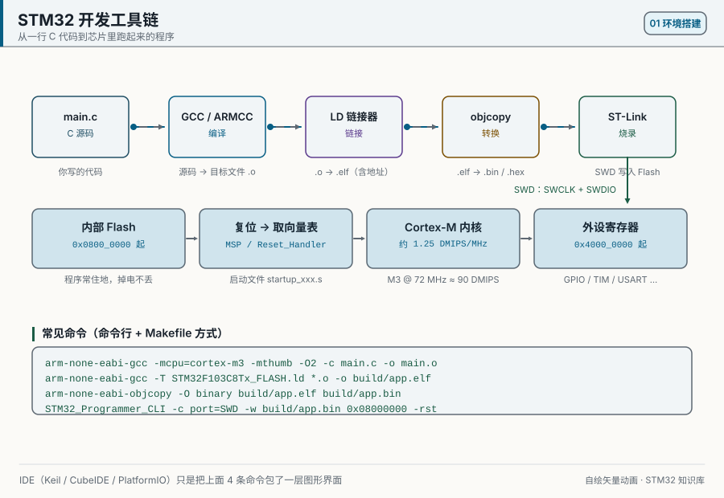
  <br><sub>▲ 动画：编译 → 链接 → 烧录 → 运行 的完整数据流（作者自绘矢量图）</sub>
</p>

<!-- video:ch00 -->
<p align="center">
  <video width="640" controls poster="../assets/video/ch00-learn.png">
    <source src="../assets/video/ch00-learn.mp4" type="video/mp4">
  </video>
  <br><sub>▲ 本章讲解视频（2.4 分钟）。<a href="../assets/video/ch00-learn.mp4">MP4</a> · <a href="../assets/video/ch00-learn.srt">字幕</a></sub>
</p>

<details>
<summary>旁白文字稿</summary>

1. 欢迎来到第零章。先别急着买一堆模块。把路线钉死：入门四周打底，进阶六周啃外设，实战八周做出能给人看的东西。
2. 顺序别跳。先把环境和时钟踩实，再碰 GPIO，然后才轮到串口。跳步的人，最容易摔在时钟没开、寄存器像写进虚空。
3. 板子用 BluePill 就够起步。手册请备三本：数据手册查引脚和电气，参考手册查寄存器，编程手册查内核。缺一本，后面就会靠猜。
4. 画面是本仓库画的工具链，不是实拍。源码要过编译、链接、烧录，复位之后程序才听你的。中间任何一步含糊，灯都不会按你的意思闪。
5. 别一上来就抄整套例程。第一场胜利只要一颗灯，按你自己算过的频率闪。抄来的工程，时钟或引脚一变，就会整片熄火。
6. 寄存器、标准库、HAL 都能点灯。入门先用 HAL 把下载和调试跑通，再回头看它改了哪几个寄存器。别同时学三套语法。
7. 常见的劝退是一次打开十个外设，或者仿真和真板打架就怀疑人生。这一章允许你慢，不允许你跳。跳过去的坑，会在项目里排队等你。
8. 口诀送你一句：先让一颗灯按你算过的频率闪。频率对了，说明时钟、引脚和延时你都真的算过，不是看视频看会的。
9. 四周结束时，你应该能独立新建工程、下载、单步，并讲清启动后先干什么。讲不清这些，先别翻串口那一章，回去把灯做稳。
10. 离开这章前，给第一颗灯留个证据：一张亮灯的照片、你自己算出的频率，还有当时卡住的第几步。下次怀疑环境坏了，翻回这条日志就有对照。

</details>
<!-- /video:ch00 -->
## 烧录成功，为什么复位后不运行

第一块板按 STM32F103C8T6 来学。下面的启动规则来自 [RM0008 Rev 21 第 3.4 节表 9](#source-rm0008-boot)。G0 和 H7 的启动方式不一样，那两个系列要查各自的手册。

BOOT 脚在复位之后 SYSCLK 的第 4 个上升沿被锁存，退出 Standby 时会再采样一次。等程序跑到 `main`，这次复位走哪条路早已定下，这时再改 BOOT 脚只影响下一次复位。CPU 接着从 `0x00000000` 取栈顶，从 `0x00000004` 取复位向量。

BOOT0=0 时，不管 BOOT1 是什么，主闪存被别名到 `0x00000000`，闪存本体仍在 `0x08000000`。平时烧录、运行程序，用的就是这种接法。

BOOT1=0 且 BOOT0=1 时，系统存储器被别名到 `0x00000000`。STM32F103C8T6 不是互联型，系统存储器在 `0x1FFFF000`。网上常见的 `0x1FFFB000` 是互联型（F105/F107）的地址，C8 上不用。BOOT1=1 且 BOOT0=1 时由内置 SRAM 启动，SRAM 本体在 `0x20000000`，里面是上电后的随机内容，不是 `0x08000000` 里那份程序。`0x08080000` 是 XL 密度芯片 Bank2 的起点，64 KB 的 C8 没有这块闪存。

## BOOT0 改的是取指入口


<p align="center">
  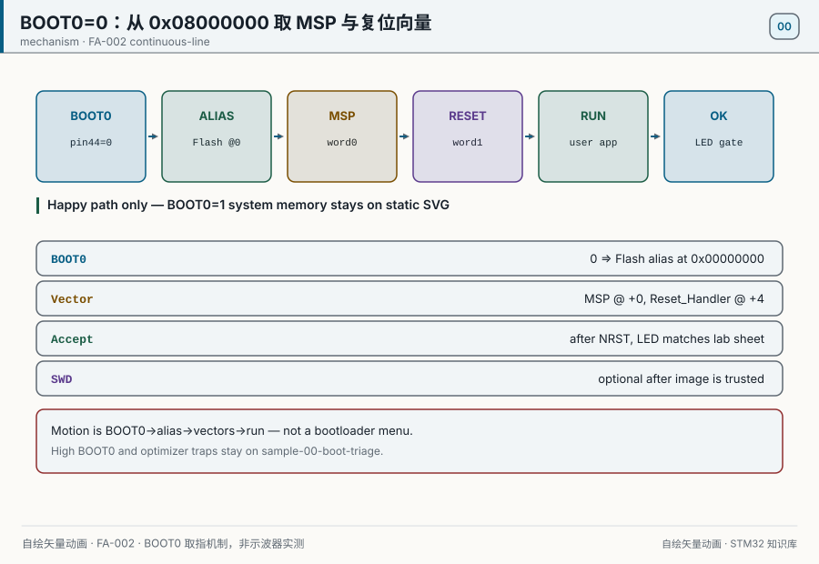
  <br><sub>▲ 自绘矢量动画（FA-002）。BOOT0→别名→向量→运行。</sub>
</p>


<p align="center">
  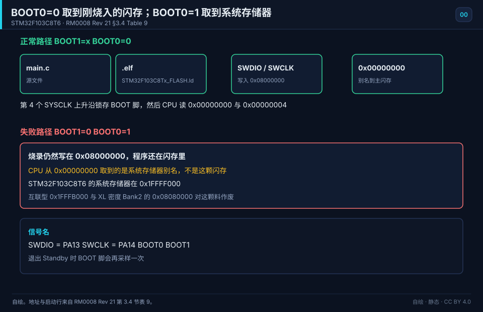
  <br><sub>▲ 自绘。STM32F103C8T6。上半部分是正常情况：经 SWDIO（PA13）和 SWCLK（PA14）把程序写入 0x08000000，BOOT0=0 时 0x00000000 别名到这块闪存。下半部分是 BOOT1=0 且 BOOT0=1 的情况：CPU 仍读 0x00000000，但取到的是 0x1FFFF000 的系统存储器，闪存里的程序还在，只是没有被取指。第 4 个 SYSCLK 上升沿锁存 BOOT 脚。出处是 [RM0008 Rev 21 第 3.4 节表 9](#source-rm0008-boot)。</sub>
</p>

<p align="center">
  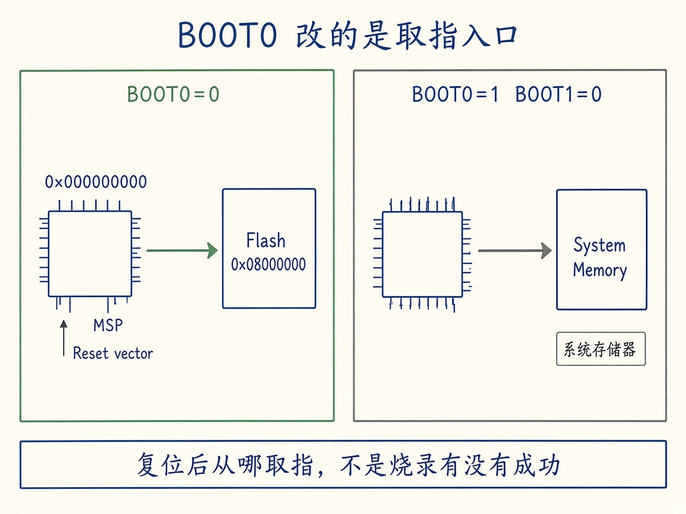
  <br><sub>▲ 知识轨（Handraw · 原理示意/非实拍）。对照 BOOT0 如何改写 0x00000000 别名目标；不是烧录日志，也不是板级实拍。</sub>
</p>


## 三个启动状态

| 状态 | BOOT1 | BOOT0 | CPU 从 0x00000000 取到什么 | 在 STM32F103C8T6 上 |
| --- | --- | --- | --- | --- |
| 正常：刚烧入的程序会跑 | x | 0 | 主闪存的别名；本体仍在 0x08000000 | 成立。下一字地址是 0x00000004 |
| 失败：烧了仍停在系统存储器 | 0 | 1 | 系统存储器的别名 | 本体在 0x1FFFF000。0x1FFFB000 是互联型的地址 |
| 失败：从 SRAM 启动 | 1 | 1 | 不是闪存里的程序 | SRAM 在 0x20000000。C8 没有 0x08080000 这块闪存 |

锁存点是复位后第 4 个 SYSCLK 上升沿。出处是 [RM0008 Rev 21 表 9](#source-rm0008-boot)。

## 地址抄对，型号也要对

| 现象 | 原因 | 处理 | 出处 | 出处里能查到什么 |
| --- | --- | --- | --- | --- |
| 程序已经写进 0x08000000，复位后跑的却不是它 | BOOT1=0 且 BOOT0=1，启动区别名到系统存储器 | 把 BOOT0 拉到 0，再复位 | [RM0008 表 9](#source-rm0008-boot) | 闪存本体仍在 0x08000000；C8 的系统存储器在 0x1FFFF000 |
| 在 main 里才改 BOOT 脚，这一次复位已经走错 | 脚电平在第 4 个 SYSCLK 上升沿已经锁存 | 在复位之前摆好 BOOT0 与 BOOT1 | [RM0008 第 3.4 节](#source-rm0008-boot) | 锁存点是 SYSCLK 的第 4 个上升沿；退出 Standby 会再采样 |
| 把互联型或 XL 密度的启动地址抄进 C8 工程 | 0x1FFFB000 与 0x08080000 属于别的密度 | 系统存储器用 0x1FFFF000，闪存用 0x08000000 | [RM0008 第 3.4 节](#source-rm0008-boot) | 0x1FFFB000 只用于互联型，0x08080000 只用于 XL 密度；STM32F103C8T6 两者都不是 |

<p align="center">
  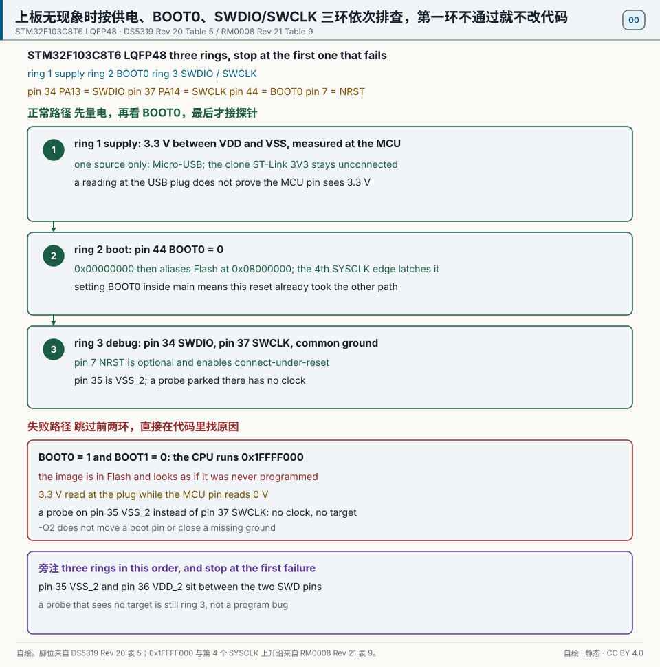
  <br><sub>▲ 自绘。三环排查，顺序从上到下。第一环量 MCU 端 VDD 与 VSS 之间的 3.3 V，只保留 Micro-USB 一个主供电；第二环确认第 44 脚 BOOT0 = 0，此时 0x00000000 别名到 0x08000000；第三环才把探针接到第 34 脚 SWDIO 与第 37 脚 SWCLK，共地，第 7 脚 NRST 可选。图中证明的是排查顺序：任何一环没过，后面的代码改动都无从验证；它不证明探针固件是否最新，也不判断克隆板 3V3 脚是输出还是检测脚，更不替代目标板原理图。出处是 [DS5319 Rev 20 表 5](#source-ds5319) 和 [RM0008 Rev 21 表 9](#source-rm0008-boot)。</sub>
</p>

<p align="center">
  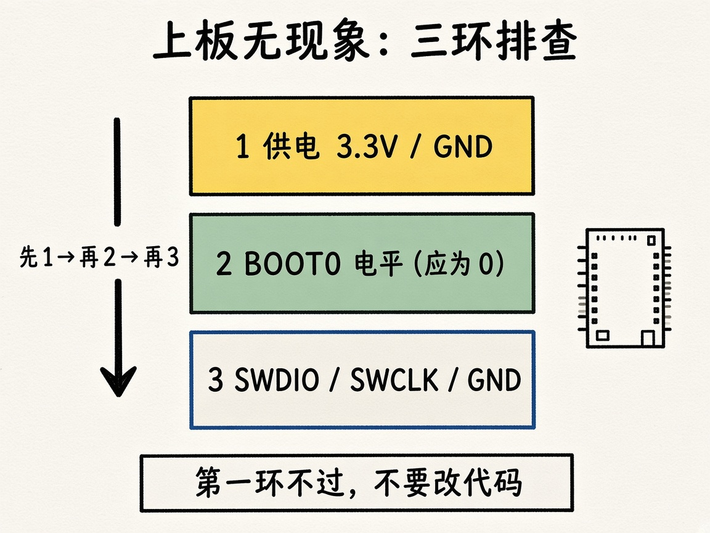
  <br><sub>▲ 知识轨（Handraw · 原理示意/非实拍）。三环顺序：供电、BOOT0、再 SWD；第一环不过不要改代码。不是万用表读数实拍。</sub>
</p>


## 学习目标
- [ ] 留下第一次闭环的四份证据：构建产物、烧录校验、`main` 断点和 PC13 的 1 Hz 波形
- [ ] 弄清学 STM32 前，C 语言 / 数字电路 / 模拟电路各自的最低要求
- [ ] 按预算配齐一套能立刻动手的硬件（含价格区间）
- [ ] 读懂「入门 4 周 / 进阶 6 周 / 实战 8 周」路线图，并用自测题检验
- [ ] 在寄存器 / 标准库 SPL / HAL+LL+CubeMX 三种开发方式间做出选择
- [ ] 识别会拖慢入门的做法：同时换板卡、工具链、库和多个外设

## 先到什么程度，再往下走

开始 STM32 之前不必学完整个电子工程。能读引脚表、算 LED 限流电阻，并用指针操作一个 `uint32_t`，就可以一边做实验一边补知识。

### 1. 前置知识「够用」标准

| 知识块 | 最低要求（必须会） | 够用即可（了解） | 需要补课的信号 |
| --- | --- | --- | --- |
| C 语言 | 指针、数组、结构体、`typedef`、`enum`、位运算 `& \| ^ ~ << >>`、函数指针 | 宏与条件编译、`volatile`/`static`/`const` 语义 | 看到 `*(volatile uint32_t*)0x40021018` 完全懵 |
| 数字电路 | 高低电平、与或非、上升/下降沿、推挽/开漏概念 | 时序图、建立/保持时间、总线仲裁 | 看不懂「上升沿触发」是什么意思 |
| 模拟电路 | 欧姆定律、分压、LED 限流电阻、上拉电阻作用 | 三极管/MOS 开关、运放基础、RC 滤波 | 不会算 LED 限流电阻 R=(Vcc−Vf)/I |
| 计算机组成 | 二进制/十六进制、字节与地址、寄存器是什么 | 中断、DMA、总线、Cache | 不理解「寄存器」和「内存」的关系 |
| 英语 | 能读数据手册里的引脚表、参数表 | 能读参考手册整章 | 连 Pin Name 都查不下去 |

达不到其中一项，就补对应的那一项，不必先读完一本 C 语言或电路教材。

### 2. 三种开发方式对比


<p align="center">
  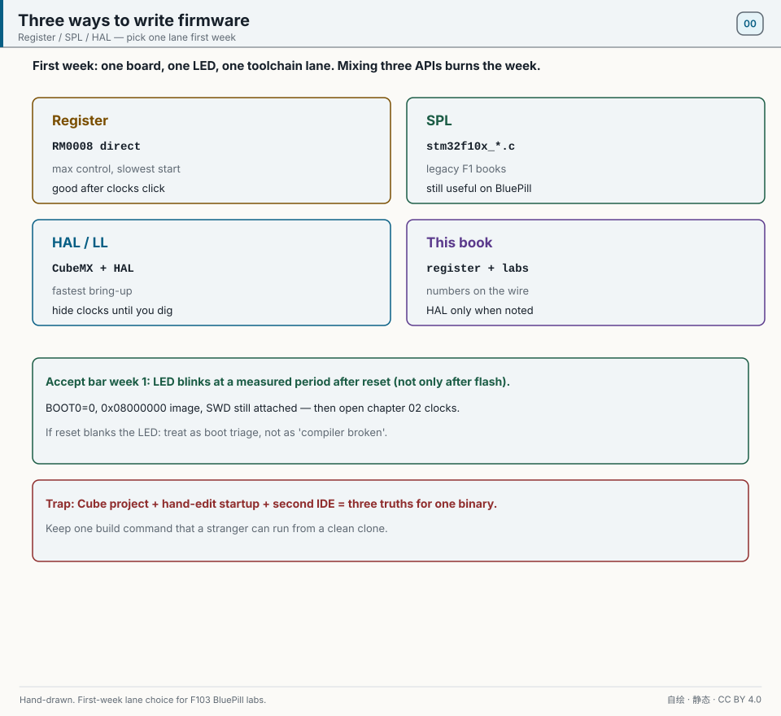
  <br><sub>▲ 自绘。第一周只选一条车道；混用三个 API 会烧掉整周。</sub>
</p>

<p align="center">
  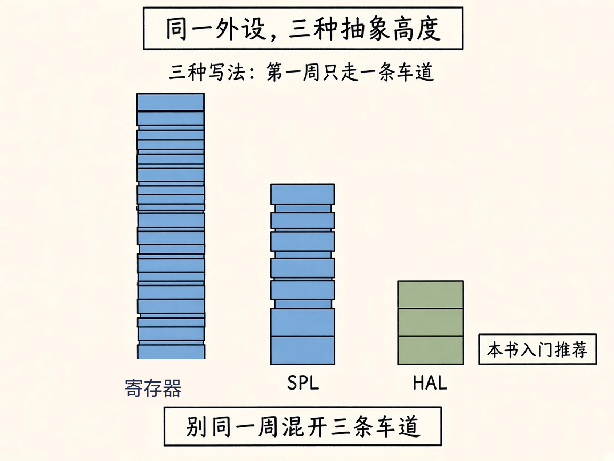
  <br><sub>▲ 知识轨（Handraw · 原理示意/非实拍）。同一外设三种抽象高度；本书入门推荐 HAL。不是 IDE 截图。</sub>
</p>


| 维度 | 寄存器（裸寄存器） | 标准库 SPL | HAL + LL + CubeMX |
| --- | --- | --- | --- |
| 抽象层级 | 最低，直接写 `GPIOA->ODR` | 中，`GPIO_SetBits()` | 最高，`HAL_GPIO_WritePin()` |
| 上手难度 | 高（要背手册） | 中 | 低（图形化生成） |
| 代码量 | 少但晦涩 | 中 | 多但清晰 |
| 可移植性 | 差（F1→F4 要改） | 差（官方已停更） | 好（HAL 跨系列统一 API） |
| 资源占用 | 最小 | 小 | 略大（可裁剪，LL 更小） |
| 官方维护 | 不依赖 SPL/HAL 版本；寄存器定义以目标芯片手册为准 | **已停止维护** | 持续更新 |
| 适用场景 | 学原理、抠时序、超小资源 | 锁定版本的老工程 | 新项目、原型验证、官方新例程 |

**建议路线：HAL+CubeMX 入门 → 寄存器对照理解底层 → 关键处用 LL 优化。**

如果你接手的是 F103 标准库旧工程，不要把函数名零散混进 HAL 工程；先读[第 26 章 · STM32F10x 标准外设库（SPL）](26-STM32F10x标准外设库SPL.md)，锁定 V3.5.0、密度宏、启动文件和外设所有权，再决定维护或迁移。

### 3. 三阶段学习路线图


<p align="center">
  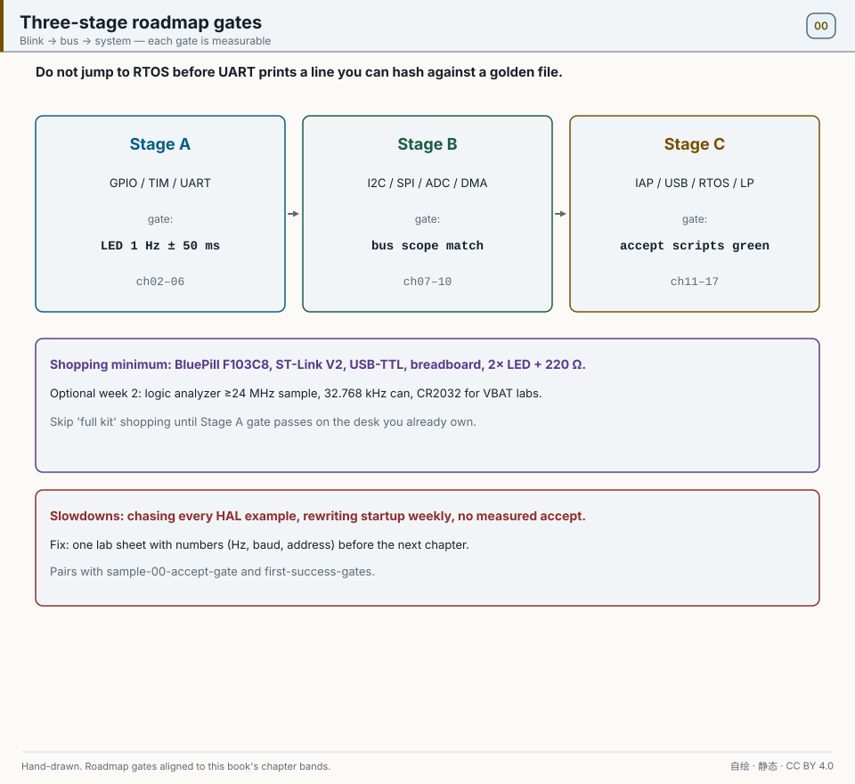
  <br><sub>▲ 自绘。每阶段有可测门槛；别跳过 UART 验收去追 RTOS。</sub>
</p>

<p align="center">
  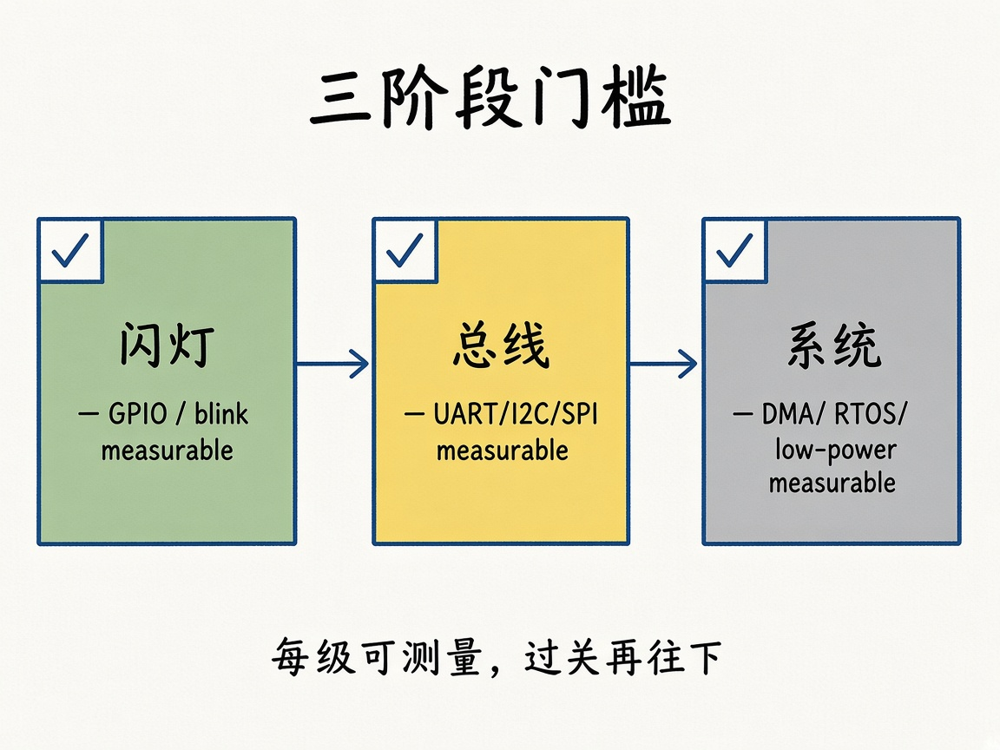
  <br><sub>▲ 知识轨（Handraw · 原理示意/非实拍）。每级可测量，过关再往下；不是进度条实拍。</sub>
</p>


#### 阶段一：入门（4 周）——把板子跑起来

| 周 | 主题 | 产出物 | 自测题 |
| --- | --- | --- | --- |
| 第 1 周 | 环境搭建、GPIO 输出、点灯 | 会编译/烧录，LED 闪烁 | 推挽与开漏区别？ |
| 第 2 周 | GPIO 输入、按键、消抖 | 按键控制 LED | 为什么按键要消抖？软件消抖怎么写？ |
| 第 3 周 | 中断与 NVIC、EXTI | 按键中断翻转 LED | 抢占优先级和子优先级区别？ |
| 第 4 周 | 定时器时基、PWM | 呼吸灯 | `fCK_CNT = fCK_PSC/(PSC+1)` 怎么来的？ |

<p align="center">
  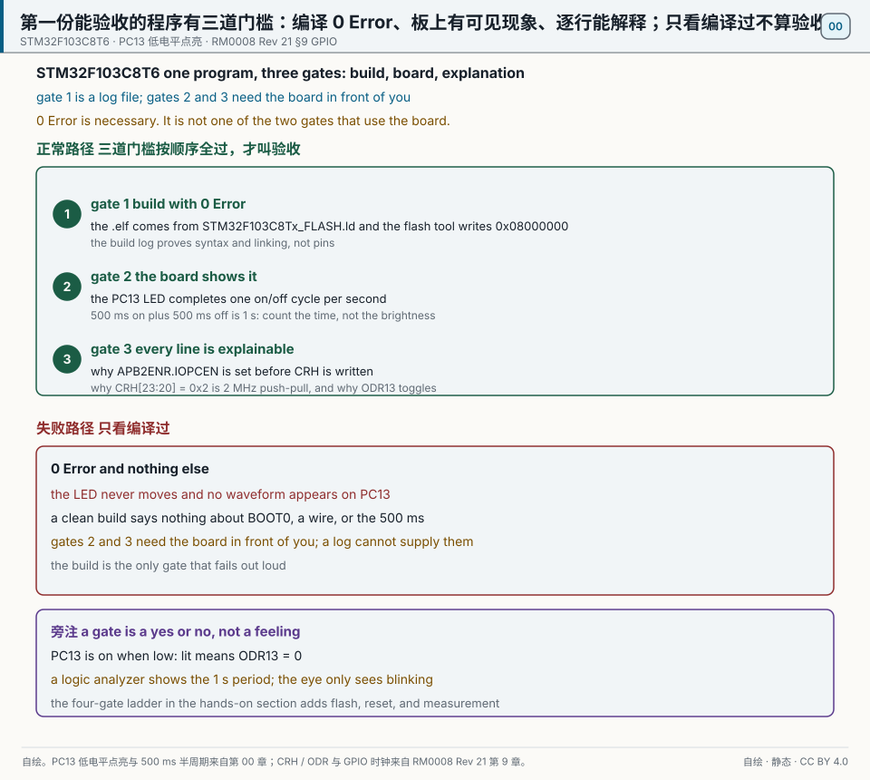
  <br><sub>▲ 自绘。三道门槛按顺序通过才叫验收。第一道看构建：0 Error，产物来自 STM32F103C8Tx_FLASH.ld，烧录工具写到 0x08000000。第二道看板子：PC13 上的 LED 每秒完成一次亮灭，500 ms 亮加 500 ms 灭正好是 1 s。第三道看解释：说清为什么先置 APB2ENR.IOPCEN 再写 CRH，为什么 CRH[23:20] = 0x2 是 2 MHz 推挽，为什么翻转 ODR13 能让 PC13 改变电平。图中证明的是编译通过只覆盖第一道；它不证明 BOOT0 接对、杜邦线接对、也不证明 500 ms 这个时长算对，动手实验里的四关阶梯再补烧录、复位与测量。出处是 [RM0008 Rev 21 第 9 章](#source-rm0008) 和 [DS5319 Rev 20 表 5](#source-ds5319)。</sub>
</p>

<p align="center">
  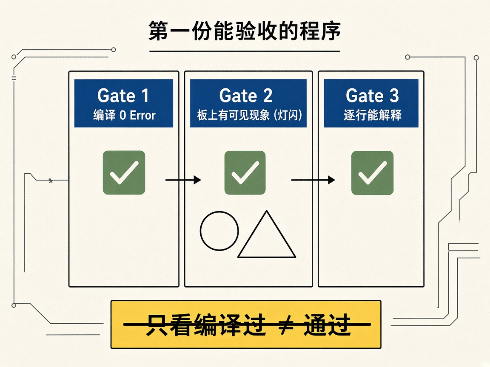
  <br><sub>▲ 知识轨（Handraw · 原理示意/非实拍）。三道验收门槛；只看编译过不等于通过。不是构建日志截图。</sub>
</p>


#### 阶段二：进阶（6 周）——打通常用通信与外设

| 周 | 主题 | 产出物 | 自测题 |
| --- | --- | --- | --- |
| 第 5 周 | UART 收发、printf 重定向 | 串口打印日志 | 波特率误差容限是多少？ |
| 第 6 周 | UART 中断 + DMA + IDLE | 不定长收包 | IDLE 中断解决什么问题？ |
| 第 7 周 | I2C 协议、OLED | 点亮 OLED 显示字符 | 地址 0x3C 与 0x78 什么关系？ |
| 第 8 周 | SPI 协议、W25Q64 | 读写 Flash | CPOL/CPHA 四种模式怎么分？ |
| 第 9 周 | ADC + DMA | 采集电压并显示 | SAR ADC 逐次逼近过程？ |
| 第 10 周 | 看门狗、低功耗 | 定时唤醒低功耗节点 | IWDG 与 WWDG 区别？ |

#### 阶段三：实战（8 周）——做一个完整项目

| 周 | 主题 | 产出物 | 自测题 |
| --- | --- | --- | --- |
| 第 11~12 周 | 需求拆解、模块划分、状态机 | 项目框图 + 任务清单 | 如何把需求拆成模块？ |
| 第 13~14 周 | 传感器驱动 + 显示 + 存储 | 完整数据采集链路 | 遇到总线死锁怎么恢复？ |
| 第 15~16 周 | 引入 FreeRTOS（任务/队列/信号量） | 多任务协同 | 什么场景才值得上 RTOS？ |
| 第 17~18 周 | 联调、异常处理、IAP 升级 | 可交付固件 + 说明 | Bootloader 如何跳转 APP？ |

<p align="center">
  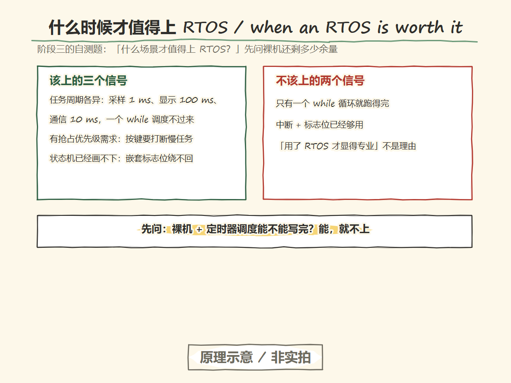
  <br><sub>▲ 知识轨（Handraw · 原理示意/非实拍）。看哪里：左栏「该上的三个信号」（任务周期各异、有抢占优先级需求、状态机画不下）与右栏「不该上的两个信号」，底条「先问裸机+定时器调度能不能写完」；对应阶段三自测题「什么场景才值得上 RTOS」；证明 RTOS 是调度需求倒逼出来的，不是专业装饰；不能替代实际项目评估，也不是性能实测。出处 本章学习路线图。</sub>
</p>

### 4. 硬件采购清单

| 物品 | 推荐型号 | 价格区间（¥） | 是否必需 | 备注 |
| --- | --- | --- | --- | --- |
| 最小系统板 | BluePill STM32F103C8T6 | 15~30 | 必需 | 本书第 00～19 章的 F1 实验以它为主 |
| 进阶板 | STM32F411 BlackPill / Nucleo-F411RE | 30~80 | 可选 | 学 F4/F7、DSP、FPU 时买 |
| 调试器 | ST-Link V2（克隆） | 15~40 | 必需 | 支持 SWD 下载 + 调试 |
| 面包板 | 830 孔免焊面包板 | 8~20 | 必需 | 搭电路必备 |
| 杜邦线 | 公对公/公对母 各 40 根 | 8~15 | 必需 | 用不同颜色区分电源、地和信号 |
| USB-TTL | CH340 / CP2102 模块 | 8~20 | 必需 | 串口调试，注意 3.3V 电平 |
| 传感器套装 | 37 合 1 传感器模块 | 40~80 | 可选 | 用到再买，第一次点灯不需要 |
| OLED 屏 | 0.96" SSD1306 I2C | 12~25 | 推荐 | 第 07 章 I2C 实验使用 |
| 逻辑分析仪 | 8 通道 24MHz（克隆） | 15~40 | 推荐 | 查看 I2C/SPI/UART 与 GPIO 时序 |
| 万用表 | 入门数字表 | 30~80 | 推荐 | 量电压、测通断 |

> 表内价格是估算区间，不含运费，购买时以当日价格为准。按表内低价准备，**极简起步约 60 元**（BluePill + ST-Link + 面包板 + 杜邦线）；加上串口、显示、测量工具和实验模块，约 200～300 元。

### 5. 会拖慢入门的做法

| 不要做 | 为什么 | 正确做法 |
| --- | --- | --- |
| 一上来啃 1000 页参考手册 | 没有上下文，记不住也用不上 | 先跑通例程，用到哪查哪 |
| 同时学 RTOS + 裸机 + 上位机 | 精力分散，哪个都不精 | 先把裸机外设打牢，再上 RTOS |
| 只抄代码不看寄存器 | 出问题不会查 | 第一次使用某个外设时，对照它的关键寄存器 |
| 直接上手 F4/H7 学基础 | 外设复杂，掩盖原理 | 用 F1 打基础，再迁移 |
| 追求「全用寄存器」炫技 | 开发效率低、易出错 | HAL 为主，关键处用 LL/寄存器 |
| 只看软件状态，不量通信线 | 无法区分配置错误和线上时序错误 | 数字总线先用逻辑分析仪；电压质量和边沿再用示波器 |
| 第一次实验就买高配板 | 多出的外设不参与点灯，却增加供电和启动变量 | 先在本书配套的 BluePill 上跑通闭环 |

<p align="center">
  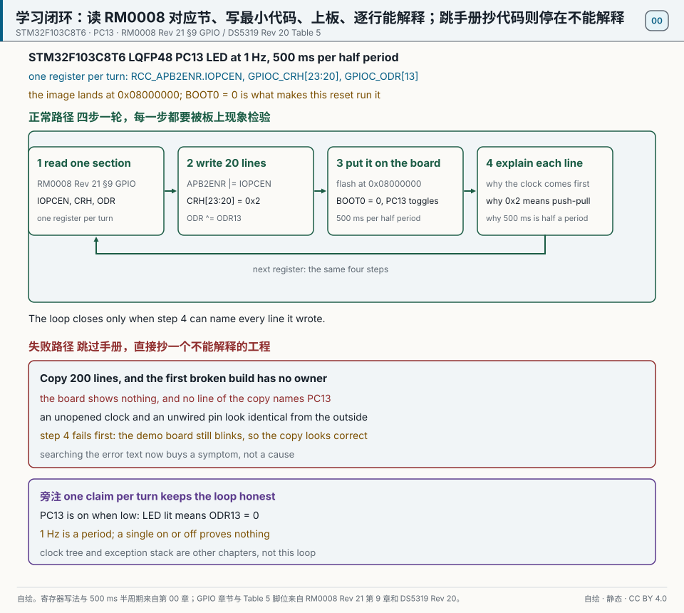
  <br><sub>▲ 自绘。闭环四步一轮：读 RM0008 第 9 章里你需要的那一个寄存器 → 写最小代码（APB2ENR 置 IOPCEN、CRH[23:20] 写 0x2、ODR 翻转 ODR13）→ 烧到 0x08000000 并在 BOOT0 = 0 下上板看 PC13 → 逐行解释为什么这个顺序、为什么 0x2 是推挽、为什么 500 ms 是半周期，然后换下一个寄存器。图的下半部分是失败路径：跳过手册直接抄一个工程，板上没现象时既指不出哪一行对应哪只脚，也分不清时钟没开和线没接。它证明的是四步缺一不可；它不证明某个具体工程的写法，也不含时钟树与异常栈。出处是 [RM0008 Rev 21 第 9 章](#source-rm0008) 与 [DS5319 Rev 20 表 5](#source-ds5319)。</sub>
</p>

<p align="center">
  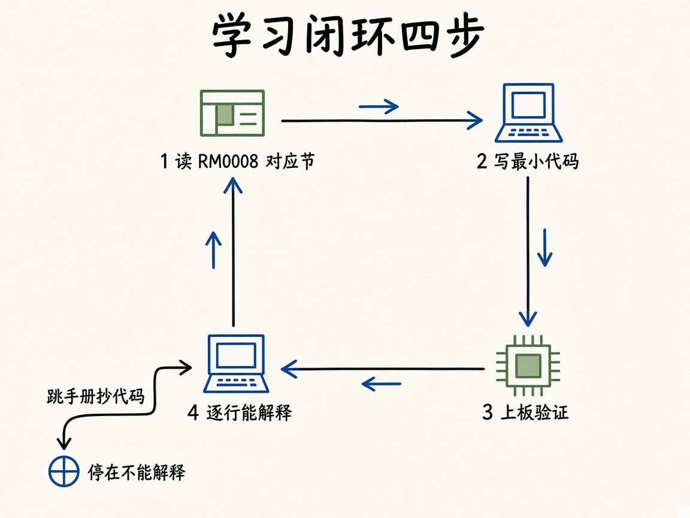
  <br><sub>▲ 知识轨（Handraw · 原理示意/非实拍）。四步闭环；跳手册抄代码会停在不能解释。不是课堂照片。</sub>
</p>


## 硬件与接线

第一次点灯只接 BluePill 和 ST-Link。下图选择 Micro-USB 作为唯一主供电；此时 ST-Link 克隆板上的 3.3V 不接。不同克隆板的 3.3V 引脚可能是输出而不是电压检测脚，不要和 USB 电源并在一起。

<p align="center">
  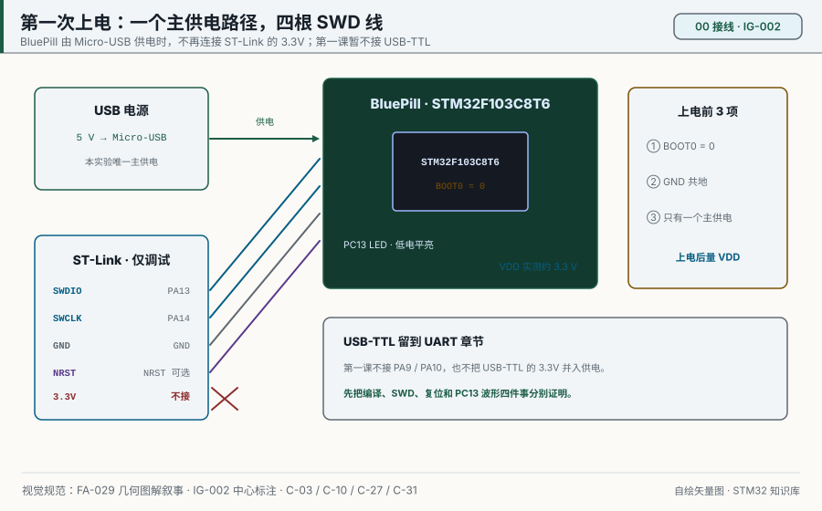
  <br><sub>▲ 首次接线：只保留一个主供电路径，先检查 BOOT0=0 和共地，再量 MCU 端 3.3V。USB-TTL 留到 UART 章节。本图是接线边界示意，不是开发板实拍，也不替代目标克隆板的原理图（FA-029 · IG-002 · C-03/C-10/C-27/C-31）。</sub>
</p>

| BluePill | ST-Link | 本次是否连接 | 作用 |
| --- | --- | --- | --- |
| GND | GND | 是 | 建立共同电位基准 |
| SWDIO (PA13) | SWDIO | 是 | 调试数据 |
| SWCLK (PA14) | SWCLK | 是 | 调试时钟 |
| NRST | RST | 可选 | 连接后可使用 connect-under-reset |
| 3V3 | 3.3V | **否** | 板子已由 Micro-USB 供电，避免并联两个电源 |

> [!WARNING]
> 5V 不能接到 3V3。上电前确认只有一个主供电路径；上电后先量板上 3.3V，再连接调试器会话。

结构对照见 [`assets/boards/bluepill-stm32f103c8t6.svg`](../assets/boards/bluepill-stm32f103c8t6.svg)。这是自绘结构图，不是实拍；仓库目前没有许可与型号都核验完成的 BluePill 照片。

## 第一份能验收的程序

让板载 LED（PC13，低电平点亮）每 1 s 完成一次亮灭周期。代码运行只是第一步，还要量到 1 Hz 波形。

```c
/* main.c —— BluePill 板载 LED(PC13) 1Hz 闪烁
 * 依赖：STM32F1 HAL 库，系统时钟 72MHz
 */
#include "stm32f1xx_hal.h"

#define LED_PIN   GPIO_PIN_13
#define LED_PORT  GPIOC

static void SystemClock_Config(void);   /* 由 CubeMX 生成或手写 */

int main(void)
{
    HAL_Init();                 /* 初始化 HAL、SysTick、中断优先级分组 */
    SystemClock_Config();       /* 配置 HSE 8MHz -> PLL x9 -> 72MHz */

    __HAL_RCC_GPIOC_CLK_ENABLE();   /* 关键：先开 GPIO 时钟，否则寄存器写不进 */

    GPIO_InitTypeDef gpio = {0};
    gpio.Pin   = LED_PIN;
    gpio.Mode  = GPIO_MODE_OUTPUT_PP;   /* 推挽输出 */
    gpio.Pull  = GPIO_NOPULL;
    gpio.Speed = GPIO_SPEED_FREQ_LOW;
    HAL_GPIO_Init(LED_PORT, &gpio);

    while (1)
    {
        HAL_GPIO_TogglePin(LED_PORT, LED_PIN);  /* 翻转电平 */
        HAL_Delay(500);                         /* 500ms，半周期 */
    }
}

/* 时钟配置（也可用 CubeMX 生成的版本） */
static void SystemClock_Config(void)
{
    RCC_OscInitTypeDef osc = {0};
    RCC_ClkInitTypeDef clk = {0};

    osc.OscillatorType = RCC_OSCILLATORTYPE_HSE;
    osc.HSEState       = RCC_HSE_ON;
    osc.HSEPredivValue = RCC_HSE_PREDIV_DIV1;
    osc.PLL.PLLState   = RCC_PLL_ON;
    osc.PLL.PLLSource  = RCC_PLLSOURCE_HSE;
    osc.PLL.PLLMUL     = RCC_PLL_MUL9;        /* 8MHz x 9 = 72MHz */
    HAL_RCC_OscConfig(&osc);

    clk.ClockType      = RCC_CLOCKTYPE_HCLK | RCC_CLOCKTYPE_SYSCLK |
                         RCC_CLOCKTYPE_PCLK1 | RCC_CLOCKTYPE_PCLK2;
    clk.SYSCLKSource   = RCC_SYSCLKSOURCE_PLLCLK;
    clk.AHBCLKDivider  = RCC_SYSCLK_DIV1;   /* AHB = 72MHz */
    clk.APB1CLKDivider = RCC_HCLK_DIV2;     /* APB1 = 36MHz（上限 36MHz） */
    clk.APB2CLKDivider = RCC_HCLK_DIV1;     /* APB2 = 72MHz（上限 72MHz） */
    HAL_RCC_ClockConfig(&clk, FLASH_LATENCY_2);  /* 72MHz 需 2 个等待周期 */
}
```

寄存器等价写法：

```c
/* 不用 HAL 时，点灯需要下面四个寄存器操作 */
RCC->APB2ENR |= RCC_APB2ENR_IOPCEN;        /* 使能 GPIOC 时钟 */
GPIOC->CRH &= ~(0xF << 20);                 /* 清 PC13 配置位 */
GPIOC->CRH |=  (0x2 << 20);                 /* PC13 通用推挽输出 2MHz */
GPIOC->ODR ^= GPIO_ODR_ODR13;               /* 翻转 PC13 */
```

完整工程见 [`examples/gpio-blink/`](../examples/gpio-blink/)。

## 动手实验

1. **实验一（环境验证）**：按上面代码驱动 PC13 并以 1 Hz 闪烁。预期现象：板载 LED 每秒完成一次亮灭周期。
2. **实验二（改动参数）**：把 `HAL_Delay(500)` 改成 100，观察闪烁变快；用逻辑分析仪量 PC13 波形，确认频率 ≈ 5Hz。
3. **实验三（寄存器对照）**：用寄存器写法实现同样的闪烁，对比 HAL 版本，记录 `CRH`、`ODR` 的位含义。

<p align="center">
  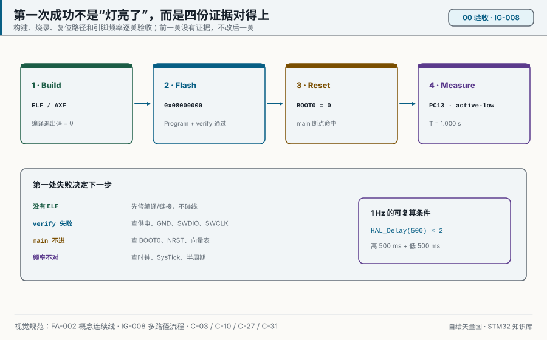
  <br><sub>▲ 验收阶梯：先确认 ELF/AXF，再确认 0x08000000 烧录校验、BOOT0=0 后进入 main，最后量 PC13 的 1 s 周期。灯亮只能证明某一时刻有电平，不能单独证明构建产物、复位路径和频率都正确（FA-002 · IG-008 · C-03/C-10/C-27/C-31）。</sub>
</p>

### 6. 排错不要从搜索报错开始

| 顺序 | 动作 | 说明 |
| --- | --- | --- |
| 1 | 看现象、量波形 | 先用逻辑分析仪/万用表确认硬件现象 |
| 2 | 查数据手册引脚/参数 | DS 里引脚定义、电气参数 |
| 3 | 查参考手册外设章节 | RM 里寄存器与时序 |
| 4 | 搜官方例程 | CubeF1 包里的 Examples/ |
| 5 | 搜索报错信息 | 关键词 + 芯片型号 |
| 6 | 提问 | 附上最小复现代码 + 现象 + 已尝试 |

> 提问时写清**做了什么、期望什么、实际什么**，并附上最小可复现工程。

### 7. 学习资源清单

| 类型 | 名称 | 用途 |
| --- | --- | --- |
| 数据手册 | DS5319（F103C8） | 引脚、封装、电气参数 |
| 参考手册 | RM0008 | 寄存器、外设、时钟 |
| 编程手册 | PM0056（Cortex-M3） | 内核、NVIC、指令 |
| 官方例程 | STM32CubeF1 | 各外设标准示例 |
| 工具 | STM32CubeMX / CubeProgrammer | 生成工程 / 烧录 |
| 调试 | ST-Link + 逻辑分析仪 | 下载调试 / 抓时序 |
| 社区 | ST 社区、电子论坛 | 查疑难杂症 |

### 8. 常见疑问 FAQ

| 问题 | 简答 |
| --- | --- |
| 用 HAL 会不会「学不到底层」？ | 不会，HAL 调用后对照寄存器即可 |
| 一定要买示波器吗？ | GPIO、UART、I2C、SPI 的数字时序可先用逻辑分析仪；要看电压质量和边沿，仍需示波器 |
| 学 F1 还是 F4？ | 本书先用 F103 建立基础；项目需要 FPU、更高主频或更多 SRAM 时再选 F4 |
| 英文手册看不懂怎么办？ | 先看图表和寄存器表，配中文教程 |
| 需要会画 PCB 吗？ | 入门用现成开发板，不需要 |

## 相关资源

- 官方手册：STM32F103C8 数据手册 **DS5319**；参考手册 **RM0008**（GPIO 第 9 章、RCC 第 8 章）
- 下一篇：[01 开发环境搭建](01-开发环境搭建.md)
- 板卡结构图：[`assets/boards/bluepill-stm32f103c8t6.svg`](../assets/boards/bluepill-stm32f103c8t6.svg)
- 图像来源与许可：[`assets/README.md`](../assets/README.md)
- 手机阅读版：[第 00 章 · 如何学习STM32（公众号图文）](https://mp.weixin.qq.com/s/r5eYFl1x8mHN3XdxQXBcrg)

