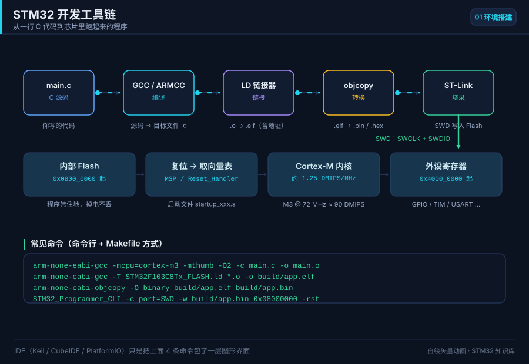

# 00 如何学习 STM32

> 面向零基础：先补齐最低门槛知识、配齐硬件、选对开发方式，再按三阶段路线图稳步推进。

  
   ▲ 动画：编译 → 链接 → 烧录 → 运行 的完整数据流（作者自绘矢量图）

## 📌 学习目标
- [ ] 弄清学 STM32 前，C 语言 / 数字电路 / 模拟电路各自的最低要求
- [ ] 按预算配齐一套能立刻动手的硬件（含价格区间）
- [ ] 读懂「入门 4 周 / 进阶 6 周 / 实战 8 周」路线图，并用自测题检验
- [ ] 在寄存器 / 标准库 SPL / HAL+LL+CubeMX 三种开发方式间做出选择
- [ ] 记住「不要做什么」清单，避免一上来就劝退自己的常见弯路

## 🧠 核心原理

**结论先行：STM32 入门不需要学完整个电子工程，只需要「够用」的前置知识 + 正确的路线。**

### 1. 前置知识「够用」标准

| 知识块 | 最低要求（必须会） | 够用即可（了解） | 需要补课的信号 |
| --- | --- | --- | --- |
| C 语言 | 指针、数组、结构体、`typedef`、`enum`、位运算 `& \| ^ ~ << >>`、函数指针 | 宏与条件编译、`volatile`/`static`/`const` 语义 | 看到 `*(volatile uint32_t*)0x40021018` 完全懵 |
| 数字电路 | 高低电平、与或非、上升/下降沿、推挽/开漏概念 | 时序图、建立/保持时间、总线仲裁 | 看不懂「上升沿触发」是什么意思 |
| 模拟电路 | 欧姆定律、分压、LED 限流电阻、上拉电阻作用 | 三极管/MOS 开关、运放基础、RC 滤波 | 不会算 LED 限流电阻 R=(Vcc−Vf)/I |
| 计算机组成 | 二进制/十六进制、字节与地址、寄存器是什么 | 中断、DMA、总线、Cache | 不理解「寄存器」和「内存」的关系 |
| 英语 | 能读数据手册里的引脚表、参数表 | 能读参考手册整章 | 连 Pin Name 都查不下去 |

> 一句话标准：**能用指针操作一个 `uint32_t` 变量，能算 LED 限流电阻，能读懂引脚表**，就可以开始了。

### 2. 三种开发方式对比

| 维度 | 寄存器（裸寄存器） | 标准库 SPL | HAL + LL + CubeMX |
| --- | --- | --- | --- |
| 抽象层级 | 最低，直接写 `GPIOA->ODR` | 中，`GPIO_SetBits()` | 最高，`HAL_GPIO_WritePin()` |
| 上手难度 | 高（要背手册） | 中 | 低（图形化生成） |
| 代码量 | 少但晦涩 | 中 | 多但清晰 |
| 可移植性 | 差（F1→F4 要改） | 差（官方已停更） | 好（HAL 跨系列统一 API） |
| 资源占用 | 最小 | 小 | 略大（可裁剪，LL 更小） |
| 官方维护 | 永恒可用 | **已停止维护** | 持续更新 |
| 适用场景 | 学原理、抠时序、超小资源 | 老工程维护 | 新产品、快速原型、求职主流 |

**建议路线：HAL+CubeMX 入门 → 寄存器对照理解底层 → 关键处用 LL 优化。**

### 3. 三阶段学习路线图

#### 阶段一：入门（4 周）——把板子跑起来

| 周 | 主题 | 产出物 | 自测题 |
| --- | --- | --- | --- |
| 第 1 周 | 环境搭建、GPIO 输出、点灯 | 会编译/烧录，LED 闪烁 | 推挽与开漏区别？ |
| 第 2 周 | GPIO 输入、按键、消抖 | 按键控制 LED | 为什么按键要消抖？软件消抖怎么写？ |
| 第 3 周 | 中断与 NVIC、EXTI | 按键中断翻转 LED | 抢占优先级和子优先级区别？ |
| 第 4 周 | 定时器时基、PWM | 呼吸灯 | `fCK_CNT = fCK_PSC/(PSC+1)` 怎么来的？ |

#### 阶段二：进阶（6 周）——打通常用通信与外设

| 周 | 主题 | 产出物 | 自测题 |
| --- | --- | --- | --- |
| 第 5 周 | UART 收发、printf 重定向 | 串口打印日志 | 波特率误差容限是多少？ |
| 第 6 周 | UART 中断 + DMA + IDLE | 不定长收包 | IDLE 中断解决什么问题？ |
| 第 7 周 | I2C 协议、OLED | 点亮 OLED 显示字符 | 地址 0x3C 与 0x78 什么关系？ |
| 第 8 周 | SPI 协议、W25Q64 | 读写 Flash | CPOL/CPHA 四种模式怎么分？ |
| 第 9 周 | ADC + DMA | 采集电压并显示 | SAR ADC 逐次逼近过程？ |
| 第 10 周 | 看门狗、低功耗 | 定时唤醒低功耗节点 | IWDG 与 WWDG 区别？ |

#### 阶段三：实战（8 周）——做一个完整项目

| 周 | 主题 | 产出物 | 自测题 |
| --- | --- | --- | --- |
| 第 11~12 周 | 需求拆解、模块划分、状态机 | 项目框图 + 任务清单 | 如何把需求拆成模块？ |
| 第 13~14 周 | 传感器驱动 + 显示 + 存储 | 完整数据采集链路 | 遇到总线死锁怎么恢复？ |
| 第 15~16 周 | 引入 FreeRTOS（任务/队列/信号量） | 多任务协同 | 什么场景才值得上 RTOS？ |
| 第 17~18 周 | 联调、异常处理、IAP 升级 | 可交付固件 + 说明 | Bootloader 如何跳转 APP？ |

### 4. 硬件采购清单

| 物品 | 推荐型号 | 价格区间（¥） | 是否必需 | 备注 |
| --- | --- | --- | --- | --- |
| 最小系统板 | BluePill STM32F103C8T6 | 15~30 | ✅ | 入门首选，资料最多 |
| 进阶板 | STM32F411 BlackPill / Nucleo-F411RE | 30~80 | 可选 | 学 F4/F7、DSP、FPU 时买 |
| 调试器 | ST-Link V2（克隆） | 15~40 | ✅ | 支持 SWD 下载 + 调试 |
| 面包板 | 830 孔免焊面包板 | 8~20 | ✅ | 搭电路必备 |
| 杜邦线 | 公对公/公对母 各 40 根 | 8~15 | ✅ | 建议买彩色的 |
| USB-TTL | CH340 / CP2102 模块 | 8~20 | ✅ | 串口调试，注意 3.3V 电平 |
| 传感器套装 | 37 合 1 传感器模块 | 40~80 | ✅ | 按键/LED/OLED/DHT11 等 |
| OLED 屏 | 0.96" SSD1306 I2C | 12~25 | 推荐 | 学 I2C 的最佳练手 |
| 逻辑分析仪 | 8 通道 24MHz（克隆） | 15~40 | 推荐 | 抓 I2C/SPI/UART 时序神器 |
| 万用表 | 入门数字表 | 30~80 | 推荐 | 量电压、测通断 |

> 预算参考：**极简起步 ≈ 60 元**（BluePill + ST-Link + 面包板 + 杜邦线）；**完整套件 ≈ 200~300 元**。

### 5. 不要做什么（劝退清单）

| ❌ 不要做 | 为什么 | 正确做法 |
| --- | --- | --- |
| 一上来啃 1000 页参考手册 | 没有上下文，记不住也用不上 | 先跑通例程，用到哪查哪 |
| 同时学 RTOS + 裸机 + 上位机 | 精力分散，哪个都不精 | 先把裸机外设打牢，再上 RTOS |
| 只抄代码不看寄存器 | 出问题不会查 | 每个 HAL 调用至少查一次对应寄存器 |
| 直接上手 F4/H7 学基础 | 外设复杂，掩盖原理 | 用 F1 打基础，再迁移 |
| 追求「全用寄存器」炫技 | 开发效率低、易出错 | HAL 为主，关键处用 LL/寄存器 |
| 没有示波器/逻辑分析仪就调通信 | 看不见时序只能瞎猜 | 至少备一个逻辑分析仪 |
| 一次买最贵的开发板 | 吃灰概率高 | 先用 30 元的 BluePill 跑通再说 |

<!--MORE-->
