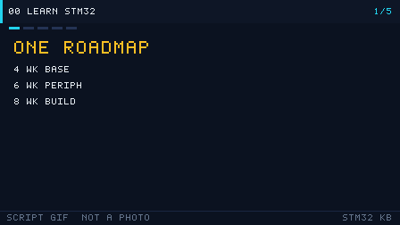

# 00 如何学习 STM32

> 面向零基础：先补齐最低门槛知识、配齐硬件、选对开发方式，再按三阶段路线图稳步推进。

<p align="center">
  
  <br><sub>▲ 动画：编译 → 链接 → 烧录 → 运行 的完整数据流（作者自绘矢量图）</sub>
</p>

<!-- video:ch00 -->
<p align="center">
  
  <br><sub>▲ 本章讲解幻灯：程序生成的 GIF（tools/gen_videos.py，可复现，不是实拍）。旁白与五帧一一对应。</sub>
</p>

**旁白（跟着画面读，大约一分钟）**

1. 先把路线钉死：入门四周打底，进阶六周啃外设，实战八周做能给别人看的东西。
2. 顺序别跳：环境、时钟、GPIO，然后才是串口和项目。跳步最容易在时钟上摔跤。
3. 板子选 BluePill 就够起步。手册三件套是数据手册、参考手册、编程手册。
4. 别一上来就抄整套例程。先让一颗灯按你算过的频率闪。
5. 合上书：BOOT0 拉低进哪？HAL 和寄存器差在哪一层？
<!-- /video:ch00 -->


## 📌 学习目标
- [ ] 弄清学 STM32 前，C 语言 / 数字电路 / 模拟电路各自的最低要求
- [ ] 按预算配齐一套能立刻动手的硬件（含价格区间）
- [ ] 读懂「入门 4 周 / 进阶 6 周 / 实战 8 周」路线图，并用自测题检验
- [ ] 在寄存器 / 标准库 SPL / HAL+LL+CubeMX 三种开发方式间做出选择
- [ ] 记住「不要做什么」清单，避免一上来就劝退自己的常见弯路

## 🧠 核心原理

**结论先行：STM32 入门不需要学完整个电子工程，只需要「够用」的前置知识 + 正确的路线。**

### 1. 前置知识「够用」标准

| 知识块 | 最低要求（必须会） | 够用即可（了解） | 需要补课的信号 |
| --- | --- | --- | --- |
| C 语言 | 指针、数组、结构体、`typedef`、`enum`、位运算 `& \| ^ ~ << >>`、函数指针 | 宏与条件编译、`volatile`/`static`/`const` 语义 | 看到 `*(volatile uint32_t*)0x40021018` 完全懵 |
| 数字电路 | 高低电平、与或非、上升/下降沿、推挽/开漏概念 | 时序图、建立/保持时间、总线仲裁 | 看不懂「上升沿触发」是什么意思 |
| 模拟电路 | 欧姆定律、分压、LED 限流电阻、上拉电阻作用 | 三极管/MOS 开关、运放基础、RC 滤波 | 不会算 LED 限流电阻 R=(Vcc−Vf)/I |
| 计算机组成 | 二进制/十六进制、字节与地址、寄存器是什么 | 中断、DMA、总线、Cache | 不理解「寄存器」和「内存」的关系 |
| 英语 | 能读数据手册里的引脚表、参数表 | 能读参考手册整章 | 连 Pin Name 都查不下去 |

> 一句话标准：**能用指针操作一个 `uint32_t` 变量，能算 LED 限流电阻，能读懂引脚表**，就可以开始了。

### 2. 三种开发方式对比

| 维度 | 寄存器（裸寄存器） | 标准库 SPL | HAL + LL + CubeMX |
| --- | --- | --- | --- |
| 抽象层级 | 最低，直接写 `GPIOA->ODR` | 中，`GPIO_SetBits()` | 最高，`HAL_GPIO_WritePin()` |
| 上手难度 | 高（要背手册） | 中 | 低（图形化生成） |
| 代码量 | 少但晦涩 | 中 | 多但清晰 |
| 可移植性 | 差（F1→F4 要改） | 差（官方已停更） | 好（HAL 跨系列统一 API） |
| 资源占用 | 最小 | 小 | 略大（可裁剪，LL 更小） |
| 官方维护 | 永恒可用 | **已停止维护** | 持续更新 |
| 适用场景 | 学原理、抠时序、超小资源 | 老工程维护 | 新产品、快速原型、求职主流 |

**建议路线：HAL+CubeMX 入门 → 寄存器对照理解底层 → 关键处用 LL 优化。**

### 3. 三阶段学习路线图

#### 阶段一：入门（4 周）——把板子跑起来

| 周 | 主题 | 产出物 | 自测题 |
| --- | --- | --- | --- |
| 第 1 周 | 环境搭建、GPIO 输出、点灯 | 会编译/烧录，LED 闪烁 | 推挽与开漏区别？ |
| 第 2 周 | GPIO 输入、按键、消抖 | 按键控制 LED | 为什么按键要消抖？软件消抖怎么写？ |
| 第 3 周 | 中断与 NVIC、EXTI | 按键中断翻转 LED | 抢占优先级和子优先级区别？ |
| 第 4 周 | 定时器时基、PWM | 呼吸灯 | `fCK_CNT = fCK_PSC/(PSC+1)` 怎么来的？ |

#### 阶段二：进阶（6 周）——打通常用通信与外设

| 周 | 主题 | 产出物 | 自测题 |
| --- | --- | --- | --- |
| 第 5 周 | UART 收发、printf 重定向 | 串口打印日志 | 波特率误差容限是多少？ |
| 第 6 周 | UART 中断 + DMA + IDLE | 不定长收包 | IDLE 中断解决什么问题？ |
| 第 7 周 | I2C 协议、OLED | 点亮 OLED 显示字符 | 地址 0x3C 与 0x78 什么关系？ |
| 第 8 周 | SPI 协议、W25Q64 | 读写 Flash | CPOL/CPHA 四种模式怎么分？ |
| 第 9 周 | ADC + DMA | 采集电压并显示 | SAR ADC 逐次逼近过程？ |
| 第 10 周 | 看门狗、低功耗 | 定时唤醒低功耗节点 | IWDG 与 WWDG 区别？ |

#### 阶段三：实战（8 周）——做一个完整项目

| 周 | 主题 | 产出物 | 自测题 |
| --- | --- | --- | --- |
| 第 11~12 周 | 需求拆解、模块划分、状态机 | 项目框图 + 任务清单 | 如何把需求拆成模块？ |
| 第 13~14 周 | 传感器驱动 + 显示 + 存储 | 完整数据采集链路 | 遇到总线死锁怎么恢复？ |
| 第 15~16 周 | 引入 FreeRTOS（任务/队列/信号量） | 多任务协同 | 什么场景才值得上 RTOS？ |
| 第 17~18 周 | 联调、异常处理、IAP 升级 | 可交付固件 + 说明 | Bootloader 如何跳转 APP？ |

### 4. 硬件采购清单

| 物品 | 推荐型号 | 价格区间（¥） | 是否必需 | 备注 |
| --- | --- | --- | --- | --- |
| 最小系统板 | BluePill STM32F103C8T6 | 15~30 | ✅ | 入门首选，资料最多 |
| 进阶板 | STM32F411 BlackPill / Nucleo-F411RE | 30~80 | 可选 | 学 F4/F7、DSP、FPU 时买 |
| 调试器 | ST-Link V2（克隆） | 15~40 | ✅ | 支持 SWD 下载 + 调试 |
| 面包板 | 830 孔免焊面包板 | 8~20 | ✅ | 搭电路必备 |
| 杜邦线 | 公对公/公对母 各 40 根 | 8~15 | ✅ | 建议买彩色的 |
| USB-TTL | CH340 / CP2102 模块 | 8~20 | ✅ | 串口调试，注意 3.3V 电平 |
| 传感器套装 | 37 合 1 传感器模块 | 40~80 | ✅ | 按键/LED/OLED/DHT11 等 |
| OLED 屏 | 0.96" SSD1306 I2C | 12~25 | 推荐 | 学 I2C 的最佳练手 |
| 逻辑分析仪 | 8 通道 24MHz（克隆） | 15~40 | 推荐 | 抓 I2C/SPI/UART 时序神器 |
| 万用表 | 入门数字表 | 30~80 | 推荐 | 量电压、测通断 |

> 预算参考：**极简起步 ≈ 60 元**（BluePill + ST-Link + 面包板 + 杜邦线）；**完整套件 ≈ 200~300 元**。

### 5. 不要做什么（劝退清单）

| ❌ 不要做 | 为什么 | 正确做法 |
| --- | --- | --- |
| 一上来啃 1000 页参考手册 | 没有上下文，记不住也用不上 | 先跑通例程，用到哪查哪 |
| 同时学 RTOS + 裸机 + 上位机 | 精力分散，哪个都不精 | 先把裸机外设打牢，再上 RTOS |
| 只抄代码不看寄存器 | 出问题不会查 | 每个 HAL 调用至少查一次对应寄存器 |
| 直接上手 F4/H7 学基础 | 外设复杂，掩盖原理 | 用 F1 打基础，再迁移 |
| 追求「全用寄存器」炫技 | 开发效率低、易出错 | HAL 为主，关键处用 LL/寄存器 |
| 没有示波器/逻辑分析仪就调通信 | 看不见时序只能瞎猜 | 至少备一个逻辑分析仪 |
| 一次买最贵的开发板 | 吃灰概率高 | 先用 30 元的 BluePill 跑通再说 |

## 🛠️ 硬件与接线

学习初期只需把「最小系统板 + ST-Link + USB-TTL」连起来：

| 开发板引脚 | ST-Link 引脚 | USB-TTL | 备注 |
| --- | --- | --- | --- |
| 3V3 | 3.3V | 3.3V | 供电（勿接 5V 到 3V3 脚） |
| GND | GND | GND | 共地必须接 |
| SWDIO (PA13) | SWDIO | — | 调试数据线 |
| SWCLK (PA14) | SWCLK | — | 调试时钟线 |
| NRST | RST | — | 可选，接上更稳 |
| PA9 (TX) | — | RX | 交叉接：板 TX → 模块 RX |
| PA10 (RX) | — | TX | 板 RX → 模块 TX |

> ⚠️ BluePill 的 3V3 引脚给 ST-Link 供电能力有限，建议用 Micro-USB 单独给板子供电。

实物结构对照见 [`assets/boards/bluepill-stm32f103c8t6.svg`](../assets/boards/bluepill-stm32f103c8t6.svg)（作者自绘结构图，非实拍）。

## 💻 代码实现

「第一个程序」：让板载 LED（PC13，低电平点亮）每秒闪一次。这是验证环境是否搭好的标准动作。

```c
/* main.c —— BluePill 板载 LED(PC13) 1Hz 闪烁
 * 依赖：STM32F1 HAL 库，系统时钟 72MHz
 */
#include "stm32f1xx_hal.h"

#define LED_PIN   GPIO_PIN_13
#define LED_PORT  GPIOC

static void SystemClock_Config(void);   /* 由 CubeMX 生成或手写 */

int main(void)
{
    HAL_Init();                 /* 初始化 HAL、SysTick、中断优先级分组 */
    SystemClock_Config();       /* 配置 HSE 8MHz -> PLL x9 -> 72MHz */

    __HAL_RCC_GPIOC_CLK_ENABLE();   /* 关键：先开 GPIO 时钟，否则寄存器写不进 */

    GPIO_InitTypeDef gpio = {0};
    gpio.Pin   = LED_PIN;
    gpio.Mode  = GPIO_MODE_OUTPUT_PP;   /* 推挽输出 */
    gpio.Pull  = GPIO_NOPULL;
    gpio.Speed = GPIO_SPEED_FREQ_LOW;
    HAL_GPIO_Init(LED_PORT, &gpio);

    while (1)
    {
        HAL_GPIO_TogglePin(LED_PORT, LED_PIN);  /* 翻转电平 */
        HAL_Delay(500);                         /* 500ms，半周期 */
    }
}

/* 时钟配置（也可用 CubeMX 生成的版本） */
static void SystemClock_Config(void)
{
    RCC_OscInitTypeDef osc = {0};
    RCC_ClkInitTypeDef clk = {0};

    osc.OscillatorType = RCC_OSCILLATORTYPE_HSE;
    osc.HSEState       = RCC_HSE_ON;
    osc.HSEPredivValue = RCC_HSE_PREDIV_DIV1;
    osc.PLL.PLLState   = RCC_PLL_ON;
    osc.PLL.PLLSource  = RCC_PLLSOURCE_HSE;
    osc.PLL.PLLMUL     = RCC_PLL_MUL9;        /* 8MHz x 9 = 72MHz */
    HAL_RCC_OscConfig(&osc);

    clk.ClockType      = RCC_CLOCKTYPE_HCLK | RCC_CLOCKTYPE_SYSCLK |
                         RCC_CLOCKTYPE_PCLK1 | RCC_CLOCKTYPE_PCLK2;
    clk.SYSCLKSource   = RCC_SYSCLKSOURCE_PLLCLK;
    clk.AHBCLKDivider  = RCC_SYSCLK_DIV1;   /* AHB = 72MHz */
    clk.APB1CLKDivider = RCC_HCLK_DIV2;     /* APB1 = 36MHz（上限 36MHz） */
    clk.APB2CLKDivider = RCC_HCLK_DIV1;     /* APB2 = 72MHz（上限 72MHz） */
    HAL_RCC_ClockConfig(&clk, FLASH_LATENCY_2);  /* 72MHz 需 2 个等待周期 */
}
```

寄存器等价写法（理解底层）：

```c
/* 不用 HAL 时，点灯三行核心操作 */
RCC->APB2ENR |= RCC_APB2ENR_IOPCEN;        /* 使能 GPIOC 时钟 */
GPIOC->CRH &= ~(0xF << 20);                 /* 清 PC13 配置位 */
GPIOC->CRH |=  (0x2 << 20);                 /* PC13 通用推挽输出 2MHz */
GPIOC->ODR ^= GPIO_ODR_ODR13;               /* 翻转 PC13 */
```

完整工程见 [`examples/gpio-blink/`](../examples/gpio-blink/)。

## ⚠️ 常见坑与排查

| 现象 | 原因 | 解决 |
| --- | --- | --- |
| 编译报错找不到 `stm32f1xx_hal.h` | 头文件路径没加 | 在工程 Include Paths 加入 HAL/Inc |
| 下载报 "No target connected" | SWD 线接反 / 板子没供电 | 检查 SWDIO/SWCLK/GND，单独给板供电 |
| 程序烧进去没反应 | 忘记使能外设时钟 | 加 `__HAL_RCC_GPIOx_CLK_ENABLE()` |
| 一上来就啃 1000 页参考手册 | 方法错误 | 先跑通例程，用到哪查哪 |
| 同时学 RTOS + 裸机 + 上位机 | 贪多嚼不烂 | 先把裸机外设打牢，再上 RTOS |
| 只抄代码不理解寄存器 | 基础虚 | 每个 HAL 调用至少查一次对应寄存器 |
| LED 一直亮/灭不闪 | 延时用了忙等或 SysTick 没初始化 | 确认 `HAL_Init()` 已调用 |

## 🧪 动手实验

1. **实验一（环境验证）**：按上面代码点亮 PC13 并 1Hz 闪烁。预期现象：板载蓝色 LED 每秒亮灭一次。
2. **实验二（改动参数）**：把 `HAL_Delay(500)` 改成 100，观察闪烁变快；用逻辑分析仪量 PC13 波形，确认频率 ≈ 5Hz。
3. **实验三（寄存器对照）**：用寄存器写法实现同样的闪烁，对比 HAL 版本，记录 `CRH`、`ODR` 的位含义。

### 6. 遇到问题怎么办（查资料的正确顺序）

| 顺序 | 动作 | 说明 |
| --- | --- | --- |
| 1 | 看现象、量波形 | 先用逻辑分析仪/万用表确认硬件现象 |
| 2 | 查数据手册引脚/参数 | DS 里引脚定义、电气参数 |
| 3 | 查参考手册外设章节 | RM 里寄存器与时序 |
| 4 | 搜官方例程 | CubeF1 包里的 Examples/ |
| 5 | 搜索报错信息 | 关键词 + 芯片型号 |
| 6 | 提问 | 附上最小复现代码 + 现象 + 已尝试 |

> 提问三要素：**你做了什么、期望什么、实际什么**，并给出最小可复现工程。

### 7. 学习资源清单

| 类型 | 名称 | 用途 |
| --- | --- | --- |
| 数据手册 | DS5319（F103C8） | 引脚、封装、电气参数 |
| 参考手册 | RM0008 | 寄存器、外设、时钟 |
| 编程手册 | PM0056（Cortex-M3） | 内核、NVIC、指令 |
| 官方例程 | STM32CubeF1 | 各外设标准示例 |
| 工具 | STM32CubeMX / CubeProgrammer | 生成工程 / 烧录 |
| 调试 | ST-Link + 逻辑分析仪 | 下载调试 / 抓时序 |
| 社区 | ST 社区、电子论坛 | 查疑难杂症 |

### 8. 常见疑问 FAQ

| 问题 | 简答 |
| --- | --- |
| 用 HAL 会不会「学不到底层」？ | 不会，HAL 调用后对照寄存器即可 |
| 一定要买示波器吗？ | 入门逻辑分析仪即可，性价比高 |
| 学 F1 还是 F4？ | 零基础 F1，追求性能/求职 F4 |
| 英文手册看不懂怎么办？ | 先看图表和寄存器表，配中文教程 |
| 需要会画 PCB 吗？ | 入门用现成开发板，不需要 |

## 🔗 相关资源

- 官方手册：STM32F103C8 数据手册 **DS5319**；参考手册 **RM0008**（GPIO 第 9 章、RCC 第 8 章）
- 下一篇：[01 开发环境搭建](01-开发环境搭建.md)
- 板卡结构图：[`assets/boards/bluepill-stm32f103c8t6.svg`](../assets/boards/bluepill-stm32f103c8t6.svg)
- 实物与资料：ST 官网 Nucleo 系列产品页（对应 BluePill 的官方同类板）
- 免责声明：本仓库插画均为作者自绘矢量图/程序生成动画，非厂商实拍照片。

