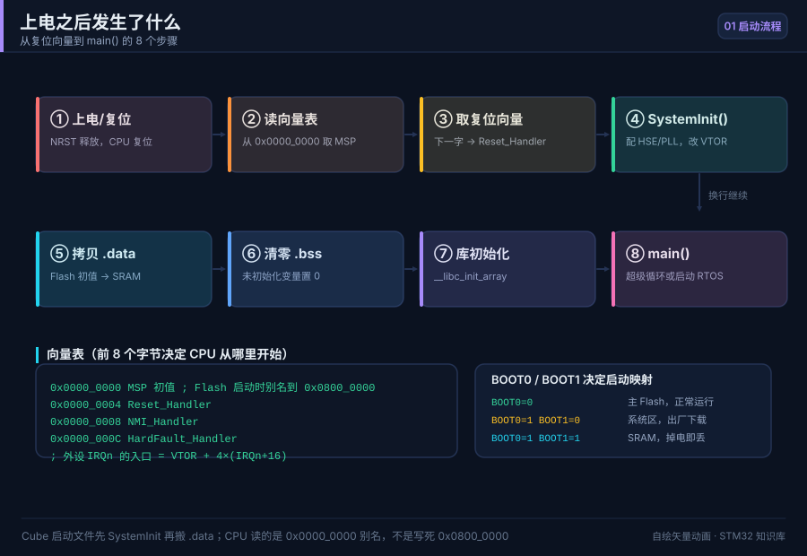
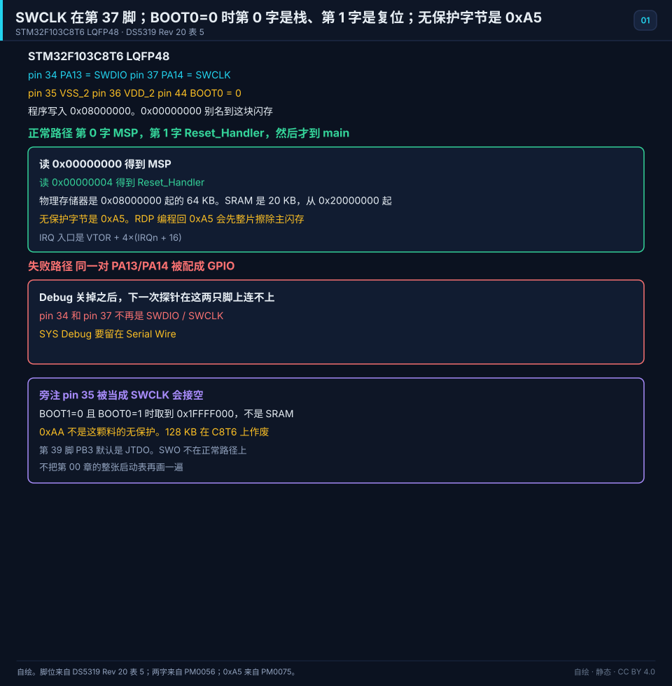
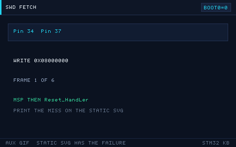

# 01 开发环境搭建

> English: [Environment](en/01-dev-environment.md)

> 从零装好一套能编译、能烧录、能单步调试的 STM32 开发环境。

<p align="center">
  
  <br><sub>▲ 动画：上电复位后 CPU 取向量表、启动流程（作者自绘矢量图）</sub>
</p>

<!-- video:ch01 -->
<p align="center">
  <video width="640" controls poster="../assets/video/ch01-env.png">
    <source src="../assets/video/ch01-env.mp4" type="video/mp4">
  </video>
  <br><sub>▲ 本章讲解 2.5 分钟。配音是微软 Edge 在线神经语音「晓晓」（zh-CN-XiaoxiaoNeural），经 edge-tts 调用。edge-tts 大部分源码为 LGPLv3，srt_composer.py 为 MIT；声线模型是微软在线服务，不是开放模型。这里提交的是合成后的 MP4，离线可看。重新生成需要联网。画面由脚本和本仓库 SVG 生成，不是实拍。 视频：<a href="../assets/video/ch01-env.mp4">MP4</a> · 字幕：<a href="../assets/video/ch01-env.srt">SRT</a>。由 <code>python3 tools/gen_narrated.py --speak</code> 用 ffmpeg 合成。</sub>
</p>

**旁白（与字幕、配音同一份稿）**

1. 环境这章只追一个问题：你写下的 C，怎样变成芯片里正在跑的程序。中间就是编译、链接、烧录、复位运行。工具可以换，这四步不会换。
2. Keil、CubeIDE、PlatformIO 都能走完这四步。差别只是谁帮你填启动文件和链接脚本。先选一个能单步的，不要三个一起装到怀疑人生。
3. 复位之后，内核先读向量表。第零个字是栈顶，第一个字才是复位入口。进 main 之前，启动文件还要配时钟、搬数据段、清 BSS。
4. 这一帧是仓库里的启动顺序动画，不是芯片照片。你只要记住：还没进 main，该做的家务启动文件已经做完一轮。单步时别以为第一行就是上电第一件事。
5. 下载靠 SWD。F103 上 PA13 是数据线，PA14 是时钟。把这两只脚让给别的功能，下次探针就连不上。救砖时先把 BOOT0 拉高，再重新接上。
6. Cube 生成的工程，用户代码写在它留的标记中间。时钟改了就重新生成，不要在启动文件里打补丁。临时文件和编译产物不要提交进版本库。
7. 第一次下载只做三件事：接上调试器，确认软件认出芯片型号，再下一个只点灯的空工程。连芯片都认不出，就先别查业务代码。
8. 口诀：先认出芯片，再谈业务。调试器连不上的时候，查线、查供电、查 BOOT，不要先重写 main。线都没通，改代码是在安慰自己。
9. 这章结束，你的文件夹里应该有一个能单步的工程。你要能说出向量表前两个字是什么，也要能指出 SWD 占用的两只脚。
10. 合上书，三问。向量表第零个字是什么？第一个字是什么？SWD 占哪两只脚？答不上来，就把启动文件再单步一遍。
<!-- /video:ch01 -->

## 原理与边界

这一章的调试和启动结论只钉在订货号 STM32F103C8T6、封装 LQFP48 上。闪存和 SRAM 跟第 02 章同一笔：64 KB 从 `0x08000000` 起，20 KB 从 `0x20000000` 起。启动别名跟第 00 章同一笔，不另画一套 BOOT 表。

复位后的调试口是第 34 脚 PA13 = SWDIO，第 37 脚 PA14 = SWCLK。中间隔着第 35 脚 VSS_2 和第 36 脚 VDD_2。把第 35 脚当成 SWCLK 是主图的失败路径。第 7 脚 NRST 建议接，它不是第三根 SWD 信号。第 44 脚是 BOOT0。信号名 PA13/PA14 与第 03 章一致；封装脚号只在这一章展开。SYS Debug 选 Serial Wire。把它关掉之后，这两只脚变成普通 GPIO，下一次 SWD 连接失败。脚位见 [DS5319 Rev 20 表 5](#source-ds5319-swd)。

BOOT0=0 时，CPU 从 `0x00000000` 读到的是闪存 `0x08000000` 的别名。第 0 个字是 MSP 初值，第 1 个字在 `0x00000004`，是 `Reset_Handler`。外设中断入口不是 `0x08000000 + 4×IRQn`，而是 `VTOR + 4×(IRQn + 16)`。`.isr_vector` 要用 `KEEP` 这件事留在核心原理。两字见 [PM0056 的向量表](#source-pm0056-vector)。

BOOT1=0 且 BOOT0=1：CPU 仍读 `0x00000000`，取到的是系统存储器 `0x1FFFF000`，闪存里的程序还在，只是没有被取指。BOOT1=1 且 BOOT0=1 才从 SRAM `0x20000000` 启动。「BOOT0=1」单独说成 SRAM 启动，这句话作废，改成这两行。不重画第 00 章那张图。启动别名见 [RM0008 Rev 21 表 9](#source-rm0008-boot)。

无保护是 RDP = `0xA5`，不是 `0xAA`。手册把这只键印成 `0x00A5`，低字节仍是 `0xA5`。解除保护会整片擦除主闪存。`0xAA` 和 `0xCC` 在这颗料上作废。选项字节界面若只显示 Level 0，旁边仍写明写入的字节是 `0xA5`。见 [PM0075](#source-pm0075-rdp)。

这颗 C8 是 64 KB 闪存、20 KB SRAM。xB 的 128 KB 作废。链接脚本里的 `LENGTH = 64K` 和 `LENGTH = 20K` 跟这两句同一笔。

跟踪脚是第 39 脚 PB3，默认功能是 JTDO，重映射里才有 TRACESWO。它不是 PA13，也不是 PA14。ITM 打印留在核心原理，不进主图的正常路径。第 17 章的 `debug-swo.svg` 不重画。

## 关键插图

<p align="center">
  
  <br><sub>▲ 自绘。STM32F103C8T6，LQFP48。第 34 脚 PA13 = SWDIO，第 37 脚 PA14 = SWCLK。第 35 脚是 VSS_2，第 36 脚是 VDD_2。第 44 脚 BOOT0 = 0 时，0x00000000 别名到 0x08000000。第 0 字是 MSP，第 1 字是 Reset_Handler。失败路径是这两只脚被配成 GPIO，或把第 35 脚当成 SWCLK。BOOT1=0 且 BOOT0=1 时取到 0x1FFFF000，不是 SRAM。无保护字节是 0xA5，0xAA 作废。出处是 [DS5319 Rev 20 表 5](#source-ds5319-swd)、[PM0056 的向量表](#source-pm0056-vector) 和 [PM0075 的 0xA5](#source-pm0075-rdp)。</sub>
</p>

<p align="center">
  
  <br><sub>▲ 网页和公众号辅图。只播放正常路径：SWD 写完闪存，CPU 读出 MSP 和 Reset_Handler，标出第 34 脚和第 37 脚。印刷以静态主图为准。GPIO 复用和 0xAA 不在这条 GIF 上。</sub>
</p>

`boot-sequence.svg` 留作辅图。不播放它，脚号、两字和连不上的失败都在静态主图上。

## 时序或状态

| 阶段 | BOOT / Debug | 读到的地址 | 状态 |
| --- | --- | --- | --- |
| 复位，BOOT0=0 | 第 44 脚 BOOT0 = 0 | `0x00000000` 别名 `0x08000000` | 物理存储器是 64 KB 闪存 |
| 第 0 字 | 向量表第 0 项 | `0x00000000` | MSP 初值 |
| 第 1 字 | 向量表第 1 项 | `0x00000004` | `Reset_Handler`，然后才到 `main` |
| 失败：Debug 关掉 | 第 34 脚和第 37 脚变成 GPIO | PA13 / PA14 不再是 SWD | SWD 连接失败 |
| 失败：系统存储器 | BOOT1=0 且 BOOT0=1 | `0x1FFFF000` | 不是 SRAM。闪存里的程序还在，只是没有被取指 |
| SRAM | BOOT1=1 且 BOOT0=1 | `0x20000000` | 两只 BOOT 都为 1 才以 SRAM 启动 |
| IRQ | 外设中断 | `VTOR + 4×(IRQn + 16)` | 不是 `0x08000000 + 4×IRQn` |
| 容量 | C8 | 64 KB 闪存，20 KB SRAM | 128 KB 在这颗料上作废 |

这张表不写工具链菜单。第 35 脚是 VSS_2，第 36 脚是 VDD_2，第 7 脚是 NRST。

## 坑与出处卡

| 现象 | 原因 | 处理 | 出处 | 该来源允许支持的主张 |
| --- | --- | --- | --- | --- |
| 烧录一次后再也连不上 | PA13/PA14 被配成 GPIO | 把 Debug 留在 Serial Wire，SWD 留在第 34 脚和第 37 脚 | [DS5319](#source-ds5319-swd) | LQFP48 第 34 脚是 PA13/SWDIO，第 37 脚是 PA14/SWCLK。第 35 脚是 VSS_2 |
| 探针接在 PA13 旁边那只脚上，时钟没有 | 第 35 脚被当成了 SWCLK | 探针不要落在第 35、36 脚（VSS_2、VDD_2 仍接地和电源），SWCLK 改接第 37 脚 | [DS5319](#source-ds5319-swd) | 第 35 脚是 VSS_2，第 36 脚是 VDD_2，第 37 脚才是 SWCLK。这两只电源脚不能悬空 |
| BOOT0 拉高之后跑的不是闪存里的程序，也不是 SRAM | BOOT1 仍是 0 | BOOT1=0 时这是系统存储器。要进 SRAM，两只 BOOT 都拉高 | [RM0008](#source-rm0008-boot) | BOOT1=0 且 BOOT0=1 时别名到 `0x1FFFF000`。SRAM 启动还要 BOOT1=1 |
| 按 `AA` 解除读保护，片子仍保护着或擦除结果对不上 | 无保护键不是 `0xAA` | 无保护键写成 `0xA5`。解除时主闪存会被整片擦掉 | [PM0075](#source-pm0075-rdp) | RDP 为 `0xA5` 才允许读出。编程回 `0xA5` 会先整片擦除。`0xAA` 在这颗料上作废 |
| 向量表第 0 字被当成复位入口 | 第 0 字是栈 | 第 0 字是 MSP，第 1 字才是 `Reset_Handler` | [PM0056](#source-pm0056-vector) | 向量表第 0 项是栈初值，第 1 项是复位。IRQ 入口要先加上 16 个系统异常 |

## 📌 学习目标
- [ ] 看懂 Keil MDK / STM32CubeIDE / VSCode+PlatformIO / CLion 四种环境差异并选定一个
- [ ] 会用 STM32CubeMX 生成一个能直接编译的工程（时钟、SWD、代码生成选项）
- [ ] 会安装 ST-Link 驱动、升级固件，并按 SWD 接线表正确连线
- [ ] 能独立排查 "No target connected"、"Flash Download failed"、芯片被读保护

## 🧠 核心原理

**结论先行：无论用哪种 IDE，底层都是同一条工具链——编译 → 链接 → 烧录 → 复位运行。**

### 1. 工具链数据流

```
源码 .c/.h
   │  编译 (arm-none-eabi-gcc / ARMCC / ARMCLANG)
   ▼
目标文件 .o
   │  链接 (ld / armlink) + 链接脚本(.ld/.sct)
   ▼
可执行 .elf  ──► .hex / .bin
   │  烧录 (ST-Link / OpenOCD / pyOCD) 经 SWD
   ▼
Flash 0x08000000
   │  复位
   ▼
CPU 取向量表 → Reset_Handler → main()
```

### 2. 上电启动流程（对应上方动画）

| 步骤 | 硬件在做什么 | 说明 |
| --- | --- | --- |
| 1 | 复位后从 `0x00000000` 读 **MSP 初值** | 主栈指针初始值 |
| 2 | 从 `0x00000004` 读 **Reset_Handler 地址** | 复位向量 |
| 3 | 执行 `startup_stm32f1xx.s` | 初始化栈、调用 SystemInit |
| 4 | `SystemInit()` | 配置时钟、向量表偏移 |
| 5 | `__main` → `main()` | 进入用户代码 |

### 3. 四种开发环境对比

| 维度 | Keil MDK-ARM | STM32CubeIDE | VSCode + PlatformIO | CLion + OpenOCD |
| --- | --- | --- | --- | --- |
| 授权 | 社区版免费（超代码大小限制需授权） | 完全免费（ST 官方） | 免费开源 | 收费（学生免费） |
| 编译器 | ARMCC / ARMCLANG | GCC (arm-none-eabi) | GCC | GCC |
| 上手难度 | 低（中文资料多） | 低（集成 CubeMX） | 中（需配 platformio.ini） | 中高 |
| 调试能力 | 强（寄存器/变量/断点完善） | 强（集成调试器） | 中（依赖 Cortex-Debug） | 强 |
| 跨平台 | 仅 Windows | Win/Linux/mac | 全平台 | 全平台 |
| 适用场景 | 教学、企业传统项目 | 官方推荐、新手 | 极客、CI 自动化 | 重度 C/C++ 开发者 |

**选择建议：新手用 STM32CubeIDE（免费 + 集成 CubeMX）；已有 Keil 授权可沿用 Keil；需要可审查、可进 CI 的构建时，用同一套 CMake Preset 驱动 CLion 或 VS Code。PlatformIO 是另一套包管理与构建路线，不要和手工 CMake 工程混编。**

### 4. 一个标准工程目录结构

```
Core/          Inc/  Src/          ← 用户代码（main.c、中断、外设初始化）
Drivers/       CMSIS/  STM32F1xx_HAL_Driver/
Middlewares/   （可选，如 FreeRTOS、FatFs）
Startup/       startup_stm32f103xb.s
STM32F103C8TX_FLASH.ld           ← 链接脚本（GCC）
<工程名>.ioc                      ← CubeMX 工程文件
```

目录结构示意图见 [`assets/diagrams/project-structure.svg`](../assets/diagrams/project-structure.svg)（作者自绘矢量图）。

### 5. STM32CubeMX 生成工程全流程

| 步骤 | 操作 | 关键选项 |
| --- | --- | --- |
| 1 | New Project，搜索并选中芯片 | 选 `STM32F103C8Tx` |
| 2 | Pinout 视图配置引脚 | 例：PC13 设为 `GPIO_Output` |
| 3 | System Core → RCC | HSE 选 `Crystal/Ceramic Resonator` |
| 4 | System Core → SYS | Debug 选 `Serial Wire`（否则复用 SWD 引脚会连不上） |
| 5 | Clock Configuration | HSE 8MHz → PLL ×9 → SYSCLK 72MHz |
| 6 | Project Manager → Project | 名称、路径、Toolchain 选 `STM32CubeIDE`/`MDK-ARM` |
| 7 | Code Generator | 勾选「Copy only necessary library files」、生成 .c/.h 分离 |
| 8 | GENERATE CODE | 生成后即可编译 |

> ⚠️ SYS Debug 一定要选 **Serial Wire**，否则 CubeMX 会把 PA13/PA14 配成普通 GPIO，烧录一次后就再也连不上（见「常见坑」）。

### 6. 编译 / 烧录 / 调试三个动作

| 动作 | Keil | CubeIDE | CLion + CMake | VS Code + CMake |
| --- | --- | --- | --- | --- |
| 编译 | F7 / Build | Ctrl+B | 选择 CMake Preset 后 Build | `Ctrl+Shift+B` 调用 CMake task |
| 烧录 | F8 / Download | Run → Debug | OpenOCD Download & Run | Cortex-Debug 启动配置 |
| 调试 | Ctrl+F5 / Start Debug | F11 / Debug | OpenOCD + `arm-none-eabi-gdb` | Cortex-Debug + OpenOCD |
| 复位运行 | Reset 按钮 | Run 按钮 | Run 配置 | Run and Debug 配置 |

### CLion：CMake 是工程真相，IDE 只是调用者

完整可编译入口见 [`examples/spl-f1-blink/`](../examples/spl-f1-blink/)；该示例的 CLI、CLion 和 VS Code 共用同一个 `CMakePresets.json`、GNU Arm toolchain file、链接脚本与 OpenOCD 配置。这样能避免“IDE 能编、CI 不能编”。

1. 安装 GNU Arm Embedded、CMake、Ninja、OpenOCD；命令行先确认 `arm-none-eabi-gcc --version` 和 `openocd --version`。
2. 设置依赖根目录（示例为冻结的 SPL V3.5.0 `SPL_ROOT`），从这个终端启动 CLion，再打开示例目录。
3. CLion 选择 `BluePill SPL Debug` CMake Preset。构建日志中的编译器必须是 `arm-none-eabi-gcc`，产物必须是 `.elf`，不能是宿主机 `.exe`。
4. 新建 **OpenOCD Download & Run**：Target 选 CMake 目标，Executable 选 ELF，Board config 选仓库里的 `openocd/bluepill-stlink.cfg`，GDB 选 `arm-none-eabi-gdb`。
5. Run 的合同是“build → program → verify → reset”；Debug 还要“OpenOCD 监听 3333 → GDB 加载同一 ELF → 断在 `main`”。

### VS Code：Task 构建，Cortex-Debug 调试

1. 安装 C/C++、CMake Tools、Cortex-Debug。从设置过依赖环境变量的终端执行 `code .`。
2. `.vscode/tasks.json` 只调用 `cmake --preset debug` 与 `cmake --build --preset debug`；不要在 JSON 里复制一套编译器参数。
3. `.vscode/launch.json` 只声明调试边界：ELF 路径、OpenOCD config、`arm-none-eabi-gdb` 和构建前置任务。
4. `Ctrl+Shift+B` 单独验证构建；再运行 Cortex-Debug。构建和调试分开验，才能区分编译器错误、链接脚本错误与探针连接错误。
5. 若只出现 IntelliSense 红线但 CMake 构建成功，先执行 `CMake: Configure` 让语言服务读取编译数据库；不要靠手写 `includePath` 掩盖真实构建参数。

| 失败表现 | 第一条边界 | 处理 |
| --- | --- | --- |
| CMake 报依赖根目录为空 | IDE 未继承环境变量 | 从已设置变量的终端启动 IDE，或在 CMake Profile 显式设置 |
| 生成了宿主机 `.exe` | toolchain file 未生效 | 删除该 build 目录，用 preset 重新 configure，检查编译器识别行 |
| 编译通过、链接报重复中断函数 | 同一 IRQ 有两个强定义 | 只保留一个中断所有者；SPL 示例用自己的 `stm32f10x_it.c` 替换模板文件 |
| ELF 已生成但 OpenOCD 连接失败 | 已离开构建边界 | 查 SWD 接线、供电、目标 cfg 与 ST-Link 固件，不要继续改 C 代码 |
| 下载成功但程序不进 `main` | 启动文件/链接脚本/复位路径 | 核对向量表、`Reset_Handler`、Flash/RAM 区域和 BOOT0 |

> 官方入口：[CLion Embedded development](https://www.jetbrains.com/help/clion/embedded-overview.html)、[CLion OpenOCD support](https://www.jetbrains.com/help/clion/openocd-support.html)、[PlatformIO IDE for VS Code](https://docs.platformio.org/en/stable/integration/ide/vscode.html)。

### 芯片被读保护时怎么解锁

工具链菜单留在这里，不进四块。无保护字节是 `0xA5`，不是 `0xAA`。`0xAA` 在 STM32F103C8T6 上作废。解除保护会整片擦除主闪存。

1. STM32CubeProgrammer → 选择 ST-LINK 连接方式，Connect。
2. 左侧 `Option bytes` → Read Out Protection 写成 `0xA5`。界面若只显示 Level 0，旁边仍写明写入的字节是 `0xA5`。
3. 点击 `Apply`。**注意：解除读保护会全片擦除主闪存。**
4. 重新下载程序。

命令行等价（OpenOCD）：

```bash
openocd -f interface/stlink.cfg -f target/stm32f1x.cfg \
  -c "init; reset halt; stm32f1x unlock 0; reset; shutdown"
```

## 🛠️ 硬件与接线

### SWD 接线表（ST-Link V2 ↔ BluePill）

| ST-Link 引脚 | 开发板引脚 | 信号 | 说明 |
| --- | --- | --- | --- |
| 3.3V | 3V3 | 电源 | 可选（板子也可 USB 供电） |
| GND | GND | 地 | **必须接**，共地 |
| SWDIO | PA13 | 数据 | 双向数据线 |
| SWCLK | PA14 | 时钟 | 调试时钟 |
| RST | NRST | 复位 | 建议接，烧录更稳 |
| 5V | — | — | 一般不用 |

> ST-Link V2 克隆版常见 10 针，注意丝印；SWD 只需 4 根（3V3/GND/SWDIO/SWCLK），NRST 可选。

### ST-Link 驱动与固件

| 项目 | 操作 |
| --- | --- |
| 装驱动 | Windows 装 ST-Link USB driver（设备管理器出现 STLink dongle） |
| 升级固件 | 运行 ST-Link Upgrade，点 Upgrade（固件太旧会报 DFU 相关错误） |
| 检查连接 | STM32CubeProgrammer 里 Connect，能读到 Device ID 即 OK |
| Linux 权限 | 加 udev 规则，避免每次 sudo |

## 💻 代码实现

CubeMX 生成的 `main.c` 骨架（关键部分），完整工程见 [`examples/gpio-blink/`](../examples/gpio-blink/)。

```c
#include "main.h"

void SystemClock_Config(void);
static void MX_GPIO_Init(void);

int main(void)
{
    HAL_Init();                 /* 复位所有外设、初始化 Flash 接口和 SysTick */
    SystemClock_Config();       /* 配置 72MHz 主频 */
    MX_GPIO_Init();             /* 初始化 PC13 */

    while (1)
    {
        HAL_GPIO_TogglePin(GPIOC, GPIO_PIN_13);
        HAL_Delay(500);
    }
}

static void MX_GPIO_Init(void)
{
    GPIO_InitTypeDef GPIO_InitStruct = {0};
    __HAL_RCC_GPIOC_CLK_ENABLE();       /* CubeMX 自动加的时钟使能 */

    GPIO_InitStruct.Pin   = GPIO_PIN_13;
    GPIO_InitStruct.Mode  = GPIO_MODE_OUTPUT_PP;
    GPIO_InitStruct.Pull  = GPIO_NOPULL;
    GPIO_InitStruct.Speed = GPIO_SPEED_FREQ_LOW;
    HAL_GPIO_Init(GPIOC, &GPIO_InitStruct);
}
```

编译 / 下载命令（GCC + OpenOCD 命令行方式，便于 CI）：

```bash
# 1) 编译（PlatformIO 或 Makefile 生成的工程）
pio run

# 2) 用 OpenOCD 烧录 .elf 到 Flash
openocd -f interface/stlink.cfg -f target/stm32f1x.cfg \
  -c "program build/firmware.elf verify reset exit"
```

## 🧪 动手实验

1. **实验一（环境打通）**：用 CubeMX 生成工程，编译并下载到 BluePill，板载 LED 1Hz 闪烁。
2. **实验二（单步调试）**：在 `HAL_GPIO_TogglePin` 处打断点，观察调试窗口中 `GPIOC->ODR` 寄存器的变化。
3. **实验三（故障复现）**：故意把 SYS Debug 设为 Disable 生成一次，体验「连不上」并用手动连接 + 全片擦除恢复。

### 7. 关键工程文件说明

| 文件 | 作用 |
| --- | --- |
| `<工程>.ioc` | CubeMX 工程配置，可重新生成代码 |
| `startup_stm32f103xb.s` | 启动汇编，定义向量表与复位入口 |
| `STM32F103C8TX_FLASH.ld` | GCC 链接脚本，定义 Flash/RAM 布局 |
| `<工程>.sct` | Keil 分散加载文件 |
| `system_stm32f1xx.c` | `SystemInit()`，时钟初始化 |
| `stm32f1xx_hal_conf.h` | HAL 模块开关（裁剪体积） |

### 8. 调试技巧

| 技巧 | 操作 |
| --- | --- |
| 断点 | 在可疑行打断点，查看变量与寄存器 |
| 变量观察 | Watch 窗口加入全局/局部变量 |
| 寄存器查看 | 打开 Peripherals → GPIO 等外设窗口 |
| SWO/ITM 打印 | 免串口打印，见下方代码 |
| 反汇编 | 查看 C 对应的汇编，理解优化 |

```c
/* SWO/ITM 打印：只需 SWD 的 SWO 引脚，不占串口 */
int _write(int fd, char *ptr, int len)
{
    for (int i = 0; i < len; i++) ITM_SendChar(ptr[i]);
    return len;
}
```

### 9. 更多常见报错

| 报错 | 原因 | 解决 |
| --- | --- | --- |
| `Flash Download failed` | 时钟未配置/算法没选 | Keil 里选对 Flash 算法 |
| `Cannot access target` | 目标掉电/复位 | 检查供电与 NRST |
| `No STM32 target found` | 连接线/驱动 | 换 USB 口，重装驱动 |
| `Core is locked up` | 访问了非法地址 | 检查指针与栈溢出 |

### 10. 下载算法（Flash Algorithm）对照

| 芯片 | Keil Flash 算法 | 备注 |
| --- | --- | --- |
| F103C8 | STM32F10x Med-density | 64KB |
| F103RC | STM32F10x High-density | 256KB |
| F401 | STM32F4xx | — |

### 11. 启动文件在把家安顿好

**结论**：CPU 复位后从 `0x00000000` 读两个字：第一个是 MSP，第二个才是 `Reset_Handler`。BOOT0=0 时，这个地址是 Flash `0x08000000` 的别名，不是另一块存储器。

Cube 当前的启动顺序（以你工程里的 `startup_*.s` 为准，老工程有的先拷数据）：

| 顺序 | 谁在做 | 结果 |
| --- | --- | --- |
| 1 | 硬件 | 读 MSP，再跳到 Reset_Handler |
| 2 | `SystemInit` | 配时钟，并把 `SCB->VTOR` 指到向量表 |
| 3 | 启动文件 | 把 `.data` 从 Flash 拷到 RAM，把 `.bss` 清零 |
| 4 | `__libc_init_array` | 跑 C++ 全局构造和 `libc` 初始化 |
| 5 | `main` | 你的程序 |

外设中断的入口不是 `0x08000000 + 4×IRQn`。向量表前面还有 16 个系统异常，所以入口地址是 `VTOR + 4×(IRQn + 16)`。

### 12. 链接脚本在划地盘

**结论**：F103C8 的 Flash 是 64 KB，从 `0x08000000` 起；SRAM 是 20 KB，从 `0x20000000` 起。栈从 RAM 顶往下长。

```ld
MEMORY
{
  FLASH (rx)  : ORIGIN = 0x08000000, LENGTH = 64K
  RAM (xrw)   : ORIGIN = 0x20000000, LENGTH = 20K
}
_estack = ORIGIN(RAM) + LENGTH(RAM);
```

`.isr_vector` 要用 `KEEP`，否则链接器会把没被 C 引用的向量表扔掉，上电就飞。

口诀：**第 0 项是栈，第 1 项才是复位；先时钟，再拷 .data，再清 .bss。**

自测：

1. BOOT0=0 时，CPU 读 `0x00000000` 实际看到的是哪一段物理存储器？
2. 未初始化的全局变量在 `.bss` 还是 `.data`？谁负责把它变成 0？
3. 为什么 `IRQn` 不能直接乘 4 再加 `0x08000000`？

## 🔗 相关资源

- 官方手册：**RM0008** 第 2 章（存储器和总线）、第 8 章（RCC）、第 9 章（GPIO）；**DS5319**（F103C8 数据手册）
- 上一篇：[00 如何学习 STM32](00-如何学习STM32.md)｜下一篇：[02 芯片选型与存储器时钟](02-芯片选型与存储器时钟.md)
- 📱 手机阅读版：[第 01 章 · 开发环境搭建（公众号图文）](https://mp.weixin.qq.com/s/_4EZnD8WekbfTyOobrxbjQ)
- 相关图：[`assets/diagrams/project-structure.svg`](../assets/diagrams/project-structure.svg)、[`assets/animations/boot-sequence.svg`](../assets/animations/boot-sequence.svg)
- 实物与资料：ST 官网 ST-Link / STM32CubeIDE / STM32CubeProgrammer 下载页
- 免责声明：本仓库插画均为作者自绘矢量图/程序生成动画，非厂商实拍照片。

