# 01 开发环境搭建

> English: [Environment](en/01-dev-environment.md)

> 工程显示 Build succeeded，芯片却没有运行。先把构建产物、烧录校验、复位入口和 `main` 断点分开检查，才知道失败停在哪一层。

<p align="center">
  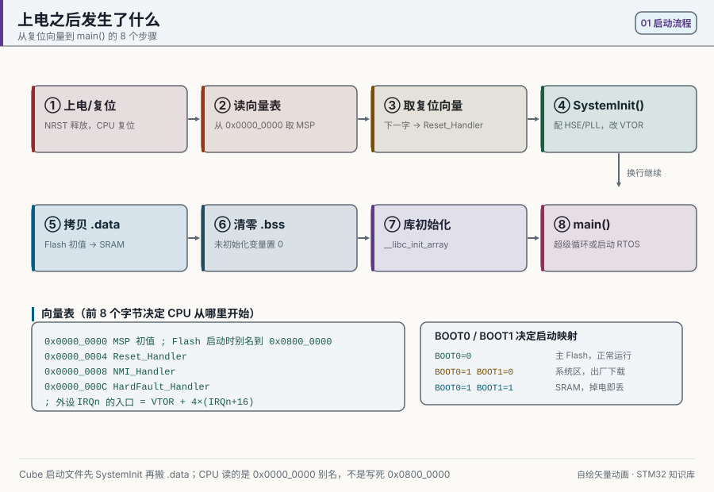
  <br><sub>▲ 动画：上电复位后 CPU 取向量表、启动流程（作者自绘矢量图）</sub>
</p>

<!-- video:ch01 -->
<p align="center">
  <video width="640" controls poster="../assets/video/ch01-env.png">
    <source src="../assets/video/ch01-env.mp4" type="video/mp4">
  </video>
  <br><sub>▲ 本章讲解视频（2.5 分钟）。<a href="../assets/video/ch01-env.mp4">MP4</a> · <a href="../assets/video/ch01-env.srt">字幕</a></sub>
</p>

<details>
<summary>旁白文字稿</summary>

1. 环境这章只追一个问题：你写下的 C，怎样变成芯片里正在跑的程序。中间就是编译、链接、烧录、复位运行。工具可以换，这四步不会换。
2. Keil、CubeIDE、PlatformIO 都能走完这四步。差别只是谁帮你填启动文件和链接脚本。先选一个能单步的，不要三个一起装到怀疑人生。
3. 复位之后，内核先读向量表。第零个字是栈顶，第一个字才是复位入口。进 main 之前，启动文件还要配时钟、搬数据段、清 BSS。
4. 这一帧是仓库里的启动顺序动画，不是芯片照片。你只要记住：还没进 main，该做的家务启动文件已经做完一轮。单步时别以为第一行就是上电第一件事。
5. 下载靠 SWD。F103 上 PA13 是数据线，PA14 是时钟。把这两只脚让给别的功能，下次探针就连不上。救砖时先把 BOOT0 拉高，再重新接上。
6. Cube 生成的工程，用户代码写在它留的标记中间。时钟改了就重新生成，不要在启动文件里打补丁。临时文件和编译产物不要提交进版本库。
7. 第一次下载只做三件事：接上调试器，确认软件认出芯片型号，再下一个只点灯的空工程。连芯片都认不出，就先别查业务代码。
8. 这一章最常忘的还是那三样：线插对没有，供电稳不稳，BOOT 跳线在不在 0。三样都对了还连不上，才轮到怀疑工程和驱动。
9. 这章结束，你的文件夹里应该有一个能单步的工程。你要能说出向量表前两个字是什么，也要能指出 SWD 占用的两只脚。
10. 下载卡住时按顺序走：先看软件认不认芯片，再看工程选的型号对不对，最后才是改代码。顺序反了，你会在错误的那一层耗掉一晚上。

</details>
<!-- /video:ch01 -->
## 原理与适用范围

本章的脚号和地址都按 STM32F103C8T6、LQFP48 封装算。存储器和第 02 章一致：64 KB 闪存从 `0x08000000` 起，20 KB SRAM 从 `0x20000000` 起。BOOT 脚怎么选启动区，第 00 章已经讲过，这里只用到结论。

复位后的调试口是第 34 脚 PA13 = SWDIO，第 37 脚 PA14 = SWCLK。两者中间隔着第 35 脚 VSS_2 和第 36 脚 VDD_2，数脚时最容易把第 35 脚当成 SWCLK。第 7 脚 NRST 建议也接上，探针可以在连不上时硬复位芯片，但它不算 SWD 信号。第 44 脚是 BOOT0。CubeMX 里 SYS Debug 要选 Serial Wire。选成 No Debug 后，生成的代码会把这两只脚初始化成普通 GPIO，程序一跑起来调试口就没了，下一次 SWD 连接失败。脚位见 [DS5319 Rev 20 表 5](#source-ds5319-swd)。

BOOT0=0 时，CPU 从 `0x00000000` 读到的是闪存 `0x08000000` 的别名。第 0 个字是 MSP 初值，第 1 个字在 `0x00000004`，是 `Reset_Handler`。外设中断入口不是 `0x08000000 + 4×IRQn`，而是 `VTOR + 4×(IRQn + 16)`。链接脚本为什么要对 `.isr_vector` 用 `KEEP`，见后面的核心原理。这两个字的定义见 [PM0056 的向量表](#source-pm0056-vector)。

BOOT1=0 且 BOOT0=1：CPU 仍读 `0x00000000`，取到的是系统存储器 `0x1FFFF000`，闪存里的程序还在，只是没有被取指。BOOT1=1 且 BOOT0=1 才从 SRAM `0x20000000` 启动。所以「BOOT0=1 就进 SRAM」这种说法是错的，要看 BOOT1。启动别名见 [RM0008 Rev 21 表 9](#source-rm0008-boot)。

无保护是 RDP = `0xA5`，不是 `0xAA`。手册把这只键印成 `0x00A5`，低字节仍是 `0xA5`。解除保护会整片擦除主闪存。F4 的笔记里常见 `0xAA`（无保护）和 `0xCC`（永久保护），这两个值在 C8 上没有意义，F1 不认。工具界面如果只显示 Level 0，实际写进选项字节的是 `0xA5`。见 [PM0075](#source-pm0075-rdp)。

C8 是 64 KB 闪存、20 KB SRAM。128 KB 是 F103CB（xB）的容量，不要照抄。链接脚本里对应写 `LENGTH = 64K` 和 `LENGTH = 20K`。

跟踪脚是第 39 脚 PB3，默认功能是 JTDO，重映射里才有 TRACESWO。它不是 PA13，也不是 PA14，只接两根 SWD 线时用不了 SWO。ITM 打印的用法在核心原理和第 17 章。

## 关键插图

<p align="center">
  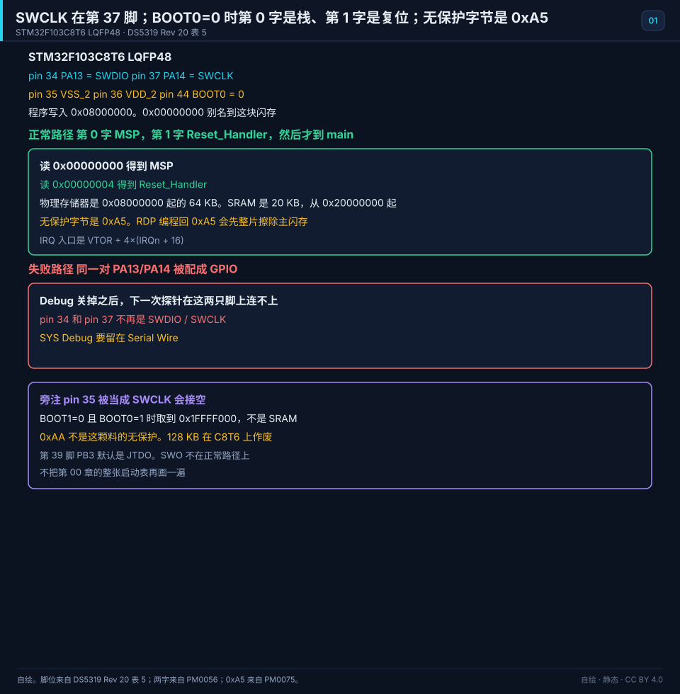
  <br><sub>▲ 自绘。STM32F103C8T6，LQFP48。第 34 脚 PA13 = SWDIO，第 37 脚 PA14 = SWCLK。第 35 脚是 VSS_2，第 36 脚是 VDD_2。第 44 脚 BOOT0 = 0 时，0x00000000 别名到 0x08000000。第 0 字是 MSP，第 1 字是 Reset_Handler。图中标出两种连不上的情况：这两只脚被配成 GPIO，或把第 35 脚当成 SWCLK。BOOT1=0 且 BOOT0=1 时取到 0x1FFFF000，不是 SRAM。无保护字节是 0xA5，不是 0xAA。出处是 [DS5319 Rev 20 表 5](#source-ds5319-swd)、[PM0056 的向量表](#source-pm0056-vector) 和 [PM0075 的 0xA5](#source-pm0075-rdp)。</sub>
</p>
<p align="center">
  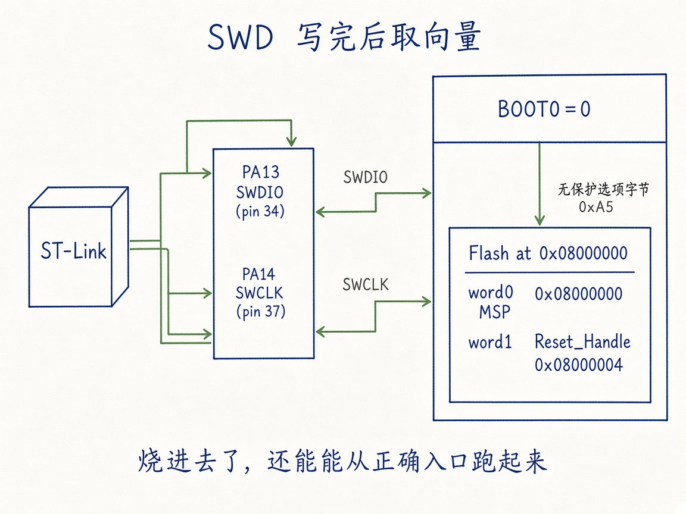
  <br><sub>▲ 知识轨（Handraw · 原理示意/非实拍）。SWDIO/SWCLK/GND 与复位后 SP/Reset 落在合法区间；不是连线照片，也不是烧录日志。</sub>
</p>


<p align="center">
  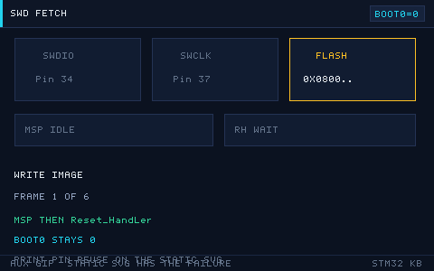
  <br><sub>▲ 动图版，只演示正常的一次：SWD 写完闪存，CPU 读出 MSP 和 Reset_Handler，并标出第 34 脚和第 37 脚。印刷版只有上面的静态图。</sub>
</p>

## 时序与状态

<p align="center">
  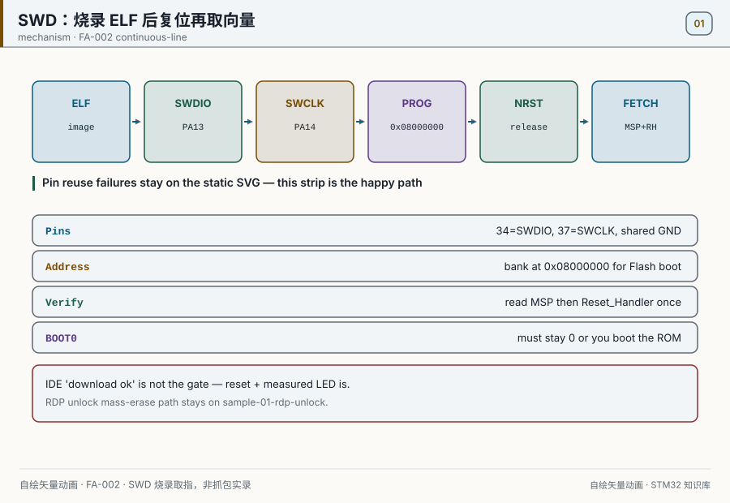
  <br><sub>▲ 自绘矢量动画（FA-002）。烧录→复位→MSP/Reset。</sub>
</p>
| 阶段 | BOOT / Debug | 读到的地址 | 状态 |
| --- | --- | --- | --- |
| 复位，BOOT0=0 | 第 44 脚 BOOT0 = 0 | `0x00000000` 别名 `0x08000000` | 物理存储器是 64 KB 闪存 |
| 第 0 字 | 向量表第 0 项 | `0x00000000` | MSP 初值 |
| 第 1 字 | 向量表第 1 项 | `0x00000004` | `Reset_Handler`，然后才到 `main` |
| 失败：Debug 关掉 | 第 34 脚和第 37 脚变成 GPIO | PA13 / PA14 不再是 SWD | SWD 连接失败 |
| 失败：系统存储器 | BOOT1=0 且 BOOT0=1 | `0x1FFFF000` | 不是 SRAM。闪存里的程序还在，只是没有被取指 |
| SRAM | BOOT1=1 且 BOOT0=1 | `0x20000000` | 两只 BOOT 都为 1 才以 SRAM 启动 |
| IRQ | 外设中断 | `VTOR + 4×(IRQn + 16)` | 不是 `0x08000000 + 4×IRQn` |
| 容量 | C8 | 64 KB 闪存，20 KB SRAM | 128 KB 是 xB 的容量 |

这张表只列硬件状态。第 35 脚是 VSS_2，第 36 脚是 VDD_2，第 7 脚是 NRST。

<p align="center">
  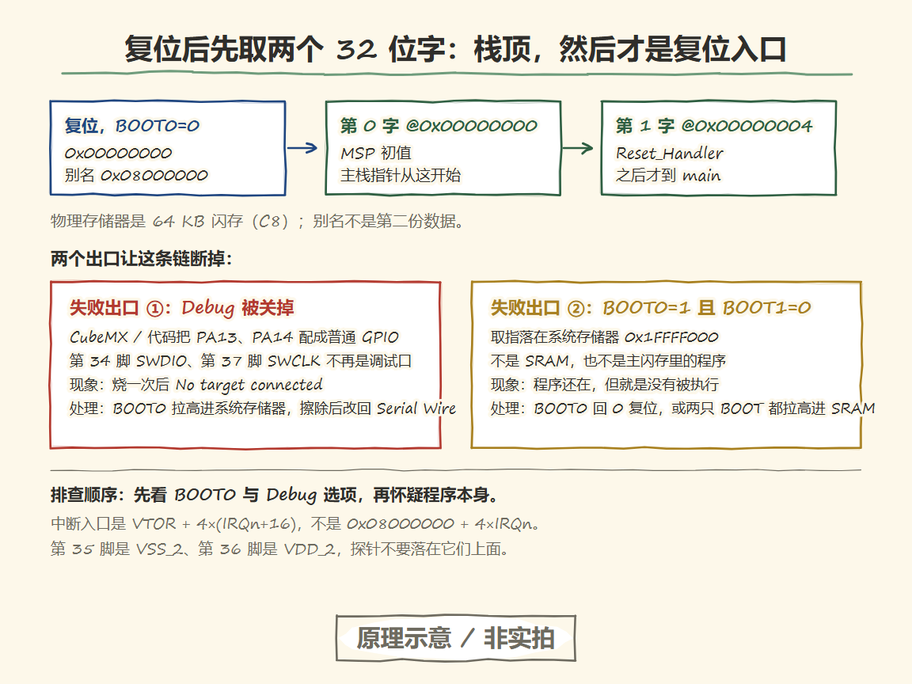
  <br><sub>▲ 知识轨（Handraw · 原理示意/非实拍）。看哪里：顶行三个方框的取指顺序——复位(BOOT0=0)从 0x00000000 别名 0x08000000 读第 0 字 MSP、第 1 字 Reset_Handler 后才到 main；下面两个「失败出口」各自的现象与处理（Debug 被关掉→BOOT0 拉高进系统存储器救回；BOOT0=1 且 BOOT1=0→取到 0x1FFFF000 不是 SRAM）；证明「连不上/不运行」先查 BOOT 与 Debug 配置再怀疑程序；不能替代 PM0056 向量表原文，也不是实测复位波形。出处 [PM0056](#source-pm0056-vector)、[RM0008](#source-rm0008-boot)、[DS5319](#source-ds5319-swd)。</sub>
</p>

## 常见坑与出处

| 现象 | 原因 | 处理 | 出处 | 出处里能查到什么 |
| --- | --- | --- | --- | --- |
| 烧录一次后再也连不上 | PA13/PA14 被配成 GPIO | 把 Debug 留在 Serial Wire，SWD 留在第 34 脚和第 37 脚 | [DS5319](#source-ds5319-swd) | LQFP48 第 34 脚是 PA13/SWDIO，第 37 脚是 PA14/SWCLK。第 35 脚是 VSS_2 |
| 探针接在 PA13 旁边那只脚上，时钟没有 | 第 35 脚被当成了 SWCLK | 探针不要落在第 35、36 脚（VSS_2、VDD_2 仍接地和电源），SWCLK 改接第 37 脚 | [DS5319](#source-ds5319-swd) | 第 35 脚是 VSS_2，第 36 脚是 VDD_2，第 37 脚才是 SWCLK。这两只电源脚不能悬空 |
| BOOT0 拉高之后跑的不是闪存里的程序，也不是 SRAM | BOOT1 仍是 0 | BOOT1=0 时这是系统存储器。要进 SRAM，两只 BOOT 都拉高 | [RM0008](#source-rm0008-boot) | BOOT1=0 且 BOOT0=1 时别名到 `0x1FFFF000`。SRAM 启动还要 BOOT1=1 |
| 按 `AA` 解除读保护，片子仍保护着或擦除结果对不上 | 无保护键不是 `0xAA` | 无保护键写成 `0xA5`。解除时主闪存会被整片擦掉 | [PM0075](#source-pm0075-rdp) | RDP 为 `0xA5` 才允许读出。编程回 `0xA5` 会先整片擦除。`0xAA` 不是 F1 的无保护值 |
| 向量表第 0 字被当成复位入口 | 第 0 字是栈 | 第 0 字是 MSP，第 1 字才是 `Reset_Handler` | [PM0056](#source-pm0056-vector) | 向量表第 0 项是栈初值，第 1 项是复位。IRQ 入口要先加上 16 个系统异常 |

## 学习目标
- [ ] 看懂 Keil MDK / STM32CubeIDE / VSCode+PlatformIO / CLion 四种环境差异并选定一个
- [ ] 会用 STM32CubeMX 生成一个能直接编译的工程（时钟、SWD、代码生成选项）
- [ ] 会安装 ST-Link 驱动、升级固件，并按 SWD 接线表正确连线
- [ ] 能独立排查 "No target connected"、"Flash Download failed"、芯片被读保护

## 核心原理

IDE 可以换，验收顺序不变：先确认 ELF/AXF，再确认烧录校验，最后看复位是否命中 `main`。

### 1. 工具链数据流

```text
源码 .c/.h
   │  编译 (arm-none-eabi-gcc / ARMCC / ARMCLANG)
   ▼
目标文件 .o
   │  链接 (ld / armlink) + 链接脚本(.ld/.sct)
   ▼
可执行 .elf  ──► .hex / .bin
   │  烧录 (ST-Link / OpenOCD / pyOCD) 经 SWD
   ▼
Flash 0x08000000
   │  复位
   ▼
CPU 取向量表 → Reset_Handler → main()
```

构建日志至少要能回答两件事：使用了哪一个交叉编译器，生成的 ELF/AXF 在哪里。没有产物路径，就还没有进入烧录边界。

### 2. 上电启动流程（对应上方动画）

| 步骤 | 硬件在做什么 | 说明 |
| --- | --- | --- |
| 1 | 复位后从 `0x00000000` 读 **MSP 初值** | 主栈指针初始值 |
| 2 | 从 `0x00000004` 读 **Reset_Handler 地址** | 复位向量 |
| 3 | 执行 `startup_stm32f1xx.s` | 初始化栈、调用 SystemInit |
| 4 | `SystemInit()` | 配置时钟、向量表偏移 |
| 5 | `__main` → `main()` | 进入用户代码 |

### 3. 四种开发环境对比

<p align="center">
  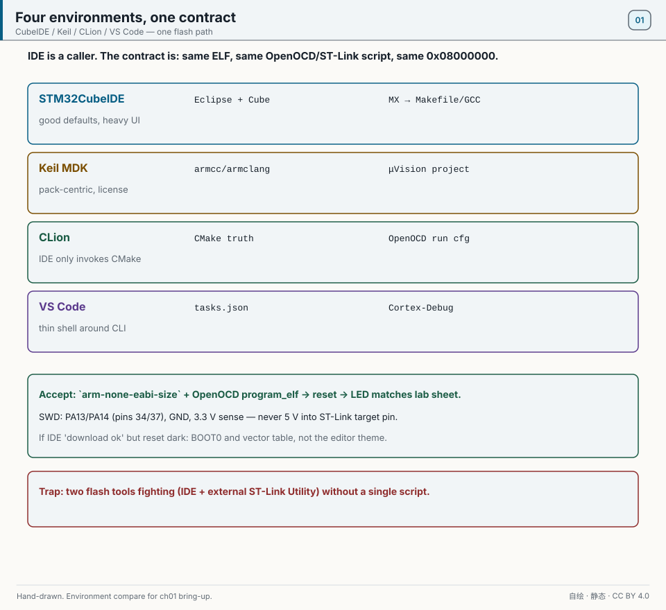
  <br><sub>▲ 自绘。IDE 只是调用者；契约是同一 ELF 与烧录脚本。</sub>
</p>
<p align="center">
  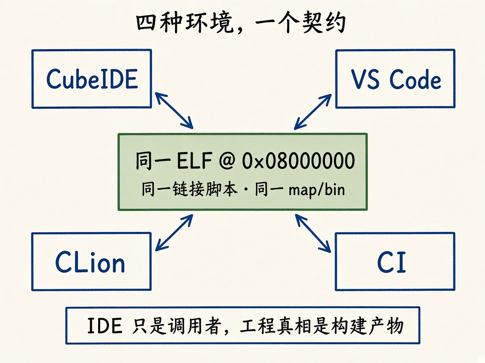
  <br><sub>▲ 知识轨（Handraw · 原理示意/非实拍）。CubeIDE / Keil / IAR / VS Code+OpenOCD 四条工具链汇到同一 ELF/HEX；不是 IDE 截图。</sub>
</p>


| 维度 | Keil MDK-ARM | STM32CubeIDE | VSCode + PlatformIO | CLion + OpenOCD |
| --- | --- | --- | --- | --- |
| 授权 | 社区版免费（超代码大小限制需授权） | 完全免费（ST 官方） | 免费开源 | 收费（学生免费） |
| 编译器 | ARMCC / ARMCLANG | GCC (arm-none-eabi) | GCC | GCC |
| 上手难度 | 低（中文资料多） | 低（集成 CubeMX） | 中（需配 platformio.ini） | 中高 |
| 调试能力 | 强（寄存器/变量/断点完善） | 强（集成调试器） | 中（依赖 Cortex-Debug） | 强 |
| 跨平台 | 仅 Windows | Win/Linux/mac | 全平台 | 全平台 |
| 适用场景 | 教学、企业传统项目 | 官方推荐、新手 | 极客、CI 自动化 | 重度 C/C++ 开发者 |

第一次建工程可用 STM32CubeIDE；已有 Keil 工程就沿用 Keil。需要命令行和 CI 时，让 CLion、VS Code 与 CI 共用同一个 CMake Preset。PlatformIO 有自己的包管理与构建模型，不要再手工维护第二套源文件、宏和链接参数。

<p align="center">
  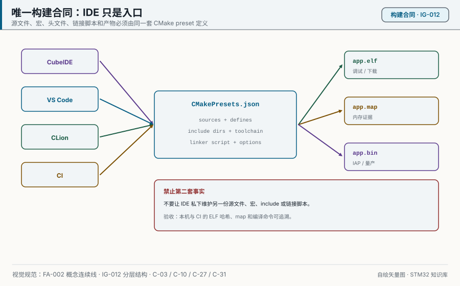
  <br><sub>▲ 一个工程只保留一套构建事实：源文件、宏、头文件路径、工具链和链接脚本都由同一入口定义。IDE 负责调用；ELF、map 和 bin 分别承担调试下载、内存核对和裸二进制交付（FA-002 · IG-012 · C-03/C-10/C-27/C-31）。</sub>
</p>

### 4. 一个标准工程目录结构

```text
Core/          Inc/  Src/          ← 用户代码（main.c、中断、外设初始化）
Drivers/       CMSIS/  STM32F1xx_HAL_Driver/
Middlewares/   （可选，如 FreeRTOS、FatFs）
Startup/       startup_stm32f103xb.s
STM32F103C8TX_FLASH.ld           ← 链接脚本（GCC）
<工程名>.ioc                      ← CubeMX 工程文件
```

目录不是越多越专业。真正需要纳入版本控制的是源文件、启动文件、链接脚本、依赖版本和可复现的构建入口；`build/` 里的临时产物可以重建。

### 5. STM32CubeMX 生成工程全流程

| 步骤 | 操作 | 关键选项 |
| --- | --- | --- |
| 1 | New Project，搜索并选中芯片 | 选 `STM32F103C8Tx` |
| 2 | Pinout 视图配置引脚 | 例：PC13 设为 `GPIO_Output` |
| 3 | System Core → RCC | HSE 选 `Crystal/Ceramic Resonator` |
| 4 | System Core → SYS | Debug 选 `Serial Wire`（否则复用 SWD 引脚会连不上） |
| 5 | Clock Configuration | HSE 8MHz → PLL ×9 → SYSCLK 72MHz |
| 6 | Project Manager → Project | 名称、路径、Toolchain 选 `STM32CubeIDE`/`MDK-ARM` |
| 7 | Code Generator | 勾选「Copy only necessary library files」、生成 .c/.h 分离 |
| 8 | GENERATE CODE | 生成后即可编译 |

> [!WARNING]
> SYS Debug 一定要选 **Serial Wire**，否则 CubeMX 会把 PA13/PA14 配成普通 GPIO，烧录一次后就再也连不上（见「常见坑」）。

### 6. 编译 / 烧录 / 调试三个动作

| 动作 | Keil | CubeIDE | CLion + CMake | VS Code + CMake |
| --- | --- | --- | --- | --- |
| 编译 | F7 / Build | Ctrl+B | 选择 CMake Preset 后 Build | `Ctrl+Shift+B` 调用 CMake task |
| 烧录 | F8 / Download | Run → Debug | OpenOCD Download & Run | Cortex-Debug 启动配置 |
| 调试 | Ctrl+F5 / Start Debug | F11 / Debug | OpenOCD + `arm-none-eabi-gdb` | Cortex-Debug + OpenOCD |
| 复位运行 | Reset 按钮 | Run 按钮 | Run 配置 | Run and Debug 配置 |

烧录这一步的三条通路——什么时候用哪一条——看这张图：

<p align="center">
  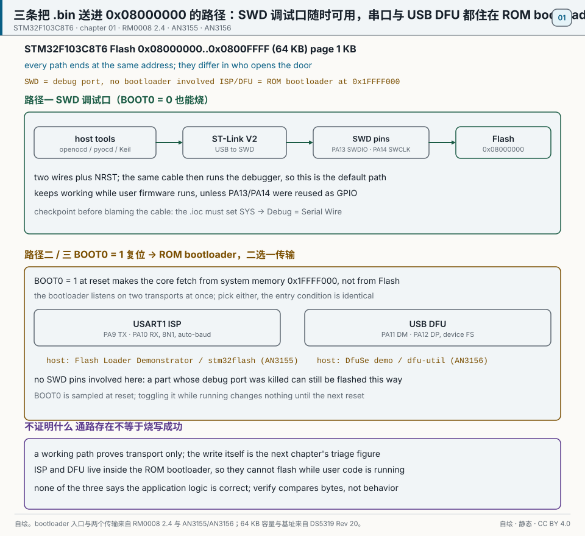
  <br><sub>▲ 自绘。看哪里：上半是 SWD 路径——主机工具 → ST-Link → PA13/PA14 → Flash；下半是 BOOT0=1 复位后的 ROM bootloader 两条传输（USART1 与 USB DFU）。证明什么：三条路径终点相同，打开门的条件不同——SWD 不经过 bootloader，ISP/DFU 只在 bootloader 里存在。不证明什么：通路可用不等于烧写成功，verify 只比对字节不比对行为。出处：RM0008 2.4 与 AN3155/AN3156；64 KB 容量来自 DS5319 Rev 20。</sub>
</p>
<p align="center">
  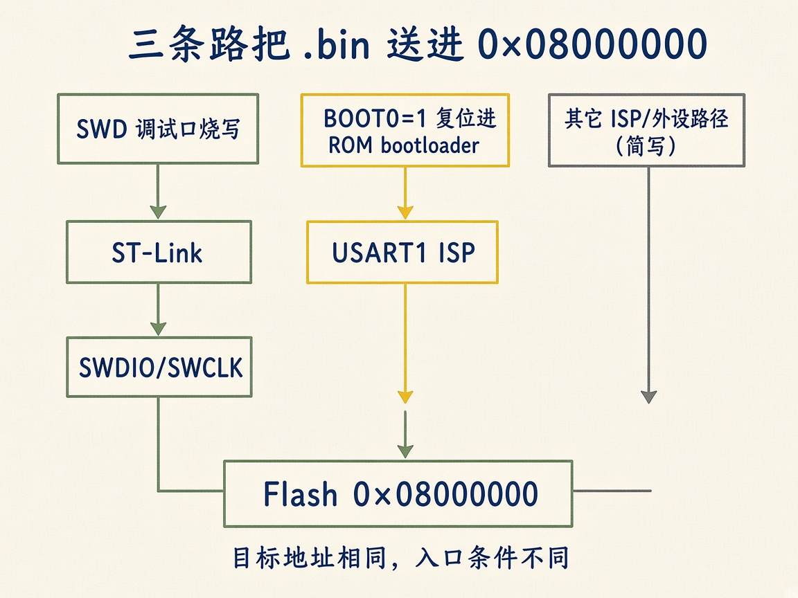
  <br><sub>▲ 知识轨（Handraw · 原理示意/非实拍）。SWD 调试器、UART/USB 系统 Bootloader、用户自定义 Bootloader 三条进 Flash 的路径；不是烧录界面截图。</sub>
</p>


### CLion：CMake 是工程真相，IDE 只是调用者

完整可编译入口见 [`examples/spl-f1-blink/`](../examples/spl-f1-blink/)；该示例的 CLI、CLion 和 VS Code 共用同一个 `CMakePresets.json`、GNU Arm toolchain file、链接脚本与 OpenOCD 配置。这样能避免“IDE 能编、CI 不能编”。

1. 安装 GNU Arm Embedded、CMake、Ninja、OpenOCD；命令行先确认 `arm-none-eabi-gcc --version` 和 `openocd --version`。
2. 设置依赖根目录（示例为冻结的 SPL V3.5.0 `SPL_ROOT`），从这个终端启动 CLion，再打开示例目录。
3. CLion 选择 `BluePill SPL Debug` CMake Preset。构建日志中的编译器必须是 `arm-none-eabi-gcc`，产物必须是 `.elf`，不能是宿主机 `.exe`。
4. 新建 **OpenOCD Download & Run**：Target 选 CMake 目标，Executable 选 ELF，Board config 选仓库里的 `openocd/bluepill-stlink.cfg`，GDB 选 `arm-none-eabi-gdb`。
5. Run 的合同是“build → program → verify → reset”；Debug 还要“OpenOCD 监听 3333 → GDB 加载同一 ELF → 断在 `main`”。

<p align="center">
  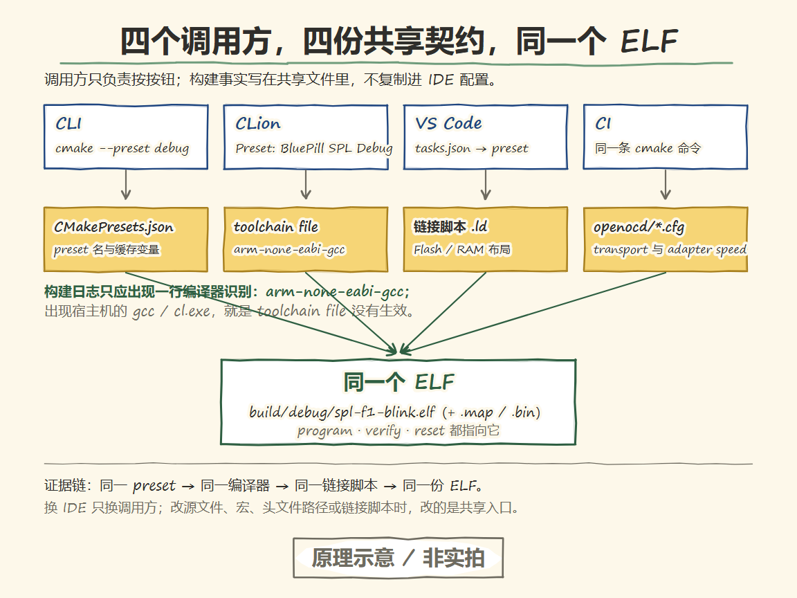
  <br><sub>▲ 知识轨（Handraw · 原理示意/非实拍）。看哪里：上排四个调用方（CLI/CLion/VS Code/CI）各自只按下拉箭头；中间一排共享契约（CMakePresets.json、toolchain file、链接脚本、openocd/*.cfg）；下方「构建日志只应出现一行 arm-none-eabi-gcc」的判据和同一个 ELF 的落点；证明「IDE 能编、CI 不能编」是契约被复制而不是工具问题；不能替代实际构建日志，也不是 CI 实测截图。出处 [本仓库 examples/spl-f1-blink](#source-project-examples)。</sub>
</p>

### VS Code：Task 构建，Cortex-Debug 调试

1. 安装 C/C++、CMake Tools、Cortex-Debug。从设置过依赖环境变量的终端执行 `code .`。
2. `.vscode/tasks.json` 只调用 `cmake --preset debug` 与 `cmake --build --preset debug`；不要在 JSON 里复制一套编译器参数。
3. `.vscode/launch.json` 只声明调试边界：ELF 路径、OpenOCD config、`arm-none-eabi-gdb` 和构建前置任务。
4. `Ctrl+Shift+B` 单独验证构建；再运行 Cortex-Debug。构建和调试分开验，才能区分编译器错误、链接脚本错误与探针连接错误。
5. 若只出现 IntelliSense 红线但 CMake 构建成功，先执行 `CMake: Configure` 让语言服务读取编译数据库；不要靠手写 `includePath` 掩盖真实构建参数。

| 失败表现 | 第一条边界 | 处理 |
| --- | --- | --- |
| CMake 报依赖根目录为空 | IDE 未继承环境变量 | 从已设置变量的终端启动 IDE，或在 CMake Profile 显式设置 |
| 生成了宿主机 `.exe` | toolchain file 未生效 | 删除该 build 目录，用 preset 重新 configure，检查编译器识别行 |
| 编译通过、链接报重复中断函数 | 同一 IRQ 有两个强定义 | 只保留一个中断所有者；SPL 示例用自己的 `stm32f10x_it.c` 替换模板文件 |
| ELF 已生成但 OpenOCD 连接失败 | 已离开构建边界 | 查 SWD 接线、供电、目标 cfg 与 ST-Link 固件，不要继续改 C 代码 |
| 下载成功但程序不进 `main` | 启动文件/链接脚本/复位路径 | 核对向量表、`Reset_Handler`、Flash/RAM 区域和 BOOT0 |

> 官方入口：[CLion Embedded development](https://www.jetbrains.com/help/clion/embedded-overview.html)、[CLion OpenOCD support](https://www.jetbrains.com/help/clion/openocd-support.html)、[PlatformIO IDE for VS Code](https://docs.platformio.org/en/stable/integration/ide/vscode.html)。

<p align="center">
  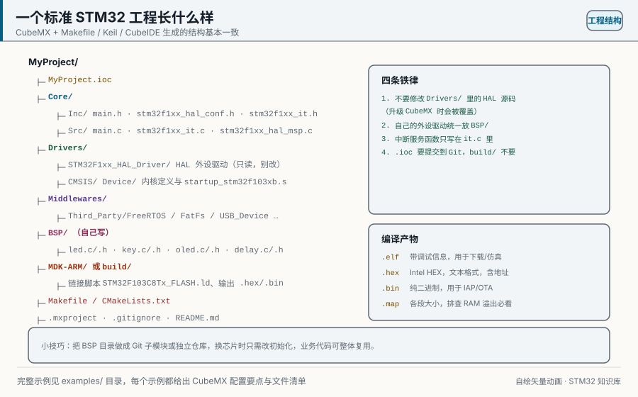
  <br><sub>▲ 工程边界：`.ioc`、源码、启动文件与链接脚本共同决定 ELF；`.map` 用来核对段和符号，`.bin` 用于裸二进制交付。图中的目录名是常见组织方式，不是 CubeMX、Keil 或 CMake 的强制结构（FA-002 · IG-002 · C-03/C-10/C-27/C-31）。</sub>
</p>

### 芯片被读保护时怎么解锁

<p align="center">
  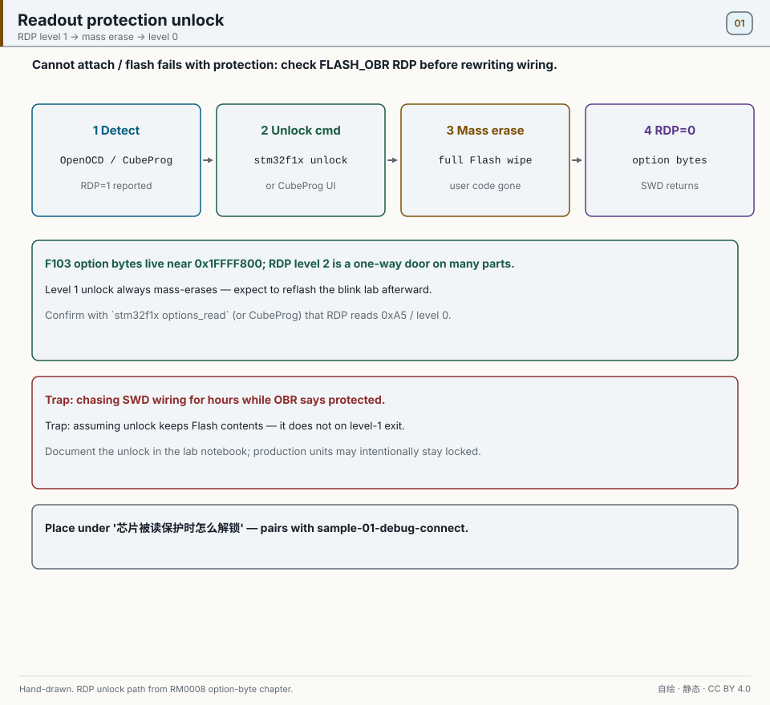
  <br><sub>▲ 自绘。退出 RDP1 必整片擦除；先别怀疑 SWD 线。</sub>
</p>
<p align="center">
  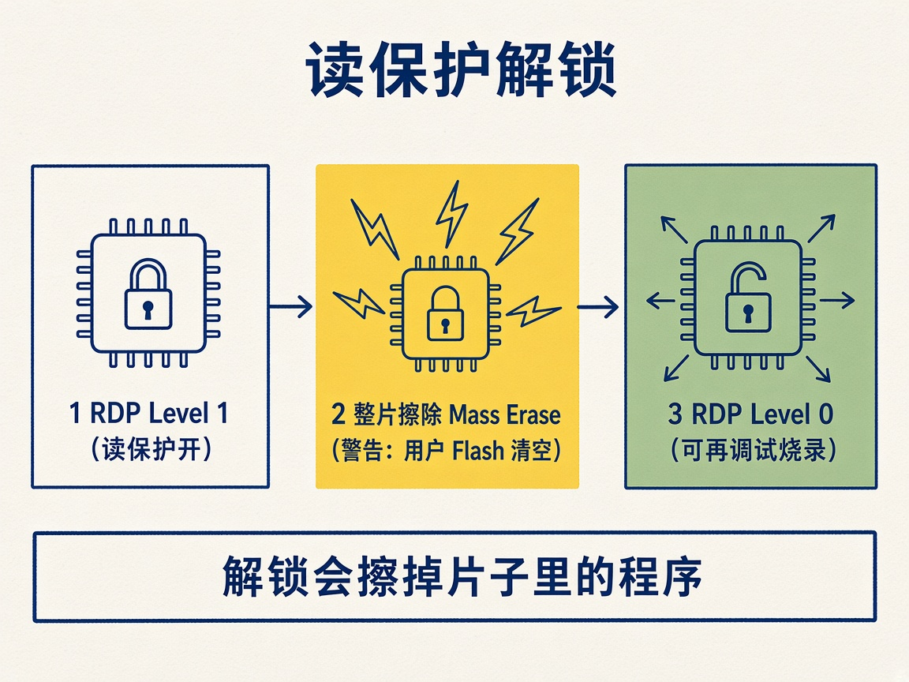
  <br><sub>▲ 知识轨（Handraw · 原理示意/非实拍）。Option Bytes 里 RDP 从 Level 1/2 降回 Level 0 会整片擦除主 Flash；不是 Programmer 实拍。</sub>
</p>


无保护字节是 `0xA5`，不是 `0xAA`。`0xAA` 是 F4 等系列的写法，STM32F103C8T6 不认。解除保护会整片擦除主闪存。

1. STM32CubeProgrammer → 选择 ST-LINK 连接方式，Connect。
2. 左侧 `Option bytes` → Read Out Protection 写成 `0xA5`。界面若只显示 Level 0，旁边仍写明写入的字节是 `0xA5`。
3. 点击 `Apply`。**注意：解除读保护会全片擦除主闪存。**
4. 重新下载程序。

命令行等价（OpenOCD）：

```bash
openocd -f interface/stlink.cfg -f target/stm32f1x.cfg \
  -c "init; reset halt; stm32f1x unlock 0; reset; shutdown"
```

<p align="center">
  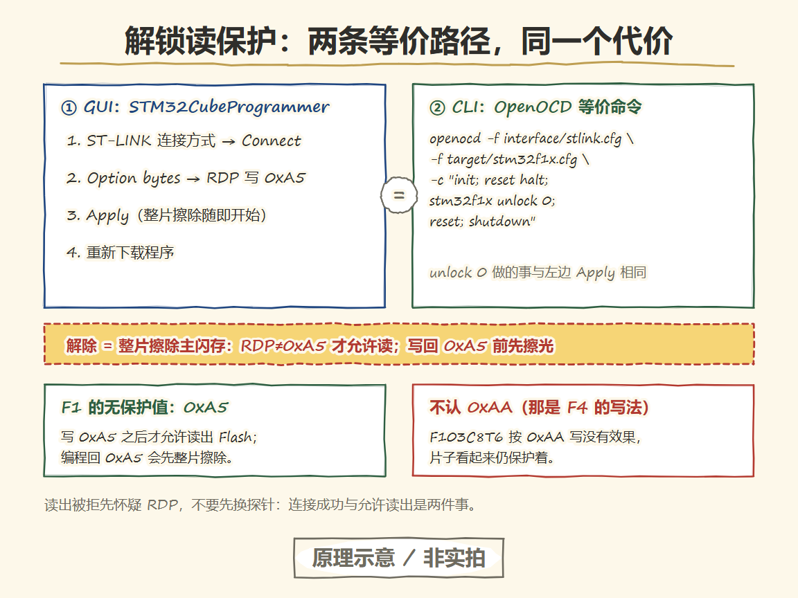
  <br><sub>▲ 知识轨（Handraw · 原理示意/非实拍）。看哪里：左右两列四步与命令行的逐步对应、中间「=」号，和黄条「解除 = 整片擦除主闪存」；底部绿框 F1 无保护值 0xA5 与红框「不认 0xAA（那是 F4 的写法）」；证明 GUI 的 Apply 与 stm32f1x unlock 0 是同一件事的两种入口，代价相同；不能替代 PM0075 的 RDP 流程原文，也不是实测解锁操作。出处 [PM0075](#source-pm0075-rdp)、[RM0008](#source-rm0008-flash)。</sub>
</p>

## 硬件与接线

### SWD 接线表（ST-Link V2 ↔ BluePill）

| ST-Link 引脚 | 开发板引脚 | 信号 | 说明 |
| --- | --- | --- | --- |
| 3.3V | 3V3 | 电源 | 本实验不接；BluePill 已由 Micro-USB 供电 |
| GND | GND | 地 | **必须接**，共地 |
| SWDIO | PA13 | 数据 | 双向数据线 |
| SWCLK | PA14 | 时钟 | 调试时钟 |
| RST | NRST | 复位 | 建议接，烧录更稳 |
| 5V | — | — | 一般不用 |

> 本实验只接 GND、SWDIO、SWCLK 和可选 NRST。不同 ST-Link 克隆板的 3.3V 脚可能是输出，不要与 BluePill 的 USB 供电并联。

### ST-Link 驱动与固件

| 项目 | 操作 |
| --- | --- |
| 装驱动 | Windows 装 ST-Link USB driver（设备管理器出现 STLink dongle） |
| 升级固件 | 运行 ST-Link Upgrade，点 Upgrade（固件太旧会报 DFU 相关错误） |
| 检查连接 | STM32CubeProgrammer 里 Connect，能读到 Device ID 即 OK |
| Linux 权限 | 加 udev 规则，避免每次 sudo |

## 代码实现

CubeMX 生成的 `main.c` 骨架（关键部分），完整工程见 [`examples/gpio-blink/`](../examples/gpio-blink/)。

```c
#include "main.h"

void SystemClock_Config(void);
static void MX_GPIO_Init(void);

int main(void)
{
    HAL_Init();                 /* 复位所有外设、初始化 Flash 接口和 SysTick */
    SystemClock_Config();       /* 配置 72MHz 主频 */
    MX_GPIO_Init();             /* 初始化 PC13 */

    while (1)
    {
        HAL_GPIO_TogglePin(GPIOC, GPIO_PIN_13);
        HAL_Delay(500);
    }
}

static void MX_GPIO_Init(void)
{
    GPIO_InitTypeDef GPIO_InitStruct = {0};
    __HAL_RCC_GPIOC_CLK_ENABLE();       /* CubeMX 自动加的时钟使能 */

    GPIO_InitStruct.Pin   = GPIO_PIN_13;
    GPIO_InitStruct.Mode  = GPIO_MODE_OUTPUT_PP;
    GPIO_InitStruct.Pull  = GPIO_NOPULL;
    GPIO_InitStruct.Speed = GPIO_SPEED_FREQ_LOW;
    HAL_GPIO_Init(GPIOC, &GPIO_InitStruct);
}
```

<p align="center">
  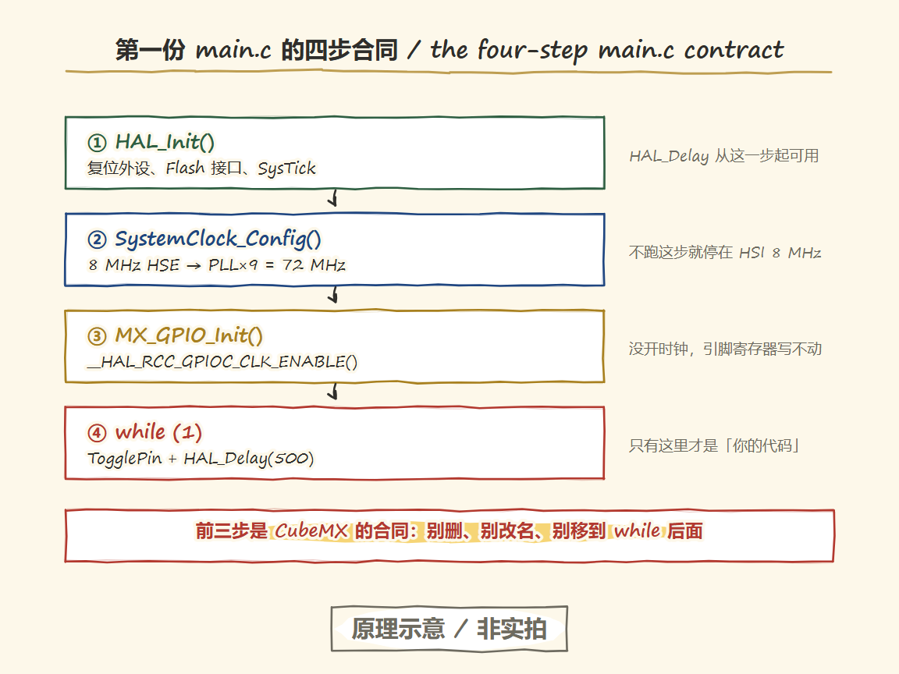
  <br><sub>▲ 知识轨（Handraw · 原理示意/非实拍）。看哪里：四个方框的先后与右侧注释——HAL_Init 起 SysTick（HAL_Delay 从此可用）、SystemClock_Config 不上 72 MHz 就停在 HSI 8 MHz、MX_GPIO_Init 不开 GPIOC 时钟寄存器写不动、while(1) 里才是你的代码；底条红框「前三步是 CubeMX 的合同」；证明骨架里哪几行不能删不能挪；不能替代实际工程文件，也不是运行截图。出处 [本仓库 examples/gpio-blink](#source-project-examples)。</sub>
</p>

仓库里的 `examples/spl-f1-blink/` 用同一套 CMake Preset 给命令行、CLion、VS Code 和 CI 构建：

```bash
# 1) 配置并编译
cmake --preset debug
cmake --build --preset debug

# 2) 用 OpenOCD 烧录同一个 ELF，并校验后复位
openocd -f interface/stlink.cfg -f target/stm32f1x.cfg \
  -c "program build/debug/spl-f1-blink.elf verify reset exit"
```

## 动手实验

1. **实验一（环境打通）**：用 CubeMX 生成工程，编译并下载到 BluePill，板载 LED 1Hz 闪烁。
2. **实验二（单步调试）**：在 `HAL_GPIO_TogglePin` 处打断点，观察调试窗口中 `GPIOC->ODR` 寄存器的变化。
3. **实验三（连接边界）**：断电后暂时拔掉 SWCLK，重新上电并记录连接报错；再断电恢复 SWCLK，确认能重新读到 Device ID。这个实验不改选项字节，也不擦除 Flash。

### 7. 关键工程文件说明

| 文件 | 作用 |
| --- | --- |
| `<工程>.ioc` | CubeMX 工程配置，可重新生成代码 |
| `startup_stm32f103xb.s` | 启动汇编，定义向量表与复位入口 |
| `STM32F103C8TX_FLASH.ld` | GCC 链接脚本，定义 Flash/RAM 布局 |
| `<工程>.sct` | Keil 分散加载文件 |
| `system_stm32f1xx.c` | `SystemInit()`，时钟初始化 |
| `stm32f1xx_hal_conf.h` | HAL 模块开关（裁剪体积） |

### 8. 调试技巧

| 技巧 | 操作 |
| --- | --- |
| 断点 | 在可疑行打断点，查看变量与寄存器 |
| 变量观察 | Watch 窗口加入全局/局部变量 |
| 寄存器查看 | 打开 Peripherals → GPIO 等外设窗口 |
| SWO/ITM 打印 | 还要把 PB3/TRACESWO 接到支持 SWO 的探针；只接 SWDIO/SWCLK 不够 |
| 反汇编 | 查看 C 对应的汇编，理解优化 |

```c
/* SWO/ITM 打印：需要额外连接 PB3/TRACESWO，不占 UART */
int _write(int fd, char *ptr, int len)
{
    for (int i = 0; i < len; i++) ITM_SendChar(ptr[i]);
    return len;
}
```

### 9. 更多常见报错

| 报错 | 原因 | 解决 |
| --- | --- | --- |
| `Flash Download failed` | 目标型号或 Flash 算法不匹配 | 核对芯片容量，并在 Keil 里选对应算法 |
| `Cannot access target` | 目标掉电/复位 | 检查供电与 NRST |
| `No STM32 target found` | 连接线/驱动 | 换 USB 口，重装驱动 |
| `Core is locked up` | 访问了非法地址 | 检查指针与栈溢出 |

表里的 `Flash Download failed` 与 `Verification failed` 常在 attach 已经成功之后才出现，三岔口各查各的：

<p align="center">
  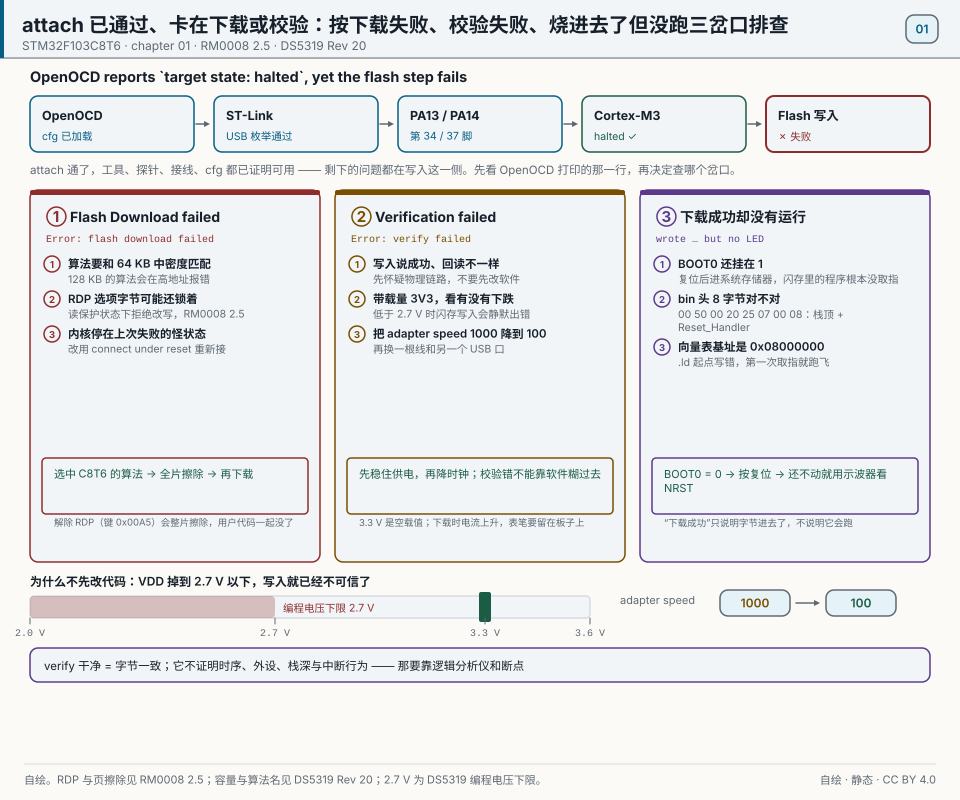
  <br><sub>▲ 自绘。看哪里：顶部一条链把「已经证明没问题的环节」排开（OpenOCD → ST-Link → 第 34/37 脚 → 内核 halted ✓ → Flash 写入 ✗），下面三个岔口各一列症状、检查点与修法——岔口一核对 64 KB 中容量算法与 RDP 选项字节；岔口二先量 3V3 再降 `adapter speed`；岔口三看 BOOT0 是否还挂在 1、bin 头八字节与 0x08000000 基址。底部的量程条标出 2.7 V 是编程电压下限，右侧是 `adapter speed` 1000 → 100 的降速方向。证明什么：attach 成功后调试口无罪，失败原因按错误行分流。不证明什么：verify 干净只证明字节一致；解除读保护会触发全片擦除。出处：RM0008 2.5 与 DS5319 Rev 20；bin 头样例来自 examples/spl-f1-blink。</sub>
</p>
<p align="center">
  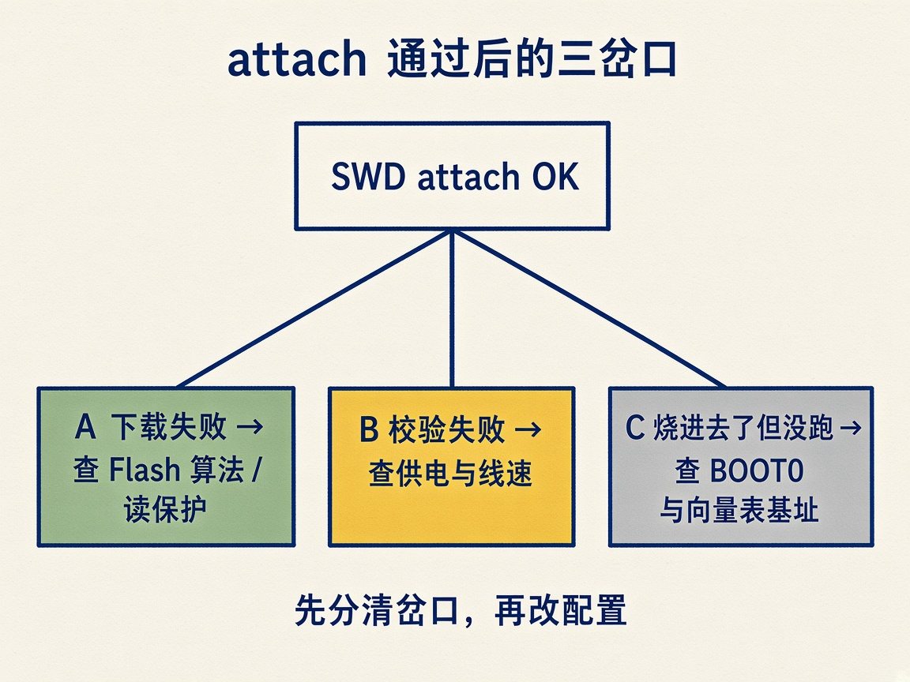
  <br><sub>▲ 知识轨（Handraw · 原理示意/非实拍）。供电 → SWD 线序 → 复位/BOOT0 → Option Bytes/RDP → 接口选型；不是故障实拍。</sub>
</p>


<p align="center">
  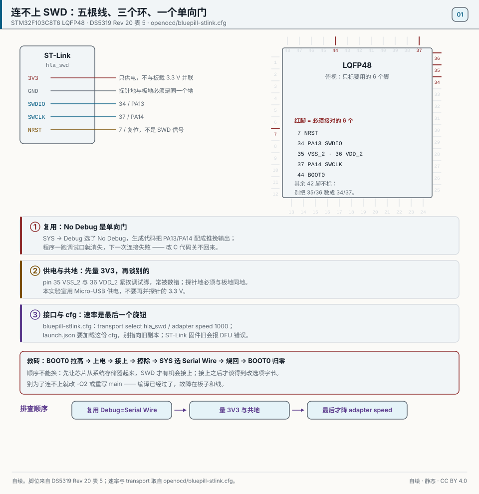
  <br><sub>▲ 自绘。三环按顺序查，每环一个检查点。第一环是第 34 脚 PA13 和第 37 脚 PA14 被复用成普通 GPIO：`.ioc` 里 SYS → Debug 必须是 `Serial Wire`，生成的 GPIO 初始化不该把这两只脚列成输出；救砖时先把第 44 脚 BOOT0 拉高，连上后擦除、改回 `Serial Wire` 再烧。第二环是供电与共地：第 35 脚 VSS_2、第 36 脚 VDD_2 不能悬空，万用表量 3V3 与 GND 之间应为 3.3 V，探针地必须与板子共地；本实验由 Micro-USB 供电，不要把探针的 3.3 V 输出并上去。第三环才是接口和 cfg：`openocd/bluepill-stlink.cfg` 里是 `transport select hla_swd` 与 `adapter speed 1000`，检查点是 Cortex-Debug 的 `configFiles` 真的加载了这份 cfg，速率只在这一行往下调。这张图不证明 ELF 本身没问题，也不覆盖 SWO/ITM。出处是 [DS5319 Rev 20 表 5](#source-ds5319-swd)；cfg 数值来自仓库 `examples/spl-f1-blink/openocd/bluepill-stlink.cfg`。</sub>
</p>
<p align="center">
  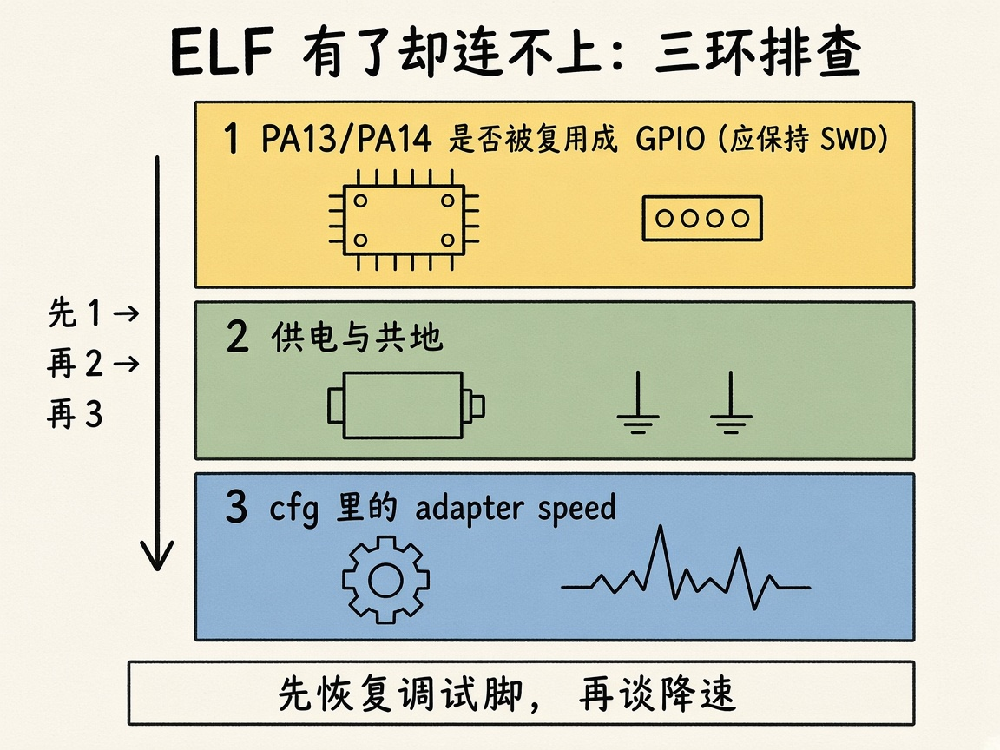
  <br><sub>▲ 知识轨（Handraw · 原理示意/非实拍）。物理层 SWD → 调试适配器 → 主机驱动/OpenOCD → IDE 会话；不是连线照片。</sub>
</p>


### 10. 下载算法（Flash Algorithm）对照

| 芯片 | Keil Flash 算法 | 备注 |
| --- | --- | --- |
| F103C8 | STM32F10x Med-density | 64KB |
| F103RC | STM32F10x High-density | 256KB |
| F401 | STM32F4xx | — |

### 11. `main` 之前谁搬 `.data`

CPU 复位后从 `0x00000000` 读两个字：第一个是 MSP，第二个才是 `Reset_Handler`。BOOT0=0 时，这个地址是 Flash `0x08000000` 的别名，不是另一块存储器。

Cube 当前的启动顺序（以你工程里的 `startup_*.s` 为准，老工程有的先拷数据）：

| 顺序 | 谁在做 | 结果 |
| --- | --- | --- |
| 1 | 硬件 | 读 MSP，再跳到 Reset_Handler |
| 2 | `SystemInit` | 配时钟，并把 `SCB->VTOR` 指到向量表 |
| 3 | 启动文件 | 把 `.data` 从 Flash 拷到 RAM，把 `.bss` 清零 |
| 4 | `__libc_init_array` | 跑 C++ 全局构造和 `libc` 初始化 |
| 5 | `main` | 你的程序 |

外设中断的入口不是 `0x08000000 + 4×IRQn`。向量表前面还有 16 个系统异常，所以入口地址是 `VTOR + 4×(IRQn + 16)`。

### 12. 链接脚本决定代码能放在哪里

F103C8 的 Flash 是 64 KB，从 `0x08000000` 起；SRAM 是 20 KB，从 `0x20000000` 起。栈从 RAM 顶往下长。

```ld
MEMORY
{
  FLASH (rx)  : ORIGIN = 0x08000000, LENGTH = 64K
  RAM (xrw)   : ORIGIN = 0x20000000, LENGTH = 20K
}
_estack = ORIGIN(RAM) + LENGTH(RAM);
```

`.isr_vector` 要用 `KEEP`，否则链接器会把没被 C 引用的向量表扔掉，上电就飞。

离开本章前，应能在调试器里读出向量表前两个字，解释 `.data` 和 `.bss` 的去向，并从 map 文件确认 Flash 与 RAM 没有越界。

<p align="center">
  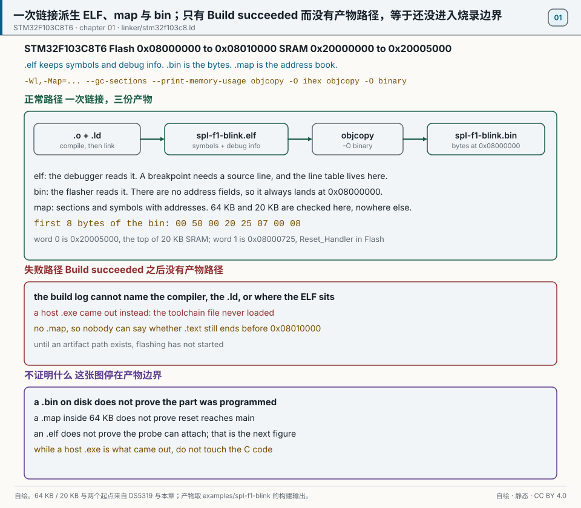
  <br><sub>▲ 自绘。上半部分：一次链接写出 `.elf`，同一条命令用 `-Wl,-Map=` 写出 `.map`，`objcopy -O binary` 再从这个 ELF 吐出 `.bin`。ELF 带符号和调试信息，所以断点能停在源码行；`.bin` 没有地址字段，烧录一律落在 `0x08000000`；`.map` 是段与符号的地址账本，64 KB 与 20 KB 有没有越界只在这里核对。图中印的是仓库 `examples/spl-f1-blink/` 实际产物的前 8 个字节 `00 50 00 20 25 07 00 08`：第 0 字 `0x20005000` 是 20 KB SRAM 的栈顶，第 1 字 `0x08000725` 是 map 里的 `Reset_Handler`。下半部分只讲没有产物路径的失败：构建日志说不出用了哪个编译器、哪份链接脚本、ELF 落在哪里；出来的是宿主机 `.exe`；或者根本没有 `.map`，没人能说清 `.text` 有没有停在 `0x08010000` 之前。这张图不证明烧录成功，也不证明复位进得了 `main`。出处是本章的工具链数据流与 [DS5319 的 64 KB / 20 KB](#source-ds5319-swd)。</sub>
</p>

自测：

1. BOOT0=0 时，CPU 读 `0x00000000` 实际看到的是哪一段物理存储器？
2. 未初始化的全局变量在 `.bss` 还是 `.data`？谁负责把它变成 0？
3. 为什么 `IRQn` 不能直接乘 4 再加 `0x08000000`？

## 相关资源

- 官方手册：**RM0008** 第 2 章（存储器和总线）、第 8 章（RCC）、第 9 章（GPIO）；**DS5319**（F103C8 数据手册）
- 上一篇：[00 如何学习 STM32](00-如何学习STM32.md)｜下一篇：[02 芯片选型与存储器时钟](02-芯片选型与存储器时钟.md)
- 手机阅读版：[第 01 章 · 开发环境搭建（公众号图文）](https://mp.weixin.qq.com/s/_4EZnD8WekbfTyOobrxbjQ)
- 相关图：[`assets/diagrams/project-structure.svg`](../assets/diagrams/project-structure.svg)、[`assets/animations/boot-sequence.svg`](../assets/animations/boot-sequence.svg)
- 实物与资料：ST 官网 ST-Link / STM32CubeIDE / STM32CubeProgrammer 下载页
- 免责声明：本仓库插画均为作者自绘矢量图/程序生成动画，非厂商实拍照片。

