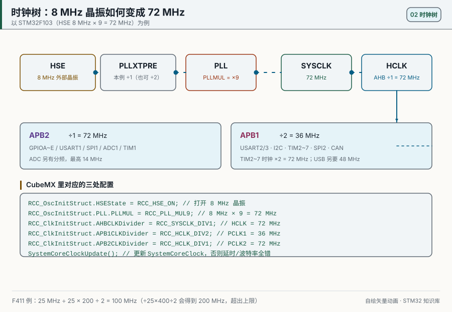
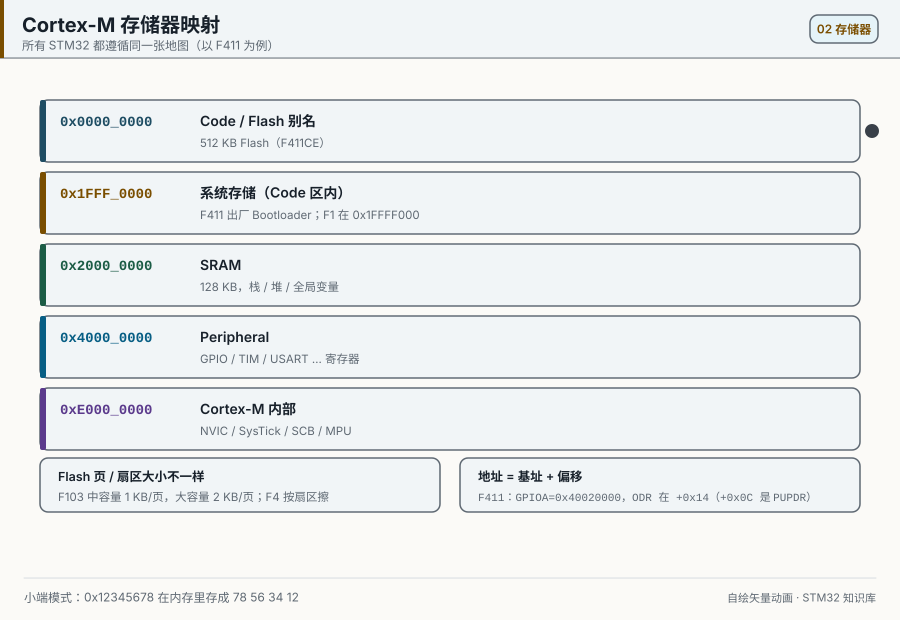
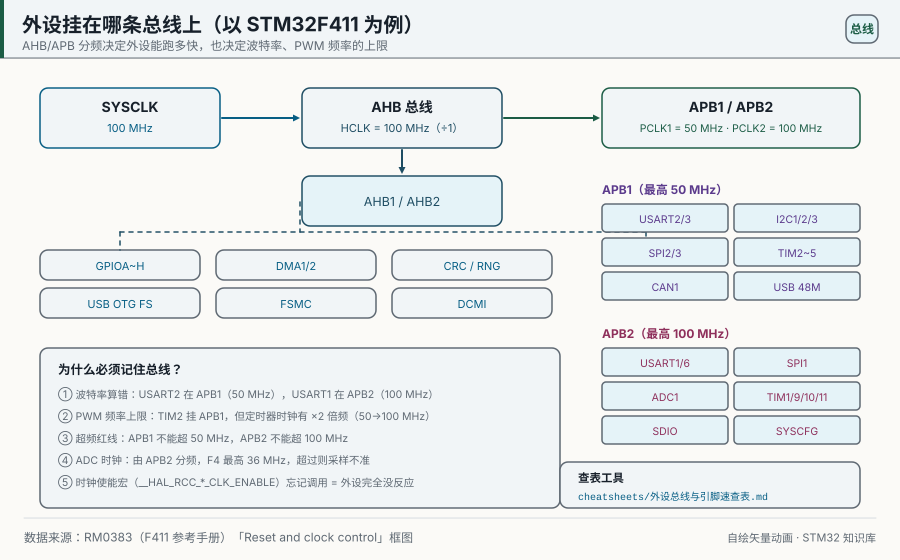
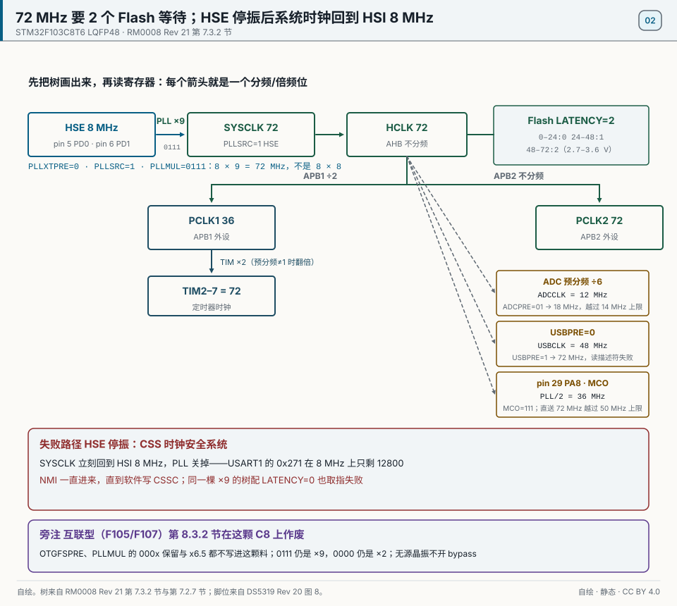
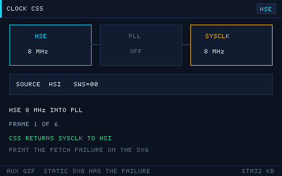

# 02 芯片选型与存储器时钟

> English: [Part, memory, clocks](en/02-part-and-clock.md)

> 读懂 STM32 命名、系列定位、存储器映射与时钟树，是选型和调频的基础。

<p align="center">
  
  <br><sub>▲ 动画：HSE 8MHz → PLL ×9 → 72MHz 的时钟树倍频过程（作者自绘矢量图）</sub>
</p>

<!-- video:ch02 -->
<p align="center">
  <video width="640" controls poster="../assets/video/ch02-clock.png">
    <source src="../assets/video/ch02-clock.mp4" type="video/mp4">
  </video>
  <br><sub>▲ 本章讲解视频（2.5 分钟）。<a href="../assets/video/ch02-clock.mp4">MP4</a> · <a href="../assets/video/ch02-clock.srt">字幕</a></sub>
</p>

<details>
<summary>旁白文字稿</summary>

1. 型号上的字母不是玄学。F103 告诉你系列，C8 这类字母看闪存容量，T6 这类看封装。先读数据手册封面和订购信息，再去数引脚。
2. 存储器地图把闪存、内存和外设分成几段。外设的本质，就是固定地址上的一排寄存器。地址抄错系列，写进去的就不是你要的那个外设。
3. F103 常见的一条路：外部 8 兆进 PLL，乘 9，系统时钟 72 兆。APB1 最高 36 兆，所以再除以 2。这条路径后面串口和 CAN 的波特率都靠它。
4. 这一帧是仓库画的时钟树。口诀你要刻进手上：先开时钟，再摸寄存器。时钟没开，写入就像写进虚空，调试器里看起来还像成功了。
5. 主频拉到 72 兆时，闪存要加等待。这一章写的是 48 到 72 兆用两个等待周期。只改 PLL、不改等待，常见的下场就是一跑就死。
6. APB 分频大于 1 的时候，定时器时钟还会再乘 2。算 PWM 前先问 HAL 要到的 PCLK，不要把 36 兆当成定时器的输入。差一倍，频率就差一倍。
7. 外部晶振起不来时，先退回内部时钟，证明芯片还活着，再查负载电容和焊点。一上来就把 PLL 乘到很高，是在用死机练习耐心。
8. 口诀再念一遍：先开时钟再摸寄存器。HSE 掉了靠时钟安全系统，想看频率可以走到时钟输出脚。别用Delay 的感觉去猜主频。
9. 动手时让串口打出主频、闪存容量和两条 APB。BluePill 上常见的是 72 兆和 64 KB 闪存。对不上，先别做后面的外设实验。
10. 合上书，三问。72 兆时闪存要几个等待？AHB 和 APB1 谁更慢？外设时钟门控没开时，写入会发生什么？

</details>
<!-- /video:ch02 -->

## 学习目标

读这一章之前：读过第 01 章，能用 STM32CubeMX 生成工程并下载到 BluePill；认得二进制和十六进制，看得懂 `|=`、`&= ~` 这样的位操作（不熟的话先读第 00 章的「零基础预备」）。做实验时再准备一只 3.3 V 电平的 USB 转串口模块，有示波器更好。

- [ ] 逐段读出 STM32F103C8T6 这个订货号，并在数据手册的订货信息里核对每一段
- [ ] 按内核、主频和外设，在几个常见系列之间选出一颗够用的芯片
- [ ] 在存储器地图上指出闪存、SRAM、外设寄存器和内核外设各在哪一段，查到 RCC 和 GPIOA 的基地址
- [ ] 从 8 MHz 晶振一路算出 SYSCLK、HCLK、PCLK1、PCLK2、定时器时钟、ADC 时钟和 USB 时钟
- [ ] 说出 72 MHz 时闪存要几个等待周期，以及为什么要先加等待、再切时钟
- [ ] 用串口打印各路时钟，用 MCO 在 PA8 上量出实际频率，确认时钟配置真的生效了

## 核心原理

**一句话结论：选芯片看订货号和数据手册里的外设表；配时钟记住一条路：8 MHz 晶振经 PLL ×9 得到 72 MHz，APB1 再除 2 得到 36 MHz，闪存加 2 个等待周期，碰任何外设之前先打开它的时钟。**

### 先打个比方

把芯片里的时钟想成一栋楼的供水。

- **时钟源**是水源。芯片内部的 HSI 像楼顶水箱，随时有水，水压不太稳；外部晶振 HSE 像市政管网，要先接通、等水压稳了才能用，但它准。
- **PLL（锁相环）**是加压泵，把 8 MHz 的「水压」抬到 72 MHz。
- **预分频器**是各层的减压阀。AHB、APB1、APB2 各有一个，APB1 这层管子最细，水压不能超过 36 MHz。
- **外设时钟门控**是每户的水龙头。上电时全部关着，省电；要用哪个外设，先拧开它的龙头。

比方到这里为止。水压可以连续调，时钟只能取寄存器给出的几档倍频和分频；水压高了只是流得快，时钟快了还要求读闪存的速度跟得上，这就是第 8 节的等待周期。

### 1. 订货号里有什么

结论：订货号的每一段都能在数据手册的「订货信息」里查到。下表照 [DS5319 Rev 20](#source-ds5319) 第 7 节把 STM32F103C8T6 逐段拆开，从左往右对着读：

| 段 | 本例 | DS5319 第 7 节的含义 |
| --- | --- | --- |
| 器件系列 | STM32 | 基于 Arm 内核的 32 位微控制器 |
| 产品类型 | F | 通用型（General-purpose） |
| 子系列 | 103 | 增强型（Performance line） |
| 引脚数 | C | 48 脚；同一份手册里还有 T = 36、R = 64、V = 100 |
| 闪存容量 | 8 | 64 KB；B = 128 KB |
| 封装 | T | LQFP；H = BGA，I = UFBGA，U = VFQFPN 或 UFQFPN |
| 温度范围 | 6 | 工业级，−40 至 85 °C；7 = −40 至 105 °C |
| 选项 | （空） | 空 = 标准品，R = 客户专用代码；另有已编程料号和 TR（卷带包装） |

所以 **STM32F103C8T6 = 通用型、增强型 F103、48 脚、64 KB 闪存、LQFP 封装、−40 至 85 °C**。

DS5319 只管 64 KB 和 128 KB 两档。别的容量和引脚数印在各自的数据手册里，例如大容量 F103 的数据手册 DS5792 里有 Z = 144 脚、C = 256 KB、E = 512 KB。同一个字母在不同系列里不一定是同一个数，换系列时重新查那颗芯片的订货信息。

### 2. 系列怎么选

结论：先按内核和主频定档次，再到那个系列里挑闪存、引脚和外设够用的型号。下表是 ST 主流系列的粗略对比，主频取该系列里的最高值；用法是先划掉主频或内核不够的行，再比价格一列。

| 系列 | 内核 | 最高主频 | 典型场景 | 价格（元/片） |
| --- | --- | --- | --- | --- |
| F0 | Cortex-M0 | 48 MHz | 替代 8 位单片机 | 4–10 |
| F1 | Cortex-M3 | 72 MHz | 教学、工业控制里的老牌选择 | 8–20 |
| F3 | Cortex-M4，带 FPU | 72 MHz | 带运放、比较器的模拟混合信号 | 15–30 |
| F4 | Cortex-M4，带 FPU | 84–180 MHz | 要浮点和 DSP 运算 | 25–70 |
| F7 | Cortex-M7 | 216 MHz | 图形、音频 | 60–150 |
| G0 | Cortex-M0+ | 64 MHz | 低成本的新设计 | 6–15 |
| G4 | Cortex-M4，带 FPU | 170 MHz | 电机控制、数字电源 | 20–45 |
| H7 | Cortex-M7 | 480 MHz（H743 修订版 V） | 高端图形、大运算量 | 80–200 |
| L0 | Cortex-M0+ | 32 MHz | 电池供电、超低功耗 | 5–12 |
| L4 | Cortex-M4，带 FPU | 80 MHz | 低功耗又要一些算力 | 20–50 |

表里的主频：F1 来自 [DS5319](#source-ds5319)，F4 的 168 MHz 和 180 MHz 来自 [RM0090](#source-rm0090) 第 3.5.1 节（180 MHz 要开过驱动），G0 来自 [DS12232](#source-ds12232)，H743 来自 [DS12110](#source-ds12110)；其余系列以 ST 官网各系列页面为准。闪存、引脚和封装在每个系列里跨度都很大，先在选型页上筛，再看那颗芯片的数据手册。

> [!NOTE]
> 价格一列是经验值，只用来比较档次，不是数据手册里的数；DS5319 和 RM0008 里都没有价格。实际价格随渠道、批次和年份变化很大。

### 3. 内核差在哪

结论：F103 的 Cortex-M3 有硬件除法，没有浮点单元。要大量浮点运算时，往 M4 或 M7 的系列走。下表从上往下，越靠下的行越是高端内核才有；「可选」的意思是 Arm 允许芯片厂决定装不装，某颗芯片装没装，看它的数据手册。

| 特性 | Cortex-M0 / M0+ | Cortex-M3 | Cortex-M4 | Cortex-M7 |
| --- | --- | --- | --- | --- |
| 架构 | Armv6-M | Armv7-M | Armv7E-M | Armv7E-M |
| 硬件除法 | 无 | 有 | 有 | 有 |
| DSP 扩展（SIMD、饱和运算） | 无 | 无 | 有 | 有 |
| 浮点单元 FPU | 无 | 无 | 可选，单精度 | 可选，单精度或双精度 |
| MPU（存储器保护单元） | M0 无，M0+ 可选 | 可选 | 可选 | 可选 |
| 缓存 | 无 | 无 | 无 | 可选，指令缓存和数据缓存 |
| 紧耦合存储器 TCM | 无 | 无 | 无 | 可选 |
| STM32 里的例子 | F0、G0、L0 | F1、F2、L1 | F3、F4、G4、L4 | F7、H7 |

M3 这一列由 [PM0056](#source-pm0056) 第 1.3 节支持：单周期 32×32 乘法和专用的硬件除法。F103C8 上有没有 MPU，PM0056 第 4.2 节说要看数据手册，而 DS5319 没有列出 MPU。其他内核的几行出自 Arm 各内核的技术参考手册。M3 算 `float` 全靠软件库，比带 FPU 的 M4 慢很多（经验值）；在 F103 上，能用整数算的地方就用整数。

### 4. 存储器地图：地址就是位置

**结论：Cortex-M3 把 4 GB 地址空间切成固定的几大段，芯片厂只能在段里摆东西。外设就是固定地址上的一排寄存器。**

寄存器是芯片里有固定地址的存储单元，写它的某几位，就改变一块硬件的行为；读它，就知道硬件现在的状态。程序配外设，归根到底就是往这些地址写数。

下表左两列是内核规定的分段（[PM0056](#source-pm0056) 第 2.2 节图 9），右一列是 F103C8 在每一段里实际放了什么（[RM0008 Rev 21](#source-rm0008) 第 3.3 节表 3、第 3.3.3 节表 5）。找一个地址时，先看它落在哪一段，再看右列：

| 地址范围 | 段 | F103C8 在这里放了什么 |
| --- | --- | --- |
| 0x0000_0000–0x1FFF_FFFF | Code，0.5 GB | 闪存从 0x0800_0000 起 64 KB；系统存储器从 0x1FFF_F000 起 2 KB（出厂 bootloader）；选项字节从 0x1FFF_F800 起 16 字节；0x0000_0000 起是启动别名（第 01 章第 7 节） |
| 0x2000_0000–0x3FFF_FFFF | SRAM，0.5 GB | 片上 SRAM 从 0x2000_0000 起 20 KB |
| 0x4000_0000–0x5FFF_FFFF | Peripheral，0.5 GB | 外设寄存器：APB1 从 0x4000_0000 起，APB2 从 0x4001_0000 起，AHB 上的 DMA1、RCC、闪存接口从 0x4002_0000 起 |
| 0x6000_0000–0x9FFF_FFFF | External RAM，1 GB | 空着，这颗 C8 没有 FSMC |
| 0xA000_0000–0xDFFF_FFFF | External device，1 GB | 空着 |
| 0xE000_0000–0xE00F_FFFF | 私有外设总线 PPB，1 MB | 内核外设：NVIC、SysTick、SCB，以及调试单元 |
| 0xE010_0000–0xFFFF_FFFF | 厂商自定义，511 MB | — |

SRAM 和外设段的开头各有 1 MB 支持位带（bit-band），可以单独读写一位，第 03 章第 8 节讲过。

<p align="center">
  
  <br><sub>▲ 动画：Cortex-M 存储器映射（Flash/SRAM/外设/系统区）（作者自绘矢量图）</sub>
</p>

常用外设的基地址和所在总线如下（[RM0008 Rev 21](#source-rm0008) 第 3.3 节表 3）。寄存器地址 = 基地址 + 偏移，例如 RCC_CFGR 的偏移是 0x04（第 7.3.2 节），地址就是 0x40021004：

| 外设 | 基地址 | 总线 |
| --- | --- | --- |
| GPIOA | 0x40010800 | APB2 |
| GPIOB | 0x40010C00 | APB2 |
| GPIOC | 0x40011000 | APB2 |
| USART1 | 0x40013800 | APB2 |
| TIM2 | 0x40000000 | APB1 |
| RCC | 0x40021000 | AHB |
| FLASH（闪存接口） | 0x40022000 | AHB |

CMSIS 头文件里都有这些地址的宏（如 `GPIOA_BASE`）和结构体（如 `RCC->CFGR`），写代码用宏，不把地址写死。换系列时地址会变：F1 的 GPIO 挂在 APB2 上，F4 的 GPIO 挂在 AHB1 上，开时钟的宏也跟着变。

### 5. 启动方式：BOOT0 / BOOT1

结论：平时 BOOT0 接 0，从闪存启动。三种启动方式的细节在第 01 章第 7 节，这里只列结论，出处是 [RM0008 Rev 21 第 3.4 节表 9](#source-rm0008-boot)：

| BOOT1 | BOOT0 | 启动区 | 用途 |
| --- | --- | --- | --- |
| 任意 | 0 | 主闪存（0x0800_0000） | 正常运行 |
| 0 | 1 | 系统存储器（0x1FFF_F000） | 出厂 bootloader，经 USART1 下载 |
| 1 | 1 | 片上 SRAM（0x2000_0000） | 调试放在 SRAM 里的程序；掉电就没了，程序还要自己把向量表移到 SRAM |

### 6. 时钟从哪来：四个时钟源和一个 PLL

**结论：F103 有两个高速时钟源（HSI、HSE）和两个低速时钟源（LSI、LSE）。系统时钟 SYSCLK 从 HSI、HSE、PLL 三者里选一个；复位后用的是 HSI 8 MHz（[RM0008 Rev 21 第 7.2.6 节](#source-rm0008-rcc)）。**

先说几个词：

- **时钟**：一串方波，数字电路每来一个上升沿走一步。频率越高，每秒走的步数越多。
- **晶振**：一片石英晶体，接上芯片里的振荡电路后，以很准的频率振荡。BluePill 上那颗银色小元件就是 8 MHz 晶振。
- **RC 振荡器**：芯片内部用电阻和电容做的振荡器，不用外接元件，但频率会随温度和电压漂。
- **PLL（Phase-Locked Loop，锁相环）**：把输入时钟乘上一个倍数再输出的电路。F103 的 PLL 只能乘整数，×2 到 ×16。

下表列出四个时钟源。频率和精度一列的数字来自 [DS5319 Rev 20](#source-ds5319) 的电气特性表，用的时候看最后一列找你要的那一路：

| 时钟源 | 是什么 | 频率 | 精度和特点 | 主要用途 |
| --- | --- | --- | --- | --- |
| HSI | 内部高速 RC 振荡器 | 8 MHz | 出厂校准，−40 至 105 °C 范围内偏差 −2% 至 +2.5%（表 24）；起振 1–2 µs | 复位后的系统时钟；HSE 坏了时的后备 |
| HSE | 外部高速晶振，或外部送进来的时钟 | 晶振 4–16 MHz（表 22），外部时钟 1–25 MHz（表 20） | 准，取决于晶振；晶振典型起振 2 ms（表 22） | 经 PLL 得到 72 MHz |
| LSI | 内部低速 RC 振荡器 | 约 40 kHz，在 30–60 kHz 之间（RM0008 第 7.2.5 节） | 很不准 | 独立看门狗，也可以给 RTC |
| LSE | 外部低速晶振 | 32.768 kHz | 准 | RTC 走时（第 11 章） |

PLL 有四条规矩：

- 输入要在 1–25 MHz，输出要在 16–72 MHz，锁定最多 200 µs（DS5319 表 27）。
- 输入可以选 HSE（可以先除以 2），或者 HSI÷2。
- 用 HSI 做输入时只有 8 / 2 = 4 MHz，最高只能乘到 64 MHz（RM0008 Rev 21 第 7.2 节图 8 的注 1）。
- 倍数和输入源要在打开 PLL 之前设好，PLL 开着时写不进去（RM0008 第 7.2.3 节、第 7.3.2 节）。

> [!WARNING]
> HAL 不会去量晶振。它按 `stm32f1xx_hal_conf.h` 里的 `HSE_VALUE`（CubeMX 默认 8000000）推算各路时钟。板上要是 12 MHz 的晶振而 `HSE_VALUE` 还是 8 MHz，×9 实际得到 108 MHz，已经超过 72 MHz，HAL 却照样报告 72 MHz。先看清晶振外壳上印的频率。

### 7. 时钟树与分频：从 SYSCLK 一路分下去

结论：SYSCLK 经过 AHB 预分频变成 HCLK，HCLK 再分成 APB1 和 APB2 两路，每一路都有上限。下图是本书一直用的那组设定：

```text
HSE 8 MHz ─► PLL ×9 ─► SYSCLK 72 MHz ─► AHB ÷1 ─► HCLK 72 MHz（内核、DMA、存储器）
               │                                   ├─► APB1 ÷2 ─► PCLK1 36 MHz ─► TIM2–TIM4 时钟 ×2 = 72 MHz
               │                                   └─► APB2 ÷1 ─► PCLK2 72 MHz ─► TIM1 72 MHz
               │                                                       └─► ADC ÷6 ─► ADCCLK 12 MHz
               └─► USB ÷1.5 ─► USBCLK 48 MHz
```

下表把每一路的来处、设定和上限列在一起。每一行都等于上一级乘或除一个系数；「上限或要求」一列的数，一个都不能越过。USB 要的不是上限，而是正好 48 MHz，所以用 USB 时 PLL 只能输出 48 MHz 或 72 MHz（[RM0008 Rev 21 第 7.2.3 节](#source-rm0008-rcc)）。

| 时钟 | 从哪来 | 本书设定 | 结果 | 上限或要求 | 出处 |
| --- | --- | --- | --- | --- | --- |
| SYSCLK | PLL | ×9 | 72 MHz | 72 MHz | RM0008 第 7.3.2 节 |
| HCLK（AHB） | SYSCLK | ÷1 | 72 MHz | 72 MHz | DS5319 表 9 |
| PCLK1（APB1） | HCLK | ÷2 | 36 MHz | 36 MHz | DS5319 表 9 |
| PCLK2（APB2） | HCLK | ÷1 | 72 MHz | 72 MHz | DS5319 表 9 |
| TIM2–TIM4 | PCLK1 | APB1 预分频不是 1，×2 | 72 MHz | — | RM0008 第 7.2 节 |
| TIM1 | PCLK2 | APB2 预分频是 1，×1 | 72 MHz | — | RM0008 第 7.2 节 |
| ADCCLK | PCLK2 | ÷6 | 12 MHz | 14 MHz | RM0008 第 11.1 节，DS5319 表 47 |
| USBCLK | PLL | ÷1.5 | 48 MHz | 必须是 48 MHz | RM0008 第 7.2.3 节 |

> [!WARNING]
> APB 预分频不是 1 时，挂在那条总线上的定时器时钟是 PCLK 的 2 倍。APB1 = 36 MHz 时，TIM2–TIM4 的计数时钟是 72 MHz，不是 36 MHz（RM0008 Rev 21 第 7.2 节）。这颗 C8 的通用定时器只有 TIM2–TIM4（DS5319 表 2），RM0008 里出现的 TIM5–TIM7 在这颗芯片上不存在。

外设挂在哪条总线上，决定它用哪一路时钟、用哪个宏开时钟。USART1 在 APB2，时钟是 PCLK2；USART2 在 APB1，时钟是 PCLK1（[RM0008 Rev 21](#source-rm0008) 第 3.3 节表 3）。下图按总线画出 F1 的外设：

<p align="center">
  
  <br><sub>▲ 图示：AHB/APB1/APB2 上分别挂载哪些外设（作者自绘矢量图）</sub>
</p>

### 8. Flash 等待周期

**结论：闪存（Flash）读得没有 CPU 快。主频越高，每次读闪存要多等几个时钟周期；72 MHz 要等 2 个。**

等待周期（wait state）是 CPU 读闪存时额外空等的时钟周期数，写在闪存接口寄存器 FLASH_ACR 的 LATENCY 位里。FLASH_ACR 的地址是 0x40022000。按目标主频落在哪一档取值（[RM0008 Rev 21](#source-rm0008) 第 3.3.3 节）：

| SYSCLK | LATENCY | 等待周期 |
| --- | --- | --- |
| 0 < SYSCLK ≤ 24 MHz | 000 | 0 |
| 24 MHz < SYSCLK ≤ 48 MHz | 001 | 1 |
| 48 MHz < SYSCLK ≤ 72 MHz | 010 | 2 |

这张表只按 SYSCLK 分档，与电源电压无关。F4 那种按电压分档的表（RM0090 第 3.5.1 节）不适用于 F1。

- **顺序**：升频时先加等待、再切时钟；降频时先切时钟、再减等待。`HAL_RCC_ClockConfig()` 就是按这个顺序做的。
- **预取缓冲区**：两块 64 位的缓冲，复位后就开着，CPU 取下一条指令时多半已经在缓冲里了。AHB 预分频不是 1 时它必须开着（第 7.3.2 节 HPRE 的注）。
- **配错的后果**：只把 PLL 改成 ×9、LATENCY 留在 0，CPU 留给闪存的读取时间比闪存需要的访问时间短，取指可能出错，表现为程序跑飞或进 HardFault，而且可能时好时坏。

### 9. 先开时钟再碰寄存器，以及 CSS 和 MCO

**结论：任何外设在第一次读写寄存器之前，都要先打开它的时钟。上电默认的系统时钟是 HSI 8 MHz，不是 Cube 里填的 72 MHz——`SystemClock_Config()` 跑完之前，按 72 MHz 算出来的波特率都是错的。**

外设时钟没开时，软件可能读不到它的寄存器，读回的值总是 0（[RM0008 Rev 21](#source-rm0008) 第 7.3.7 节 RCC_APB2ENR 的注）。例如 GPIOA 的 CRL 复位值是 0x4444 4444（第 9.2.1 节）；GPIOA 时钟没开时去读，只会读到 0。

门控、CSS、MCO 三个机制，下表各用一行说清，最后一列是 HAL 里对应的调用：

| 机制 | 干什么 | 怎么用 |
| --- | --- | --- |
| 外设时钟门控 | 不打开，这块外设就不工作，寄存器读回 0 | 先 `__HAL_RCC_xxx_CLK_ENABLE()`，再 `HAL_xxx_Init()` |
| CSS（Clock Security System，时钟安全系统） | HSE 停振时自动切回 HSI，并触发 NMI | `HAL_RCC_EnableCSS()`；NMI 里调用 `HAL_RCC_NMI_IRQHandler()` |
| MCO（Microcontroller Clock Output，时钟输出） | 把一路内部时钟送到 PA8，给示波器量 | `HAL_RCC_MCOConfig()` |

**CSS 的细节。**打开 CSS 后，检测器在 HSE 起振之后才开始工作。运行中 HSE 停振时，硬件关掉 HSE；如果 HSE 直接或经 PLL 当着系统时钟，系统时钟切到 HSI，PLL 也被关掉。同时触发 NMI（不可屏蔽中断）。NMI 里必须写 RCC_CIR 寄存器的 CSSC 位清掉标志，否则 NMI 会一直进来（[RM0008 Rev 21 第 7.2.7 节](#source-rm0008-rcc)）。同一事件还送到高级定时器的刹车输入，这颗 C8 上只有 TIM1。晶振从一开始就没起振时 CSS 帮不上忙：检测器还没启动，`HAL_RCC_OscConfig()` 等不到 HSE 就绪，返回超时。

**MCO 的细节。**MCO 能送出四路时钟：SYSCLK、HSI、HSE、PLL÷2，由 RCC_CFGR 的 MCO 位选择（第 7.2.10 节）。送 SYSCLK 时手册要求不超过 50 MHz，这是 I/O 的最高速度，所以 72 MHz 的 SYSCLK 不要直接送出去，改送 PLL÷2 的 36 MHz。HAL 里的 `RCC_MCO1SOURCE_PLLCLK` 在 F1 上就是 PLL÷2，名字里看不出这个除以 2。

口诀：**先开时钟再碰寄存器；HSE 掉了靠 CSS，想看频率走 MCO。**

### 10. RCC_CFGR：时钟树对应的寄存器位

上面每一步设定都落在 RCC_CFGR 里。它在 0x40021004，复位值 0x0000 0000。下表按位从高到低列出（[RM0008 Rev 21 第 7.3.2 节](#source-rm0008-rcc)），最后一列是本书的设定，对着它看代码里每个宏写进了哪几位：

| 位 | 名称 | 取值 | 本书设定 |
| --- | --- | --- | --- |
| 26:24 | MCO | 0xx 不输出；100 SYSCLK；101 HSI；110 HSE；111 PLL÷2 | 111（实验二） |
| 22 | USBPRE | 0：PLL÷1.5；1：不分频 | 0 |
| 21:18 | PLLMUL | 0000 = ×2，0001 = ×3，…，0111 = ×9，…，1110 = ×16，1111 也是 ×16 | 0111 |
| 17 | PLLXTPRE | 0：HSE 不分频；1：HSE÷2 | 0 |
| 16 | PLLSRC | 0：HSI÷2；1：HSE | 1 |
| 15:14 | ADCPRE | PCLK2 的 00 ÷2，01 ÷4，10 ÷6，11 ÷8 | 10 |
| 13:11 | PPRE2 | 0xx 不分频；100 ÷2；101 ÷4；110 ÷8；111 ÷16 | 0xx |
| 10:8 | PPRE1 | 编码同 PPRE2；软件要保证 PCLK1 不超过 36 MHz | 100 |
| 7:4 | HPRE | 0xxx 不分频；1000 ÷2，1001 ÷4，1010 ÷8，1011 ÷16，1100 ÷64 … 1111 ÷512，没有 ÷32 | 0xxx |
| 3:2 | SWS | 只读：00 HSI；01 HSE；10 PLL | 读回 10 |
| 1:0 | SW | 00 HSI；01 HSE；10 PLL；11 不允许 | 10 |

PLLSRC、PLLXTPRE、PLLMUL 只能在 PLL 关着时写。SW 除了软件写，硬件也会改它：离开 Stop、Standby 模式时，或者 CSS 检测到 HSE 失效时，硬件把它改回 HSI。

这张表来自低、中、大和 XL 容量共用的第 7.3.2 节。互联型（F105/F107）的 RCC_CFGR 在第 8 章的第 8.3.2 节，那里的 PLLMUL 编码不同，在 STM32F103C8T6 上作废。

### 11. 换系列时什么会变

结论：F1 的时钟树是最简单的一种。换到别的系列，PLL 的结构、最高主频、等待周期的分档都要重新查。下表只列和 F1 不同的地方：

| 系列 | 最高 SYSCLK | PLL 结构 | 和 F1 最大的不同 |
| --- | --- | --- | --- |
| F1 | 72 MHz | HSE 或 HSI÷2，再 ×2 到 ×16 | 没有 PLLM、PLLN、PLLP 这些分频 |
| F4 | F405/F407 为 168 MHz；F42x/F43x 开过驱动后 180 MHz | M 分频、N 倍频、P 和 Q 两路输出 | Q 路给 USB 等外设出 48 MHz；闪存等待按电压分档（RM0090 第 3.5.1 节） |
| G0 | 64 MHz | M 分频、N 倍频，P、Q、R 三路输出 | 系统时钟取 R 路（[RM0444](#source-rm0444)） |
| H7 | 480 MHz（H743 修订版 V） | 最多 3 个 PLL | 主频档位和内核电压档绑在一起（[DS12110](#source-ds12110)） |

MCO 也不一样：F1 只有 PA8 一路，F4 有 MCO1（PA8）和 MCO2（PC9）两路（RM0090）。

## 硬件与接线

本章的实验只用到三样东西：板上已经焊好的晶振、一只打印用的 USB 转串口模块、一只量 MCO 的示波器。引脚号按 LQFP48，来自 [DS5319 Rev 20](#source-ds5319) 表 5：

| 开发板 | 外设/信号 | 引脚 | 备注 |
| --- | --- | --- | --- |
| BluePill | HSE 晶振 8 MHz | 第 5 脚 PD0-OSC_IN、第 6 脚 PD1-OSC_OUT | 板上已焊；先看晶振外壳印的频率 |
| BluePill | LSE 晶振 32.768 kHz | 第 3 脚 PC14-OSC32_IN、第 4 脚 PC15-OSC32_OUT | 给 RTC 用，本章不用 |
| BluePill | BOOT0 跳线 | 第 44 脚 BOOT0 | 保持 0，从闪存启动 |
| USB 转串口 | USART1_TX → 模块 RXD | 第 30 脚 PA9 | 实验一、三打印用，115200 8N1（例程设定） |
| USB 转串口 | USART1_RX ← 模块 TXD | 第 31 脚 PA10 | 本章只发不收，可以不接 |
| 示波器 | MCO 输出 | 第 29 脚 PA8 | 实验二量频率 |
| 全部 | GND | GND | 串口模块、示波器都要和板子共地 |

```text
BluePill                              USB 转串口模块（3.3 V 电平）
  PA9  (USART1_TX，第 30 脚) ──────►  RXD
  PA10 (USART1_RX，第 31 脚) ◄──────  TXD（可不接）
  GND  ─────────────────────────────  GND

BluePill                              示波器
  PA8  (MCO，第 29 脚) ─────────────  探头
  GND  ─────────────────────────────  探头地线（越短越好）

板上已焊：8 MHz 晶振接第 5、6 脚（PD0/PD1）；BOOT0 跳线保持 0
```

串口要交叉接：板子的 TX 接模块的 RX。接成同名相连，电脑上一个字也收不到。

## 代码实现

下面的 `main.c` 把时钟配到 72 MHz，再从 USART1 打印各路时钟、闪存容量和唯一 ID。它放在第 01 章那个 CubeMX 工程里，工程要先在 CubeMX 里打开 USART1（Mode 选 Asynchronous，115200 8N1，引脚是 PA9/PA10），并保持第 01 章勾选的「每个外设生成一对 .c/.h 文件」，这样 `usart.c` 里就有 `huart1` 和 `MX_USART1_UART_Init()`。

```c
/* main.c：打印各路时钟、闪存容量和唯一 ID（STM32F103C8T6，HSE 8 MHz） */
#include "main.h"
#include "usart.h"
#include <stdio.h>

#define UART_TX_TIMEOUT_MS  100U    /* 发送超时（例程设定） */

void SystemClock_Config(void);

/* GCC 的 printf 最后调用 _write()，这里把字符交给 USART1 */
int _write(int fd, char *ptr, int len)
{
    (void)fd;
    HAL_UART_Transmit(&huart1, (uint8_t *)ptr, (uint16_t)len, UART_TX_TIMEOUT_MS);
    return len;
}

int main(void)
{
    HAL_Init();
    SystemClock_Config();
    MX_USART1_UART_Init();

    /* 设备电子签名（RM0008 第 30 章）；两个地址宏来自 CMSIS 头文件 stm32f103xb.h */
    uint16_t flash_kb = *(const volatile uint16_t *)FLASHSIZE_BASE;      /* 0x1FFFF7E0 */
    const volatile uint32_t *uid = (const volatile uint32_t *)UID_BASE;  /* 0x1FFFF7E8 */

    printf("SYSCLK=%lu Hz, HCLK=%lu Hz\r\n",
           (unsigned long)HAL_RCC_GetSysClockFreq(), (unsigned long)HAL_RCC_GetHCLKFreq());
    printf("PCLK1=%lu Hz, PCLK2=%lu Hz\r\n",
           (unsigned long)HAL_RCC_GetPCLK1Freq(), (unsigned long)HAL_RCC_GetPCLK2Freq());
    printf("Flash=%u KB\r\n", (unsigned)flash_kb);
    printf("UID=%08lX-%08lX-%08lX\r\n",
           (unsigned long)uid[0], (unsigned long)uid[1], (unsigned long)uid[2]);

    while (1)
    {
    }
}

void SystemClock_Config(void)
{
    RCC_OscInitTypeDef       osc    = {0};
    RCC_ClkInitTypeDef       clk    = {0};
    RCC_PeriphCLKInitTypeDef periph = {0};

    osc.OscillatorType = RCC_OSCILLATORTYPE_HSE;
    osc.HSEState       = RCC_HSE_ON;
    osc.HSEPredivValue = RCC_HSE_PREDIV_DIV1;     /* PLLXTPRE = 0 */
    osc.HSIState       = RCC_HSI_ON;
    osc.PLL.PLLState   = RCC_PLL_ON;
    osc.PLL.PLLSource  = RCC_PLLSOURCE_HSE;       /* PLLSRC = 1 */
    osc.PLL.PLLMUL     = RCC_PLL_MUL9;            /* PLLMUL = 0111：8 MHz × 9 = 72 MHz */
    if (HAL_RCC_OscConfig(&osc) != HAL_OK)
    {
        Error_Handler();                          /* 晶振没起振会停在这里 */
    }

    clk.ClockType      = RCC_CLOCKTYPE_HCLK | RCC_CLOCKTYPE_SYSCLK
                       | RCC_CLOCKTYPE_PCLK1 | RCC_CLOCKTYPE_PCLK2;
    clk.SYSCLKSource   = RCC_SYSCLKSOURCE_PLLCLK; /* SW = 10 */
    clk.AHBCLKDivider  = RCC_SYSCLK_DIV1;         /* HCLK 72 MHz */
    clk.APB1CLKDivider = RCC_HCLK_DIV2;           /* PCLK1 36 MHz */
    clk.APB2CLKDivider = RCC_HCLK_DIV1;           /* PCLK2 72 MHz */
    if (HAL_RCC_ClockConfig(&clk, FLASH_LATENCY_2) != HAL_OK)   /* LATENCY = 010 */
    {
        Error_Handler();
    }

    periph.PeriphClockSelection = RCC_PERIPHCLK_ADC | RCC_PERIPHCLK_USB;
    periph.AdcClockSelection    = RCC_ADCPCLK2_DIV6;            /* ADCPRE = 10：72 / 6 = 12 MHz */
    periph.UsbClockSelection    = RCC_USBCLKSOURCE_PLL_DIV1_5;  /* USBPRE = 0：72 / 1.5 = 48 MHz */
    if (HAL_RCCEx_PeriphCLKConfig(&periph) != HAL_OK)
    {
        Error_Handler();
    }
}

void Error_Handler(void)
{
    __disable_irq();          /* 停在这里；调试器暂停就能看到卡在哪 */
    while (1)
    {
    }
}
```

逐段看：

- `HAL_RCC_GetSysClockFreq()` 这几个函数不测量，只按 RCC 寄存器的设定和 `HSE_VALUE` 推算。想知道实际频率，用实验二的 MCO 去量。
- `HAL_RCC_OscConfig()` 打开 HSE、等它就绪，再配 PLL、等它锁定，每一步都有超时。晶振没起振时它返回超时，程序停进 `Error_Handler()`，系统时钟还留在 HSI。
- `HAL_RCC_ClockConfig(&clk, FLASH_LATENCY_2)` 先写等待周期、再切到 PLL，最后更新全局变量 `SystemCoreClock`，并按新主频重设 1 ms 的 SysTick。
- `HAL_RCCEx_PeriphCLKConfig()` 写 ADCPRE 和 USBPRE。CubeMX 只在你打开 ADC 或 USB 时才生成这一段；这里写出来，是为了让时钟树的每一路都有着落。
- `FLASHSIZE_BASE` 处的 16 位数是以 KB 计的闪存容量（RM0008 第 30.1.1 节）。`UID_BASE` 起的 96 位是唯一 ID，每颗芯片都不同，常拿来当序列号（第 30.2 节）。
- `_write()` 只对 GCC 有效。Keil 的 C 库不走 `_write()`，要改写 `fputc()`。

同一件事用寄存器写，就是下面这个顺序：开 HSE、加等待、定 PLL 和三个预分频、开 PLL、切 SW。

```c
/* 寄存器版：从复位后的 HSI 切到 72 MHz，和上面的 SystemClock_Config() 做同一件事 */
#include "stm32f1xx.h"

#define HSE_WAIT_LOOPS  0x5000U   /* 等 HSE 起振的轮询上限（例程设定） */

static int clock_to_72mhz(void)
{
    uint32_t n = 0U;

    RCC->CR |= RCC_CR_HSEON;                                   /* 1. 开 HSE */
    while ((RCC->CR & RCC_CR_HSERDY) == 0U)
    {
        if (++n > HSE_WAIT_LOOPS)
        {
            return -1;                                         /* 晶振没起振：留在 HSI */
        }
    }

    FLASH->ACR = FLASH_ACR_PRFTBE                              /* 2. 预取开着 */
               | (2U << FLASH_ACR_LATENCY_Pos);                /*    LATENCY = 010，先加等待 */

    RCC->CFGR = (RCC->CFGR & ~(RCC_CFGR_HPRE | RCC_CFGR_PPRE1 | RCC_CFGR_PPRE2
                               | RCC_CFGR_ADCPRE | RCC_CFGR_USBPRE
                               | RCC_CFGR_PLLSRC | RCC_CFGR_PLLXTPRE | RCC_CFGR_PLLMULL))
              | RCC_CFGR_HPRE_DIV1                             /* 3. HCLK = 72 MHz */
              | RCC_CFGR_PPRE1_DIV2                            /*    PCLK1 = 36 MHz */
              | RCC_CFGR_PPRE2_DIV1                            /*    PCLK2 = 72 MHz */
              | RCC_CFGR_ADCPRE_DIV6                           /*    ADCCLK = 12 MHz；USBPRE 清 0 得 48 MHz */
              | RCC_CFGR_PLLSRC                                /*    PLLSRC = 1：HSE */
              | RCC_CFGR_PLLMULL9;                             /*    PLLMUL = 0111：×9 */

    RCC->CR |= RCC_CR_PLLON;                                   /* 4. 开 PLL，等它锁定 */
    while ((RCC->CR & RCC_CR_PLLRDY) == 0U)
    {
    }

    RCC->CFGR = (RCC->CFGR & ~RCC_CFGR_SW) | RCC_CFGR_SW_PLL;  /* 5. 切到 PLL */
    while ((RCC->CFGR & RCC_CFGR_SWS) != RCC_CFGR_SWS_PLL)
    {
    }

    SystemCoreClockUpdate();                                   /* 让 SystemCoreClock 跟上新主频 */
    return 0;
}
```

- 第 2 步不用 `FLASH_ACR_LATENCY_2`。在 STM32CubeF1 的 CMSIS 头文件 `stm32f103xb.h` 里，它指的是 LATENCY 字段的第 2 位（0x4），写进去是 100，不是「2 个等待周期」。要么写 `2U << FLASH_ACR_LATENCY_Pos`，要么用 HAL 的 `FLASH_LATENCY_2`，后者在 `stm32f1xx_hal_flash.h` 里定义成 `FLASH_ACR_LATENCY_1`，值是 0x2。
- 第 3 步一次写完 RCC_CFGR 里和 PLL、预分频有关的位。PLL 还关着，PLLSRC、PLLXTPRE、PLLMUL 才写得进去。
- `SystemCoreClockUpdate()` 是 CMSIS 函数，按寄存器重新算出 `SystemCoreClock`。工程里还用 HAL 的话，接着要调用 `HAL_InitTick(TICK_INT_PRIORITY)`，否则 `HAL_Delay()` 还按 8 MHz 计时。

实验二要用的 MCO 输出只有一行，放在 `MX_USART1_UART_Init()` 之后：

```c
HAL_RCC_MCOConfig(RCC_MCO1, RCC_MCO1SOURCE_HSE, RCC_MCODIV_1);       /* PA8 输出 HSE：8 MHz */
/* 换成下面这行，PA8 输出 PLL÷2：36 MHz
HAL_RCC_MCOConfig(RCC_MCO1, RCC_MCO1SOURCE_PLLCLK, RCC_MCODIV_1); */
```

`HAL_RCC_MCOConfig()` 会自己打开 GPIOA 的时钟，把 PA8 配成复用推挽输出、50 MHz 档。

实验三把 `SystemClock_Config()` 里的振荡器部分换成下面这段，不用晶振也能跑：

```c
osc.OscillatorType      = RCC_OSCILLATORTYPE_HSI;
osc.HSIState            = RCC_HSI_ON;
osc.HSICalibrationValue = RCC_HSICALIBRATION_DEFAULT;   /* HSITRIM 用默认值 16 */
osc.PLL.PLLState        = RCC_PLL_ON;
osc.PLL.PLLSource       = RCC_PLLSOURCE_HSI_DIV2;       /* PLLSRC = 0：8 / 2 = 4 MHz */
osc.PLL.PLLMUL          = RCC_PLL_MUL16;                /* PLLMUL = 1110：4 × 16 = 64 MHz */
```

## 动手实验

1. **实验一：打印各路时钟。** 编译、下载上面的 `main.c`，电脑上用串口助手以 115200 8N1 打开模块对应的串口，按一下复位键。
   - 预期现象：串口打印 `SYSCLK=72000000 Hz, HCLK=72000000 Hz`、`PCLK1=36000000 Hz, PCLK2=72000000 Hz`、`Flash=64 KB`，以及一行 UID。
   - 怎么确认：逐个对照第 7 节的时钟表；换一块板子再跑一次，UID 应该不同。
   - 没成功先查：一个字都没有，先查 TX、RX 是否交叉接、地线是否接上；出来的是乱码，查 `HSE_VALUE` 和板上晶振是否一致；闪存不是 64 KB，先看芯片丝印，兼容芯片的电子签名可能不同（经验值）。
2. **实验二：用 MCO 量出实际频率。** 加上 MCO 那一行，示波器探头接 PA8，地线接 GND。
   - 预期现象：先看到 8 MHz 的方波；换成 PLL÷2 那一行后是 36 MHz。
   - 怎么确认：用示波器的频率测量读数，8 MHz 那一路的偏差应在晶振标称精度以内。36 MHz 那一路要求示波器带宽在 100 MHz 以上才看得出方波（经验值），带宽不够时波形接近正弦，频率读数仍然有效。
   - 没成功先查：PA8 上什么都没有，确认 `HAL_RCC_MCOConfig()` 确实执行到了；24 MHz 采样的廉价逻辑分析仪量不了 36 MHz；8 MHz 那一路每个周期只采到 3 个点，读数会跳（经验值）。
3. **实验三：不用晶振也能跑。** 把振荡器部分换成 HSI 那段，其余不动，重新下载。
   - 预期现象：打印 `SYSCLK=64000000 Hz, HCLK=64000000 Hz` 和 `PCLK1=32000000 Hz, PCLK2=64000000 Hz`，串口照样能用。
   - 怎么确认：`8 / 2 × 16 = 64` MHz；64 MHz 仍在 48–72 MHz 这一档，`FLASH_LATENCY_2` 不用改。晶振起不来的时候，先用这个配置证明芯片本身是好的，再去查晶振和焊点。
   - 没成功先查：`PLLSource` 是否改成了 `RCC_PLLSOURCE_HSI_DIV2`；这时 USB 用不了，因为 64 MHz 不是 48 或 72 MHz。

## 自测

1. HSE 是 8 MHz，PLLXTPRE = 1，PLLMUL = 1110。SYSCLK 是多少？LATENCY 该写几？
2. HCLK = 72 MHz，PPRE1 设成 101。PCLK1 是多少？TIM2 的计数时钟是多少？
3. 要用 USB，又想把主频降到 48 MHz。PLLMUL、USBPRE、LATENCY 和 APB1 预分频各怎么设？
4. 你写了 `GPIOA->CRL`，却忘了开 GPIOA 的时钟，读回来是 0。为什么？开了时钟、刚复位时读，应该是多少？
5. 读地址 0x1FFFF7E0 处的 16 位数，得到 0x0040。这颗芯片的闪存有多大？

参考答案：

1. PLL 输入 = 8 / 2 = 4 MHz（在 1–25 MHz 之内），×16 = 64 MHz。48 < 64 ≤ 72，LATENCY = 010，即 2 个等待周期。
2. 101 是 ÷4，PCLK1 = 72 / 4 = 18 MHz。APB1 预分频不是 1，定时器时钟 ×2，TIM2 = 36 MHz。
3. 8 × 6 = 48 MHz，PLLMUL = 0100；USBPRE = 1（不分频），USBCLK = 48 MHz。24 < 48 ≤ 48，LATENCY = 001，即 1 个等待周期。APB1 不分频会得到 48 MHz，超过 36 MHz，所以 PPRE1 = 100（÷2），PCLK1 = 24 MHz。
4. RM0008 第 7.3.7 节的注：外设时钟没开时，软件可能读不到寄存器的值，读回总是 0。开了时钟、复位后读 CRL，应是复位值 0x4444 4444（第 9.2.1 节）。
5. 0x0040 = 64，单位是 KB，所以是 64 KB（RM0008 第 30.1.1 节）。

## 原理与适用范围

> [!NOTE]
> 从这一节到「常见坑与出处」是深入部分，把前面的结论落到具体订货号、手册章节和能复算的数字上。第一次读可以先跳过，做完动手实验再回来对照。

这一章的时钟结论钉在订货号 STM32F103C8T6、封装 LQFP48 上。

**时钟源和倍频。**HSE 从第 5 脚 PD0-OSC_IN、第 6 脚 PD1-OSC_OUT 进来，8 MHz。`PLLXTPRE=0`（HSE 不预分频），`PLLSRC=1`（PLL 入口是 HSE），`PLLMUL=0111`（×9），`8 × 9 = 72` MHz。`SW=10` 时 SYSCLK 用 PLL。出处是 [RM0008 Rev 21 第 7.3.2 节](#source-rm0008-rcc)。

**三条总线。**HPRE 不分频，HCLK = 72 MHz。PPRE1 = `100`（÷2），PCLK1 = 36 MHz，不得超过 36 MHz。PPRE2 不分频，PCLK2 = 72 MHz。

**定时器时钟。**APB 预分频不是 1 时，挂在那条总线上的定时器时钟 ×2，所以 TIM2–TIM4 是 72 MHz。TIM1 在 APB2，预分频为 1，不再 ×2，也是 72 MHz。这颗 C8 的 APB1 上只有 TIM2–TIM4 三个通用定时器（DS5319 表 2）。

**闪存等待。**`FLASH_ACR` 基址 `0x40022000`，偏移 `0x00`。48 MHz 到 72 MHz 这一档 LATENCY 是 `010`，也就是 2；0–24 MHz 是 0，24–48 MHz 是 1。F1 只按 SYSCLK 分档，不分电压档，在 2.0–3.6 V 的整个工作电压范围内（DS5319 表 9）都按这张表取值。只把 PLL 改成 ×9、LATENCY 还留在 0，取指会出错，这是主图的失败路径。

**USB 和 ADC。**`USBPRE=0` 时 72 MHz 的 PLL 再 ÷1.5，得到 48 MHz。`USBPRE=1` 是不除，得到 72 MHz，不是 48 MHz。`ADCPRE=10` 是 PCLK2÷6，`72 / 6 = 12` MHz。`ADCPRE=01` 是 ÷4，得到 18 MHz，越过 RM0008 的 14 MHz 上限。采样时间和逐次逼近留在第 09 章，这一章不写。

**CSS。**HSE 停振且 CSS 已开时，若 HSE 直接或经 PLL 当系统时钟，硬件改用 HSI，并关掉 HSE；HSE 若是 PLL 入口，PLL 也关掉。CSS 中断接在 NMI 上。NMI 里要写 `RCC_CIR` 的 CSSC，否则 NMI 会一直进来。同一事件还送到高级定时器的刹车输入，这颗 C8 上只有 TIM1。上电默认系统时钟是 HSI 8 MHz，不是 Cube 里填的 72 MHz。NMI 怎样抢占其他中断见第 04 章，这一章不重复。

**MCO。**第 29 脚 PA8 的复用功能里有 MCO，脚位见 [DS5319 Rev 20 图 8](#source-ds5319-clock)。`MCO=111` 送出 PLL÷2，也就是 36 MHz，低于手册给的 50 MHz I/O 上限。`MCO=100` 把 SYSCLK 送出去时，72 MHz 越过这条 50 MHz。正常路径是 36 MHz。HSE bypass 只用于外部送进来的时钟（最高 25 MHz），无源晶振不开 bypass。

**互联型那一节作废。**第 8.3.2 节的 `OTGFSPRE`、`PLLMUL` 的 `000x` 保留、以及 ×6.5，在 STM32F103C8T6 上作废。这颗 C8 的 `RCC_CFGR` 用第 7.3.2 节：`0111` 仍是 ×9，`0000` 是 ×2。

**换芯片时。**换到互联型 F105/F107，上面第 7.3.2 节那几句作废，改读第 8.3.2 节。换到 F4，等待周期要按电压档重查（RM0090 第 3.5.1 节），PLL 也换成 M/N/P/Q 结构。

## 关键插图

<p align="center">
  
  <br><sub>▲ 自绘。STM32F103C8T6，LQFP48。第 5 脚 PD0、第 6 脚 PD1 进来的 8 MHz，PLLMUL=0111、PLLSRC=1、PLLXTPRE=0，得到 72 MHz。PCLK1 = 36 MHz，PCLK2 = 72 MHz，APB1 上的定时器 = 72 MHz，ADCCLK = 12 MHz，USBPRE=0 得到 48 MHz。正常路径 LATENCY = 2，第 29 脚 PA8 上的 MCO 是 36 MHz。失败路径是同一棵树 LATENCY 仍为 0。HSE 停振后 SYSCLK 回到 HSI 8 MHz，NMI 里要写 CSSC。18 MHz 越过 14 MHz，72 MHz 直接送 MCO 越过 50 MHz，这两句只在旁注。出处是 [RM0008 Rev 21 第 7.3.2 节与第 7.2.7 节](#source-rm0008-rcc) 和 [DS5319 Rev 20 图 8](#source-ds5319-clock)。</sub>
</p>

<p align="center">
  
  <br><sub>▲ 网页和公众号辅图。只播放 CSS 回到 HSI 的那一条。印刷以静态主图为准。LATENCY 仍为 0 的取指失败不在这条 GIF 上。</sub>
</p>

主图分三层读。上层是正常路径：8 MHz 从第 5、6 脚进来，经 PLL ×9 到 72 MHz，再分到三条总线、定时器、ADC 和 USB，LATENCY = 2，PA8 上能量到 36 MHz。中层是失败路径：同一棵树，只是 LATENCY 留在 0，取指出错。下层是 CSS：HSE 停振后系统时钟回到 HSI 8 MHz，NMI 一直进来，直到软件写 CSSC。

图上有两处标注要按正文读。「TIM2-TIM7」沿用了 RM0008 图 8 的写法：那张时钟树是整个 F1 系列共用的，APB1 那一路列的是 TIM2–TIM7 和 TIM12–TIM14；这颗 C8 只有 TIM2–TIM4（DS5319 表 2）。「电压档 2.7-3.6 V」是 F4 那类芯片的说法，F1 的等待周期不分电压档，只按 SYSCLK 分档（RM0008 第 3.3.3 节）。

章首的 `clock-tree.svg` 留作辅图。不播放它也行：72 MHz、LATENCY 和 CSS 回到 HSI 都在这张静态主图上。

## 时序与状态

下表从上往下是一次上电配时钟的顺序。标「失败」的一行是 LATENCY 没加时走到的岔路；CSS 和 Stop 两行是运行中硬件改时钟的情况；最后一行是 ADC 时钟。寄存器位来自 [RM0008 Rev 21 第 7.3.1 节和第 7.3.2 节](#source-rm0008-rcc)，起振和锁定时间来自 DS5319 Rev 20 表 22 和表 27。

| 阶段 | SWS / 开关 | 时钟 | 状态 |
| --- | --- | --- | --- |
| 复位 | SWS = 00，指向 HSI | HSI 8 MHz | 系统时钟还不是 Cube 里填的 72 MHz |
| 开 HSE | HSEON = 1，等 HSERDY | 8 MHz，从第 5 脚、第 6 脚进来 | 晶振典型起振 2 ms；PLL 还没开 |
| 配 PLL | PLLMUL=0111，PLLSRC=1，PLLXTPRE=0，再 PLLON = 1，等 PLLRDY | PLL 输出 72 MHz | 锁定最多 200 µs；这三个位只能在 PLL 关着时写 |
| 写等待 | LATENCY = 2 | SYSCLK 仍是 HSI 8 MHz | 先写等待，再切 SW |
| 切到 PLL | SW=10，SWS 读回 10 | SYSCLK = HCLK = 72 MHz | PCLK1 = 36 MHz，PCLK2 = 72 MHz，USBPRE=0 得到 48 MHz |
| 失败：等待还是 0 | LATENCY = 0 | 72 MHz | 取指失败 |
| CSS | HSE 失败，CSSON = 1 | SYSCLK 回到 HSI 8 MHz | HSE 和 PLL 关闭。NMI 挂起，直到软件写 CSSC |
| 进 Stop 再醒来 | 进入时硬件清 PLLON、HSEON；醒来时 SW 回到 HSI | HSI 8 MHz | 醒来后要重新开 HSE 和 PLL（第 16 章） |
| ADC | ADCPRE=10 | 12 MHz | ADCPRE=01 得到 18 MHz，越过 14 MHz |

这张表不写 ADC 采样时间。

## 常见坑与出处

| 现象 | 原因 | 处理 | 出处 | 出处能证明的部分 |
| --- | --- | --- | --- | --- |
| 只改 PLL ×9，一跑就停住 | LATENCY 还是 0 | 先把 LATENCY 写成 2，再切 SYSCLK | [RM0008](#source-rm0008-rcc) | 48–72 MHz 这一档是 2 个等待 |
| PWM 频率差一倍 | 用 PCLK1 的 36 MHz 去算 | 定时器时钟用 72 MHz | [RM0008](#source-rm0008-rcc) | APB 预分频不是 1 时定时器时钟再 ×2。TIM1 在 APB2 且预分频为 1 时不再 ×2 |
| 运行中碰了晶振，程序卡在 NMI 里出不来 | CSS 已开，NMI 里没写 CSSC | NMI 里调用 `HAL_RCC_NMI_IRQHandler()` 写 CSSC，再按 HSI 重新配时钟 | [RM0008](#source-rm0008-rcc) | HSE 失效时 SYSCLK 改用 HSI；HSE 是 PLL 入口时 PLL 也关掉；不写 CSSC，NMI 会一直进来 |
| 按第 8.3.2 节去填 PLLMUL | 那一节是互联型 | 这颗 C8 用第 7.3.2 节。0111 仍是 ×9，0000 是 ×2 | [RM0008](#source-rm0008-rcc) | 互联型的 000x 保留和 OTGFSPRE 在 STM32F103C8T6 上作废 |
| MCO 送出的波形超出脚的速度 | 把 72 MHz 的 SYSCLK 直接送上 PA8 | 送 PLL÷2 的 36 MHz | [RM0008](#source-rm0008-rcc) | 送到 MCO 脚的 SYSCLK 不得超过 50 MHz |
| ADC 为了更快选了 ÷4 | ADCPRE=01 得到 18 MHz | 改回 ÷6，得到 12 MHz | [RM0008](#source-rm0008-rcc) | 14 MHz 是上限。÷4 得到 18 MHz。采样时间留在第 09 章 |
| 外设寄存器怎么写都读回 0 | 没开这个外设的时钟 | 先 `__HAL_RCC_xxx_CLK_ENABLE()`，再配置 | [RM0008](#source-rm0008) | 第 7.3.7 节的注：外设时钟没开时，寄存器读回总是 0 |
| 写寄存器配 72 MHz，结果等待周期写成了 100 | 把 CMSIS 的 `FLASH_ACR_LATENCY_2` 当成「2 个等待」 | 写 `2U << FLASH_ACR_LATENCY_Pos`，或用 HAL 的 `FLASH_LATENCY_2` | [RM0008](#source-rm0008) | 第 3.3.3 节 LATENCY 只定义了 000、001、010 三个值 |

## 相关资源

- 官方手册：**RM0008**（第 2 章存储器映射、第 8 章 RCC、第 30 章设备电子签名）；**DS5319**（F103C8 数据手册）
- 上一篇：[01 开发环境搭建](01-开发环境搭建.md)｜下一篇：[03 GPIO与LED](03-GPIO与LED.md)
- 手机阅读版：[第 02 章 · 芯片选型与存储器时钟（公众号图文）](https://mp.weixin.qq.com/s/sjGlvKgXTK6X335kHXHZeA)
- 相关图：[`assets/animations/clock-tree.svg`](../assets/animations/clock-tree.svg)、[`assets/animations/memory-map.svg`](../assets/animations/memory-map.svg)、[`assets/diagrams/peripheral-bus.svg`](../assets/diagrams/peripheral-bus.svg)
- 实物与资料：ST 官网各系列产品选型页（Product Selector）
- 免责声明：本仓库插画均为作者自绘矢量图/程序生成动画，非厂商实拍照片。
