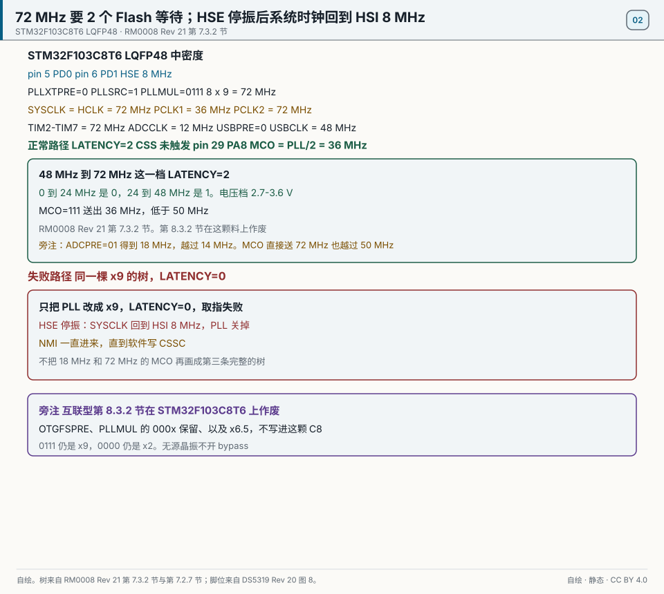
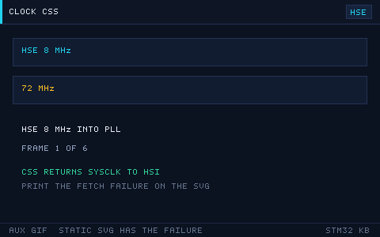

# 02 芯片选型与存储器时钟

> English: [Part, memory, clocks](en/02-part-and-clock.md)

> 读懂 STM32 命名、系列定位、存储器映射与时钟树，是选型和调频的基础。

<p align="center">
  
  <br><sub>▲ 动画：HSE 8MHz → PLL ×9 → 72MHz 的时钟树倍频过程（作者自绘矢量图）</sub>
</p>

<!-- video:ch02 -->
<p align="center">
  <video width="640" controls poster="../assets/video/ch02-clock.png">
    <source src="../assets/video/ch02-clock.mp4" type="video/mp4">
  </video>
  <br><sub>▲ 本章讲解 2.5 分钟。配音是微软 Edge 在线神经语音「晓晓」（zh-CN-XiaoxiaoNeural），经 edge-tts 调用。edge-tts 大部分源码为 LGPLv3，srt_composer.py 为 MIT；声线模型是微软在线服务，不是开放模型。这里提交的是合成后的 MP4，离线可看。重新生成需要联网。画面由脚本和本仓库 SVG 生成，不是实拍。 视频：<a href="../assets/video/ch02-clock.mp4">MP4</a> · 字幕：<a href="../assets/video/ch02-clock.srt">SRT</a>。由 <code>python3 tools/gen_narrated.py --speak</code> 用 ffmpeg 合成。</sub>
</p>

**旁白（与字幕、配音同一份稿）**

1. 型号上的字母不是玄学。F103 告诉你系列，C8 这类字母看闪存容量，T6 这类看封装。先读数据手册封面和订购信息，再去数引脚。
2. 存储器地图把闪存、内存和外设分成几段。外设的本质，就是固定地址上的一排寄存器。地址抄错系列，写进去的就不是你要的那个外设。
3. F103 常见的一条路：外部 8 兆进 PLL，乘 9，系统时钟 72 兆。APB1 最高 36 兆，所以再除以 2。这条路径后面串口和 CAN 的波特率都靠它。
4. 这一帧是仓库画的时钟树。口诀你要刻进手上：先开时钟，再摸寄存器。时钟没开，写入就像写进虚空，调试器里看起来还像成功了。
5. 主频拉到 72 兆时，闪存要加等待。这一章写的是 48 到 72 兆用两个等待周期。只改 PLL、不改等待，常见的下场就是一跑就死。
6. APB 分频大于 1 的时候，定时器时钟还会再乘 2。算 PWM 前先问 HAL 要到的 PCLK，不要把 36 兆当成定时器的输入。差一倍，频率就差一倍。
7. 外部晶振起不来时，先退回内部时钟，证明芯片还活着，再查负载电容和焊点。一上来就把 PLL 乘到很高，是在用死机练习耐心。
8. 口诀再念一遍：先开时钟再摸寄存器。HSE 掉了靠时钟安全系统，想看频率可以走到时钟输出脚。别用Delay 的感觉去猜主频。
9. 动手时让串口打出主频、闪存容量和两条 APB。BluePill 上常见的是 72 兆和 64 KB 闪存。对不上，先别做后面的外设实验。
10. 合上书，三问。72 兆时闪存要几个等待？AHB 和 APB1 谁更慢？外设时钟门控没开时，写入会发生什么？
<!-- /video:ch02 -->

## 原理与边界

这一章的时钟结论只钉在订货号 STM32F103C8T6、封装 LQFP48 上。时钟账整格照抄附录 D，不另算一套大约的主频。换到互联型时，下面第 7.3.2 节那一句作废，要改读第 8.3.2 节。换电压档时，等待周期那一档作废，要按附录 D 的电压格重读。

HSE 从第 5 脚 PD0-OSC_IN、第 6 脚 PD1-OSC_OUT 进来，8 MHz。`PLLXTPRE=0`（HSE 不预分频），`PLLSRC=1`（PLL 入口是 HSE），`PLLMUL=0111`（×9）。`8 × 9 = 72` MHz。`SW=10` 时 SYSCLK 用 PLL。HPRE 取不分频，HCLK = 72 MHz。PPRE1 = `100`（÷2），PCLK1 = 36 MHz，不得超过 36 MHz。PPRE2 取不分频，PCLK2 = 72 MHz。APB 预分频不是 1 时，挂在那条总线上的定时器时钟再 ×2，所以 TIM2–TIM7 仍是 72 MHz。TIM1 在 APB2，预分频为 1，不再 ×2。出处是 [RM0008 Rev 21 第 7.3.2 节](#source-rm0008-rcc)。

`FLASH_ACR` 基址 `0x40022000`，偏移 `0x00`。LATENCY 在 48 MHz 到 72 MHz 这一档是 `010`，也就是 2。0–24 MHz 是 0，24–48 MHz 是 1。电压档整格照抄附录 D：2.7–3.6 V。只把 PLL 改成 ×9、LATENCY 还留在 0，取指会错。这句是主图的失败路径。

`USBPRE=0` 时 72 MHz 的 PLL 再 ÷1.5，得到 48 MHz。`USBPRE=1` 是不除，得到 72 MHz，不是 48 MHz。`ADCPRE=10` 是 PCLK2÷6，`72 / 6 = 12` MHz。`ADCPRE=01` 是 ÷4，得到 18 MHz，越过 RM0008 的 14 MHz 上限。采样时间和逐次逼近留在第 09 章，这一章不写。

HSE 停振且 CSS 已开时，若 HSE 直接或经 PLL 当系统时钟，硬件改用 HSI，并关掉 HSE；HSE 若是 PLL 入口，PLL 也关掉。CSS 中断接在 NMI 上。NMI 里要写 `RCC_CIR` 的 CSSC，否则 NMI 会一直进来。同一事件还送到 TIM1 和 TIM8 的刹车输入。上电默认系统时钟是 HSI 8 MHz，不是 Cube 里填的 72 MHz。第 04 章只交叉引用「CSS 进 NMI」，不在这一章重画抢占。

第 29 脚 PA8 的复用含 MCO。脚位见 [DS5319 Rev 20 图 8](#source-ds5319-clock)。`MCO=111` 送出 PLL÷2，也就是 36 MHz，低于手册写的 50 MHz I/O 上限。`MCO=100` 把 SYSCLK 送出去时，72 MHz 越过这句 50 MHz。正常路径是 36 MHz。HSE bypass 只用于外部时钟，无源晶振不开 bypass。

第 8.3.2 节的 `OTGFSPRE`、`PLLMUL` 的 `000x` 保留、以及 ×6.5，在 STM32F103C8T6 上作废。这颗 C8 的 `RCC_CFGR` 用第 7.3.2 节。`0111` 仍是 ×9，`0000` 是 ×2。

## 关键插图

<p align="center">
  
  <br><sub>▲ 自绘。STM32F103C8T6，LQFP48。第 5 脚 PD0、第 6 脚 PD1 进来的 8 MHz，PLLMUL=0111、PLLSRC=1、PLLXTPRE=0，得到 72 MHz。PCLK1 = 36 MHz，PCLK2 = 72 MHz，TIM2–TIM7 = 72 MHz，ADCCLK = 12 MHz，USBPRE=0 得到 48 MHz。正常路径 LATENCY = 2，第 29 脚 PA8 上的 MCO 是 36 MHz。失败路径是同一棵树 LATENCY 仍为 0。HSE 停振后 SYSCLK 回到 HSI 8 MHz，NMI 里要写 CSSC。18 MHz 越过 14 MHz，72 MHz 直接送 MCO 越过 50 MHz，这两句只在旁注。出处是 [RM0008 Rev 21 第 7.3.2 节与第 7.2.7 节](#source-rm0008-rcc) 和 [DS5319 Rev 20 图 8](#source-ds5319-clock)。</sub>
</p>

<p align="center">
  
  <br><sub>▲ 网页和公众号辅图。只播放 CSS 回到 HSI 的那一条。印刷以静态主图为准。LATENCY 仍为 0 的取指失败不在这条 GIF 上。</sub>
</p>

章首的 `clock-tree.svg` 留作辅图。不播放它，72 MHz、LATENCY 和 CSS 回 HSI 都在静态主图上。

## 时序或状态

| 阶段 | SWS / 开关 | 时钟 | 状态 |
| --- | --- | --- | --- |
| 复位 | SWS 指向 HSI | HSI 8 MHz | 系统时钟还不是 Cube 里填的 72 MHz |
| HSE 就绪 | HSE 从第 5 脚、第 6 脚进来 | 8 MHz | PLL 还没切 |
| PLL 锁定 | PLLMUL=0111，PLLSRC=1，PLLXTPRE=0 | 72 MHz | 先写 LATENCY，再切 SW |
| 写等待 | LATENCY = 2 | 72 MHz | 48 MHz 到 72 MHz 这一档 |
| 切到 PLL | SW=10，SWS 读回 PLL | SYSCLK = HCLK = 72 MHz | PCLK1 = 36 MHz，PCLK2 = 72 MHz，USBPRE=0 得到 48 MHz |
| 失败：等待还是 0 | LATENCY = 0 | 72 MHz | 取指失败 |
| CSS | HSE 失败 | SYSCLK 回到 HSI 8 MHz | PLL 关闭。NMI 挂起，直到软件写 CSSC |
| ADC | ADCPRE=10 | 12 MHz | ADCPRE=01 得到 18 MHz，越过 14 MHz |

这张表不写采样时间。出处是 [RM0008 Rev 21 第 7.3.2 节](#source-rm0008-rcc)。

## 坑与出处卡

| 现象 | 原因 | 处理 | 出处 | 该来源允许支持的主张 |
| --- | --- | --- | --- | --- |
| 只改 PLL ×9，一跑就停住 | LATENCY 还是 0 | 先把 LATENCY 写成 2，再切 SYSCLK | [RM0008](#source-rm0008-rcc) | 48–72 MHz 这一档是 2 个等待。电压档沿用附录 D 的 2.7–3.6 V |
| PWM 频率差一倍 | 用 PCLK1 的 36 MHz 去除 | 定时器时钟用 72 MHz | [RM0008](#source-rm0008-rcc) | APB 预分频不是 1 时定时器时钟再 ×2。TIM1 在 APB2 且预分频为 1 时不再 ×2 |
| 晶振没起振，系统停在外面 | HSE 停了，CSS 没把 NMI 清掉 | 打开 CSS 之后时钟回到 HSI，并在 NMI 里写 CSSC | [RM0008](#source-rm0008-rcc) | HSE 作为 PLL 入口时，失败会关掉 PLL，SYSCLK 改用 HSI |
| 按第 8.3.2 节去填 PLLMUL | 那一节是互联型 | 这颗 C8 用第 7.3.2 节。0111 仍是 ×9，0000 是 ×2 | [RM0008](#source-rm0008-rcc) | 互联型的 000x 保留和 OTGFSPRE 在 STM32F103C8T6 上作废 |
| MCO 送出的波形超出脚的速度 | 把 72 MHz 的 SYSCLK 直接送上 PA8 | 送 PLL÷2 的 36 MHz | [RM0008](#source-rm0008-rcc) | 送到 MCO 脚的时钟不得超过 50 MHz |
| ADC 为了更快选了 ÷4 | ADCPRE=01 得到 18 MHz | 改回 ÷6，得到 12 MHz | [RM0008](#source-rm0008-rcc) | 14 MHz 是上限。÷4 得到 18 MHz。采样时间留在第 09 章 |

## 📌 学习目标
- [ ] 能逐段拆解 STM32 型号命名（STM32F103C8T6 每个字符的含义）
- [ ] 能在 F0/F1/F3/F4/F7/G0/G4/H7/L0/L4 之间按需求选型
- [ ] 说清 Cortex-M3/M4/M7 的 FPU/DSP/MPU/Cache 差异
- [ ] 记住存储器映射分区与 BOOT0/BOOT1 启动模式
- [ ] 会算 HSE→PLL→SYSCLK→AHB/APB 的分频，并定位 RCC_CFGR 关键位

## 🧠 核心原理

**结论先行：选型看「内核 + 主频 + Flash/RAM + 封装 + 外设」；调频看「时钟树 + 分频上限」。**

### 1. 命名规则逐段拆解

以 **STM32F103C8T6** 为例：

| 段 | 值 | 含义 |
| --- | --- | --- |
| STM32 | — | 意法半导体 32 位 MCU 品牌 |
| F | F | 产品系列：F=基础/主流型，L=低功耗，G=通用，H=高性能 |
| 103 | 103 | 子系列：103=F1 增强型（72MHz，USB/CAN），030=F0，407=F4 |
| C | C | 引脚数：T=36，C=48，R=64，V=100，Z=144，I=176 |
| 8 | 8 | Flash 容量：4=16K，6=32K，8=64K，B=128K，C=256K，E=512K，G=1M |
| T | T | 封装：T=LQFP，U=QFN，H=BGA，P=TSSOP |
| 6 | 6 | 温度范围：6=−40~85℃，7=−40~105℃，3=−40~125℃ |
| A | (后缀) | 内部代码/版本，采购时可忽略 |

所以 **STM32F103C8T6 = F1 增强型 · 48 脚 · 64KB Flash · LQFP · −40~85℃**。

### 2. 系列对比表

| 系列 | 内核 | 主频 | Flash 典型 | 封装 | 典型场景 | 价格（¥/片） |
| --- | --- | --- | --- | --- | --- | --- |
| F0 | M0 | 48MHz | 16~256KB | TSSOP/QFN | 低成本替代 8 位机 | 4~10 |
| F1 | M3 | 72MHz | 64~512KB | LQFP | 教学、工业经典 | 8~20 |
| F3 | M4F | 72MHz | 64~512KB | LQFP | 带运放/比较器、模拟混合 | 15~30 |
| F4 | M4F | 100~180MHz | 128~2048KB | LQFP/BGA | 高性能、DSP、FPU | 25~70 |
| F7 | M7F | 216MHz | 512KB~2MB | LQFP/BGA | 图形、音频、高速 | 60~150 |
| G0 | M0+ | 64MHz | 16~512KB | QFN/TSSOP | 低功耗 + 性价比 | 6~15 |
| G4 | M4F | 170MHz | 32~512KB | LQFP | 电机控制、数字电源 | 20~45 |
| H7 | M7F | 480MHz | 512KB~2MB | LQFP/BGA | 高端图形/AI | 80~200 |
| L0 | M0+ | 32MHz | 8~192KB | TSSOP | 超低功耗 | 5~12 |
| L4 | M4F | 80MHz | 64~1MB | LQFP | 低功耗 + 性能兼顾 | 20~50 |

> 价格是选型口吻，不是数据手册里的数，也不是 DS5319 或 RM0008 里的数。不进四块，也不进新来源的 scope。

### 3. 内核特性对比（Cortex-M）

| 特性 | Cortex-M3 | Cortex-M4 | Cortex-M7 |
| --- | --- | --- | --- |
| 架构 | ARMv7-M | ARMv7E-M | ARMv7E-M |
| FPU | ❌ 无 | ✅ 单精度（可选双精度） | ✅ 双精度 |
| DSP 指令 | 部分 | ✅ 完整 SIMD/MAC | ✅ 完整 |
| MPU | 可选 | 可选 | ✅ 标配 |
| Cache | ❌ | ❌ | ✅ I-Cache/D-Cache |
| TCM | ❌ | ❌ | ✅ ITCM/DTCM |
| 典型主频 | ≤ 120MHz | ≤ 200MHz | ≤ 600MHz |

### 4. 存储器映射

Cortex-M 把 4GB 地址空间固定划分为若干区域：

| 地址范围 | 区域 | 内容 |
| --- | --- | --- |
| 0x0000_0000–0x1FFF_FFFF | Code | 别名到 Flash/系统存储区，中断向量表 |
| 0x2000_0000–0x3FFF_FFFF | SRAM | 片上 SRAM |
| 0x4000_0000–0x5FFF_FFFF | Peripheral | 所有外设寄存器 |
| 0x6000_0000–0x9FFF_FFFF | 外部 RAM | FSMC/FMC 扩展 |
| 0xA000_0000–0xDFFF_FFFF | 外部设备 | 外部设备接口 |
| 0xE000_0000–0xFFFF_FFFF | 系统 | NVIC、SysTick、SCB（PPB） |

存储映射动画见下方图示：

<p align="center">
  
  <br><sub>▲ 动画：Cortex-M 存储器映射（Flash/SRAM/外设/系统区）（作者自绘矢量图）</sub>
</p>

F103C8 典型：**Flash 64KB @ 0x0800_0000，SRAM 20KB @ 0x2000_0000**。

### 5. 启动模式 BOOT0 / BOOT1

| BOOT1 | BOOT0 | 启动区域 | 用途 |
| --- | --- | --- | --- |
| x | 0 | 主 Flash（0x0800_0000） | 正常运行 |
| 0 | 1 | 系统存储器 | 出厂 Bootloader，串口 ISP 下载 |
| 1 | 1 | 内置 SRAM | 调试/救砖（掉电丢失） |

### 6. 时钟树与分频

链路：`HSE(8MHz) → PLL(×9) → SYSCLK(72MHz) → AHB prescaler → APB1/APB2`

| 时钟 | 来源 | 分频 | 频率 | 上限 |
| --- | --- | --- | --- | --- |
| SYSCLK | PLL | — | 72MHz | 72MHz |
| AHB (HCLK) | SYSCLK | ÷1 | 72MHz | 72MHz |
| APB1 (PCLK1) | AHB | ÷2 | 36MHz | 36MHz |
| APB2 (PCLK2) | AHB | ÷1 | 72MHz | 72MHz |
| ADC | APB2 ÷6 | — | 12MHz | 14MHz |
| USB | PLL ÷1.5 | — | 48MHz | 48MHz |

> ⚠️ APB 分频系数 >1 时，定时器时钟会 **×2**：例如 APB1=36MHz，则 TIM2~7 时钟为 72MHz。

外设挂在哪条总线上：

<p align="center">
  
  <br><sub>▲ 图示：AHB/APB1/APB2 上分别挂载哪些外设（作者自绘矢量图）</sub>
</p>

**RCC_CFGR 关键位（RM0008 Rev 21 中密度第 7.3.2 节。第 8.3.2 节是互联型，在 STM32F103C8T6 上作废）：**

| 位域 | 名称 | 说明 |
| --- | --- | --- |
| [1:0] | SW | 系统时钟源：00=HSI，01=HSE，10=PLL |
| [3:2] | SWS | 当前系统时钟源（只读） |
| [7:4] | HPRE | AHB 分频 |
| [10:8] | PPRE1 | APB1 分频 |
| [13:11] | PPRE2 | APB2 分频 |
| [21:18] | PLLMUL | PLL 倍频（×2~×16） |
| [16] | PLLSRC | PLL 输入源：0=HSI/2，1=HSE |
| [17] | PLLXTPRE | HSE 预分频 |

## 🛠️ 硬件与接线

| 开发板 | 外设/信号 | 引脚 | 备注 |
| --- | --- | --- | --- |
| BluePill | HSE 晶振 | PD0/PD1（8MHz） | 板上已焊，外部晶振 |
| BluePill | LSE 晶振 | PC14/PC15（32.768kHz） | 做 RTC 用 |
| BluePill | BOOT0 跳线 | BOOT0 | 跳帽切启动模式 |
| BluePill | USB 5V | 5V | 供电 |

## 💻 代码实现

读取芯片唯一 ID、Flash 容量与当前主频，串口打印验证时钟配置：

```c
/* chip_info.c —— 读取唯一 ID / Flash 容量 / 当前主频 */
#include "stm32f1xx_hal.h"
#include <stdio.h>

void SystemClock_Config(void);

/* 读取 96 位唯一 ID（RM0008 第 30 章） */
static void print_uid(void)
{
    uint32_t uid0 = *(volatile uint32_t *)0x1FFFF7E8;
    uint32_t uid1 = *(volatile uint32_t *)0x1FFFF7EC;
    uint32_t uid2 = *(volatile uint32_t *)0x1FFFF7F0;
    printf("UID: %08lX-%08lX-%08lX\r\n", uid0, uid1, uid2);
}

/* 读取 Flash 容量（单位 KB，位于 0x1FFFF7E0 低 16 位） */
static uint16_t get_flash_kb(void)
{
    return (uint16_t)(*(volatile uint16_t *)0x1FFFF7E0);
}

int main(void)
{
    HAL_Init();
    SystemClock_Config();       /* 假设已配好 72MHz */

    uint32_t sysclk = HAL_RCC_GetSysClockFreq();
    uint32_t hclk   = HAL_RCC_GetHCLKFreq();
    uint32_t pclk1  = HAL_RCC_GetPCLK1Freq();
    uint32_t pclk2  = HAL_RCC_GetPCLK2Freq();

    printf("SYSCLK=%lu Hz, HCLK=%lu Hz\r\n", sysclk, hclk);
    printf("PCLK1=%lu Hz, PCLK2=%lu Hz\r\n", pclk1, pclk2);
    printf("Flash=%u KB\r\n", get_flash_kb());
    print_uid();

    while (1) { }
}
```

寄存器等价（手动读 RCC_CFGR）：

```c
uint32_t cfgr  = RCC->CFGR;
uint32_t sws   = cfgr & RCC_CFGR_SWS;              /* 当前系统时钟源 */
uint32_t hpre  = (cfgr & RCC_CFGR_HPRE)  >> 4;     /* AHB 分频 */
uint32_t ppre1 = (cfgr & RCC_CFGR_PPRE1) >> 8;     /* APB1 分频 */
```

## 🧪 动手实验

1. **实验一（读芯片信息）**：运行上面代码，串口打印主频、Flash 容量、唯一 ID，核对是否 72MHz / 64KB。
2. **实验二（超频测试）**：把 PLL 从 ×9 改到 ×16，观察是否死机，理解 Flash 等待周期与主频上限的关系。
3. **实验三（APB 分频影响）**：把 PPRE1 从 ÷2 改 ÷1，观察 APB1 外设（如 USART2）是否还能工作。

### 7. Flash 等待周期与主频

| 主频范围 | 等待周期（LATENCY） |
| --- | --- |
| 0~24MHz | 0 |
| 24~48MHz | 1 |
| 48~72MHz | 2 |

> 等待周期由 `FLASH_ACR` 的 LATENCY 位配置，配错会死机或取指错误。

### 8. 各系列时钟树差异（要点）

| 系列 | 最高 SYSCLK | PLL 结构 | 备注 |
| --- | --- | --- | --- |
| F1 | 72MHz | HSE/HSI/2 ×N | 无 PLLM/PLLN/PLLP |
| F4 | 168MHz | M/N/P/Q 分频 | 支持 48MHz USB |
| F7 | 216MHz | 更复杂 | 支持过采样 |
| G0 | 64MHz | 简化 | 低功耗 |

### 9. 常用外设基地址速查（F103）

| 外设 | 基地址 |
| --- | --- |
| GPIOA | 0x40010800 |
| GPIOB | 0x40010C00 |
| GPIOC | 0x40011000 |
| USART1 | 0x40013800 |
| TIM2 | 0x40000000 |
| RCC | 0x40021000 |
| FLASH | 0x40022000 |

> 这些地址在 CMSIS 头文件里都有宏定义（如 `GPIOA_BASE`），编程时用宏而非硬编码。

### 10. 先开时钟，再谈 CSS 和 MCO

**结论**：任何外设在第一次写寄存器之前，都要先 `__HAL_RCC_*_CLK_ENABLE()`。上电默认是 HSI 8 MHz，不是你在 Cube 里填的 72 MHz——`SystemClock_Config()` 没跑到之前，串口波特率一定是错的。

| 机制 | 干什么 | 记一条 |
| --- | --- | --- |
| 外设时钟门控 | 不打开就等于这块外设不存在 | 先 `CLK_ENABLE` 再 `HAL_xxx_Init` |
| CSS | HSE 停振时切回 HSI，并进 NMI | `HAL_RCC_EnableCSS()` |
| MCO | 把内部时钟送到引脚，给示波器看 | F1 在 PA8；F4 的 MCO1/MCO2 在 PA8/PC9 |

F1 的 MCO 在 `RCC_CFGR` 的 MCO 位里选 SYSCLK / HSI / HSE / PLL÷2。定时器时钟在 APB 预分频大于 1 时再 ×2，这张图里的 72 MHz 已经是乘过之后的数。

换系列时外设基址不同，用 CMSIS 头文件里的宏，不把地址写死。这句没有新的寄存器值，不进出处卡。

口诀：**先开时钟再摸寄存器；HSE 掉了靠 CSS，想看频率走 MCO。**

自测：

1. 只写了 `GPIOA->CRL`、没开 GPIOA 时钟，读回来为什么还是 0？
2. HSE 晶振没焊，CSS 打开之后系统时钟会落到哪？
3. APB1 预分频是 2 时，TIM2 的计数时钟是 36 MHz 还是 72 MHz？

## 🔗 相关资源

- 官方手册：**RM0008**（第 2 章存储器映射、第 8 章 RCC、第 30 章设备电子签名）；**DS5319**（F103C8 数据手册）
- 上一篇：[01 开发环境搭建](01-开发环境搭建.md)｜下一篇：[03 GPIO与LED](03-GPIO与LED.md)
- 📱 手机阅读版：[第 02 章 · 芯片选型与存储器时钟（公众号图文）](https://mp.weixin.qq.com/s/sjGlvKgXTK6X335kHXHZeA)
- 相关图：[`assets/animations/clock-tree.svg`](../assets/animations/clock-tree.svg)、[`assets/animations/memory-map.svg`](../assets/animations/memory-map.svg)、[`assets/diagrams/peripheral-bus.svg`](../assets/diagrams/peripheral-bus.svg)
- 实物与资料：ST 官网各系列产品选型页（Product Selector）
- 免责声明：本仓库插画均为作者自绘矢量图/程序生成动画，非厂商实拍照片。

