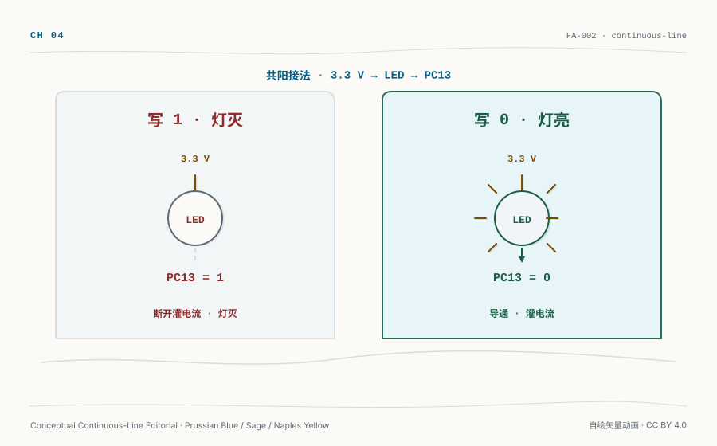
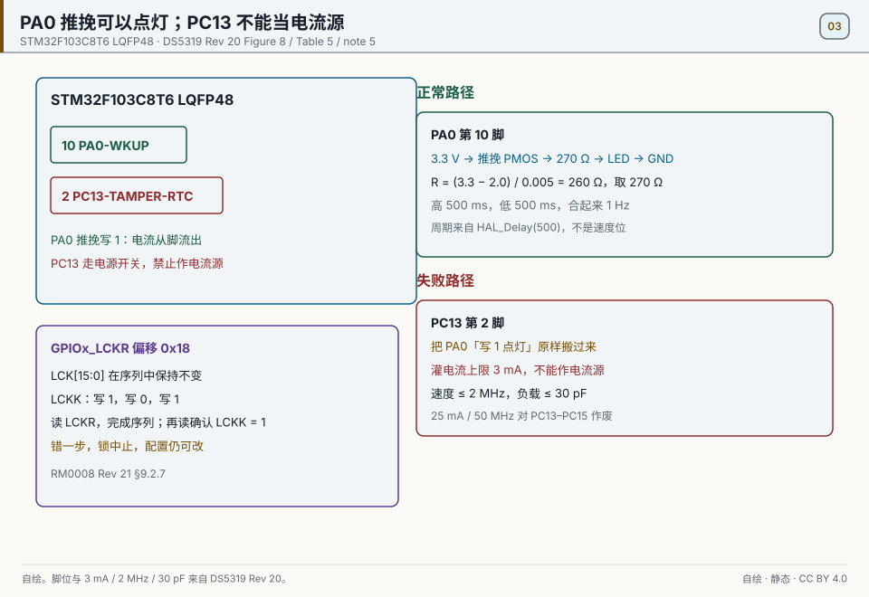
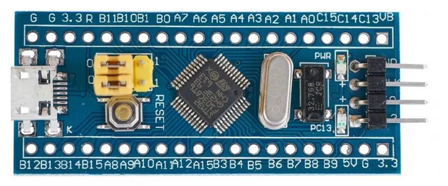
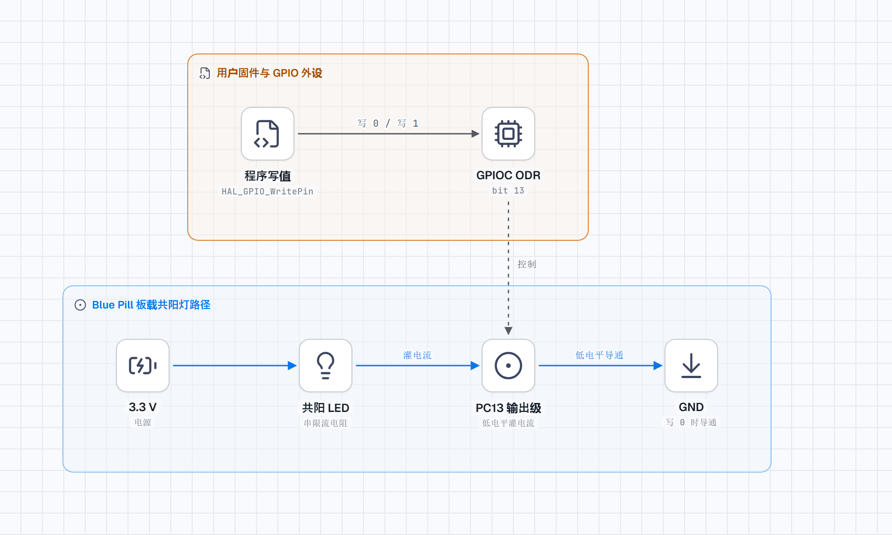
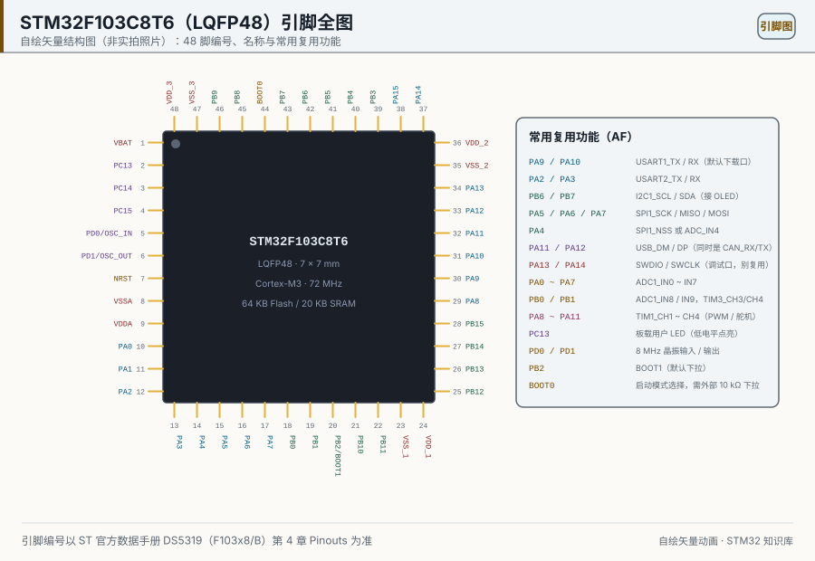
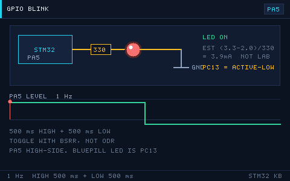

# 03 GPIO 与 LED

> English: [GPIO and the LED](en/03-gpio-and-led.md)

> PC13 写 0 灯亮，PA0 写 1 外接灯亮，PA1 按下却读到 0。先把这三种电平关系量清楚，再讨论模式、寄存器和消抖。

<p align="center">
  
  <br><sub>▲ 动画：GPIO 推挽输出点亮 LED（电平、电流、波形同步，作者自绘矢量图）</sub>
</p>

<!-- video:ch03 -->
<p align="center">
  <video width="640" controls poster="../assets/video/ch03-gpio.png">
    <source src="../assets/video/ch03-gpio.mp4" type="video/mp4">
  </video>
  <br><sub>▲ 本章讲解视频（2.9 分钟）。<a href="../assets/video/ch03-gpio.mp4">MP4</a> · <a href="../assets/video/ch03-gpio.srt">字幕</a></sub>
</p>

<details>
<summary>旁白文字稿</summary>


1. 先问一个反常识的问题。BluePill 的板载灯接在 PC13，你写 1，灯反而灭；写 0，它才亮。别急着背结论，先看电流到底从哪儿走。
2. 先别翻八种模式表。打开 GPIOC 时钟，把 PC13 配成推挽输出：写 RESET 灯应亮，写 SET 灯应灭。调试器读 ODR 的 bit13，或量 PC13 对地电压；对上了再往下听。
3. 共阳接法：阳极在 3.3 伏，PC13 拉低才有灌电流，灯才亮。写 1 时 PMOS 拉高，灌电流断开，灯灭。这张图是原理演示，不是实测电流。
4. 推挽高低都有人驱动；开漏只会拉低，高电平靠外部上拉，I2C 就靠这个。按键另一端接 GND 时引脚要上拉：空闲为高，按下为低。内部上拉只管空闲，不给外设供电。
5. PA0 共阴常写 1 才亮；PC13 共阳写 0 才亮。亮灭反了先翻译有效电平。PC13 灌电流上限 3 毫安，不能当电流源点外接灯。
6. F1 把外设换脚要先开 AFIO，再写 MAPR。5 伏只认数据手册标了 FT 的脚。锁定是掩码不变，写 1、写 0、再写 1，然后读两次，第二次确认 LCKK 等于 1。
7. 离开前只留一件验收：让 PC13 按你算过的延时以 1 赫兹翻转，并能口述从 3.3 伏经灯流入引脚的路径。主循环一堵，短按会丢——下一章用边沿敲门，这里不背三道题。

</details>
<!-- /video:ch03 -->
## 最小胜利

先别管八种模式表。烧上 [`examples/gpio-blink/`](../examples/gpio-blink/)，只做这一步：

1. 把 `GPIOC` 口时钟打开，把 PC13 配成推挽输出。
2. `HAL_GPIO_WritePin(GPIOC, GPIO_PIN_13, GPIO_PIN_RESET)` —— 预期：**板载灯亮**。
3. 再写成 `GPIO_PIN_SET` —— 预期：**灯灭**。
4. 验收：调试器读 `GPIOC->ODR` 的 bit13，或万用表测 PC13 对地电压；灯亮时该位为 0、电压接近 0 V，灯灭时该位为 1、电压接近 3.3 V。

对上了，再往下读模式、限流和锁定。对不上，先走「常见坑与出处」里 ODR/时钟/共阳三行，不要先改电阻公式。

<p align="center">
  
  <br><sub>▲ 知识轨（Handraw）。说明写值与共阳电流方向，不是万用表读数，也不是实拍。文件 <code>assets/illustrations/ch03-handdraw.svg</code>；完整 SHA-256 见审计清单 <code>stm32-book/audits/ch03-converge-gate.md</code>。</sub>
</p>

## 原理与适用范围

最小胜利已经对上灯态之后，再谈脚号与电流上限才有用。本章的脚号和电流限制都按 STM32F103C8T6、LQFP48 封装算。[DS5319 Rev 20](#source-ds5319-gpio) 的图 8 和表 5 把 PA0-WKUP 放在第 10 脚，把 PC13-TAMPER-RTC 放在第 2 脚。

PA0 可以做电流源。把它配成推挽、写 1，电流从 3.3 V 经脚内的 PMOS 流出，再经过电阻和发光二极管到地。例程里的算术是 `(3.3 − 2.0) / 0.005 = 260`，取标准值 270 Ω。这里的 2.0 V 和 5 mA 是 [例程](#source-project-examples) 按普通红灯选的估算值，不是数据手册推荐的电流。换颜色不同的灯，压降变了，电阻也要重算。

PC13、PC14、PC15 走电源开关。同一份数据手册的注 5 给出的界限是：灌电流不超过 3 mA，速度不超过 2 MHz，负载不超过 30 pF，而且不能拿这三只脚去当电流源点灯。BluePill 板载灯接在 PC13 上还能亮，是因为灯的阳极在 3.3 V，脚只负责灌电流，写 0 才亮。所以 PA0 那种「写 1 点亮」的接法不能原样搬到 PC13。

后面速度表里的 25 mA 和 50 MHz 对 PC13–PC15 不适用。换了封装，第 2 脚和第 10 脚的脚号也会变，要重新查表 5。F1 改复用脚用 AFIO 的 MAPR 寄存器整组重映射；F4 每个脚有自己的 AFR 字段，那部分不在 RM0008 里，要读 F4 的参考手册。

## 关键插图

<p align="center">
  
  <br><sub>▲ 自绘。STM32F103C8T6，LQFP48：PA0 是第 10 脚，PC13 是第 2 脚。上半部分是正确接法：3.3 V 经推挽和 270 Ω 到 LED；260 Ω 是 (3.3 − 2.0) / 0.005 的商。下半部分是把同一接法搬到 PC13 的错误：注 5 只允许 3 mA 灌电流，速度不超过 2 MHz，负载不超过 30 pF。锁序列见 GPIOx_LCKR，偏移 0x18。脚位与电流来自 [DS5319 Rev 20](#source-ds5319-gpio) 表 5、图 8、注 5；锁与 SWD 来自 [RM0008 Rev 21](#source-rm0008-gpio) 第 9.2.7 节和第 9.3.5 节表 36。</sub>
</p>

## 时序与状态

1 Hz 的高低电平不是 GPIO 速度位算出来的。高 500 ms、低 500 ms 来自 [gpio-blink 例程](#source-project-examples) 的 `HAL_Delay(500)`。速度位写成 50 MHz 不会把 PC13 变成可以点灯的脚。

| 步骤 | LCK[15:0] | LCKK | 读回 | 结果 |
| --- | --- | --- | --- | --- |
| 1 | 保持要锁的脚 | 写 1 | — | 序列开始 |
| 2 | 同上，不能改 | 写 0 | — | 序列继续 |
| 3 | 同上，不能改 | 写 1 | — | 序列写完 |
| 4 | 同上 | — | 第一次读 LCKR，完成写读序列 | 写序列完成 |
| 5 | 同上 | — | 第二次读，确认 LCKK = 1 | 锁住，直到复位 |
| 失败 | 中途改了掩码，或少了一次写/读 | — | 第二次确认不是 1 | 锁中止，配置仍可改 |

寄存器是 `GPIOx_LCKR`，偏移 `0x18`。出处是 [RM0008 Rev 21 第 9.2.7 节](#source-rm0008-gpio)。

## 常见坑与出处

| 现象 | 原因 | 处理 | 出处 | 出处里能查到什么 |
| --- | --- | --- | --- | --- |
| 外接灯接在 PC13 上，写 1 也不按 PA0 的方式亮 | PC13 不能当电流源 | 外接灯改到 PA0，串 270 Ω | [DS5319 Rev 20 注 5](#source-ds5319-gpio) | LQFP48 第 2 脚是 PC13；PC13–PC15 灌电流不超过 3 mA，速度不超过 2 MHz，负载不超过 30 pF |
| 板载灯写 1 反而不亮 | 板载灯共阳，PC13 灌电流才亮 | 写 0 点亮 | [gpio-blink 例程](#source-project-examples) | 这块 BluePill 的接法。3 mA 这个限值要看数据手册 |
| 写了 ODR，脚上没有电平 | 口时钟还没开，配置寄存器还没进外设 | 先打开对应 GPIO 口的时钟，再写 CRL/CRH | [RM0008 GPIO](#source-rm0008-gpio) | 先给这个口时钟，再写第 9 章的配置寄存器 |
| LCKR 写了三次，之后仍能改配置 | 序列出错，或确认读回不是 1 | 掩码保持不变，写 1、写 0、写 1，连续读两次，第二次确认 LCKK = 1 | [RM0008 第 9.2.7 节](#source-rm0008-gpio) | 锁成立后保持到复位；错一步则锁中止 |
| 烧完就再也连不上 | PA13/PA14 被配成普通 GPIO | 把 SWD 留在 PA13 与 PA14 | [RM0008 表 36](#source-rm0008-gpio) | SWDIO 是 PA13，SWCLK 是 PA14 |

按键抖动没有列在这张表里：常说的 10 ms 到 20 ms 消抖时间是经验值，RM0008 和 DS5319 都没有给。动手实验照样要做消抖，只是别把这个数当成手册规定。
## 学习目标

离开本章前，不翻书应能做到：

- [ ] 说出 PC13 共阳时写 0 亮、写 1 灭，并能指出失效条件（外接共阴灯）
- [ ] 用 ODR 读回或引脚电压区分「配置没进外设」和「接法反了」
- [ ] 按 `R = (Vcc − Vf) / I` 为 PA0 外接灯算出限流电阻，并标明 Vf、I 来自例程估算
- [ ] 用 HAL 与 BSRR 两种写法点灭 PC13，并说明 ODR 读改写的并发边界
- [ ] 列出迁移时必须重查的项：封装脚位、PC13–PC15 注 5、FT 标记、F1 AFIO vs F4 AFR


## 核心原理

GPIO 配置要同时回答三个问题：信号由谁驱动、空闲时由谁定电平、引脚现在归 GPIO 还是外设。少答一个，代码也可能“看起来写成功”，引脚却没有预期电平。

### 1. 8 种 GPIO 模式详解表

| 模式（HAL 宏） | 方向 | 输出级 | 上/下拉 | 典型场景 |
| --- | --- | --- | --- | --- |
| `GPIO_MODE_INPUT` + Pull=`GPIO_NOPULL` | 输入 | — | 浮空 | 外部已有上下拉，或接数字器件输出 |
| `GPIO_MODE_INPUT` + Pull=UP | 输入 | — | 上拉 | 按键接 GND（低有效） |
| `GPIO_MODE_INPUT` + Pull=DOWN | 输入 | — | 下拉 | 按键接 VCC（高有效） |
| `GPIO_MODE_ANALOG` | 输入 | 关闭 | — | ADC 采样、低功耗 |
| `GPIO_MODE_OUTPUT_PP` | 输出 | 推挽 | — | LED、驱动信号（强高低） |
| `GPIO_MODE_OUTPUT_OD` | 输出 | 开漏 | — | I2C、需要外部上拉或线与 |
| `GPIO_MODE_AF_PP` | 复用 | 推挽 | — | UART/SPI/PWM 输出 |
| `GPIO_MODE_AF_OD` | 复用 | 开漏 | — | I2C 硬件外设、SMBus |

> F1 的外设输入通常仍把引脚配置成输入模式，复用输出才使用 `GPIO_MODE_AF_PP/OD`。F4/F7 还要填写 `Alternate` 功能号。不要把一个系列的 HAL 宏照搬到另一个系列。

### 2. 输出速度与电流能力

| 参数 | 值 | 说明 |
| --- | --- | --- |
| 输出速度（F1） | 2/10/50MHz | 越高边沿越陡。PC13、PC14、PC15 不用这一行，界限写在「原理与边界」。 |
| 输出速度（F4+） | Low/Medium/High/Very High | 对应不同驱动强度 |
| 单脚灌/拉电流 | 25mA（F103） | 其他脚仍用这一行。PC13、PC14、PC15 不用这一行，界限写在「原理与边界」。 |
| 端口总电流 | 150mA（F103） | 所有 IO 之和 |
| 内部上下拉 | 30~50kΩ（F1） | 弱上拉，驱动能力有限 |

### 3. 推挽 vs 开漏

| 对比 | 推挽（Push-Pull） | 开漏（Open-Drain） |
| --- | --- | --- |
| 高电平来源 | PMOS 主动拉高到 VDD | 高阻，靠外部上拉 |
| 低电平来源 | NMOS 主动拉低到 GND | NMOS 主动拉低到 GND |
| 能否线与 | 不能 | 可以，多脚并接实现线与 |
| 典型用途 | LED、普通数字输出 | I2C、电平转换、共享总线 |
| 电流路径 | 高：VDD→PMOS→引脚；低：引脚→NMOS→GND | 低：引脚→NMOS→GND；高：无（靠外部上拉） |

### 4. LED 限流电阻计算

`R = (Vcc − Vf) / I`

| 参数 | 典型值 | 说明 |
| --- | --- | --- |
| Vcc | 3.3V | 供电电压 |
| Vf（红） | 1.8~2.2V | 正向压降 |
| Vf（绿/蓝/白） | 2.8~3.2V | 蓝/白更高，3.3V 供电可能偏暗 |
| I（目标） | 5~10mA | 普通指示 LED 足够 |

具体订货号上的算例写在「原理与边界」，并标明它来自例程而不是数据手册。这里只保留公式。

### 5. GPIO 寄存器（F1）

| 寄存器 | 作用 |
| --- | --- |
| CRL / CRH | 配置低 8 位 / 高 8 位引脚的模式与速度 |
| IDR | 输入数据寄存器（读引脚电平） |
| ODR | 输出数据寄存器（读写引脚电平） |
| BSRR | 置位/复位寄存器，写 1 有效，原子操作 |
| BRR | 复位寄存器（F1 有，F4 合并进 BSRR） |

## 硬件与接线

> **真证轨现状：** 下图为 Blue Pill 板卡的第三方实拍（CC BY-SA 4.0，Avandalen / Wikimedia Commons），只用于识别板卡外观与板载 LED 位置，不是本书实验的测量证据。本次实验的万用表/逻辑分析仪截图仍待补；上面的 Handraw 与 stack 图只属于知识轨。知识轨文件与 SHA-256 登记在 stm32-book/audits/ch03-converge-gate.md，照片来源与许可登记在 assets/photos/README.md。

<figure class="photo-spread">
  
  <figcaption>▲ 硬件参照照（CC BY-SA 4.0 实拍，Avandalen / Wikimedia Commons）：Blue Pill 开发板，主控 STM32F103C8T6——与本章实验使用的板卡同型号。板载 PC13 LED 位于 USB 座一侧（据板卡原理图/丝印，图中过小难以分辨）。此图仅用于板卡外观与引脚排布识别，不含接线与测量画面，不是实验测量证据。来源与处理记录见 <code>assets/photos/README.md</code>。</figcaption>
</figure>

| 开发板 | 外设 | 引脚 | 备注 |
| --- | --- | --- | --- |
| BluePill | 板载 LED | PC13 | **共阳接法，低电平点亮** |
| BluePill | 外接 LED | PA0 | 串 270Ω 电阻，高电平点亮 |
| BluePill | 按键 | PA1 | 另一端接 GND，内部上拉 |

接线（外接 LED）：PA0 → 270Ω → LED 阳极，LED 阴极 → GND（**共阴**，高电平点亮）。
板载 LED 是 **共阳** 接法：阳极接 3.3V，PC13 拉低才导通，故**低电平点亮**。

<p align="center" class="wide-figure" tabindex="0">
  <a href="../assets/diagrams/stack-gpio-pc13-led.png"></a>
  <br><sub>▲ 上图把“程序写值”与“电流方向”分开：写 0 时，PC13 输出级导通，电流从 3.3 V 经共阳 LED 和限流电阻流入引脚。它解释低电平点亮的原因，不给出实测电流，也不替代具体克隆板原理图。<a href="../assets/diagrams/stack-gpio-pc13-led.html">HTML 源</a> · <a href="../assets/diagrams/stack-gpio-pc13-led-dark.png">暗色图</a> · Lucide 图标。</sub>
</p>

<p align="center">
  
  <br><sub>▲ 本章只用 PA0、PA1 和 PC13；PA13/PA14 留给 SWD。图用于找针脚和核对丝印，不能替代目标克隆板原理图，也不能证明某个引脚已经输出正确电平（FA-029 · IG-002 · C-03/C-10/C-27/C-31）。</sub>
</p>

本章先用主循环轮询 PA1。下一章会把按键改接 PA0/EXTI0；外接 LED 要先从 PA0 拆下，PC13 继续作为结果指示灯。

## 代码实现

```c
/* gpio_blink.c —— GPIO 输出点灯 + 按键读取（HAL） */
#include "stm32f1xx_hal.h"

#define LED_PIN    GPIO_PIN_13
#define LED_PORT   GPIOC
#define KEY_PIN    GPIO_PIN_1
#define KEY_PORT   GPIOA

void SystemClock_Config(void);

static void gpio_init(void)
{
    GPIO_InitTypeDef io = {0};

    __HAL_RCC_GPIOC_CLK_ENABLE();
    __HAL_RCC_GPIOA_CLK_ENABLE();

    /* PC13 推挽输出（板载 LED，低电平点亮） */
    io.Pin   = LED_PIN;
    io.Mode  = GPIO_MODE_OUTPUT_PP;
    io.Pull  = GPIO_NOPULL;
    io.Speed = GPIO_SPEED_FREQ_LOW;
    HAL_GPIO_Init(LED_PORT, &io);

    /* PA1 输入，内部上拉（按键按下接地为低） */
    io.Pin  = KEY_PIN;
    io.Mode = GPIO_MODE_INPUT;
    io.Pull = GPIO_PULLUP;
    HAL_GPIO_Init(KEY_PORT, &io);
}

int main(void)
{
    HAL_Init();
    SystemClock_Config();
    gpio_init();

    while (1)
    {
        /* 按键按下（低电平）时点亮 LED */
        GPIO_PinState key = HAL_GPIO_ReadPin(KEY_PORT, KEY_PIN);
        HAL_GPIO_WritePin(LED_PORT, LED_PIN,
                          (key == GPIO_PIN_RESET) ? GPIO_PIN_RESET : GPIO_PIN_SET);
    }
}
```

三种写法对照（点亮与熄灭要分开；HAL 与直接 BSRR 都原子写位，ODR 读改写不是原子操作）：

```c
/* 1) HAL 函数：底层同样写 BSRR */
HAL_GPIO_WritePin(GPIOC, GPIO_PIN_13, GPIO_PIN_RESET);   /* PC13 = 0：灯亮 */
HAL_GPIO_WritePin(GPIOC, GPIO_PIN_13, GPIO_PIN_SET);     /* PC13 = 1：灯灭 */

/* 2) 直接写 BSRR：原子置位/复位 */
GPIOC->BSRR = GPIO_BSRR_BR13;   /* 复位 PC13 = 0：灯亮 */
GPIOC->BSRR = GPIO_BSRR_BS13;   /* 置位 PC13 = 1：灯灭 */

/* 3) ODR 读改写：有并发竞争边界 */
GPIOC->ODR &= ~GPIO_ODR_ODR13;  /* PC13 = 0：灯亮 */
GPIOC->ODR |= GPIO_ODR_ODR13;   /* PC13 = 1：灯灭 */
```

位带操作（F1 支持，用一个别名地址直接操作单个 bit）：

```c
/* 位带别名：把外设地址 0x4001100C (GPIOC_ODR) 的 bit13 映射到别名地址 */
#define BITBAND_PERIPH(addr, bit) \
    (*(volatile uint32_t *)(0x42000000UL + ((addr) - 0x40000000UL) * 32 + (bit) * 4))

#define PC13_OUT  BITBAND_PERIPH(0x4001100CUL, 13)   /* GPIOC->ODR bit13 */
PC13_OUT = 0;   /* 直接写 0/1，无需读改写，等效于 ODR */
```

完整工程见 [`examples/gpio-blink/`](../examples/gpio-blink/)。

<p align="center">
  
  <br><sub>▲ 实验预期：PC13 低有效，每 500ms 翻转一次得到 1s 周期。动画只能说明逻辑关系；验收仍要读 ODR/IDR 或测量引脚周期。</sub>
</p>

## 动手实验

1. **实验一**：PC13 板载 LED 1Hz 闪烁（对照 `gpio-blink.svg` 与 `led-blink.gif`）。
2. **实验二**：外接 LED 到 PA0，计算并串接 270Ω 电阻，实现按键 PA1 控制 LED。
3. **实验三（暴露轮询边界）**：在主循环每轮加入 100ms 的阻塞任务，再短按 PA1。记录漏检或响应延迟；删掉阻塞后重测。这个现象留给第 04 章用 EXTI 解决。

### 6. 按键电路与消抖

| 接法 | 空闲电平 | 按下电平 | 触发沿 |
| --- | --- | --- | --- |
| 上拉 + 按键接地 | 高 | 低 | 下降沿 |
| 下拉 + 按键接 VCC | 低 | 高 | 上升沿 |

| 消抖方式 | 说明 |
| --- | --- |
| 软件延时 | 检测到变化后延时 10~20ms 再确认 |
| 定时器扫描 | 定时器周期采样，多次一致才确认 |
| RC 滤波 | 硬件加 0.1µF 电容 + 电阻 |
| 施密特触发器 | 硬件整形 |

```c
/* 软件消抖：等待稳定 */
static uint8_t key_scan(GPIO_TypeDef *port, uint16_t pin)
{
    if (HAL_GPIO_ReadPin(port, pin) == GPIO_PIN_RESET)   /* 检测到低 */
    {
        HAL_Delay(20);                                    /* 延时消抖 */
        if (HAL_GPIO_ReadPin(port, pin) == GPIO_PIN_RESET) return 1;
    }
    return 0;
}
```

### 7. 常见外设 GPIO 配置速查

| 外设 | 引脚模式 |
| --- | --- |
| LED 输出 | OUTPUT_PP |
| 按键输入 | INPUT + PULLUP/PULLDOWN |
| UART TX | AF_PP |
| UART RX | INPUT + PULLUP |
| I2C SDA/SCL | AF_OD（或 OUTPUT_OD） |
| SPI SCK/MOSI | AF_PP |
| SPI MISO | INPUT |
| ADC 通道 | ANALOG |
| PWM 输出 | AF_PP |

### 8. 位带地址计算公式

- 外设区别名：`别名地址 = 0x42000000 + (外设地址 − 0x40000000) × 32 + bit × 4`
- SRAM 区别名：`别名地址 = 0x22000000 + (SRAM 地址 − 0x20000000) × 32 + bit × 4`

> STM32F103 的 SRAM 与外设位带别名可用；换到其他内核或系列时，要重新查处理器和芯片参考手册，不能从 F1 直接类推。

### 9. LED 与数码管驱动简述

| 器件 | 驱动方式 | 注意 |
| --- | --- | --- |
| 单色 LED | GPIO 直接驱动 + 限流电阻 | 电流 < 20mA |
| 高亮/大功率 LED | 三极管/MOS 驱动 | GPIO 只给基极电流 |
| 数码管（共阳/共阴） | 位选 + 段选，可加 74HC595 | 扫描刷新 |
| RGB LED | 三个 PWM 通道 | 混色 |

### 10. GPIO 电气特性补充

| 参数 | 值 |
| --- | --- |
| 输入高电平 VIH | 0.7×VDD ≈ 2.31V |
| 输入低电平 VIL | 0.3×VDD ≈ 0.99V |
| 输出高电平 VOH | VDD−0.4 ≈ 2.9V（轻载） |
| 输出低电平 VOL | 0.4V |
| 内部上拉阻值 | 30~50kΩ |

### 11. 重映射、5 V 容忍和锁定

F1 改脚位走 AFIO 重映射，F4 每个引脚自己选 AF 号。能不能接 5 V，只看数据手册那一列有没有 FT，不是“STM32 都耐 5 V”。

| 系列 | 怎么换功能 | 先决条件 |
| --- | --- | --- |
| F1 | `AFIO->MAPR` 整组重映射（如 USART1 从 PA9/10 到 PB6/7） | 先 `__HAL_RCC_AFIO_CLK_ENABLE()` |
| F4 | `GPIOx->AFR` 按引脚填 AF 编号 | 模式先设成复用 |

5 V 容忍（FT）的脚在数据手册引脚表里单独标。普通脚直接接 5 V 会损坏，本仓库不给“大概没事”的电流。

锁定某一脚，避免后面的初始化再改它。序列是写 1、写 0、再写 1，然后读一次：

```c
GPIOA->LCKR = GPIO_LCKR_LCKK | GPIO_LCKR_LCK5;
GPIOA->LCKR = GPIO_LCKR_LCK5;
GPIOA->LCKR = GPIO_LCKR_LCKK | GPIO_LCKR_LCK5;
(void)GPIOA->LCKR;   /* 第一次读：完成写读序列 */
(void)GPIOA->LCKR;   /* 第二次读：确认 LCKK = 1，锁保持到复位 */
```

离开本章前，应留下 PA0 的高低电平、PA1 的按下/松开读值和 PC13 的 1s 周期三份记录，并能解释为什么轮询会漏掉短脉冲。

自测：

1. F103 把 USART1 重映射到 PB6/PB7，忘了开 AFIO 时钟，现象是什么？
2. 数据手册没标 FT 的 PA0，能不能直接接 5 V 传感器？
3. `LCKR` 写完不读，锁有没有生效？

## 相关资源

- 官方手册：**RM0008** 第 9 章（GPIO）及第 9.2 节（寄存器描述）；**DS5319** 引脚定义
- 上一篇：[02 芯片选型与存储器时钟](02-芯片选型与存储器时钟.md)｜下一篇：[04 中断与NVIC](04-中断与NVIC.md)
- 手机阅读版：[第 03 章 · GPIO与LED（公众号图文）](https://mp.weixin.qq.com/s/G8szO2UDufAHY9vJYDpYFA)
- 相关图：[`assets/animations/gpio-blink.svg`](../assets/animations/gpio-blink.svg)、[`assets/gif/led-blink.gif`](../assets/gif/led-blink.gif)
- 实物与资料：ST 官网 Nucleo 板原理图（LED 接法参考）
- 免责声明：本仓库插画均为作者自绘矢量图/程序生成动画，非厂商实拍照片。

