# 04 中断与 NVIC

> English: [Interrupts and the NVIC](en/04-interrupts-nvic.md)

> 第 03 章的轮询会漏掉短按键。把同一个输入交给 EXTI 后，还要证明 pending 位被清掉、ISR 没做慢操作，并且高优先级确实能打断低优先级。

<p align="center">
  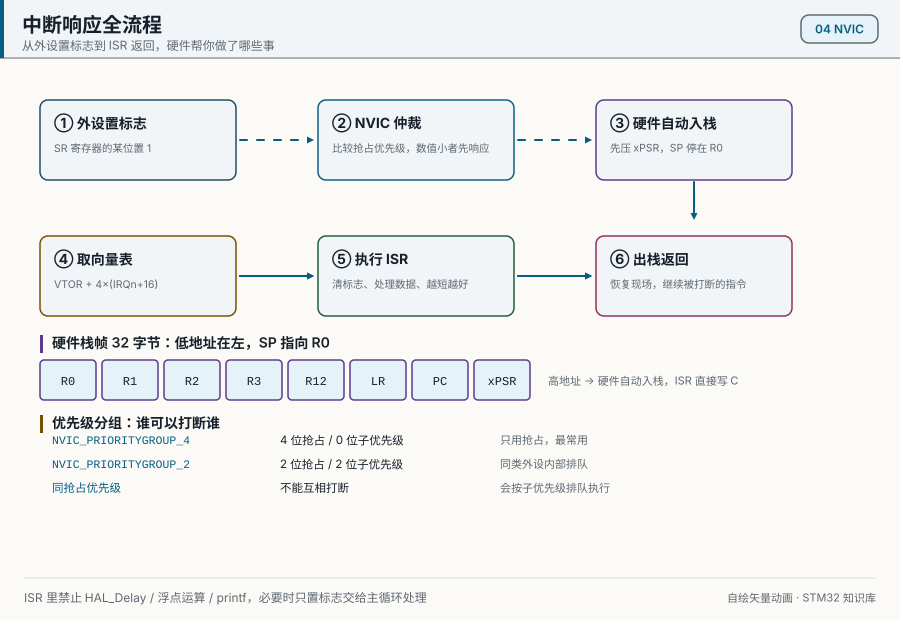
  <br><sub>▲ 动画：中断响应全流程（入栈现场 → 取向量 → ISR → 出栈，作者自绘矢量图）</sub>
</p>

<!-- video:ch04 -->
<p align="center">
  <video width="640" controls poster="../assets/video/ch04-nvic.png">
    <source src="../assets/video/ch04-nvic.mp4" type="video/mp4">
  </video>
  <br><sub>▲ 本章讲解视频（2.5 分钟）。<a href="../assets/video/ch04-nvic.mp4">MP4</a> · <a href="../assets/video/ch04-nvic.srt">字幕</a></sub>
</p>

<details>
<summary>旁白文字稿</summary>

1. 轮询是你不停去问，中断是事情来了敲你的门。主程序可以继续干别的。进了中断服务，办完要清标志，不然门会一直响。
2. NVIC 这道总闸可以分成三档来记：这路中断开了没有，优先级谁高，有没有挂起还没处理。三档看全，才不会觉得中断时灵时不灵。
3. EXTI 的编号就是引脚号。EXTI0 同时只能留给一个端口。PA0 和 PB0 不能一起拿这条线。要两只按键，就换不同的脚号。
4. 这一帧是仓库画的中断路径。引脚边沿先进 EXTI，再由 NVIC 决定要不要打断当前程序，最后才进你写的服务函数。路径上任何一扇门关着，回调都不会来。
5. 优先级不是数字越大越急。F1 上要先看优先级分组切成什么样，才知道哪些位是抢占、哪些是子优先级。抄例程时把分组改了，顺序会整个翻掉。
6. 中断服务要短。别在里面调用会阻塞的延时，也别做很重的打印。置一个标志，或者塞进缓冲区，把慢活交回主循环。服务函数一长，别的中断就饿着。
7. 主循环和中断一起碰的变量，编译器可能会缓存。单字节标志加 volatile。超过一个字的数据，读的时候还得短暂关中断，否则会撕成两半。
8. 口诀：总闸分三档；同一编号的脚，EXTI 只能留一个端口。记住这两句，按键中断的大多数玄学都会消失。
9. 实验用一只按键走下降沿，服务函数里只翻转 PC13。按下能亮、松开不连翻，说明边沿和清标志都做对了。连翻多半是没清，或者抖动没处理。
10. 合上书，三问。EXTI0 能同时留给 PA0 和 PB0 吗？服务函数里为什么别写阻塞延时？总闸那三档各管什么？

</details>
<!-- /video:ch04 -->
## 原理与适用范围

本章按 STM32F103C8T6 讲，时钟和附录 D 一致：SYSCLK = HCLK = 72 MHz。优先级分组用 HAL 的默认值 `NVIC_PRIORITYGROUP_4`：4 位全给抢占优先级，子优先级 0 位。数值越小，优先级越高。

抢占优先级更高（数值更小）的异常可以打断正在执行的、抢占更低的 ISR。子优先级只在多份请求已经同时挂起时决定谁先被响应，不能用来嵌套。`GROUP_4` 的子优先级位数是 0，`HAL_NVIC_SetPriority` 的子优先级参数在这个分组下不产生嵌套。要看见子优先级起作用，分组不能是 `GROUP_4`。分组一改，同一个数值代表的抢占级也变了，改分组之后还拿旧数值去比谁能嵌套，结论会错。出处是 [PM0056 第 2.3.6 节](#source-pm0056-nvic)。

退出时若已有挂起异常，硬件可以省掉一部分出栈再入栈。尾链减少开销，不改变谁有权抢占。低优先级不会因为尾链插进高优先级的 ISR。「尾链打开后，低优先级也能插进高优先级」是常见误解。PM0056 第 2.3.7 节没有给出尾链省下多少周期，所以本章不给具体数字，图上只表示少了一次出栈再入栈。

`PRIMASK` 关掉可配置优先级的中断，NMI 和 HardFault 仍能进入。`FAULTMASK` 再挡住 HardFault，仍留 NMI。`BASEPRI` 只挡住优先级数值大于等于阈值的那一截。NMI 不参加 EXTI0 和 TIM2 那种抢占比较。这三个寄存器挡住的范围各不相同，用之前先确认挡的是哪一段。第 02 章讲过时钟安全系统（CSS）的中断走 NMI，所以关中断也挡不住它。

裸机这套配置不自动满足第 15 章的 FromISR 约束。FreeRTOS 规定，在中断里调用 FromISR 函数的中断，优先级数值不能小于系统调用阈值，具体见第 15 章和 [FreeRTOS 的优先级说明](#source-freertos-priority)。

EXTI 线按脚号共用：PA0 和 PB0 都在 EXTI0 上，不能同时做外部中断。F1 上改端口要先开 AFIO 时钟，再写 `EXTICR`。这是 F1 的做法。F4、L4、H7 把这组寄存器放在 SYSCFG 里（`SYSCFG_EXTICR`），要开的是 SYSCFG 的时钟；G0 又挪进了 EXTI 自己（`EXTI_EXTICR`），不用开 AFIO 也不用开 SYSCFG。[RM0008 Rev 21](#source-rm0008-exti) 把 EXTICR 放在第 9.4.3 到 9.4.6 节。第 9.2.7 节是 `GPIOx_LCKR`，不要写成 EXTICR。`EXTI_PR` 要清，写 1 清掉对应的挂起位。

## 关键插图


<p align="center">
  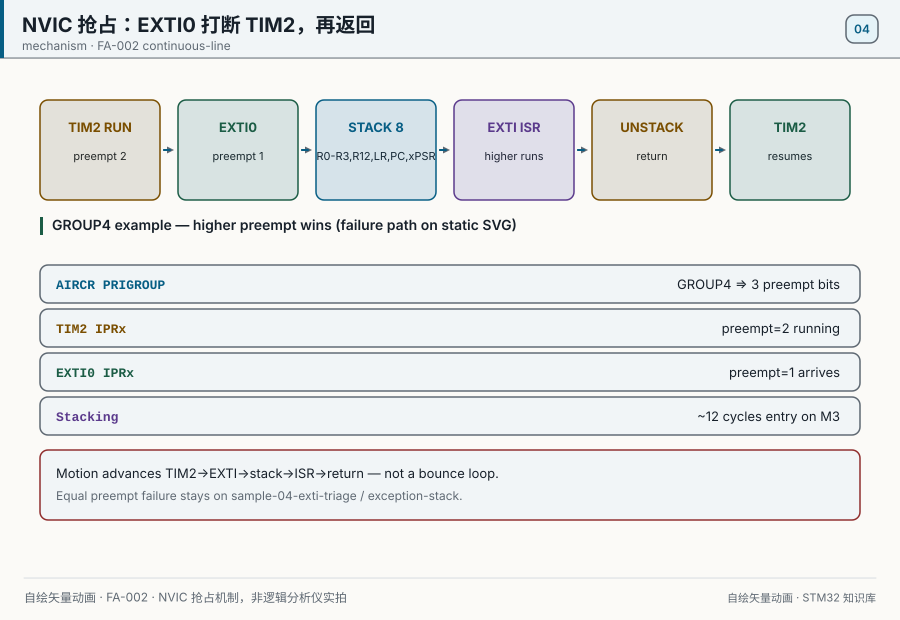
  <br><sub>▲ 自绘矢量动画（FA-002）。TIM2→EXTI0→入栈→ISR→返回。</sub>
</p>


<p align="center">
  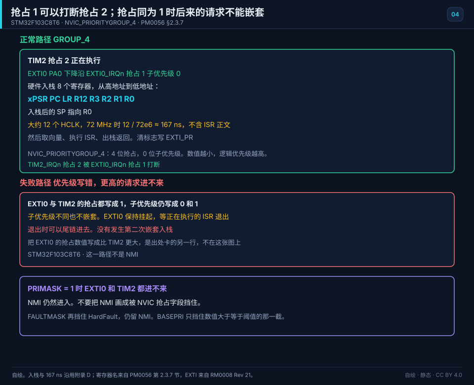
  <br><sub>▲ 自绘。STM32F103C8T6，NVIC_PRIORITYGROUP_4。上半部分：TIM2 抢占 2 正在执行，EXTI0（PA0，EXTI0_IRQn）以抢占 1、子优先级 0 打断它。入栈 8 个寄存器，从高地址到低地址是 xPSR, PC, LR, R12, R3, R2, R1, R0，SP 指向 R0。大约 12 个 HCLK，72 MHz 时 167 ns，不含 ISR 正文。下半部分：两者抢占都写成 1，子优先级 0 和 1 仍然不能嵌套，退出后可以尾链，没有第二次嵌套入栈。PRIMASK = 1 时 EXTI0 和 TIM2 进不来，NMI 仍进入。出处是 [PM0056 第 2.3.7 节](#source-pm0056-nvic) 与 [RM0008 Rev 21 的 EXTICR](#source-rm0008-exti)。</sub>
</p>
<p align="center">
  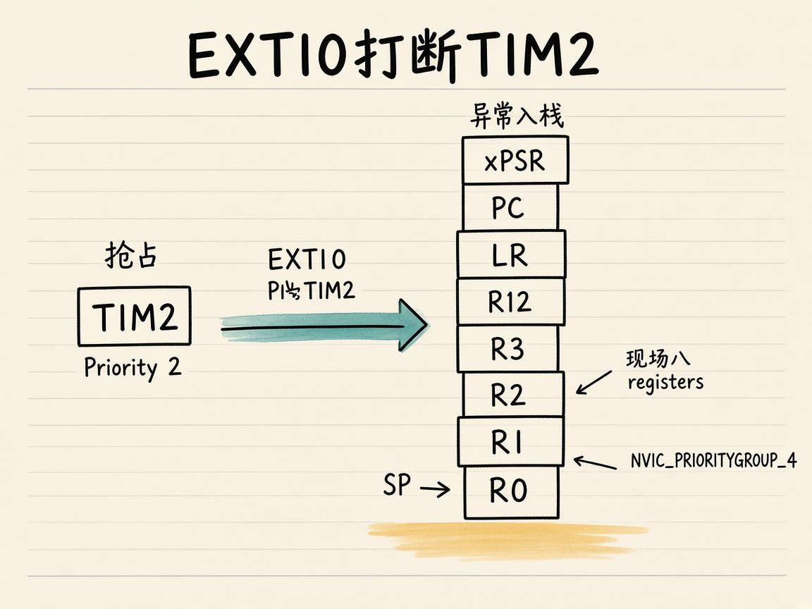
  <br><sub>▲ 知识轨（Handraw · 原理示意/非实拍）。抢占 1 的 EXTI0 打断抢占 2 的 TIM2，现场八寄存器入栈；不是示波器实拍。</sub>
</p>


<p align="center">
  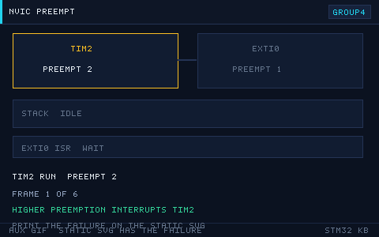
  <br><sub>▲ 动图版，只演示 EXTI0 成功抢占 TIM2 的过程。印刷版只有上面的静态图。</sub>
</p>

## 时序与状态

| 阶段 | 分组 | EXTI0 抢占 | TIM2 抢占 | 状态 | 时间 |
| --- | --- | --- | --- | --- | --- |
| 正常：TIM2 正在执行 | GROUP_4 | — | 2 | TIM2 的 ISR 在跑 | — |
| 正常：EXTI0 到达 | GROUP_4 | 1 | 2 | 入栈 xPSR, PC, LR, R12, R3, R2, R1, R0 | 12 HCLK，约 167 ns |
| 正常：服务与返回 | GROUP_4 | 1 | 2 | 取向量、执行 ISR、出栈返回 | 167 ns 不含 ISR 正文 |
| 失败：抢占写成同一级 | GROUP_4 | 1 | 1 | EXTI0 保持挂起。尾链只发生在退出之后。没有第二次嵌套入栈 | 手册未给周期数 |
| PRIMASK = 1 | GROUP_4 | 1 | 2 | 可配置中断不进入。NMI 仍进入 | — |

入栈约 12 个 HCLK，72 MHz 下约 167 ns，和附录 D 一致。出处是 [PM0056 第 2.3.7 节](#source-pm0056-nvic)。`EXTI_PR` 的清除见 [RM0008](#source-rm0008-exti)。

## 常见坑与出处

| 现象 | 原因 | 处理 | 出处 | 出处里能查到什么 |
| --- | --- | --- | --- | --- |
| 子优先级更小，却打断不了正在跑的 ISR | 同抢占不能嵌套 | 改抢占级，不要改子优先级来嵌套 | [PM0056](#source-pm0056-nvic) | 同抢占不能嵌套；GROUP_4 没有子优先级位 |
| 按键中断打不断定时器 | EXTI0 的抢占数值没有小于 TIM2 | 让 EXTI0 的抢占数值小于 TIM2 | [PM0056](#source-pm0056-nvic) | 数值越小越优先；写反了就嵌套失败 |
| 打开尾链之后低优先级插进了高优先级 | 这不是尾链的定义 | 检查抢占级 | [PM0056 第 2.3.7 节](#source-pm0056-nvic) | 尾链不改变谁有权抢占 |
| `__disable_irq()` 之后仍进了 NMI | PRIMASK 不管 NMI | 这是预期，不是 PRIMASK 失效 | [PM0056 Table 7](#source-pm0056-nvic) | PRIMASK 挡可配置优先级；NMI 除外 |
| PA0 已经占用 EXTI0，PB0 不再触发 | 同一编号的脚共用一条 EXTI 线 | 换一个脚号 | [RM0008 EXTICR](#source-rm0008-exti) | PA0 和 PB0 都在 EXTI0 上 |
| F1 上 EXTI 不进中断 | 没开 AFIO 时钟，或没写 EXTICR | 打开 AFIO 时钟再写 EXTICR，并清 EXTI_PR | [RM0008 第 9.4.3 节](#source-rm0008-exti) | F1 的 EXTI 端口选择在 AFIO_EXTICR |

## 学习目标
- [ ] 说清中断与轮询的差异及适用场景
- [ ] 掌握 NVIC 抢占优先级 / 子优先级分组规则
- [ ] 理解中断响应的硬件全流程（入栈 → 取向量 → ISR → 出栈）
- [ ] 会配置 EXTI 外部中断并注意 AFIO 时钟
- [ ] 会用 volatile、临界区，知道中断里为什么不能用 `HAL_Delay`

## 核心原理

EXTI 解决的是“何时发现事件”，NVIC 解决的是“多个事件先处理谁”。事件被及时发现，不代表处理就正确；标志、共享数据和 ISR 执行时间仍要逐项验收。

### 1. 中断 vs 轮询

等快递有两种办法。一种是每隔五分钟下楼看一眼信箱，这叫轮询：CPU 在主循环里一遍遍读按键的电平。另一种是装个门铃，快递到了按铃，你再下楼，这叫中断：按键按下时硬件通知 CPU，CPU 才去处理。门铃的好处是你不用一直盯着，坏处是铃一响你得放下手里的事，所以处理要快，放下的事也要记得接着做。

| 维度 | 轮询（Polling） | 中断（Interrupt） |
| --- | --- | --- |
| CPU 占用 | 高（一直查） | 低（事件才响应） |
| 响应延迟 | 取决于轮询周期 | 通常几个时钟周期 ~ 微秒 |
| 代码复杂度 | 低 | 中（要处理优先级/共享变量） |
| 实时性 | 差（可能漏事件） | 好 |
| 适用场景 | 简单、事件稀少、要求确定性 | 事件异步、要求快速响应 |

### 2. NVIC 优先级机制


<p align="center">
  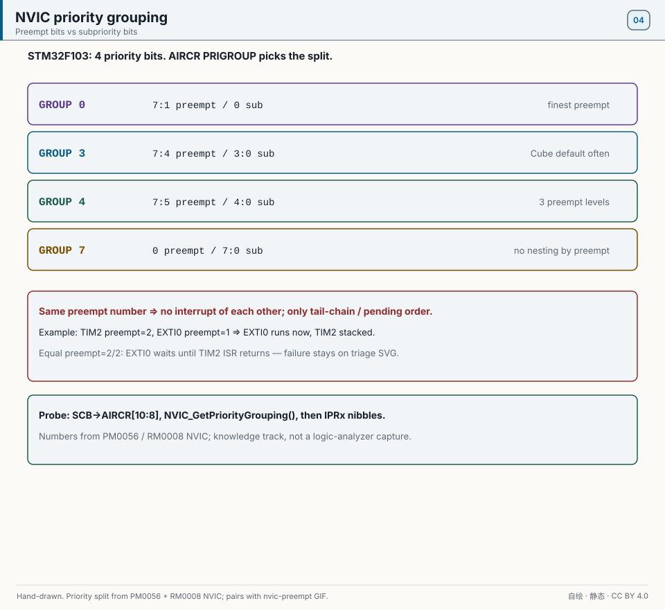
  <br><sub>▲ 自绘。AIRCR PRIGROUP 切分 4 个优先级位；同抢占互不打断。</sub>
</p>
<p align="center">
  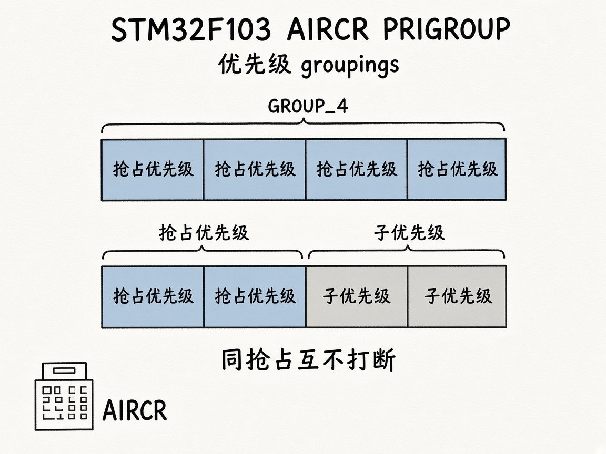
  <br><sub>▲ 知识轨（Handraw · 原理示意/非实拍）。PRIGROUP 切分抢占/子优先级；同抢占互不打断；不是寄存器截图。</sub>
</p>


NVIC 是芯片里专门管中断的「前台」。几件事同时找上门时，它按两个数排队。抢占优先级像急诊分级：重症病人到了，可以把正在看病的轻症病人请出去先等着，这就是嵌套。子优先级只管挂号顺序：两个同级的病人同时到，先叫谁，但已经进了诊室的不会被同级的人打断。记住一条反直觉的规则：数字越小越急，0 最急。

- 优先级**数值越小，优先级越高**。
- 优先级分「抢占优先级（preemption）」和「子优先级（subpriority）」。
- 抢占优先级高的可以打断抢占优先级低的 ISR；**同抢占优先级不能互相打断**（即使子优先级不同）。
- 子优先级只在多个中断**同时挂起**时决定谁先执行，不产生嵌套。
- 分组由 `HAL_NVIC_SetPriorityGrouping()` / `NVIC_PriorityGroupConfig()` 决定。

| 分组宏（HAL） | 抢占位 | 子优先级位 | 可表示的抢占级数 |
| --- | --- | --- | --- |
| `NVIC_PRIORITYGROUP_0` | 0 | 4 | 1（无抢占） |
| `NVIC_PRIORITYGROUP_1` | 1 | 3 | 2 |
| `NVIC_PRIORITYGROUP_2` | 2 | 2 | 4 |
| `NVIC_PRIORITYGROUP_3` | 3 | 1 | 8 |
| `NVIC_PRIORITYGROUP_4` | 4 | 0 | 16（HAL 默认） |

优先级仲裁示意图：

<p align="center">
  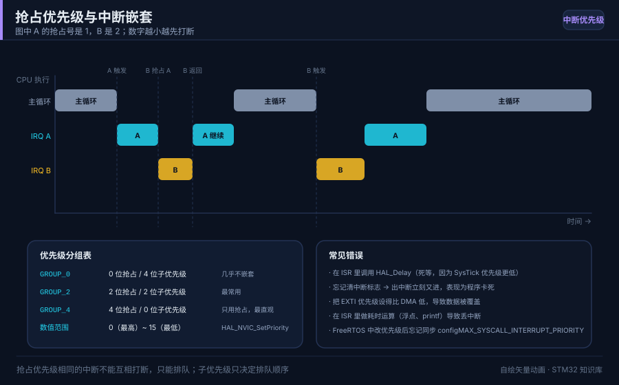
  <br><sub>▲ 图示：抢占优先级 vs 子优先级的仲裁示意（作者自绘矢量图）</sub>
</p>
<p align="center">
  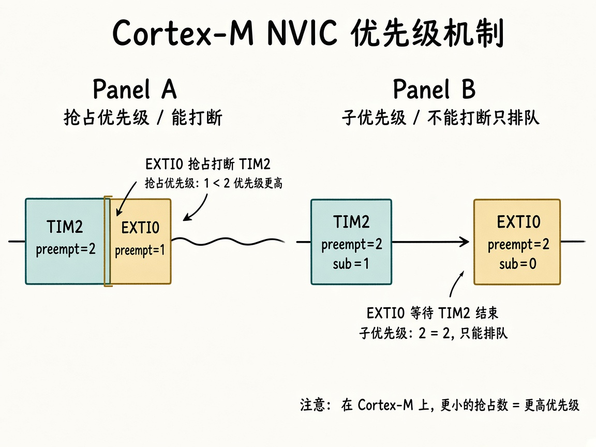
  <br><sub>▲ 知识轨（Handraw · 原理示意/非实拍）。更小抢占数优先级更高能打断；同抢占只靠子优先级排队；不是调试器实拍。</sub>
</p>


### 3. 中断响应全流程

从按键按下到你的处理函数开始跑，中间这几步全是硬件自动做的。最要紧的是第 4 步：CPU 先把手头 8 个寄存器存到栈上，就像起身去开门前在书里夹一张书签。处理完回来，硬件按书签恢复，主程序根本不知道自己被打断过。你写的代码只负责第 6 步，而且一定要清掉中断标志，否则门铃一直响，CPU 会一遍遍进同一个中断出不来。

| 阶段 | 硬件动作 |
| --- | --- |
| 1 | 外设事件置位标志（如 `EXTI_PR` 对应位） |
| 2 | 外设把请求送到 NVIC，NVIC 置挂起位 |
| 3 | CPU 完成当前指令，比较优先级，决定是否响应 |
| 4 | 硬件自动入栈 8 个寄存器（xPSR, PC, LR, R12, R3, R2, R1, R0） |
| 5 | 从向量表取出 ISR 地址，跳转执行 |
| 6 | 执行用户 ISR，**清中断标志** |
| 7 | 出栈恢复现场，返回主程序 |

这七步的动态对照——轮询、外部中断与 EXTI 触发——看这张动画：

<p align="center">
  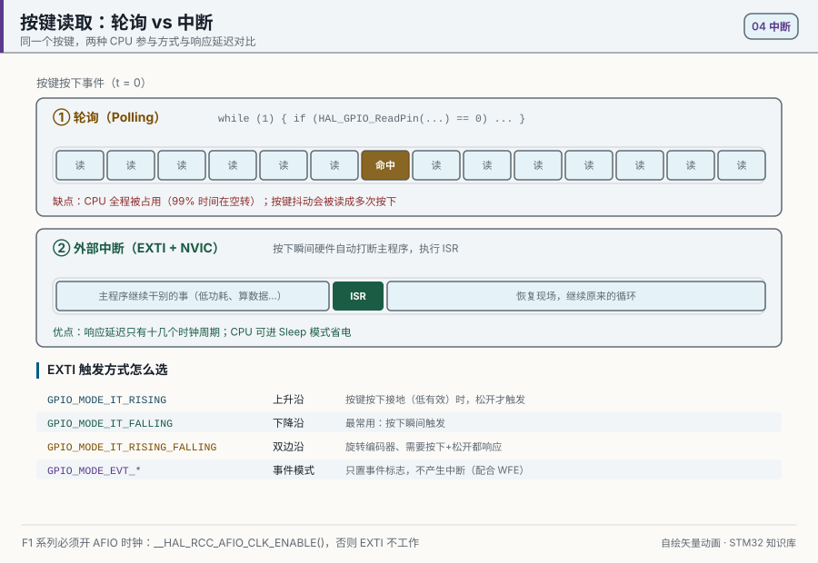
  <br><sub>▲ 动画：轮询 vs 外部中断 vs EXTI 触发方式对比（作者自绘矢量图）</sub>
</p>

### 4. EXTI 外部中断


<p align="center">
  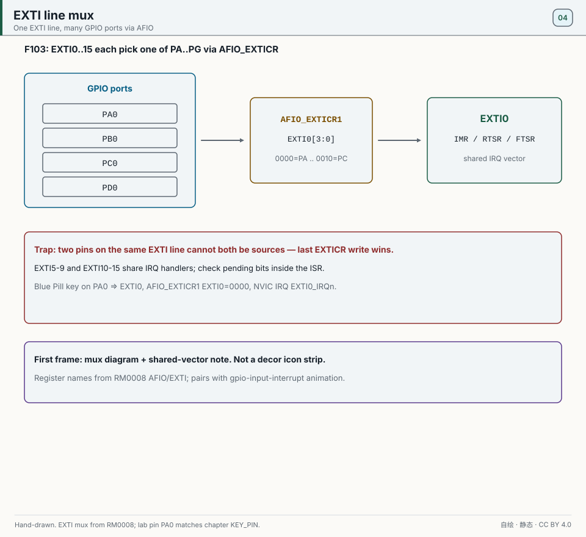
  <br><sub>▲ 自绘。每条 EXTI 线只选一个端口；5–9 / 10–15 共用 IRQ。</sub>
</p>
<p align="center">
  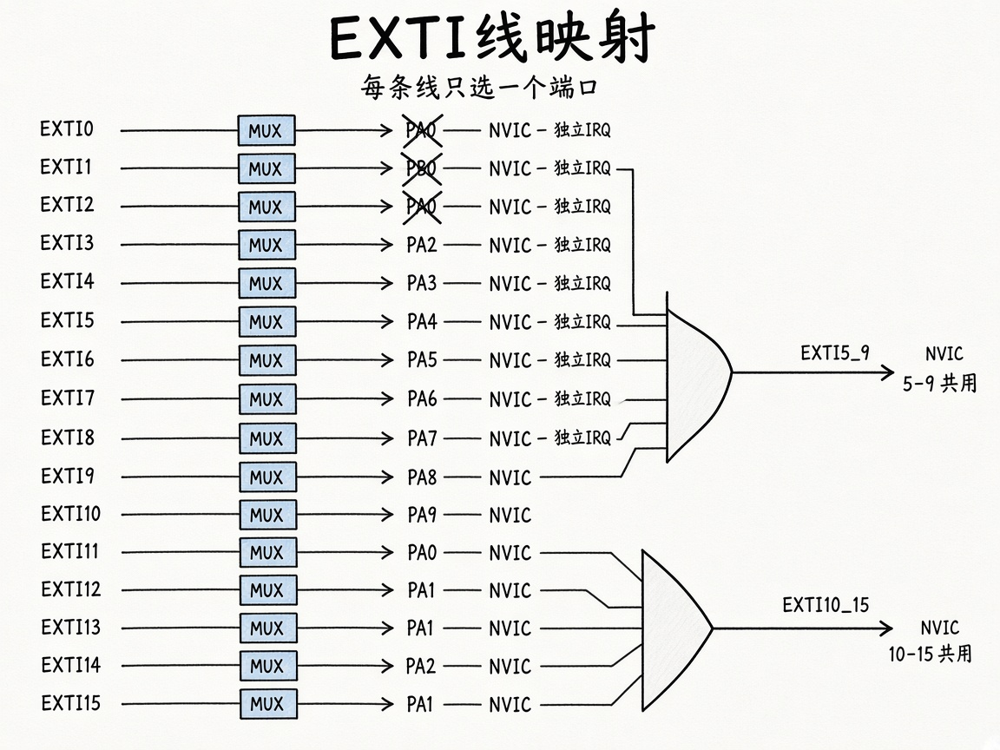
  <br><sub>▲ 知识轨（Handraw · 原理示意/非实拍）。每条 EXTI 线只选一个端口；5–9 / 10–15 共用 IRQ；不是芯片显微照片。</sub>
</p>


EXTI 是把引脚变化转成中断请求的那一层。F103 有 16 条 EXTI 线，按脚号分：所有端口的 0 号脚（PA0、PB0、PC0……）共用 EXTI0，所有 1 号脚共用 EXTI1，以此类推。一条线同一时间只能接一个端口，就像一栋楼每层只有一个门铃按钮，A 座 1 层和 B 座 1 层不能同时用。选哪个端口靠 `EXTICR` 这组开关，F1 上它在 AFIO 里，所以要先开 AFIO 时钟。

| 概念 | 说明 |
| --- | --- |
| EXTI 线 | 每条线对应一个（或一组）GPIO 引脚 |
| 触发方式 | 上升沿 / 下降沿 / 双边沿 |
| AFIO | F1 上配置 EXTI 引脚映射需使能 `__HAL_RCC_AFIO_CLK_ENABLE()`（**F1 特有坑**） |
| 映射 | `AFIO->EXTICR[x]` 选择 EXTI 线连到哪个端口（PAx/PBx/…） |

<p align="center">
  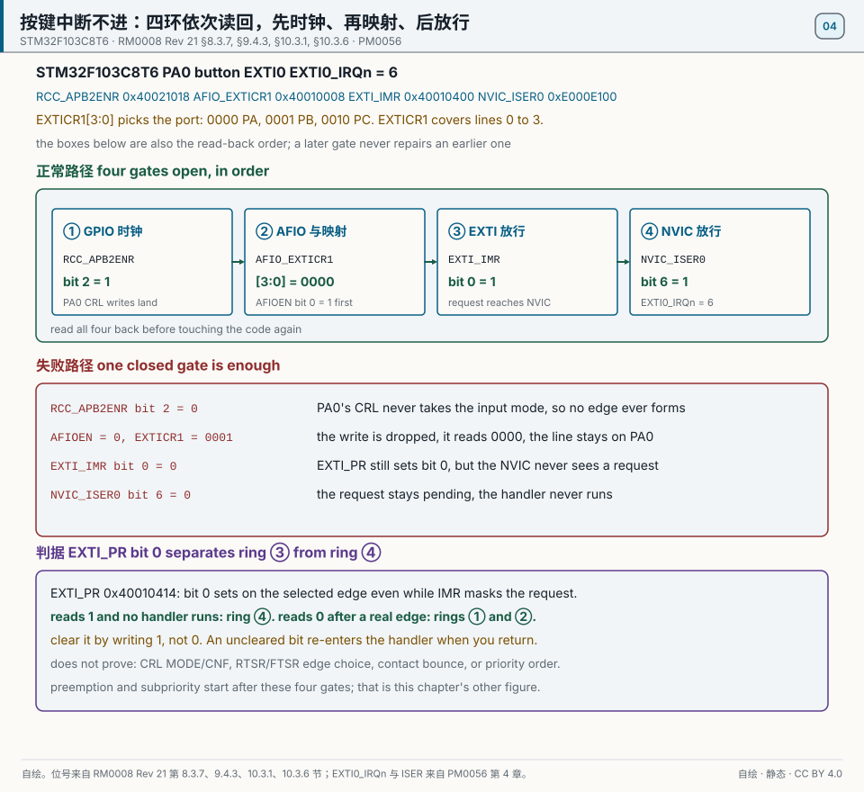
  <br><sub>▲ 自绘。STM32F103C8T6，按键在 PA0，EXTI0_IRQn = 6。看哪里：按 PA0 边沿到 ISR 的顺序读四个寄存器——RCC_APB2ENR 的 bit 2（IOPAEN）、AFIO_EXTICR1 的 [3:0]（0000 选 PA0）、EXTI_IMR 的 bit 0、NVIC_ISER0 的 bit 6；四个都读回 1，这条路径才通。证明什么：EXTI_IMR 为 0 时，EXTI_PR 的 bit 0 照样被边沿置 1，所以「PR 为 1 却不进 ISR」把第 ④ 环和第 ③ 环分开；PR 读回 0 说明边沿根本没到 EXTI，要回第 ①、② 环。不证明什么：引脚模式（GPIOx_CRL 的 MODE/CNF）、RTSR/FTSR 选的触发沿、按键抖动，以及抢占与子优先级，都不在这张图上。出处是 RM0008 Rev 21 第 8.3.7、9.4.3、10.3.1、10.3.6 节（[EXTICR 与 EXTI_PR](#source-rm0008-exti)），以及 [PM0056 第 4 章](#source-pm0056-nvic) 的 NVIC_ISERx 与异常编号。</sub>
</p>
<p align="center">
  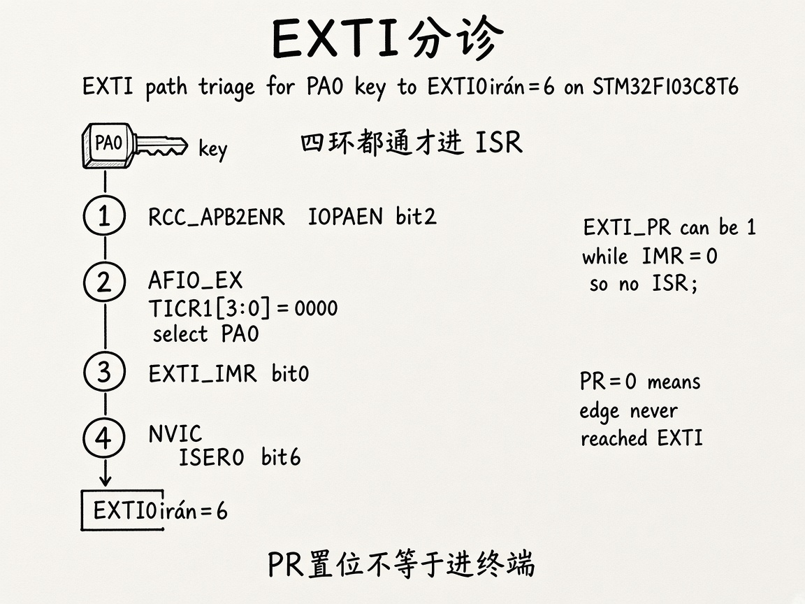
  <br><sub>▲ 知识轨（Handraw · 原理示意/非实拍）。IOPAEN → EXTICR → IMR → NVIC_ISER 四环都通才进 ISR；PR 置位不等于进中断；不是板级实拍。</sub>
</p>


### 5. 关键 C 语义

中断和主程序共用一个变量时，最容易出两种事。第一种是编译器「好心」把变量缓存在寄存器里，主循环一直读旧值，看不到中断改过的新值，所以这种变量要加 `volatile`。第二种是主程序改一个多字节的数据改到一半，中断进来读走了半新半旧的值，所以这类读写要放在临界区里，期间先关中断。

| 概念 | 作用 |
| --- | --- |
| `volatile` | 告诉编译器变量可能在 ISR 中被改，禁止优化缓存 |
| 临界区 `__disable_irq()/__enable_irq()` | 关/开总中断，保护共享数据 |
| `__DSB()` | 数据同步屏障，保证内存访问完成 |
| 中断里禁用 `HAL_Delay` | 它依赖 SysTick 中断，若被同级/更高级屏蔽会死等 |

## 硬件与接线

| 开发板 | 外设 | 引脚 | 备注 |
| --- | --- | --- | --- |
| BluePill | 按键（EXTI） | PA0 | 另一端接 GND，下降沿触发 |
| BluePill | LED | PC13 | 中断里翻转 |

从第 03 章继续时，先拆掉 PA0 上的外接 LED，再把按键从 PA1 移到 PA0。PA13/PA14 仍留给 SWD。

## 代码实现

```c
/* exti_key.c —— PA0 按键外部中断翻转 PC13（含标志位 + 主循环消抖） */
#include "stm32f1xx_hal.h"

#define LED_PIN   GPIO_PIN_13
#define LED_PORT  GPIOC
#define KEY_PIN   GPIO_PIN_0
#define KEY_PORT  GPIOA

static volatile uint8_t g_key_flag = 0;   /* ISR 与主循环共享，必须 volatile */

void SystemClock_Config(void);

int main(void)
{
    HAL_Init();
    SystemClock_Config();

    __HAL_RCC_GPIOA_CLK_ENABLE();
    __HAL_RCC_GPIOC_CLK_ENABLE();
    __HAL_RCC_AFIO_CLK_ENABLE();          /* F1 关键：EXTI 需要 AFIO 时钟 */

    GPIO_InitTypeDef io = {0};

    /* PC13 LED 输出 */
    io.Pin = LED_PIN; io.Mode = GPIO_MODE_OUTPUT_PP;
    io.Pull = GPIO_NOPULL; io.Speed = GPIO_SPEED_FREQ_LOW;
    HAL_GPIO_Init(LED_PORT, &io);

    /* PA0 按键，下降沿触发中断（按键接 GND，平时上拉为高） */
    io.Pin  = KEY_PIN;
    io.Mode = GPIO_MODE_IT_FALLING;       /* 下降沿中断 */
    io.Pull = GPIO_PULLUP;
    HAL_GPIO_Init(KEY_PORT, &io);

    /* 配置 NVIC：抢占优先级 1，子优先级 0 */
    HAL_NVIC_SetPriority(EXTI0_IRQn, 1, 0);
    HAL_NVIC_EnableIRQ(EXTI0_IRQn);

    while (1)
    {
        if (g_key_flag)
        {
            g_key_flag = 0;
            HAL_GPIO_TogglePin(LED_PORT, LED_PIN);
        }
    }
}

/* EXTI0 中断服务函数（PA0 映射到 EXTI0） */
void EXTI0_IRQHandler(void)
{
    if (__HAL_GPIO_EXTI_GET_IT(KEY_PIN) != RESET)
    {
        __HAL_GPIO_EXTI_CLEAR_IT(KEY_PIN);   /* 必须清标志，否则反复进中断 */
        g_key_flag = 1;                      /* 只置标志，不做耗时操作 */
    }
}
```

主循环侧软件消抖（避免机械抖动导致多次翻转）：

```c
if (g_key_flag)
{
    HAL_Delay(20);                          /* 主循环里延时是安全的 */
    if (HAL_GPIO_ReadPin(KEY_PORT, KEY_PIN) == GPIO_PIN_RESET)  /* 仍为低 */
    {
        HAL_GPIO_TogglePin(LED_PORT, LED_PIN);
    }
    g_key_flag = 0;
}
```

临界区保护（主循环读多字节共享变量时）：

```c
uint32_t snapshot;
__disable_irq();          /* 关总中断 */
snapshot = g_shared_counter;
__enable_irq();           /* 开总中断 */
```

完整工程见 [`examples/exti-key/`](../examples/exti-key/)。

## 动手实验

1. **实验一（事件闭环）**：PA0 下降沿只在 ISR 里置标志，主循环翻转 PC13。连续按 10 次，记录 10 次有效翻转，并在调试器中确认 `EXTI_PR` 对应位已经清零。
2. **实验二（抖动证据）**：临时去掉主循环消抖，统计 10 次按键产生的标志次数；恢复消抖后重测。保留两组计数，不用“看起来稳定”代替结果。
3. **实验三（抢占证据）**：增加 TIM2 中断，并让两个 ISR 分别在入口置高、出口置低一只空闲 GPIO。用逻辑分析仪捕获嵌套波形，验证抢占优先级 1 的 EXTI0 能插入抢占优先级 2 的 TIM2。

### 6. NVIC 相关寄存器与函数

| 项目 | 说明 |
| --- | --- |
| ISER | 中断使能置位寄存器 |
| ICER | 中断使能清除寄存器 |
| ISPR/ICPR | 挂起/解挂 |
| IPR | 优先级寄存器（每 8 位一个） |
| `HAL_NVIC_SetPriority` | 设置抢占/子优先级 |
| `HAL_NVIC_EnableIRQ` | 使能中断 |
| `HAL_NVIC_SetPriorityGrouping` | 设置分组 |

### 7. SysTick 与 HAL 时基

- `HAL_Init()` 会把 SysTick 配置为 1ms 中断，`HAL_Delay()` 依赖它。
- SysTick 优先级通常设为最低（`TICK_INT_PRIORITY`），避免打断业务中断。
- 若在 ISR 中调用 `HAL_Delay()`，且该 ISR 优先级高于 SysTick，则计数不前进 → 死等。

### 8. 中断嵌套与优先级示例

```c
/* 高抢占（数值小）可打断低抢占；同抢占不可打断 */
HAL_NVIC_SetPriority(EXTI0_IRQn, 1, 0);   /* 抢占 1 */
HAL_NVIC_SetPriority(TIM2_IRQn, 2, 0);    /* 抢占 2，会被 EXTI0 打断 */
HAL_NVIC_EnableIRQ(EXTI0_IRQn);
HAL_NVIC_EnableIRQ(TIM2_IRQn);
```

### 9. 优先级分组选择建议

| 场景 | 建议分组 |
| --- | --- |
| 不用 RTOS | GROUP_4（全抢占） |
| 用 FreeRTOS | GROUP_4（RTOS 要求全抢占） |
| 需要子优先级仲裁 | GROUP_2 |

### 10. 中断响应开销与优化机制


<p align="center">
  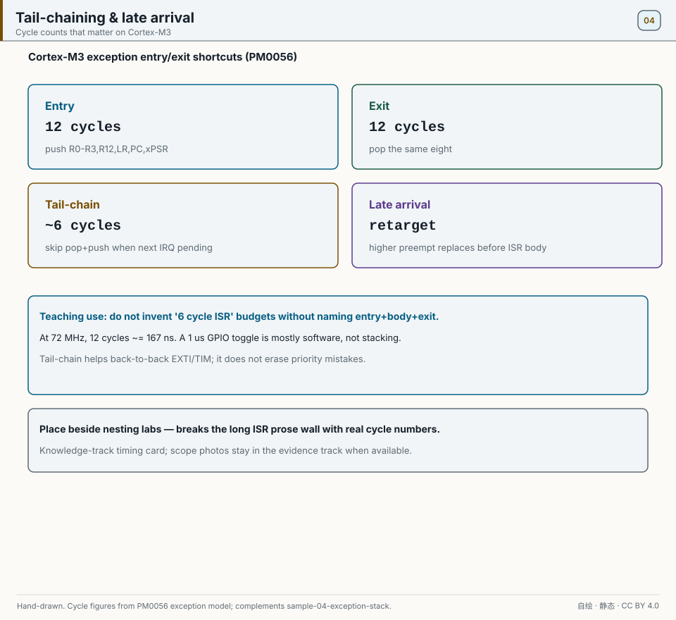
  <br><sub>▲ 自绘。入栈约 12 周期；尾链约 6。别空谈“6 周期 ISR”。</sub>
</p>
<p align="center">
  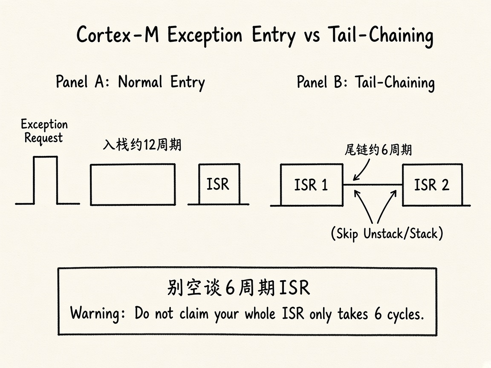
  <br><sub>▲ 知识轨（Handraw · 原理示意/非实拍）。入栈约 12 周期，尾链约 6；别把硬件尾链开销当成整个 ISR 时长；不是示波器实拍。</sub>
</p>


| 机制 | 说明 |
| --- | --- |
| 硬件入栈 | 自动保存 8 个寄存器，约 12 个时钟周期 |
| 尾链（Tail-chaining） | 退出时可以省掉一部分出栈再入栈，不改变谁有权抢占。账在「时序或状态」 |
| 晚到（Late-arriving） | 入栈期间更高优先级抢占 |
| 优化建议 | ISR 尽量短，耗时操作交给主循环 |

### 11. 三把总闸，和共用的 EXTI 线

`PRIMASK` 关掉除 NMI 和 HardFault 以外的全部中断；`FAULTMASK` 连 HardFault 也关，只留 NMI；`BASEPRI` 只挡住“优先级数值 ≥ 阈值”的那一截（数值越大，优先级越低）。

| 寄存器 | 挡住谁 | 常见写法 |
| --- | --- | --- |
| PRIMASK | 全部可屏蔽中断 | `__disable_irq()` / `__enable_irq()` |
| FAULTMASK | 再加 HardFault | `__disable_fault_irq()` |
| BASEPRI | 数值不够优先的那些 | `__set_BASEPRI(prio << (8 - __NVIC_PRIO_BITS))` |

EXTI 线是按**引脚号**共用的：PA0 和 PB0 都连在 EXTI0 上，不能同时做外部中断。要换端口，改 `AFIO->EXTICR`（F1）或 `SYSCFG->EXTICR`（F4），不是两条线并行。

离开本章前，应有按键事件计数、消抖前后对比和一张抢占波形；同时能解释为什么 PA0 与 PB0 不能各占一条独立的 EXTI0。

自测：

1. `__disable_irq()` 之后，HardFault 还能进来吗？
2. PA0 已经接了按键中断，PB0 还能再挂一个 EXTI 下降沿吗？
3. BASEPRI 的阈值是“数值更大更优先”还是相反？

## 相关资源

- 官方手册：**RM0008** 第 10 章（中断与事件 EXTI）、第 9.4.3 到 9.4.6 节（AFIO_EXTICR）。第 9.2.7 节是 GPIOx_LCKR，不是 EXTICR。入栈见 [PM0056 第 2.3.7 节](#source-pm0056-nvic)
- 上一篇：[03 GPIO与LED](03-GPIO与LED.md)｜下一篇：[05 定时器与PWM](05-定时器与PWM.md)
- 手机阅读版：[第 04 章 · 中断与NVIC（公众号图文）](https://mp.weixin.qq.com/s/zxETginoI0WV0MEgcGVrSA)
- 相关图：[`assets/animations/nvic-interrupt-flow.svg`](../assets/animations/nvic-interrupt-flow.svg)、[`assets/animations/gpio-input-interrupt.svg`](../assets/animations/gpio-input-interrupt.svg)、[`assets/diagrams/interrupt-priority.svg`](../assets/diagrams/interrupt-priority.svg)
- 免责声明：本仓库插画均为作者自绘矢量图/程序生成动画，非厂商实拍照片。

