# 05 定时器与 PWM

> English: [Timers and PWM](en/05-timer-pwm.md)

> 第 04 章靠中断响应事件，这一章让硬件自己产生节拍。先从第 02 章确认 TIM3 输入是 72 MHz，再用 PSC、ARR 和 CCR 生成并测回 1 kHz、50% PWM。

<p align="center">
  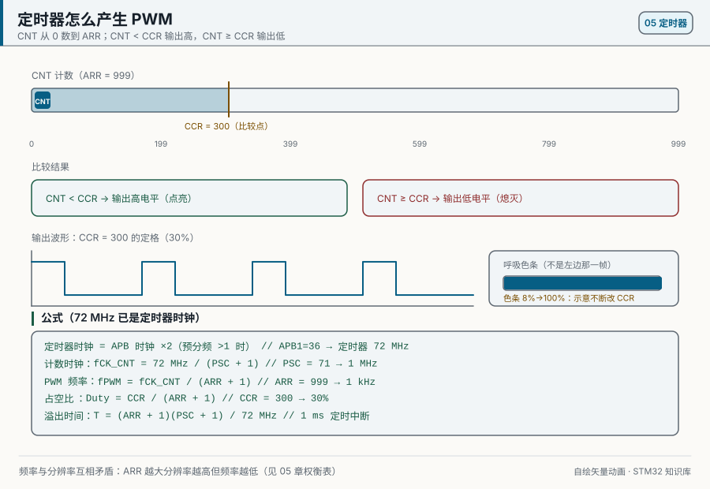
  <br><sub>▲ 动画：定时器计数、比较匹配与 PWM 占空比（呼吸灯，作者自绘矢量图）</sub>
</p>

<!-- video:ch05 -->
<p align="center">
  <video width="640" controls poster="../assets/video/ch05-tim.png">
    <source src="../assets/video/ch05-tim.mp4" type="video/mp4">
  </video>
  <br><sub>▲ 本章讲解视频（2.7 分钟）。<a href="../assets/video/ch05-tim.mp4">MP4</a> · <a href="../assets/video/ch05-tim.srt">字幕</a></sub>
</p>

<details>
<summary>旁白文字稿</summary>

1. 定时器不是魔法，就是一个被时钟推着走的计数器。CNT 加到 ARR 就回头，这一圈就是周期。先把这句话讲顺，再去看 PWM。
2. 三个数各管一件事。PSC 把时钟变慢，ARR 决定一圈多长，CCR 决定方波在哪里翻。频率不对先看前两个，亮度不对再看 CCR。
3. 频率等于定时器时钟，除以 ARR 加 1，再除以 PSC 加 1。想要 1 千赫，先选定分频后的计数时钟，再反推 ARR。不要三个数一起瞎试。
4. 这一帧是仓库画的 PWM。计数器一边跑，一边和 CCR 比。低于和高于可以是两种电平，占空比就出来了。示波器上的高电平宽度，应该和你算的 CCR 一致。
5. 想要 1 千赫，你先定谁？先定 PSC，让计数时钟变成好算的整数，再定 ARR 加 1。CCR 最后填，因为它不改变频率，只改变占空比。
6. 输入捕获不是去量电压。边沿到来时，硬件把当时的 CNT 锁进捕获寄存器。两个边沿相减，再乘上计数周期，就是脉宽。口诀：捕获锁的是 CNT。
7. 回到时钟那一章：APB 分频大于 1 时，定时器时钟常常还要乘 2。公式里的时钟用错，你算的 1 千赫会变成 2 千赫或 500 赫。先问到真实的定时器时钟。
8. 三个数按顺序拧：先用 PSC 把时钟分到好算，再用 ARR 定周期，最后 CCR 定占空比。每拧一步记下算出的数，出错时才知道是哪一步的账不对。
9. 实验输出大约 1 千赫、占空比三成的 PWM。用逻辑分析仪或示波器对一下。对不上时，先核对定时器时钟，再核对 ARR 和 CCR，别先怀疑探头。
10. 离开前把账读回一遍：PSC 和 ARR 是不是你写的值，CNT 有没有真的在跑。寄存器读回和示波器对上，PWM 这一章才算闭环。

</details>
<!-- /video:ch05 -->
## 原理与适用范围

本章的波形数字都按 STM32F103C8T6 算，计数时钟取附录 D 的 72 MHz。换到带 32 位定时器的系列，下面「16 位装不下」那段要重算。

TIM3 挂在 APB1 上，PCLK1 = 36 MHz。APB1 预分频不是 1 时，定时器时钟是 PCLK1 的两倍，所以 TIM3 实际按 72 MHz 计数。PSC = 71，ARR = 999：`72e6 / ((71+1) × (999+1)) = 1000` Hz。计数时钟先被分成 1 MHz，再数 1000 下，周期 1 ms。如果按 36 MHz 去算这组数，得到的是 500 Hz，示波器上量到 500 Hz 多半就是这个原因。出处是 [RM0008 Rev 21 第 15 章](#source-rm0008-tim)。

PWM 模式 1：CNT < CCR 时输出有效电平。CCR = 500 时占空比 `500 / (999+1) = 50%`，高电平 500 µs。

C8 的 TIM2～TIM5 都是 16 位，ARR 最大 65535。想用 PSC = 71、ARR = 999999 得到 1 秒，999999 装不下。能装下的写法是 PSC = 7199、ARR = 9999：`72e6 / (7200 × 10000) = 1` Hz。32 位的 TIM2/TIM5 出现在 F4 等别的系列上。

不重映射时，TIM3_CH1 在 PA6，也就是 LQFP48 第 16 脚。DS5319 Rev 20 表 5 里这只脚的默认复用同时列了 TIM3_CH1 和 SPI1_MISO，同一时间只能用其中一个。第 08 章把它当 SPI1_MISO 用。重映射到 PB4 或 PC6 需要另配 `TIM3_REMAP`。出处是 [DS5319 Rev 20 表 5](#source-ds5319-tim)。

高级定时器 TIM1/TIM8 多一个刹车与死区寄存器 `TIMx_BDTR`，偏移 `0x44`，复位值 `0x0000`。位 15 MOE 为 0 时主输出关闭，引脚上没有波形。`HAL_TIM_PWM_Start` 会替你置 MOE，自己写寄存器时容易漏。通用定时器 TIM3 没有这一位。

## 关键插图


<p align="center">
  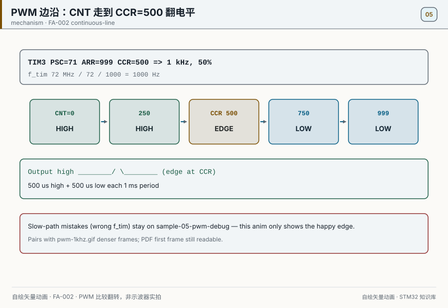
  <br><sub>▲ 自绘矢量动画（FA-002）。1 kHz、50% 高电平 500 µs。</sub>
</p>


<p align="center">
  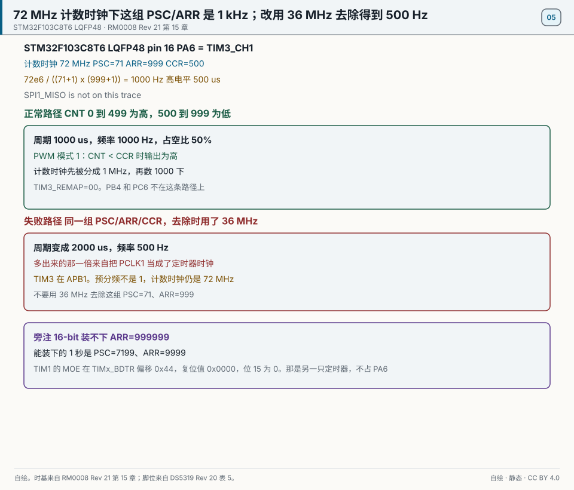
  <br><sub>▲ 自绘。STM32F103C8T6，LQFP48 第 16 脚 PA6 = TIM3_CH1。计数时钟 72 MHz，PSC = 71，ARR = 999，CCR = 500。上半部分是正确的波形：周期 1 ms，高电平 500 µs，频率 1000 Hz。下半部分是按 36 MHz 算错时的波形：周期 2 ms，频率 500 Hz。图上另标出 ARR = 999999 在 16 位计数器里装不下。TIM1 的 MOE 在偏移 0x44，复位值 0x0000，与这条 TIM3 波形无关。出处是 [RM0008 Rev 21 第 15 章](#source-rm0008-tim) 和 [DS5319 Rev 20 表 5](#source-ds5319-tim)。</sub>
</p>

<p align="center">
  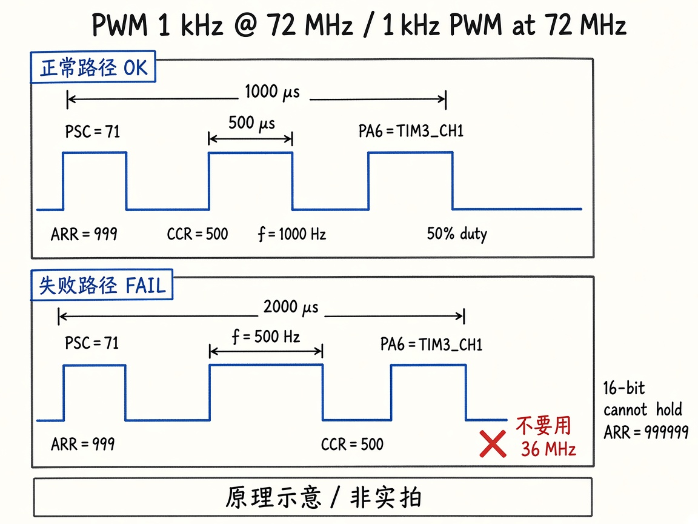
  <br><sub>▲ 知识轨（Handraw · 原理示意/非实拍）。上半 72 MHz→1000 Hz；下半误用 36 MHz→500 Hz；不是示波器实拍。</sub>
</p>

<p align="center">
  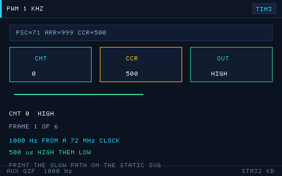
  <br><sub>▲ 动图版，只演示 1000 Hz、高电平 500 µs 的正确波形。印刷版只有上面的静态图。</sub>
</p>

## 时序与状态

| 情况 | 计数时钟 | PSC | ARR | CCR | CNT | 输出 | 时间 |
| --- | --- | --- | --- | --- | --- | --- | --- |
| 正确，高电平段 | 72 MHz | 71 | 999 | 500 | 0 到 499 | 高 | 500 µs |
| 正确，低电平段 | 72 MHz | 71 | 999 | 500 | 500 到 999 | 低 | 再 500 µs，周期 1000 µs，1000 Hz |
| 按 36 MHz 算错 | 36 MHz | 71 | 999 | 500 | 0 到 999 | 比较方式不变 | 周期 2000 µs，500 Hz |
| ARR 装不下 | 72 MHz | 71 | 999999 | — | — | 得不到 1 秒 | 16 位寄存器截断 |
| 1 秒的写法 | 72 MHz | 7199 | 9999 | — | 0 到 9999 | — | 1 Hz |

出处是 [RM0008 Rev 21 第 15 章](#source-rm0008-tim)。

## 常见坑与出处

| 现象 | 原因 | 处理 | 出处 | 出处里能查到什么 |
| --- | --- | --- | --- | --- |
| 示波器上是 500 Hz | 按 36 MHz 算了 PSC 和 ARR | 按 72 MHz 算，PSC = 71，ARR = 999 | [RM0008](#source-rm0008-tim) | 这组数在 72 MHz 下是 1000 Hz，按 36 MHz 计数则是 500 Hz |
| 想要 1 秒，ARR 写成 999999 | 16 位装不下 | 改成 PSC = 7199、ARR = 9999 | [RM0008](#source-rm0008-tim) | C8 的通用定时器是 16 位，装不下 999999 |
| TIM1 完全没有波形 | BDTR 位 15 的 MOE 还是 0 | 置上 MOE | [RM0008](#source-rm0008-tim) | 复位值 0x0000，MOE 为 0 时主输出关闭。偏移 0x44。TIM3 没有这一位 |
| PWM 出现在别的脚上 | TIM3_REMAP 不是 00 | 保持 TIM3_REMAP=00，用 PA6 | [DS5319](#source-ds5319-tim) | LQFP48 第 16 脚是 PA6，默认复用含 TIM3_CH1 |

## 学习目标
- [ ] 分清 STM32 各类定时器（高级/通用/基本/看门狗/SysTick）
- [ ] 会用时基公式算出任意定时周期的 PSC/ARR
- [ ] 理解计数模式、更新事件与影子寄存器
- [ ] 会配 PWM 模式并推导占空比/频率公式
- [ ] 会用输入捕获测频/测占空比，了解编码器接口

## 核心原理

先确定定时器输入时钟，再算 PSC 和 ARR。CCR 只决定比较点；如果一开始把 36 MHz 的 PCLK1 当成 72 MHz 的定时器时钟，后面的公式全部会差一倍。

### 1. 定时器分类表

定时器说穿了就是一个跟着时钟往上数的计数器，再配几个比较器。区别在于配件多少：基本定时器只会数数，适合当闹钟；通用定时器多了 4 个通道，能出 PWM、能测脉宽；高级定时器再加上互补输出和死区，专门给电机驱动用。SysTick 是内核自带的那一个，HAL 和 RTOS 都拿它当心跳。

| 类别 | 型号 | 位宽 | 特点 | 典型用途 |
| --- | --- | --- | --- | --- |
| 高级 | TIM1/TIM8 | 16 位 | 互补输出、死区、刹车、MOE | 电机、三相 PWM |
| 通用 | TIM2~TIM5 | 16 位 | 4 通道，PWM/捕获/编码器 | STM32F103C8T6 上是 16 位。F4 等系列的 TIM2/TIM5 是 32 位 |
| 基本 | TIM6/TIM7 | 16 位 | 仅计数，无外部通道 | 时基、触发 DAC |
| 看门狗 | IWDG/WWDG | 12/7 位 | 独立/窗口看门狗 | 程序跑飞复位 |
| 系统 | SysTick | 24 位 | 内核自带 | HAL 时基、RTOS 节拍 |

### 2. 时基公式


<p align="center">
  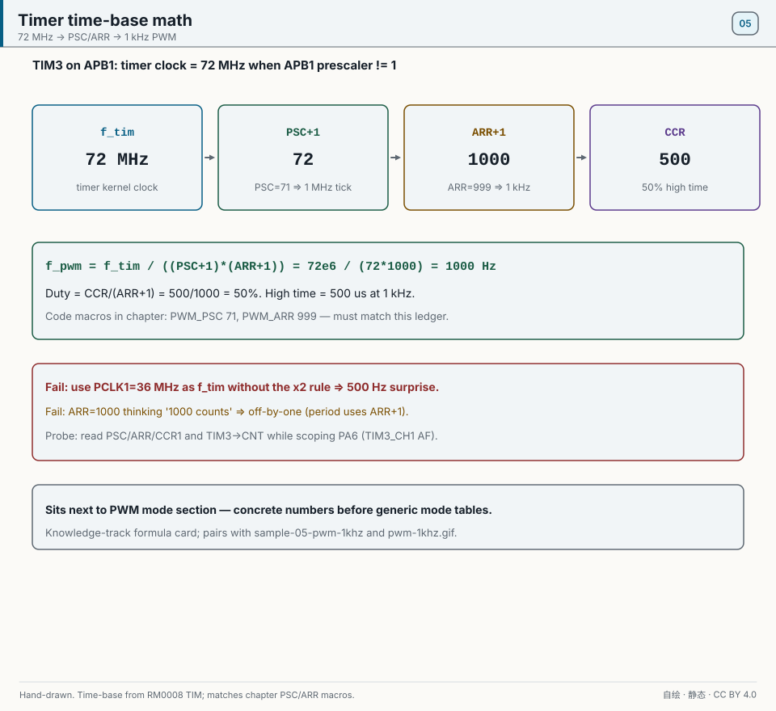
  <br><sub>▲ 自绘。PSC=71 ARR=999 CCR=500 与章内宏一致。</sub>
</p>

<p align="center">
  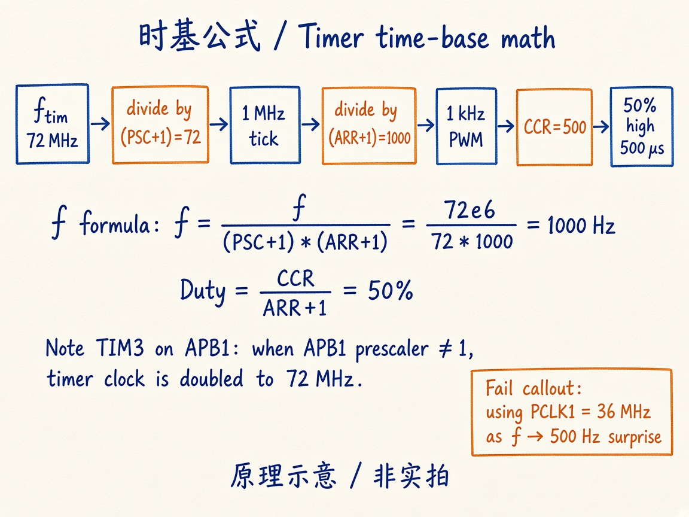
  <br><sub>▲ 知识轨（Handraw · 原理示意/非实拍）。72 MHz→(PSC+1)→(ARR+1)→1 kHz；CCR/1000=50%；不是实拍。</sub>
</p>


把定时器想成两级齿轮。PSC 是第一级，先把 72 MHz 的时钟减慢：PSC = 71 就是每 72 个时钟走一格，一格 1 µs。ARR 是第二级，数到 ARR 就清零重来：ARR = 999 就是 1000 格一圈，一圈 1 ms。两个寄存器都是「写的值加 1」才是真正的格数，这个 +1 是最常见的差一错误。

- 计数时钟：`fCK_CNT = fCK_PSC / (PSC + 1)`
- 定时周期：`T = (ARR + 1) × (PSC + 1) / fCK_PSC`
- 频率：`f = fCK_PSC / ((ARR + 1)(PSC + 1))`

72MHz 下常用参数表：

| 目标周期 | PSC | ARR | 实际 T | 说明 |
| --- | --- | --- | --- | --- |
| 1ms | 71 | 999 | 1.000ms | 1kHz |
| 10ms | 7199 | 99 | 10.00ms | 100Hz |
| 100ms | 7199 | 999 | 100.0ms | 10Hz |
| 1s | 7199 | 9999 | 1.000s | 1Hz |
| 1s（大 ARR） | 71 | 999999 | 装不下 | C8 的 TIM2–TIM5 是 16 位，装不下 999999。能装下的 1 秒是上一行 PSC = 7199、ARR = 9999 |

> 先定 `fCK_CNT`（选 PSC），再定 `ARR+1 = T × fCK_CNT`。

### 3. 计数模式与影子寄存器


<p align="center">
  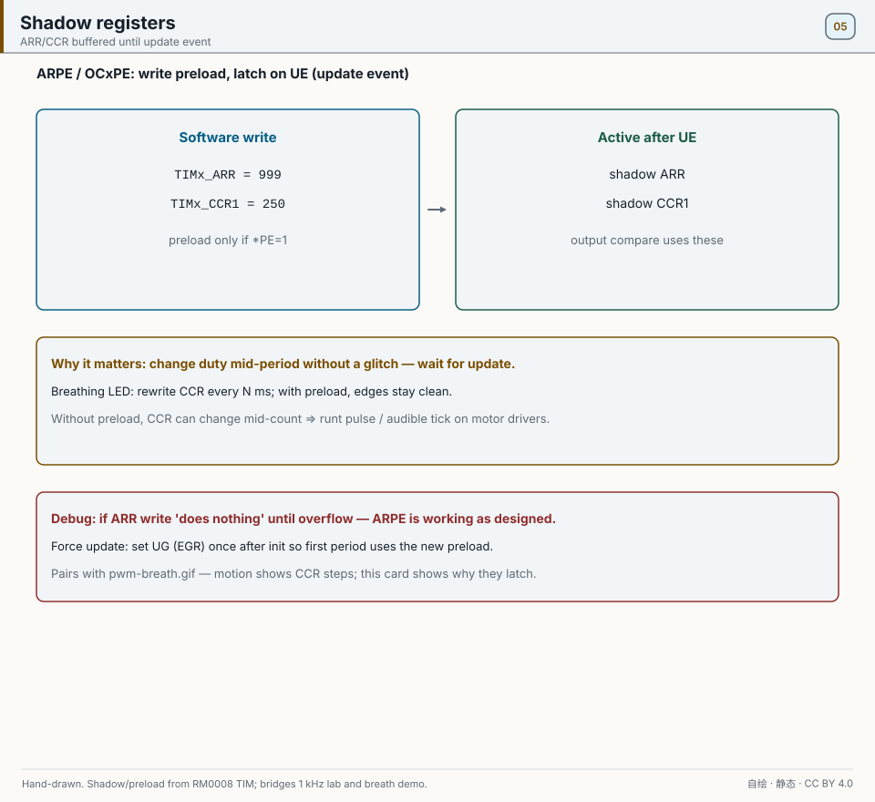
  <br><sub>▲ 自绘。ARPE/OCxPE：写预装载，UE 才锁进影子。</sub>
</p>

<p align="center">
  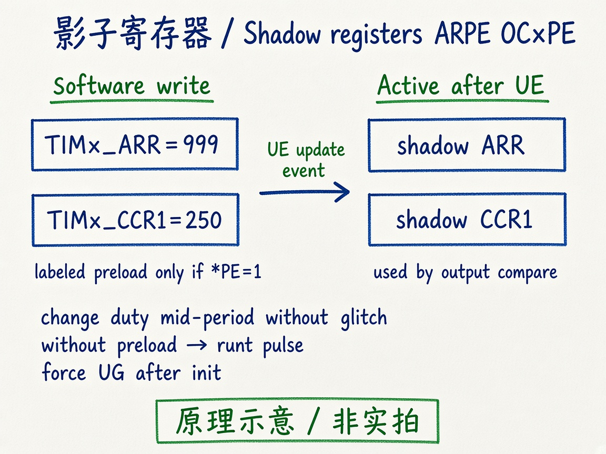
  <br><sub>▲ 知识轨（Handraw · 原理示意/非实拍）。写预装载，UE 才锁进影子；无预装载易出短脉冲；不是实拍。</sub>
</p>


影子寄存器像餐厅换菜单。你新写的 ARR 或 CCR 先放在后台（预装载寄存器），等这一圈数完、更新事件到来时才换到前台去参与比较。这样不会出现一圈 PWM 数到一半周期突然变了、波形出一个怪脉冲的情况。代价是新值要晚一圈才生效。

| 模式 | 说明 |
| --- | --- |
| 向上计数 | 0→ARR，到 ARR 产生更新事件（最常用） |
| 向下计数 | ARR→0 |
| 中央对齐 | 0→ARR→0，用于电机，对称 PWM |

| 概念 | 说明 |
| --- | --- |
| 更新事件 UEV | 计数器溢出/下溢时产生，可产生中断/DMA |
| 预装载 ARR | ARR 写入影子寄存器，UEV 时才生效 |
| 预装载 CCR | 同理，避免 PWM 中途抖动（ARPE/OCxPE） |
| 影子寄存器 | 用户写的是预装载寄存器，真正参与比较的是影子寄存器 |

<p align="center">
  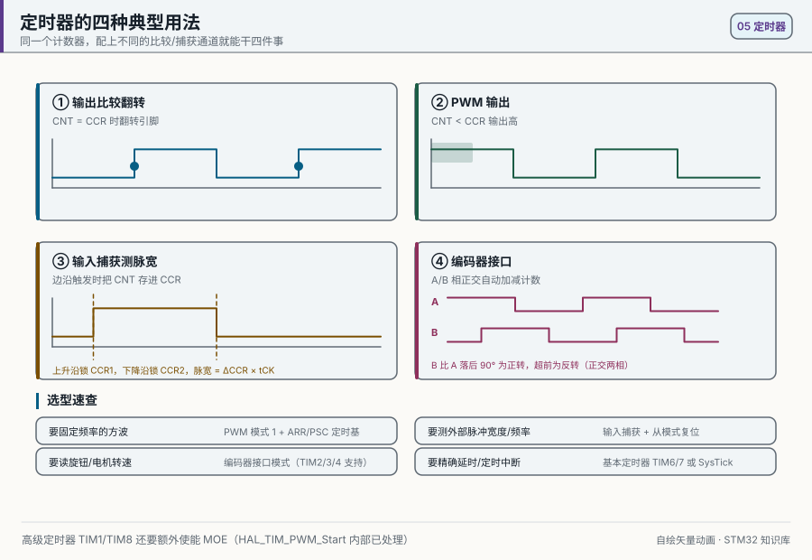
  <br><sub>▲ 计数状态：CNT、ARR 和 CCR 的关系决定更新事件与比较输出。动画首帧在 PDF 中仍可读；它说明顺序和边界，不是示波器实测波形（FA-002 · IG-009 · C-03/C-10/C-27/C-31）。</sub>
</p>

输出全无或频率不对时，先按下面三环读回寄存器，不要同时改 PSC、ARR、CCR。示波器上还有波形、只是周期差整数倍，问题在环 ① 的分频比；PA6 上一点波形都没有，才往下读环 ② 的 CC1E 和环 ③ 的 GPIO 复用。

<p align="center">
  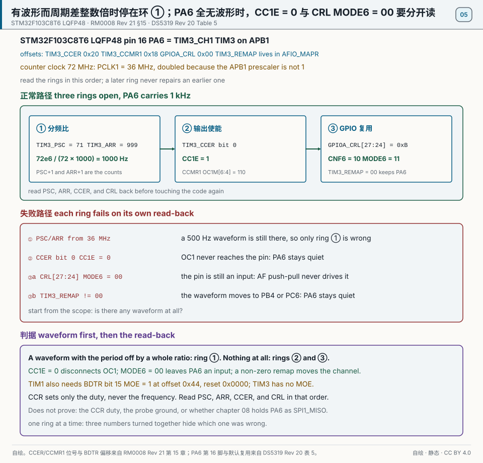
  <br><sub>▲ 自绘。看哪里：上一排三张波形是判据——1 kHz 通过、500 Hz 差整数倍只查环 ①、全无查环 ②③；三环信号链从左到右画到 PA6。环 ① 读回 TIM3_PSC = 71、TIM3_ARR = 999，用 72 MHz 重算 72e6 / (72 × 1000) = 1000 Hz；同一组数按 36 MHz 除得到 500 Hz。环 ② 读回 TIM3_CCER 位 0 的 CC1E = 1，TIM3_CCMR1 的 OC1M[6:4] = 110 是 PWM 模式 1。环 ③ 读回 GPIOA_CRL[27:24] = 0xB，即 CNF6 = 10 复用推挽、MODE6 = 11 是 50 MHz，TIM3_REMAP = 00 把通道留在第 16 脚 PA6。证明什么：三环的读回值能把「频率错」和「引脚上完全没有波形」分开——判据排里 500 Hz 那张就是只错环 ① 的样子；CC1E = 0 与 MODE6 = 00 都让 PA6 没有波形，重映射不为 00 则波形改去 PB4 或 PC6。不证明什么：CCR 占空比、探头是否共地，以及第 08 章是否把 PA6 当 SPI1_MISO 用；TIM1 额外的 BDTR 位 15 MOE 在偏移 0x44，本图只点名不展开。出处是 [RM0008 Rev 21 第 15 章](#source-rm0008-tim) 和 [DS5319 Rev 20 表 5](#source-ds5319-tim)。</sub>
</p>

<p align="center">
  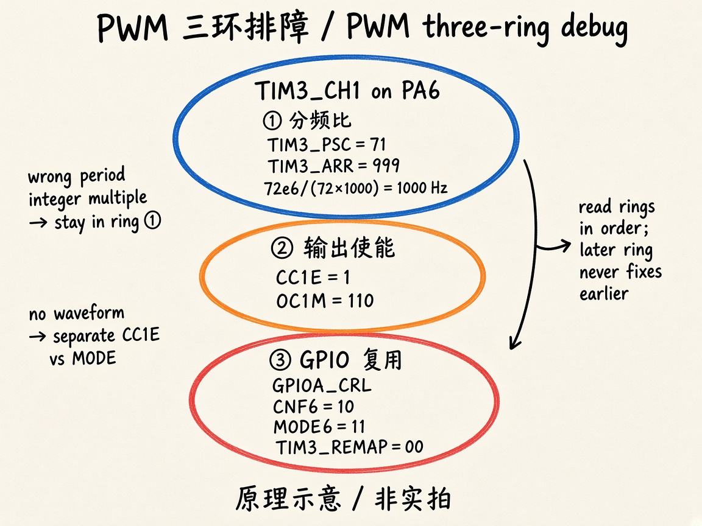
  <br><sub>▲ 知识轨（Handraw · 原理示意/非实拍）。①分频比 ②CC1E/OC1M ③GPIO 复用；后环修不了前环；不是实拍。</sub>
</p>

### 4. PWM 模式与公式

PWM 就是让一个开关每秒开合成千上万次，负载只感受到平均值：LED 看起来是半亮，电机转得是半速。计数器从 0 数到 ARR，数到 CCR 之前输出高，之后输出低，CCR 就是那个开关点。一圈总共只有 ARR+1 格，所以频率越高、一圈越短，能切的档位就越少。

| 模式 | 行为 |
| --- | --- |
| PWM 模式 1 | CNT < CCR 时输出有效电平 |
| PWM 模式 2 | CNT < CCR 时输出无效电平（反相） |

- 频率：`f_PWM = fCK_PSC / ((ARR + 1)(PSC + 1))`
- 占空比：`Duty = CCR / (ARR + 1) × 100%`

频率与分辨率权衡（同一 fCK_PSC）：

| 目标 PWM 频率 | PSC | ARR+1 | 占空比分辨率 | 说明 |
| --- | --- | --- | --- | --- |
| 1kHz | 1 | 36000 | 1/36000 | 另一组高分辨率参数。PSC = 0 时 ARR+1 要 72000，超过 16 位上限 65536，所以 PSC 取 1。不是附录 D 的 1 kHz 格子（PSC = 71，ARR = 999） |
| 10kHz | 0 | 7200 | 1/7200 | 常用电机 PWM |
| 20kHz | 0 | 3600 | 1/3600 | 常用于把开关声移出主要可听范围；仍要实测电机与驱动器 |
| 50Hz（舵机） | 71 | 20000 | 1/20000 | 1 µs 一格，20 ms 一圈，舵机脉宽 1–2 ms 正好是 CCR = 1000–2000 |

> **PWM 频率越高，可用于调节占空比的 ARR 档位越少，分辨率越低**——两者矛盾，按需折中。

<p align="center">
  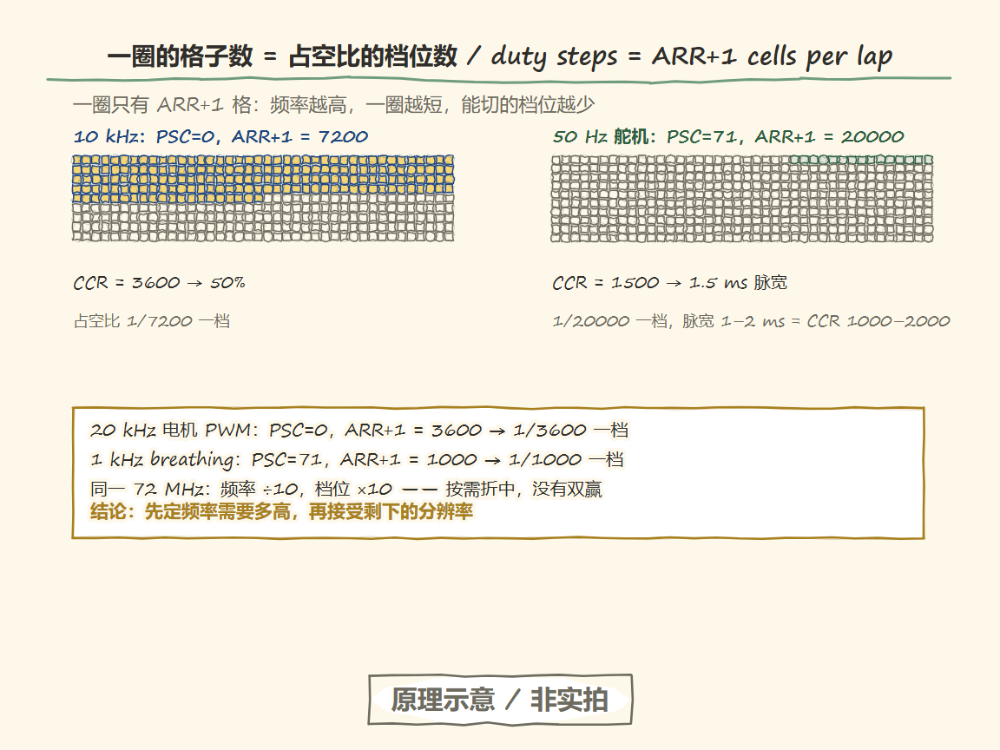
  <br><sub>▲ 知识轨（Handraw · 原理示意/非实拍）。同一 72 MHz：10 kHz 一圈 7200 格、50 Hz 舵机 20000 格；一圈的格子数就是占空比的档位数，频率越高档位越少；不是实拍。</sub>
</p>


### 5. 输入捕获 / 编码器 / 从模式

输入捕获反过来用计数器：外面的信号一跳变，硬件立刻把当时的 CNT 抄进 CCR，就像赛跑终点的计时员按下秒表。两次抄下的数一减，就是周期或脉宽。编码器接口看两路相差 90° 的方波，谁先跳变决定往上数还是往下数，计数器的值直接就是电机转过的位置。

<p align="center">
  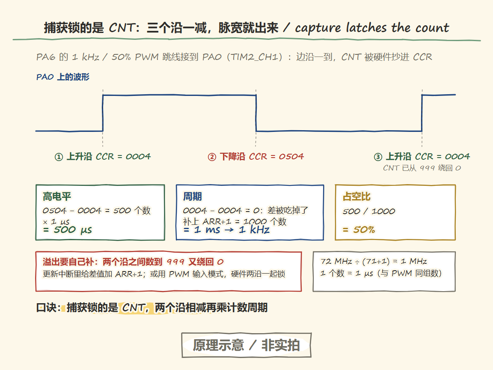
  <br><sub>▲ 知识轨（Handraw · 原理示意/非实拍）。看哪里：PA0 上三个被锁存的边沿，①③ 两个上升沿读数相同是因为 CNT 从 999 绕回了 0；下面的三个盒子把 0504 − 0004 = 500 数 × 1 µs = 500 µs、补上 ARR+1 得 1 ms → 1 kHz、500/1000 = 50% 各算一遍。证明什么：脉宽和频率不用量电压，两个 CCR 读数相减再乘计数周期就是答案，溢出要补 ARR+1。不能证明什么：这是 72 MHz ÷ 72 = 1 MHz 计数时钟下的算术，不涉及信号发生器的实际抖动、捕获滤波器设置与中断延迟，也不是示波器截图。出处是 [RM0008 Rev 21 第 15 章](#source-rm0008-tim)。</sub>
</p>

| 功能 | 原理 | 用途 |
| --- | --- | --- |
| 输入捕获 | 边沿触发时把 CNT 锁存到 CCR | 测频率、测脉宽/占空比 |
| PWM 输入 | 两个通道分别捕获上升/下降沿 | 直接得周期与高电平时间 |
| 编码器接口 | A/B 相正交解码，自动加减计数 | 电机测速/位置 |
| 从模式 | 外部信号复位/门控计数器 | 测周、门控计数 |

## 硬件与接线

| 开发板 | 外设 | 引脚 | 备注 |
| --- | --- | --- | --- |
| BluePill | LED（PWM 调光） | PA6 (TIM3_CH1) | 串 270Ω，观察呼吸 |
| BluePill | 输入捕获 | PA0 (TIM2_CH1) | 接信号发生器 / 另一路 PWM |

> F1 定时器通道对应关系见 DS5319 引脚复用表；TIM1 是高级定时器，PWM 输出需 **MOE**。

从第 04 章继续时，先拆掉 PA0 按键。做输入捕获实验时，用跳线把 PA6 的 PWM 接到 PA0；两脚必须共地，PA0 保持输入模式。

## 代码实现

```c
/* timer_pwm.c —— TIM3_CH1(PA6) 输出 1kHz PWM，软件调节占空比做呼吸灯 */
#include "stm32f1xx_hal.h"

TIM_HandleTypeDef htim3;

#define PWM_TIM    TIM3
#define PWM_CH     TIM_CHANNEL_1
#define PWM_PSC    71        /* 72MHz/(71+1)=1MHz 计数时钟 */
#define PWM_ARR    999       /* 1MHz/(999+1)=1kHz PWM */

void SystemClock_Config(void);

static void pwm_init(void)
{
    __HAL_RCC_TIM3_CLK_ENABLE();
    __HAL_RCC_GPIOA_CLK_ENABLE();

    /* PA6 复用推挽（TIM3_CH1） */
    GPIO_InitTypeDef io = {0};
    io.Pin   = GPIO_PIN_6;
    io.Mode  = GPIO_MODE_AF_PP;
    io.Speed = GPIO_SPEED_FREQ_HIGH;
    HAL_GPIO_Init(GPIOA, &io);

    htim3.Instance               = PWM_TIM;
    htim3.Init.Prescaler         = PWM_PSC;
    htim3.Init.CounterMode       = TIM_COUNTERMODE_UP;
    htim3.Init.Period            = PWM_ARR;          /* = ARR */
    htim3.Init.ClockDivision     = TIM_CLOCKDIVISION_DIV1;
    htim3.Init.AutoReloadPreload = TIM_AUTORELOAD_PRELOAD_ENABLE;
    HAL_TIM_PWM_Init(&htim3);

    TIM_OC_InitTypeDef oc = {0};
    oc.OCMode     = TIM_OCMODE_PWM1;
    oc.Pulse      = 500;                             /* CCR = 500。500 / (ARR + 1) = 50%，高电平 500 µs */
    oc.OCPolarity = TIM_OCPOLARITY_HIGH;
    oc.OCFastMode = TIM_OCFAST_DISABLE;
    HAL_TIM_PWM_ConfigChannel(&htim3, &oc, PWM_CH);

    HAL_TIM_PWM_Start(&htim3, PWM_CH);               /* 启动 PWM 输出 */
}

int main(void)
{
    HAL_Init();
    SystemClock_Config();
    pwm_init();

    int16_t duty = 0;
    int16_t step = 10;

    while (1)
    {
        duty += step;
        if (duty >= PWM_ARR || duty <= 0) step = -step;   /* 0→100% 往返 */
        __HAL_TIM_SET_COMPARE(&htim3, PWM_CH, duty);      /* 更新 CCR */
        HAL_Delay(10);
    }
}
```

高级定时器 TIM1 的额外要求：

```c
/* TIM1/TIM8 是高级定时器，输出前必须使能主输出 MOE */
HAL_TIM_PWM_Start(&htim1, TIM_CHANNEL_1);   /* HAL 内部会置 MOE */
/* 若用寄存器：__HAL_TIM_MOE_ENABLE(&htim1); */
```

输入捕获要真的把通道配出来。上升沿锁存 CCR，下降沿再锁一次，差值乘计数周期就是脉宽：

```c
TIM_IC_InitTypeDef ic = {0};
ic.ICPolarity  = TIM_INPUTCHANNELPOLARITY_RISING;
ic.ICSelection = TIM_ICSELECTION_DIRECTTI;
ic.ICPrescaler = TIM_ICPSC_DIV1;
ic.ICFilter    = 0;
HAL_TIM_IC_ConfigChannel(&htim2, &ic, TIM_CHANNEL_1);
HAL_TIM_IC_Start_IT(&htim2, TIM_CHANNEL_1);

void HAL_TIM_IC_CaptureCallback(TIM_HandleTypeDef *htim)
{
    if (htim->Channel == HAL_TIM_ACTIVE_CHANNEL_1)
    {
        uint32_t ccr = HAL_TIM_ReadCapturedValue(htim, TIM_CHANNEL_1);
        (void)ccr; /* 脉宽 = (CCR2 - CCR1) / fCK_CNT，溢出时补一个 ARR+1 */
    }
}
```

完整工程见 [`examples/timer-pwm/`](../examples/timer-pwm/)。

## 动手实验

1. **实验一（PWM 输出）**：TIM3_CH1 输出 1kHz、50% 方波。记录测得频率、周期、高电平时间和占空比，并与 PSC=71、ARR=999、CCR=500 逐项对账。
2. **实验二（占空比台阶）**：依次写 CCR=100、500、900，测量约 10%、50%、90% 三档，再运行呼吸灯。亮度变化只能作现象，三档波形才是验收证据。
3. **实验三（输入捕获闭环）**：PA6 接到 PA0，用 TIM2 捕获实验一的 PWM。串口打印捕获周期和高电平计数，与设定值比较；溢出时按 ARR+1 补偿。

<p align="center">
  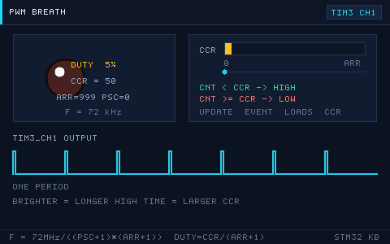
  <br><sub>▲ 呼吸灯只展示 CCR 随时间变化的结果。频率是否仍为 1kHz、三档占空比是否正确，要以实验一和实验二保存的波形为准。</sub>
</p>

### 6. 互补输出与死区（高级定时器）


<p align="center">
  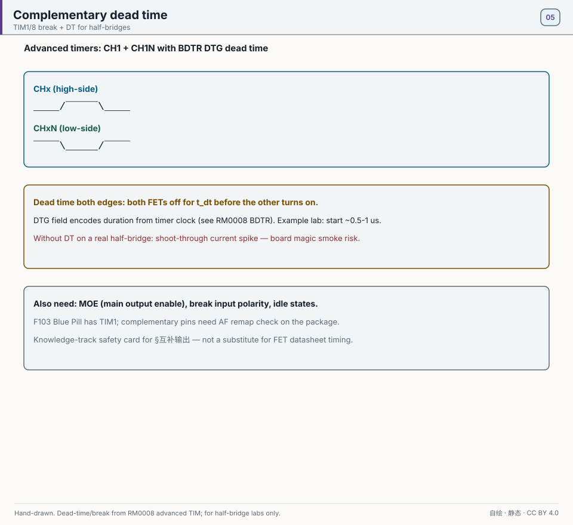
  <br><sub>▲ 自绘。BDTR DTG + MOE；半桥实验才需要。</sub>
</p>

<p align="center">
  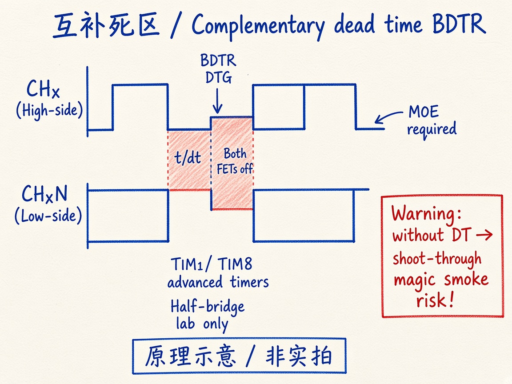
  <br><sub>▲ 知识轨（Handraw · 原理示意/非实拍）。CHx/CHxN 双沿死区；无 DT 有直通风险；半桥实验才需要；不是实拍。</sub>
</p>


| 概念 | 说明 |
| --- | --- |
| 互补输出 | CH1/CH1N 一对，用于 H 桥 |
| 死区 | 上下桥臂切换时插入的空白时间，防止直通短路 |
| 刹车 | BKIN 触发立即关输出 |
| MOE | 主输出使能，必须置位才有输出 |

```c
/* 配置死区与互补输出 */
TIM_BreakDeadTimeConfigTypeDef bd = {0};
bd.OffStateRunMode = TIM_OSSR_ENABLE;
bd.DeadTime        = 0x10;        /* 死区时间 */
bd.BreakState      = TIM_BREAK_DISABLE;
HAL_TIMEx_ConfigBreakDeadTime(&htim1, &bd);
```

### 7. 定时器中断实例（1Hz 翻转 LED）

```c
/* TIM2 每 1s 触发更新中断翻转 PC13 */
void HAL_TIM_PeriodElapsedCallback(TIM_HandleTypeDef *htim)
{
    if (htim->Instance == TIM2)
    {
        HAL_GPIO_TogglePin(GPIOC, GPIO_PIN_13);
    }
}

/* 启动：用 Start_IT 而非 Start */
HAL_TIM_Base_Start_IT(&htim2);
```

### 8. 定时器选型速查

| 需求 | 推荐定时器 |
| --- | --- |
| 通用定时 | TIM2~5 |
| 高级 PWM（互补） | TIM1/TIM8 |
| 仅做时基 | TIM6/TIM7 |
| 32 位长定时 | TIM2/TIM5（F4） |
| 系统节拍 | SysTick |

### 9. 输入捕获和 TRGO

测脉宽用输入捕获；要让 ADC 按固定间隔采样，用主模式把更新事件送出去（TRGO），不要在主循环里软件触发。

<p align="center">
  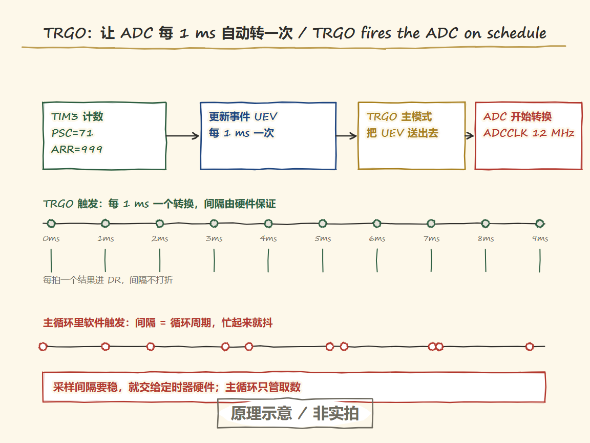
  <br><sub>▲ 知识轨（Handraw · 原理示意/非实拍）。TIM3 每 1 ms 的更新事件经 TRGO 启动 ADC，间隔由硬件保证；主循环软件触发忙起来就抖；不是实拍。</sub>
</p>


```c
TIM_MasterConfigTypeDef mst = {0};
mst.MasterOutputTrigger = TIM_TRGO_UPDATE;          /* 每次溢出送一个脉冲 */
mst.MasterSlaveMode     = TIM_MASTERSLAVEMODE_DISABLE;
HAL_TIMEx_MasterConfigSynchronization(&htim3, &mst);
```

正交编码看两相：B 比 A 落后约 90° 是一个方向，超前是另一个方向。只有一路方波时，硬件分不清正反转。

<p align="center">
  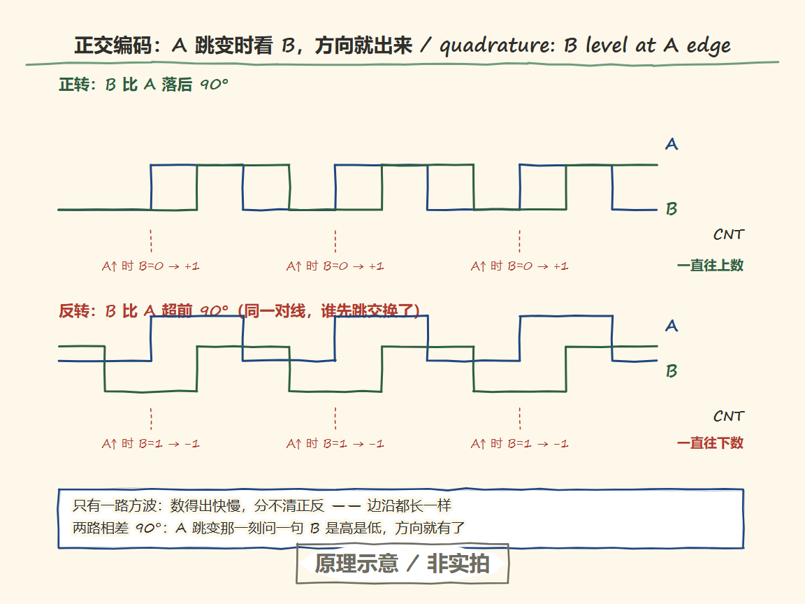
  <br><sub>▲ 知识轨（Handraw · 原理示意/非实拍）。A 跳变时看 B：正转 B=0 加一，反转 B=1 减一；只有一路分不清正反；不是实拍。</sub>
</p>


离开本章前，应保留 1kHz/50% 输出波形、三档占空比波形和一次输入捕获读数，并能从 72 MHz 反算 PSC、ARR 与 CCR。

自测：

1. 只捕获了上升沿，能不能算出占空比？
2. ADC 想每 1 ms 转一次，该让定时器的 TRGO 选什么事件？
3. 编码器只接了 A 相，反转时计数会怎样？

## 相关资源

- 官方手册：**RM0008** 第 14 章（高级定时器 TIM1/8）、第 15 章（通用定时器 TIM2~5）、第 16 章（基本定时器 TIM6/7）
- 上一篇：[04 中断与NVIC](04-中断与NVIC.md)｜下一篇：[06 串口UART](06-串口UART.md)
- 手机阅读版：[第 05 章 · 定时器与PWM（公众号图文）](https://mp.weixin.qq.com/s/Jutp6HD4eo8bV0QcXWJ_pw)
- 相关图：[`assets/animations/timer-pwm.svg`](../assets/animations/timer-pwm.svg)、[`assets/animations/timer-modes.svg`](../assets/animations/timer-modes.svg)、[`assets/gif/pwm-breath.gif`](../assets/gif/pwm-breath.gif)
- 免责声明：本仓库插画均为作者自绘矢量图/程序生成动画，非厂商实拍照片。


