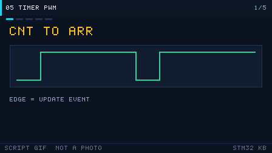

# 05 定时器与 PWM

> English: [Timers and PWM](en/05-timer-pwm.md)

> 定时器负责精确计时、产生 PWM 和捕获外部信号，是控制类应用的心脏。

<p align="center">
  
  <br><sub>▲ 动画：定时器计数、比较匹配与 PWM 占空比（呼吸灯，作者自绘矢量图）</sub>
</p>

<!-- video:ch05 -->
<p align="center">
  
  <br><sub>▲ 本章讲解幻灯：程序生成的 GIF（tools/gen_videos.py，可复现，不是实拍）。旁白与五帧一一对应。</sub>
</p>

**旁白（跟着画面读，大约一分钟）**

1. 定时器就是一个会自己加的计数器。CNT 碰到 ARR 就回头，这就是周期。
2. PWM 频率看 ARR 和 PSC，占空比看 CCR。三个数各管一件事。
3. F103 上 APB1 定时器时钟常常是 72 MHz，不是 36。倍频规则要记。
4. 呼吸灯就是让 CCR 慢慢走。输入捕获锁的是 CNT，不是脚上的电压。
5. 口诀：捕获锁的是 CNT。自测：想要 1 kHz，你先定谁？
<!-- /video:ch05 -->


## 📌 学习目标
- [ ] 分清 STM32 各类定时器（高级/通用/基本/看门狗/SysTick）
- [ ] 会用时基公式算出任意定时周期的 PSC/ARR
- [ ] 理解计数模式、更新事件与影子寄存器
- [ ] 会配 PWM 模式并推导占空比/频率公式
- [ ] 会用输入捕获测频/测占空比，了解编码器接口

## 🧠 核心原理

**结论先行：定时器的本质是「时钟驱动计数器」，PSC 定快慢、ARR 定周期、CCR 定占空比。**

### 1. 定时器分类表

| 类别 | 型号 | 位宽 | 特点 | 典型用途 |
| --- | --- | --- | --- | --- |
| 高级 | TIM1/TIM8 | 16 位 | 互补输出、死区、刹车、MOE | 电机、三相 PWM |
| 通用 | TIM2~TIM5 | 16/32 位 | 4 通道，PWM/捕获/编码器 | 通用定时/PWM |
| 基本 | TIM6/TIM7 | 16 位 | 仅计数，无外部通道 | 时基、触发 DAC |
| 看门狗 | IWDG/WWDG | 12/7 位 | 独立/窗口看门狗 | 程序跑飞复位 |
| 系统 | SysTick | 24 位 | 内核自带 | HAL 时基、RTOS 节拍 |

### 2. 时基公式

- 计数时钟：`fCK_CNT = fCK_PSC / (PSC + 1)`
- 定时周期：`T = (ARR + 1) × (PSC + 1) / fCK_PSC`
- 频率：`f = fCK_PSC / ((ARR + 1)(PSC + 1))`

72MHz 下常用参数表：

| 目标周期 | PSC | ARR | 实际 T | 说明 |
| --- | --- | --- | --- | --- |
| 1ms | 71 | 999 | 1.000ms | 1kHz |
| 10ms | 7199 | 99 | 10.00ms | 100Hz |
| 100ms | 7199 | 999 | 100.0ms | 10Hz |
| 1s | 7199 | 9999 | 1.000s | 1Hz |
| 1s（大 ARR） | 71 | 999999 | 1.000s | 需 32 位定时器 |

> 结论：先定 `fCK_CNT`（选 PSC），再定 `ARR+1 = T × fCK_CNT`。

### 3. 计数模式与影子寄存器

| 模式 | 说明 |
| --- | --- |
| 向上计数 | 0→ARR，到 ARR 产生更新事件（最常用） |
| 向下计数 | ARR→0 |
| 中央对齐 | 0→ARR→0，用于电机，对称 PWM |

| 概念 | 说明 |
| --- | --- |
| 更新事件 UEV | 计数器溢出/下溢时产生，可产生中断/DMA |
| 预装载 ARR | ARR 写入影子寄存器，UEV 时才生效 |
| 预装载 CCR | 同理，避免 PWM 中途抖动（ARPE/OCxPE） |
| 影子寄存器 | 用户写的是预装载寄存器，真正参与比较的是影子寄存器 |

### 4. PWM 模式与公式

| 模式 | 行为 |
| --- | --- |
| PWM 模式 1 | CNT < CCR 时输出有效电平 |
| PWM 模式 2 | CNT < CCR 时输出无效电平（反相） |

- 频率：`f_PWM = fCK_PSC / ((ARR + 1)(PSC + 1))`
- 占空比：`Duty = CCR / (ARR + 1) × 100%`

频率与分辨率权衡（同一 fCK_PSC）：

| 目标 PWM 频率 | ARR+1 | 占空比分辨率 | 说明 |
| --- | --- | --- | --- |
| 1kHz | 72000 | 1/72000 | 高分辨率，适合调光 |
| 10kHz | 7200 | 1/7200 | 常用电机 PWM |
| 50Hz（舵机） | 1440000 | — | 需配合 PSC 凑 20ms |
| 20kHz | 3600 | 1/3600 | 无 audible 噪音 |

> 结论：**PWM 频率越高，可用于调节占空比的 ARR 档位越少，分辨率越低**——两者矛盾，按需折中。

### 5. 输入捕获 / 编码器 / 从模式

| 功能 | 原理 | 用途 |
| --- | --- | --- |
| 输入捕获 | 边沿触发时把 CNT 锁存到 CCR | 测频率、测脉宽/占空比 |
| PWM 输入 | 两个通道分别捕获上升/下降沿 | 直接得周期与高电平时间 |
| 编码器接口 | A/B 相正交解码，自动加减计数 | 电机测速/位置 |
| 从模式 | 外部信号复位/门控计数器 | 测周、门控计数 |

## 🛠️ 硬件与接线

| 开发板 | 外设 | 引脚 | 备注 |
| --- | --- | --- | --- |
| BluePill | LED（PWM 调光） | PA6 (TIM3_CH1) | 串 270Ω，观察呼吸 |
| BluePill | 输入捕获 | PA0 (TIM2_CH1) | 接信号发生器 / 另一路 PWM |

> F1 定时器通道对应关系见 DS5319 引脚复用表；TIM1 是高级定时器，PWM 输出需 **MOE**。

## 💻 代码实现

```c
/* timer_pwm.c —— TIM3_CH1(PA6) 输出 1kHz PWM，软件调节占空比做呼吸灯 */
#include "stm32f1xx_hal.h"

TIM_HandleTypeDef htim3;

#define PWM_TIM    TIM3
#define PWM_CH     TIM_CHANNEL_1
#define PWM_PSC    71        /* 72MHz/(71+1)=1MHz 计数时钟 */
#define PWM_ARR    999       /* 1MHz/(999+1)=1kHz PWM */

void SystemClock_Config(void);

static void pwm_init(void)
{
    __HAL_RCC_TIM3_CLK_ENABLE();
    __HAL_RCC_GPIOA_CLK_ENABLE();

    /* PA6 复用推挽（TIM3_CH1） */
    GPIO_InitTypeDef io = {0};
    io.Pin   = GPIO_PIN_6;
    io.Mode  = GPIO_MODE_AF_PP;
    io.Speed = GPIO_SPEED_FREQ_HIGH;
    HAL_GPIO_Init(GPIOA, &io);

    htim3.Instance               = PWM_TIM;
    htim3.Init.Prescaler         = PWM_PSC;
    htim3.Init.CounterMode       = TIM_COUNTERMODE_UP;
    htim3.Init.Period            = PWM_ARR;          /* = ARR */
    htim3.Init.ClockDivision     = TIM_CLOCKDIVISION_DIV1;
    htim3.Init.AutoReloadPreload = TIM_AUTORELOAD_PRELOAD_ENABLE;
    HAL_TIM_PWM_Init(&htim3);

    TIM_OC_InitTypeDef oc = {0};
    oc.OCMode     = TIM_OCMODE_PWM1;
    oc.Pulse      = PWM_ARR / 2;                     /* 初始 50% 占空比 = CCR */
    oc.OCPolarity = TIM_OCPOLARITY_HIGH;
    oc.OCFastMode = TIM_OCFAST_DISABLE;
    HAL_TIM_PWM_ConfigChannel(&htim3, &oc, PWM_CH);

    HAL_TIM_PWM_Start(&htim3, PWM_CH);               /* 启动 PWM 输出 */
}

int main(void)
{
    HAL_Init();
    SystemClock_Config();
    pwm_init();

    int16_t duty = 0;
    int16_t step = 10;

    while (1)
    {
        duty += step;
        if (duty >= PWM_ARR || duty <= 0) step = -step;   /* 0→100% 往返 */
        __HAL_TIM_SET_COMPARE(&htim3, PWM_CH, duty);      /* 更新 CCR */
        HAL_Delay(10);
    }
}
```

高级定时器 TIM1 的额外要求：

```c
/* TIM1/TIM8 是高级定时器，输出前必须使能主输出 MOE */
HAL_TIM_PWM_Start(&htim1, TIM_CHANNEL_1);   /* HAL 内部会置 MOE */
/* 若用寄存器：__HAL_TIM_MOE_ENABLE(&htim1); */
```

输入捕获要真的把通道配出来。上升沿锁存 CCR，下降沿再锁一次，差值乘计数周期就是脉宽：

```c
TIM_IC_InitTypeDef ic = {0};
ic.ICPolarity  = TIM_INPUTCHANNELPOLARITY_RISING;
ic.ICSelection = TIM_ICSELECTION_DIRECTTI;
ic.ICPrescaler = TIM_ICPSC_DIV1;
ic.ICFilter    = 0;
HAL_TIM_IC_ConfigChannel(&htim2, &ic, TIM_CHANNEL_1);
HAL_TIM_IC_Start_IT(&htim2, TIM_CHANNEL_1);

void HAL_TIM_IC_CaptureCallback(TIM_HandleTypeDef *htim)
{
    if (htim->Channel == HAL_TIM_ACTIVE_CHANNEL_1)
    {
        uint32_t ccr = HAL_TIM_ReadCapturedValue(htim, TIM_CHANNEL_1);
        (void)ccr; /* 脉宽 = (CCR2 - CCR1) / fCK_CNT，溢出时补一个 ARR+1 */
    }
}
```

完整工程见 [`examples/timer-pwm/`](../examples/timer-pwm/)。

## ⚠️ 常见坑与排查

| 现象 | 原因 | 解决 |
| --- | --- | --- |
| PWM 完全没输出 | TIM1/TIM8 没使能 MOE | `HAL_TIM_PWM_Start` 会置 MOE，或手动 `__HAL_TIM_MOE_ENABLE` |
| 有波形但占空比不动 | 没调用 `HAL_TIM_PWM_Start` | 启动 PWM 通道 |
| 改了 CCR 不生效 | 没使能 CCR 预装载 | 设 `oc.OCPreload` 或开 `OCxPE` |
| 中断只进一次 | 忘了清更新标志 | ISR 里 `__HAL_TIM_CLEAR_FLAG(..., TIM_FLAG_UPDATE)` |
| ARR 改小后占空比异常 | 只改了 ARR 没同步 CCR | 保证 CCR ≤ ARR，改 ARR 后重设 CCR |
| PWM 频率差一倍 | 忘了 APB 分频>1 定时器时钟 ×2 | 用实际定时器时钟算 PSC/ARR |
| 呼吸灯闪跳 | 更新 CCR 时撕裂 | 开 ARR/CCR 预装载，或一次写入 |

## 🧪 动手实验

1. **实验一（PWM 输出）**：TIM3_CH1 输出 1kHz、50% 方波，用示波器/逻辑分析仪确认频率与占空比。
2. **实验二（呼吸灯）**：按上面代码让占空比 0→100% 往返，观察 LED 渐亮渐灭（对照 `pwm-breath.gif`）。
3. **实验三（输入捕获）**：把实验一的 PWM 接到另一路输入捕获通道，测量频率与占空比，与设定值比对误差。

### 6. 互补输出与死区（高级定时器）

| 概念 | 说明 |
| --- | --- |
| 互补输出 | CH1/CH1N 一对，用于 H 桥 |
| 死区 | 上下桥臂切换时插入的空白时间，防止直通短路 |
| 刹车 | BKIN 触发立即关输出 |
| MOE | 主输出使能，必须置位才有输出 |

```c
/* 配置死区与互补输出 */
TIM_BreakDeadTimeConfigTypeDef bd = {0};
bd.OffStateRunMode = TIM_OSSR_ENABLE;
bd.DeadTime        = 0x10;        /* 死区时间 */
bd.BreakState      = TIM_BREAK_DISABLE;
HAL_TIMEx_ConfigBreakDeadTime(&htim1, &bd);
```

### 7. 定时器中断实例（1Hz 翻转 LED）

```c
/* TIM2 每 1s 触发更新中断翻转 PC13 */
void HAL_TIM_PeriodElapsedCallback(TIM_HandleTypeDef *htim)
{
    if (htim->Instance == TIM2)
    {
        HAL_GPIO_TogglePin(GPIOC, GPIO_PIN_13);
    }
}

/* 启动：用 Start_IT 而非 Start */
HAL_TIM_Base_Start_IT(&htim2);
```

### 8. 定时器选型速查

| 需求 | 推荐定时器 |
| --- | --- |
| 通用定时 | TIM2~5 |
| 高级 PWM（互补） | TIM1/TIM8 |
| 仅做时基 | TIM6/TIM7 |
| 32 位长定时 | TIM2/TIM5（F4） |
| 系统节拍 | SysTick |

### 9. 输入捕获和 TRGO

**结论**：测脉宽用输入捕获；要让 ADC 按固定间隔采样，用主模式把更新事件送出去（TRGO），不要在主循环里软件触发。

```c
TIM_MasterConfigTypeDef mst = {0};
mst.MasterOutputTrigger = TIM_TRGO_UPDATE;          /* 每次溢出送一个脉冲 */
mst.MasterSlaveMode     = TIM_MASTERSLAVEMODE_DISABLE;
HAL_TIMEx_MasterConfigSynchronization(&htim3, &mst);
```

正交编码看两相：B 比 A 落后约 90° 是一个方向，超前是另一个方向。只有一路方波时，硬件分不清正反转。

口诀：**捕获锁的是 CNT，TRGO 送的是节拍；编码器必须有 A 和 B。**

自测：

1. 只捕获了上升沿，能不能算出占空比？
2. ADC 想每 1 ms 转一次，该让定时器的 TRGO 选什么事件？
3. 编码器只接了 A 相，反转时计数会怎样？

## 🔗 相关资源

- 官方手册：**RM0008** 第 14 章（高级定时器 TIM1/8）、第 15 章（通用定时器 TIM2~5）、第 16 章（基本定时器 TIM6/7）
- 上一篇：[04 中断与NVIC](04-中断与NVIC.md)｜下一篇：[06 串口UART](06-串口UART.md)
- 相关图：[`assets/animations/timer-pwm.svg`](../assets/animations/timer-pwm.svg)、[`assets/animations/timer-modes.svg`](../assets/animations/timer-modes.svg)、[`assets/gif/pwm-breath.gif`](../assets/gif/pwm-breath.gif)
- 免责声明：本仓库插画均为作者自绘矢量图/程序生成动画，非厂商实拍照片。


