# 06 串口 UART

> English: [UART](en/06-uart.md)

> 串口助手收到乱码时，先同时看三处：线上一位多长、SR 里有没有 FE/ORE、内存缓冲区实际写进了什么。三处对上，才能判断是波特率、接收时机还是缓冲区边界的问题。

<p align="center">
  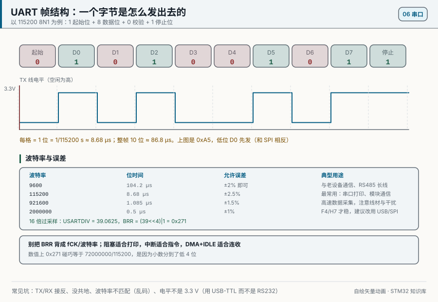
  <br><sub>▲ 动画：UART 帧结构逐位时序（起始位/数据位/校验/停止位，作者自绘矢量图）</sub>
</p>

<!-- video:ch06 -->
<p align="center">
  <video width="640" controls poster="../assets/video/ch06-uart.png">
    <source src="../assets/video/ch06-uart.mp4" type="video/mp4">
  </video>
  <br><sub>▲ 本章讲解视频（2.6 分钟）。<a href="../assets/video/ch06-uart.mp4">MP4</a> · <a href="../assets/video/ch06-uart.srt">字幕</a></sub>
</p>

<details>
<summary>旁白文字稿</summary>

1. 115200 8N1 里的 8，是数据位，不是波特率的一部分。一帧通常是起始位、八位数据、没有校验、一位停止。位数说错，对方会一直解出错帧。
2. 波特率是双方约好的速度，由总线时钟分频得到。F103 上 APB 时钟不对，分频再准也会偏。一边 115200，另一边 9600，你只能看到乱码。
3. 溢出错误 ORE 表示你来不及把数据取走。清除时要先读状态寄存器，再读数据寄存器。顺序反了，标志清不掉，后面的字节会全部卡住。
4. 这一帧是仓库画的串口帧，一位一位排开。看图时对照你的初始化：数据位、停止位、校验，要和上位机软件里的设置逐项相同。差一项就乱码。
5. 不定长的一包数据，可以用 DMA 接着收，再用空闲线判断对方说完了。别在中断里一个字节一个字节地阻塞等待。Wokwi 里这套 DMA 目前对不上，接线可以看，收包要上真板。
6. RS485 要控制收发方向。最后一个字节离开移位寄存器，发送完成标志才会起来。标志没起来就转身去收，最后一个字节会被你自己截掉。
7. TX 接对方的 RX，RX 接对方的 TX，地必须连在一起。只接两根信号、不共地，电平没有参考，有时能蒙对，有时完全没字。先共地，再谈波特率。
8. 这一章最常忘的两处：清溢出要先读状态再读数据；RS485 要等发送完成再转身。这两句能省掉一半「串口偶发丢字」的下午。
9. 实验可以先把 TX 和 RX 短接，确认自己能收到自己发出的字，再接到电脑。短接都收不到，就先别怀疑 USB 转串口线。
10. 把线接到电脑前，对三根线：TX 和 RX 要交叉，地线一定要共，两边的电平要一致。错一根，收到的就是乱码或什么都没有。

</details>
<!-- /video:ch06 -->
## 先做一个小实验

先用本章 USART1 发送例程发出 `0x55`，把逻辑分析仪接在 PA9 与 GND，按 115200、8N1 解码。预期是一位约 8.68 µs、一帧 10 位约 86.8 µs，解码字节仍是 `0x55`。这一步只检查发送；回环时把 PA9 与 PA10 短接，再由程序接收并比较字节，外部发送端应先断开。发送波形不对就先查时钟、引脚复用和 `BRR`，暂不引入 DMA 与协议分包。

## 原理与适用范围

本章的帧和波特率都按 STM32F103C8T6、LQFP48 封装算。USART1 挂在 APB2 上，内核 72 MHz 时 PCLK2 也是 72 MHz，外设基址 `0x40013800`。默认脚是 PA9 = USART1_TX = 第 30 脚，PA10 = USART1_RX = 第 31 脚，见 [DS5319 Rev 20 图 8](#source-ds5319-usart)。复位后不在 PB6/PB7 上，要用那两只脚得先开 AFIO 时钟再配重映射。

F103 的接收器用 16 倍波特率的时钟采样，每一位采 16 次。停止位看第 8、9、10 个采样点，三点多数表决。起始位除了这三点，还要在第 3、5、7 点确认，用来滤掉线上的毛刺，见 [RM0008 27.3.3](#source-rm0008-usart)。数据位也取中间那三点。

<p align="center">
  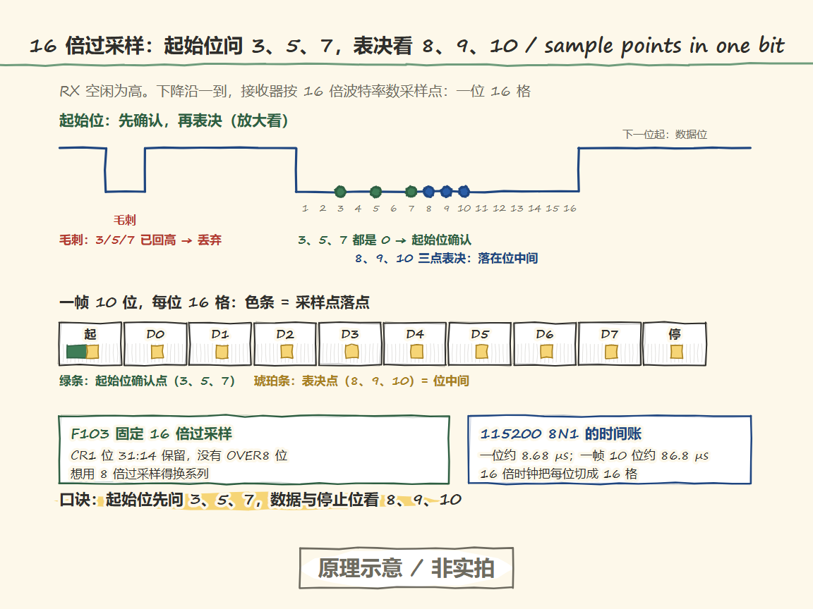
  <br><sub>▲ 知识轨（Handraw · 原理示意/非实拍）。RX 空闲为高，下降沿后按 16 倍波特率数点：起始位在第 3、5、7 点确认以滤掉毛刺，再由第 8、9、10 点表决；数据位与停止位都取中间三点。115200 8N1 一位约 8.68 µs。F103 固定 16 倍过采样，CR1 没有 OVER8 位。出处是 [RM0008 27.3.3](#source-rm0008-usart)。</sub>
</p>

波特率从外设时钟分出来，16 倍过采样时用 `USARTDIV = fPCLK / (16 × 波特率)`。USART1 的 PCLK2=72 MHz，目标是 115200，算得 `72e6 / (16 × 115200) = 39.0625`。整数 39 写成 0x27，小数 `0.0625 × 16 = 1`，合起来就是 BRR=`0x271`；`USART_BRR` 在偏移 `0x08`，低 4 位存小数。

反算 `72e6 / (16 × 39.0625) = 115200`，分频误差为 0，附录 D 也使用这个工作点。常见的约 0.16% 来自另一个配置：USART2 在 APB1=36 MHz 下使用 BRR=`0x138`；或在 72 MHz 下丢掉小数、只用整数 39。那不是写进 `0x271` 的结果。这里算的是分频取整误差，实际波特率还跟随外部时钟误差。

F103 只有 16 倍过采样。`USART_CR1` 偏移 `0x0C`，位 31:14 保留，没有 F4 上的 OVER8 位，想用 8 倍过采样得换系列。

115200、8N1 时一位约 8.68 µs，一帧 10 位约 86.8 µs。RM0008 把一整帧时间的高电平叫空闲线。IDLE 标志只说明线已经空了大约一个帧时间，不说明对方协议里的一包已经收完。用循环 DMA 接收时，回调里的 `Size` 是 DMA 当前写到的位置，不是这次新收的字节数。

停止位的多数表决结果为低时，硬件置 `USART_SR.FE`。图中只发生 FE、没有同时溢出，坏字节仍会进入 `USART_DR`。只读 DR 会清 RXNE；清 FE 则要先读 SR 再读 DR。FE 本身不单独触发中断，接收中断要看 RXNEIE，DMA 接收的错误中断还要看 CR3 的 EIE。

<p align="center">
  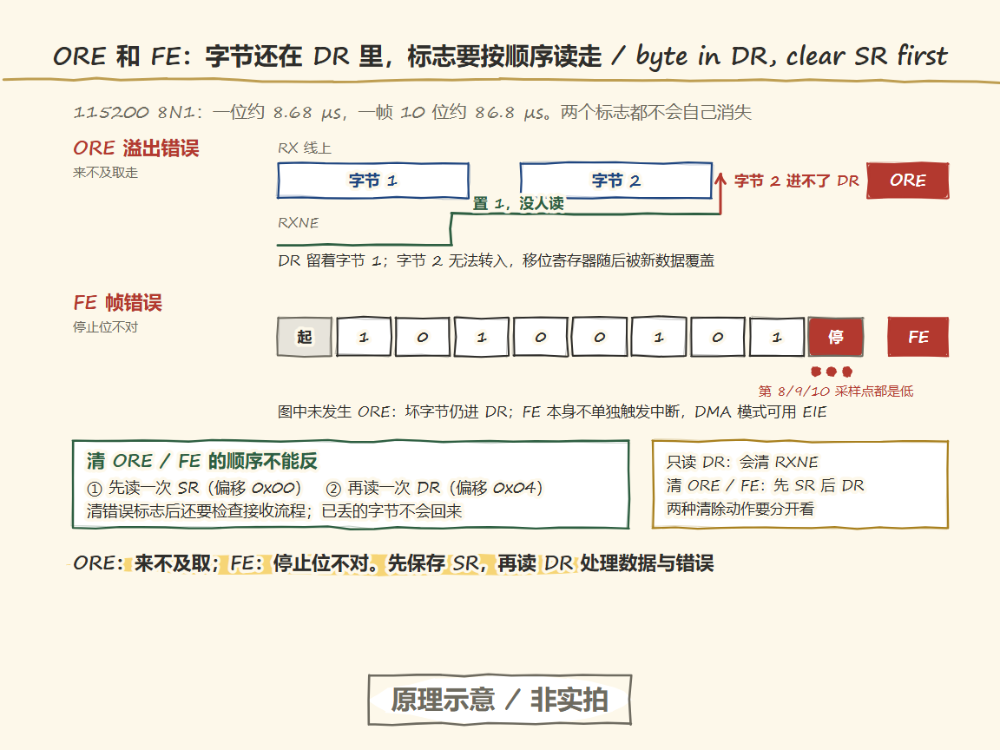
  <br><sub>▲ 知识轨（Handraw · 原理示意/非实拍）。上半：RXNE 还没读，字节 2 到来后无法转入 DR，ORE 置位；下半：停止位的第 8/9/10 个采样点都是低，FE 置位，但坏字节仍进 DR。底部给出清除顺序：先读 SR（0x00），再读 DR（0x04）。这是逻辑示意，不是示波器波形。出处是 [RM0008 Rev 21 第 27 章](#source-rm0008-usart)。</sub>
</p>

<p align="center">
  
  <br><sub>▲ 自绘矢量动画（FA-002）。动画按三步看：字节 1 先留在 DR；字节 2 到来后触发 ORE；CPU 再按 SR→DR 顺序保存状态并取走旧字节。动画放慢了时间，只说明寄存器关系，不是示波器实测。出处是 [RM0008 Rev 21 第 27 章](#source-rm0008-usart)。</sub>
</p>

## 关键插图


<p align="center">
  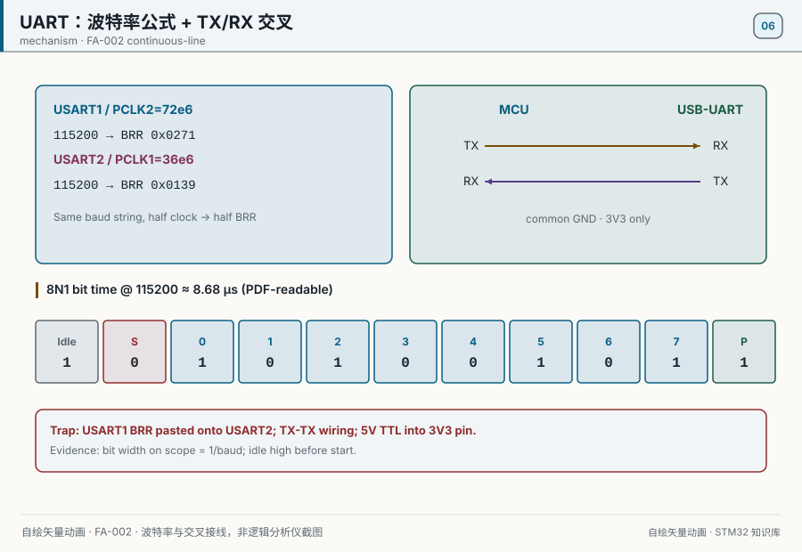
  <br><sub>▲ 自绘矢量动画（FA-002）。公式台账 + 交叉流动 + 位高亮。</sub>
</p>


<p align="center">
  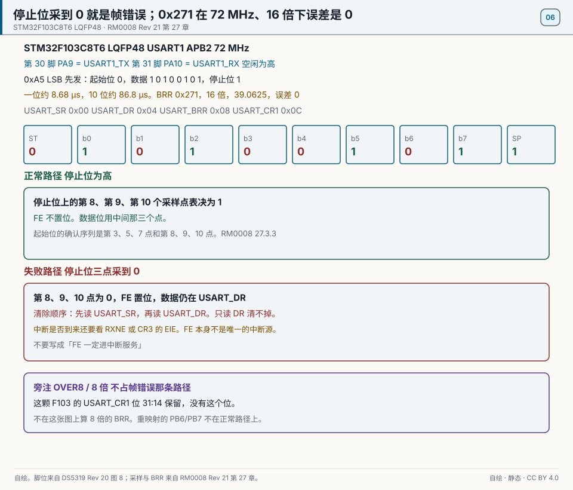
  <br><sub>▲ 自绘。STM32F103C8T6，LQFP48 第 30 脚 PA9 = USART1_TX，第 31 脚 PA10 = USART1_RX。帧是 0xA5，LSB 先发。一位约 8.68 µs，10 位约 86.8 µs。BRR `0x271`，39.0625，16 倍，误差 0。寄存器偏移 USART_SR 0x00、USART_DR 0x04、USART_BRR 0x08、USART_CR1 0x0C。上半部分是正常接收：停止位第 8、9、10 点为 1，FE 不置位。下半部分是帧错误：这三点为 0，FE 置位，字节仍在 DR，先读 SR 再读 DR 才能清除。右下角注明 F103 的 CR1 位 31:14 保留，没有 OVER8。脚位见 [DS5319 Rev 20 图 8](#source-ds5319-usart)，采样与 BRR 见 [RM0008 Rev 21 第 27 章](#source-rm0008-usart)。</sub>
</p>

<p align="center">
  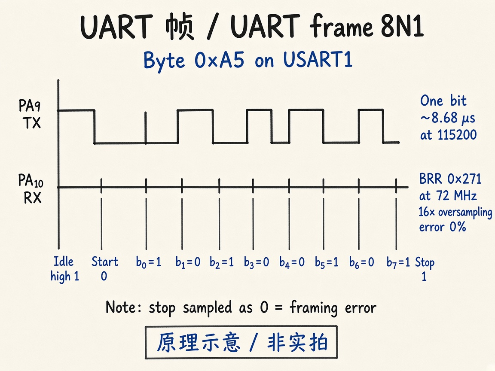
  <br><sub>▲ 知识轨（Handraw · 原理示意/非实拍）。Idle/Start/8 数据 LSB/Stop；115200 一位约 8.68 µs；不是示波器实拍。</sub>
</p>

<p align="center">
  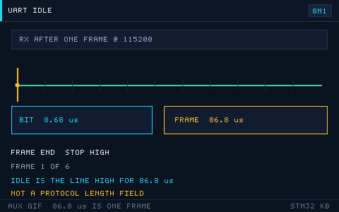
  <br><sub>▲ 动图版，只演示一帧结束后线保持高电平、满 86.8 µs 后出现 IDLE。印刷版只有上面的静态图。</sub>
</p>

后面帧格式小节里的 `uart-frame.svg` 和 `uart-bits.gif` 演示的是同一帧的逐位发送。

## 时序与状态

| 阶段 | 线上电平 | 0xA5 的位 | 第 8、9、10 点 | FE | 时间 | BRR |
| --- | --- | --- | --- | --- | --- | --- |
| 空闲 | 高 | — | — | 0 | — | — |
| 起始位 | 0 | — | 另在第 3、5、7 点确认 | 0 | 约 8.68 µs | — |
| 数据，LSB 先 | 1 0 1 0 0 1 0 1 | 0xA5 | 每位取中间三点 | 0 | 8 位 | — |
| 停止位正常 | 1 | 停止位 | 表决为 1 | 0 | 约 8.68 µs | USART1，72 MHz，`0x271`，误差 0% |
| 停止位出错 | 0 | 停止位 | 三点为 0 | 1 | 约 8.68 µs | 先读 SR 再读 DR 清除 |
| 一帧合计 | — | 10 位 | — | — | 约 86.8 µs | 39.0625 |
| 对照：USART2 | — | — | — | — | — | APB1，36 MHz，`0x138`，约 0.16%，不是 USART1 |
| IDLE | 停止位之后保持高 | — | — | 0 | 满一个帧时间，约 86.8 µs | 不等于对方一包结束 |

0.16% 只属于 USART2 那一行。出处是 [RM0008 第 27.3.3 节](#source-rm0008-usart)。

## 常见坑与出处

| 现象 | 原因 | 处理 | 出处 | 出处里能查到什么 |
| --- | --- | --- | --- | --- |
| 有资料说 USART1 的 `0x271` 有误差 | 那份资料丢掉了小数位，或者抄的是 USART2 那一行 | 72 MHz、16 倍、带上小数位，误差是 0% | [RM0008 BRR](#source-rm0008-usart) | `0x271` 分频后正好是 115200，误差 0% |
| 停止位错了仍读到一个字节，接着收不到数据 | FE 置位时字节照样进 DR，只读 DR 清不掉 FE | 先读 SR 再读 DR 清 FE | [RM0008 27.3.3](#source-rm0008-usart) | FE 置位时字节仍进 DR；只读 DR 不清标志 |
| 把 IDLE 当成对方一包已经结束 | IDLE 只表示线路空闲 | 用长度字段或协议判断包尾，不要把 86.8 µs 当包界 | [RM0008](#source-rm0008-usart) | IDLE 是线路空闲满一个帧时间 |
| 想在 F103 上打开 OVER8 改善误码 | F103 没有这一位 | 先核对 72 MHz 和 `0x271`，误差本来就是 0% | [RM0008 CR1](#source-rm0008-usart) | CR1 位 31:14 保留 |
| 循环 DMA 把 `Size` 当成这一次新增的字节数 | `Size` 是 DMA 写到的位置 | 自己保存上次位置再相减，注意回绕 | [STM32CubeF4 v1.28.3](#source-stm32cube-f4) | 该版本例程里 Size 是写位置。它是 F4 例程，不能用来证明 F103 的脚位 |
| 应用把 DMA 缓冲区当成一条完整的线性帧读 | 环形缓冲区里的数据可能绕回开头 | 从上次位置读到 DMA 当前写位置为止 | [MaJerle USART DMA](#source-majerle-uart) | 环形缓冲区读写位置的处理方法。不涉及波特率或脚位 |
| 半传输中断和 IDLE 好像总是成对出现 | 这是论坛帖子里的观察，手册没有这样规定 | 不要依赖这个顺序；空闲长度仍按 86.8 µs 算 | [ST 社区帖](#source-st-uart-idle) | 经验线索，未升格为规范。没有新的寄存器值 |

## 学习目标
- [ ] 说清 UART 帧格式（起始/数据/校验/停止位）
- [ ] 会算这颗 F103 上 16 倍过采样的 BRR。这颗芯片没有 OVER8
- [ ] 掌握阻塞/中断/DMA 三种收发方式取舍
- [ ] 会重定向 printf 并规避半主机模式坑
- [ ] 理解环形缓冲区与 DMA+IDLE 不定长接收

## 核心原理

UART 没有时钟线。接收端用自己的时钟在每一位中间采样，所以必须把帧格式、PCLK 和 BRR 一起核对；只在串口助手里反复换波特率，无法说明错误发生在哪一层。

### 1. 帧格式详解


<p align="center">
  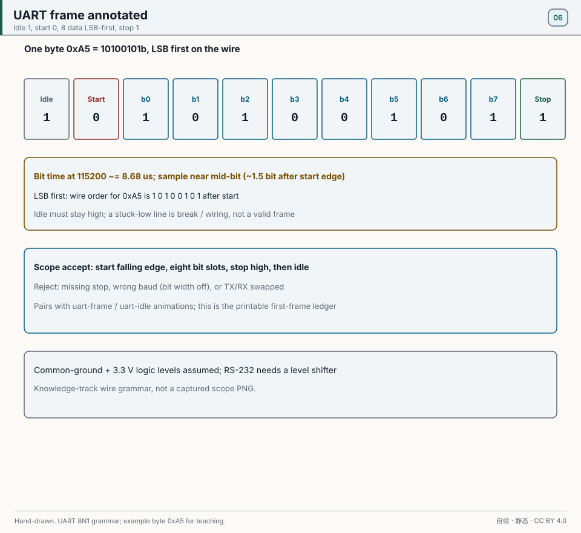
  <br><sub>▲ 自绘。LSB first；115200 位宽≈8.68 µs。知识轨线语法。</sub>
</p>


UART 没有时钟线，两边各拿各的表。所以每个字节前面先发一个低电平的起始位，相当于喊一声「开始了」，接收方听到这一声的下降沿就开始按约定的节拍数格子，每格中间看一眼线上是高还是低。8 位数据从最低位开始发，最后一个高电平的停止位让线回到空闲，给下一声「开始了」留出下降沿。

一帧 = 1 起始位 + 8/9 数据位（LSB 先发）+ 可选校验位 + 0.5/1/1.5/2 停止位

| 组成 | 取值 | 说明 |
| --- | --- | --- |
| 起始位 | 1 位（低） | 标志一帧开始 |
| 数据位 | 8 或 9 位 | LSB first |
| 校验位 | 无/奇/偶 | 简单检错 |
| 停止位 | 0.5/1/1.5/2 位（高） | 标志一帧结束 |
| 空闲 | 高电平 | 帧间默认 |

<p align="center">
  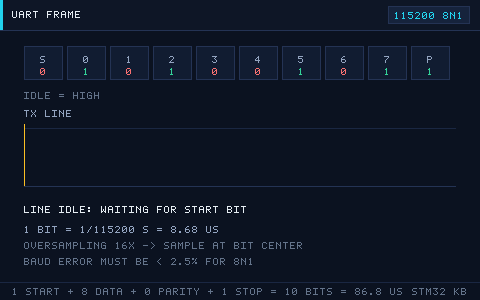
  <br><sub>▲ 动画：UART 逐位发送（含波特率时间轴，程序生成 GIF）</sub>
</p>

### 2. 波特率与误差


<p align="center">
  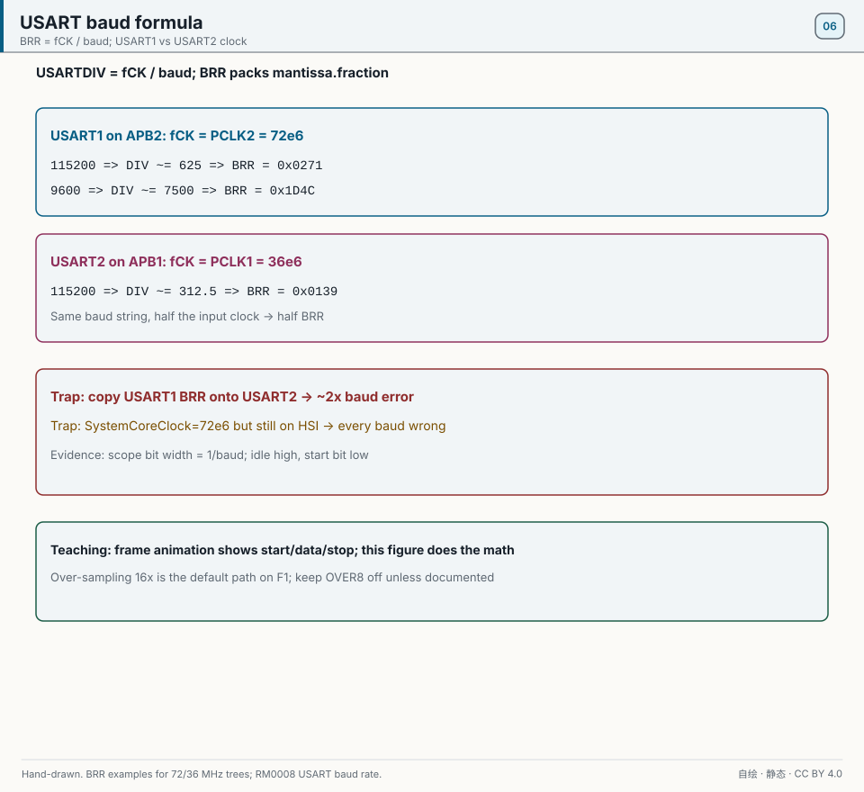
  <br><sub>▲ 自绘。同一波特率字符串，PCLK 不同则 BRR 不同。</sub>
</p>

<p align="center">
  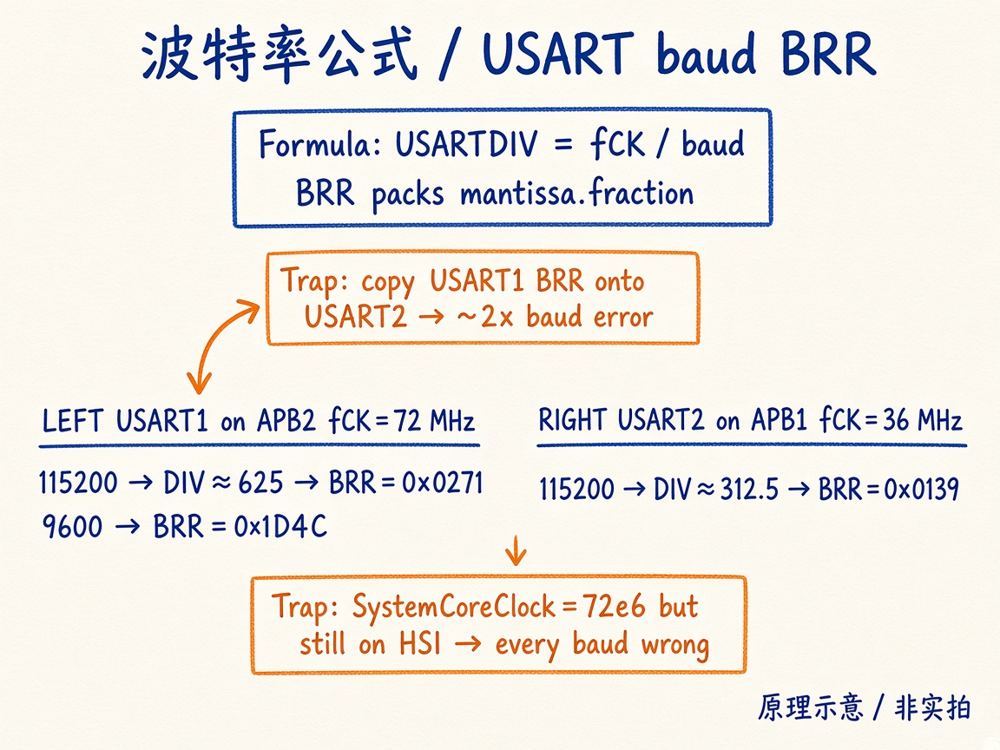
  <br><sub>▲ 知识轨（Handraw · 原理示意/非实拍）。USART1 72 MHz vs USART2 36 MHz；抄 BRR 会差约 2 倍；不是实拍。</sub>
</p>


两个人约好每秒拍 115200 下，各自数拍子。一帧只有 10 位，只要两边的表在这 10 位里错开不到半格，接收方每次都还能在格子中间附近采样。半格摊到 10 位上大约是 5%，再扣掉采样和边沿的余量，通常要求收发合计误差在 2%～3% 以内。BRR 就是告诉 USART 一格要数多少个 PCLK。

- 波特率 = 每秒传输的位数（bit/s）。常见 9600、115200。
- 每比特时间 = 1/波特率。115200 → 约 8.68µs。
- **误差容限**：收发累计误差需 < 约 ±2%~3%（10 位帧、在中间 3 点采样）。
- 误差公式：`误差 = (实际波特率 − 目标波特率) / 目标波特率 × 100%`

BRR 计算（F1，16 倍过采样）：`USARTDIV = fPCLK / (16 × 波特率)`，BRR = 整数部分 << 4 | 小数部分 × 16

| USART | 目标波特率 | 总线 | PCLK | USARTDIV | BRR（十六进制） | 误差 |
| --- | --- | --- | --- | --- | --- | --- |
| USART1 | 9600 | APB2 | 72 MHz | 468.75 | 0x1D4C | 0% |
| USART1 | 115200 | APB2 | 72 MHz | 39.0625 | 0x271 | 0% |
| USART2 | 115200 | APB1 | 36 MHz | 19.531 | 0x138 | 约 0.16% |

> 这颗 STM32F103C8T6 的 USART_CR1 位 31:14 保留，没有 OVER8。8 倍过采样要换到带这个位的系列。F103 上不要为了高频误码去开 OVER8，先核对 72 MHz 和 BRR `0x271`。`HAL_UART_Init` 仍按 16 倍算 BRR。

乱码、没输出、丢字节是串口实验最常见的三种「坏了」，下面这张图把它们收敛成三条岔路，每条只查一个根因。

<p align="center">
  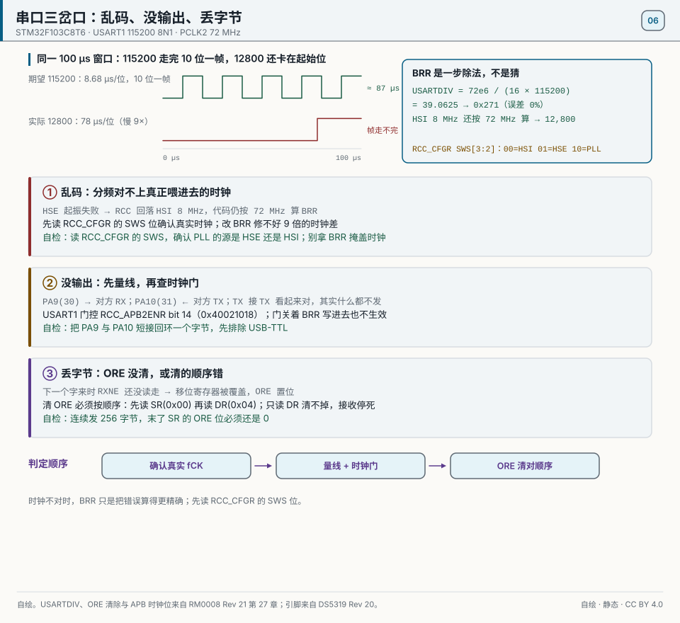
  <br><sub>▲ 自绘。岔口一：`USARTDIV = fPCLK / (16 × baud)`，USART1 在 PCLK2 72 MHz、115200 下是 39.0625，BRR `0x271`，误差 0；若 HSE 启动失败回落 HSI 8 MHz 而代码仍按 72 MHz 分频，线上只剩 12800 波特，慢 9 倍——先看 `RCC_CFGR` 的 SWS 位（00=HSI、01=HSE、10=PLL）再谈改 BRR。岔口二：PA9（第 30 脚）必须接对方 RX，TX 对 TX 看着正常但两端都收不到；USART1 的门是 `RCC_APB2ENR` 位 14，USART2/3 是 `RCC_APB1ENR` 位 17/18，门没开时写 BRR 无处落地、SR 读回 0x00C0。岔口三：下一个字来时 RXNE 还没读走，移位寄存器被覆盖，ORE 置位；清除顺序是先读 SR（0x00）再读 DR（0x04），只读 DR 清不掉。脚位见 [DS5319 Rev 20 图 8](#source-ds5319-usart)，USARTDIV 与 ORE 清除见 [RM0008 Rev 21 第 27 章](#source-rm0008-usart)。</sub>
</p>

<p align="center">
  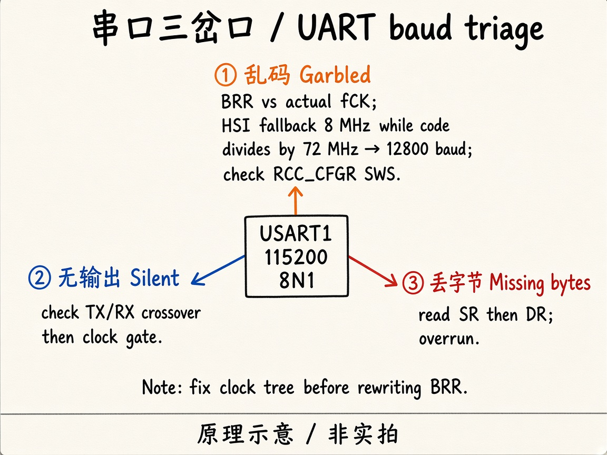
  <br><sub>▲ 知识轨（Handraw · 原理示意/非实拍）。乱码查 fCK/BRR；无输出查交叉与时钟门；丢字节先读 SR 再读 DR；不是实拍。</sub>
</p>

### 3. 三种收发方式对比

三种方式的区别是 CPU 守在哪里。阻塞模式像站在门口等快递，等到为止什么都不干。中断模式是每来一个字节按一次门铃，115200 波特下每秒响一万多次。DMA 是请了个管家，字节直接搬进数组，整包收完或线空闲了才叫你一声。

| 维度 | 阻塞（Polling） | 中断（IT） | DMA |
| --- | --- | --- | --- |
| CPU 占用 | 高（死等） | 中（每字节进中断） | 低（搬完才中断） |
| 吞吐 | 低 | 中 | 高 |
| 代码复杂度 | 低 | 中 | 中高 |
| 适用 | 简单调试 | 少量不定长数据 | 大量/连续数据、不定长收包 |

## 硬件与接线


<p align="center">
  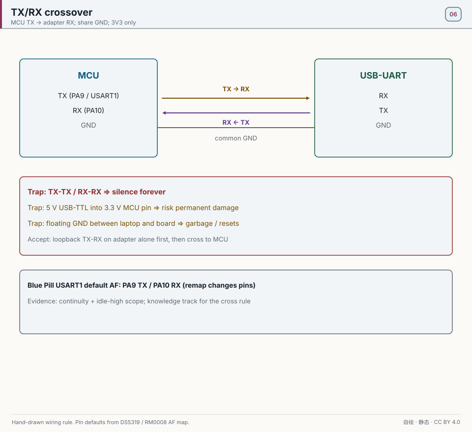
  <br><sub>▲ 自绘接线规则。TX-TX 会永远沉默；5V TTL 进 3V3 有风险。</sub>
</p>

<p align="center">
  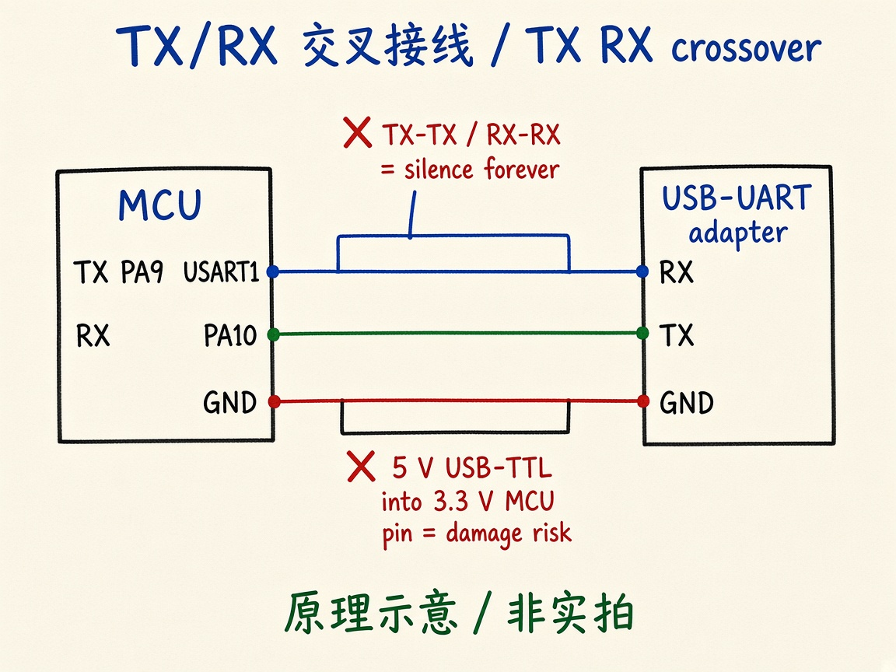
  <br><sub>▲ 知识轨（Handraw · 原理示意/非实拍）。MCU TX→适配器 RX；共地；禁 5 V 灌 3.3 V 脚；不是实拍。</sub>
</p>


| 开发板 | 外设 | 引脚 | 备注 |
| --- | --- | --- | --- |
| BluePill | USART1 TX | PA9 | 接 USB-TTL 的 RX |
| BluePill | USART1 RX | PA10 | 接 USB-TTL 的 TX |
| BluePill | GND | GND | 与 USB-TTL 共地 |

> [!WARNING]
> TX/RX 必须交叉接；USB-TTL 电平选 3.3V；USB-TTL 与 ST-Link 不要同时给板子供电冲突。

## 代码实现

阻塞收发：

```c
/* uart_blocking.c —— USART1 回显（阻塞方式） */
#include "stm32f1xx_hal.h"

UART_HandleTypeDef huart1;

void SystemClock_Config(void);

static void uart_init(void)
{
    __HAL_RCC_USART1_CLK_ENABLE();
    __HAL_RCC_GPIOA_CLK_ENABLE();

    /* PA9=TX 复用推挽，PA10=RX 上拉输入 */
    GPIO_InitTypeDef io = {0};
    io.Pin = GPIO_PIN_9; io.Mode = GPIO_MODE_AF_PP; io.Speed = GPIO_SPEED_FREQ_HIGH;
    HAL_GPIO_Init(GPIOA, &io);
    io.Pin = GPIO_PIN_10; io.Mode = GPIO_MODE_INPUT; io.Pull = GPIO_PULLUP;
    HAL_GPIO_Init(GPIOA, &io);

    huart1.Instance          = USART1;
    huart1.Init.BaudRate     = 115200;
    huart1.Init.WordLength   = UART_WORDLENGTH_8B;
    huart1.Init.StopBits     = UART_STOPBITS_1;
    huart1.Init.Parity       = UART_PARITY_NONE;
    huart1.Init.Mode         = UART_MODE_TX_RX;
    huart1.Init.HwFlowCtl    = UART_HWCONTROL_NONE;
    huart1.Init.OverSampling = UART_OVERSAMPLING_16;
    HAL_UART_Init(&huart1);
}

int main(void)
{
    HAL_Init();
    SystemClock_Config();
    uart_init();

    uint8_t ch;
    while (1)
    {
        if (HAL_UART_Receive(&huart1, &ch, 1, 1000) == HAL_OK)
        {
            HAL_UART_Transmit(&huart1, &ch, 1, 1000);   /* 回显 */
        }
    }
}
```

重定向 printf（方式一：fputc/`_write`）：

```c
#include <stdio.h>

/* Keil 用 fputc；GCC 用 _write。二者选一。 */
#ifdef __GNUC__
int _write(int fd, char *ptr, int len)
{
    HAL_UART_Transmit(&huart1, (uint8_t *)ptr, len, HAL_MAX_DELAY);
    return len;
}
#else
int fputc(int ch, FILE *f)
{
    HAL_UART_Transmit(&huart1, (uint8_t *)&ch, 1, HAL_MAX_DELAY);
    return ch;
}
#endif
```

> [!WARNING]
> Keil 需勾选「Use MicroLIB」，否则可能卡在半主机模式（Semihosting）。

方式二（推荐，无半主机依赖）：

```c
#include <stdarg.h>
#include <stdio.h>

void log_printf(const char *fmt, ...)
{
    char buf[128];
    va_list ap;
    va_start(ap, fmt);
    int n = vsnprintf(buf, sizeof(buf), fmt, ap);
    va_end(ap);
    if (n > 0) HAL_UART_Transmit(&huart1, (uint8_t *)buf, (uint16_t)n, HAL_MAX_DELAY);
}
```

DMA + IDLE 不定长接收：

```c
/* 循环 DMA 时，回调里的 Size 是写位置，不是这一次新增的字节数。
   下面把接收重新启动。位置差的算法见本章「常见坑与出处」。 */
#define RX_BUF_SIZE 128
uint8_t rx_buf[RX_BUF_SIZE];
volatile uint16_t rx_len = 0;

void uart_dma_idle_start(void)
{
    HAL_UARTEx_ReceiveToIdle_DMA(&huart1, rx_buf, RX_BUF_SIZE);
    __HAL_DMA_DISABLE_IT(huart1.hdmarx, DMA_IT_HT);   /* 关半传输中断，只用 IDLE 回调 */
}

/* 回调：IDLE 或缓冲区满时触发 */
void HAL_UARTEx_RxEventCallback(UART_HandleTypeDef *huart, uint16_t Size)
{
    if (huart->Instance == USART1)
    {
        rx_len = Size;                                 /* 写位置。循环缓冲要和上次位置相减，并处理绕回 */
        HAL_UARTEx_ReceiveToIdle_DMA(&huart1, rx_buf, RX_BUF_SIZE);  /* 重启接收 */
    }
}
```

环形缓冲区思路（中断只入队，主循环出队处理）：

```c
/* 写指针由 ISR 前进，读指针由主循环前进；用计数或留一空位判断满/空 */
static volatile uint16_t head, tail;
static uint8_t ring[256];
/* ISR: ring[head++ & 255] = ch;  主循环: ch = ring[tail++ & 255]; */
```

完整工程见 [`examples/uart-dma-idle/`](../examples/uart-dma-idle/)。

## 动手实验

1. **实验一（线上波形）**：USART1 发送 `0x55`，测量 10 位 8N1 帧。115200 baud 时一位约 8.68µs、整帧约 86.8µs，并核对 TX/RX 交叉接线。
2. **实验二（外设状态）**：故意把串口助手改成错误波特率，记录乱码与 FE；恢复 115200 后读 SR、DR 清标志，确认 RXNE 能继续变化。
3. **实验三（内存结果）**：DMA+IDLE 接收 1、17、255 字节三种长度，记录回调长度、缓冲区首尾字节和完整回显。第 10 章再解释 DMA 怎样更新剩余计数。

### 4. USART 关键寄存器（F1）

| 寄存器 | 作用 |
| --- | --- |
| SR | 状态寄存器（TXE/RXNE/TC/IDLE/ORE） |
| DR | 数据寄存器 |
| BRR | 波特率寄存器 |
| CR1 | 使能、字长、校验、中断 |
| CR2 | 停止位 |
| CR3 | DMA 使能、流控 |

### 5. 串口 DMA 发送

```c
/* 启动 DMA 发送（TX 端） */
extern uint8_t msg[];            /* 待发数据缓冲区 */
uint16_t msg_len = 10;
HAL_UART_Transmit_DMA(&huart1, msg, msg_len);

/* 发送完成回调 */
void HAL_UART_TxCpltCallback(UART_HandleTypeDef *huart)
{
    if (huart->Instance == USART1)
    {
        /* 可在此启动下一帧或置标志 */
    }
}
```

轮询的下一步是「DMA 搬字节、IDLE 划帧」：CPU 整帧只醒一次，帧长从 CNDTR 差值直接算出来。

<p align="center">
  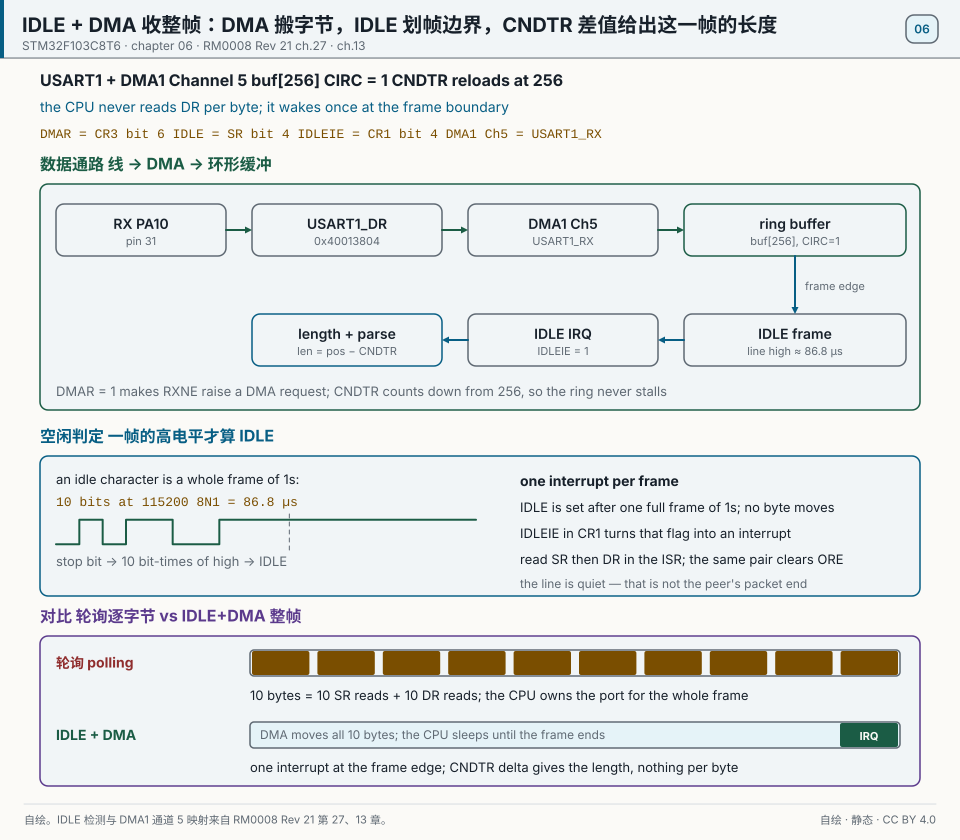
  <br><sub>▲ 自绘。`DMAR = CR3 bit 6` 让每次 RXNE 都触发 DMA 请求，DMA1 通道 5（USART1_RX 的固定映射）把字节搬进 256 项环形缓冲（CIRC=1，CNDTR 从 256 递减、归零回卷）；线上保持高满一帧——115200 8N1 下 10 位约 86.8 µs——IDLE（SR 位 4）置位，`IDLEIE = CR1 bit 4` 把它变成中断；ISR 里 `len = pos − CNDTR`（`pos` 为上一帧 ISR 保存的 CNDTR，回卷则再加 256）就是这一帧的长度，读 SR 再读 DR 这对操作顺带清掉 ORE。右下对比：轮询收 10 字节要 20 次 SR/DR 访问且 CPU 全程占用；IDLE+DMA 整帧只进一次中断。注意 IDLE 只说明线路空闲满一帧，不等于对方一包结束。IDLE 判定见 [ST 社区经验帖](#source-st-uart-idle)，通道映射与寄存器见 [RM0008 Rev 21 第 27、13 章](#source-rm0008-usart)。</sub>
</p>

<p align="center">
  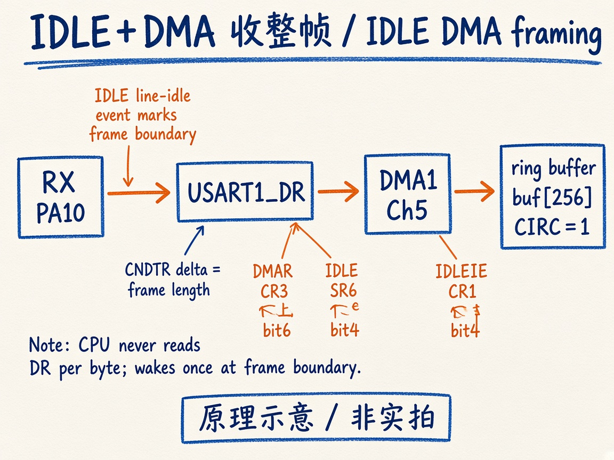
  <br><sub>▲ 知识轨（Handraw · 原理示意/非实拍）。DMA 搬字节，IDLE 划帧界，CNDTR 差值=帧长；不是实拍。</sub>
</p>

### 6. 串口助手常见设置

| 设置项 | 常见值 |
| --- | --- |
| 波特率 | 115200 |
| 数据位/停止位/校验 | 8/1/无 |
| 流控 | 无 |
| 发送新行 | 视协议加 CRLF |
| 编码 | 与 MCU 端一致 |

### 7. 溢出错误，和 RS485 的方向脚

ORE 置位之后，新字节不再进 DR，直到你**先读 SR 再读 DR**。只读 DR 清不掉 ORE，接收就这么停死。

| 标志 | 含义 | 怎么清 |
| --- | --- | --- |
| ORE | 上一字节还没读，下一字节又到了 | 读 SR，再读 DR |
| FE | 停止位不是 1，通常是波特率错 | 读 SR，再读 DR |
| NE | 采样窗口里电平不干净 | 读 SR，再读 DR |
| PE | 校验位不符 | 读 SR，再读 DR |

RS485 的方向脚（DE）在发送期间为高。`TXE` 只说明数据进了移位寄存器，线上还在发。切回接收必须等 `TC`：

```c
HAL_GPIO_WritePin(DE_PORT, DE_PIN, GPIO_PIN_SET);
HAL_UART_Transmit(&huart1, buf, len, 20);
while (__HAL_UART_GET_FLAG(&huart1, UART_FLAG_TC) == RESET) { }
HAL_GPIO_WritePin(DE_PORT, DE_PIN, GPIO_PIN_RESET);
```

离开本章前，应保留一张 `0x55` 帧波形、一组错误波特率下的 SR 标志，以及三种 DMA+IDLE 长度对应的内存记录。

自测：

1. 中断里只读了 DR，ORE 还会不会留着？
2. `TXE` 已经是 1，为什么示波器上还看得到最后几位？
3. 8N1 的停止位在图上为什么标 SP，不标 P？

## 相关资源

- 官方手册：**RM0008** 第 27 章（USART）；**DS5319** USART 引脚复用表
- 上一篇：[05 定时器与PWM](05-定时器与PWM.md)｜下一篇：[07 I2C总线](07-I2C总线.md)
- 手机阅读版：[第 06 章 · 串口UART（公众号图文）](https://mp.weixin.qq.com/s/_hR9mWbVJJp8_d05jBnA9w)
- 相关图：[`assets/animations/uart-frame.svg`](../assets/animations/uart-frame.svg)、[`assets/gif/uart-bits.gif`](../assets/gif/uart-bits.gif)
- 免责声明：本仓库插画均为作者自绘矢量图/程序生成动画，非厂商实拍照片。

