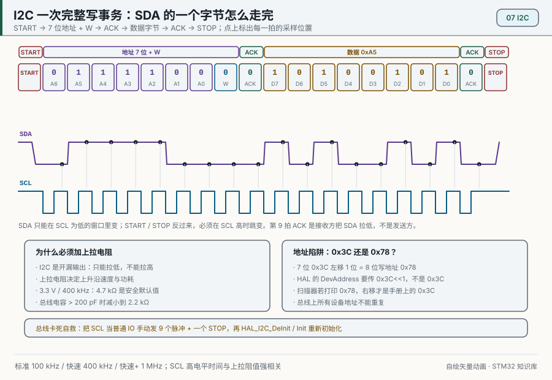
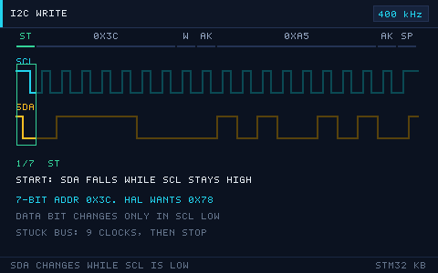
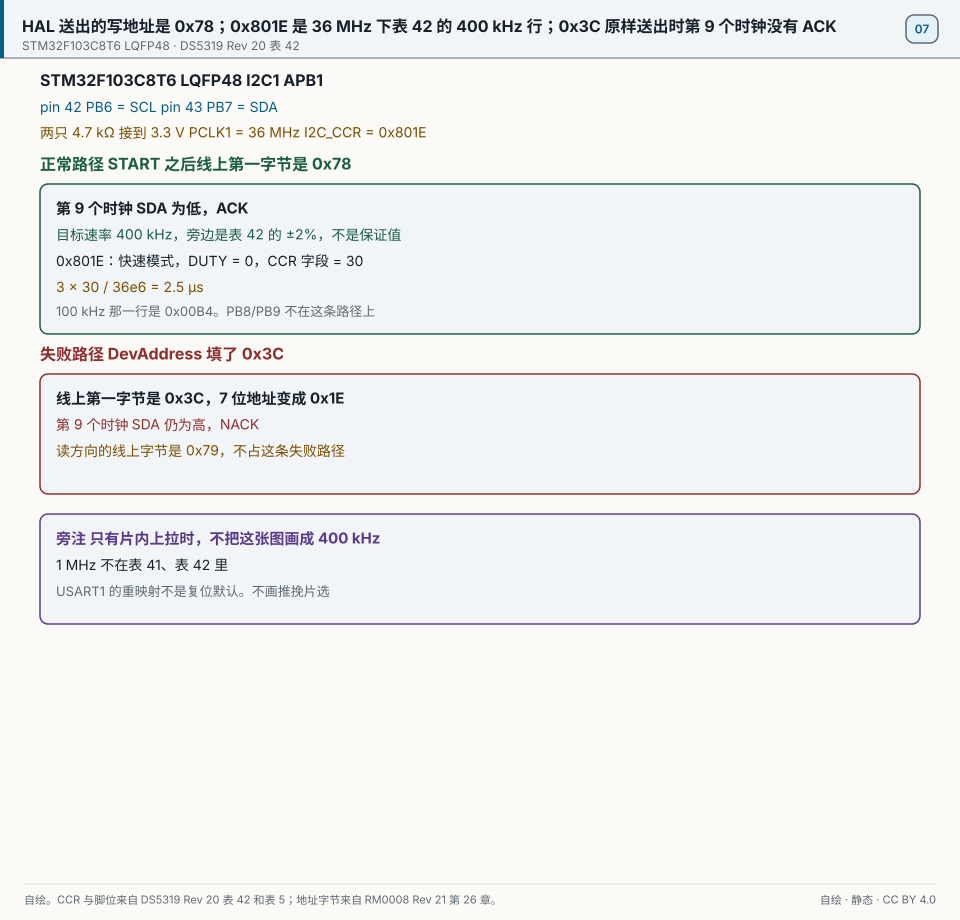
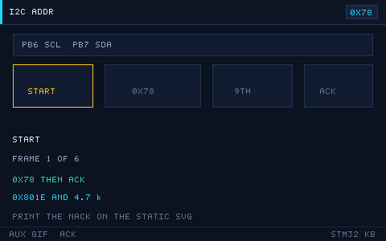

# 07 I2C 总线

> English: [I2C](en/07-i2c.md)

> I2C 用两根线连接多个器件，是传感器、EEPROM、OLED 的常用总线。

<p align="center">
  
  <br><sub>▲ 动画：I2C 完整事务（START、地址、ACK、数据、STOP，作者自绘矢量图）</sub>
</p>

<!-- video:ch07 -->
<p align="center">
  <video width="640" controls poster="../assets/video/ch07-i2c.png">
    <source src="../assets/video/ch07-i2c.mp4" type="video/mp4">
  </video>
  <br><sub>▲ 本章讲解视频（2.5 分钟）。<a href="../assets/video/ch07-i2c.mp4">MP4</a> · <a href="../assets/video/ch07-i2c.srt">字幕</a></sub>
</p>

<details>
<summary>旁白文字稿</summary>

1. I2C 只有时钟和数据两根线，都是开漏，所以都要上拉。没有上拉，线放不回高电平，主机会一直等，最后告诉你超时。
2. 应答是接收方把数据线拉低。高电平反而是不应答。地址不对、线没接好，你就会看到 NACK。记反的人会把好设备当成坏设备。
3. 很多芯片的寄存器要先写下寄存器地址，中间来一个重复起始，再读数据。不要先停止、再重新起始。HAL 里这条路就是存储器读。
4. 这一帧是仓库画的一次写事务。起始之后是地址，对方拉低应答，再送数据，最后停止。示波器上每一段都能对上，总线上的玄学就会少很多。
5. 七位地址和八位写地址差一位。屏幕模块常见 0x3C，放进 HAL 时往往要左移成 0x78。对不上时，先确认你手里的是哪一种写法，别把设备换掉。
6. 从机如果还死死拉着数据线，主机再发起始也没用。恢复的办法是在时钟线上补若干个脉冲，把从机的状态机推完，再发一个停止。然后才重新初始化。
7. 线上拉电阻不是随便贴一个。太弱，上升沿爬不完，高速时会错；太强，灌电流大，有的脚吃不消。短线实验可以用芯片内部上拉凑合，产品里要算一下。
8. 口诀：读寄存器走存储器读；中间是重复起始，不是停止再起始。地址先确认七位还是八位。这三句能对付大多数传感器例程。
9. 实验先在空闲总线上扫描地址。一个应答都没有，先查上拉和接线，不要先改协议。扫到了，再按手册读一个寄存器核对。
10. 合上书，三问。ACK 是高电平还是低电平？读寄存器时，写地址和读数据中间应该是停止还是重复起始？总线被拉死时先补什么？

</details>
<!-- /video:ch07 -->

## 学习目标

读这一章之前：需要第 02 章的 APB1 时钟（本书的配置下 PCLK1 = 36 MHz），第 03 章的开漏输出和复用功能；第 06 章「先读状态寄存器、再读数据寄存器」的清标志办法，这一章还会用到。电压、电流、电阻和欧姆定律不熟，或者还不会把十六进制数换成二进制，先读第 00 章的「零基础预备」。

- [ ] 说出 I2C 的两根线为什么都要上拉，并按总线电容估出上拉电阻的上限和下限
- [ ] 画出一次写事务：START、地址字节、第 9 个时钟的 ACK、数据、STOP
- [ ] 把 7 位地址 0x3C 换成线上的写字节 0x78 和读字节 0x79，知道 HAL 的 DevAddress 填哪一个
- [ ] 用 `HAL_I2C_Mem_Read` 读寄存器，在逻辑分析仪上找到中间的重复起始
- [ ] 在 PCLK1 = 36 MHz 下算出 100 kHz 和 400 kHz 的 CCR 与 TRISE，并在调试器里核对 0x00B4 和 0x801E
- [ ] 扫描总线找出在线的器件；通信失败时，从 HAL 的返回值和错误码分清是没有应答还是总线忙
- [ ] 从机把 SDA 拉死时，用最多 9 个时钟脉冲加一个 STOP 把总线救回来

## 核心原理

**一句话结论：I2C 用 SCL（时钟线）和 SDA（数据线）两根线连接多个器件；每个器件只能把线拉低，松手后靠上拉电阻回到高电平。主机先发 START 和地址，地址对上的器件在第 9 个时钟把 SDA 拉低应答，之后才开始传数据。**

### 先打个比方

教室天花板上吊着一根绳子，绳子上端挂着弹簧，弹簧总想把绳子拉到高处。屋里每个人都能伸手把绳子往下拽，但谁也没法把它往上推。只要有一个人拽着，绳子就在低处；所有人都松手，弹簧才把它拉回去。

老师（主机）拽着另一根绳子打拍子，喊一个学号（地址）。学号对上的学生在下一拍把绳子拽一下，表示「到」（应答）。这一拍没人拽，就是这个学号不在。

比方到这里为止。真的总线上，弹簧拉回去要花时间：上拉电阻越大、线上的电容越大，电平升得越慢，拍子快到一定程度就跟不上，这是第 1 节要算的上升时间。学号也不是喊出来的，而是一串二进制位，每一位跟着时钟线的一拍送出去。

### 1. 电气特性：开漏、上拉和线与

开漏（open-drain）是一种输出方式：引脚里只有一只往地拉的管子，写 0 时它导通，把线拉低；写 1 时它断开，引脚悬空，不往高处推（RM0008 Rev 21 第 9.1.8 节）。高电平全靠上拉电阻（pull-up resistor）：它一端接电源，一端接信号线，没人拉低时把线拉到高电平。

很多器件的开漏脚并在同一根线上，就形成线与（wired-AND）：任何一个器件拉低，整根线就是低；所有器件都松手，线才是高。I2C 的应答、时钟同步和多主机仲裁都靠这一点（第 5 节）。

| 特性 | 说明 |
| --- | --- |
| 引脚类型 | 开漏，SDA 和 SCL 都要上拉 |
| 线与 | 任何一个器件拉低即为低；全部松手才为高 |
| 速率档 | 标准模式最高 100 kHz，快速模式最高 400 kHz（RM0008 Rev 21 第 26.1 节） |
| 多主多从 | 一条总线上可以有多个主机和多个从机，从机靠地址区分 |

这张表是 I2C 的四条电气规矩，后面几节都从这里推出来。

F1 上有两点要单独记住：

- 硬件 I2C 的两只脚要配成复用开漏（RM0008 Rev 21 表 27）。复用功能模式和输出模式下，芯片内部的上拉、下拉电阻都是断开的（第 9.1.8、9.1.9 节），所以硬件 I2C 用不上片内上拉，外部上拉必须焊上。
- 就算改用软件模拟、把引脚切到输入上拉，片内上拉也有 30–50 kΩ（DS5319 Rev 20 表 36），对 I2C 来说太弱，下面一算就知道。

**上拉电阻怎么选。** 电阻有上限，也有下限。

上限来自上升时间。上升时间 tr 指电平从 0.3 VDD 升到 0.7 VDD 用的时间，这是 DS5319 Rev 20 图 32 注 1 规定的测量点。上拉电阻 Rp 给总线电容 Cb 充电，走的是一条 RC 曲线，从 0.3 VDD 升到 0.7 VDD 正好用掉 0.8473 × Rp × Cb：

```text
tr      = 0.8473 × Rp × Cb               0.8473 = ln(0.7 / 0.3)
Rp(max) = tr(max) / (0.8473 × Cb)
tr(max)：标准模式 1000 ns，快速模式 300 ns（DS5319 Rev 20 表 41）
```

下限来自灌电流。器件拉低时，电流从电源经 Rp 流进它的引脚。I2C 规范要求器件灌 3 mA 时把线压到 0.4 V 以下（NXP 的 I2C 规范 UM10204，不在本书的出处清单里），于是：

```text
Rp(min) = (VDD − 0.4 V) / 3 mA = (3.3 − 0.4) / 0.003 ≈ 967 Ω
```

把几档总线电容代进上限公式：

| 总线电容 Cb | 标准模式 Rp(max) | 快速模式 Rp(max) |
| --- | --- | --- |
| 50 pF | 23.6 kΩ | 7.08 kΩ |
| 100 pF | 11.8 kΩ | 3.54 kΩ |
| 200 pF | 5.90 kΩ | 1.77 kΩ |
| 400 pF | 2.95 kΩ | 0.885 kΩ |

用法：先估出总线电容，再按速率档查最大值，选一只不超过它、又不低于 967 Ω 的电阻。400 pF 是表 41 允许的最大总线电容；这一行的快速模式上限 0.885 kΩ 已经低于 967 Ω，说明总线挂到 400 pF 再跑 400 kHz，单靠一只电阻做不到。

总线电容是所有器件的引脚电容加上导线电容。STM32 每只脚典型 5 pF（DS5319 Rev 20 表 36）；面包板上挂一两个模块、导线十几厘米，总共通常是几十皮法（经验值）。DS5319 表 42 用的外部上拉是 4.7 kΩ，按上面的公式，它在快速模式下最多带 300 ns ÷ (0.8473 × 4.7 kΩ) ≈ 75 pF，所以 4.7 kΩ 适合短线；线长了、器件多了，换 2.2 kΩ 这类更小的电阻。片内上拉按典型值 40 kΩ 算，哪怕总线只有 50 pF，0.8473 × 40 kΩ × 50 pF ≈ 1.7 µs，连标准模式的 1000 ns 都超了。

### 2. 时序与协议：START、地址、ACK、STOP

| 信号 | 条件 | 含义 |
| --- | --- | --- |
| START（S） | SCL 为高时，SDA 由高变低 | 一次传输开始，总线变忙 |
| STOP（P） | SCL 为高时，SDA 由低变高 | 一次传输结束，总线空闲 |
| 数据位 | SCL 为低时改 SDA，SCL 为高时 SDA 保持不动 | 接收方在 SCL 高电平期间读这一位 |
| ACK | 第 9 个时钟，接收方把 SDA 拉低 | 收到了 |
| NACK | 第 9 个时钟，SDA 保持高 | 没有器件应答，或者主机读完最后一个字节、不再要了 |

读表时留意 ACK 是谁发的：主机写的时候由从机应答，主机读的时候由主机应答。读完最后一个字节，主机故意回 NACK，告诉从机别再往外送了。START 和 STOP 的电平定义来自 I2C 规范 UM10204；RM0008 Rev 21 第 26.3.1 节写明，数据和地址都按 8 位一个字节、高位先出（MSB first），每个字节后面跟第 9 个时钟，由接收方送应答位。

给 OLED 写一条命令，线上是这样（S 是 START，A 是 ACK，P 是 STOP）：

```text
S | 0111100 0 | A | 0000 0000 | A | 1010 1110 | A | P
  | 地址 0x3C + 写 = 0x78     | 控制字节 0x00   | 命令 0xAE（关显示）
```

每个字节 8 个时钟，加 1 个应答时钟，共 9 个时钟。快速模式 400 kHz 下一个时钟 2.5 µs，一个字节连应答是 22.5 µs。

和 UART 比：UART 低位先出（第 06 章），I2C 高位先出，所以同一个 0xA5，在两种总线上的位序正好相反。

DS5319 Rev 20 表 41 规定了时钟和起止条件的最短时长。下表挑了最常用的几行，方便在逻辑分析仪上对照：

| 参数 | 标准模式 | 快速模式 |
| --- | --- | --- |
| SCL 低电平 tw(SCLL)，最短 | 4.7 µs | 1.3 µs |
| SCL 高电平 tw(SCLH)，最短 | 4.0 µs | 0.6 µs |
| START 保持 th(STA)，最短 | 4.0 µs | 0.6 µs |
| STOP 建立 tsu(STO)，最短 | 4.0 µs | 0.6 µs |
| STOP 到下一个 START 的空闲 tw(STO:STA)，最短 | 4.7 µs | 1.3 µs |
| 上升时间 tr，最长 | 1000 ns | 300 ns |
| 每根线的总线电容 Cb，最大 | 400 pF | 400 pF |

用法：量到的低电平、高电平不短于这一列的最小值，上升时间不超过最大值，就符合这一档。表 41 注 1 写明这些值由设计保证，量产时不测。

<p align="center">
  
  <br><sub>▲ 动画：I2C 时序细节（程序生成 GIF）</sub>
</p>

### 3. 地址：7 位地址、8 位写法和 0x78

I2C 地址有 7 位和 10 位两种，常用的是 7 位。7 位地址模式下，START 之后的第一个字节由两部分组成：高 7 位是地址，最低位是读写位 R/W，0 表示主机要写，1 表示主机要读（RM0008 Rev 21 第 26.3.3 节）。

把 0x3C 拆开看：

```text
0x3C 的 7 位：            011 1100
左移 1 位，最低位放 R/W： 0111 1000 = 0x78（写）
                          0111 1001 = 0x79（读）
```

器件手册和网上的例程有两种写法：有的写 7 位地址 0x3C，有的直接写写字节 0x78。HAL 的 `DevAddress` 参数要的是左移以后的值，也就是 `0x3C << 1`。把扫描器报出的 0x3C 原样填进去，线上出去的第一个字节就是 0x3C，对应的 7 位地址变成 0x1E，没有器件应答，HAL 报错。

| 器件 | 7 位地址 | HAL 的 DevAddress | 地址怎么变 |
| --- | --- | --- | --- |
| SSD1306 OLED | 0x3C | 0x78 | SA0 脚接高时是 0x3D |
| AT24C02 EEPROM | 0x50 | 0xA0 | A2、A1、A0 三只脚决定 0x50–0x57 |
| MPU6050 | 0x68 | 0xD0 | AD0 脚接高时是 0x69 |
| PCF8574 | 0x20–0x27 | 0x40–0x4E | A2、A1、A0 三只脚决定 |

查表时先看第二列确认 7 位地址，再看最后一列：同一个型号的地址常常由几只引脚的接法决定，模块背面的跳线或焊盘会改变它。这些地址来自各器件的数据手册，不在本书的出处清单里，以你手里那颗的手册为准。7 位地址里 0x00–0x07 和 0x78–0x7F 两段被 I2C 规范保留，扫描时跳过。这里说的是 7 位地址：OLED 的 0x78 是左移以后的写字节，它的 7 位地址 0x3C 不在保留段里。

### 4. 重复起始：读寄存器的标准动作

传感器和 EEPROM 内部有很多寄存器或存储单元，读之前要先告诉它读哪一个。顺序是：

```text
S | 器件地址+写 | A | 寄存器地址 | A | Sr | 器件地址+读 | A | 数据 | NACK | P
     0x78                                     0x79
```

前半段是一次写，只写一个寄存器地址；主机接着不发 STOP，直接再发一个 START，这就是重复起始；后半段是一次读。F1 的 I2C 外设在主机模式下再置一次 START 位，就会在当前字节结束后产生重复起始（RM0008 Rev 21 第 26.3.3 节）。

自己先调 `HAL_I2C_Master_Transmit` 写寄存器地址，再调 `HAL_I2C_Master_Receive` 读，中间会多出一个 STOP 和一个新的 START。有的器件要求中间必须是重复起始，看到 STOP 就把刚写进去的寄存器地址作废；多主机的总线上，STOP 之后总线空闲，别的主机还可能插进来。哪颗器件在意这一点，看它的手册。用 `Mem_Read` 一次做完，两种情况都不用操心。

口诀：**读寄存器走 Mem_Read；中间是 Sr，不是 STOP 再 START。**

### 5. 时钟同步、仲裁和时钟拉伸

这三件事都是线与的直接结果。

| 机制 | 怎么回事 |
| --- | --- |
| 时钟同步 | SCL 也是线与，谁把 SCL 拉低得最久，低电平就持续多久 |
| 仲裁 | 两个主机同时发送时，各自一边发一边读 SDA；发 1 却读到 0 的一方知道别人在发 0，自己退出 |
| 时钟拉伸 | 从机来不及处理时把 SCL 拉低不放，主机只能等它松手 |

只有一个 STM32 当主机的板子上用不到仲裁，时钟拉伸却经常遇到，所以这张表从下往上读更实用。F1 的 I2C 当主机时，拉高 SCL 之后等过 TRISE 设定的时间再检查 SCL；发现 SCL 还是低，就认为从机在拉伸，高电平计数器停下来等（RM0008 Rev 21 第 26.3.3 节）。仲裁失败时 SR1 的 ARLO 位置 1，外设自动退回从机模式（第 26.3.4 节）。CR1 里的 NOSTRETCH 位只管 STM32 自己当从机时拉不拉伸，跟当主机无关（第 26.6.1 节）。

### 6. 硬件 I2C 的速率：FREQ、CCR 和 TRISE

F1 的 I2C 外设用 APB1 时钟 PCLK1 数出 SCL 的高低电平，要配三个寄存器（RM0008 Rev 21 第 26.6 节）：

- I2C_CR2 的 FREQ[5:0]：告诉外设 PCLK1 是多少 MHz，这里写 36。外设靠它生成合乎规范的建立和保持时间，最低 2 MHz（第 26.6.2 节）。
- I2C_CCR（偏移 0x1C）：位 15 是 F/S，0 为标准模式，1 为快速模式；位 14 是 DUTY；位 11:0 是 CCR 字段（第 26.6.8 节）。
- I2C_TRISE（偏移 0x20）：填 SCL 最长上升时间折合的 PCLK1 周期数，再加 1（第 26.6.9 节）。

CCR 的公式如下，TPCLK1 = 1 / 36 MHz ≈ 27.8 ns：

```text
标准模式：         Thigh = CCR × TPCLK1        Tlow = CCR × TPCLK1
快速模式 DUTY = 0：Thigh = CCR × TPCLK1        Tlow = 2 × CCR × TPCLK1
快速模式 DUTY = 1：Thigh = 9 × CCR × TPCLK1    Tlow = 16 × CCR × TPCLK1
```

代进 36 MHz：

| 目标 | 模式 | CCR 字段 | I2C_CCR | 高 / 低电平 | TRISE |
| --- | --- | --- | --- | --- | --- |
| 100 kHz | 标准，F/S = 0 | 36e6 / (2 × 100e3) = 180 | 0x00B4 | 5 µs / 5 µs | 1000 ns × 36 MHz = 36，加 1 = 37 |
| 400 kHz | 快速，F/S = 1，DUTY = 0 | 36e6 / (3 × 400e3) = 30 | 0x801E | 0.833 µs / 1.667 µs | 300 ns × 36 MHz = 10.8，取整 10，加 1 = 11 |

用法：按目标速率选行；CCR 字段决定频率，F/S 和 DUTY 两位拼在最高位上，合起来就是整个 I2C_CCR。两行的 I2C_CCR 和 DS5319 Rev 20 表 42 在 36 MHz 下印的 0x00B4、0x801E 一致。表 42 注 2 给了实际速率的容差：200 kHz 附近 ±5%，其他速率 ±2%，取决于外部元件的精度。

快速模式还有两个细节：

- 表 41 注 2 说，要达到 400 kHz 的上限，PCLK1 得是 10 MHz 的整数倍。36 MHz 不是。DUTY = 1 时一个周期是 25 × CCR × TPCLK1，36 MHz 下要 CCR = 3.6 才凑得出 400 kHz；CCR 只能取整数，取 4 就只剩 360 kHz。DUTY = 0 时 CCR = 30 正好整除，表 42 印的 0x801E 就是这一档。
- RM0008 第 26.6.8 节注明，Thigh 里包含 SCL 的上升时间（thigh = tr(SCL) + tw(SCLH)）。400 kHz、DUTY = 0 时 Thigh 只有 833 ns，上升要是用掉 300 ns，剩下的 533 ns 已经短于表 41 要求的 0.6 µs。所以跑 400 kHz 时，上升时间最好明显小于 300 ns，上拉电阻不要贴着第 1 节算出的上限选。

TRISE 是给时钟拉伸检测用的：外设拉高 SCL 后，等 TRISE 个 PCLK1 周期，再去看 SCL 是否真的升上来了。上拉太弱、上升慢过这个时间，外设会当成从机在拉伸，停下来等，SCL 的周期随之变长（第 26.3.3 节）。

用 HAL 时，`HAL_I2C_Init()` 根据 `ClockSpeed` 和 `DutyCycle` 自己算出这三个值，你在调试器里能看到结果（实验三）。

### 7. 软件模拟 I2C 和硬件 I2C

| 对比 | 软件模拟（翻转 GPIO） | 硬件 I2C（I2C1 外设） |
| --- | --- | --- |
| 引脚 | 任意两只 GPIO | 固定：PB6/PB7，或重映射到 PB8/PB9 |
| CPU 占用 | 每一位都由 CPU 翻转，传输期间 CPU 被占满 | 外设生成时序，CPU 只处理事件 |
| 速率 | 由延时决定，一般在 100 kHz 量级（经验值） | 标准模式 100 kHz，快速模式 400 kHz |
| 容易出错的地方 | 延时随编译优化变化，要用逻辑分析仪量 | 主机接收时关 ACK、请求 STOP 的时机很紧，中断被耽误就会出错 |

读这张表时看你缺什么：引脚被占了、或者要好几路 I2C，用软件模拟；要省 CPU、要跑 400 kHz，用硬件。F1 的硬件 I2C 做主机接收时，要在最后一个字节的应答脉冲之前清掉 ACK 位、请求 STOP；中断优先级不够高时，手册另给了一套做法（RM0008 Rev 21 第 26.3.3 节的 Method 2）。HAL 已经按这些步骤写好，你自己写寄存器级驱动时才需要逐条照做。

### 8. 总线卡死与恢复

最常见的情形：主机正在读从机，从机正往外送一个 0，这时主机复位了。从机还在等时钟把剩下的位送完，于是一直把 SDA 拉低。I2C1 看到 SDA 是低，就把 SR2 的 BUSY 位置 1（BUSY 在 SDA 或 SCL 为低时置位，检测到 STOP 才清零，第 26.6.7 节）。外设要等 BUSY 清零才会产生 START（第 26.3.3 节），所以 START 发不出去，HAL 返回 `HAL_BUSY`。

恢复分三步：

1. 把 PB6、PB7 切成开漏输出的普通 GPIO，在 SCL 上一拍一拍地打时钟，每拍之后看一眼 SDA。从机手里最多还剩 8 位数据加 1 位应答，所以最多 9 拍，它就会松开 SDA。I2C 规范 UM10204 的「总线清除」一节写的就是 9 个时钟。
2. SDA 回到高电平后，造一个 STOP：SCL 为低时把 SDA 拉低，松开 SCL，再松开 SDA。
3. I2C 外设自己的 BUSY 位可能还锁着。RM0008 Rev 21 第 26.6.1 节说明，BUSY 因为总线上的毛刺锁住时，可以用 CR1 的 SWRST 位复位外设，复位前要确认两根线已经松开。复位后重新初始化。

打完 9 拍 SDA 还是低，说明从机坏了，或者线被别的东西拉住了，只能给从机断电。

## 硬件与接线

| 开发板 | 外设 | 引脚 | 备注 |
| --- | --- | --- | --- |
| BluePill | I2C1_SCL | PB6（LQFP48 第 42 脚） | 复用开漏；4.7 kΩ 上拉到 3.3 V |
| BluePill | I2C1_SDA | PB7（第 43 脚） | 复用开漏；4.7 kΩ 上拉到 3.3 V |
| SSD1306 OLED 模块 | 7 位地址 0x3C | 接同一对 SCL、SDA | 很多模块板上已经有上拉，先用万用表量一下（经验值） |
| AT24C02 EEPROM | 7 位地址 0x50 | 同上 | A2、A1、A0 和写保护脚 WP 接地 |
| MPU6050 模块 | 7 位地址 0x68 | 同上 | AD0 接地；接高变成 0x69 |

脚号来自 DS5319 Rev 20 表 5，复用开漏来自 RM0008 Rev 21 表 27。

```text
                 3.3V ──┬────────────┬──────────────
                      [4.7k]       [4.7k]
                        │            │
BluePill PB6 (第42脚) ──┴──── SCL ───┼──── OLED / EEPROM / MPU6050 的 SCL
BluePill PB7 (第43脚) ──────── SDA ──┴──── OLED / EEPROM / MPU6050 的 SDA
BluePill GND ─────────────────────────────── 各模块的 GND
```

接线时注意：一条总线只要一组上拉。每个模块都自带 4.7 kΩ 时，挂上去的电阻是并联的，挂到第 5 个模块就只剩 4.7 kΩ ÷ 5 = 940 Ω，低于第 1 节算出的 967 Ω 下限，要把多余模块上的上拉焊掉；上拉接 3.3 V。

## 代码实现

第一个程序：用硬件 I2C1 扫描总线，再初始化 OLED、画满横条纹。不用串口，结果放在全局变量里，用调试器看。

```c
/* i2c_scan_oled.c —— I2C1 400 kHz 扫描总线并点亮 SSD1306（HAL，STM32F103C8T6） */
#include <string.h>
#include "stm32f1xx_hal.h"

#define I2C_SPEED_HZ      400000U       /* PCLK1 = 36 MHz 时 HAL 写出 CCR = 0x801E */
#define I2C_TIMEOUT_MS    20U
#define SCAN_FIRST        0x08U         /* 0x00–0x07 和 0x78–0x7F 是保留地址 */
#define SCAN_LAST         0x77U
#define SCAN_TIMEOUT_MS   2U
#define MAX_FOUND         8U

#define OLED_ADDR         (0x3CU << 1)  /* 7 位 0x3C → HAL 的 DevAddress 0x78 */
#define OLED_CTRL_CMD     0x00U         /* 控制字节：后面全是命令 */
#define OLED_CTRL_DATA    0x40U         /* 控制字节：后面全是显存数据 */
#define OLED_WIDTH        128U
#define OLED_PAGES        8U            /* 64 行，每页 8 行 */
#define OLED_PATTERN      0x0FU         /* 每页上 4 行亮、下 4 行灭：横条纹 */

I2C_HandleTypeDef hi2c1;

volatile uint8_t  g_found[MAX_FOUND];   /* 扫描到的 7 位地址 */
volatile uint8_t  g_found_count;
volatile HAL_StatusTypeDef g_oled_status = HAL_ERROR;
volatile uint32_t g_i2c_error;          /* 最后一次 OLED 传输后的 HAL_I2C_GetError() */

/* 128×64 模块常用的初始化序列：用模块上的电荷泵升压 */
static const uint8_t oled_init_cmds[] = {
    0xAE,           /* 关显示 */
    0xD5, 0x80,     /* 时钟分频 */
    0xA8, 0x3F,     /* 多路复用比：64 行 */
    0xD3, 0x00,     /* 显示偏移 0 */
    0x40,           /* 起始行 0 */
    0x8D, 0x14,     /* 打开电荷泵 */
    0x20, 0x00,     /* 水平寻址模式 */
    0xA1,           /* 段重映射：左右不颠倒 */
    0xC8,           /* COM 扫描方向：上下不颠倒 */
    0xDA, 0x12,     /* COM 引脚配置 */
    0x81, 0xCF,     /* 对比度 */
    0xD9, 0xF1,     /* 预充电周期 */
    0xDB, 0x40,     /* VCOMH 电平 */
    0xA4,           /* 显示跟随显存 */
    0xA6,           /* 正常显示，不反白 */
    0xAF            /* 开显示 */
};

void SystemClock_Config(void);
void error_handler(void);
void i2c1_init(void);
static void i2c_scan(void);
static HAL_StatusTypeDef oled_cmds(const uint8_t *cmds, uint16_t len);
static HAL_StatusTypeDef oled_fill(uint8_t pattern);

int main(void)
{
    HAL_StatusTypeDef st;

    HAL_Init();
    SystemClock_Config();                   /* PCLK1 = 36 MHz，CCR 才是 0x801E */
    i2c1_init();

    i2c_scan();                             /* 结果在 g_found[] 里 */

    st = oled_cmds(oled_init_cmds, sizeof(oled_init_cmds));
    if (st == HAL_OK)
    {
        st = oled_fill(OLED_PATTERN);
    }
    g_oled_status = st;                     /* HAL_OK、HAL_ERROR 或 HAL_BUSY */
    g_i2c_error   = HAL_I2C_GetError(&hi2c1);

    while (1)
    {
    }
}

void i2c1_init(void)
{
    GPIO_InitTypeDef io = {0};

    __HAL_RCC_GPIOB_CLK_ENABLE();
    io.Pin   = GPIO_PIN_6 | GPIO_PIN_7;     /* PB6 = SCL，PB7 = SDA */
    io.Mode  = GPIO_MODE_AF_OD;             /* 复用开漏：外设只往低拉，高电平靠外部上拉 */
    io.Speed = GPIO_SPEED_FREQ_HIGH;
    HAL_GPIO_Init(GPIOB, &io);

    __HAL_RCC_I2C1_CLK_ENABLE();
    hi2c1.Instance             = I2C1;
    hi2c1.Init.ClockSpeed      = I2C_SPEED_HZ;
    hi2c1.Init.DutyCycle       = I2C_DUTYCYCLE_2;      /* 快速模式 Tlow / Thigh = 2 */
    hi2c1.Init.OwnAddress1     = 0;
    hi2c1.Init.AddressingMode  = I2C_ADDRESSINGMODE_7BIT;
    hi2c1.Init.DualAddressMode = I2C_DUALADDRESS_DISABLE;
    hi2c1.Init.OwnAddress2     = 0;
    hi2c1.Init.GeneralCallMode = I2C_GENERALCALL_DISABLE;
    hi2c1.Init.NoStretchMode   = I2C_NOSTRETCH_DISABLE;
    if (HAL_I2C_Init(&hi2c1) != HAL_OK)
    {
        error_handler();
    }
}

/* 对每个 7 位地址发 START、地址加写，看第 9 个时钟有没有 ACK */
static void i2c_scan(void)
{
    g_found_count = 0U;
    for (uint8_t addr7 = SCAN_FIRST; addr7 <= SCAN_LAST; addr7++)
    {
        if (HAL_I2C_IsDeviceReady(&hi2c1, (uint16_t)(addr7 << 1), 1, SCAN_TIMEOUT_MS) == HAL_OK)
        {
            if (g_found_count < MAX_FOUND)
            {
                g_found[g_found_count] = addr7;
            }
            g_found_count++;
        }
    }
}

/* 一次传输：地址 0x78、控制字节 0x00、一串命令 */
static HAL_StatusTypeDef oled_cmds(const uint8_t *cmds, uint16_t len)
{
    return HAL_I2C_Mem_Write(&hi2c1, OLED_ADDR, OLED_CTRL_CMD, I2C_MEMADD_SIZE_8BIT,
                             (uint8_t *)cmds, len, I2C_TIMEOUT_MS);
}

/* 把 128 列 × 8 页的显存都写成同一个字节 */
static HAL_StatusTypeDef oled_fill(uint8_t pattern)
{
    static const uint8_t window[] = {
        0x21, 0x00, OLED_WIDTH - 1U,        /* 列地址 0–127 */
        0x22, 0x00, OLED_PAGES - 1U         /* 页地址 0–7 */
    };
    uint8_t row[OLED_WIDTH];
    HAL_StatusTypeDef st;

    memset(row, pattern, sizeof(row));
    st = oled_cmds(window, sizeof(window));
    for (uint32_t page = 0; (page < OLED_PAGES) && (st == HAL_OK); page++)
    {
        st = HAL_I2C_Mem_Write(&hi2c1, OLED_ADDR, OLED_CTRL_DATA, I2C_MEMADD_SIZE_8BIT,
                               row, sizeof(row), I2C_TIMEOUT_MS);
    }
    return st;
}

/* HSE 8 MHz × 9 = 72 MHz；APB1 二分频得 36 MHz，I2C1 用它 */
void SystemClock_Config(void)
{
    RCC_OscInitTypeDef osc = {0};
    RCC_ClkInitTypeDef clk = {0};

    osc.OscillatorType = RCC_OSCILLATORTYPE_HSE;
    osc.HSEState       = RCC_HSE_ON;
    osc.HSEPredivValue = RCC_HSE_PREDIV_DIV1;
    osc.PLL.PLLState   = RCC_PLL_ON;
    osc.PLL.PLLSource  = RCC_PLLSOURCE_HSE;
    osc.PLL.PLLMUL     = RCC_PLL_MUL9;
    if (HAL_RCC_OscConfig(&osc) != HAL_OK)
    {
        error_handler();
    }

    clk.ClockType      = RCC_CLOCKTYPE_HCLK | RCC_CLOCKTYPE_SYSCLK |
                         RCC_CLOCKTYPE_PCLK1 | RCC_CLOCKTYPE_PCLK2;
    clk.SYSCLKSource   = RCC_SYSCLKSOURCE_PLLCLK;
    clk.AHBCLKDivider  = RCC_SYSCLK_DIV1;   /* HCLK  = 72 MHz */
    clk.APB1CLKDivider = RCC_HCLK_DIV2;     /* PCLK1 = 36 MHz：I2C1 */
    clk.APB2CLKDivider = RCC_HCLK_DIV1;     /* PCLK2 = 72 MHz：GPIOB */
    if (HAL_RCC_ClockConfig(&clk, FLASH_LATENCY_2) != HAL_OK)
    {
        error_handler();
    }
}

void error_handler(void)
{
    __disable_irq();
    while (1)
    {
    }
}
```

逐段看：

- `i2c1_init()` 先把 PB6、PB7 配成复用开漏，再开 I2C1 时钟、调 `HAL_I2C_Init()`。`HAL_I2C_Init()` 只会调用弱定义的 `HAL_I2C_MspInit()`，不定义它、也不像这里自己配脚，两只脚就停在复位后的浮空输入，外设根本碰不到总线。
- `ClockSpeed = 400000`、`DutyCycle = I2C_DUTYCYCLE_2`，PCLK1 = 36 MHz 时 HAL 算出的 I2C_CCR 是 0x801E，TRISE 是 11（第 6 节）。改成 100000，就是 0x00B4 和 37。
- `HAL_I2C_IsDeviceReady()` 发 START、地址加写，看第 9 个时钟有没有 ACK，再发 STOP。扫描从 0x08 扫到 0x77，跳过保留地址。
- SSD1306 收到的每次传输，第一个数据字节是控制字节：0x00 表示后面全是命令，0x40 表示后面全是显存数据。`HAL_I2C_Mem_Write()` 的顺序是 START、器件地址、一个「存储器地址」字节、数据、STOP，把控制字节当成存储器地址传进去，正好就是 SSD1306 要的格式，不用再拷一份缓冲区。
- 初始化序列里的 `0x8D, 0x14` 打开电荷泵。大多数 0.96 英寸模块靠它产生屏幕需要的高压，少了这两个字节，命令全都收下了，屏幕却不亮。各条命令的含义见 SSD1306 数据手册（不在本书的出处清单里），换了别的模块要对照它的手册。
- 一页 128 字节加地址和控制字节共 130 个字节，每个 9 个时钟，400 kHz 下约 2.9 ms；整屏 8 页约 23 ms。
- 传输失败时看两个变量：`g_oled_status` 是 `HAL_BUSY`，多半是总线一直被拉低（没有上拉，或者从机卡住，第 8 节）；是 `HAL_ERROR` 且 `g_i2c_error` 含 `HAL_I2C_ERROR_AF`，就是地址或数据没收到 ACK。返回值和错误码的这种对应，是 STM32CubeF1 的 HAL 源码里的写法，换版本时以源码为准。

第二段代码：AT24C02 EEPROM 的读写，放在同一个工程的另一个文件里，用第一个程序的 `hi2c1`。

```c
/* at24c02.c —— AT24C02 分页写入、应答轮询、随机读（HAL） */
#include "stm32f1xx_hal.h"

#define AT24_ADDR        (0x50U << 1)   /* A2、A1、A0 接地：7 位 0x50 → DevAddress 0xA0 */
#define AT24_SIZE        256U           /* 2 Kbit = 256 字节 */
#define AT24_PAGE        8U             /* 一页 8 字节 */
#define AT24_POLL_MS     10U            /* 写周期最长 5 ms，留一倍余量 */
#define AT24_TIMEOUT_MS  20U

extern I2C_HandleTypeDef hi2c1;

/* 内部写周期里 EEPROM 不应答自己的地址；重新应答就说明写完了 */
static HAL_StatusTypeDef at24_wait_ready(void)
{
    uint32_t t0 = HAL_GetTick();

    while (HAL_I2C_IsDeviceReady(&hi2c1, AT24_ADDR, 1, 1) != HAL_OK)
    {
        if ((HAL_GetTick() - t0) > AT24_POLL_MS)
        {
            return HAL_TIMEOUT;
        }
    }
    return HAL_OK;
}

/* 从 mem 开始写 len 字节。一次写入不能跨页，否则页内地址回卷，覆盖这一页的开头 */
HAL_StatusTypeDef at24_write(uint16_t mem, const uint8_t *data, uint16_t len)
{
    if ((mem + len) > AT24_SIZE)
    {
        return HAL_ERROR;
    }
    while (len > 0U)
    {
        uint16_t room = (uint16_t)(AT24_PAGE - (mem % AT24_PAGE));
        uint16_t n    = (len < room) ? len : room;
        HAL_StatusTypeDef st = HAL_I2C_Mem_Write(&hi2c1, AT24_ADDR, mem, I2C_MEMADD_SIZE_8BIT,
                                                 (uint8_t *)data, n, AT24_TIMEOUT_MS);
        if (st == HAL_OK)
        {
            st = at24_wait_ready();
        }
        if (st != HAL_OK)
        {
            return st;
        }
        mem  = (uint16_t)(mem + n);
        data += n;
        len  = (uint16_t)(len - n);
    }
    return HAL_OK;
}

/* 随机读：写字地址、重复起始、连续读 len 字节 */
HAL_StatusTypeDef at24_read(uint16_t mem, uint8_t *data, uint16_t len)
{
    if ((mem + len) > AT24_SIZE)
    {
        return HAL_ERROR;
    }
    return HAL_I2C_Mem_Read(&hi2c1, AT24_ADDR, mem, I2C_MEMADD_SIZE_8BIT, data, len, AT24_TIMEOUT_MS);
}
```

逐段看：

- AT24C02 的容量 256 字节、一页 8 字节、写周期最长 5 ms，都来自 AT24C02 的数据手册（不在本书的出处清单里）。不同厂家、不同容量的页大小不一样，换料要改 `AT24_PAGE`。
- 一次页写只能写在同一页里。地址写到页尾以后，器件内部的地址只在本页里回卷，第 9 个字节会盖掉这一页的第 1 个字节，所以 `at24_write()` 按页边界切开。从 0x06 写 16 字节，会切成 2、8、6 三次。
- 写完一页，EEPROM 要花几毫秒把数据真正写进去，这期间它不应答自己的地址。`at24_wait_ready()` 反复发地址，收到 ACK 就说明写完了，比固定 `HAL_Delay(5)` 快，也不会等得不够。
- `at24_read()` 用 `HAL_I2C_Mem_Read()`，线上就是第 4 节那种「写字地址、重复起始、读」的顺序。

换成 MPU6050，同样两个函数就够了，只是寄存器地址换成下表。表里的寄存器地址和取值来自 MPU-6050 的寄存器手册，不在本书的出处清单里：

| 步骤 | 寄存器 | 写入或期望值 | 说明 |
| --- | --- | --- | --- |
| 确认身份 | WHO_AM_I（0x75） | 读到 0x68 | 读这个寄存器不用先唤醒 |
| 唤醒 | PWR_MGMT_1（0x6B） | 写 0x00 | 上电默认是睡眠状态（复位值 0x40），不清掉 SLEEP 位，测量寄存器不会更新 |
| 采样率 | SMPLRT_DIV（0x19） | 按需要 | 采样率分频 |
| 陀螺仪量程 | GYRO_CONFIG（0x1B） | 0x18 | ±2000 °/s |
| 加速度量程 | ACCEL_CONFIG（0x1C） | 0x00 | ±2 g |

照表从上往下做一遍，就是一次最小的初始化。读 6 个字节的加速度时，从 ACCEL_XOUT_H（0x3B）开始用一次 `HAL_I2C_Mem_Read()` 连读，器件内部的寄存器地址会自动加 1。

第三段代码：总线卡死时的恢复，对应第 8 节的三步。

```c
/* i2c_recover.c —— 从机拉住 SDA 时：SCL 上最多打 9 拍，再造一个 STOP，最后复位 I2C1 */
#include "stm32f1xx_hal.h"

#define I2C_PORT          GPIOB
#define I2C_SCL_PIN       GPIO_PIN_6
#define I2C_SDA_PIN       GPIO_PIN_7
#define RECOVER_CLOCKS    9U
#define RECOVER_HALF_MS   1U            /* 半个周期 1 ms：慢，但 I2C 没有最低速率 */

extern I2C_HandleTypeDef hi2c1;
void i2c1_init(void);

HAL_StatusTypeDef i2c_bus_recover(void)
{
    GPIO_InitTypeDef io = {0};

    HAL_I2C_DeInit(&hi2c1);                                 /* 先关掉外设 */

    HAL_GPIO_WritePin(I2C_PORT, I2C_SCL_PIN | I2C_SDA_PIN, GPIO_PIN_SET);   /* 先写 1：松开 */
    io.Pin   = I2C_SCL_PIN | I2C_SDA_PIN;
    io.Mode  = GPIO_MODE_OUTPUT_OD;                         /* 开漏输出，读 IDR 能看到线上电平 */
    io.Speed = GPIO_SPEED_FREQ_LOW;
    HAL_GPIO_Init(I2C_PORT, &io);

    for (uint32_t i = 0; i < RECOVER_CLOCKS; i++)
    {
        if (HAL_GPIO_ReadPin(I2C_PORT, I2C_SDA_PIN) == GPIO_PIN_SET)
        {
            break;                                          /* 从机已经松开 SDA */
        }
        HAL_GPIO_WritePin(I2C_PORT, I2C_SCL_PIN, GPIO_PIN_RESET);
        HAL_Delay(RECOVER_HALF_MS);
        HAL_GPIO_WritePin(I2C_PORT, I2C_SCL_PIN, GPIO_PIN_SET);
        HAL_Delay(RECOVER_HALF_MS);
    }

    /* STOP：SCL 为低时拉低 SDA，松开 SCL，再在 SCL 为高时松开 SDA */
    HAL_GPIO_WritePin(I2C_PORT, I2C_SCL_PIN, GPIO_PIN_RESET);
    HAL_Delay(RECOVER_HALF_MS);
    HAL_GPIO_WritePin(I2C_PORT, I2C_SDA_PIN, GPIO_PIN_RESET);
    HAL_Delay(RECOVER_HALF_MS);
    HAL_GPIO_WritePin(I2C_PORT, I2C_SCL_PIN, GPIO_PIN_SET);
    HAL_Delay(RECOVER_HALF_MS);
    HAL_GPIO_WritePin(I2C_PORT, I2C_SDA_PIN, GPIO_PIN_SET);
    HAL_Delay(RECOVER_HALF_MS);

    if ((HAL_GPIO_ReadPin(I2C_PORT, I2C_SDA_PIN) == GPIO_PIN_RESET) ||
        (HAL_GPIO_ReadPin(I2C_PORT, I2C_SCL_PIN) == GPIO_PIN_RESET))
    {
        return HAL_ERROR;                                   /* 还被拉着：给从机断电 */
    }

    /* 两根线都松开了，再复位外设：BUSY 位可能还锁着 */
    __HAL_RCC_I2C1_CLK_ENABLE();
    SET_BIT(I2C1->CR1, I2C_CR1_SWRST);
    CLEAR_BIT(I2C1->CR1, I2C_CR1_SWRST);
    i2c1_init();                                            /* 脚切回复用开漏，重新配速率 */
    return HAL_OK;
}
```

逐段看：

- 先写 1 再把脚配成输出，切换的那一刻引脚就是松开的，不会在总线上多拉一下。
- F1 的开漏输出模式下，读输入数据寄存器 IDR 得到的是引脚上的真实电平（RM0008 Rev 21 第 9.1.8 节），所以同一只脚既能当输出拉低，又能读回线上是不是被从机拉着。
- 每打一拍前先看 SDA，松开了就不再打，最多 9 拍。
- `HAL_Delay(1)` 让时钟只有约 500 Hz。I2C 只规定了最短的高低电平，没有规定最低速率，慢一点不碍事。
- SWRST 在两根线确认松开之后才置位、清零，这是第 26.6.1 节要求的顺序。复位会把 CR2、CCR、TRISE 都恢复成复位值，所以最后要重新调 `i2c1_init()`，它也把两只脚切回复用开漏。

第四段代码：软件模拟 I2C。任意两只 GPIO 都能用，这里仍用 PB6、PB7，因此和硬件 I2C1 只能二选一。

```c
/* soft_i2c.c —— 用两只开漏 GPIO 模拟 I2C 主机（SCL = PB6，SDA = PB7） */
#include "stm32f1xx_hal.h"

#define SI2C_PORT           GPIOB
#define SI2C_SCL            GPIO_PIN_6
#define SI2C_SDA            GPIO_PIN_7
#define SI2C_DELAY_LOOPS    50U         /* 经验值：72 MHz 下约 100 kHz 或更慢，用逻辑分析仪量了再调 */
#define SI2C_STRETCH_LOOPS  10000U      /* 等从机放开 SCL 的上限 */

#define SCL_L()   HAL_GPIO_WritePin(SI2C_PORT, SI2C_SCL, GPIO_PIN_RESET)
#define SDA_H()   HAL_GPIO_WritePin(SI2C_PORT, SI2C_SDA, GPIO_PIN_SET)
#define SDA_L()   HAL_GPIO_WritePin(SI2C_PORT, SI2C_SDA, GPIO_PIN_RESET)
#define SDA_IN()  (HAL_GPIO_ReadPin(SI2C_PORT, SI2C_SDA) == GPIO_PIN_SET)

static void si2c_delay(void)
{
    for (volatile uint32_t i = 0; i < SI2C_DELAY_LOOPS; i++)
    {
    }
}

/* 松开 SCL，并等从机放手：从机可能在拉伸时钟 */
static void scl_release(void)
{
    uint32_t n = 0;

    HAL_GPIO_WritePin(SI2C_PORT, SI2C_SCL, GPIO_PIN_SET);
    while ((HAL_GPIO_ReadPin(SI2C_PORT, SI2C_SCL) == GPIO_PIN_RESET) && (n < SI2C_STRETCH_LOOPS))
    {
        n++;
    }
}

void si2c_init(void)
{
    GPIO_InitTypeDef io = {0};

    __HAL_RCC_GPIOB_CLK_ENABLE();
    HAL_GPIO_WritePin(SI2C_PORT, SI2C_SCL | SI2C_SDA, GPIO_PIN_SET);       /* 两根线都松开 */
    io.Pin   = SI2C_SCL | SI2C_SDA;
    io.Mode  = GPIO_MODE_OUTPUT_OD;     /* 开漏：只往低拉，高电平靠外部上拉 */
    io.Speed = GPIO_SPEED_FREQ_HIGH;
    HAL_GPIO_Init(SI2C_PORT, &io);
}

void si2c_start(void)
{
    SDA_H();
    scl_release();
    si2c_delay();
    SDA_L();                            /* SCL 为高时 SDA 下降：START */
    si2c_delay();
    SCL_L();
    si2c_delay();
}

void si2c_stop(void)
{
    SDA_L();
    si2c_delay();
    scl_release();
    si2c_delay();
    SDA_H();                            /* SCL 为高时 SDA 上升：STOP */
    si2c_delay();
}

/* 高位先出发一个字节；返回 1 表示第 9 个时钟接收方拉低了 SDA（ACK） */
int si2c_write(uint8_t byte)
{
    int ack;

    for (int i = 7; i >= 0; i--)
    {
        if ((byte & (1U << i)) != 0U)
        {
            SDA_H();
        }
        else
        {
            SDA_L();
        }
        si2c_delay();                   /* SCL 为低时改 SDA */
        scl_release();
        si2c_delay();                   /* 接收方在 SCL 为高时读 */
        SCL_L();
    }
    SDA_H();                            /* 第 9 个时钟把 SDA 让给接收方 */
    si2c_delay();
    scl_release();
    si2c_delay();
    ack = SDA_IN() ? 0 : 1;             /* 低电平是 ACK */
    SCL_L();
    si2c_delay();
    return ack;
}

/* 高位先出读一个字节；ack 为 1 回 ACK，读最后一个字节时传 0 回 NACK */
uint8_t si2c_read(int ack)
{
    uint8_t byte = 0;

    SDA_H();                            /* 松开 SDA，让从机驱动 */
    for (int i = 7; i >= 0; i--)
    {
        si2c_delay();
        scl_release();
        si2c_delay();
        if (SDA_IN())
        {
            byte |= (uint8_t)(1U << i);
        }
        SCL_L();
    }
    if (ack != 0)
    {
        SDA_L();
    }
    else
    {
        SDA_H();
    }
    si2c_delay();
    scl_release();
    si2c_delay();
    SCL_L();
    SDA_H();
    return byte;
}

/* 7 位地址 addr7 上有没有器件应答 */
int si2c_probe(uint8_t addr7)
{
    int ack;

    si2c_start();
    ack = si2c_write((uint8_t)(addr7 << 1));    /* 写方向 */
    si2c_stop();
    return ack;
}
```

逐段看：

- 两只脚都是开漏输出。写 1 只是「松手」，线上是不是高要看有没有别人在拉，所以发完 1 以后要从 IDR 读回来才能确认。读 ACK 和读数据都靠这一点。
- `scl_release()` 松开 SCL 后等它真的变高。从机拉伸时钟时，SCL 会被它按住一阵；等的次数有上限，线被拉死也不会让程序永远卡在这里。
- `SI2C_DELAY_LOOPS` 决定速率，空循环一次要几个时钟周期，随编译器优化级别变，所以 50 只是经验值。用逻辑分析仪量 SCL，确认低电平不短于 4.7 µs、高电平不短于 4.0 µs（标准模式，表 41）再定。
- 读最后一个字节时传 `ack = 0`，主机回 NACK，从机就不再往外送（第 2 节）。
- `si2c_probe(0x3C)` 返回 1，说明 OLED 在线，和硬件扫描得到的结果应该一样。

寄存器版：同样的 I2C1、400 kHz，看清 HAL 替你写了哪些寄存器，再手动发一次「控制字节 0x00 加命令 0xAE」。

```c
/* 寄存器版：I2C1 400 kHz（PCLK1 = 36 MHz），向 0x3C 写控制字节和一条命令。教学用，没有超时 */
RCC->APB2ENR |= RCC_APB2ENR_IOPBEN;
GPIOB->CRL = (GPIOB->CRL & ~(0xFFUL << 24)) | (0xFFUL << 24);  /* PB6、PB7：复用开漏 50 MHz（CNF = 11，MODE = 11 → 0xF） */
RCC->APB1ENR |= RCC_APB1ENR_I2C1EN;

I2C1->CR1   = I2C_CR1_SWRST;            /* 复位外设 */
I2C1->CR1   = 0;                        /* PE = 0 时才能写 CCR 和 TRISE */
I2C1->CR2   = 36;                       /* FREQ = PCLK1 的 MHz 数 */
I2C1->CCR   = 0x801E;                   /* F/S = 1，DUTY = 0，CCR = 30 */
I2C1->TRISE = 11;                       /* 300 ns × 36 MHz = 10.8 → 10 + 1 */
I2C1->CR1   = I2C_CR1_PE;

I2C1->CR1 |= I2C_CR1_START;
while ((I2C1->SR1 & I2C_SR1_SB) == 0) { }                   /* START 已发出 */
I2C1->DR = 0x78;                                            /* 读过 SR1 再写 DR，清 SB */
while ((I2C1->SR1 & (I2C_SR1_ADDR | I2C_SR1_AF)) == 0) { }
if ((I2C1->SR1 & I2C_SR1_AF) != 0)                          /* 第 9 个时钟是 NACK */
{
    I2C1->CR1 |= I2C_CR1_STOP;
    I2C1->SR1 = ~I2C_SR1_AF;                                /* AF 写 0 清除，写 1 的位不受影响 */
}
else
{
    (void)I2C1->SR2;                                        /* 读过 SR1 再读 SR2，清 ADDR */
    I2C1->DR = 0x00;                                        /* 控制字节 */
    while ((I2C1->SR1 & I2C_SR1_TXE) == 0) { }
    I2C1->DR = 0xAE;                                        /* 命令：关显示 */
    while ((I2C1->SR1 & I2C_SR1_BTF) == 0) { }              /* 最后一个字节连应答都完了 */
    I2C1->CR1 |= I2C_CR1_STOP;
}
```

`CRL` 管 PB0 到 PB7，每只脚 4 位，PB6 是位 27:24，PB7 是位 31:28。每个标志怎么清，都写在 RM0008 Rev 21 第 26.3.3 节的传输序列图里：SB 是先读 SR1 再写 DR，ADDR 是先读 SR1 再读 SR2，和第 06 章 USART 的「先读 SR 再读 DR」是同一种思路；AF 要软件写 0（第 26.6.6 节）。收到 NACK 后，主机必须自己发 STOP 或重复起始（第 26.3.4 节）。

完整工程见 [`examples/i2c-oled/`](../examples/i2c-oled/)。它用 100 kHz，带字库和整屏刷新，但没有定义 `HAL_I2C_MspInit()`，也没有在别处把 PB6、PB7 配成复用开漏，注释里说 `HAL_I2C_Init` 会替你配，其实不会。照本节 `i2c1_init()` 的写法补上配脚的几行再用。

## 动手实验

1. **实验一：扫描总线。** 只接 OLED 模块，下载第一个程序。
   - 预期现象：屏幕出现横条纹；调试器里 `g_found_count` 是 1，`g_found[0]` 是 0x3C，`g_oled_status` 是 `HAL_OK`。
   - 怎么确认：逻辑分析仪接 PB6、PB7，按 I2C 解码。扫描阶段大多数地址后面是 NACK，只有写字节 0x78 后面是 ACK；量一个 SCL 周期约 2.5 µs。拔掉上拉电阻（模块自带上拉的话这一步做不了）再跑一次，扫描结果应该是 0。
   - 没成功先查：上拉电阻在不在、接的是不是 3.3 V；SCL、SDA 有没有接反；PB6、PB7 是不是复用开漏；`g_oled_status` 是 `HAL_BUSY` 时，先量两根线空闲时是不是高电平。
2. **实验二：EEPROM 写读、掉电保持。** 接上 AT24C02，加入 `at24c02.c`，在 `main()` 里扫描之后从地址 0x06 写 16 个字节、再读回比对；然后断电，换一份只读不写的程序，再读一次。
   - 预期现象：两次读回都和写入的 16 个字节一样，扫描结果里多出 0x50。
   - 怎么确认：逻辑分析仪上，16 个字节分成 2、8、6 三次页写；每次页写之后跟着一串得不到 ACK 的 0xA0，持续不超过 5 ms，那是应答轮询。读的那次能看到 0xA0、0x06、重复起始、0xA1，中间没有 STOP。
   - 没成功先查：A2、A1、A0 的接法（地址可能是 0x50–0x57 中的另一个）；WP 脚是不是接地；`at24_write()` 返回的是不是 `HAL_OK`。
3. **实验三：核对 CCR 和 TRISE。** 在实验一的程序里，`HAL_I2C_Init()` 之后打断点，在调试器里看 I2C1 的寄存器。
   - 预期现象：CR2 的 FREQ 字段是 36（0x24），CCR 是 0x801E，TRISE 是 11（0x0B）。把 `I2C_SPEED_HZ` 改成 100000 重新编译，CCR 变成 0x00B4，TRISE 变成 37（0x25）。
   - 怎么确认：逻辑分析仪量 SCL：400 kHz 时低电平约 1.67 µs、高电平约 0.83 µs；100 kHz 时各约 5 µs。和第 6 节的表对一遍。
   - 没成功先查：PCLK1 是不是 36 MHz（`SystemClock_Config()` 有没有在 `i2c1_init()` 之前调用）；周期明显偏长时，量一下上升时间是不是超过了 300 ns。

## 自测

1. MPU6050 的 AD0 脚接了高电平，7 位地址变成 0x69。线上的写字节、读字节各是多少？HAL 的 DevAddress 填什么？
2. PCLK1 = 36 MHz，要 100 kHz 标准模式。I2C_CCR 和 TRISE 各写多少？
3. 总线电容估计 150 pF，要跑 400 kHz。上拉电阻最大能用多大？DS5319 表 42 用的 4.7 kΩ 合不合适？
4. 读一个寄存器时，代码先调 `HAL_I2C_Master_Transmit` 写寄存器地址，再调 `HAL_I2C_Master_Receive` 读数据。两次调用之间线上出现了什么？读寄存器时这里应该是什么？
5. 同一条总线上挂了 5 个模块，每个都自带 4.7 kΩ 上拉。总的上拉电阻是多少？在 3.3 V 下是否可以接受？

参考答案：

1. 0x69 = 110 1001，左移 1 位得 1101 0010 = 0xD2（写），最低位置 1 得 0xD3（读）。DevAddress 填 0xD2，也就是 `0x69 << 1`。
2. CCR 字段 = 36 000 000 / (2 × 100 000) = 180 = 0xB4；标准模式 F/S = 0，所以 I2C_CCR = 0x00B4。TRISE = 1000 ns × 36 MHz + 1 = 36 + 1 = 37。
3. Rp(max) = 300 ns / (0.8473 × 150 pF) ≈ 2.36 kΩ。4.7 kΩ 大于它，上升时间约 0.8473 × 4.7 kΩ × 150 pF ≈ 597 ns，超过 300 ns，不合适。换 2.2 kΩ：小于 2.36 kΩ，又大于 967 Ω 的下限。
4. 两次调用之间是一个 STOP 加一个新的 START。读寄存器时这里应该是重复起始 Sr，中间不发 STOP；用 `HAL_I2C_Mem_Read` 一次完成。
5. 5 只 4.7 kΩ 并联：4.7 kΩ ÷ 5 = 940 Ω。低于 (3.3 − 0.4) V / 3 mA ≈ 967 Ω 的下限，器件拉低时灌电流超过 3 mA，低电平可能压不到 0.4 V 以下。只留一两个模块上的上拉，其余焊掉。

## 原理与适用范围

> [!NOTE]
> 从这一节到「常见坑与出处」是深入部分，把前面的结论落到具体订货号、手册章节和能复算的数字上。第一次读可以先跳过，做完动手实验再回来对照。

这一章的 I2C 结论只钉在订货号 STM32F103C8T6 上。

**脚号。** 复位后的默认脚是第 42 脚 PB6 = I2C1_SCL，第 43 脚 PB7 = I2C1_SDA，两只脚都配成复用开漏，各接 4.7 kΩ 到 3.3 V（[DS5319 Rev 20 表 5 与表 42](#source-ds5319-i2c)）。I2C1 可以重映射到第 45 脚 PB8、第 46 脚 PB9，那要置 AFIO_MAPR 的 I2C1_REMAP 位，不在本章的正常路径上。表 5 的重映射列把 USART1_TX、USART1_RX 也放在 PB6、PB7 上，那同样不是复位默认（第 06 章用的是 PA9、PA10）；同一时刻两只脚不能既当 I2C1 又当 USART1。

**时钟。** I2C1 在 APB1 上，本书的配置下 PCLK1 = 36 MHz，和附录 D 的 APB1 格子是同一笔。I2C_CR2 的 FREQ 写 36。

**地址字节。** 7 位 `0x3C` 的位型是 `0111100`。写方向的线上第一字节是 `0x3C << 1`，也就是 `0x78`；读方向是 `0x79`。HAL 的 DevAddress 填 `0x78`。把扫描器看到的 `0x3C` 原样送进 `HAL_I2C_Master_Transmit`，线上出去的是 `0x3C`，7 位地址变成 `0x1E`，这是主图的失败路径。例程里的宏已经是 `0x78`，见 [examples/i2c-oled](#source-project-examples)。地址字节的组成见 [RM0008 Rev 21 第 26 章](#source-rm0008-i2c)。

**应答。** 第 9 个时钟，接收方把 SDA 拉低是 ACK，SDA 保持高是 NACK。地址不对时看到的是 NACK，高电平不表示「答应了」。主机收到 NACK 后，SR1 的 AF 位置 1，软件要自己发 STOP 或重复起始（RM0008 Rev 21 第 26.3.4 节）。

**读寄存器。** `HAL_I2C_Mem_Read` 的顺序是 START、器件地址加写、寄存器地址、重复起始、器件地址加读、数据、STOP。先 `Master_Transmit` 再 `Master_Receive` 会在中间插入 STOP。

**速率这一格。** `0x801E` 拆开是：快速模式位 F/S 置 1，DUTY = 0，CCR 字段 = 30。PCLK1 = 36 MHz 时一个 SCL 周期是 `3 × 30 / 36e6 = 2.5` µs，目标 400 kHz。100 kHz 那一行是 `0x00B4`，CCR 字段 = 180，标准模式，`36e6 / (2 × 180) = 100` kHz。CCR 的公式和「只能在 PE = 0 时写」出自 [RM0008 Rev 21](#source-rm0008) 第 26.6.8 节。表 41 注 2 说，要达到 400 kHz 的上限，PCLK1 要是 10 MHz 的整数倍，36 MHz 不满足；表 42 仍把 400 kHz 和 `0x801E` 印在 36 MHz 这一列。按表 42 注 2 留 ±2% 的容差，不把 400 kHz 写成保证的边沿。

**1 MHz。** RM0008 第 26.1 节只列标准模式（100 kHz）和快速模式（400 kHz），表 41、表 42 里也没有 1 MHz。快速模式 Plus 的 1 MHz 在 STM32F103C8T6 上作废，不进本章的工作点。

**上升时间与上拉。** 表 41 规定标准模式上升时间上限 1000 ns，快速模式 300 ns，每根线的总线电容最大 400 pF；表 42 那一行的外部上拉是 4.7 kΩ。按 RC 曲线算，4.7 kΩ 在 300 ns 以内最多带约 75 pF。复用开漏模式下片内上拉、下拉被断开（RM0008 Rev 21 第 9.1.9 节），片内上拉本身也有 30–50 kΩ（DS5319 Rev 20 表 36），所以它代替不了这只外部电阻，更跑不了 400 kHz。

**不是真开漏。** DS5319 第 5.3.16 节写明，SDA 和 SCL 所在的引脚不是「真」开漏：配成开漏时，连到 VDD 的 PMOS 被关掉，但管子还在。外部上拉仍然要有，上拉也接 3.3 V。

## 关键插图

<p align="center">
  
  <br><sub>▲ 自绘。STM32F103C8T6。第 42 脚 PB6 = SCL，第 43 脚 PB7 = SDA，两只 4.7 kΩ 接到 3.3 V。PCLK1 = 36 MHz，I2C_CCR = 0x801E，目标 400 kHz，容差 ±2%。正常路径的第一字节是 0x78，第 9 个时钟 ACK。失败路径是 DevAddress 填了 0x3C，第 9 个时钟 SDA 仍为高。出处是 [DS5319 Rev 20 表 42 和表 5](#source-ds5319-i2c) 与 [RM0008 Rev 21 第 26 章](#source-rm0008-i2c)。</sub>
</p>

<p align="center">
  
  <br><sub>▲ 网页和公众号辅图。只播放正常路径：START，线上移出 0x78，第 9 个时钟 ACK，标出 0x801E 和 4.7 kΩ。印刷以静态主图为准。0x3C 被原样送出和缺上拉不在这条 GIF 上。</sub>
</p>

静态主图分上下两条路径。上面是正常路径：START 之后线上第一个字节是 0x78，第 9 个时钟 SDA 被拉低，旁边写着 0x801E 怎么拆成快速模式、DUTY = 0、CCR = 30，以及一个周期 2.5 µs 的算式。下面是失败路径：DevAddress 填了 0x3C，线上第一个字节就是 0x3C，对应 7 位地址 0x1E，第 9 个时钟 SDA 仍为高。旁注提醒三件事：只有片内上拉时不按 400 kHz 画，1 MHz 不在表 41 和表 42 里，USART1 的重映射不是复位默认。章首的 `i2c-transaction.svg` 和第 2 节的 `i2c-timing.gif` 是会动的辅图；PDF 里 GIF 不会动，起始、地址、应答和失败路径以这张静态图为准。

## 时序与状态

下表按时间顺序走一次「写地址、看应答、再读」，最后几行是速率和上拉的工作点。时长按 400 kHz、一个 SCL 周期 2.5 µs 算；地址字节和应答出自 [RM0008 Rev 21 第 26 章](#source-rm0008-i2c)，速率和上升时间出自 [DS5319 Rev 20 表 41、表 42](#source-ds5319-i2c)。

| 段 | SCL | SDA | 线上的字节 | 400 kHz 时长 |
| --- | --- | --- | --- | --- |
| START | 高 | 由高到低 | 还没有地址字节 | 保持至少 0.6 µs |
| 正常：写地址 | 8 个时钟 | 逐位移出，高位先出 | `0x78` | 8 × 2.5 = 20 µs |
| 正常：第 9 个时钟 | 第 9 个时钟 | 低 | ACK | 2.5 µs |
| 失败：写地址 | 8 个时钟 | 逐位移出 | `0x3C`，7 位地址变成 `0x1E` | 20 µs |
| 失败：第 9 个时钟 | 第 9 个时钟 | 高 | NACK，AF 置 1，主机发 STOP | 2.5 µs |
| 读方向 | 重复起始之后 | 地址字节 | `0x79`，中间没有 STOP | 22.5 µs 连应答 |
| 速率 | `0x801E` 目标 400 kHz | `0x00B4` 是 100 kHz | CCR 字段 30 与 180，容差 ±2% | 周期 2.5 µs 与 10 µs |
| 上升时间 | 快速模式最长 300 ns | 标准模式最长 1000 ns | TRISE 写 11 与 37 | 4.7 kΩ 时最多约 75 pF |
| 上拉 | 外部 4.7 kΩ 到 3.3 V | 36 MHz、3.3 V | 只有片内上拉时不跑这一行 400 kHz | — |

上升时间：标准模式 1000 ns，快速模式 300 ns。1 MHz 在这颗料上作废，不列成工作点。

## 常见坑与出处

| 现象 | 原因 | 处理 | 出处 | 出处能证明的部分 |
| --- | --- | --- | --- | --- |
| 扫描器看到 `0x3C`，HAL 却没有 ACK | DevAddress 填了 7 位地址 | DevAddress 填 `0x78`；读方向的线上字节是 `0x79` | [RM0008](#source-rm0008-i2c) | 7 位地址左移 1 位再加读写位；`0x3C` 原样送出会变成 7 位地址 `0x1E` |
| 地址发出后第 9 个时钟 SDA 为高 | 没有器件应答：地址不对、器件没上电或没接好 | 先查地址和接线；收到 NACK 后由主机发 STOP | [RM0008](#source-rm0008-i2c) | 第 9 个时钟 SDA 拉低是 ACK，保持高是 NACK |
| 例程和手册的地址写法对不上 | 7 位和 8 位写法混在一处 | 例程的宏已经是 `0x78` | [例程](#source-project-examples) | `examples/i2c-oled` 的器件地址宏是 `0x78`，由 `0x3C << 1` 得到 |
| 没焊外部上拉，指望片内上拉顶替 | 复用功能模式下片内上拉、下拉都断开 | 焊外部上拉电阻 | [RM0008](#source-rm0008) | 第 9.1.9 节：复用功能配置下，弱上拉和弱下拉被断开 |
| 软件模拟时切到输入上拉，SCL 边沿圆钝，速率上不去 | 片内上拉大约 30–50 kΩ，上升太慢 | 按表 42 外接 4.7 kΩ 到 3.3 V，线长时换更小的电阻 | [DS5319](#source-ds5319-i2c) | 36 MHz、3.3 V 下 400 kHz 那一行的 Rp 是 4.7 kΩ；片内电阻的千欧数出自 DS5319 表 36，不由这条来源规定 |
| SCL 比 400 kHz 偏一截 | CCR 不是表 42 那一行，或上升时间超过了 TRISE | 核对 `I2C_CCR` 是 `0x801E`、TRISE 是 11，并留下 ±2% | [DS5319](#source-ds5319-i2c) | 表 42 在 36 MHz 下把 400 kHz 印成 `0x801E`，注 2 给出 ±2% 的容差，达成的速率不保证正好是 400 kHz |
| 波形出现在 PB8/PB9，或和串口抢 PB6 | 打开了重映射，或 USART1 也重映射到这两只脚 | 复位默认是第 42 脚和第 43 脚，只开 I2C1 | [DS5319](#source-ds5319-i2c) | 第 42 脚默认含 I2C1_SCL，第 43 脚默认含 I2C1_SDA；USART1 的重映射不是复位默认 |
| 主机中途复位后，HAL 一直返回 `HAL_BUSY` | 从机拉住 SDA，BUSY 位一直是 1，START 发不出去 | SCL 上打最多 9 拍，造一个 STOP，再用 SWRST 复位外设 | [RM0008](#source-rm0008) | 第 26.6.1 节：BUSY 因毛刺锁住时可以用 SWRST 复位外设，复位前两根线要先松开 |

下面几条没有放进表里，因为清单里没有能证明它们的出处卡：9 个时钟的总线清除和上拉下限用的 3 mA、0.4 V 出自 NXP 的 I2C 规范 UM10204；电荷泵命令 `0x8D, 0x14` 出自 SSD1306 数据手册；8 字节一页和 5 ms 写周期出自 AT24C02 数据手册；`HAL_BUSY` 和 `HAL_I2C_ERROR_AF` 的对应关系出自 STM32CubeF1 的 HAL 源码。

## 相关资源

- 官方手册：**RM0008** 第 26 章（I2C）；SSD1306/AT24C02/MPU6050 数据手册
- 上一篇：[06 串口UART](06-串口UART.md)｜下一篇：[08 SPI总线](08-SPI总线.md)
- 手机阅读版：[第 07 章 · I2C总线（公众号图文）](https://mp.weixin.qq.com/s/07jJcqWJ4BITYMNFEmlwAQ)
- 相关图：[`assets/animations/i2c-transaction.svg`](../assets/animations/i2c-transaction.svg)、[`assets/gif/i2c-timing.gif`](../assets/gif/i2c-timing.gif)
- 免责声明：本仓库插画均为作者自绘矢量图/程序生成动画，非厂商实拍照片。
