# 08 SPI 总线

> English: [SPI](en/08-spi.md)

> SPI 用四根线实现高速全双工通信，常用于 Flash、屏幕、传感器。

<p align="center">
  
  <br><sub>▲ 动画：SPI 全双工移位与 CPOL/CPHA 四种模式时序（作者自绘矢量图）</sub>
</p>

<!-- video:ch08 -->
<p align="center">
  <video width="640" controls poster="../assets/video/ch08-spi.png">
    <source src="../assets/video/ch08-spi.mp4" type="video/mp4">
  </video>
  <br><sub>▲ 本章讲解 2.6 分钟。配音是微软 Edge 在线神经语音「晓晓」（zh-CN-XiaoxiaoNeural），经 edge-tts 调用。edge-tts 大部分源码为 LGPLv3，srt_composer.py 为 MIT；声线模型是微软在线服务，不是开放模型。这里提交的是合成后的 MP4，离线可看。重新生成需要联网。画面由脚本和本仓库 SVG 生成，不是实拍。 视频：<a href="../assets/video/ch08-spi.mp4">MP4</a> · 字幕：<a href="../assets/video/ch08-spi.srt">SRT</a>。由 <code>python3 tools/gen_narrated.py --speak</code> 用 ffmpeg 合成。</sub>
</p>

**旁白（与字幕、配音同一份稿）**

1. SPI 通常是时钟、主机输出、主机输入、片选。名字要按方向记：主机出去的那根不能和进来的那根对调。对调之后，两边都在听，谁也不说话。
2. 模式由时钟空闲电平和在哪个沿采样决定。模式 0 是空闲为低，第一个有效沿就采样。主机和从机模式不一致时，数据会整字节错位，看起来像随机数。
3. 片选是一次事务的括号。拉低表示开始，拉高表示结束。有的从机只在片选上升沿才把数据收下。一直压着片选，下一包会粘在上一包后面。
4. 这一帧是仓库画的移位过程。时钟每走一拍，主机和从机同时移出一位。所以 SPI 没有应答位。你发出去的同时，也会收到一位，哪怕你并不关心它。
5. 全双工意味着你发送的时候，接收缓冲也在进数。只写不读，下一次读到的可能是上一包的剩菜。HAL 里能用收发一起的接口，把两边一次做完。
6. 时钟多快，从机手册说了才算。杜邦线很长时，沿会变钝，实验能过、产品会偶发。先把分频放到从机舒服的范围，再谈把速率拧高。
7. 多个从机可以共享时钟和两根数据线，但片选要各走各的。选中谁，谁才应该回应。两根片选同时为低，两个从机一起说话，线上就是冲突。
8. 口诀：模式 0 的空闲时钟是低；主机输出和主机输入不能接反。片选用上升沿结束一次事务。三句先背下来再接线。
9. 实验找一个带只读寄存器的器件，用正确的模式读回来。数值和手册复位值一致，这章才算过。读出全是 FF 或 00，先查模式和进出线。
10. 合上书，三问。模式 0 时空闲时钟是高还是低？主机输出和主机输入能不能接反？一次事务结束时片选应该怎样？
<!-- /video:ch08 -->
## 📌 学习目标
- [ ] 理解 SPI 四线制与全双工移位原理
- [ ] 掌握 CPOL/CPHA 四种模式与常用器件模式
- [ ] 会算 SPI 速率与时钟分频（BR 位）
- [ ] 会比较软件模拟与硬件 SPI，了解 DMA 刷屏
- [ ] 会用 W25Q64 读 ID/读写页、ST7789 初始化

## 🧠 核心原理

**结论先行：SPI 是「一个主机、多个从机、主从各一个移位寄存器」的环形交换——主机发一位，从机同时回一位。**

### 1. 四根线与移位原理

| 线 | 全称 | 方向 | 说明 |
| --- | --- | --- | --- |
| SCK | Serial Clock | 主→从 | 时钟 |
| MOSI | Master Out Slave In | 主→从 | 主机发 |
| MISO | Master In Slave Out | 从→主 | 从机发 |
| NSS/CS | Slave Select | 主→从 | 片选，低有效 |

移位原理：主从各有一个 8 位移位寄存器，构成环形。每个时钟沿双方各移出 1 位、移入 1 位，8 个时钟后完成一次字节交换。

### 2. CPOL/CPHA 四种模式

| 模式 | CPOL | CPHA | 空闲时钟 | 采样沿 | 常用器件 |
| --- | --- | --- | --- | --- | --- |
| Mode 0 | 0 | 0 | 低 | 第 1 沿（上升） | W25Q64、ST7789、多数器件 |
| Mode 1 | 0 | 1 | 低 | 第 2 沿（下降） | 部分传感器 |
| Mode 2 | 1 | 0 | 高 | 第 1 沿（下降） | 较少 |
| Mode 3 | 1 | 1 | 高 | 第 2 沿（上升） | W25Q64（也支持） |

> 结论：**先用 Mode 0 试；读 ID 全 0/全 FF 时优先怀疑模式不对。**

### 3. 速率与分频

- SPI 时钟 = fPCLK / 分频系数（BR 位：2/4/8/16/32/64/128/256）。
- 例：APB2=72MHz，分频 8 → 9MHz。

| BR[2:0] | 分频 | 72MHz 下 SCK |
| --- | --- | --- |
| 000 | 2 | 36MHz |
| 001 | 4 | 18MHz |
| 010 | 8 | 9MHz |
| 011 | 16 | 4.5MHz |
| 100 | 32 | 2.25MHz |

### 4. NSS 管理与多从机

| 方式 | 说明 |
| --- | --- |
| 软件 NSS | 普通 GPIO 控制片选，最灵活（推荐） |
| 硬件 NSS | 由硬件管理，多主时用 |
| 多从机 | 每个从机独立 CS，共用 SCK/MOSI/MISO |

### 5. 软件模拟 vs 硬件 SPI

| 维度 | 软件模拟 | 硬件 SPI |
| --- | --- | --- |
| 速率 | 低（几十 kHz~几 MHz） | 高（几十 MHz） |
| CPU 占用 | 高 | 低 |
| 灵活性 | 高 | 低（固定引脚） |
| DMA | 无 | 支持（刷屏/读 Flash 快） |

## 🛠️ 硬件与接线

| 开发板 | 外设 | 引脚 | 备注 |
| --- | --- | --- | --- |
| BluePill | W25Q64 | PA5=SCK, PA6=MISO, PA7=MOSI, PA4=CS | Mode 0/3 |
| BluePill | ST7789/ILI9341 | PA5=SCK, PA7=MOSI, PA4=CS, PA3=DC, PA2=RST | 只写，MISO 不用 |

## 💻 代码实现

```c
/* spi_flash.c —— 硬件 SPI1 读 W25Q64 JEDEC ID（HAL） */
#include "stm32f1xx_hal.h"

SPI_HandleTypeDef hspi1;

#define FLASH_CS_LOW()   HAL_GPIO_WritePin(GPIOA, GPIO_PIN_4, GPIO_PIN_RESET)
#define FLASH_CS_HIGH()  HAL_GPIO_WritePin(GPIOA, GPIO_PIN_4, GPIO_PIN_SET)

#define CMD_JEDEC_ID     0x9F
#define CMD_READ_STATUS1 0x05
#define CMD_WRITE_ENABLE 0x06
#define CMD_PAGE_PROGRAM 0x02
#define CMD_READ_DATA    0x03

void SystemClock_Config(void);

static void spi_init(void)
{
    __HAL_RCC_SPI1_CLK_ENABLE();
    __HAL_RCC_GPIOA_CLK_ENABLE();

    /* PA5/PA7 复用推挽，PA6 输入，PA4 普通输出做 CS */
    GPIO_InitTypeDef io = {0};
    io.Pin = GPIO_PIN_5 | GPIO_PIN_7; io.Mode = GPIO_MODE_AF_PP;
    io.Speed = GPIO_SPEED_FREQ_HIGH; HAL_GPIO_Init(GPIOA, &io);
    io.Pin = GPIO_PIN_6; io.Mode = GPIO_MODE_INPUT; io.Pull = GPIO_NOPULL;
    HAL_GPIO_Init(GPIOA, &io);
    io.Pin = GPIO_PIN_4; io.Mode = GPIO_MODE_OUTPUT_PP; io.Pull = GPIO_NOPULL;
    HAL_GPIO_Init(GPIOA, &io);
    FLASH_CS_HIGH();

    hspi1.Instance               = SPI1;
    hspi1.Init.Mode              = SPI_MODE_MASTER;
    hspi1.Init.Direction         = SPI_DIRECTION_2LINES;
    hspi1.Init.DataSize          = SPI_DATASIZE_8BIT;
    hspi1.Init.CLKPolarity       = SPI_POLARITY_LOW;   /* CPOL=0 */
    hspi1.Init.CLKPhase          = SPI_PHASE_1EDGE;    /* CPHA=0 → Mode 0 */
    hspi1.Init.NSS               = SPI_NSS_SOFT;
    hspi1.Init.BaudRatePrescaler = SPI_BAUDRATEPRESCALER_8;   /* 9MHz */
    hspi1.Init.FirstBit          = SPI_FIRSTBIT_MSB;
    HAL_SPI_Init(&hspi1);
}

/* 读 W25Q64 的 JEDEC ID：预期 0xEF4017 */
static uint32_t w25q_read_id(void)
{
    uint8_t tx[4] = {CMD_JEDEC_ID, 0xFF, 0xFF, 0xFF};
    uint8_t rx[4] = {0};

    FLASH_CS_LOW();
    HAL_SPI_TransmitReceive(&hspi1, tx, rx, 4, 100);
    FLASH_CS_HIGH();

    return ((uint32_t)rx[1] << 16) | ((uint32_t)rx[2] << 8) | rx[3];
}

int main(void)
{
    HAL_Init();
    SystemClock_Config();
    spi_init();

    uint32_t id = w25q_read_id();   /* 预期 0xEF4017（Winbond 25Q64） */

    while (1) { (void)id; }
}
```

页写入（W25Q64 页大小 256 字节，写前必须写使能 + 等待忙）：

```c
static void w25q_write_enable(void)
{
    uint8_t cmd = CMD_WRITE_ENABLE;
    FLASH_CS_LOW();
    HAL_SPI_Transmit(&hspi1, &cmd, 1, 100);
    FLASH_CS_HIGH();
}

static void w25q_wait_busy(void)
{
    uint8_t cmd = CMD_READ_STATUS1, st = 0;
    do {
        FLASH_CS_LOW();
        HAL_SPI_Transmit(&hspi1, &cmd, 1, 100);
        HAL_SPI_Receive(&hspi1, &st, 1, 100);
        FLASH_CS_HIGH();
    } while (st & 0x01);   /* BUSY 位 */
}
```

DMA 刷屏思路：把整屏像素缓冲通过 `HAL_SPI_Transmit_DMA` 一次性发出，CPU 去准备下一帧，大幅提速。

完整工程见 [`examples/spi-flash/`](../examples/spi-flash/)。

## ⚠️ 常见坑与排查

| 现象 | 原因 | 解决 |
| --- | --- | --- |
| 读 ID 全 0xFF | MISO 悬空/没接 | 检查 MISO 接线，或加下拉 |
| 读 ID 全 0x00 | 模式不对/CS 没拉低 | 换 Mode 0/3；确认片选时序 |
| 数据错位 | CPHA 不对 | 对照器件手册选 Mode 0 或 3 |
| 花屏 | SPI 速率过高/线太长 | 降分频（提高分频系数） |
| 写 Flash 失败 | 没写使能或没等忙 | 每次写前 WREN，写后等 BUSY 清零 |
| 多从机互相干扰 | 片选没独立 | 每个从机独立 CS，未选中保持高 |

## 🧪 动手实验

1. **实验一**：读 W25Q64 JEDEC ID，确认是 0xEF4017（对照 `spi-transfer.svg` 理解移位）。
2. **实验二**：向某页写 16 字节再读回，验证一致；故意不写使能观察失败。
3. **实验三**：ST7789 初始化并填充颜色，用 DMA 刷整屏，对比阻塞发送的帧率。

### 6. SPI 关键寄存器（F1）

| 寄存器 | 作用 |
| --- | --- |
| CR1 | 使能、主从、CPOL/CPHA、BR、NSS |
| CR2 | 中断/DMA 使能 |
| SR | 状态（TXE/RXNE/BSY） |
| DR | 数据 |

### 7. 软件模拟 SPI 核心片段

```c
/* 用 GPIO 模拟 SPI Mode 0（SCK=PA5, MOSI=PA7, MISO=PA6） */
static uint8_t spi_soft_xfer(uint8_t tx)
{
    uint8_t rx = 0;
    for (int i = 7; i >= 0; i--)
    {
        HAL_GPIO_WritePin(GPIOA, GPIO_PIN_7, (tx >> i) & 1);  /* 准备数据 */
        HAL_GPIO_WritePin(GPIOA, GPIO_PIN_5, GPIO_PIN_SET);   /* 上升沿采样 */
        rx = (rx << 1) | HAL_GPIO_ReadPin(GPIOA, GPIO_PIN_6);
        HAL_GPIO_WritePin(GPIOA, GPIO_PIN_5, GPIO_PIN_RESET);
    }
    return rx;
}
```

### 8. ST7789 常用初始化命令

| 命令 | 值 | 作用 |
| --- | --- | --- |
| SWRESET | 0x01 | 软件复位 |
| SLPOUT | 0x11 | 退出睡眠 |
| COLMOD | 0x3A | 像素格式（0x55=16bit） |
| MADCTL | 0x36 | 扫描方向 |
| DISPON | 0x29 | 开显示 |

> 屏幕类器件通常「命令/数据」靠 DC 引脚区分，非 SPI 协议本身。

### 9. 全双工与只写器件

- 只写器件（如屏幕）可不接 MISO，用 `HAL_SPI_Transmit` 即可。
- 读器件（如 Flash）必须接 MISO，用 `HAL_SPI_TransmitReceive`。
- 全双工时发送的同时就在接收，收到的可能是上一次的残留数据。
- 只想读一个字节，也必须同时发出时钟。主机常发 dummy `0xFF`，从机才有机会把数据移出来。

### 10. SPI / I2C / UART 对比

| 维度 | SPI | I2C | UART |
| --- | --- | --- | --- |
| 线数 | 4 | 2 | 2（含 GND） |
| 速率 | 高 | 中 | 中 |
| 多设备 | 每设备一 CS | 地址寻址 | 点对点 |
| 全双工 | 是 | 半双工 | 是 |

## 🔗 相关资源

- 官方手册：**RM0008** 第 25 章（SPI）；W25Q64、ST7789 数据手册
- 上一篇：[07 I2C总线](07-I2C总线.md)
- 📱 手机阅读版：[第 08 章 · SPI总线（公众号图文）](https://mp.weixin.qq.com/s/FOR_DIzh4qdzByi0qAI1Jg)
- 相关图：[`assets/animations/spi-transfer.svg`](../assets/animations/spi-transfer.svg)
- 免责声明：本仓库插画均为作者自绘矢量图/程序生成动画，非厂商实拍照片。
