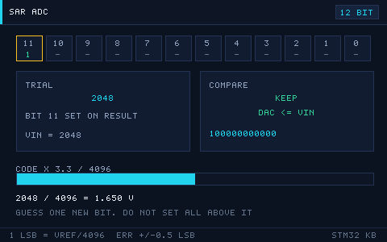
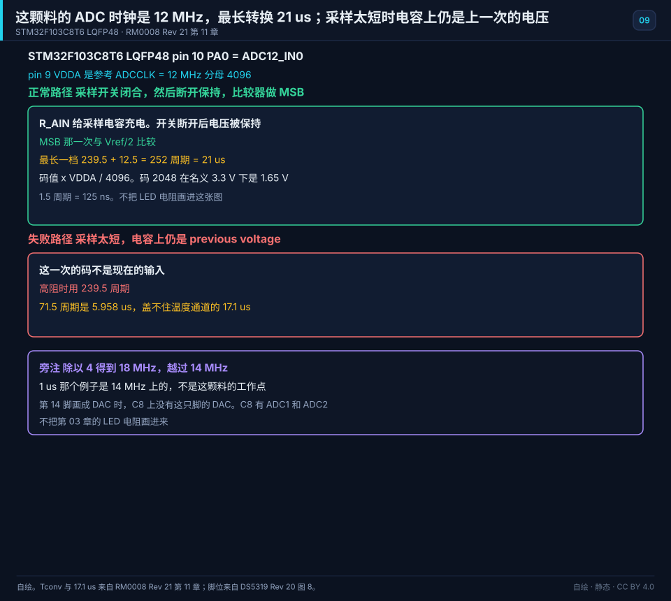
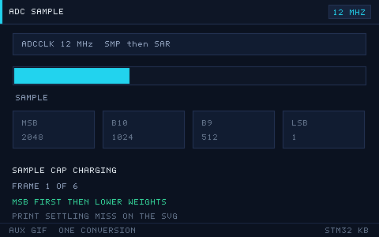

# 09 ADC 与 DAC

> English: [ADC and DAC](en/09-adc-dac.md)

> ADC 把模拟电压量化成数字量，DAC 把数字量还原成模拟电压，它们是 STM32 连接真实世界的两端。

<p align="center">
  
  <br><sub>▲ 动画：ADC 采样保持 + 逐次逼近（SAR）比较过程（作者自绘矢量动画，非实拍）</sub>
</p>

<!-- video:ch09 -->
<p align="center">
  <video width="640" controls poster="../assets/video/ch09-adc.png">
    <source src="../assets/video/ch09-adc.mp4" type="video/mp4">
  </video>
  <br><sub>▲ 本章讲解视频（2.6 分钟）。<a href="../assets/video/ch09-adc.mp4">MP4</a> · <a href="../assets/video/ch09-adc.srt">字幕</a></sub>
</p>

<details>
<summary>旁白文字稿</summary>

1. 逐次逼近之前，要先让采样电容充满。源阻抗越大，需要的采样时间越长。充不满就转换，读数会偏向你上一次采过的电压。
2. F1 的 ADC 是 12 位。换算时用读数除以 4096，再乘参考电压。用 4095 做口算会有一个最小步长的差别。参考电压不是想当然的 3.3，要看你接到哪。
3. STM32F103C8 有 ADC，没有 DAC。把 F4 的 DAC 例程抄过来，编译或许能过，引脚上不会出现你要的模拟电压。换芯片前先看数据手册的功能表。
4. 这一帧是仓库画的逐次逼近：从最高位开始试，比参考大了就清掉，再试下一位。它帮助你记得，转换需要时间，不是把引脚读进来就结束。
5. 引脚要设成模拟输入，ADC 时钟要开，规则通道和采样时间都要写上。少一项，读数会停在一个奇怪的常数。先读一个已知电压，比如分压后的参考，再去测传感器。
6. 连续采样不要在每个转换完成里做重活。让 DMA 把结果搬进数组，半满和全满时再去算。Wokwi 的 BluePill 模型没有 DMA，这章的连续采样要在真板上对。
7. 读数乱跳时，先看参考电压和模拟地，再谈软件平均。平均能盖住一点噪声，盖不住一根飞线当成天线。实验板上，传感器线短一点，结果会诚实很多。
8. 口诀：采样看阻抗，换算除以 4096，C8 没有 DAC。三句分别挡住采不准、算不准、抄错芯片这三件最常见的事。
9. 实验用电位器做分压，两端接地和参考，中间进 ADC。慢慢旋转，读数应该单调变化。跳变或反向，先查接线和参考，不要先改分辨率。
10. 合上书，三问。采样时间主要看什么？12 位换算要除以多少？STM32F103C8 有没有 DAC？

</details>
<!-- /video:ch09 -->

## 学习目标

读这一章之前：知道电压、二进制和十六进制是什么意思（不熟的话先读第 00 章的「零基础预备」），会用第 03 章的方法配置一只引脚，知道第 02 章里 PCLK2 是怎么分频得来的。

- [ ] 由码值算出电压：12 位 ADC 的分母是 4096，名义 3.3 V 下 1 LSB 约 0.806 mV
- [ ] 说清逐次逼近（SAR）ADC 的「采样—保持—比较」三步，以及一次转换为什么要「采样周期 + 12.5」个 ADC 时钟
- [ ] 按信号源阻抗选采样时间，并用 DS5319 的公式验算
- [ ] 用 HAL 写出单通道轮询程序：模拟输入、校准、配通道、启动、读数
- [ ] 读内部基准 VREFINT 反推 VDDA，读内部温度传感器看温度变化，并说出两者的误差有多大
- [ ] 说出多通道连续采集为什么要用扫描模式加 DMA
- [ ] 查清手上的芯片有没有 DAC：STM32F103C8 没有 DAC

## 核心原理

**一句话结论：ADC（Analog-to-Digital Converter，模数转换器）先把引脚电压存到片内一只小电容上，再比较 12 次，把它变成 0–4095 之间的一个码值；电压 = 码值 × VDDA / 4096。采样时间要够电容充满，参考电压要心里有数，而 STM32F103C8 只有 ADC，没有 DAC。**

### 先打个比方

把 ADC 想成一个用天平称东西的人。他有一套砝码：最大的一块是满量程的一半，下一块是四分之一，再下一块是八分之一，一共 12 块。

- **采样**：先把东西放上秤盘。要称的是电压，秤盘是片内的采样电容。放稳需要时间；还没放稳就开始称，读数就不对。
- **逐次逼近**：从最大的砝码试起。放上去，砝码那边沉了，说明砝码太重，拿下来；没沉就留着。再试下一块。12 块试完，盘里留下的砝码组合就是结果。
- **参考电压**：每块砝码的重量都按「满量程」折算。满量程（VDDA）变了，同一样东西称出来的读数也跟着变。

比方到这里为止。真实的 ADC 里没有砝码：「试一块砝码」是比较器拿保持住的电压，和片内按位生成的比较电压比一次；「放上秤盘」是采样开关合上后，信号源经过电阻给电容充电，快慢由信号源的阻抗决定。第 4 节给出具体数字。

### 1. 分辨率、参考电压与量化误差

**结论：12 位 ADC 把 0 到参考电压之间分成 4096 个台阶。名义 3.3 V 参考下，一个台阶（1 LSB）约 0.806 mV，理想的量化误差是 ±0.5 LSB。**

几个词先说清：

- **分辨率**：结果有几位二进制。12 位就是 2^12 = 4096 个码值，从 0 到 4095。
- **参考电压**：码值的满量程对应的电压。STM32F103C8 的参考就是模拟电源 VDDA，理由见本节末尾的提示。
- **LSB**（Least Significant Bit，最低有效位）：码值变 1 对应的电压，也就是一个台阶的高度。
- **量化误差**：真实电压落在两个台阶之间时，码值只能取其中一个，所以理想情况下最多差半个台阶。

| 分辨率 N | 台阶数 2^N | 参考 3.3 V 时的 1 LSB | 在哪见到 |
| --- | --- | --- | --- |
| 8 位 | 256 | 12.89 mV | 粗略测量 |
| 10 位 | 1024 | 3.22 mV | — |
| 12 位 | 4096 | 806 µV | STM32F1、F4 的 ADC |
| 16 位 | 65536 | 50.4 µV | H743 的 ADC 可选 16 位（RM0433 Rev 9） |

这张表这样读：分辨率每多 2 位，台阶就细 4 倍。台阶细不等于测得准，误差还来自参考电压和噪声，后面几节会一项项讲。

```text
1 LSB     = Vref / 2^N
电压      = 码值 × Vref / 2^N
量化误差  = ±0.5 LSB = ±Vref / 2^(N+1)        （理想 ADC，只算量化）
最大码值  = 2^N − 1 = 4095，对应 Vref − 1 LSB
```

算一个例子：名义 3.3 V，码值 2048。2048 × 3.3 / 4096 = 1.65 V，正好一半。拿 4095 当分母会得到 1.6504 V，差不到一个 LSB，但这不是手册的算法：DS5319 Rev 20 图 37 把理想的 1 LSB 定义为 VREF+ / 2^n。

> [!WARNING]
> STM32F103C8 的参考电压就是第 9 脚 VDDA。DS5319 Rev 20 表 47 注 3 写明：VFQFPN 和 LQFP 封装的 VREF+ 在片内接到 VDDA，VREF− 接到 VSSA。所以 VDDA 上的偏差和纹波会一比一进入读数。要测得准，要么给 VDDA 单独滤波，要么先读 VREFINT 反推 VDDA（第 8 节）。别的封装（例如 TFBGA64 有单独的 VREF+ 脚）以那颗料的引脚表为准。

### 2. 通道和引脚：信号从哪只脚进来

**结论：STM32F103C8 有 ADC1 和 ADC2 两只 ADC，共用 10 个外部通道（PA0–PA7、PB0、PB1）。ADC1 另有两个内部通道：16 号是温度传感器，17 号是内部基准 VREFINT。**

| 通道 | 引脚 / 来源 | 说明 |
| --- | --- | --- |
| IN0–IN7 | PA0–PA7 | PA0 在 LQFP48 第 10 脚 |
| IN8、IN9 | PB0、PB1 | — |
| IN16 | 片内温度传感器 | 只在 ADC1 上，先置 TSVREFE |
| IN17 | 片内基准 VREFINT（典型 1.20 V） | 只在 ADC1 上，同样先置 TSVREFE |

这张表这样用：先找信号接在哪只脚，再查它是几号通道，程序里写的是通道号。数据手册把这些脚写成 ADC12_INx，意思是 ADC1 和 ADC2 都能接。拿一只脚做模拟输入时，要把它配成模拟模式（第 03 章的 `GPIO_MODE_ANALOG`），数字输入电路关掉，电压原样送进 ADC。别的封装和别的系列，通道表以那颗料数据手册的引脚表为准。

### 3. 逐次逼近（SAR）原理：采样保持 + 二分比较

**结论：SAR（Successive Approximation Register，逐次逼近寄存器）ADC 用二分查找逼近输入电压。12 位结果要比较 12 次，从最高位（MSB）到最低位（LSB）一位一位定下来。**

一次转换分三步：

1. **采样**：采样开关合上。外部信号经过信号源自己的电阻 `R_AIN` 和片内开关电阻 `R_ADC`，给片内采样电容 `C_ADC` 充电，电容电压跟着输入走。
2. **保持**：开关断开，电容上的电压被冻住，后面比较时不再变。
3. **逐次逼近**：比较器先拿保持电压和 `Vref/2`（MSB 置 1）比，输入大就保留这一位，小就清掉；再比 `Vref/4`……一共 12 次，得到 12 位结果。

<p align="center">
  
  <br><sub>▲ 动画：SAR ADC 逐次逼近比较过程（程序生成光栅动画，非实拍）</sub>
</p>

所以一次转换的时间 = 采样时间 + 12.5 个 ADC 时钟（RM0008 Rev 21 第 11.6 节）。后面的 12.5 个周期留给逐次逼近，是固定的；前面的采样时间在 `ADC_SMPR1` / `ADC_SMPR2` 里按通道选，共 8 档：1.5 / 7.5 / 13.5 / 28.5 / 41.5 / 55.5 / 71.5 / 239.5 个 ADC 时钟（第 11.12.4、11.12.5 节）。

ADC 时钟（ADCCLK）由 PCLK2 分频得到，DS5319 Rev 20 表 47 规定它在 0.6–14 MHz 之间。在 12 MHz 下算两笔：

- 最短一档：1.5 + 12.5 = 14 个周期，14 / 12 MHz ≈ 1.17 µs。
- 最长一档：239.5 + 12.5 = 252 个周期，252 / 12 MHz = 21 µs。

RM0008 第 11.2 节写的「1 µs」是 ADC 时钟 14 MHz 时的数字：主频 56 MHz 时一次转换 1 µs，72 MHz 时 1.17 µs。原因是主频 72 MHz 时 ADC 时钟只能选 12 MHz（÷6）；选 ÷4 是 18 MHz，超过了 14 MHz 的上限。所以这颗料在 72 MHz 下到不了 1 MSPS。

### 4. 采样时间跟着源阻抗走

**结论：信号源的内阻越大，给采样电容充电越慢，采样时间就要选得越长。STM32F103C8 在 12 MHz 下：1 kΩ 选 7.5 周期，10 kΩ 选 13.5 周期，50 kΩ 选 55.5 周期；超过 50 kΩ 就在前面加一个运放跟随器。**

信号源阻抗 `R_AIN` 是从 ADC 引脚往外看、信号源那一侧的等效电阻。分压电路的源阻抗是两只电阻的并联：10 kΩ 电位器滑到正中间时最大，是 5 kΩ ∥ 5 kΩ = 2.5 kΩ。

DS5319 Rev 20 第 5.3.18 节的公式 1 给出误差小于 1/4 LSB 时允许的最大源阻抗：

```text
R_AIN < T_S / (f_ADC × C_ADC × ln(2^(N+2))) − R_ADC      T_S 是采样周期数
N = 12，ln(2^14) ≈ 9.704；C_ADC 最大 8 pF，R_ADC 最大 1 kΩ（表 47）
反过来写：采样时间 t_S > (R_AIN + R_ADC) × C_ADC × ln(2^14)
```

按反过来的式子算出常见信号源要的最短采样时间，再到 12 MHz 的 8 档里挑一档不短于它的：

| 源阻抗 R_AIN | 算出的最短采样时间 | 12 MHz 下选哪一档 |
| --- | --- | --- |
| 1 kΩ | (1 + 1) kΩ × 8 pF × 9.704 ≈ 155 ns | 7.5 周期（0.625 µs）；1.5 周期只有 125 ns，不够 |
| 2.5 kΩ（10 kΩ 电位器在正中间） | ≈ 272 ns | 7.5 周期 |
| 10 kΩ | ≈ 0.854 µs | 13.5 周期（1.125 µs） |
| 50 kΩ | ≈ 3.96 µs | 55.5 周期（4.625 µs） |
| 大于 50 kΩ | 超出表 47 的范围：R_AIN 最大 50 kΩ | 加运放跟随器，不要靠把采样拉到 239.5 周期硬撑 |

这张表这样用：先估出信号源阻抗，落在哪一行就选那一行的档位，宁长勿短。DS5319 表 48 在 14 MHz 下列出了每一档允许的最大 R_AIN（例如 13.5 周期是 11.4 kΩ）；12 MHz 下每个周期更长，允许的阻抗比表 48 略大。

采样太短，电容还没充到位就开始比较，读数会偏向电容上原来的电压，也就是上一次采过的那个通道的电压。扫描多个通道时，高阻通道最容易被前一个通道带偏；加长采样，或者在两个高阻通道之间插一个低阻通道。这一句是经验做法，手册里没有给数字。

### 5. 转换模式：单次、连续、扫描、间断

**结论：单次是要一个读数时转一次；连续是转完马上再转；扫描是按顺序表一次转好几个通道；间断是每次触发只转顺序表里的一小段。**

先认三个词：

- **规则组**（regular group）：平时排队转换的通道顺序表，最多 16 个，写在 `ADC_SQR1`–`ADC_SQR3` 里。所有规则通道共用一个结果寄存器 `ADC_DR`。
- **注入组**（injected group）：最多 4 个通道，能插队打断规则组，结果各放在自己的 `ADC_JDRx` 里。
- **触发**：让 ADC 开始转换的信号，可以是软件写 SWSTART 位，也可以是定时器事件或 EXTI 线。

| 模式 | 关键位 | 行为 | 典型场景 |
| --- | --- | --- | --- |
| 单次 | `ADC_CR2.CONT = 0` | 触发一次转一次，转完停下 | 隔一会儿看一次电池电压 |
| 连续 | `ADC_CR2.CONT = 1` | 转完立即重来，结果不断刷新 | 实时监测 |
| 扫描 | `ADC_CR1.SCAN = 1` | 按顺序表依次转多个通道；规则组要配 DMA 取数 | 多路传感器 |
| 间断 | `ADC_CR1.DISCEN = 1`，`DISCNUM` 选 1–8 个 | 每次触发只转顺序表里接下来的几个通道 | 分组采样 |
| 外部触发 | `ADC_CR2.EXTTRIG = 1`，`EXTSEL` 选来源 | 定时器或 EXTI 事件启动规则组 | 和 PWM 同步采样 |

这张表的前四行可以组合，例如「扫描 + 连续 + DMA」就是下一节的多通道采集。位名出自 RM0008 Rev 21 第 11.3 节和第 11.12 节。注意 SCAN 位在 `ADC_CR1`，不在 `ADC_CR2`。

### 6. 多通道与 DMA

**结论：多通道连续采集的标准做法是「扫描 + 连续 + DMA 循环搬运」：ADC 每转完一个通道，DMA 就把结果搬进内存数组，CPU 不用插手。**

DMA（Direct Memory Access，直接存储器访问）是专门搬数据的硬件，第 10 章细讲。这里只需要知道四件事：

- 扫描模式下，每转完一个通道，ADC 发一次 DMA 请求（`ADC_CR2.DMA = 1`），DMA 把 `ADC_DR` 搬进数组。RM0008 第 11.3.8 节要求规则组用扫描模式时必须置 DMA 位：所有规则通道共用一个 `ADC_DR`，不及时取走就会被下一个通道的结果盖掉。
- DMA 用循环模式，数组写满后自动回到开头，形成环形缓冲区。半满和全满各有一次中断，分别处理前一半和后一半。
- 数据对齐 `ADC_CR2.ALIGN`：右对齐（默认，低 12 位有效）或左对齐（高 12 位有效）。
- 只有 ADC1 能发 DMA 请求：RM0008 第 11.12.3 节 DMA 位的说明写的是只有 ADC1 和 ADC3 能产生 DMA 请求，而 C8 没有 ADC3。这颗料只有 DMA1，ADC1 接在通道 1。半字宽度和 CNDTR 计数这些 DMA 自己的算术留在第 10 章。

换系列时，下面这张表告诉你哪些结论还能用：

| 项 | F1（RM0008 Rev 21 第 11 章，DS5319 Rev 20） | F4（RM0090 Rev 22 第 13 章，DS8626 Rev 12） |
| --- | --- | --- |
| 分辨率 | 12 位 | 12 位，也可选 10、8、6 位 |
| 最快转换 | ADC 时钟 14 MHz 时 1 µs；主频 72 MHz 时 ADC 时钟 12 MHz，1.17 µs | 2.4 MSPS，三只 ADC 交替可到 7.2 MSPS |
| 规则组 / 注入组 | 16 / 4 | 16 / 4 |
| 转换时间 | 采样 + 12.5 个周期 | 采样 + 12 个周期 |
| 内部通道 | 温度 IN16、VREFINT IN17 | 温度、VREFINT、VBAT |
| 上电校准 | 要做 | 没有这一步 |

两列只有分辨率的 12 位和「16 / 4」相同，其余每一行搬到另一个系列都要重查。

### 7. 校准、模拟看门狗与注入组

**结论：F1 的 ADC 上电后要校准一次，放在第一次转换之前；模拟看门狗让电压越界才打断 CPU；注入组可以插队，不打乱规则组的 DMA。**

- **校准**：ADC 内部有一点固定的偏差，F1 提供自校准，把它量出来再扣掉。RM0008 第 11.4 节建议每次上电后校准一次，而且开始校准前 ADON 已经为 1 至少两个 ADC 时钟。DS5319 表 47 的校准时间 tCAL 是 83 个 ADC 时钟，12 MHz 下约 6.9 µs。HAL 函数是 `HAL_ADCEx_Calibration_Start`。
- **模拟看门狗**（Analog Watchdog）：设好上限和下限，转换结果越界才置标志、进中断，不用 CPU 每次去比。HAL 函数是 `HAL_ADC_AnalogWDGConfig`。它和第 11 章会复位芯片的看门狗无关，只是名字像。
- **注入组**：规则组的 DMA 照常跑，偶尔插一个通道，结果放在 `ADC_JDRx`，不进规则组的数组。HAL 函数是 `HAL_ADCEx_InjectedStart_IT`。规则组的 DMA 缓冲不要和注入结果混在一个数组里。
- **耗电**：DS5319 表 17、表 18 的注 2 写明，每只 ADC 在 ADON = 1 期间另外多耗 0.8 mA。不用时关掉 ADC，`HAL_ADC_Stop` 会把 ADON 清零。第 16 章进低功耗模式前要用到这一条。

### 8. 内部温度传感器与 VREFINT

**结论：ADC1 的 16 号通道是片内温度传感器，17 号通道是片内基准 VREFINT。VREFINT 可以用来反推实际的 VDDA；温度传感器适合看温度变化，不适合直接当温度计用。**

温度传感器（RM0008 Rev 21 第 11.10 节）：先置 `ADC_CR2.TSVREFE = 1` 打开两个内部通道，选通道 16，采样时间不少于 17.1 µs。

```text
V_SENSE = V25 − Avg_Slope × (T − 25)
T（°C） = (V25 − V_SENSE) / Avg_Slope + 25
DS5319 Rev 20 表 51：V25 = 1.34 / 1.43 / 1.52 V（最小 / 典型 / 最大）
                    Avg_Slope = 4.0 / 4.3 / 4.6 mV/°C
```

这组数这样读：V25 的范围是 ±0.09 V，除以 4.3 mV/°C，约等于 ±21 °C。RM0008 第 11.10 节也写明，这条直线的偏移随芯片不同，片与片之间最多差 45 °C，所以手册建议拿它检测温度变化，不要拿它测绝对温度。

VREFINT 是片内一个比较稳定的电压。它不随 VDDA 变，所以读它的码值就能反推 VDDA：

```text
VDDA     = VREFINT × 4096 / 码值(通道 17)
真实电压 = 码值(ch) × VDDA / 4096
DS5319 Rev 20 表 12：VREFINT = 1.16 / 1.20 / 1.24 V（−40 到 85 °C）
```

这组数这样读：VREFINT 本身有约 ±3.3% 的片间差，拿典型值 1.20 V 反推出的 VDDA 也带着差不多大的误差。它擅长抓住「VDDA 比刚才低了」这种变化。想更准，就在已知 VDDA 时读一次 VREFINT 的码值，算出这一片的 VREFINT 存下来，以后用它代替 1.20 V（这是常见做法，不是手册步骤）。采样时间：表 12 的 TS_vrefint 典型 5.1 µs、最大 17.1 µs，用 239.5 周期最稳。

> [!NOTE]
> F4 的数据手册（DS8626 Rev 12 表 70、表 73）在系统存储区里存了出厂校准值：TS_CAL1（30 °C）、TS_CAL2（110 °C）和 VREFIN_CAL。F103C8 没有这些值，只能用典型值，或者自己校准。

### 9. DAC 输出模式、缓冲器与噪声

**结论：DAC（Digital-to-Analog Converter，数模转换器）把码值变回电压。STM32F103C8 没有 DAC。F1 里只有大容量（F103xC/D/E）、超大容量（xF/xG）和互联型有 DAC：12 位、两路输出，输出电压 = VREF+ × DOR / 4096（RM0008 Rev 21 第 12 章、第 12.3.5 节）。**

| 特性 | 说明 | 关键位 / 寄存器 |
| --- | --- | --- |
| 分辨率 | 12 位（也可 8 位），两路各有一个转换器 | `DHR12Rx` / `DHR12Lx` / `DHR8Rx` |
| 输出缓冲 | 打开后能直接带负载 | `DAC_CR.BOFFx` |
| 触发 | 定时器 TRGO、EXTI 9 号线或软件触发更新输出 | `DAC_CR.TENx` / `TSELx` |
| 噪声 / 三角波 | 内置 LFSR 噪声和三角波发生器 | `DAC_CR.WAVEx` / `MAMPx` |
| DMA | 每路都能用 DMA 连续更新 | `DAC_CR.DMAENx` |

这张表只对有 DAC 的型号成立。读的时候注意三点：

- 缓冲器关掉时输出阻抗高，适合接高阻负载；打开后带载能力强，但输出摆不到 0 V 和 VREF+ 两端。输出阻抗、失调、能摆到多近，这些数字在那颗料自己的数据手册里（例如 F103xC/D/E 的 DS5792）。本书核对用的 DS5319 不含 DAC 参数，所以这里不给数字。
- 噪声来自 VDDA 纹波、数字开关的耦合、缓冲器噪声和量化噪声。精密场合在输出端加 RC 低通或运放缓冲（经验做法）。
- 要输出正弦或任意波形：定时器触发，加 DMA 循环搬一张查找表，触发频率决定输出频率。

STM32F103C8 上要模拟电压：用 PWM 加 RC 低通（第 05 章），或者外接 DAC 芯片。

口诀：**采样看阻抗，换算除 4096，C8 没有 DAC。**

## 硬件与接线

| 开发板 | 功能 | 引脚 | 备注 |
| --- | --- | --- | --- |
| BluePill | 电位器中间抽头 → ADC12_IN0 | PA0（LQFP48 第 10 脚） | 配成模拟输入 |
| BluePill | 模拟电源 / 参考、模拟地 | VDDA（第 9 脚）、VSSA（第 8 脚） | 板上已经接好，不用另接 |
| — | 温度传感器 / VREFINT | 片内，没有外部脚 | ADC1 通道 16 / 17，先开 TSVREFE |
| 有 DAC 的型号 | DAC_OUT1 | PA4 | STM32F103C8 的 PA4（第 14 脚）没有 DAC 功能 |

```text
3.3 V ──┐
        │
       [ ]  10 kΩ 电位器
       [ ]◀── 中间抽头 ── PA0（第 10 脚，ADC12_IN0，模拟输入）
       [ ]
        │
GND  ───┘

VDDA（第 9 脚）是参考电压，VSSA（第 8 脚）是模拟地
```

电位器两端只能接 3.3 V 和 GND，不能接 5 V：DS5319 表 47 规定输入电压在 0 到 VREF+ 之间，而 PA0 也没有标 FT（第 03 章）。

## 代码实现

下面这段程序每 200 ms 读三个通道：内部基准、PA0 上的电位器、内部温度传感器。结果放进全局变量，用调试器的 Watch 窗口看，不需要串口。

```c
/* adc_poll.c —— 轮询读 PA0、VREFINT 和温度传感器（HAL，STM32F103C8T6） */
#include "stm32f1xx_hal.h"

#define ADC_FULL_SCALE       4096.0f                     /* 12 位：2^12 个台阶 */
#define VREFINT_TYP_V        1.20f                       /* DS5319 表 12 典型值，范围 1.16–1.24 V */
#define V25_TYP_V            1.43f                       /* DS5319 表 51 典型值，范围 1.34–1.52 V */
#define AVG_SLOPE_V_PER_C    0.0043f                     /* DS5319 表 51 典型值 4.3 mV/°C */
#define VDDA_NOMINAL_V       3.3f                        /* 第一次读到 VREFINT 之前用名义值 */
#define POT_CHANNEL          ADC_CHANNEL_0               /* PA0 = ADC12_IN0 */
#define POT_SAMPLETIME       ADC_SAMPLETIME_13CYCLES_5   /* 12 MHz 下 1.125 µs，例程设定 */
#define INTERNAL_SAMPLETIME  ADC_SAMPLETIME_239CYCLES_5  /* 19.958 µs，盖住 17.1 µs */
#define POLL_TIMEOUT_MS      10U
#define LOOP_PERIOD_MS       200U

ADC_HandleTypeDef hadc1;

/* 在调试器里看这几个变量 */
volatile uint32_t g_pot_code;
volatile float    g_pot_v;
volatile float    g_vdda_v = VDDA_NOMINAL_V;
volatile float    g_temp_c;

void SystemClock_Config(void);
static void adc1_init(void);
static uint32_t adc1_read(uint32_t channel, uint32_t sampletime);
static void error_handler(void);

int main(void)
{
    HAL_Init();
    SystemClock_Config();          /* 72 MHz，ADCCLK = 72 / 6 = 12 MHz */
    adc1_init();

    while (1)
    {
        uint32_t ref = adc1_read(ADC_CHANNEL_VREFINT, INTERNAL_SAMPLETIME);
        if (ref != 0U)
        {
            g_vdda_v = VREFINT_TYP_V * ADC_FULL_SCALE / (float)ref;
        }

        g_pot_code = adc1_read(POT_CHANNEL, POT_SAMPLETIME);
        g_pot_v    = (float)g_pot_code * g_vdda_v / ADC_FULL_SCALE;

        uint32_t ts  = adc1_read(ADC_CHANNEL_TEMPSENSOR, INTERNAL_SAMPLETIME);
        float vsense = (float)ts * g_vdda_v / ADC_FULL_SCALE;
        g_temp_c     = (V25_TYP_V - vsense) / AVG_SLOPE_V_PER_C + 25.0f;

        HAL_Delay(LOOP_PERIOD_MS);
    }
}

static void adc1_init(void)
{
    GPIO_InitTypeDef io = {0};

    __HAL_RCC_GPIOA_CLK_ENABLE();
    __HAL_RCC_ADC1_CLK_ENABLE();

    io.Pin  = GPIO_PIN_0;
    io.Mode = GPIO_MODE_ANALOG;                          /* 关掉数字输入，电压原样进 ADC */
    HAL_GPIO_Init(GPIOA, &io);

    hadc1.Instance                   = ADC1;
    hadc1.Init.ScanConvMode          = ADC_SCAN_DISABLE; /* 一次只转一个通道 */
    hadc1.Init.ContinuousConvMode    = DISABLE;          /* 单次：转完就停 */
    hadc1.Init.DiscontinuousConvMode = DISABLE;
    hadc1.Init.ExternalTrigConv      = ADC_SOFTWARE_START;
    hadc1.Init.DataAlign             = ADC_DATAALIGN_RIGHT;
    hadc1.Init.NbrOfConversion       = 1;
    if (HAL_ADC_Init(&hadc1) != HAL_OK) { error_handler(); }

    /* F1 上电后校准一次，放在第一次转换之前 */
    if (HAL_ADCEx_Calibration_Start(&hadc1) != HAL_OK) { error_handler(); }
}

static uint32_t adc1_read(uint32_t channel, uint32_t sampletime)
{
    ADC_ChannelConfTypeDef ch = {0};
    uint32_t code = 0U;

    ch.Channel      = channel;
    ch.Rank         = ADC_REGULAR_RANK_1;
    ch.SamplingTime = sampletime;
    if (HAL_ADC_ConfigChannel(&hadc1, &ch) != HAL_OK) { error_handler(); }

    if (HAL_ADC_Start(&hadc1) != HAL_OK) { error_handler(); }
    if (HAL_ADC_PollForConversion(&hadc1, POLL_TIMEOUT_MS) == HAL_OK)
    {
        code = HAL_ADC_GetValue(&hadc1);
    }
    HAL_ADC_Stop(&hadc1);                                /* 清 ADON，省下 0.8 mA */
    return code;
}

void SystemClock_Config(void)
{
    RCC_OscInitTypeDef       osc  = {0};
    RCC_ClkInitTypeDef       clk  = {0};
    RCC_PeriphCLKInitTypeDef pclk = {0};

    osc.OscillatorType = RCC_OSCILLATORTYPE_HSE;
    osc.HSEState       = RCC_HSE_ON;
    osc.HSEPredivValue = RCC_HSE_PREDIV_DIV1;
    osc.PLL.PLLState   = RCC_PLL_ON;
    osc.PLL.PLLSource  = RCC_PLLSOURCE_HSE;
    osc.PLL.PLLMUL     = RCC_PLL_MUL9;                   /* 8 MHz × 9 = 72 MHz */
    if (HAL_RCC_OscConfig(&osc) != HAL_OK) { error_handler(); }

    clk.ClockType      = RCC_CLOCKTYPE_HCLK | RCC_CLOCKTYPE_SYSCLK
                       | RCC_CLOCKTYPE_PCLK1 | RCC_CLOCKTYPE_PCLK2;
    clk.SYSCLKSource   = RCC_SYSCLKSOURCE_PLLCLK;
    clk.AHBCLKDivider  = RCC_SYSCLK_DIV1;
    clk.APB1CLKDivider = RCC_HCLK_DIV2;                  /* 36 MHz */
    clk.APB2CLKDivider = RCC_HCLK_DIV1;                  /* 72 MHz */
    if (HAL_RCC_ClockConfig(&clk, FLASH_LATENCY_2) != HAL_OK) { error_handler(); }

    pclk.PeriphClockSelection = RCC_PERIPHCLK_ADC;
    pclk.AdcClockSelection    = RCC_ADCPCLK2_DIV6;       /* 72 / 6 = 12 MHz，不超过 14 MHz */
    if (HAL_RCCEx_PeriphCLKConfig(&pclk) != HAL_OK) { error_handler(); }
}

static void error_handler(void)
{
    __disable_irq();
    while (1) { }
}
```

逐段看：

- `RCC_ADCPCLK2_DIV6`：PCLK2 = 72 MHz 除以 6，得到 12 MHz 的 ADC 时钟。DS5319 表 47 规定 ADC 时钟不超过 14 MHz，除以 4 得到 18 MHz 就超了。时钟树见第 02 章。
- `GPIO_MODE_ANALOG`：PA0 配成模拟输入，数字输入电路和上下拉都断开。
- `ADC_SCAN_DISABLE` 加上 `ContinuousConvMode = DISABLE`：一次只转一个通道，转完停下，这就是单次模式。所以每次读之前用 `HAL_ADC_ConfigChannel` 换通道、设采样时间。
- `HAL_ADCEx_Calibration_Start`：F1 上电后校准一次，放在第一次 `HAL_ADC_Start` 之前。
- `ADC_CHANNEL_VREFINT` 和 `ADC_CHANNEL_TEMPSENSOR`：F1 HAL 的 `HAL_ADC_ConfigChannel` 配这两个通道时会顺手置 TSVREFE（这是 STM32CubeF1 HAL 源码的行为）。两者都用 239.5 周期，满足最长 17.1 µs 的采样要求。
- `if (ref != 0U)`：码值为 0 时不做除法，避免除零。
- 电压一律按 `码值 × VDDA / 4096` 换算，VDDA 用刚反推出来的值，不写死 3.3 V。
- `HAL_ADC_Stop`：每次读完把 ADON 清零，不转换的时候不多耗那 0.8 mA。
- `HAL_Delay` 靠 SysTick 中断计时；`SysTick_Handler` 里调用 `HAL_IncTick()`，由 CubeMX 生成在 `stm32f1xx_it.c` 里。

同一次单次转换的寄存器写法，可以对照 RM0008 第 11.12 节看每一位：

```c
/* 寄存器写法：ADC1 单次转换 PA0（通道 0），采样 13.5 周期 */
RCC->CFGR    = (RCC->CFGR & ~RCC_CFGR_ADCPRE) | RCC_CFGR_ADCPRE_DIV6;  /* 72 / 6 = 12 MHz */
RCC->APB2ENR |= RCC_APB2ENR_IOPAEN | RCC_APB2ENR_ADC1EN;
GPIOA->CRL   &= ~(GPIO_CRL_MODE0 | GPIO_CRL_CNF0);                       /* PA0 模拟输入 */

ADC1->SMPR2 = (ADC1->SMPR2 & ~ADC_SMPR2_SMP0) | (2U << ADC_SMPR2_SMP0_Pos); /* 010 = 13.5 周期 */
ADC1->SQR1  = 0U;                                   /* L = 0000：顺序表只有 1 个转换 */
ADC1->SQR3  = 0U;                                   /* SQ1 = 通道 0 */

ADC1->CR2 |= ADC_CR2_ADON;                          /* 第一次置 ADON：上电 */
HAL_Delay(1);                                       /* 等 tSTAB（表 47 最大 1 µs），也满足「至少两个 ADC 时钟」 */
ADC1->CR2 |= ADC_CR2_RSTCAL;
while (ADC1->CR2 & ADC_CR2_RSTCAL) { }              /* 复位校准寄存器 */
ADC1->CR2 |= ADC_CR2_CAL;
while (ADC1->CR2 & ADC_CR2_CAL) { }                 /* 校准完成，硬件清 CAL */

ADC1->CR2 |= ADC_CR2_EXTSEL | ADC_CR2_EXTTRIG;      /* EXTSEL = 111：由 SWSTART 触发 */
ADC1->CR2 |= ADC_CR2_SWSTART;                       /* 启动规则组 */
while (!(ADC1->SR & ADC_SR_EOC)) { }                /* 等转换结束 */
uint16_t code = (uint16_t)ADC1->DR;                 /* 读 DR 会清 EOC */
```

RM0008 第 11.3.1 节还允许第二次写 ADON = 1 来启动转换，但 `ADC_CR2` 的 ADON 位说明加了一句：同一次写里如果还改了别的位，转换不会启动。混着改位容易踩到这一条，所以上面用 SWSTART。

多通道连续采集用 DMA，完整代码见 [`examples/adc-dma/`](../examples/adc-dma/)：PA0、PA1、PA4 三个通道扫描，每个通道采样 55.5 周期，DMA1 通道 1 循环搬运。`HAL_ADC_Start_DMA` 之前同样要先校准；半传输回调里处理前一半，传输完成回调里处理后一半。

定时器触发（TRGO）让采样间隔不依赖主循环。下面是片段，TIM3 的时基初始化见第 05 章：

```c
/* TIM3 每次更新事件启动一次规则组转换 */
hadc1.Init.ExternalTrigConv = ADC_EXTERNALTRIGCONV_T3_TRGO;   /* EXTSEL = 100：TIM3_TRGO */
if (HAL_ADC_Init(&hadc1) != HAL_OK) { error_handler(); }

TIM_MasterConfigTypeDef mst = {0};
mst.MasterOutputTrigger = TIM_TRGO_UPDATE;
mst.MasterSlaveMode     = TIM_MASTERSLAVEMODE_DISABLE;
HAL_TIMEx_MasterConfigSynchronization(&htim3, &mst);

HAL_ADC_Start(&hadc1);        /* ADC 等 TIM3_TRGO */
HAL_TIM_Base_Start(&htim3);   /* 采样间隔 = TIM3 的更新周期 */
```

有 DAC 的芯片才用得上下面这段。STM32F103C8 的器件头文件里没有 DAC，`DAC_BASE` 没有定义，这段会被预处理器跳过；不要以为在 BluePill 上它做了什么：

```c
/* 片段：只在有 DAC 的型号上编译，例如 STM32F103RC；假定 hdac 已由 CubeMX 初始化 */
#if defined(DAC_BASE)
HAL_DAC_Start(&hdac, DAC_CHANNEL_1);
HAL_DAC_SetValue(&hdac, DAC_CHANNEL_1, DAC_ALIGN_12B_R, 2048); /* 2048 / 4096 = 1/2，名义 3.3 V 下是 1.65 V */
#endif
```

完整工程见 [`examples/adc-dma/`](../examples/adc-dma/)。

## 动手实验

1. **实验一：电位器读数随旋钮单调变化。** PA0 接 10 kΩ 电位器的中间抽头，两端接 3.3 V 和 GND，运行上面的程序。
   - 预期现象：`g_pot_code` 随旋钮从 0 附近单调变到 4095 附近；转到正中间时约 2048，`g_pot_v` 约 1.65 V。
   - 怎么确认：用万用表量 PA0 对 GND 的电压，和 `g_pot_v` 比。差几毫伏到十几毫伏属于正常（经验值），因为 VDDA 是靠 VREFINT 的典型值反推的。
   - 没成功先查：PA0 是不是模拟模式；ADC 时钟开了没有、是不是 12 MHz；电位器两端是否有一头没接，让中间抽头悬空。
2. **实验二：用 VREFINT 反推 VDDA。** 看 `g_vdda_v`，再拿万用表量第 9 脚 VDDA（BluePill 上就是 3.3 V 那排针）。
   - 预期现象：`g_vdda_v` 在 3.3 V 附近。VREFINT 有 1.16–1.24 V 的片间差，所以它和万用表可能差到 ±3% 左右。
   - 怎么确认：用「万用表读数 × 码值 / 4096」算出这一片的 VREFINT，填进 `VREFINT_TYP_V` 重新编译，两个数应该对上。再用可调电源把 VDDA 降到 3.0 V，`g_vdda_v` 应该跟着降。
   - 没成功先查：通道 17 是不是在 ADC1 上读的；采样时间是不是 239.5 周期；VDDA 是不是被写死成了 3.3。
3. **实验三：采样时间不够时读数被前一个通道带偏。** 用两只 100 kΩ 电阻做分压（源阻抗 100 kΩ ∥ 100 kΩ = 50 kΩ），中点接 PA1（ADC12_IN1），并把 PA1 配成模拟输入。电位器拧到 GND 一端，让 PA0 是 0 V。每次先读 PA0，紧接着读 PA1，PA1 分别用 1.5 周期和 55.5 周期各读 100 次。
   - 预期现象：1.5 周期时 PA1 的码值明显偏向 0 V 一侧，而且每次差得多；55.5 周期时稳定在 2048 附近（实际值随电阻误差略有出入）。
   - 怎么确认：每组算平均值和最大最小差。再去掉「先读 PA0」那一步，1.5 周期的偏差会明显变小，说明偏差来自上一个通道留在电容上的电压。
   - 没成功先查：分压电阻的实际阻值；PA1 是否配成了模拟输入；每次读 PA1 之前有没有重新 `HAL_ADC_ConfigChannel` 设采样时间。

## 自测

1. ADC 时钟 12 MHz，采样选 55.5 周期，一次转换要多久？换成 239.5 周期呢？
2. 两只 20 kΩ 电阻做分压（源阻抗 10 kΩ），接到 PA1。12 MHz 下最少选哪一档采样时间？为什么 1.5 周期不行？
3. 读到 VREFINT 的码值是 1520，按典型值算 VDDA 大约是多少？如果这一片的 VREFINT 实际是 1.16 V，算出的 VDDA 偏高还是偏低，偏多少？
4. 有人为了转得快，把 ADCPRE 从 ÷6 改成 ÷4，会发生什么？
5. 温度通道换算出 V_SENSE = 1.38 V，按典型值算是多少度？这个数能直接当室温用吗？

参考答案：

1. (55.5 + 12.5) / 12 MHz = 68 / 12e6 ≈ 5.67 µs；(239.5 + 12.5) / 12 MHz = 252 / 12e6 = 21 µs。
2. t_S > (10 + 1) kΩ × 8 pF × 9.704 ≈ 0.854 µs，乘 12 MHz 约 10.2 个周期，所以选 13.5 周期（1.125 µs）。1.5 周期只有 125 ns，电容充不到 1/4 LSB 以内，读数会偏向上一次的电压。
3. VDDA = 1.20 × 4096 / 1520 ≈ 3.234 V。实际 VREFINT 是 1.16 V 时，真实 VDDA = 1.16 × 4096 / 1520 ≈ 3.126 V，所以按 1.20 V 算出的 VDDA 偏高，高出 1.20 / 1.16 − 1 ≈ 3.4%。
4. ADC 时钟变成 72 / 4 = 18 MHz，超过 DS5319 表 47 的 14 MHz 上限，转换结果不再有保证。改回 ÷6，12 MHz。
5. T = (1.43 − 1.38) / 0.0043 + 25 ≈ 11.6 + 25 ≈ 36.6 °C。不能直接当室温：V25 的范围 1.34–1.52 V 就能带来约 ±21 °C 的偏差，RM0008 也写明片间偏移最多 45 °C，况且测的是芯片自己的温度。拿它看温度升了还是降了。

## 原理与适用范围

> [!NOTE]
> 从这一节到「常见坑与出处」是深入部分，把前面的结论落到具体订货号、手册章节和能复算的数字上。第一次读可以先跳过，做完动手实验再回来对照。

这一章的采样结论只钉在订货号 STM32F103C8T6（LQFP48）上，采样时钟用附录 D 的 12 MHz，换算分母用 4096。换到有 DAC 的型号，「这颗料没有 DAC」那一句作废；换到 F4，「采样再加 12.5」和上电校准那两句作废。

**时钟。**PCLK2 = 72 MHz，`ADCPRE=10`（÷6）得到 ADCCLK = 12 MHz；÷4 得到 18 MHz，越过 14 MHz。分频位的细节交叉引用第 02 章，这一章不重画时钟树。RM0008 在 14 MHz、采样 1.5 周期处给出 `Tconv = 1 µs`，那是上限上的例子；这颗料的工作点是 12 MHz，所以四块里不把 1 µs 和 21 µs 写进同一格。出处是 [RM0008 Rev 21 第 11 章](#source-rm0008-adc)。

**转换时间。**采样开关合上时，输入经源阻抗给采样电容充电；开关断开后，电容上的电压被保持，然后从 MSB 开始比较 12 次。转换时间是采样周期再加 12.5 个 ADCCLK。最长采样档 239.5 加 12.5 等于 252 个周期，`252 / 12e6 = 21 µs`。在 12 MHz 上：1.5 周期 = 125 ns，13.5 周期 = 1.125 µs，55.5 周期 = 4.625 µs，71.5 周期 = 5.958 µs，239.5 周期 = 19.958 µs。F4 的「采样再加 12 个周期」在这颗料上作废。

**温度与 VREFINT。**温度传感器的推荐采样时间是 17.1 µs，`17.1e-6 × 12e6 = 205.2` 个周期，所以 239.5 周期盖得住，71.5 周期盖不住。通道是 ADC1 的输入 16，VREFINT 是 ADC1 的输入 17。正文对 VREFINT 只写典型值 1.20 V，不编一块板子上的实测 VDDA。TSVREFE 在 `ADC_CR2`，双 ADC 器件上这一位只在 ADC1，ADC2 的通道 16 和 17 接到 VSS。温度公式是 `(V25 − VSENSE) / Avg_Slope + 25`；V25 ≈ 1.43 V、斜率 ≈ 4.3 mV/°C 是电气特性里的典型值，不是保证的校准，RM0008 Rev 21 第 11.10 节还写明片间偏移最多 45 °C。F4 的 `TS_CAL1`、`TS_CAL2`、`VREFIN_CAL` 在 F103C8 上作废。

**几只 ADC，有没有 DAC。**DS5319 写明中密度器件都有两个 12 位 ADC。C8 有 ADC1 和 ADC2，没有 ADC3，没有 DAC，`HAL_DAC_Start` 在这颗料上落空。F1 里只有大容量、超大容量和互联型才有 DAC（RM0008 Rev 21 第 12 章开头），F4 也有。核心原理第 9 节的缓冲器、噪声和三角波，只在换到有 DAC 的型号后成立。出处是 [DS5319 Rev 20](#source-ds5319-adc)。

**脚号与参考。**LQFP48 第 10 脚 PA0 = ADC12_IN0，第 9 脚 VDDA 就是参考：DS5319 Rev 20 表 47 注 3 写明 LQFP 封装的 VREF+ 在片内接到 VDDA、VREF− 接到 VSSA，这一封装没有单独的 VREF+ 脚。第 10 脚在第 03 章是点外接灯的电流脚；这一章把它当模拟输入时，第 03 章「写 1 输出电流」那一句同时作废，`sample-03-gpio-led.svg` 不重画。第 14 脚 PA4 在 C8 上是 ADC12_IN4 / SPI1_NSS，不是 DAC_OUT1；把 DAC 画在第 14 脚上是失败旁注。

**换算。**电压 = 码 × VDDA / 4096。名义 3.3 V 时 1 LSB = `3.3 / 4096 ≈ 0.806` mV，和核心原理表里的 806 µV 是同一笔账。码 2048 是 `2048 / 4096 = 1/2`，名义 3.3 V 下正好 1.65 V。分母用 4095 会让结果偏大，最多一个 LSB。

**校准。**RM0008 第 11.4 节：上电后做一次校准；置 `ADC_CR2` 的 CAL 之前，ADON 已经为 1 至少两个 ADC 时钟。HAL 侧是 `HAL_ADCEx_Calibration_Start`，放在 Start 之前。F4 没有这一步，换系列时这一句作废。

**DMA。**这里只交叉引用第 10 章和附录 D：这颗料只有 DMA1，ADC1 是通道 1。半字宽度和「已写 5 个采样」的算术不搬进这一章。

## 关键插图

<p align="center">
  
  <br><sub>▲ 自绘。STM32F103C8T6，LQFP48 第 10 脚 PA0 = ADC12_IN0，第 9 脚 VDDA 为参考。ADCCLK = 12 MHz。正常路径采样开关闭合再断开，比较器做 MSB 那一次，最长一档 239.5 + 12.5 = 21 µs，码值乘 VDDA / 4096。失败路径是采样太短，电容上仍是上一次的电压。旁注：÷4 得到 18 MHz，越过 14 MHz；第 14 脚被画成 DAC 时，C8 上没有这只脚的 DAC。不把第 03 章的 LED 电阻画进来。出处是 [RM0008 Rev 21 第 11 章](#source-rm0008-adc) 和 [DS5319 Rev 20 图 8](#source-ds5319-adc)。</sub>
</p>

<p align="center">
  
  <br><sub>▲ 网页和公众号辅图。只播放一次成功的采样和 MSB。印刷以静态主图为准。采样过短和 18 MHz 不在这条 GIF 上。</sub>
</p>

主图把一次转换画成两条路。上面是正常路径：采样开关合上、电容充够、开关断开，比较器做第一次（MSB）比较，结果乘 VDDA / 4096 变回电压。下面是失败路径：采样太短，电容上还留着上一次的电压，于是读数被上一个通道带偏，这正是实验三看到的现象。GIF 只播放成功的那一次。章首的 `adc-sar.svg` 是会动的辅图；核心原理第 3 节里的 `sar-adc.gif` 留在原处，像素不替换。

## 时序与状态

下面这张表的每一格都能用「周期数 ÷ 12 MHz」算回去：

| 行 | 采样周期数 | 采样时间 | 加 12.5 之后 |
| --- | --- | --- | --- |
| 最短 | 1.5 | 125 ns | 14 / 12e6 ≈ 1.17 µs |
| 最长 | 239.5 | 19.958 µs | 252 / 12e6 = 21 µs |
| 温度 | 239.5，不用 71.5 | 17.1 µs 需要 205.2 个周期 | 71.5 周期只有 5.958 µs，盖不住 |
| 失败 | — | — | ADCCLK = 18 MHz，越过 14 MHz。这一行不再除出另一套微秒去和 21 µs 并列 |
| 换算 | — | — | 码 2048 在名义 3.3 V 下是 1.65 V，分母 4096 |

时钟是 12 MHz。出处是 [RM0008 Rev 21 第 11 章](#source-rm0008-adc)。

一次软件触发的单次转换按这个顺序走：第一次置 ADON 让 ADC 上电，等 tSTAB（DS5319 表 47 最大 1 µs）；校准（83 个 ADC 时钟）；写 SWSTART；采样若干周期；12.5 个周期逐次逼近；EOC 置 1；读 `ADC_DR`，EOC 随之清零。清 ADON，ADC 回到掉电状态。

## 常见坑与出处

| 现象 | 原因 | 处理 | 出处 | 出处能证明的部分 |
| --- | --- | --- | --- | --- |
| 读数还停在上一次的电压附近 | 采样时间按错了时钟，或者对源阻抗来说太短 | 按 12 MHz 重算，加长采样；高阻时用 239.5 周期 | [RM0008](#source-rm0008-adc) | 转换时间 = 采样 + 12.5；12 MHz 下最长 252 周期是 21 µs |
| 为了更快把 ADC 设成 ÷4 | ADCPRE 选成了 ÷4 | 改回 ÷6，12 MHz | [RM0008](#source-rm0008-adc) | 14 MHz 是上限，18 MHz 越过它；1 µs 那个例子是 14 MHz 上的，不是这颗料的工作点 |
| 高阻传感器读数偏低、来回跳 | 源阻抗超过 50 kΩ，加长采样也不在规格内 | 前面加运放跟随器 | [DS5319](#source-ds5319) | 表 47：R_AIN 最大 50 kΩ；公式 1 把采样时间和源阻抗联系起来 |
| 温度通道噪声大、读数飘 | 采样盖不住 17.1 µs，或者通道开错了 | 采样至少覆盖 17.1 µs，用 ADC1 通道 16，并置 TSVREFE | [RM0008](#source-rm0008-adc) | 17.1 µs 在 12 MHz 上是 205.2 个周期；VREFINT 是 ADC1 通道 17；ADC2 的 16/17 接到 VSS |
| 上电后的读数整体偏一点 | 没校准 | Start 之前做一次校准 | [RM0008](#source-rm0008-adc) | 第 11.4 节：CAL 之前 ADON 已为 1 至少两个 ADC 时钟 |
| 换算值比按 4096 算的略高 | 分母用了 4095 | 分母用 4096 | [DS5319](#source-ds5319-adc) | 两只 ADC 都是 12 位，4096 = 2^12；参考是第 9 脚 VDDA |
| 扫描几个通道，数组里的结果互相覆盖 | 规则组扫描没开 DMA | 置 DMA 位，用 DMA1 通道 1 搬数 | [RM0008](#source-rm0008) | 第 11.3.8 节：规则组用扫描模式时必须置 DMA 位 |
| ADC2 开了 DMA，数组却一直不更新 | 只有 ADC1 能发 DMA 请求 | 多通道放在 ADC1 上 | [RM0008](#source-rm0008) | `ADC_CR2` 的 DMA 位说明：只有 ADC1 和 ADC3 能产生 DMA 请求 |
| 蓝药丸上调用了 HAL_DAC_Start，PA4 没有模拟电压 | 这颗 C8 没有 DAC | 要模拟电压用 PWM 加 RC，或换有 DAC 的型号 | [DS5319](#source-ds5319-adc) | 中密度有两个 12 位 ADC；没有 ADC3，没有 DAC；第 14 脚不是 DAC_OUT1 |
| 第 10 脚点过灯，采样却像在读推挽输出 | 脚还停在输出模式 | 采样前把这只脚配成模拟输入，不再按第 03 章输出电流 | [DS5319](#source-ds5319-adc) | LQFP48 第 10 脚 PA0 是 ADC12_IN0；不改写第 03 章那张 LED 图 |

扫描时通道之间的串扰没有单独放进这张表：「加长采样，或在两个高阻通道之间插一个低阻通道」是经验做法，RM0008 和 DS5319 都没有给数字，所以不当作手册数字引用。实验三可以亲眼看到它。

## 相关资源

- RM0008 第 11 章 ADC、第 12 章 DAC（大容量才有 DAC）。
- 数据手册 DS5319：ADC 引脚、采样时间与源阻抗。
- 示例：[`examples/adc-dma/`](../examples/adc-dma/)。
- 配图：[`assets/animations/adc-sar.svg`](../assets/animations/adc-sar.svg)、[`assets/gif/sar-adc.gif`](../assets/gif/sar-adc.gif)（作者自绘 / 程序生成，不是实拍）。

- 手机阅读版：[第 09 章 · ADC与DAC（公众号图文）](https://mp.weixin.qq.com/s/GCSYHfF66I5Qr88pK4rXIA)
