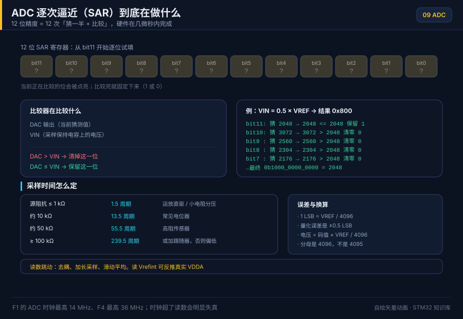

# 09 ADC 与 DAC

> English: [ADC and DAC](en/09-adc-dac.md)

> ADC 把模拟电压量化成数字量，DAC 把数字量还原成模拟电压，它们是 STM32 连接真实世界的两端。

<p align="center">
  
  <br><sub>▲ 动画：ADC 采样保持 + 逐次逼近（SAR）比较过程（作者自绘矢量动画，非实拍）</sub>
</p>

<!-- video:ch09 -->
<p align="center">
  <video width="640" controls poster="../assets/video/ch09-adc.png">
    <source src="../assets/video/ch09-adc.mp4" type="video/mp4">
  </video>
  <br><sub>▲ 本章讲解 2.6 分钟。配音是微软 Edge 在线神经语音「晓晓」（zh-CN-XiaoxiaoNeural），经 edge-tts 调用。edge-tts 大部分源码为 LGPLv3，srt_composer.py 为 MIT；声线模型是微软在线服务，不是开放模型。这里提交的是合成后的 MP4，离线可看。重新生成需要联网。画面用文泉驿微米黑绘制，插图是本仓库 SVG，不是实拍。 字幕：<a href="../assets/video/ch09-adc.srt">SRT</a>。由 <code>python3 tools/gen_narrated.py --speak</code> 用 ffmpeg 合成。</sub>
</p>

**旁白（与字幕、配音同一份稿）**

1. 逐次逼近之前，要先让采样电容充满。源阻抗越大，需要的采样时间越长。充不满就转换，读数会偏向你上一次采过的电压。
2. F1 的 ADC 是 12 位。换算时用读数除以 4096，再乘参考电压。用 4095 做口算会有一个最小步长的差别。参考电压不是想当然的 3.3，要看你接到哪。
3. STM32F103C8 有 ADC，没有 DAC。把 F4 的 DAC 例程抄过来，编译或许能过，引脚上不会出现你要的模拟电压。换芯片前先看数据手册的功能表。
4. 这一帧是仓库画的逐次逼近：从最高位开始试，比参考大了就清掉，再试下一位。它帮助你记得，转换需要时间，不是把引脚读进来就结束。
5. 引脚要设成模拟输入，ADC 时钟要开，规则通道和采样时间都要写上。少一项，读数会停在一个奇怪的常数。先读一个已知电压，比如分压后的参考，再去测传感器。
6. 连续采样不要在每个转换完成里做重活。让 DMA 把结果搬进数组，半满和全满时再去算。Wokwi 的 BluePill 模型没有 DMA，这章的连续采样要在真板上对。
7. 读数乱跳时，先看参考电压和模拟地，再谈软件平均。平均能盖住一点噪声，盖不住一根飞线当成天线。实验板上，传感器线短一点，结果会诚实很多。
8. 口诀：采样看阻抗，换算除以 4096，C8 没有 DAC。三句分别挡住采不准、算不准、抄错芯片这三件最常见的事。
9. 实验用电位器做分压，两端接地和参考，中间进 ADC。慢慢旋转，读数应该单调变化。跳变或反向，先查接线和参考，不要先改分辨率。
10. 合上书，三问。采样时间主要看什么？12 位换算要除以多少？STM32F103C8 有没有 DAC？
<!-- /video:ch09 -->
## 📌 学习目标

- [ ] 掌握分辨率、参考电压、量化误差的定量关系，能估算 1 LSB 对应的电压。
- [ ] 理解逐次逼近（SAR）ADC 的「采样—保持—比较」过程，会根据源阻抗选择采样时间。
- [ ] 会配置单次 / 连续 / 扫描 / 间断四种转换模式，并用 DMA 做多通道采集。
- [ ] 会用内部温度传感器与 Vrefint 反推芯片结温和真实 VDDA。
- [ ] 掌握 DAC 的输出模式、缓冲器开关对精度与噪声的影响。

## 🧠 核心原理

### 1. 分辨率、参考电压与量化误差

**结论**：12 位 ADC 在 3.3 V 参考下的最小可分辨电压（1 LSB）约为 **0.806 mV**；理想量化误差为 **±0.5 LSB**。

| 分辨率 N | 台阶数 2^N | Vref=3.3V 的 1 LSB | Vref=5.0V 的 1 LSB | 备注 |
| --- | --- | --- | --- | --- |
| 8 位 | 256 | 12.89 mV | 19.5 mV | 快速/粗略 |
| 10 位 | 1024 | 3.22 mV | 4.88 mV | — |
| 12 位 | 4096 | 806 µV | 1.22 mV | STM32F1/F4 主流 |
| 16 位 | 65536 | 50.4 µV | 76.3 µV | F3/G4/L4 等 |

计算公式：

```
1 LSB     = Vref / 2^N                          (N 位分辨率)
V_in      = ADC_Code × Vref / 2^N               (正比式读数)
量化误差   = ±0.5 LSB = ±Vref / 2^(N+1)          (理想 ADC，仅考虑量化)
满量程电压 = Vref × (2^N - 1) / 2^N ≈ Vref - 1 LSB
```

> ⚠️ STM32F1 的 `Vref` 就是 `VDDA`（模拟电源），二者共用引脚（100 脚以上封装才有独立 `VREF+`/`VREF-`）。所以 **VDDA 波动 = 读数直接误差**；精密测量要么外接基准，要么先测 Vrefint 做软件校准。

### 2. 逐次逼近（SAR）原理：采样保持 + 二分比较

**结论**：SAR ADC 用「二分查找」逼近输入电压，N 位需要 N 次比较，从 MSB 到 LSB 依次确定每一位。

转换过程（以 12 位为例）：

1. **采样（Sample）**：采样开关闭合，外部输入经 `R_AIN` 给内部采样电容 `C_ADC` 充电，`C_ADC` 电压跟随输入。
2. **保持（Hold）**：开关断开，`C_ADC` 电压被「冻结」，转换期间保持不变。
3. **逐次逼近（SAR）**：比较器先把 `Vref/2`（MSB 置 1）与保持电压比较；输入大则保留该位、小则清零，再比较 `Vref/4`…… 共 12 次得到 12 位结果。

<p align="center">
  
  <br><sub>▲ 动画：SAR ADC 逐次逼近比较过程（程序生成光栅动画，非实拍）</sub>
</p>

**采样时间与源阻抗**——最容易踩坑的地方。采样开关与信号源构成 RC 充电回路，必须在采样时间内把电容充到 1/2 LSB 以内。ST 给出的经验公式：

```
t_s(最小) ≈ (R_AIN + R_ADC) × C_ADC × ln(2^(N+2))
其中 STM32F1：R_ADC ≈ 1 kΩ，C_ADC ≈ 8 pF，N = 12 → ln(2^14) ≈ 9.7
```

| 信号源阻抗 R_AIN | 最小采样时间 t_s | F1 推荐 SMPx（ADCCLK=14 MHz） | 说明 |
| --- | --- | --- | --- |
| ≤ 1 kΩ | ≈ 78 ns | `000` = 1.5 周期（≈107 ns） | 运放直驱 / 分压电阻取小 |
| ≈ 10 kΩ | ≈ 0.78 µs | `010` = 13.5 周期（≈0.96 µs） | 常见电位器 |
| ≈ 50 kΩ | ≈ 3.9 µs | `101` = 55.5 周期（≈3.96 µs） | 高阻传感器 |
| ≈ 100 kΩ | ≈ 7.8 µs | `111` = 239.5 周期（≈17 µs） | 需放慢 ADCCLK |
| ≥ 1 MΩ | ≥ 78 µs | 239.5 周期仍不够 | **必须加电压跟随器缓冲** |

F1 的 `SMPx[2:0]` 可选：1.5 / 7.5 / 13.5 / 28.5 / 41.5 / 55.5 / 71.5 / 239.5 个 ADCCLK 周期（见 RM0008 第 11 章 ADC「通道采样时间」）。**源阻抗越大，采样时间要越长**，否则读数偏低且不稳。

### 3. 四种转换模式

**结论**：单次用于按需采样省电，连续用于实时监测，扫描用于多通道轮询，间断用于「一次触发转一组」。

| 模式 | 关键位 | 行为 | 典型场景 |
| --- | --- | --- | --- |
| 单次 Single | `CR2.CONT=0` + 软件/外部触发 | 触发一次转一次，转完停止 | 电池电压巡检 |
| 连续 Continuous | `CR2.CONT=1` | 转完立即重启，数据不断刷新 | 实时波形/监测 |
| 扫描 Scan | `CR2.SCAN=1` | 按 SQR 序列依次转多通道 | 多路传感器轮询 |
| 间断 Discontinuous | `CR1.DISCEN=1`、`DISCNUM` | 每次触发只转 n 个通道后暂停 | 分组采样 |
| 外部触发 | `CR2.EXTSEL`/`EXTTRIG` | 定时器/EXTI 触发规则组 | 与 PWM 同步采样 |

规则组（Regular）最多 16 个转换序列，注入组（Injected）最多 4 个且可打断规则组（用于电机电流的「紧急」采样）。

### 4. 多通道 + DMA

**结论**：多通道高速采集的标准姿势是「扫描模式 + 连续转换 + DMA 循环搬运」，CPU 完全不参与。

- 扫描模式下，每转完一个通道产生一次 DMA 请求（`CR2.DMA=1`），把 `DR` 搬到内存数组。
- DMA 用**循环模式**，数组自动回卷，形成环形缓冲区。
- 数据对齐 `CR2.ALIGN`：右对齐（默认，低 12 位有效）或左对齐（高 12 位有效，便于 16 位整型直接比较）。
- F1 只有 1 个 ADC（大容量型号才有 ADC3），ADC1/2 共享 DMA1 通道 1。

| 项 | F1（RM0008 第 11 章） | F4（RM0090 第 13 章） |
| --- | --- | --- |
| 分辨率 | 12 位 | 12 位 |
| 最大采样率 | 1 MSPS（ADCCLK=14 MHz） | 2.4 MSPS（三重交替可达 7.2 MSPS） |
| 规则通道 | 16 | 16 |
| 注入通道 | 4 | 4 |
| 转换时间 | t_s + 12.5 周期 | t_s + 12 周期 |
| 内部通道 | 温度 CH16、Vrefint CH17 | 温度、Vrefint、VBAT |

### 5. 内部温度传感器与 Vrefint

**结论**：温度传感器与 Vrefint 是 ADC 的「内部通道」，能免费拿到芯片结温和真实 VDDA，用来校准外部读数。

**温度（F1，RM0008 第 11 章「温度传感器」）**：先置 `CR2.TSVREFE=1` 使能，选通道 16。

```
V_sense = V25 - Slope × (T - 25)
=> T(°C) = (V25 - V_sense) / Slope + 25
F1 典型值：V25 ≈ 1.43 V，Slope ≈ 4.3 mV/°C
```

**Vrefint 反推 VDDA**：通道 17 测的是约 1.20 V 的固定内部基准。

```
VDDA      = 1.20 V × 4096 / ADC_Read(Vrefint_CH17)
真实 V_in = ADC_Read(ch) × VDDA / 4096
```

> F4/L4 等系列提供**出厂校准值** `TS_CAL1`(30°C)/`TS_CAL2`(110°C) 与 `VREFINT_CAL`，存于系统存储区，直接读取即可，精度远高于查典型值。

### 6. DAC 输出模式、缓冲器与噪声

**结论**：F1 DAC 为 12 位、双通道，输出电压 `V_out = Vref × DOR / 4096`；输出缓冲器能增强带载能力，但会引入失调且无法满摆幅。

| 特性 | 说明 | 关键位/寄存器 |
| --- | --- | --- |
| 分辨率 | 12 位，双通道 DAC1/DAC2 | `DHR12Rx`/`DHR12Lx`/`DHR8Rx` |
| 输出缓冲 | 使能后可驱动一定负载，输出不能到 0 V/VDDA 轨 | `DAC_CR.BOFFx` |
| 触发模式 | 定时器/EXTI 触发更新，可配三角波/噪声 | `DAC_CR.TSELx`/`TENx` |
| 噪声/三角波 | 内置 LFSR 噪声与三角波发生器 | `DAC_CR.WAVEx`/`MAMPx` |
| DMA | 支持 DMA 连续更新（配合定时器做任意波形） | `DAC_CR.DMAENx` |

- **缓冲器关闭**时输出阻抗高（≈15 kΩ），可接近满摆幅，适合高阻负载；**开启**时带载强，但失调典型 ±10 mV、且无法到轨。
- 噪声来源：VDDA 纹波、数字开关耦合、缓冲器噪声、LSB 量化噪声。精密场合建议外部加 RC 低通或运放缓冲。
- 产生正弦/任意波形：定时器触发 + DMA 循环搬运查找表，触发频率决定输出频率。

> F103C8（BluePill 常见型号）**没有 DAC**。DAC 从 F103 大容量（xC/xD/xE）和 F4 才有。中容量片子要模拟电压，用 PWM 加 RC，或者外接 DAC 芯片。

## 🛠️ 硬件与接线

| 开发板 | 功能 | 引脚 | 备注 |
| --- | --- | --- | --- |
| BluePill / Nucleo F103 | ADC1_IN0 | PA0 | 模拟输入，别再当 GPIO 用 |
| 同上 | 内部温度 / Vrefint | 无外部脚 | F1 通道 16 / 17，先开 TSVREFE |
| 有 DAC 的型号 | DAC_OUT1 | PA4 | F103C8 没有这个脚的 DAC 功能 |

信号源阻抗按上一节的采样时间表来选。高阻传感器先加跟随器，不要靠把采样时间拉到 239.5 周期硬撑。

## 💻 代码实现

**结论**：F1 在启动转换前必须做一次校准；多通道连续采集用 DMA，单次慢信号用轮询就够。

```c
HAL_ADCEx_Calibration_Start(&hadc1);          /* F1 必做；F4 没有这一步 */
HAL_ADC_Start(&hadc1);
HAL_ADC_PollForConversion(&hadc1, 10);
uint16_t code = HAL_ADC_GetValue(&hadc1);
/* 电压 = code * VDDA / 4096 ，分母是 4096 不是 4095 */
```

多通道循环搬运见 [`examples/adc-dma/`](../examples/adc-dma/)：`HAL_ADC_Start_DMA` 之前同样要先校准。半传输回调里处理前一半，完成回调里处理后一半。

定时器触发（TRGO）让采样间隔不依赖主循环：

```c
TIM_MasterConfigTypeDef mst = {0};
mst.MasterOutputTrigger = TIM_TRGO_UPDATE;
mst.MasterSlaveMode     = TIM_MASTERSLAVEMODE_DISABLE;
HAL_TIMEx_MasterConfigSynchronization(&htim3, &mst);
/* ADC 外部触发源选 TIM3_TRGO，再 HAL_ADC_Start */
```

有 DAC 的芯片才写下面这段。F103C8 调用会落空，不要在 BluePill 上照抄：

```c
HAL_DAC_Start(&hdac, DAC_CHANNEL_1);
HAL_DAC_SetValue(&hdac, DAC_CHANNEL_1, DAC_ALIGN_12B_R, 2048); /* 约 VREF/2 */
```

## ⚠️ 常见坑与排查

| 现象 | 原因 | 解决 |
| --- | --- | --- |
| 读数整体偏低、乱跳 | 采样时间短于源阻抗 | 加长采样，或加跟随器 |
| 换算比万用表高一截 | 用了 /4095 | 改成 code × VREF / 4096 |
| F1 上电第一次就偏 | 没校准 | `HAL_ADCEx_Calibration_Start` 放在 Start 之前 |
| 通道互相串扰 | 扫描时前一通道还没放完电 | 高阻通道加长采样，或插入间隔 |
| 以为 BluePill 能出模拟电压 | C8 没有 DAC | 改 PWM+RC，或换大容量 / F4 |
| DMA 缓冲区只有新的一半 | 半字传输却按字节数理解 HT | 4 个半字 = 8 字节，见第 10 章 |

## 🧪 动手实验

1. **电位器**：PA0 接 10 kΩ 电位器中间抽头，两端接 3.3 V 和 GND。串口打印码值和 `code * 3.3f / 4096`。预期：拧到头接近 0 和 3.3 V，中间约 1.65 V（码值约 2048）。
2. **内部基准**：读 Vrefint，用 `VDDA = 1.20f * 4096 / code` 反推。预期：USB 供电时 VDDA 在 3.3 V 附近，具体数字以你的表为准，这里不给“标准实测值”。
3. **采样时间对比**：同一高阻分压，分别用 1.5 和 239.5 周期各读 100 次。预期：短采样均值偏低、方差大。

### 7. 校准、模拟看门狗、注入通道

**结论**：校准只在 F1 上电后做一次；模拟看门狗负责“越界才打断 CPU”；注入通道可以插队，不打乱规则组的 DMA。

| 功能 | 什么时候用 | HAL |
| --- | --- | --- |
| 校准 | F1 每次上电、Start 之前 | `HAL_ADCEx_Calibration_Start` |
| 模拟看门狗 | 电压超窗再进中断 | `HAL_ADC_AnalogWDGConfig` |
| 注入组 | 规则组 DMA 跑着，偶尔插一个通道 | `HAL_ADCEx_InjectedStart_IT` |

注入组最多 4 个通道。规则组的 DMA 缓冲不要和注入结果混在同一个数组里。

### 8. 通道和引脚（F103 ADC1）

| 通道 | 引脚 / 来源 |
| --- | --- |
| IN0 ~ IN7 | PA0 ~ PA7 |
| IN8、IN9 | PB0、PB1 |
| IN16 | 片内温度传感器 |
| IN17 | Vrefint（约 1.20 V） |

别的封装和 F4 的通道表以数据手册的 Pinout 为准，不要拿这张表去套 H7。

### 9. 自测

1. 12 位、VREF = 3.3 V，码值 2048 对应多少伏？为什么不是 `2048/4095*3.3`？
2. SAR 试探 bit10 时，已经保留 bit11，试探值应该是 3072 还是 1024？
3. 为什么 F103C8 的工程里不该出现 `HAL_DAC_Start`？

口诀：**采样看阻抗，换算除 4096，C8 没有 DAC。**

## 🔗 相关资源

- RM0008 第 11 章 ADC、第 12 章 DAC（大容量才有 DAC）。
- 数据手册 DS5319：ADC 引脚、采样时间与源阻抗。
- 示例：[`examples/adc-dma/`](../examples/adc-dma/)。
- 配图：[`assets/animations/adc-sar.svg`](../assets/animations/adc-sar.svg)、[`assets/gif/sar-adc.gif`](../assets/gif/sar-adc.gif)（作者自绘 / 程序生成，不是实拍）。