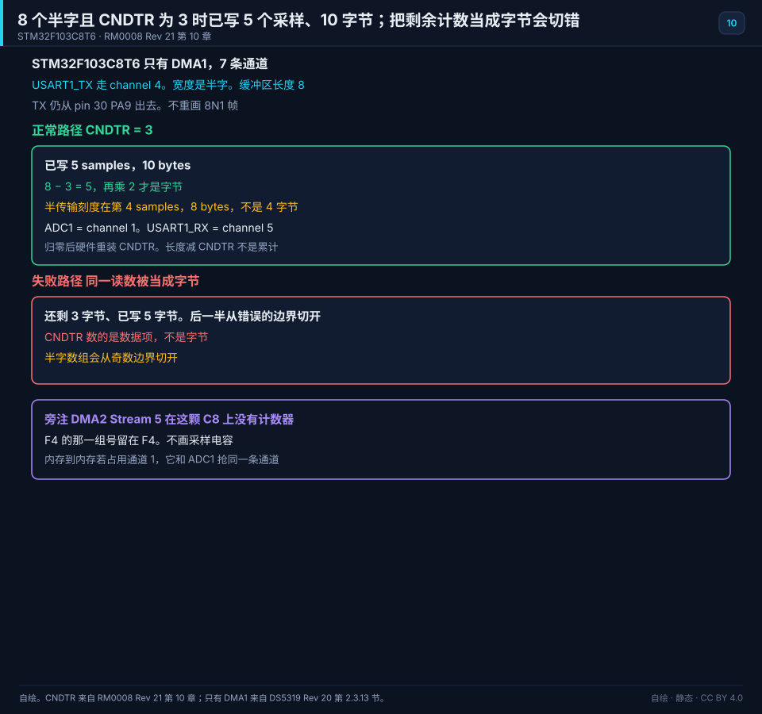
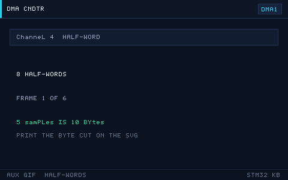

# 10 DMA

> English: [DMA](en/10-dma.md)

> DMA（直接存储器访问）让外设与内存之间的数据自动搬运，CPU 不必逐字节参与，从而把算力留给计算本身。

<p align="center">
  
  <br><sub>▲ 动画：DMA 循环模式搬运 ADC 数据，CPU 同时执行其他任务（作者自绘矢量动画，非实拍）</sub>
</p>

<!-- video:ch10 -->
<p align="center">
  <video width="640" controls poster="../assets/video/ch10-dma.png">
    <source src="../assets/video/ch10-dma.mp4" type="video/mp4">
  </video>
  <br><sub>▲ 本章讲解 2.6 分钟。配音是微软 Edge 在线神经语音「晓晓」（zh-CN-XiaoxiaoNeural），经 edge-tts 调用。edge-tts 大部分源码为 LGPLv3，srt_composer.py 为 MIT；声线模型是微软在线服务，不是开放模型。这里提交的是合成后的 MP4，离线可看。重新生成需要联网。画面由脚本和本仓库 SVG 生成，不是实拍。 视频：<a href="../assets/video/ch10-dma.mp4">MP4</a> · 字幕：<a href="../assets/video/ch10-dma.srt">SRT</a>。由 <code>python3 tools/gen_narrated.py --speak</code> 用 ffmpeg 合成。</sub>
</p>

**旁白（与字幕、配音同一份稿）**

1. DMA 是搬运工。外设来了新数据，或者内存里有一包要送出去，它可以自己搬，CPU 继续算别的。前提是你把源、目的和数量写对。
2. 剩余数量记在 NDTR 里。它减到 0，这一轮就搬完了。循环模式下，硬件会把数量装回去，指针也回到起点。你不用在中断里手动重置。
3. 半传输标志按元素个数算。如果每个元素是半字，两个字节，你要再乘 2 才是字节数。用字节去切半字数组，后半段会从奇数地址开始，读出来是错的。
4. 这一帧是仓库画的循环搬运。写指针走到头就绕回来，旧数据会被新数据盖住。你如果处理得比 DMA 慢，就会丢一圈。速度要算得过，不能只看灯还在闪。
5. 外设数据宽度、内存宽度、地址增不增加，三项要和真实的寄存器一致。ADC 结果是半字，你却按字节去增地址，内存里会插进一堆空隙。
6. 半满的时候可以处理前半段，全满的时候处理后半段。中断里只做这个切换和必要的计算，不要阻塞。一阻塞，下一圈 DMA 已经把你还没看的数据盖掉了。
7. F103 没有数据缓存，DMA 和 CPU 看的是同一份内存。到了带缓存的 H7，CPU 看到的数组可能和总线上的不一样。那一章会再提，这里先把 F1 的搬运做对。
8. 口诀：剩下的在 NDTR；半字的半传输按元素算，再乘 2 才是字节。调试时把 NDTR 打出来，比猜「DMA 是不是坏了」快得多。
9. 实验让 DMA 把一串数搬进数组，断点时后半段应该已经变了，NDTR 也在减小。数组纹丝不动，先查通道、方向和使能，别先改算法。
10. 合上书，三问。NDTR 里装的是地址还是剩余数量？循环模式谁把指针拨回去？半字传输的半满，怎样换成字节数？
<!-- /video:ch10 -->

## 原理与边界

这一章的 DMA 结论只钉在订货号 STM32F103C8T6 上。通道号和半字账整格照抄附录 D。

这颗中密度有一个 DMA，7 条通道。分类表里「DMA2（5 通道，大容量）」在 STM32F103C8T6 上作废。见 [DS5319 Rev 20 第 2.3.13 节](#source-ds5319-dma)。F4 的 Stream 和 Channel 是另一本手册：USART1_RX 在 DMA2 Stream 5、Channel 4，FIFO 是 4 个 32 位字。把这组号写进 C8，计数器不动。见 [RM0090](#source-rm0090)。不改那条已有对象。

ADC1 = DMA1 通道 1。USART1_TX = DMA1 通道 4。USART1_RX = DMA1 通道 5。四块只主张附录 D 这三行。见 [RM0008 Rev 21 第 13 章](#source-rm0008-dma)。

缓冲区 8 个半字，`CNDTR` 读回 3：已经写入 `8 − 3 = 5` 个采样，字节数是 `5 × 2 = 10`。半传输发生在 4 个采样，也就是 8 字节，不是 4 字节。把 `CNDTR` 当成剩余字节，会把「还剩 3」读成 3 字节。这是主图的失败路径。

计数归零后硬件重装 `CNDTR`。`长度 − CNDTR` 不是累计进度。位置仍用回调里的 `Size` 和 `old_pos`，这句与附录 A 同一笔，不改附录 A。

F1 的 DMA 控制器是 AHB 主机，外设寄存器在 APB。F1 没有 D-Cache。H7 的 Cache 维护留在核心原理，不进这颗料的四块规范主张。

USART1_TX 仍是第 06 章的第 30 脚 PA9。本图只旁注通道号，不重画那一帧。ADC 的采样时间留在第 09 章。

## 关键插图

<p align="center">
  
  <br><sub>▲ 自绘。STM32F103C8T6，只有 DMA1。USART1_TX 走通道 4，宽度是半字，缓冲区长度 8。CNDTR = 3 时已写 5 个采样、10 字节。半传输在第 4 个采样、8 字节。失败路径把同一读数当成字节。TX 仍从第 30 脚 PA9 出去。DMA2 Stream 5 在这颗 C8 上没有计数器。出处是 [RM0008 Rev 21 第 13 章](#source-rm0008-dma) 和 [DS5319 Rev 20 第 2.3.13 节](#source-ds5319-dma)。</sub>
</p>

<p align="center">
  
  <br><sub>▲ 网页和公众号辅图。只播放正常路径：CNDTR 减到 3，标出已写 5 个采样、10 字节。印刷以静态主图为准。把剩余计数当成字节不在这条 GIF 上。</sub>
</p>

`dma-circular.svg` 和 `dma-ring.gif` 留在原节，标成辅图。

## 时序或状态

| 长度 | 宽度 | CNDTR | 已写采样 | 已写字节 |
| --- | --- | --- | --- | --- |
| 8 | 半字 | 3 | 5 | 10 |
| 8 | 半字 | 半传输 | 4 | 8，不是 4 字节 |
| 8 | 被当成字节 | 3 | 错切 | 还剩 3 被读成 3 字节 |
| USART1_TX | DMA1 通道 4 | — | — | 第 30 脚 PA9 |
| USART1_RX | DMA1 通道 5 | — | — | 不是 DMA2 Stream 5 |
| ADC1 | DMA1 通道 1 | — | — | 和内存到内存示例抢这一条通道 |
| 作废 | DMA2 Stream 5 | 这颗料上没有计数器 | — | F4 的 FIFO 是 4 个 32 位字，不证明 C8 有 DMA2 |
| 循环 | 归零后重装 | 重装后的 CNDTR | 不是累计 | `长度 − CNDTR` 不是进度 |

## 坑与出处卡

| 现象 | 原因 | 处理 | 出处 | 该来源允许支持的主张 |
| --- | --- | --- | --- | --- |
| 半字数组后一半看起来像新数据 | 半传输被当成 4 字节 | 半传输按 4 个采样、8 字节处理 | [RM0008](#source-rm0008-dma) | `CNDTR` 数的是数据项。8 个半字里已写 5 个是 10 字节。半传输不是 4 字节 |
| `CNDTR` 读回 3，字节数却对不上 | 剩余计数被当成字节 | 先减采样个数，再乘 2 | [RM0008](#source-rm0008-dma) | 剩余 3 个半字不是剩余 3 字节 |
| 配了 DMA2 Stream 5，C8 上不动 | 这颗料没有 DMA2 | USART1_RX 改用 DMA1 通道 5 | [DS5319](#source-ds5319-dma) | 这颗中密度只有一个 7 通道的 DMA1。DMA2 在 C8 上作废 |
| 对照 F4 例程时通道号能对上，板上不对 | F4 的编号被写进了 C8 | F4 那一组号留在 F4 | [RM0090](#source-rm0090) | F4 的 USART1_RX 是 DMA2 Stream 5、Channel 4。FIFO 是 4 个 32 位字。这条不证明 C8 有 DMA2 |
| 循环模式下进度越算越大 | 用了 `长度 − CNDTR` 当累计 | 进度用回调里的写位置 | [RM0008](#source-rm0008-dma) | 计数归零后硬件重装。进度用回调里的写位置 |

## 📌 学习目标

- [ ] 说清 DMA 控制器结构：F1 的「通道」模型与 F4 的「流（Stream）× 通道（Channel）」模型。
- [ ] 会查请求映射表，把外设请求接到正确的通道/流。
- [ ] 掌握外设↔内存、内存↔内存、普通/循环、FIFO（F4）、双缓冲。
- [ ] 会用传输完成（TC）/半传输（HT）中断实现「边收边处理」。
- [ ] 理解 DMA 与 CPU 的总线争抢，以及 H7/F7 的 Cache 一致性问题。

## 🧠 核心原理

### 1. 控制器结构：F1 的「通道」 vs F4 的「流×通道」

**结论**：F1 一个外设请求固定绑到某条 DMA 通道；F4 先把请求绑到「流」，再用 `CHSEL` 选通道，灵活性更高。

| 项 | STM32F1（RM0008 第 13 章 DMA 控制器） | STM32F4（RM0090 第 9 章 DMA 控制器） |
| --- | --- | --- |
| 控制器 | DMA1（7 通道）。DMA2（5 通道）是大容量的句子，在 STM32F103C8T6 上作废 | DMA1/DMA2 各 8 个 Stream |
| 请求绑定 | 每通道固定服务若干外设（查映射表） | 每个 Stream 有 8 个 Channel，`SxCR.CHSEL` 选择 |
| 优先级 | 通道间固定优先级 + 软件优先级 | 软件优先级 4 级 + 流编号仲裁 |
| FIFO | 无 | 有（4×32 位），支持突发（burst） |
| 双缓冲 | 无 | 有（Double Buffer Mode） |
| 数据宽度 | 8/16/32 位 | 8/16/32 位 |
| 内存↔内存 | 支持（`CCR.MEM2MEM`） | 支持 |

### 2. 请求映射表（选对通道/流是关键）

**F1 DMA1 请求映射（节选，完整见 RM0008 表 78 / 表 79）**：

| 通道 | 主要请求（节选） |
| --- | --- |
| CH1 | ADC1、TIM2_CH3、TIM4_CH1 |
| CH2 | SPI1_RX、USART3_TX、TIM1_CH1、TIM3_CH3 |
| CH3 | SPI1_TX、USART3_RX、TIM3_CH4、TIM3_UP |
| CH4 | SPI2/I2S2_RX、USART1_TX、I2C2_TX、TIM1_CH4 |
| CH5 | SPI2/I2S2_TX、USART1_RX、I2C2_RX、TIM1_UP |
| CH6 | USART2_RX、I2C1_TX、TIM1_CH3、TIM3_CH1 |
| CH7 | USART2_TX、I2C1_RX、TIM2_CH2、TIM2_CH4、TIM4_UP |

**F4 典型请求（RM0090 表 42 / 表 43）**：

| 外设请求 | 控制器/流 | Channel |
| --- | --- | --- |
| ADC1 | DMA2 Stream0/4 | CH0 |
| SPI1_RX | DMA2 Stream0/2 | CH3 |
| SPI1_TX | DMA2 Stream3/5 | CH3 |
| USART1_TX | DMA2 Stream7 | CH4 |
| USART1_RX | DMA2 Stream5 | CH4 |
| TIM1_CH1 | DMA2 Stream1/5 | CH6 |

> 记忆技巧：**F4 里同一外设 TX/RX 往往用不同 Stream，但同一 Channel**；查表时先定 Stream 再定 Channel。

### 3. 传输方向与工作模式

| 模式/配置 | 关键位 | 说明 |
| --- | --- | --- |
| 外设→内存 | `DIR=0`（F4）/ `CCR.DIR` | ADC/UART_RX 到数组 |
| 内存→外设 | `DIR=1` | 数组到 UART_TX/DAC |
| 内存→内存 | `MEM2MEM=1` | 快速 memcpy（F1 也支持） |
| 普通模式 | `CIRC=0` | 搬完 N 个就停（产生 TC 中断） |
| 循环模式 | `CIRC=1` | 搬完自动回卷，持续刷新 |
| 指针增量 | `PINC`/`MINC` | 内存一般增，外设寄存器不增 |
| 数据宽度 | `PSIZE`/`MSIZE` | 源/目标可不同宽，DMA 自动打包 |
| 优先级 | `PL` | 低 / 中 / 高 / 最高 |
| FIFO / 突发 | `FCR`（F4） | 攒够再走总线，减少占用 |
| 双缓冲 | `DBM`（F4） | 两个内存区交替，处理与搬运并行 |

### 4. 中断

| 中断 | 触发时机 | 用途 |
| --- | --- | --- |
| TC（传输完成） | 搬完全部 N 个 | 数据处理完毕 |
| HT（半传输） | 搬完 N/2 个 | 双缓冲「前半满」处理 |
| TE（传输错误） | 总线错误 | 排查配置 |
| DME / FE（F4） | 直接模式错误 / FIFO 错误 | 高级排查 |

「半传输 + 循环模式」是经典组合：DMA 填前半区时 CPU 处理后半区，反之亦然，实现无缝流式处理。

### 5. 总线争抢与 Cache 一致性

- **总线争抢**：DMA 与 CPU 共享总线矩阵。DMA 搬运时会周期性占用总线，极端情况下拖慢 CPU。F4 的 FIFO/突发模式能把多次小传输合并，减少总线占用。
- **Cache 一致性（H7/F7）**：若内存开了 D-Cache，DMA 直接写内存可能绕过 Cache，导致 CPU 读到旧值；CPU 写内存也可能还停在 Cache 里没落到 RAM，DMA 读到旧值。解决办法：把 DMA 缓冲区放到 **非 Cache 区（MPU 配 Non-Cacheable）**，或搬运前后调用 `SCB_CleanDCache_by_Addr` / `SCB_InvalidateDCache_by_Addr`。**F1/F4 无 D-Cache，不存在此问题。**
- **FIFO 阈值**：F4 上偶发数据错，是因为 FIFO 未配置或突发不匹配。设 FIFO 阈值、突发大小。
- **局部变量缓冲区**：串口发一半就卡，是因为缓冲区是局部变量，函数返回后失效。用 `static` 或全局缓冲区。

## 🛠️ 硬件与接线

DMA 是纯片内功能，不需要额外接线；它的价值体现在「驱动外设」上。下表给出典型用例的引脚：

| 开发板 | 用途 | 外设/引脚 | 备注 |
| --- | --- | --- | --- |
| BluePill (F103) | 串口 DMA 发送 | USART1_TX=PA9 → DMA1_CH4 | 接 USB-TTL |
| BluePill | ADC 多通道 | PA0/PA1/PA4 → DMA1_CH1 | 见第 09 章 |
| Nucleo-F411RE | 串口 DMA | USART2_TX=PA2 → DMA1_Stream6_CH4 | ST-Link 虚拟串口 |
| 任意 | 内存→内存搬运 | 无需引脚 | 测吞吐用 |

## 💻 代码实现

**① 串口 DMA 发送（内存→外设，普通模式）**

```c
#include "stm32f1xx_hal.h"

UART_HandleTypeDef huart1;
DMA_HandleTypeDef  hdma_usart1_tx;

static void MX_DMA_Init(void)
{
    __HAL_RCC_DMA1_CLK_ENABLE();
    HAL_NVIC_SetPriority(DMA1_Channel4_IRQn, 0, 0);   /* USART1_TX = DMA1_CH4 */
    HAL_NVIC_EnableIRQ(DMA1_Channel4_IRQn);
}

static void MX_USART1_DMA_Init(void)
{
    /* USART1 基础初始化略（PA9=TX, PA10=RX, 115200-8-N-1） */
    hdma_usart1_tx.Instance                 = DMA1_Channel4;
    hdma_usart1_tx.Init.Direction           = DMA_MEMORY_TO_PERIPH;
    hdma_usart1_tx.Init.PeriphInc           = DMA_PINC_DISABLE;  /* 外设地址不增 */
    hdma_usart1_tx.Init.MemInc              = DMA_MINC_ENABLE;   /* 内存地址递增 */
    hdma_usart1_tx.Init.PeriphDataAlignment = DMA_PDATAALIGN_BYTE;
    hdma_usart1_tx.Init.MemDataAlignment    = DMA_MDATAALIGN_BYTE;
    hdma_usart1_tx.Init.Mode                = DMA_NORMAL;
    hdma_usart1_tx.Init.Priority            = DMA_PRIORITY_LOW;
    HAL_DMA_Init(&hdma_usart1_tx);
    __HAL_LINKDMA(&huart1, hdmatx, hdma_usart1_tx);
}

void Uart_Dma_Send(const uint8_t *buf, uint16_t len)
{
    HAL_UART_Transmit_DMA(&huart1, (uint8_t *)buf, len);   /* 立即返回，后台搬运 */
}
```

**② 内存→内存搬运（MEM2MEM）**

```c
static void DMA_MemCopy(const uint8_t *src, uint8_t *dst, uint16_t len)
{
    DMA_HandleTypeDef hdma = {0};
    hdma.Instance                 = DMA1_Channel1;
    hdma.Init.Direction           = DMA_MEMORY_TO_MEMORY;
    hdma.Init.PeriphInc           = DMA_PINC_ENABLE;
    hdma.Init.MemInc              = DMA_MINC_ENABLE;
    hdma.Init.PeriphDataAlignment = DMA_PDATAALIGN_BYTE;
    hdma.Init.MemDataAlignment    = DMA_MDATAALIGN_BYTE;
    hdma.Init.Mode                = DMA_NORMAL;
    hdma.Init.Priority            = DMA_PRIORITY_HIGH;
    HAL_DMA_Init(&hdma);
    HAL_DMA_Start(&hdma, (uint32_t)src, (uint32_t)dst, len);
    HAL_DMA_PollForTransfer(&hdma, HAL_DMA_FULL_TRANSFER, 100);
    HAL_DMA_DeInit(&hdma);
}
```

这条示例占用 DMA1 通道 1，和 ADC1 的请求抢同一条通道。它不是 USART1_TX 的正常路径。

**③ 半传输 + 循环（双缓冲思想，F1）**

```c
#define BUF_LEN  64
uint8_t rx_buf[BUF_LEN];

/* DMA 循环模式 + HT/TC 中断；在回调里处理对应半区 */
void HAL_UART_RxHalfCpltCallback(UART_HandleTypeDef *huart)  /* 前半满 */
{
    ProcessData(&rx_buf[0], BUF_LEN / 2);
}
void HAL_UART_RxCpltCallback(UART_HandleTypeDef *huart)      /* 后半满 */
{
    ProcessData(&rx_buf[BUF_LEN / 2], BUF_LEN / 2);
}
```

> F4 还可直接用硬件**双缓冲模式**（`DBM`），两个内存指针 `M0AR`/`M1AR` 由硬件自动切换，`CT` 位指示当前使用哪块。

## 🧪 动手实验

1. **串口 DMA 回环打印**：用 `HAL_UART_Transmit_DMA` 发送一段长字符串，同时主循环翻转 LED。预期：LED 正常闪烁（说明发送不阻塞 CPU），串口数据完整。
2. **内存→内存吞吐测试**：用 `DMA_MemCopy` 搬运 64 KB 数据，用 DWT 计时对比 `memcpy`。预期：DMA 版本 CPU 占用更低（详见第 17 章 DWT 计时）。
3. **UART 空闲中断 + DMA 不定长接收**：DMA 循环收数据，`USART_IDLE` 中断触发时计算已收长度。预期：能稳定接收不定长数据帧，不丢包。
4. **（进阶）双缓冲乒乓**：F4 上开启 `DBM`，两个缓冲区交替，`CT` 位指示当前块，实现零拷贝流式处理。

### 6. 还剩多少没搬：看 NDTR

**结论**：循环模式下“已经到了第几个”不要猜。F1 的剩余计数在 `CNDTR`，HAL 写成 `__HAL_DMA_GET_COUNTER`。

```c
/* 半字缓冲区：已写入的采样个数，不是字节数 */
uint16_t left = __HAL_DMA_GET_COUNTER(&hdma_adc1);
uint16_t got  = ADC_BUF_SIZE - left;
```

半字传输时，半满中断发生在 4 个采样，也就是 8 个字节。按“每 4 字节进一次中断”去处理，会把后一半当成新数据。

口诀：**剩下的在 NDTR；半字的 HT 按采样个数算，再乘 2 才是字节。**

自测：

1. 缓冲区长度 8、半字，`CNDTR` 读回 3，已经写入几个采样？
2. 为什么 HT 中断时不该只处理 4 个字节？
3. F1 的 DMA 挂在 AHB 还是 APB？

## 🔗 相关资源

- RM0008《STM32F10xxx 参考手册》第 13 章 DMA 控制器（含请求映射表 78/79）。
- RM0090《STM32F4 参考手册》第 9 章 DMA 控制器（Stream/Channel、FIFO、双缓冲）。
- 应用笔记 AN4031《Using the STM32F2/F4 DMA controller》。
- 本仓库相关章节：第 09 章 ADC+DMA、第 17 章 DWT 计时。
- 配图：`../assets/animations/dma-circular.svg`、`../assets/gif/dma-ring.gif`（均为作者自绘/程序生成）。

- 📱 手机阅读版：[第 10 章 · DMA（公众号图文）](https://mp.weixin.qq.com/s/KaH4f8tRlMPmGxHsF6qmTQ)