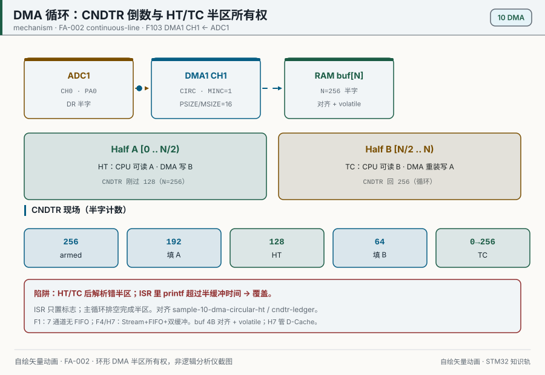
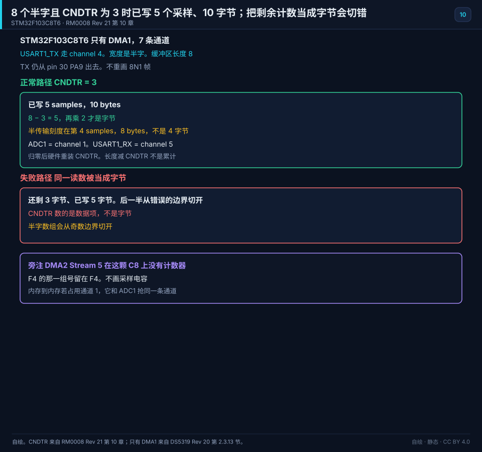
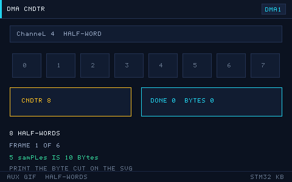

# 10 DMA

> English: [DMA](en/10-dma.md)

> DMA（直接存储器访问）让外设与内存之间的数据自动搬运，CPU 不必逐字节参与，从而把算力留给计算本身。

<p align="center">
  
  <br><sub>▲ 动画：DMA 循环模式搬运 ADC 数据，CPU 同时执行其他任务（作者自绘矢量动画，非实拍）</sub>
</p>

<!-- video:ch10 -->
<p align="center">
  <video width="640" controls poster="../assets/video/ch10-dma.png">
    <source src="../assets/video/ch10-dma.mp4" type="video/mp4">
  </video>
  <br><sub>▲ 本章讲解视频（2.6 分钟）。<a href="../assets/video/ch10-dma.mp4">MP4</a> · <a href="../assets/video/ch10-dma.srt">字幕</a></sub>
</p>

<details>
<summary>旁白文字稿</summary>

1. DMA 是搬运工。外设来了新数据，或者内存里有一包要送出去，它可以自己搬，CPU 继续算别的。前提是你把源、目的和数量写对。
2. 剩余数量记在 NDTR 里。它减到 0，这一轮就搬完了。循环模式下，硬件会把数量装回去，指针也回到起点。你不用在中断里手动重置。
3. 半传输标志按元素个数算。如果每个元素是半字，两个字节，你要再乘 2 才是字节数。用字节去切半字数组，后半段会从奇数地址开始，读出来是错的。
4. 这一帧是仓库画的循环搬运。写指针走到头就绕回来，旧数据会被新数据盖住。你如果处理得比 DMA 慢，就会丢一圈。速度要算得过，不能只看灯还在闪。
5. 外设数据宽度、内存宽度、地址增不增加，三项要和真实的寄存器一致。ADC 结果是半字，你却按字节去增地址，内存里会插进一堆空隙。
6. 半满的时候可以处理前半段，全满的时候处理后半段。中断里只做这个切换和必要的计算，不要阻塞。一阻塞，下一圈 DMA 已经把你还没看的数据盖掉了。
7. F103 没有数据缓存，DMA 和 CPU 看的是同一份内存。到了带缓存的 H7，CPU 看到的数组可能和总线上的不一样。那一章会再提，这里先把 F1 的搬运做对。
8. 口诀：剩下的在 NDTR；半字的半传输按元素算，再乘 2 才是字节。调试时把 NDTR 打出来，比猜「DMA 是不是坏了」快得多。
9. 实验让 DMA 把一串数搬进数组，断点时后半段应该已经变了，NDTR 也在减小。数组纹丝不动，先查通道、方向和使能，别先改算法。
10. 合上书，三问。NDTR 里装的是地址还是剩余数量？循环模式谁把指针拨回去？半字传输的半满，怎样换成字节数？

</details>
<!-- /video:ch10 -->

## 学习目标

读这一章之前：读完第 04 章（中断服务函数和 NVIC）、第 05 章（定时器的 PSC、ARR 和 TRGO）、第 06 章（USART1 和 USB-TTL 模块的接法）和第 09 章（ADC 的转换和外部触发）；知道数组的元素在内存里按地址一个挨一个排开，指针里存的是地址，会把元素个数换算成字节数（不熟的话先读第 00 章的「零基础预备」）。

- [ ] 说清 DMA 替 CPU 省下的是什么：同样从串口发 64 个字节，轮询、中断和 DMA 各要 CPU 做多少事
- [ ] 说出 STM32F103C8T6 只有 DMA1 的 7 条通道，并从请求映射表查出 ADC1、USART1_TX、USART1_RX 各走哪一条
- [ ] 按手册的六步配好一条通道：外设地址、内存地址、数量、优先级、方向和宽度，最后才使能
- [ ] 从 CNDTR 的读数算出已经写了几个数据、几个字节：8 个半字、CNDTR = 3 时是 5 个采样、10 字节
- [ ] 用循环模式加半传输、传输完成两个中断，让 CPU 处理一半时 DMA 写另一半，并算出每一半留给 CPU 的时间
- [ ] 让 USART1 经 DMA 发出一行文字，说出为什么发完要等 USART 的 TC，不能只看 DMA 的 TC
- [ ] 说出 F4 的「数据流加通道」编号和 H7 的 Cache 一致性为什么不能照搬到这颗芯片上

## 核心原理

**一句话结论：DMA 是芯片里的搬运工。你告诉它从哪里搬、搬到哪里、搬几个，外设每要一次，它就搬一个，CPU 不用插手。STM32F103C8T6 上只有一个 DMA1，7 条通道，每个外设的请求只接在固定的一条上。**

### 先打个比方

把 DMA 想成仓库里的一个搬运工，CPU 是坐在办公室里的经理。

- **源地址**是货架。ADC1 的数据寄存器 ADC1_DR 就是一个货架，每次只放一件货。
- **目的地址**是一排格子。内存里的数组 `adc_buf[8]` 有 8 个格子。
- **数量**是派工单上写的件数。搬一件，划掉一件，单子上剩下的件数就是 CNDTR。
- **请求**是货架上的铃。ADC 转换完一次，铃响一下，搬运工搬一件。
- **通道**是仓库的 7 扇门，每扇门上挂一张派工单。每个货架的铃只接在其中一扇门后面；派工单挂错了门，铃响了也没人接。
- **中断**是搬运工给经理打的电话。可以约好搬完一半打一次（半传输），全部搬完再打一次（传输完成）。

比方到这里为止。真实的「一件」可以是 1、2 或 4 个字节，派工单上记的是件数，不是字节数（第 5 节）；搬运工和经理走的是同一条走廊，两个人要去同一个地方时得轮流走（第 10 节）；派工单挂错了门，搬运工一直听不到铃，单子上的件数一件也不会少（第 3 节）。

### 1. DMA 是什么：替 CPU 搬数据的硬件

**DMA**（direct memory access，直接存储器访问）是芯片里一个专门搬数据的电路。它能把数据从外设搬到内存、从内存搬到外设，或者从内存搬到内存，搬的时候不需要 CPU 执行指令（RM0008 Rev 21 第 13.1 节，第 274 页）。

拿第 06 章的串口举例：从 USART1 发 64 个字节，115200 波特率，每个字符 10 位（起始位、8 个数据位、停止位），线上要走 `64 × 10 / 115200 ≈ 5.56 ms`。三种写法的差别在 CPU 这一侧：

| 写法 | CPU 要做什么 | 发 64 字节时 CPU 的负担 |
| --- | --- | --- |
| 轮询 | 反复查「发送寄存器空了没有」，空了就写下一个字节 | 5.56 ms 全耗在这里，别的事都得等 |
| 中断 | 每当发送寄存器空了进一次中断，写下一个字节 | 进 64 次左右的中断，每次只干一件小事 |
| DMA | 配好地址和数量，启动，然后去干别的 | 发完时进一次中断 |

这张表看第三列：线上的时间三种写法都是 5.56 ms，一点没少。DMA 省的是 CPU 的时间，不是传输的时间。

**请求**（request）是外设给 DMA 的信号，意思是「我这边好了，搬一个」。ADC 转换完一次、USART 的发送寄存器空了，都会发请求。DMA 收到请求后搬一个数据，回一个应答，外设撤掉请求，等下一次（第 13.3.1 节，第 276 页）。每搬一个数据，DMA 做三件事（同一节，第 277 页）：

1. 从源地址读一个数据。
2. 把它写到目的地址。
3. 把剩余数量减 1。

```text
ADC1 转换完 ──请求──▶ DMA1 通道 1：读 ADC1_DR ──▶ 写 adc_buf[i] ──▶ 剩余数量减 1
     ▲                                                                   │
     └─────────────────── 应答，等下一次转换 ◀───────────────────────────┘
```

### 2. 一个 DMA1、7 条「通道」

**结论：STM32F103C8T6 只有 DMA1，7 条通道。手册里的 DMA2 是大容量芯片才有的，这颗料上作废。**

**通道**（channel）是 DMA1 里 7 套各自独立的搬运配置。每条通道有自己的一组寄存器，记着自己的源、目的和数量。7 条通道可以同时开着，各管一件搬运任务；几条同时有请求时，由 DMA 里的仲裁器按优先级决定先服务哪一条。

RM0008 第 13.1 节写的是「两个控制器一共 12 条通道，DMA1 有 7 条，DMA2 有 5 条」，同一章图 49 的注说明 DMA2 只在大容量和超大容量器件上有（第 274、276 页）。STM32F103C8T6 是中密度器件，数据手册只写了一个 7 通道的 DMA（DS5319 Rev 20 第 2.3.13 节，第 17 页）。

| 项 | 在 STM32F103C8T6 上 | 出处 |
| --- | --- | --- |
| 控制器 | 只有 DMA1 | DS5319 Rev 20 第 2.3.13 节 |
| 通道 | 7 条：通道 1 到通道 7 | 同上；RM0008 Rev 21 第 13.1 节 |
| 每条通道的寄存器 | CCR（配置）、CNDTR（数量）、CPAR（外设地址）、CMAR（内存地址） | RM0008 Rev 21 第 13.4 节 |
| 优先级 | 软件设 4 级；一样高时编号小的通道先搬 | 第 13.3.2 节 |
| 中断 | 每条通道一个向量：DMA1_Channel1 到 DMA1_Channel7，向量表位置 11 到 17 | 表 63 |
| 时钟 | RCC_AHBENR 的位 0 DMA1EN，复位后是关的 | 第 7.3.6 节 |

前两行回答「有什么」，后四行是写程序时要碰的东西：寄存器、优先级、中断函数名和时钟开关。

两条通道同时有请求时，DMA 先比 CCR 里 PL 位设的软件优先级，分低、中、高、很高四级；一样高时，编号小的先搬，例如通道 2 先于通道 4（第 13.3.2 节，第 277 页）。

每条通道有三个事件标志：**HTIF**（half transfer，半传输）、**TCIF**（transfer complete，传输完成）、**TEIF**（transfer error，传输错误）。三个标志合用这条通道的一个中断向量（第 13.2 节、第 13.3.6 节表 77）。标志在 DMA_ISR 里读，往 DMA_IFCR 的对应位写 1 清掉（第 13.4.1、13.4.2 节）。

### 3. 请求映射：哪个外设走哪条通道

**结论：F1 的请求是接死的。ADC1 只能走通道 1，USART1_TX 只能走通道 4，USART1_RX 只能走通道 5。查表照填，没有可选的余地。**

**请求映射**（request mapping）就是「哪个外设的请求接在哪条通道上」这张对照表。下表是 RM0008 Rev 21 表 78（第 282 页）的全部内容：

| 通道 | 接在这条通道上的请求 |
| --- | --- |
| 通道 1 | ADC1、TIM2_CH3、TIM4_CH1 |
| 通道 2 | SPI1_RX、USART3_TX、TIM1_CH1、TIM2_UP、TIM3_CH3 |
| 通道 3 | SPI1_TX、USART3_RX、TIM3_CH4、TIM3_UP |
| 通道 4 | SPI2_RX、USART1_TX、I2C2_TX、TIM1_CH4、TIM1_TRIG、TIM1_COM、TIM4_CH2 |
| 通道 5 | SPI2_TX、USART1_RX、I2C2_RX、TIM1_UP、TIM2_CH1、TIM4_CH3 |
| 通道 6 | USART2_RX、I2C1_TX、TIM1_CH3、TIM3_CH1、TIM3_TRIG |
| 通道 7 | USART2_TX、I2C1_RX、TIM2_CH2、TIM2_CH4、TIM4_UP |

用法：先在表里找到你要用的请求，它在哪一行，就配哪条通道。手册原表写的是 SPI2/I2S2，这颗料没有 I2S，I2S 是大容量芯片才有的外设（DS5319 Rev 20 第 2.2 节，第 13 页），所以这里只写 SPI2。ADC 只有 ADC1 一项：ADC2 不能自己发 DMA 请求（RM0008 Rev 21 第 11.12.3 节）。

同一行里的几个请求，在进 DMA1 之前只是简单地「或」在一起，DMA 分不清是谁在要。所以手册要求同一条通道上同一时刻只打开一个请求（第 13.3.7 节，第 281 页）。例如 SPI2_RX 和 USART1_TX 都在通道 4，两个不能同时用 DMA。

光配好 DMA 还不够。外设自己也有一个「发 DMA 请求」的开关，在它自己的寄存器里：

| 外设 | 开关 | 位置 |
| --- | --- | --- |
| ADC1 | ADC_CR2 的 DMA | 位 8（第 11.12.3 节） |
| USART1、2、3 | USART_CR3 的 DMAT（发送）、DMAR（接收） | 位 7、位 6（第 27.6.6 节） |
| SPI1、2 | SPI_CR2 的 TXDMAEN、RXDMAEN | 位 1、位 0（第 25.5.2 节） |
| I2C1、2 | I2C_CR2 的 DMAEN | 位 11（第 26.6.2 节） |
| TIM1 到 TIM4 | TIMx_DIER 的 UDE（更新）、CC1DE 到 CC4DE（捕获/比较） | 位 8、位 9 到 12（第 14.4.4、15.4.4 节） |

这张表在自己写寄存器时用。HAL 的 `HAL_ADC_Start_DMA()`、`HAL_UART_Transmit_DMA()` 会替你置这些位（出自 STM32CubeF1 的 HAL 源码）。漏了这一步，DMA 通道开着，却永远等不到请求，CNDTR 一个也不减。

### 4. 配一条通道：六步

**结论：按手册的顺序填四个寄存器：先填地址和数量，再填配置，最后一步才置 EN。**

RM0008 Rev 21 第 13.3.3 节（第 278 页）给出的顺序：

| 步 | 写哪里 | 填什么 | ADC1 的例子 |
| --- | --- | --- | --- |
| 1 | CPAR | 外设寄存器的地址 | `&ADC1->DR` |
| 2 | CMAR | 内存地址 | 数组 `adc_buf` 的首地址 |
| 3 | CNDTR | 要搬的数据个数 | 8 |
| 4 | CCR 的 PL | 优先级 | 高 |
| 5 | CCR 的其余位 | 方向、循环、地址增不增、宽度、中断 | 外设到内存，16 位，内存地址递增，开 HT 和 TC |
| 6 | CCR 的 EN | 使能 | 置 1 |

前三步是派工单上的「从哪、到哪、几件」，第 4、5 步是搬法，第 6 步是开工。CNDTR 只能在 EN = 0 时写（第 13.4.4 节），所以要改数量，先关通道。

第 5 步要填的位都在 CCR 里（第 13.4.3 节，第 286 页；偏移是 `0x08 + 20 × (通道号 − 1)`，20 是十进制）：

| 位 | 名字 | 意思 |
| --- | --- | --- |
| 14 | MEM2MEM | 1：内存到内存 |
| 13:12 | PL | 优先级：00 低，01 中，10 高，11 很高 |
| 11:10 | MSIZE | 内存一侧每个数据的宽度：00 是 8 位，01 是 16 位，10 是 32 位 |
| 9:8 | PSIZE | 外设一侧的宽度，编码同 MSIZE |
| 7 | MINC | 1：每搬一个，内存地址加一个宽度 |
| 6 | PINC | 1：每搬一个，外设地址加一个宽度 |
| 5 | CIRC | 1：循环模式 |
| 4 | DIR | 0：从外设读、写到内存；1：从内存读、写到外设 |
| 3 | TEIE | 传输错误中断使能 |
| 2 | HTIE | 半传输中断使能 |
| 1 | TCIE | 传输完成中断使能 |
| 0 | EN | 通道使能 |

ADC 的例子里，两边都是 16 位，MINC = 1，PINC = 0，DIR = 0。外设地址不增，因为 ADC1_DR 永远是同一个地址；内存地址要增，不然 8 个结果都写进 `adc_buf[0]`。HAL 的 `hdma.Init` 每个字段都对应这张表里的一组位，例如 `PeriphDataAlignment` 就是 PSIZE，`MemInc` 就是 MINC。

### 5. CNDTR：还剩多少没搬（F4 叫 NDTR）

**结论：CNDTR 记的是还没搬的数据个数，不是字节数，也不是地址。已写个数 = 总数 − CNDTR；字节数 = 已写个数 × 每个数据的字节数。**

**CNDTR**（channel number of data register，通道数据数量寄存器）的低 16 位叫 NDT。启动前写进总数，每搬一个减 1（第 13.3.1 节）。视频旁白里说的 NDTR，是 F4 上同一个计数器的名字（DMA_SxNDTR）；F1 上这个寄存器叫 DMA_CNDTRx。HAL 的 `__HAL_DMA_GET_COUNTER()` 读的就是它。

缓冲区 8 个半字（每个 2 字节），CNDTR 读回 3：

```text
adc_buf：8 个半字，16 字节
下标    [0]   [1]   [2]   [3]   [4]   [5]   [6]   [7]
状态    已写  已写  已写  已写  已写  空    空    空
                                       ▲
                              下一个写这里：下标 5

CNDTR = 3：还剩 3 个没写
已写   = 8 − 3 = 5 个采样
字节数 = 5 × 2 = 10 字节
```

一个容易被手册带偏的地方：第 13.4.4 节（第 287 页）的寄存器说明把读数写成 remaining bytes（剩余字节）。同一章第 13.3.1 节说 CNDTR 存的是「还要执行的传输次数」，表 76 的例子里 NDT = 4、宽度 16 位，搬的是 4 个半字、8 个字节。按个数算，三处才对得上。

口诀：**剩下的看 CNDTR（旁白里叫 NDTR）；已写的个数是总数减读数；要字节数，再乘每个数据的字节数。**

NDT 是 16 位，最多 65535（第 13.3.3、13.4.4 节；第 13.2 节写成 65536，按 16 位寄存器以 65535 为准）。CNDTR 是 0 时，通道开着也不搬（第 13.4.4 节）。

### 6. 数据宽度：两边可以不一样宽，但 F1 不打包

**结论：PSIZE 和 MSIZE 不一样时，F1 只会给每个数据补零或截掉高位，不会把两个字节拼成一个半字。数组元素的类型要和 MSIZE 一样宽。**

下表摘自 RM0008 Rev 21 表 76（第 279 页）。源数据写成 B1B0、B3B2……，每个「B 加数字」是一个字节：

| 外设宽度 PSIZE | 内存宽度 MSIZE | 每个数据怎么搬 | 内存里的样子 |
| --- | --- | --- | --- |
| 16 位 | 16 位 | 原样搬 | B1B0、B3B2……每个占 2 字节 |
| 16 位 | 8 位 | 只写低字节 | B0、B2、B4……高字节丢掉，每个占 1 字节 |
| 16 位 | 32 位 | 高 16 位补 0 | 0000B1B0、0000B3B2……每个占 4 字节 |
| 8 位 | 16 位 | 高 8 位补 0 | 00B0、00B1……每个占 2 字节 |

看最后一列：一个数据进，一个数据出，个数不变，变的只是每个数据在内存里占几个字节。ADC 的结果是 12 位，放在 16 位的数据寄存器里（RM0008 Rev 21 第 11.1 节），所以两边都选 16 位，数组用 `uint16_t`。地址还要按宽度对齐：16 位的地址必须是 2 的倍数，32 位的必须是 4 的倍数（第 13.2 节）。`uint16_t` 数组天然按 2 字节对齐。

视频旁白第 5 条说，按字节去增地址，内存里会「插进一堆空隙」。按表 76，MSIZE 选 8 位时是高字节被丢掉、低字节挨着排，没有空隙；用 `uint16_t` 去读，每个元素是两个低字节拼成的怪数，数组后一半根本没被写到。插空隙的是 MSIZE 选成 32 位：每个结果占 4 个字节，用 `uint16_t` 去读，就成了「数、0、数、0」。两种都是宽度配错，现象不一样。

F4 在 FIFO 模式下会真的打包，比如把两个字节拼成一个半字写出去（RM0090 Rev 22 第 10.3.10 节）。这是 F1 没有的。

### 7. 普通模式与循环模式

**结论：普通模式搬完 CNDTR 个就停；循环模式搬完后自动把 CNDTR 和地址装回初值，从头再来，直到你关掉通道。**

**普通模式**（CIRC = 0）：CNDTR 减到 0 后，通道即使还开着，也不再响应请求。要再搬一轮，先清 EN，重写 CNDTR，再置 EN（第 13.3.3 节，第 278 页）。关通道不会清掉 CCR、CPAR、CMAR，原来的配置还在。串口发一包、读一批固定个数的数据，用它。

**循环模式**（CIRC = 1）：最后一个数据搬完，CNDTR 自动装回初值，内部的当前地址也回到 CPAR、CMAR 里的起始地址，请求照常服务（同一节）。ADC 不停地采样、串口一直收，用它。

```text
普通模式：CNDTR  8 → 7 → … → 1 → 0                停在 0，不再搬
循环模式：CNDTR  8 → 7 → … → 1 → 8 → 7 → …        写完第 8 个立刻装回 8
```

循环模式下，`长度 − CNDTR` 是这一圈里下一个要写的下标，不是一共收了多少。CNDTR 装回 8 时，它又从 0 算起。要知道新来了哪一段，得记住上一次处理到的位置：串口接收常用的 `HAL_UARTEx_ReceiveToIdle_DMA()` 在回调里给一个 `Size`，表示这一圈里第一个还没写的位置，拿它和上一次的位置 `old_pos` 比，就知道新数据是哪一段（ST 的 STM32CubeF4 循环 DMA 例程；附录 A 第 3 节）。

**内存到内存**（MEM2MEM = 1）：不等外设请求，置 EN 就开始搬，CNDTR 到 0 就停；它不能和循环模式一起用（第 13.3.3 节，第 279 页）。因为不需要请求，7 条通道哪一条都能做，挑工程里没人用的那条。

### 8. 半传输与传输完成：一半一半地处理

**结论：循环模式加 HT、TC 两个中断，就是一个乒乓缓冲：HT 来时处理前一半，TC 来时处理后一半。每一半留给 CPU 的时间是「半个缓冲区的数据个数 ÷ 采样率」。**

搬完一半时置 HTIF，全部搬完置 TCIF，对应的中断使能位开着就进中断（第 13.3.3 节，第 278 页）。手册原话是「一半的字节」搬完时置 HTIF；每个数据一样宽，一半的字节就是一半的个数。8 个半字的缓冲区，HT 在第 4 个采样、第 8 个字节时到来，不是 4 字节。

**乒乓缓冲**（ping-pong buffer）是把一块缓冲区分成两半轮流用：DMA 写一半，CPU 读另一半，然后交换。

```text
            ┌───── 前一半 [0]..[3] ─────┬───── 后一半 [4]..[7] ─────┐
DMA 写入    │ 第 1、2、3、4 个采样      │ 第 5、6、7、8 个采样      │  第 9 个采样又写进 [0]
            └───────────────────────────┴───────────────────────────┘
                                        ▲                           ▲
                          HT：CPU 处理 [0]..[3]        TC：CPU 处理 [4]..[7]

期限：HT 之后，要在 DMA 回到 [0] 之前处理完前一半，也就是 4 个采样的时间
```

每一半的期限：

```text
期限 = (N / 2) ÷ 采样率
N = 8，1 Hz 触发：  4 ÷ 1 = 4 s（实验三）
N = 64，1 kHz 采样：32 ÷ 1000 = 32 ms
```

中断里只做切换和必要的计算，不要阻塞。处理得比 DMA 慢，下一圈就把还没处理的数据盖掉了；灯照样在闪，数据已经丢了。

传输出错时（例如地址落在保留的地址空间），硬件清掉这条通道的 EN，置 TEIF（第 13.3.5 节，第 280 页）。通道停了，要查地址，再重新配置。

HAL 里，ADC 的 HT 和 TC 分别进 `HAL_ADC_ConvHalfCpltCallback()` 和 `HAL_ADC_ConvCpltCallback()`；串口接收对应 `HAL_UART_RxHalfCpltCallback()` 和 `HAL_UART_RxCpltCallback()`。`HAL_DMA_IRQHandler()` 会替你写 IFCR 清标志（出自 STM32CubeF1 的 HAL 源码）。

DMA 的完成中断只说明 DMA 把请求搬完了，不说明业务上没丢数据，也不说明一帧数据从哪里开始、到哪里结束。

### 9. F4 的编号：先选数据流，再选通道

**结论：F4 的 DMA 多了一层数据流（stream）：两个控制器各有 8 个数据流，每个数据流再从 8 个通道里选一个请求。同一个外设请求，在 F4 上的编号和 F1 完全不同，不能照搬。**

以下出自 RM0090 Rev 22 第 10 章（第 304 页起）：

- 两个控制器一共 16 个数据流，每个控制器 8 个；每个数据流最多 8 个通道（请求），用 DMA_SxCR 的 CHSEL 位选（第 10.1、10.2 节）。
- 每个数据流有一个 4 个字深、每字 32 位的 FIFO，可以工作在 FIFO 模式或直接模式（第 10.2 节）。
- 只有 DMA2 能做内存到内存（第 10.3.6 节，第 313 页）。
- 两边宽度不同时的打包和拆包只在 FIFO 模式下有；直接模式要求两边一样宽（第 10.3.10 节，第 316 页）。NDT 也按个数算：PSIZE 是半字时，要搬的字节数是 NDT 的 2 倍（同一节）。
- 比 F1 多两个错误标志：FIFO 错误 FEIF 和直接模式错误 DMEIF。FIFO 阈值和突发长度配不上时，一使能就置 FEIF，数据流自动关掉（第 10.3.12 节表 49，第 320 页）。
- 双缓冲模式：DBM = 1 时，两个内存地址 M0AR、M1AR 轮流用，CT 位指示 DMA 正在写哪一个（第 10.3.9 节，第 315 页）。

下表把几个常用请求在两个系列上的编号放在一起（F4 一列出自 RM0090 Rev 22 表 44，第 310 页）：

| 请求 | STM32F103C8T6 | STM32F4 |
| --- | --- | --- |
| ADC1 | DMA1 通道 1 | DMA2 Stream 0 或 Stream 4，Channel 0 |
| USART1_TX | DMA1 通道 4 | DMA2 Stream 7，Channel 4 |
| USART1_RX | DMA1 通道 5 | DMA2 Stream 2 或 Stream 5，Channel 4 |
| SPI1_RX | DMA1 通道 2 | DMA2 Stream 0 或 Stream 2，Channel 3 |
| SPI1_TX | DMA1 通道 3 | DMA2 Stream 3 或 Stream 5，Channel 3 |
| TIM1_CH1 | DMA1 通道 2 | DMA2 Stream 1 或 Stream 3，Channel 6；或 Stream 6，Channel 0 |

同一行左右两格说的是同一个请求，左格只对这颗 F103C8 有效，右格只对 F4 有效。F4 上查表先定数据流，再定通道。

### 10. 总线共享与 Cache 一致性

**结论：DMA 不占 CPU 的指令，但要和 CPU 共用总线。F1 上两边轮流用，CPU 至少拿到一半带宽。F1 没有数据 Cache，DMA 写进内存的数，CPU 立刻能读到；换到带 D-Cache 的 F7、H7，要另外保证 CPU 看到的是新数据。**

**总线矩阵**（BusMatrix）是芯片里管「谁先用 SRAM、Flash 和外设」的仲裁电路。F1 的 DMA 是 AHB 总线上的主设备（master），能自己发起读写，它经 DMA 总线接到总线矩阵（RM0008 Rev 21 第 3.1 节）。外设寄存器挂在 APB1、APB2 两条外设总线上，DMA 经桥访问它们。DMA 和 CPU 去同一个目标（同一块内存或同一个外设）时，DMA 的请求可能让 CPU 等几个总线周期；总线矩阵轮流仲裁，保证 CPU 至少拿到一半带宽（第 13.3 节，第 276 页）。

F1 的 Cortex-M3 内核不带数据 Cache。CPU 和 DMA 经总线矩阵访问的是同一块 SRAM，DMA 刚写进去的数，CPU 下一次读就能读到。

**Cache** 是内核旁边一小块很快的存储，存着内存里一部分数据的副本。F7、H7 的 Cortex-M7 内核带 L1 Cache，按 32 字节一行管理（[AN4839 Rev 2](#source-an4839) 第 2 节）。**Cache 一致性**说的是 CPU 看到的副本和 DMA 看到的内存是否相同：DMA 直接写 SRAM，CPU 可能还在读 Cache 里的旧副本；CPU 写的新数据可能还留在 Cache 里，没写回 SRAM，DMA 读走的是旧值。AN4839 Rev 2 第 4 节给了两类办法：

- 把 DMA 缓冲区放进用 MPU（存储器保护单元）设成不可缓存（non-cacheable）的区域。
- 缓冲区留在可缓存区：DMA 发送前做 clean（`SCB_CleanDCache_by_Addr()`，把 Cache 里的新数据写回 SRAM），DMA 接收完做 invalidate（`SCB_InvalidateDCache_by_Addr()`，丢掉 Cache 里的旧副本）。这两个操作按 32 字节一行进行，缓冲区按 32 字节对齐、长度取 32 的倍数，免得把同一行里别的变量一起写回或丢掉。

H7 还有一个独立的问题：有的 DMA 根本访问不到某些内存，例如 DTCM。缓冲区放错了地方，Cache 处理得再对也没用（[ST 社区文章](#source-st-h7-dma)）。

## 硬件与接线

| 器件 | 接到 BluePill | 备注 |
| --- | --- | --- |
| USB-TTL 模块的 RXD | PA9（USART1_TX，LQFP48 第 30 脚） | 实验一、四：电脑上的串口终端设成 115200-8-N-1 |
| USB-TTL 模块的 TXD | PA10（USART1_RX，第 31 脚） | 本章只发不收，接上备用 |
| USB-TTL 模块的 GND | GND | 必须共地 |
| 电位器（10 kΩ，经验值）的中间脚 | PA0（ADC12_IN0，第 10 脚） | 电位器两端接 3.3 V 和 GND；没有电位器，就用杜邦线把 PA0 接到 3.3 V |
| 板载 LED | PC13 | 低电平点亮；实验二、三看它翻转 |
| ST-Link | 调试排针的 SWDIO、SWCLK、GND、3.3 V | 在调试器里看 CNDTR 和数组 |

一次接好这几根线，四个实验都不用再改线。

```text
USB-TTL 模块              BluePill（STM32F103C8T6）
  RXD  ◀────────────────  PA9   第 30 脚，USART1_TX
  TXD  ────────────────▶  PA10  第 31 脚，USART1_RX
  GND  ─────────────────  GND

3.3 V ──┐
     [电位器]── 中间脚 ─▶ PA0   第 10 脚，ADC12_IN0
GND ────┘

板载 LED：PC13，低电平亮
ST-Link：SWDIO、SWCLK、GND、3.3 V 接调试排针
```

脚号出自 DS5319 Rev 20 表 5 和图 8。PA0 上的电压保持在 0 到 3.3 V：LQFP48 封装的 ADC 参考 VREF+ 在片内接到第 9 脚 VDDA（表 47 注 3），输入高过它，读数也只是 4095；PA0 不是 5 V 容忍脚（表 5 里它的 I/O 电平一栏没有 FT），这类脚输入电压的绝对最大值是 4.0 V（表 6，第 37 页），接 5 V 就超了。USB-TTL 模块的电平跳线选 3.3 V。

## 代码实现

下面两份是完整代码：`uart_dma_tx.c` 对应实验一和实验四，`adc_dma.c` 对应实验二和实验三。两份都调用第 02 章写好的 `SystemClock_Config()`：HSE 8 MHz，PLL ×9 得到 72 MHz，APB1 二分频，APB2 不分频，和附录 D「时钟树」一行的数值相同。

```c
/* uart_dma_tx.c —— USART1 经 DMA1 通道 4 发送；等待期间 CPU 自己数数 */
#include "stm32f1xx_hal.h"
#include <stdio.h>

#define LINE_LEN  64                     /* 每行 64 字节，含结尾的 \r\n */

UART_HandleTypeDef huart1;
DMA_HandleTypeDef  hdma_usart1_tx;

static char msg[LINE_LEN + 1];           /* 多 1 字节给 snprintf 的结尾 '\0'，DMA 只发前 64 个 */
static volatile uint8_t tx_done;         /* 1：上一行已经从 PA9 发完 */
volatile uint32_t idle_last;             /* 上一行发送期间 CPU 空转的圈数，调试器里看它 */

void SystemClock_Config(void);           /* 第 02 章：HSE 8 MHz，PLL ×9 = 72 MHz */

static void uart1_dma_init(void)
{
    __HAL_RCC_GPIOA_CLK_ENABLE();
    __HAL_RCC_USART1_CLK_ENABLE();
    __HAL_RCC_DMA1_CLK_ENABLE();         /* RCC_AHBENR 位 0：DMA1EN */

    GPIO_InitTypeDef io = {0};
    io.Pin   = GPIO_PIN_9;               /* PA9 = USART1_TX，复用推挽 */
    io.Mode  = GPIO_MODE_AF_PP;
    io.Speed = GPIO_SPEED_FREQ_HIGH;
    HAL_GPIO_Init(GPIOA, &io);
    io.Pin   = GPIO_PIN_10;              /* PA10 = USART1_RX，浮空输入 */
    io.Mode  = GPIO_MODE_INPUT;
    io.Pull  = GPIO_NOPULL;
    HAL_GPIO_Init(GPIOA, &io);

    huart1.Instance          = USART1;
    huart1.Init.BaudRate     = 115200;
    huart1.Init.WordLength   = UART_WORDLENGTH_8B;
    huart1.Init.StopBits     = UART_STOPBITS_1;
    huart1.Init.Parity       = UART_PARITY_NONE;
    huart1.Init.Mode         = UART_MODE_TX_RX;
    huart1.Init.HwFlowCtl    = UART_HWCONTROL_NONE;
    huart1.Init.OverSampling = UART_OVERSAMPLING_16;
    HAL_UART_Init(&huart1);

    hdma_usart1_tx.Instance                 = DMA1_Channel4;          /* USART1_TX 只接在通道 4 */
    hdma_usart1_tx.Init.Direction           = DMA_MEMORY_TO_PERIPH;   /* DIR = 1：从内存读，写到外设 */
    hdma_usart1_tx.Init.PeriphInc           = DMA_PINC_DISABLE;       /* 目的地址一直是 USART1->DR */
    hdma_usart1_tx.Init.MemInc              = DMA_MINC_ENABLE;        /* 源地址每次加 1 */
    hdma_usart1_tx.Init.PeriphDataAlignment = DMA_PDATAALIGN_BYTE;    /* 两边都是 8 位 */
    hdma_usart1_tx.Init.MemDataAlignment    = DMA_MDATAALIGN_BYTE;
    hdma_usart1_tx.Init.Mode                = DMA_NORMAL;             /* 发完一行就停 */
    hdma_usart1_tx.Init.Priority            = DMA_PRIORITY_LOW;
    HAL_DMA_Init(&hdma_usart1_tx);
    __HAL_LINKDMA(&huart1, hdmatx, hdma_usart1_tx);                   /* 把 DMA 句柄挂到串口句柄上 */

    HAL_NVIC_SetPriority(DMA1_Channel4_IRQn, 1, 0);
    HAL_NVIC_EnableIRQ(DMA1_Channel4_IRQn);
    HAL_NVIC_SetPriority(USART1_IRQn, 1, 0);
    HAL_NVIC_EnableIRQ(USART1_IRQn);
}

void DMA1_Channel4_IRQHandler(void) { HAL_DMA_IRQHandler(&hdma_usart1_tx); }
void USART1_IRQHandler(void)        { HAL_UART_IRQHandler(&huart1); }

void HAL_UART_TxCpltCallback(UART_HandleTypeDef *huart)   /* USART 的 TC：最后一位已经离开 PA9 */
{
    if (huart->Instance == USART1) tx_done = 1;
}

int main(void)
{
    HAL_Init();
    SystemClock_Config();
    uart1_dma_init();

    for (uint32_t n = 0; ; n++)
    {
        /* 拼一行正好 64 字节的文字：5 + 6 + 7 + 8 + 2 + 34 + 2 = 64 */
        snprintf(msg, sizeof msg, "line %06lu  idle %08lu  %-34s\r\n",
                 (unsigned long)(n % 1000000), (unsigned long)idle_last, "DMA1 channel 4 -> USART1 -> PA9");

        tx_done = 0;
        HAL_UART_Transmit_DMA(&huart1, (uint8_t *)msg, LINE_LEN);   /* 立刻返回，DMA 在后台搬 */

        uint32_t idle = 0;
        while (!tx_done) idle++;         /* 这一行要在线上走约 5.56 ms，CPU 闲着就数数 */
        idle_last = idle;

        HAL_Delay(500);
    }
}
```

逐段看：

- `__HAL_RCC_DMA1_CLK_ENABLE()`：DMA1 挂在 AHB 上，时钟开关是 RCC_AHBENR 的位 0 DMA1EN（RM0008 Rev 21 第 7.3.6 节）。复位后它是关的，漏了这一句，DMA 的寄存器写不进去。
- `Instance = DMA1_Channel4`：查表 78，USART1_TX 在通道 4。写成别的通道，请求进不来（实验四）。
- `DMA_MEMORY_TO_PERIPH`、`DMA_PINC_DISABLE`、`DMA_MINC_ENABLE`：从 `msg` 读，写到 USART1_DR；外设地址不动，内存地址每搬一个字节加 1。两边都是字节宽度，因为 USART 一次收发一个 8 位的字符。
- `__HAL_LINKDMA()`：把 DMA 句柄挂到串口句柄的 `hdmatx` 上，`HAL_UART_Transmit_DMA()` 才知道该启动哪条通道。
- 两个中断函数都要有。DMA 写完最后一个字节时进 `DMA1_Channel4_IRQHandler()`，HAL 在这里打开 USART 的 TC 中断；最后一位离开 PA9 时进 `USART1_IRQHandler()`，HAL 在这里把串口状态改回空闲，再调用 `HAL_UART_TxCpltCallback()`。少了后一个，第一行能发出去，之后每次调用都返回 `HAL_BUSY`，再也发不出东西。这一串流程出自 STM32CubeF1 的 HAL 源码；「DMA 写完最后一个数据以后，要等 USART 的 TC 置位才算发完」出自 RM0008 Rev 21 第 27.3.13 节（第 813 页）。
- `msg` 是 `static` 的全局数组。DMA 在后台读它的时候，它必须一直有效。要是把它写成某个函数里的局部数组，函数一返回，那块栈就被别的变量占了，发出去的是乱码。主循环等到 `tx_done` 才改写 `msg`，也是同一个道理：DMA 没读完之前，这块缓冲区归 DMA 用。
- `snprintf()` 那一行：行号对 1000000 取余，一直是 6 位，整行一直是 64 字节。
- `while (!tx_done) idle++;` 只是为了演示 CPU 有空。真实的程序在这里去干别的事，不用空转。
- 115200 波特率下每个字符 10 位，64 字节要 `64 × 10 / 115200 ≈ 5.56 ms`。`idle_last` 记下这段时间里 CPU 空转了多少圈。

```c
/* adc_dma.c —— TIM3 每秒触发一次 ADC1，DMA1 通道 1 把结果搬进 adc_buf[8] */
#include "stm32f1xx_hal.h"

#define LAB_CIRCULAR  0                  /* 0：实验二，普通模式；1：实验三，循环模式 */
#define ADC_BUF_LEN   8                  /* 8 个半字 = 16 字节 */

ADC_HandleTypeDef hadc1;
DMA_HandleTypeDef hdma_adc1;
TIM_HandleTypeDef htim3;

volatile uint16_t adc_buf[ADC_BUF_LEN];  /* DMA 往这里写 */
volatile uint16_t left;                  /* 主循环读回的 CNDTR，调试器里看它 */

void SystemClock_Config(void);           /* 第 02 章：72 MHz，APB2 = 72 MHz */

static void led_init(void)
{
    __HAL_RCC_GPIOC_CLK_ENABLE();
    GPIO_InitTypeDef io = {0};
    io.Pin   = GPIO_PIN_13;              /* 板载 LED，低电平点亮 */
    io.Mode  = GPIO_MODE_OUTPUT_PP;
    io.Speed = GPIO_SPEED_FREQ_LOW;
    HAL_GPIO_Init(GPIOC, &io);
    HAL_GPIO_WritePin(GPIOC, GPIO_PIN_13, GPIO_PIN_SET);   /* 先熄灭 */
}

static void adc_dma_init(void)
{
    RCC_PeriphCLKInitTypeDef clk = {0};
    clk.PeriphClockSelection = RCC_PERIPHCLK_ADC;
    clk.AdcClockSelection    = RCC_ADCPCLK2_DIV6;              /* 72 MHz / 6 = 12 MHz */
    HAL_RCCEx_PeriphCLKConfig(&clk);

    __HAL_RCC_GPIOA_CLK_ENABLE();
    __HAL_RCC_ADC1_CLK_ENABLE();
    __HAL_RCC_DMA1_CLK_ENABLE();

    GPIO_InitTypeDef io = {0};
    io.Pin  = GPIO_PIN_0;                                      /* PA0 = ADC12_IN0 */
    io.Mode = GPIO_MODE_ANALOG;
    HAL_GPIO_Init(GPIOA, &io);

    hdma_adc1.Instance                 = DMA1_Channel1;        /* ADC1 只接在通道 1 */
    hdma_adc1.Init.Direction           = DMA_PERIPH_TO_MEMORY; /* DIR = 0：从外设读 */
    hdma_adc1.Init.PeriphInc           = DMA_PINC_DISABLE;     /* 一直读 ADC1->DR */
    hdma_adc1.Init.MemInc              = DMA_MINC_ENABLE;      /* 每次写下一个元素 */
    hdma_adc1.Init.PeriphDataAlignment = DMA_PDATAALIGN_HALFWORD;  /* PSIZE = 16 位 */
    hdma_adc1.Init.MemDataAlignment    = DMA_MDATAALIGN_HALFWORD;  /* MSIZE = 16 位，和 uint16_t 一样宽 */
#if LAB_CIRCULAR
    hdma_adc1.Init.Mode                = DMA_CIRCULAR;         /* 搬完 8 个自动从头再来 */
#else
    hdma_adc1.Init.Mode                = DMA_NORMAL;           /* 搬完 8 个就停 */
#endif
    hdma_adc1.Init.Priority            = DMA_PRIORITY_HIGH;
    HAL_DMA_Init(&hdma_adc1);
    __HAL_LINKDMA(&hadc1, DMA_Handle, hdma_adc1);

    hadc1.Instance                   = ADC1;
    hadc1.Init.ScanConvMode          = ADC_SCAN_DISABLE;       /* 只转换一个通道 */
    hadc1.Init.ContinuousConvMode    = DISABLE;                /* 来一拍转换一次 */
    hadc1.Init.DiscontinuousConvMode = DISABLE;
    hadc1.Init.ExternalTrigConv      = ADC_EXTERNALTRIGCONV_T3_TRGO;   /* 由 TIM3 的 TRGO 触发 */
    hadc1.Init.DataAlign             = ADC_DATAALIGN_RIGHT;
    hadc1.Init.NbrOfConversion       = 1;
    HAL_ADC_Init(&hadc1);

    ADC_ChannelConfTypeDef ch = {0};
    ch.Channel      = ADC_CHANNEL_0;
    ch.Rank         = ADC_REGULAR_RANK_1;
    ch.SamplingTime = ADC_SAMPLETIME_55CYCLES_5;               /* 例程设定，怎么选见第 09 章 */
    HAL_ADC_ConfigChannel(&hadc1, &ch);

    HAL_ADCEx_Calibration_Start(&hadc1);                       /* 上电后校准一次 */

    HAL_NVIC_SetPriority(DMA1_Channel1_IRQn, 1, 0);
    HAL_NVIC_EnableIRQ(DMA1_Channel1_IRQn);
}

static void tim3_trgo_1hz_init(void)
{
    __HAL_RCC_TIM3_CLK_ENABLE();
    htim3.Instance           = TIM3;
    htim3.Init.Prescaler     = 7199;                           /* 72 MHz / 7200 = 10 kHz */
    htim3.Init.CounterMode   = TIM_COUNTERMODE_UP;
    htim3.Init.Period        = 9999;                           /* 10 kHz / 10000 = 1 Hz */
    htim3.Init.ClockDivision = TIM_CLOCKDIVISION_DIV1;
    HAL_TIM_Base_Init(&htim3);

    TIM_MasterConfigTypeDef m = {0};
    m.MasterOutputTrigger = TIM_TRGO_UPDATE;                   /* MMS = 010：每次更新送一拍 TRGO */
    m.MasterSlaveMode     = TIM_MASTERSLAVEMODE_DISABLE;
    HAL_TIMEx_MasterConfigSynchronization(&htim3, &m);
}

void DMA1_Channel1_IRQHandler(void) { HAL_DMA_IRQHandler(&hdma_adc1); }

void HAL_ADC_ConvHalfCpltCallback(ADC_HandleTypeDef *hadc)    /* HT：adc_buf[0..3] 写好了 */
{
    HAL_GPIO_TogglePin(GPIOC, GPIO_PIN_13);
}

void HAL_ADC_ConvCpltCallback(ADC_HandleTypeDef *hadc)        /* TC：adc_buf[4..7] 也写好了 */
{
    HAL_GPIO_TogglePin(GPIOC, GPIO_PIN_13);
}

int main(void)
{
    HAL_Init();
    SystemClock_Config();
    led_init();
    adc_dma_init();
    tim3_trgo_1hz_init();

    HAL_ADC_Start_DMA(&hadc1, (uint32_t *)adc_buf, ADC_BUF_LEN);  /* 长度是数据个数：8 个半字 */
    HAL_TIM_Base_Start(&htim3);                                   /* 1 s 后来第一拍 */

    while (1)
    {
        left = (uint16_t)__HAL_DMA_GET_COUNTER(&hdma_adc1);       /* 读 CNDTR：还剩几个没写 */
    }
}
```

逐段看：

- `RCC_ADCPCLK2_DIV6`：ADC 的时钟由 APB2 的 72 MHz 六分频得到 12 MHz，不超过手册要求的 14 MHz（RM0008 Rev 21 第 11.1 节，第 215 页）。
- `Instance = DMA1_Channel1`：查表 78，ADC1 在通道 1。
- 两个 `HALFWORD`：ADC1_DR 是 16 位，数组是 `uint16_t`，PSIZE 和 MSIZE 都选 16 位（第 6 节）。
- `ExternalTrigConv = ADC_EXTERNALTRIGCONV_T3_TRGO`：ADC_CR2 的 EXTSEL 选 100，TIM3 的 TRGO 一来就转换一次（RM0008 Rev 21 第 11.12.3 节，第 240 页）。`ContinuousConvMode = DISABLE` 保证一拍只转换一次。这样 DMA 每秒只收到一个请求，CNDTR 每秒减 1，人眼跟得上。
- TIM3 的两个数：`72 MHz / (7199 + 1) / (9999 + 1) = 1 Hz`，算法见第 05 章。`TIM_TRGO_UPDATE` 就是 TIMx_CR2 的 MMS = 010，每次更新事件送出一拍 TRGO。
- `HAL_ADC_Start_DMA(&hadc1, (uint32_t *)adc_buf, ADC_BUF_LEN)`：第三个参数是数据个数 8，写进 CNDTR，不是字节数 16。指针写成 `uint32_t *` 是 HAL 函数原型的要求，实际按 MSIZE 的 16 位写。这个函数还会置 ADC_CR2 的 DMA 位和 EXTTRIG 位，并打开 DMA 的 HT、TC 中断（出自 STM32CubeF1 的 HAL 源码）。
- 先启动 ADC 和 DMA，再启动 TIM3：第一拍到来时，接收的一侧已经准备好了。
- 两个回调各翻转一次 PC13：HT 时 `adc_buf[0]` 到 `adc_buf[3]` 已经写好，TC 时 `adc_buf[4]` 到 `adc_buf[7]` 也写好了。真实的程序在这里处理对应的一半。
- `adc_buf` 加 `volatile`：告诉编译器这块内存会在程序背后被 DMA 改，每次都要重新读，不能拿寄存器里的旧值顶替。主循环这里只读 CNDTR。

同一件事的寄存器写法，把 HAL 替你做的事摊开（位名出自 RM0008 Rev 21 第 13.4 节）。这里只写 DMA 这一段，配成循环模式，开 HT 和 TC，对应实验三；ADC 和 TIM3 的配置和上面一样：

```c
static void adc_dma_regs_init(void)
{
    RCC->AHBENR |= RCC_AHBENR_DMA1EN;                    /* DMA1 的时钟 */

    DMA1_Channel1->CCR   = 0;                            /* 先确认 EN = 0：EN 为 1 时 CNDTR 写不进去 */
    DMA1_Channel1->CPAR  = (uint32_t)&ADC1->DR;          /* 第 1 步：外设地址，ADC1 的数据寄存器 */
    DMA1_Channel1->CMAR  = (uint32_t)adc_buf;            /* 第 2 步：内存地址，数组首地址 */
    DMA1_Channel1->CNDTR = 8;                            /* 第 3 步：数据个数，不是字节数 */
    DMA1_Channel1->CCR   = DMA_CCR_PL_1                  /* 第 4 步：PL = 10，高优先级 */
                         | DMA_CCR_MSIZE_0               /* 第 5 步：MSIZE = 01，内存 16 位 */
                         | DMA_CCR_PSIZE_0               /*          PSIZE = 01，外设 16 位 */
                         | DMA_CCR_MINC                  /*          内存地址递增；PINC = 0，DIR = 0 */
                         | DMA_CCR_CIRC                  /*          循环模式 */
                         | DMA_CCR_HTIE | DMA_CCR_TCIE;  /*          半传输、传输完成中断 */
    NVIC_EnableIRQ(DMA1_Channel1_IRQn);                  /* 中断要到得了 CPU */
    DMA1_Channel1->CCR  |= DMA_CCR_EN;                   /* 第 6 步：最后才使能 */

    ADC1->CR2 |= ADC_CR2_DMA;                            /* 外设这一侧：ADC1 每转换完一次发一个请求 */
}

void DMA1_Channel1_IRQHandler(void)
{
    if (DMA1->ISR & DMA_ISR_HTIF1) {                 /* 前一半写好了 */
        DMA1->IFCR = DMA_IFCR_CHTIF1;                /* 写 1 清标志 */
        /* 处理 adc_buf[0..3] */
    }
    if (DMA1->ISR & DMA_ISR_TCIF1) {                 /* 后一半写好了 */
        DMA1->IFCR = DMA_IFCR_CTCIF1;
        /* 处理 adc_buf[4..7] */
    }
}
```

- `CCR = 0` 放在最前面：EN 为 1 时 CNDTR 写不进去，先确认通道关着。
- CCR 分两次写：先写配置，最后单独置 EN，和第 13.3.3 节的第 6 步一致。
- `ADC1->CR2 |= ADC_CR2_DMA` 是外设一侧的开关（第 3 节的表）。少了它，通道开着却等不到请求。
- 中断函数先判断是哪个标志，再往 IFCR 写 1 清掉；只读 ISR 不会清标志（第 13.4.2 节）。不清的话，一退出中断马上又进来。

内存到内存不需要外设请求。下面这段把 16 个字从 `src` 搬到 `dst`，通道 3 是例程设定，本章的其他例程没用它：

```c
static uint32_t src[16], dst[16];

void dma_copy_words(void)
{
    RCC->AHBENR |= RCC_AHBENR_DMA1EN;
    DMA1_Channel3->CCR   = 0;
    DMA1_Channel3->CPAR  = (uint32_t)src;             /* MEM2MEM 时「外设」这一侧当源 */
    DMA1_Channel3->CMAR  = (uint32_t)dst;
    DMA1_Channel3->CNDTR = 16;                        /* 16 个字，64 字节 */
    DMA1_Channel3->CCR   = DMA_CCR_MEM2MEM
                         | DMA_CCR_MSIZE_1 | DMA_CCR_PSIZE_1   /* 两边都是 32 位 */
                         | DMA_CCR_MINC | DMA_CCR_PINC;        /* 两边地址都要增 */
    DMA1_Channel3->CCR  |= DMA_CCR_EN;                /* 一置 EN 就开始搬 */
    while (!(DMA1->ISR & DMA_ISR_TCIF3)) { }          /* 等它搬完 */
    DMA1->IFCR = DMA_IFCR_CTCIF3;
    DMA1_Channel3->CCR = 0;                           /* 用完关掉 */
}
```

- MEM2MEM 时 DIR = 0：CPAR 那一侧当源，CMAR 那一侧当目的；两边的地址都要增，所以 PINC 和 MINC 都置 1。
- PL 留在 00，最低（例程设定）。内存到内存一开就连着搬，优先级放低，外设通道的请求先被服务。
- 置 EN 就开始搬，CNDTR 到 0 停；不能同时置 CIRC（第 13.3.3 节）。

完整工程见 [`examples/adc-dma/`](../examples/adc-dma/)：ADC1 扫描三个通道、连续转换，DMA1 通道 1 循环搬运。串口用 DMA 收不定长数据的例子在 [`examples/uart-dma-idle/`](../examples/uart-dma-idle/)，USART1_RX 走 DMA1 通道 5。

## 动手实验

1. **实验一：串口 DMA 发送，CPU 在等待时数数。** 编译烧录 `uart_dma_tx.c`，打开电脑上的串口终端，设成 115200-8-N-1。
   - 预期现象：大约每半秒出现一行，形如 `line 000001  idle 000xxxxx  DMA1 channel 4 -> USART1 -> PA9`，每行 64 字节。第一行的 idle 是 0，因为还没量过；从第二行起是一个几万量级的数（经验值，随编译器的优化等级变化）。
   - 怎么确认：逻辑分析仪接 PA9，量一行从第一个起始位到最后一个停止位，约 5.56 ms，和 `64 × 10 / 115200` 对得上。idle 不是 0，说明这 5.56 ms 里 CPU 一直在跑自己的代码；换成阻塞的 `HAL_UART_Transmit()`，这 5.56 ms 全耗在函数里面。
   - 没成功先查：终端上什么也没有，先查 PA9 是否接到模块的 RXD、有没有共地、波特率对不对，再查 `Instance` 是不是 `DMA1_Channel4`，有没有 `__HAL_RCC_DMA1_CLK_ENABLE()`；只出来第一行，查 `USART1_IRQHandler` 和 `DMA1_Channel4_IRQHandler` 两个函数名的拼写，以及对应的 `HAL_NVIC_EnableIRQ()`；终端上是乱码，查 `SystemClock_Config()` 是否在 `HAL_UART_Init()` 之前执行。
2. **实验二：普通模式，看 CNDTR 一格一格往下走。** 保持 `LAB_CIRCULAR` 为 0，编译烧录 `adc_dma.c`，PA0 接 3.3 V 或电位器。在调试器里实时观察 `left` 和 `adc_buf`；调试器不支持实时刷新，就每隔一两秒暂停一次。
   - 预期现象：`left` 从 8 开始，每秒减 1；`adc_buf` 从下标 0 起依次被写上读数，PA0 接 3.3 V 时接近 4095。第 4 秒 PC13 亮（HT），第 8 秒 PC13 灭（TC）。之后 `left` 停在 0，`adc_buf` 不再变。
   - 怎么确认：在 `left` 等于 3 时暂停，`adc_buf[0]` 到 `adc_buf[4]` 有读数，`adc_buf[5]` 到 `adc_buf[7]` 还是 0：已写 `8 − 3 = 5` 个采样。打开内存窗口看 `adc_buf` 的地址，前 10 个字节有数据，后 6 个字节是 00。4095 是 0x0FFF，按小端顺序存放，低字节在前，内存窗口里显示成 FF 0F（RM0008 Rev 21 第 3.2 节）。
   - 没成功先查：`left` 一直是 8，先查有没有调用 `HAL_TIM_Base_Start()`、`MasterOutputTrigger` 是不是 `TIM_TRGO_UPDATE`、`ExternalTrigConv` 是不是 `ADC_EXTERNALTRIGCONV_T3_TRGO`，再查 `Instance` 是不是 `DMA1_Channel1`；`left` 在第 1 秒直接跳到 0，是 `ContinuousConvMode` 开成了 `ENABLE`；`left` 停在 7 不动，是触发源成了软件启动，只转换了一次；`left` 在变、PC13 不动，查 `DMA1_Channel1_IRQHandler` 的拼写和 `HAL_NVIC_EnableIRQ(DMA1_Channel1_IRQn)`。
3. **实验三：循环模式，HT 和 TC 轮流来。** 把 `LAB_CIRCULAR` 改成 1，重新编译烧录。
   - 预期现象：PC13 每 4 秒翻转一次，一直持续下去；`left` 在 8 到 1 之间循环，写完第 8 个的那一刻装回 8；`adc_buf` 一圈一圈被新读数盖掉。
   - 怎么确认：给 PC13 计时，亮 4 s、灭 4 s，和 `(8 / 2) ÷ 1 Hz = 4 s` 对得上。拧电位器，几秒后新读数出现在 `adc_buf` 里，写入的位置按 0、1、…、7、0 轮转，下一个要写的下标总是 `8 − left`。
   - 没成功先查：PC13 翻转两次就停，是 `Mode` 仍是 `DMA_NORMAL`，确认改完 `LAB_CIRCULAR` 以后重新编译了；翻转间隔不是 4 s，按 `(ADC_BUF_LEN / 2) ÷ 触发频率` 复算，触发频率不对，回第 05 章查 PSC 和 ARR。
4. **实验四：故意走错门。** 在 `uart_dma_tx.c` 里把 `hdma_usart1_tx.Instance` 改成 `DMA1_Channel5`，中断函数不动，重新烧录。
   - 预期现象：终端上什么也收不到。程序卡在 `while (!tx_done)` 里，`idle` 一直涨。
   - 怎么确认：暂停，在调试器的寄存器窗口里看 DMA1 通道 5 的 CNDTR，一直是 64；通道 5 的 EN 是 1，USART1_CR3 的 DMAT 也是 1。通道和请求都开着，只是 USART1_TX 的请求接在通道 4 上，通道 5 永远等不到它（表 78）。
   - 没成功先查：这个实验的「成功」就是什么也发不出去。终端上照样有字，说明改动没烧进去，重新编译再烧录。做完把 `Instance` 改回 `DMA1_Channel4`。

## 自测

1. 缓冲区 16 个半字，普通模式，CNDTR 读回 6。已经写了几个采样、几个字节？下一个数写进哪个下标？
2. 一个工程里，SPI2 收数据想用 DMA，USART1 发送也想用 DMA。在 STM32F103C8T6 上能不能同时用？
3. ADC 按 1 kHz 采样，循环模式，缓冲区 64 个半字。HT 来了以后，CPU 最多有多少时间处理前一半？
4. ADC 的 PSIZE 选 16 位，MSIZE 误选成 32 位，数组仍是 `uint16_t adc_buf[8]`，CNDTR 写 4。数组里会看到什么？CNDTR 要是写成 8 呢？
5. 照着 F4 的例程，在 C8 上把 USART1_RX 配成 DMA2 Stream 5、Channel 4，会怎样？该怎么改？

参考答案：

1. 已写 `16 − 6 = 10` 个采样，`10 × 2 = 20` 字节；下一个写下标 10，下标从 0 数。
2. 不能。查表 78，SPI2_RX 和 USART1_TX 都在通道 4；同一条通道上的请求进 DMA1 之前是「或」在一起的，同一时刻只能打开一个（RM0008 Rev 21 第 13.3.7 节）。一个用 DMA，另一个改用中断或轮询；或者改用 SPI1，SPI1_RX 在通道 2。
3. 一半是 32 个采样，`32 ÷ 1000 = 32 ms`。超过 32 ms，DMA 已经开始覆盖前一半。
4. 每个结果按 32 位写，高 16 位补 0，地址每次加 4（表 76）。4 个结果占 16 字节，正好铺满 `adc_buf[0]` 到 `adc_buf[7]`：小端顺序，低半字在前，看到的是「结果 1、0、结果 2、0……」交替出现。MSIZE 是 32 位时，CMAR 还必须是 4 的倍数（第 13.2 节），`uint16_t` 数组不保证这一点。CNDTR 写 8，DMA 要写 32 字节，会越过数组末尾再写 16 字节，踩坏后面的变量。
5. 编译这一步就过不去：F1 的头文件里没有 DMA2 的数据流，F1 HAL 的 `DMA_InitTypeDef` 也没有 Channel 字段。数据流加 Channel 这套编号是 F4 的（RM0090 Rev 22 表 44）。就算绕过编译器直接写地址，C8 也没有 DMA2（DS5319 Rev 20 第 2.3.13 节只有一个 7 通道的 DMA），计数器不会动。改成 DMA1 通道 5（表 78）。

## 原理与适用范围

> [!NOTE]
> 从这一节到「常见坑与出处」是深入部分，把前面的结论落到具体订货号、手册章节和能复算的数字上。第一次读可以先跳过，做完动手实验再回来对照。

**订货号。**这一章的 DMA 结论只钉在订货号 STM32F103C8T6 上。它是中密度器件，只有一个 DMA1，7 条通道，没有 DMA2。RM0008 第 13.1 节「两个控制器一共 12 条通道，DMA2 有 5 条」那一句是大容量和超大容量芯片的，在 STM32F103C8T6 上作废。出处是 [DS5319 Rev 20 第 2.3.13 节](#source-ds5319-dma)（第 17 页），以及 RM0008 Rev 21 第 13.1 节和图 49 的注（第 274、276 页）。通道号和半字账与附录 D 的「DMA 通道」一行相同。

**三条请求。**ADC1 = DMA1 通道 1，USART1_TX = DMA1 通道 4，USART1_RX = DMA1 通道 5，出自 [RM0008 Rev 21 第 13 章](#source-rm0008-dma) 的表 78（第 282 页）。同一条通道上的请求先「或」在一起再进 DMA1，同一时刻只能开一个（第 13.3.7 节）。表 78 写的 SPI2/I2S2 在这颗料上只剩 SPI2：I2S 是大容量芯片的外设（[DS5319 Rev 20](#source-ds5319) 第 2.2 节）。

**CNDTR 这笔账。**CNDTR 数的是数据项，不是字节。缓冲区 8 个半字，CNDTR 读回 3：已写 `8 − 3 = 5` 个采样，字节数是 `5 × 2 = 10`。半传输在 4 个采样，也就是 8 字节，不是 4 字节。依据是第 13.3.1 节（CNDTR 存的是还要执行的传输次数）和表 76（NDT = 4、宽度 16 位时搬 4 个半字）。第 13.4.4 节（第 287 页）把读数写成 remaining bytes，按前两处读成「剩余数据项」。NDT 最大 65535（第 13.3.3、13.4.4 节）；第 13.2 节写的 65536 和 16 位的寄存器对不上，按 65535 算。

**循环模式。**CIRC = 1 时，最后一个数据搬完，CNDTR 自动装回初值，内部地址回到 CPAR、CMAR 的起始值（第 13.3.3 节，第 278 页）。所以 `长度 − CNDTR` 只是这一圈里的下标，不是累计进度。串口接收的位置用回调里的 `Size` 和上一次的 `old_pos`，和附录 A 第 3 节是同一笔账（[STM32CubeF4 例程](#source-stm32cube-f4)）。

**宽度。**F1 两边宽度不同时，只补零或截掉高位，不打包（表 76，第 279 页）。F4 只在 FIFO 模式下打包，那是另一本手册（RM0090 Rev 22 第 10.3.10 节）。

**总线。**DMA1 是 AHB 上的主设备，经总线矩阵访问 SRAM、Flash 和外设；外设寄存器在 APB1、APB2 上（[RM0008](#source-rm0008) 第 3.1 节）。DMA 和 CPU 访问同一目标时轮流使用，CPU 至少拿到一半带宽（第 13.3 节，第 276 页）。F1 没有数据 Cache；H7 的 Cache 维护只在核心原理第 10 节讲，这一节的结论不涉及它。

**F4 是另一本手册。**RM0090 Rev 22 第 10 章（第 304 页起）：每个控制器 8 个数据流；USART1_RX 在 DMA2 Stream 5（也可用 Stream 2）、Channel 4；每个数据流的 FIFO 是 4 个 32 位字。见 [RM0090](#source-rm0090)。把这组号写进 C8，计数器不动。

**引脚。**USART1_TX 仍是第 06 章的第 30 脚 PA9，USART1_RX 是第 31 脚 PA10（[DS5319 Rev 20](#source-ds5319-usart) 表 5）；实验里的 PA0 是第 10 脚 ADC12_IN0，第 9 脚 VDDA 是 ADC 的参考（[DS5319 Rev 20](#source-ds5319-adc) 图 8）。ADC 的采样时间留在第 09 章。

## 关键插图

<p align="center">
  
  <br><sub>▲ 自绘。STM32F103C8T6，只有 DMA1。图上把 USART1_TX 的通道 4 和一个 8 个半字的缓冲区画在一起：CNDTR = 3 时已写 5 个采样、10 字节，半传输在第 4 个采样、8 字节。失败路径把同一读数当成字节。TX 仍从第 30 脚 PA9 出去。DMA2 Stream 5 在这颗 C8 上没有计数器。出处是 [RM0008 Rev 21 第 13 章](#source-rm0008-dma) 和 [DS5319 Rev 20 第 2.3.13 节](#source-ds5319-dma)。</sub>
</p>

**怎么读这张图。**图分三段。正常路径：8 个格子里前 5 个已写，CNDTR = 3，已写 10 字节；第 4 格旁的刻度是半传输，8 字节。失败路径：把「还剩 3」当成 3 字节，以为已写 5 字节，半字数组从第 5 个字节切开，那里正是第 3 个采样的中间。旁注：ADC1 = 通道 1，USART1_RX = 通道 5；内存到内存若占用通道 1，会和 ADC1 抢同一条通道。图上把 USART1_TX 和半字宽度画在一起，只为演示计数规则；真实的串口发送一次一个字符，宽度选字节（代码实现里的 `uart_dma_tx.c`）。计数规则不变，CNDTR 数的是个数。本章用半字做实验的是 ADC1 通道 1（实验二、三）。

<p align="center">
  
  <br><sub>▲ 网页和公众号辅图。只播放正常路径：CNDTR 减到 3，标出已写 5 个采样、10 字节。印刷以静态主图为准。把剩余计数当成字节不在这条 GIF 上。</sub>
</p>

章首的 `dma-circular.svg` 是动图：ADC1 CH0（PA0）经 DMA1 通道 1 循环写进 `buf[8]`，半字，MINC = 1，和实验三的配置一样。图上有两句要按本章读：「总线空闲时 DMA 自动抢占一个周期」不准确，DMA 不等总线空闲，和 CPU 抢同一目标时由总线矩阵轮流仲裁（核心原理第 10 节）；「缓冲区要 4 字节对齐」比手册要求严，半字缓冲区按 2 字节对齐就够（RM0008 Rev 21 第 13.2 节）。`dma-ring.gif` 只在「相关资源」里给链接。

## 时序与状态

下表按 TIM3 的触发拍数拆开实验二和实验三（8 个半字，每秒一拍）。每一行都能用 [RM0008 Rev 21 第 13 章](#source-rm0008-dma) 的规则复算：已写个数 = 8 − CNDTR，字节数 = 已写个数 × 2。

| 第几拍 | 时刻 | CNDTR | 已写采样 | 已写字节 | 事件 |
| --- | --- | --- | --- | --- | --- |
| 启动后 | 0 s | 8 | 0 | 0 | 等第一拍 |
| 1 | 1 s | 7 | 1 | 2 | — |
| 4 | 4 s | 4 | 4 | 8 | HT：前一半写好，PC13 亮。不是 4 字节 |
| 5 | 5 s | 3 | 5 | 10 | 主图的正常路径，下一个写下标 5 |
| 8 | 8 s | 0 | 8 | 16 | TC：PC13 灭。普通模式到此为止 |
| 8，循环模式 | 8 s | 8（装回） | 本圈 0 | 本圈 0 | TC 之后硬件装回，下一拍写回 `adc_buf[0]` |
| 9，循环模式 | 9 s | 7 | 本圈 1 | 本圈 2 | `8 − CNDTR` 是本圈下标，不是累计 |
| 12，循环模式 | 12 s | 4 | 本圈 4 | 本圈 8 | 又一次 HT，PC13 亮 |

同一个读数的两种算法：

| CNDTR | 算法 | 结果 |
| --- | --- | --- |
| 3，按个数 | `(8 − 3) × 2` | 5 个采样，10 字节 |
| 3，当成字节 | `8 − 3` | 以为写了 5 字节，从第 3 个采样的中间切开 |

串口 DMA 发送的两个「完成」（实验一，64 字节）：

| 时刻 | 发生了什么 | 标志 |
| --- | --- | --- |
| 调用 `HAL_UART_Transmit_DMA()` | DMA1 通道 4 开始，CNDTR = 64 | — |
| 每次 TXE（发送寄存器空了） | DMA 往 USART1_DR 写一个字节，CNDTR 减 1 | — |
| CNDTR 到 0 | 第 64 个字节刚写进 USART1_DR，第 63 个还在移位寄存器里往外送 | DMA 的 TCIF4 |
| 再过约两个字符时间 | 最后一个停止位离开 PA9（第 30 脚） | USART 的 TC |

算式：`64 × 10 / 115200 ≈ 5.56 ms`；一个字符 `10 / 115200 ≈ 86.8 µs`，两个约 0.17 ms。最后两行的先后出自 RM0008 Rev 21 第 27.3.13 节和图 297（第 813 页）；0.17 ms 是按这张时序图推算的。

## 常见坑与出处

表里最后一格只写出处能证明的那部分。HAL 的内部流程出自 STM32CubeF1 源码，不在这些出处里。

| 现象 | 原因 | 处理 | 出处 | 出处能证明的部分 |
| --- | --- | --- | --- | --- |
| 半字数组后一半看起来像新数据 | 半传输被当成 4 字节 | 半传输按 4 个采样、8 字节处理 | [RM0008 第 13 章](#source-rm0008-dma) | CNDTR 数的是数据项。8 个半字里已写 5 个是 10 字节。半传输不是 4 字节 |
| CNDTR 读回 3，字节数对不上 | 剩余计数被当成字节 | 先算个数 `8 − 3 = 5`，再乘 2 得 10 | [RM0008 第 13 章](#source-rm0008-dma) | 剩余 3 个半字不是剩余 3 字节 |
| 配了 DMA2 Stream 5，C8 上不动 | 这颗料没有 DMA2 | USART1_RX 改用 DMA1 通道 5 | [DS5319 第 2.3.13 节](#source-ds5319-dma) | 这颗中密度只有一个 7 通道的 DMA1。DMA2 在 C8 上作废 |
| 照 F4 例程配的号，板子不动 | F4 的数据流编号被写进了 C8 | F4 那一组号留在 F4 | [RM0090](#source-rm0090) | F4 的 USART1_RX 是 DMA2 Stream 5、Channel 4，FIFO 是 4 个 32 位字。这条不证明 C8 有 DMA2 |
| 循环模式下进度越算越乱 | 用 `长度 − CNDTR` 当累计 | 进度用回调里的 `Size` 和 `old_pos` | [RM0008 第 13 章](#source-rm0008-dma) | 计数归零后硬件重装 |
| CNDTR 一直停在初值 8 或 64 | 请求没进这条通道：通道选错，或外设一侧的 DMA 位没开 | 按表 78 改通道；查 ADC_CR2 的 DMA 位、USART_CR3 的 DMAT | [RM0008 第 13.3.7 节](#source-rm0008) | 同一通道的请求「或」在一起；外设用自己寄存器里的 DMA 位打开请求 |
| 串口 DMA 只发出第一行 | 缺 `USART1_IRQHandler`，HAL 等不到 USART 的 TC，状态一直是忙 | 补上中断函数，使能 USART1_IRQn | [RM0008 第 27.3.13 节](#source-rm0008) | DMA 写完最后一个字节后，要等 USART 的 TC 置位才算发完 |
| 通道自己停了，EN 变回 0 | 传输错误，地址落在保留区 | 查 CPAR、CMAR 的地址，再重新配置 | [RM0008 第 13.3.5 节](#source-rm0008) | 出错时硬件清 EN、置 TEIF |
| `uint16_t` 数组里「数、0、数、0」交替 | MSIZE 选成了 32 位 | MSIZE 和数组元素一样宽 | [RM0008 表 76](#source-rm0008) | 16 位到 32 位时高 16 位补 0，地址每次加 4 |
| 改了 CNDTR 不生效 | 通道还开着 | 先清 EN，再写 CNDTR，再置 EN | [RM0008 第 13.4.4 节](#source-rm0008) | CNDTR 只能在 EN = 0 时写 |

## 相关资源

- RM0008《STM32F10xxx 参考手册》第 13 章 DMA 控制器（含请求映射表 78/79）。
- RM0090《STM32F4 参考手册》第 9 章 DMA 控制器（Stream/Channel、FIFO、双缓冲）。
- 应用笔记 AN4031《Using the STM32F2/F4 DMA controller》。
- 本仓库相关章节：第 09 章 ADC+DMA、第 17 章 DWT 计时。
- 配图：`../assets/animations/dma-circular.svg`、`../assets/gif/dma-ring.gif`（均为作者自绘/程序生成）。

- 手机阅读版：[第 10 章 · DMA（公众号图文）](https://mp.weixin.qq.com/s/KaH4f8tRlMPmGxHsF6qmTQ)
