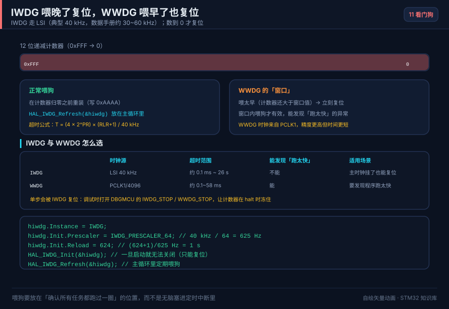

# 11 RTC 与看门狗

> RTC 提供掉电仍走时的日历时钟，独立/窗口看门狗保证程序跑飞后能自动复位，是产品可靠性的两大基石。

<p align="center">
  
  <br><sub>▲ 动画：独立看门狗计数与喂狗窗口（过早/过晚都触发复位）（作者自绘矢量动画，非实拍）</sub>
</p>

## 📌 学习目标

- [ ] 掌握 RTC 的四种时钟源（LSE/LSI/HSE/128）取舍，理解备份域与 VBAT。
- [ ] 会用 BKP 备份寄存器保存标志，判断是否首次上电。
- [ ] 会配置日历、闹钟、周期唤醒、时间戳。
- [ ] 说清 IWDG 与 WWDG 的区别，并给出正确的喂狗策略。
- [ ] 会排查「RTC 不走时」「LSE 不起振」「看门狗误复位」等问题。

## 🧠 核心原理

### 1. RTC 与备份域

**结论**：RTC 位于**备份域**，由 `VBAT` 供电，主电源掉电后仍能走时；时钟源优先选 **LSE 32.768 kHz**（精度最高）。

| 时钟源 | 频率 | 精度 | 引脚占用 | 适用 |
| --- | --- | --- | --- | --- |
| LSE（外部 32.768 kHz 晶振） | 32.768 kHz | 高（±20 ppm） | PC14/PC15 | 需要准确走时 |
| LSI（内部 RC） | ≈ 32~40 kHz | 低（±50% 起振误差、温漂大） | 无 | 省引脚/仅做唤醒 |
| HSE/128（主晶振分频） | 8 MHz/128 | 取决于 HSE | 占用 HSE | 已有高精度主晶振 |
| RTC 预分频 | — | 由 `PRL` 设定 | — | 把源频率分到 1 Hz |

- F1 的 RTC 是一个 **32 位秒计数器**，日历（年月日时分秒）需软件把秒数换算；F4 及以上内置 **BCD 硬件日历**（`TR`/`DR` 寄存器），带星期与闰年自动处理。
- 备份域访问要先使能 `PWR` 与 `BKP` 时钟，并解锁备份域（`PWR_CR.DBP`，见 RM0008 第 5 章 PWR / 第 6 章 BKP）。

### 2. BKP 备份寄存器

**结论**：`BKP_DRx` 由 `VBAT` 供电，主电源掉电也不丢，常用来保存「是否首次上电」「校准参数」等标志。

| 系列 | 备份寄存器 | 位数 |
| --- | --- | --- |
| STM32F1 | `BKP_DR1`~`BKP_DR10`（42 个，大容量） | 16 位 |
| STM32F4 | `RTC_BKP_DR0`~`DR19` | 32 位 |

典型用法：上电先读一个「魔法值」（如 `0xA5A5`），若匹配说明之前初始化过，直接读时间；否则写入魔法值并初始化日历。

### 3. 日历、闹钟、唤醒与时间戳

| 功能 | 说明 | 关键寄存器 |
| --- | --- | --- |
| 日历 | 秒/分/时/日/月/年（F1 需软件换算，F4 硬件 BCD） | `RTC_TR`/`RTC_DR`（F4） |
| 闹钟 Alarm | 与计数器比较，到点产生中断/事件 | `RTC_ALR`（F1）/`RTC_ALRMxR`（F4） |
| 周期唤醒 Wakeup | 按固定周期自动唤醒，配合 STOP 省电 | `RTC_WUTR`（F4） |
| 时间戳 Timestamp | 引脚上升沿记录当前时间 | `RTC_TSTR`/`RTC_TSDR`（F4） |

> F1 的闹钟是比较**秒计数器**；F4 可按「秒/分/时/日/月/星期」掩码匹配，更灵活。

### 4. IWDG 与 WWDG 对比

**结论**：IWDG 时钟独立、能兜底，是**安全底线**；WWDG 精度高、有喂狗窗口，能**检测程序时序异常**。二者可同时使用。

| 项 | IWDG（独立看门狗） | WWDG（窗口看门狗） |
| --- | --- | --- |
| 时钟源 | LSI（独立，与主时钟无关） | PCLK1（APB1） |
| 计数器 | 12 位递减 + 8 位预分频 | 7 位递减（`T[6:0]`） |
| 复位条件 | 计数到 0 前未喂狗 | **喂太早（>W[6:0]）或太晚（<0x40）都复位** |
| 窗口 | 无（随时可喂） | 有（`WWDG_CFR.W[6:0]` 设定） |
| 精度 | 差（LSI 温漂大） | 好（跟随 PCLK1） |
| 超时范围 | 约 0.1 ms ~ 26 s | 约 0.1 ms ~ 60 ms |
| 典型场景 | 死机兜底、低功耗 | 检测周期性任务是否按时执行 |
| F1 章节 | RM0008 第 17 章 | RM0008 第 18 章 |

**喂狗策略**：

- **主循环喂狗**：最简单，但若某个子函数死循环就失效。
- **定时器/中断喂狗**：适合 IWDG，但中断卡死也会误复位。
- **多任务各喂一次**：RTOS 中让每个关键任务都喂，任一任务卡死即复位。
- **WWDG 窗口**：强制在「不太早、不太晚」的窗口内喂，能发现「跑太快」（如时钟异常）和「跑太慢」。

## 🛠️ 硬件与接线

| 开发板 | 外设 | 引脚 | 备注 |
| --- | --- | --- | --- |
| BluePill (F103) | LSE 晶振 | PC14=OSC32_IN、PC15=OSC32_OUT | 焊 32.768 kHz 晶振 + 2×负载电容（~6 pF） |
| BluePill | VBAT | VBAT 脚 | 接 3 V 纽扣电池（CR2032）维持走时 |
| BluePill | 备用 LED | PC13 | 常用于心跳指示 |
| Nucleo-F411RE | LSE | PC14/PC15 | 板上已焊 32.768 kHz |
| 任意 | 看门狗 | 无需引脚 | 纯片内 |

> ⚠️ 负载电容要按晶振手册选（常见 6 pF / 12.5 pF），**电容过大 LSE 不起振**，是「RTC 不走时」的头号原因。

## 💻 代码实现

**① RTC 初始化 + 读时间（F1，LSE 源）**

```c
#include "stm32f1xx_hal.h"

RTC_HandleTypeDef hrtc;

static void MX_RTC_Init(void)
{
    __HAL_RCC_PWR_CLK_ENABLE();
    __HAL_RCC_BKP_CLK_ENABLE();

    hrtc.Instance          = RTC;
    hrtc.Init.AsynchPrediv = RTC_AUTO_1_SECOND;   /* F1 预分频到 1Hz */
    hrtc.Init.OutPut       = RTC_OUTPUTSOURCE_NONE;
    HAL_RTC_Init(&hrtc);

    /* 首次上电（BKP 无魔法值）才设置时间 */
    if (HAL_RTCEx_BKUPRead(&hrtc, RTC_BKP_DR1) != 0xA5A5) {
        RTC_TimeTypeDef t = { .Hours = 12, .Minutes = 0, .Seconds = 0 };
        RTC_DateTypeDef d = { .Year = 26, .Month = RTC_MONTH_JANUARY,
                              .Date = 7, .WeekDay = RTC_WEEKDAY_WEDNESDAY };
        HAL_RTC_SetTime(&hrtc, &t, RTC_FORMAT_BIN);
        HAL_RTC_SetDate(&hrtc, &d, RTC_FORMAT_BIN);
        HAL_RTCEx_BKUPWrite(&hrtc, RTC_BKP_DR1, 0xA5A5);   /* 存魔法值 */
    }
}

void RTC_PrintTime(void)
{
    RTC_TimeTypeDef t; RTC_DateTypeDef d;
    HAL_RTC_GetTime(&hrtc, &t, RTC_FORMAT_BIN);
    HAL_RTC_GetDate(&hrtc, &d, RTC_FORMAT_BIN);   /* 读日期会锁存时间寄存器 */
    printf("20%02d-%02d-%02d %02d:%02d:%02d\r\n",
           d.Year, d.Month, d.Date, t.Hours, t.Minutes, t.Seconds);
}
```

**② 闹钟中断**

```c
void MX_RTC_Alarm_Init(void)
{
    RTC_AlarmTypeDef alarm = {0};
    alarm.AlarmTime.Hours   = 8;
    alarm.AlarmTime.Minutes = 30;
    alarm.AlarmTime.Seconds = 0;
    alarm.AlarmMask         = RTC_ALARMMASK_DATEWEEKDAY;  /* 每天触发 */
    HAL_RTC_SetAlarm_IT(&hrtc, &alarm, RTC_FORMAT_BIN);
}

void HAL_RTC_AlarmAEventCallback(RTC_HandleTypeDef *hrtc)
{
    /* 到点回调，可置标志唤醒主循环 */
}
```

**③ 独立看门狗 IWDG**

```c
IWDG_HandleTypeDef hiwdg;

static void MX_IWDG_Init(void)
{
    hiwdg.Instance       = IWDG;
    hiwdg.Init.Prescaler = IWDG_PRESCALER_64;   /* LSI≈40kHz /64 = 625Hz */
    hiwdg.Init.Reload    = 4095;                /* 超时 ≈ 4095/625 ≈ 6.55 s */
    HAL_IWDG_Init(&hiwdg);
}

/* 主循环里定期喂狗（不要放在中断里，否则中断卡死也救不了） */
HAL_IWDG_Refresh(&hiwdg);
```

**④ 窗口看门狗 WWDG**

```c
WWDG_HandleTypeDef hwwdg;

static void MX_WWDG_Init(void)
{
    hwwdg.Instance       = WWDG;
    hwwdg.Init.Prescaler = WWDG_PRESCALER_8;    /* PCLK1/4096/8 */
    hwwdg.Init.Window    = 0x50;                /* 窗口上界 */
    hwwdg.Init.Counter   = 0x7F;                /* 初值，超时 ≈ 58.25ms @36MHz */
    hwwdg.Init.EWIMode   = WWDG_EWI_ENABLE;     /* 使能早唤醒中断 */
    HAL_WWDG_Init(&hwwdg);
}

/* 必须落在 [0x40, 0x50] 窗口内喂狗 */
HAL_WWDG_Refresh(&hwwdg);
```

## ⚠️ 常见坑与排查

| 现象 | 原因 | 解决 |
| --- | --- | --- |
| RTC 时间不走/上电归零 | LSE 未起振、VBAT 未接 | 检查晶振负载电容；VBAT 接电池 |
| LSE 起振失败 | 负载电容过大/晶振质量差 | 换 6 pF 电容，走线尽量短 |
| 年份/月份错乱 | F1 日历需软件换算，公式写错 | 用标准 32 位秒数↔日历换算库 |
| 读时间后日期变了 | 读 `TR` 会锁存，未及时读 `DR` | 先读时间再读日期 |
| 看门狗频繁复位 | 喂狗间隔 > 超时 | 算清超时时间；循环里定期喂 |
| WWDG 一使能就复位 | 初值 < 窗口上界或喂太早 | 令 `Counter > Window`，且只在窗口内喂 |
| 低功耗下看门狗误复位 | STOP 模式 LSI 仍计数 | 停止前 `HAL_IWDG_Refresh` 并规划唤醒 |

## 🧪 动手实验

1. **掉电走时**：焊上 LSE 晶振与 VBAT 纽扣电池，串口每秒打印时间；断电再上电。预期：时间连续，不会归零。
2. **每天定时闹钟**：设置每天 08:30 闹钟，到点在回调里点亮 LED。预期：到点触发一次，其余时间不动作。
3. **看门狗压力测试**：IWDG 超时设为 6.5 s；在代码里故意 `while(1)` 死循环不喂狗。预期：约 6.5 s 后芯片自动复位。
4. **（进阶）窗口看门狗检测时序**：用 WWDG 窗口检测一个周期性任务；把任务延迟调大到超时，观察复位；把任务改得过快（喂太早），同样复位。

## 🔗 相关资源

- RM0008《STM32F10xxx 参考手册》第 16 章 RTC、第 17 章 IWDG、第 18 章 WWDG、第 5 章 PWR、第 6 章 BKP、第 7 章 RCC（LSE/LSI 配置）。
- RM0090《STM32F4 参考手册》第 26 章 RTC、IWDG/WWDG 对应章节。
- 数据手册 DS：LSE 起振条件、LSI 频率范围、VBAT 工作电压。
- 应用笔记 AN4759《Using the hardware real-time clock (RTC) in STM32》。
- 配图：`../assets/animations/iwdg-window.svg`（作者自绘矢量图）。