# 11 RTC 与看门狗

> English: [RTC and the watchdog](en/11-rtc-watchdog.md)

> LED 重新闪烁不能证明看门狗生效。启动代码还要读到 IWDGRSTF，持久 boot_id 要增加，RTC 时间则应在主电源断开后继续前进。

<p align="center">
  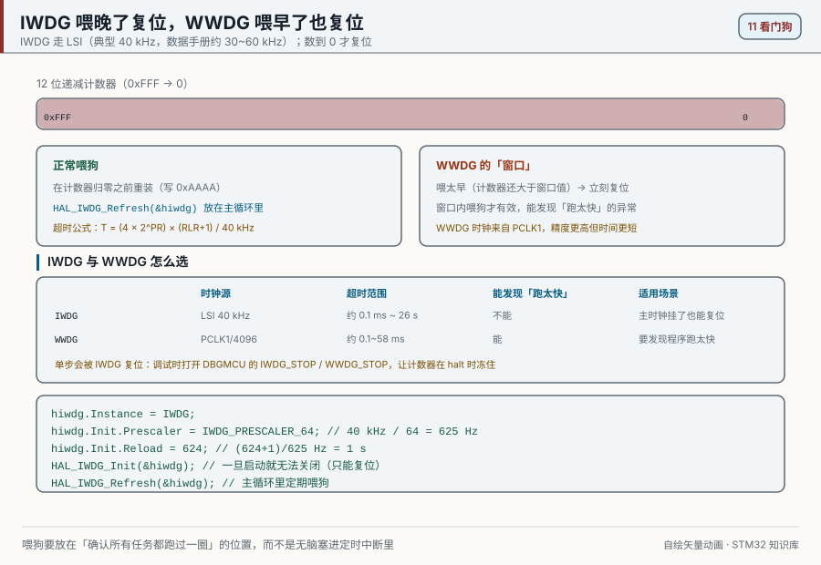
  <br><sub>▲ 辅图。独立看门狗只惩罚喂晚。喂早也复位的是窗口看门狗。不播放这张图时，1 秒和减到 0 才复位都在静态主图上。（作者自绘矢量动画，非实拍）</sub>
</p>

<!-- video:ch11 -->
<p align="center">
  <video width="640" controls poster="../assets/video/ch11-rtc.png">
    <source src="../assets/video/ch11-rtc.mp4" type="video/mp4">
  </video>
  <br><sub>▲ 本章讲解视频（2.6 分钟）。<a href="../assets/video/ch11-rtc.mp4">MP4</a> · <a href="../assets/video/ch11-rtc.srt">字幕</a></sub>
</p>

<details>
<summary>旁白文字稿</summary>

1. RTC 住在备份域。主电源掉了，只要备用电池和低速晶振还在，日历就能继续走。时钟源优先选外部 32.768 千赫，它比内部低速时钟准。
2. 备份域默认不让你随便写。要先允许访问，再选时钟、设分频。写不进去的时候，多半不是晶振坏了，而是域还锁着，或者写保护没解。
3. 独立看门狗的时钟独立，喂晚了就复位，用来兜底。窗口看门狗喂早喂晚都会复位，用来发现程序走得太快或太慢。两只可以同时在岗。
4. 这一帧是仓库画的看门狗窗口。太早喂，说明程序没有走到该到的地方；太晚喂，说明它卡住了。窗口看门狗把这两种都当成故障。独立看门狗只惩罚迟到。
5. 32.768 千赫晶振起振慢，初始化超时给得太短，会误判失败。真的不起振，再查负载电容和焊接。调试阶段可以暂时改用内部低速时钟，先把日历逻辑跑通。
6. 把喂狗放在一个和业务无关的定时中断里，主循环死锁时狗仍然吃得饱，等于没养。喂狗要放在你确认「这一圈真的走完了」的地方，并且落在窗口里面。
7. 芯片为什么重启，复位标志里有记录。独立看门狗、窗口看门狗、上电，是不同的旗。读完记得清掉，不然下一次你分不清是新的复位还是旧旗。
8. 口诀：独立看门狗只怕喂晚；窗口看门狗喂早喂晚都会复位。RTC 走在备份域，主电掉了还靠备用电池和低速钟。
9. 实验先故意不喂狗，确认它真的会复位，并且复位旗对得上。然后再把喂狗放到主循环里正确的位置。从没被咬过的狗，你不知道它在不在岗。
10. 合上书，三问。主电源掉了，RTC 还靠什么继续走？哪只看门狗喂早了也会复位？为什么不要把喂狗只放在一个无关的定时中断里？

</details>
<!-- /video:ch11 -->

## 原理与适用范围

本章的数字都按 STM32F103C8T6 算。IWDG 的 1 秒与附录 D 一致：预分频 64，Reload = 624，LSI 取典型值 40 kHz，计数频率 625 Hz。LSI 是片内 RC 振荡器，表 25 给的范围是 30 / 40 / 60 kHz（最小 / 典型 / 最大），所以这 1 秒只是典型值。

`T = 64 / 40000 × (624 + 1) = 1` s。Reload 写成 625 时多了一个计数，是 `(625 + 1) / 625` 秒。预分频和重载不变，LSI = 30 kHz 时 `64 / 30000 × 625 = 4/3` s，LSI = 60 kHz 时 `64 / 60000 × 625 = 2/3` s，正好是 30 kHz 时的一半。附录 D 写「大约一半」，是因为 30 kHz 和 60 kHz 是手册给的两端，不是某一颗芯片的实测。最长一档约 26 s，也按附录 D，手册没给保证的最大值。独立看门狗只在计数减到 0 时复位，喂早不复位。见 [RM0008 Rev 21 第 19 章](#source-rm0008-wdg) 和 [DS5319 Rev 20 表 25](#source-ds5319-rtc)。

窗口看门狗（WWDG）不一样，喂早、喂晚都会复位。PCLK1 = 36 MHz、预分频 8、计数初值 `0x7F` 时，超时 `(1/36e6) × 4096 × 8 × 64 = 58.25` ms。窗口值设为 `0x50`，计数器还大于 `0x50` 时就喂狗，会立刻复位。

有的代码片段把 Reload 设成最大值 4095，那时超时是 `(4095 + 1) / 625 = 6.5536` s，动手实验里说的「约 6.5 s」就是它。本章其余地方都按 624 这一秒来算。

RTC 用 LSE 晶振，32.768 kHz，接在第 3 脚 PC14-OSC32_IN 和第 4 脚 PC15-OSC32_OUT。RTC 的分频比是 `(PRL + 1)`，所以 PRL = 32767 才把 32768 Hz 分成 1 Hz，写成 PRL = 32768 就不是 1 Hz 了。LSI 典型 40 kHz，又会在 30–60 kHz 之间漂，用任何整数 PRL 都得不到稳定的 1 Hz，RTC 要准就得用 LSE。主电源断开后，备份域靠第 1 脚 VBAT 供电。写备份域之前要打开 PWR 和 BKP 时钟，并置位 `PWR_CR` 的 DBP。见 [RM0008 Rev 21 第 18 章](#source-rm0008-rtc)。

C8 是中密度，有 10 个 16 位备份数据寄存器，共 20 字节。资料里的 42 个是大容量型号的数字。F4 的 RTC 另是一套：20 个 32 位备份寄存器，日历放在 BCD 格式的 `TR`/`DR` 里。F103 的 RTC 只有一个 32 位秒计数器，年月日要软件自己换算。

IWDG 在 Stop 和 Standby 模式下照样计数。调试时可以冻住计数器，用章内的 `__HAL_DBGMCU_FREEZE_IWDG()`。RM0008 §19.3.3 只印了配置位名 `DBG_IWDG_STOP`，没给位号。选项字节里 `WDG_SW = 0` 时，上电就由硬件启动看门狗，软件关不掉；`WDG_SW = 1` 时由软件决定何时启动。见 [PM0075](#source-pm0075-rdp)。

LSE 占着第 3 脚和第 4 脚时，这两只脚不能再当 GPIO。PC13 如果还当心跳灯，规则和第 03 章一样：只能灌电流，写 0 才亮。换到大容量型号或 F4 时，上面的备份寄存器个数不再适用，要按那颗芯片的手册重查。

## 关键插图


<p align="center">
  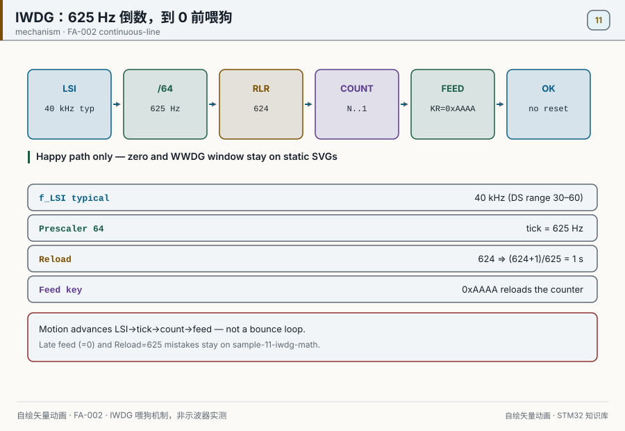
  <br><sub>▲ 自绘矢量动画（FA-002）。LSI→625 Hz→倒数→喂狗。</sub>
</p>


<p align="center">
  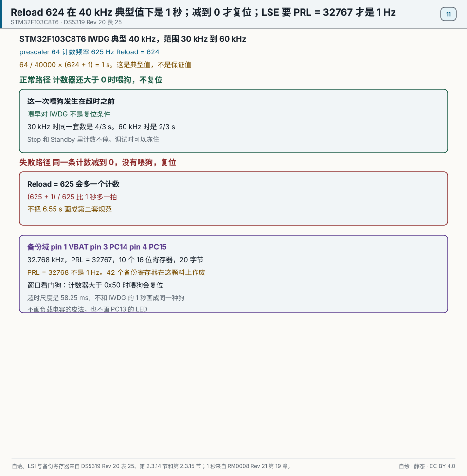
  <br><sub>▲ 自绘。STM32F103C8T6。LSI 典型 40 kHz，范围 30–60 kHz。预分频 64，计数频率 625 Hz，Reload = 624，在减到 0 之前喂狗，超时按典型值算是 1 秒，不是保证值。图里标出的出错情况是计数减到 0，或把 Reload 写成 625。备份域部分画的是第 1 脚 VBAT、第 3 脚 PC14、第 4 脚 PC15，32.768 kHz，PRL = 32767，10 个 16 位寄存器。PRL = 32768 不是 1 Hz。窗口看门狗在计数器大于 0x50 时喂狗会复位，超时 58.25 ms。出处是 [DS5319 Rev 20 表 25、第 2.3.14 节和第 2.3.15 节](#source-ds5319-rtc) 以及 [RM0008 Rev 21 第 19 章](#source-rm0008-wdg)。</sub>
</p>

<p align="center">
  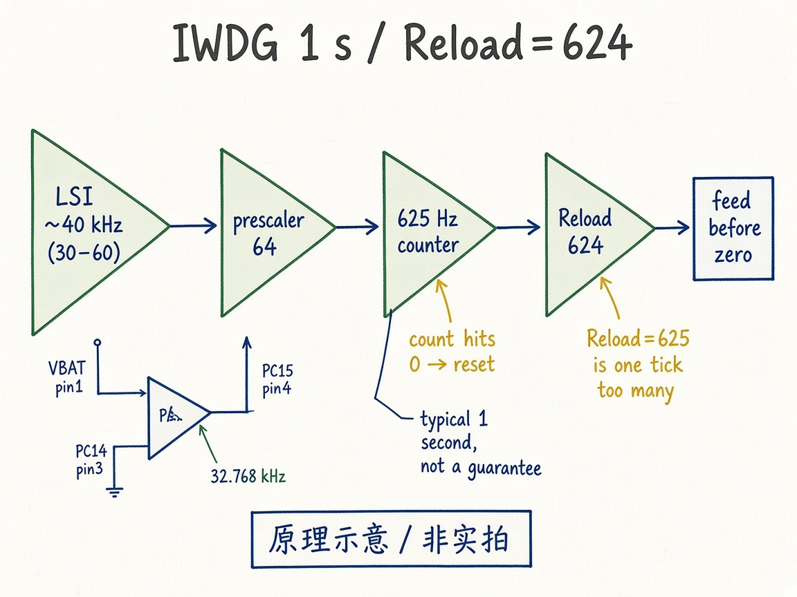
  <br><sub>▲ 知识轨（Handraw · 原理示意/非实拍）。LSI→÷64→625 Hz；Reload 624 典型 1 秒非保证；625 多一拍；不是实拍。</sub>
</p>

<p align="center">
  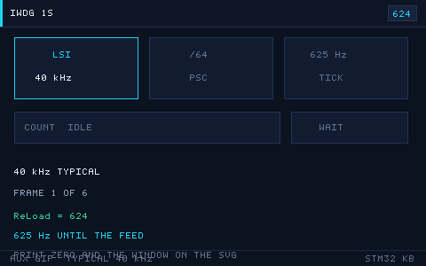
  <br><sub>▲ 动图版，演示 625 Hz 的计数在减到 0 之前被喂狗，标出 Reload = 624 和 40 kHz 典型值。印刷版只有上面的静态图。</sub>
</p>

章首的 `iwdg-window.svg` 画的是窗口看门狗。「喂早也复位」只适用于 WWDG，IWDG 喂早不会复位。

## 时序与状态

| 预分频 | f_LSI | Reload | (Reload + 1) | 时间 | 复位与否 |
| --- | --- | --- | --- | --- | --- |
| 64 | 40 kHz | 624 | 625 | 1 s | 减到 0 才复位。喂早不复位 |
| 64 | 40 kHz | 625 | 626 | 多一个计数 | 不是 1 秒整 |
| 64 | 30 kHz | 624 | 625 | 4/3 s | 不是保证值 |
| 64 | 60 kHz | 624 | 625 | 2/3 s | 大约是 30 kHz 那一档的一半 |
| RTC | 32768 Hz | PRL = 32767 | 32768 | 1 Hz | 分频比是 (PRL + 1) |
| RTC 失败 | 32768 Hz | PRL = 32768 | 32769 | 不是 1 Hz | 改成 32767 |
| 备份寄存器 | — | 10 个 16 位 | 20 字节 | 第 1 脚 VBAT 续电 | 42 个是大容量型号 |
| WWDG | PCLK1 = 36 MHz | 预分频 8，初值 `0x7F` | — | 58.25 ms | 计数器大于 `0x50` 时喂狗复位 |
| 对照 | 64 | 4095 | 4096 | 6.5536 s | 不取代 Reload 624 |

## 常见坑与出处

| 现象 | 原因 | 处理 | 出处 | 出处里能查到什么 |
| --- | --- | --- | --- | --- |
| 按 40 kHz 算的 1 秒，板上偏短或偏长 | 40 kHz 只是典型值 | Reload 用 624，并按 30–60 kHz 留余量 | [DS5319](#source-ds5319-rtc) | 表 25 的 fLSI 是 30 / 40 / 60 kHz。40 kHz 是典型值。这一秒不是保证值 |
| Reload 写成 625，超时比 1 秒多一拍 | 少算了一次 +1 的位置 | 改成 624 | [RM0008](#source-rm0008-wdg) | 预分频 64、40 kHz 时计数频率 625 Hz。时间用 `(Reload + 1)`。625 多一个计数 |
| 独立看门狗一喂就复位，像有窗口 | 把它当成了窗口看门狗 | 喂早对 IWDG 是允许的。要窗口用 WWDG | [RM0008](#source-rm0008-wdg) | IWDG 减到 0 才复位。WWDG 在计数器大于窗口值时喂狗也会复位。36 MHz 下 `0x7F` 与预分频 8 的超时是 58.25 ms |
| 主电源掉了日历归零 | 备份域没有续电，或 PRL 不对 | 接上第 1 脚 VBAT，LSE 用第 3 脚和第 4 脚，PRL 写 32767 | [DS5319](#source-ds5319-rtc) | 10 个 16 位备份寄存器由 VBAT 续电。默认 1 秒时基来自 32.768 kHz。C8 上是 10 个，不是 42 个 |
| 预分频写成 32768，秒脉冲偏慢 | 分频比是 (PRL + 1) | 改成 32767 | [RM0008](#source-rm0008-rtc) | 分频比是 `(PRL + 1)`。32768 Hz 要写成 32767 才是 1 Hz |
| 断点停住以后自己复位 | 调试时计数器还在减 | 调试时冻住 IWDG | [RM0008](#source-rm0008-wdg) | §19.3.3 印出配置位名 `DBG_IWDG_STOP`。调试时可以冻住独立看门狗。手册没给位号 |
| 选项字节把看门狗改成上电就跑，软件关不掉 | `WDG_SW` 为 0 | `WDG_SW` 为 0 是硬件看门狗，为 1 才是软件看门狗 | [PM0075](#source-pm0075-rdp) | USER 字节的这一位：0 表示硬件看门狗，1 表示软件看门狗 |

## 学习目标

- [ ] 掌握 RTC 的四种时钟源（LSE/LSI/HSE/128）取舍，理解备份域与 VBAT。
- [ ] 会用 BKP 备份寄存器保存标志，判断是否首次上电。
- [ ] 会配置日历、闹钟、周期唤醒、时间戳。
- [ ] 说清 IWDG 与 WWDG 的区别，并给出正确的喂狗策略。
- [ ] 会排查「RTC 不走时」「LSE 不起振」「看门狗误复位」等问题。

## 核心原理

复位实验必须区分“看门狗造成的复位”和普通上电复位；RTC 实验必须区分“计数继续”与“时间准确”。复位原因、持久状态和实际时间缺一不可。

### 1. RTC 与备份域


<p align="center">
  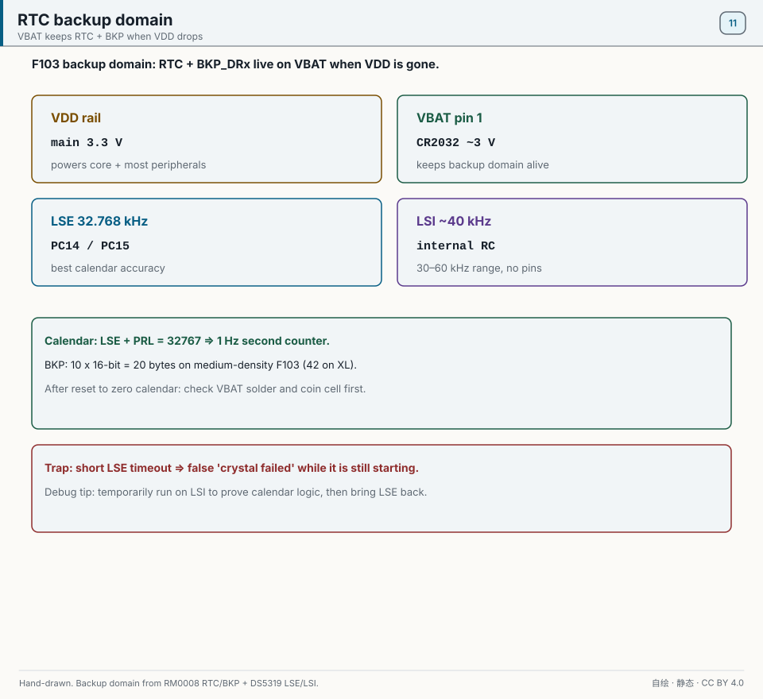
  <br><sub>▲ 自绘。VBAT 续电备份域；LSE 最准，LSI 仅作备用。</sub>
</p>

<p align="center">
  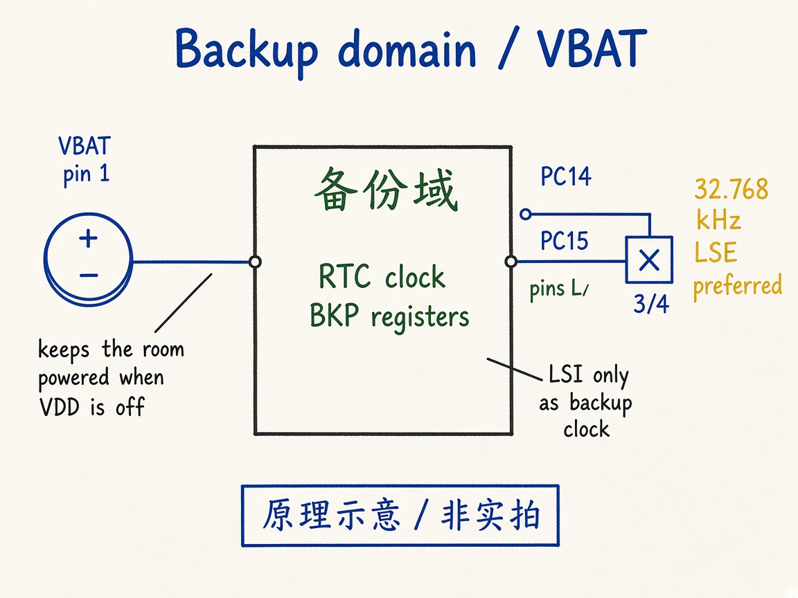
  <br><sub>▲ 知识轨（Handraw · 原理示意/非实拍）。VBAT 续电备份域；LSE 优先，LSI 仅备用；不是实拍。</sub>
</p>


RTC 是芯片里的一块电子表，它和几个备份寄存器住在一个单独的小房间里，叫备份域。主电源断了，只要 VBAT 脚上还接着纽扣电池，这个小房间照样有电，表照样走。表的准不准看时钟源：外接的 32.768 kHz 晶振最准，内部的 LSI 只能算大概。

RTC 位于**备份域**，由 `VBAT` 供电，主电源掉电后仍能走时；时钟源优先选 **LSE 32.768 kHz**（精度最高）。

| 时钟源 | 频率 | 精度 | 引脚占用 | 适用 |
| --- | --- | --- | --- | --- |
| LSE（外部 32.768 kHz 晶振） | 32.768 kHz | 由晶振决定，常见 ±20 ppm，以晶振手册为准 | PC14/PC15 | 需要准确走时 |
| LSI（内部 RC） | 最小 30 kHz，典型 40 kHz，最大 60 kHz | 表 25 的范围，不是 ±50% | 无 | 省引脚/仅做唤醒 |
| HSE/128（主晶振分频） | 8 MHz/128 | 取决于 HSE | 占用 HSE | 已有高精度主晶振 |
| RTC 预分频 | — | 由 `PRL` 设定 | — | 把源频率分到 1 Hz |

- F1 的 RTC 是一个 **32 位秒计数器**，日历（年月日时分秒）需软件把秒数换算；F4 及以上内置 **BCD 硬件日历**（`TR`/`DR` 寄存器），带星期与闰年自动处理。
- 备份域访问要先使能 `PWR` 与 `BKP` 时钟，并解锁备份域（`PWR_CR.DBP`，见 RM0008 第 5 章 PWR / 第 6 章 BKP）。

### 2. BKP 备份寄存器

备份寄存器是那个小房间里的便签纸，主电源掉了也不会丢。最常见的用法是贴一张「已经设置过时间」的条子：上电先看条子在不在，在就直接读表，不在才去初始化日历再把条子贴上。不然每次重启都会把时间重置一遍。

`BKP_DRx` 由 `VBAT` 供电，主电源掉电也不丢，常用来保存「是否首次上电」「校准参数」等标志。

| 系列 | 备份寄存器 | 位数 |
| --- | --- | --- |
| STM32F103C8T6 | `BKP_DR1`~`BKP_DR10`，10 个 16 位，共 20 字节。42 个是大容量型号的数字 | 16 位 |
| STM32F4 | `RTC_BKP_DR0`~`DR19` | 32 位 |

典型用法：上电先读一个「魔法值」（如 `0xA5A5`），若匹配说明之前初始化过，直接读时间；否则写入魔法值并初始化日历。

### 3. 日历、闹钟、唤醒与时间戳

F1 的 RTC 其实只会数秒，年月日要靠软件拿秒数去算。闹钟就是「数到这个秒数时叫我」。F4 以后的 RTC 直接按年月日时分秒存，闹钟可以设成「每天 7 点」这样的规则，还多了周期唤醒和时间戳，适合配合低功耗模式定时醒来。

| 功能 | 说明 | 关键寄存器 |
| --- | --- | --- |
| 日历 | 秒/分/时/日/月/年（F1 需软件换算，F4 硬件 BCD） | `RTC_TR`/`RTC_DR`（F4） |
| 闹钟 Alarm | 与计数器比较，到点产生中断/事件 | `RTC_ALR`（F1）/`RTC_ALRMxR`（F4） |
| 周期唤醒 Wakeup | 按固定周期自动唤醒，配合 STOP 省电 | `RTC_WUTR`（F4） |
| 时间戳 Timestamp | 引脚上升沿记录当前时间 | `RTC_TSTR`/`RTC_TSDR`（F4） |

> F1 的闹钟是比较**秒计数器**；F4 可按「秒/分/时/日/月/星期」掩码匹配，更灵活。


<p align="center">
  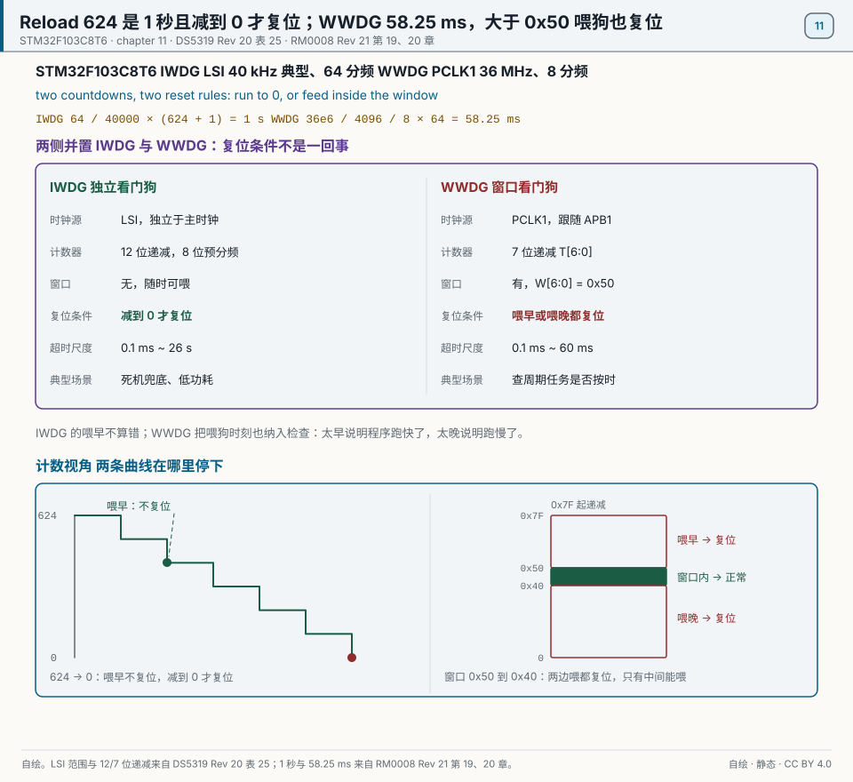
  <br><sub>▲ 自绘。IWDG 递减到 0 就复位：LSI 40 kHz、预分频 64、Reload 624 正好 1 秒。WWDG 是带窗口的倒计时：约 58.25 ms 一程，计数值还大于 0x50 时喂狗同样复位，喂狗只允许在窗口内。出处是 [RM0008 看门狗](#source-rm0008-wdg) 和 [DS5319 Rev 20](#source-ds5319-rtc)。</sub>
</p>

<p align="center">
  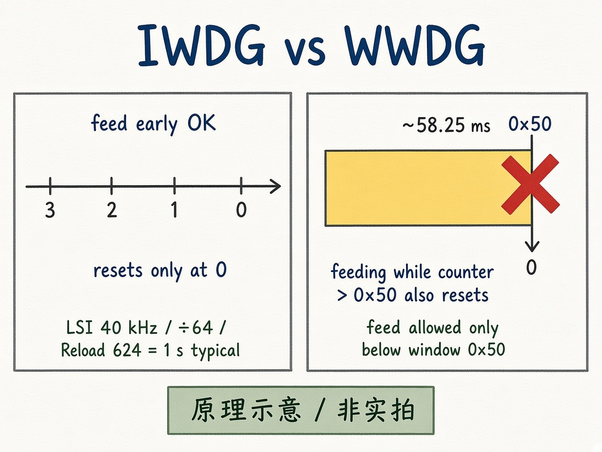
  <br><sub>▲ 知识轨（Handraw · 原理示意/非实拍）。IWDG 减到 0 才复位；WWDG 窗口外喂狗也复位；不是实拍。</sub>
</p>

### 4. IWDG 与 WWDG 对比


<p align="center">
  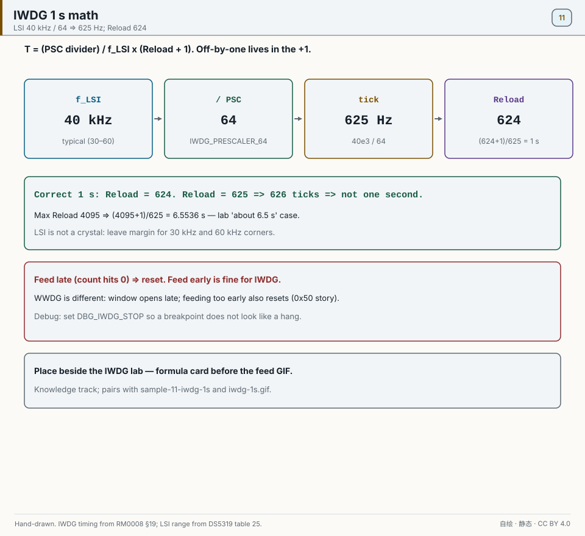
  <br><sub>▲ 自绘。超时用 (Reload+1)；写成 625 会多一拍。</sub>
</p>

<p align="center">
  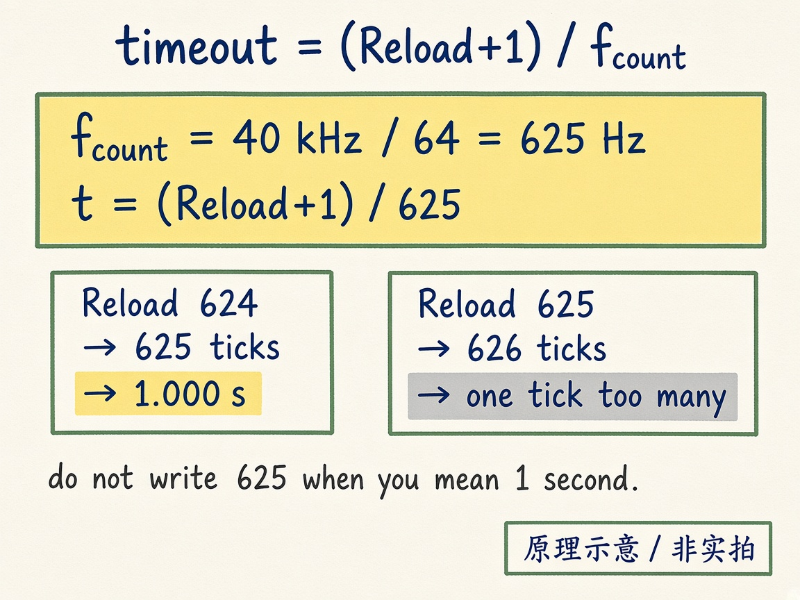
  <br><sub>▲ 知识轨（Handraw · 原理示意/非实拍）。超时用 (Reload+1)；624→1.000 s；写成 625 会多一拍；不是实拍。</sub>
</p>


看门狗是一个一直往下数的倒计时，程序要定期去「喂」它，把数拨回去。程序卡死了，没人喂，数到头芯片就复位。独立看门狗用自己的时钟，主时钟坏了它也照样数，是最后一道保险。窗口看门狗管得更细：喂得太晚会复位，喂得太早也会复位，所以它能发现程序跑得太快或太慢。

IWDG 时钟独立、能兜底，是**安全底线**；WWDG 精度高、有喂狗窗口，能**检测程序时序异常**。二者可同时使用。

| 项 | IWDG（独立看门狗） | WWDG（窗口看门狗） |
| --- | --- | --- |
| 时钟源 | LSI（独立，与主时钟无关） | PCLK1（APB1） |
| 计数器 | 12 位递减 + 8 位预分频 | 7 位递减（`T[6:0]`） |
| 复位条件 | 计数到 0 前未喂狗 | **喂太早（>W[6:0]）或太晚（<0x40）都复位** |
| 窗口 | 无（随时可喂） | 有（`WWDG_CFR.W[6:0]` 设定） |
| 精度 | 差（LSI 温漂大） | 好（跟随 PCLK1） |
| 超时范围 | 约 0.1 ms ~ 26 s | 约 0.1 ms ~ 60 ms |
| 典型场景 | 死机兜底、低功耗 | 检测周期性任务是否按时执行 |
| F1 章节 | RM0008 第 19 章 | RM0008 第 20 章 |

独立看门狗喂早不复位。喂早也复位的是窗口看门狗。

**喂狗策略**：

- **主循环喂狗**：最简单，但若某个子函数死循环就失效。
- **定时器/中断喂狗**：中断卡死也会误复位；更常见的是主循环已经死锁，中断仍按点喂狗，看门狗等于没养。
- **健康监督者喂狗**：RTOS 中每个关键任务完成一轮有效工作后只更新自己的健康纪元；监督任务检查全部纪元、队列积压和内存水位，全部健康时才刷新硬件看门狗。任一任务卡死，监督者停止刷新即复位。若让每个任务各自直接喂狗，卡死的任务不再喂、其他任务照常喂，反而制造假健康。
- **WWDG 窗口**：强制在「不太早、不太晚」的窗口内喂，能发现「跑太快」（如时钟异常）和「跑太慢」。

<p align="center">
  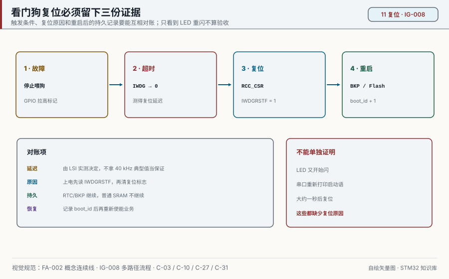
  <br><sub>▲ 看门狗闭环：故障、超时、复位原因和重启记录必须对得上。LED 或启动日志重新出现只能证明系统重启，不能单独证明复位来自 IWDG（FA-002 · IG-008 · C-03/C-10/C-27/C-31）。</sub>
</p>

## 硬件与接线

| 开发板 | 外设 | 引脚 | 备注 |
| --- | --- | --- | --- |
| BluePill (F103) | LSE 晶振 | PC14=OSC32_IN、PC15=OSC32_OUT | 焊 32.768 kHz 晶振，负载电容按晶振手册选择 |
| BluePill | VBAT | VBAT 脚 | 接 3 V 纽扣电池（CR2032）维持走时 |
| BluePill | 备用 LED | PC13 | 常用于心跳指示 |
| Nucleo-F411RE | LSE | PC14/PC15 | 板上已焊 32.768 kHz |
| 任意 | 看门狗 | 无需引脚 | 纯片内 |

> [!WARNING]
> 负载电容按晶振手册选择。电容过大时 LSE 可以不起振。

## 代码实现

**① RTC 初始化 + 读时间（F1，LSE 源）**

```c
#include "stm32f1xx_hal.h"

RTC_HandleTypeDef hrtc;

static void MX_RTC_Init(void)
{
    __HAL_RCC_PWR_CLK_ENABLE();
    __HAL_RCC_BKP_CLK_ENABLE();

    hrtc.Instance          = RTC;
    hrtc.Init.AsynchPrediv = RTC_AUTO_1_SECOND;   /* F1 预分频到 1Hz */
    hrtc.Init.OutPut       = RTC_OUTPUTSOURCE_NONE;
    HAL_RTC_Init(&hrtc);

    /* 首次上电（BKP 无魔法值）才设置时间 */
    if (HAL_RTCEx_BKUPRead(&hrtc, RTC_BKP_DR1) != 0xA5A5) {
        RTC_TimeTypeDef t = { .Hours = 12, .Minutes = 0, .Seconds = 0 };
        RTC_DateTypeDef d = { .Year = 26, .Month = RTC_MONTH_JANUARY,
                              .Date = 7, .WeekDay = RTC_WEEKDAY_WEDNESDAY };
        HAL_RTC_SetTime(&hrtc, &t, RTC_FORMAT_BIN);
        HAL_RTC_SetDate(&hrtc, &d, RTC_FORMAT_BIN);
        HAL_RTCEx_BKUPWrite(&hrtc, RTC_BKP_DR1, 0xA5A5);   /* 存魔法值 */
    }
}

void RTC_PrintTime(void)
{
    RTC_TimeTypeDef t; RTC_DateTypeDef d;
    HAL_RTC_GetTime(&hrtc, &t, RTC_FORMAT_BIN);
    HAL_RTC_GetDate(&hrtc, &d, RTC_FORMAT_BIN);   /* 读日期会锁存时间寄存器 */
    printf("20%02d-%02d-%02d %02d:%02d:%02d\r\n",
           d.Year, d.Month, d.Date, t.Hours, t.Minutes, t.Seconds);
}
```

**② 闹钟中断**

```c
void MX_RTC_Alarm_Init(void)
{
    RTC_AlarmTypeDef alarm = {0};
    alarm.AlarmTime.Hours   = 8;
    alarm.AlarmTime.Minutes = 30;
    alarm.AlarmTime.Seconds = 0;
    alarm.AlarmMask         = RTC_ALARMMASK_DATEWEEKDAY;  /* 每天触发 */
    HAL_RTC_SetAlarm_IT(&hrtc, &alarm, RTC_FORMAT_BIN);
}

void HAL_RTC_AlarmAEventCallback(RTC_HandleTypeDef *hrtc)
{
    /* 到点回调，可置标志唤醒主循环 */
}
```

**③ 独立看门狗 IWDG**

```c
IWDG_HandleTypeDef hiwdg;

static void MX_IWDG_Init(void)
{
    hiwdg.Instance       = IWDG;
    hiwdg.Init.Prescaler = IWDG_PRESCALER_64;   /* LSI≈40kHz /64 = 625Hz */
    hiwdg.Init.Reload    = 4095;                /* 超时 (4095 + 1) / 625 = 6.5536 s。前面讲的 1 秒超时用的是 Reload 624 */
    HAL_IWDG_Init(&hiwdg);
}

/* 主循环里定期喂狗：不要放进与业务无关的定时中断。主循环死锁时中断仍会按时喂，狗就等于没养 */
HAL_IWDG_Refresh(&hiwdg);
```

**④ 窗口看门狗 WWDG**

```c
WWDG_HandleTypeDef hwwdg;

static void MX_WWDG_Init(void)
{
    hwwdg.Instance       = WWDG;
    hwwdg.Init.Prescaler = WWDG_PRESCALER_8;    /* PCLK1/4096/8 */
    hwwdg.Init.Window    = 0x50;                /* 窗口上界 */
    hwwdg.Init.Counter   = 0x7F;                /* 初值，超时 ≈ 58.25ms @36MHz */
    hwwdg.Init.EWIMode   = WWDG_EWI_ENABLE;     /* 使能早唤醒中断 */
    HAL_WWDG_Init(&hwwdg);
}

/* 必须落在 [0x40, 0x50] 窗口内喂狗 */
HAL_WWDG_Refresh(&hwwdg);
```


<p align="center">
  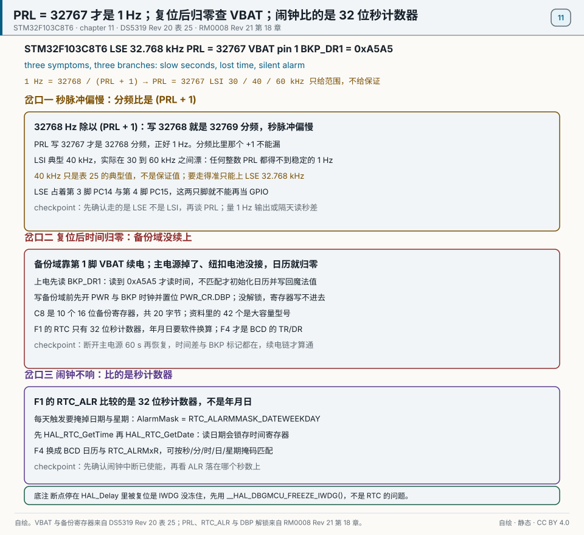
  <br><sub>▲ 自绘。排错三岔口：时间快慢不一，先查 PRL 是不是 32767——32.768 kHz 减一才是 1 Hz；复位后时间归零，查 VBAT 与备份域有没有掉电；闹钟不响，记住比较对象是 32 位秒计数器。出处是 [RM0008 RTC](#source-rm0008-rtc) 和 [DS5319 Rev 20](#source-ds5319-rtc)。</sub>
</p>

<p align="center">
  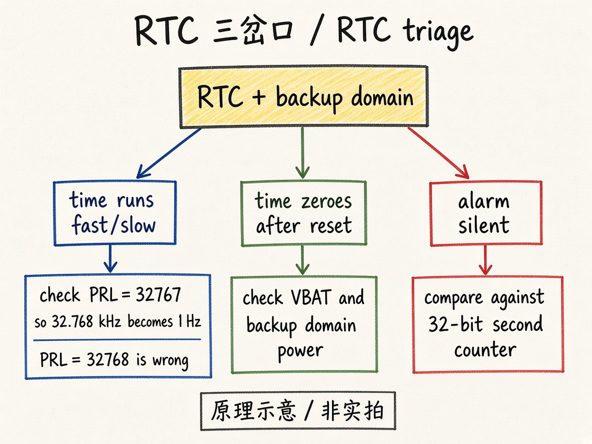
  <br><sub>▲ 知识轨（Handraw · 原理示意/非实拍）。岔口：PRL / VBAT 掉电 / 闹钟秒计数；不是实拍。</sub>
</p>

## 动手实验

1. **RTC 持久性**：写入时间和 BKP 标记，断开主电源 60s 后恢复。记录恢复后的时间差与 BKP 标记；LSE 不起振时另记失败状态。
2. **IWDG 复位证据**：设置约 1s 超时，停止喂狗并用 GPIO 标出故障起点。重启后先读 IWDGRSTF、增加 boot_id，再清标志；重复 5 次记录实际延迟范围。
3. **WWDG 窗口证据**：分别制造喂早、喂晚和窗口内喂狗三种情况，记录复位原因与 GPIO 时间点。窗口内运行应持续，另外两种应复位。

### 超时怎么算，调试时怎么冻住

`T = 预分频 ÷ f_LSI × (Reload + 1)`。`IWDG_PRESCALER_64` 在 LSI 典型 40 kHz 下是 625 Hz，想要 1 秒要把 Reload 写成 **624**，写成 625 会多一个计数。

LSI 的数据手册范围大约 30~60 kHz，40 kHz 只是典型值。超时要留余量，不要卡在标称值上。

| 看门狗 | 什么时候复位 | 时间尺度 |
| --- | --- | --- |
| IWDG | 只在喂晚了（减到 0） | 约 0.1 ms ~ 26 s |
| WWDG | 喂早了或喂晚了都复位 | F103 @ 36 MHz 大约 0.1~58 ms |

单步调试会被 IWDG 复位。在选项或调试寄存器里冻住它：

```c
__HAL_DBGMCU_FREEZE_IWDG();   /* F1 在 DBGMCU->CR，F4 在 APB1FZ，宏会选对寄存器 */
__HAL_DBGMCU_FREEZE_WWDG();
```

IWDG 一旦 `HAL_IWDG_Init` 成功就停不下来，只有复位能关。选项字节里把 `WDG_SW` 写成 0，上电就由硬件看门狗接管，软件想关也关不掉。

离开本章前，应有掉电前后的 RTC/BKP 记录、5 次 IWDG 延迟与 IWDGRSTF，以及 WWDG 早/晚/窗口内三组结果。

自测：

1. 预分频 64、Reload 624、LSI 按 40 kHz，超时是不是刚好 1 秒？差在哪一个“+1”？
2. 窗口看门狗在计数器还大于窗口值时喂狗，会发生什么？
3. 为什么断点停在 `HAL_Delay` 里，板子会自己复位？

## 相关资源

- RM0008《STM32F10xxx 参考手册》第 18 章 RTC、第 19 章 IWDG、第 20 章 WWDG、第 5 章 PWR、第 6 章 BKP、第 7 章 RCC（LSE/LSI 配置）。
- RM0090《STM32F4 参考手册》第 26 章 RTC、IWDG/WWDG 对应章节。
- 数据手册 DS：LSE 起振条件、LSI 频率范围、VBAT 工作电压。
- 应用笔记 AN4759《Using the hardware real-time clock (RTC) in STM32》。
- 配图：`../assets/animations/iwdg-window.svg`（作者自绘矢量图）。

- 手机阅读版：[第 11 章 · RTC与看门狗（公众号图文）](https://mp.weixin.qq.com/s/MSNJ-MdVM15opQi3W20V1g)
