# 12 Flash 与 IAP 升级

> English: [Flash and IAP](en/12-flash-iap.md)

> 收到固件并跳转不等于升级成功。Bootloader 必须先核对长度、范围、CRC 和向量表，再交出控制权；应用版本心跳用于确认启动。若跳转后没有心跳，需要预先设计超时复位和重新下载入口。单槽没有旧镜像可回退，回滚还需要完好的备份和可恢复的切换记录。

<p align="center">
  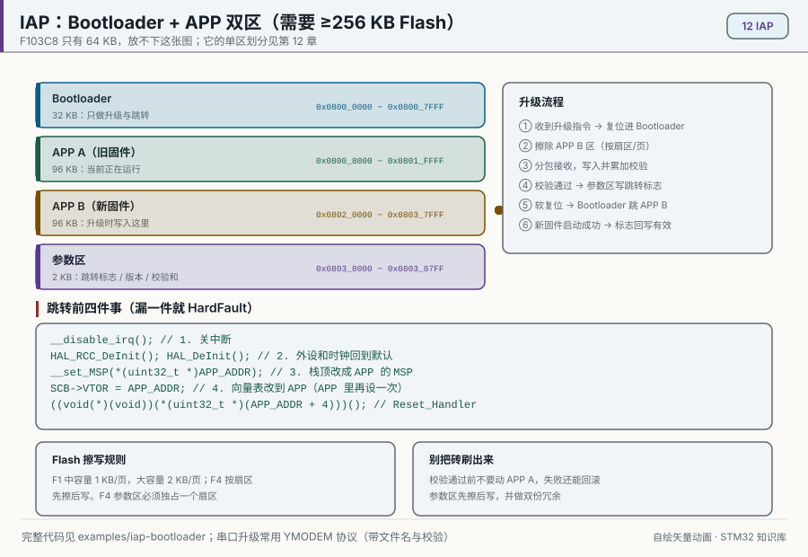
  <br><sub>▲ 动画：IAP 在线升级 Bootloader + APP 双区跳转（作者自绘矢量动画，非实拍）</sub>
</p>

<!-- video:ch12 -->
<p align="center">
  <video width="640" controls poster="../assets/video/ch12-iap.png">
    <source src="../assets/video/ch12-iap.mp4" type="video/mp4">
  </video>
  <br><sub>▲ 本章讲解视频（2.8 分钟）。<a href="../assets/video/ch12-iap.mp4">MP4</a> · <a href="../assets/video/ch12-iap.srt">字幕</a></sub>
</p>

<details>
<summary>旁白文字稿</summary>

1. 闪存不能当内存随便改一个字节。通常要先擦，再写。擦写之前必须解锁。写到一半掉电，这一页可能是半新半旧，启动时要能认出来。
2. F103 的读保护里，选项字节 0xA5 表示不保护。改成别的值之前，先想清楚你还能不能再读出来。改保护之前，先把现有程序备份下来。
3. 到了 F4，0xCC 这一档是不可逆的读保护。手滑写进去，这颗芯片的调试口就回不来了。实验这种操作，不要放在你唯一的那块板子上。
4. 这一帧是仓库画的升级路径。程序不要擦掉自己的脚下：先回到 Bootloader，再由它把新固件写进 APP 区。单槽没有旧程序可退，校验失败就留在升级模式。
5. 程序如果不是从默认的闪存起始跑，中断向量表的偏移也要改。只改链接脚本、不改向量表偏移，平时能跑，一进中断就飞到旧地址。
6. 跳转前至少核对长度和校验。没有校验就跳，等于允许任意一包噪声变成新程序。失败就留在 Bootloader 等重传，单槽没有旧版本可回滚。
7. 擦除不是调用一下就结束。要等忙标志落下，再去读。写保护如果开着，解锁只解了闪存控制器还不够。手册里的顺序不要跳步。
8. 两把钥匙别带错门：0xA5 是 F1 的开门钥匙，0xCC 是 F4 的单程票。擦除前必须先解锁，锁着的闪存会拒绝写入，或者让你以为写进去了。
9. 实验选一页确定不会踩到当前程序的闪存，擦掉、写几个字、再读回来。和程序区叠在一起的实验，做完这章你就没有调试器可以后悔了。
10. 选页有三条纪律：页址别踩到程序区，先擦干净再写，写完读回核对。三条都守住，升级程序才不会把自己刷死。

</details>
<!-- /video:ch12 -->
## 原理与适用范围

本章的页大小、半字写入和跳转都按 STM32F103C8T6 算。它是中容量，闪存 64 KB，地址从 `0x08000000` 到 `0x08010000` 之前，1 KB 一页，共 64 页，页号 0 到 63。第 63 页从 `0x0800FC00` 起。`0x0801FC00` 是 128 KB 型号的末页，已经超出 C8 的 64 KB。大容量型号是 2 KB 一页，换到那些型号时页地址要重算。见 [RM0008 Rev 21 第 3 章](#source-rm0008-flash)。

编程地址要 2 字节对齐，一次写 16 位。擦除后读回 `0xFFFF`。闪存只能把 1 写成 0，已经是 0 的位不擦整页就回不到 1。F103 不能按字节编程（F4 可以），一个 32 位值要分两次半字写。

解锁要把两把钥匙按顺序写进 `FLASH_KEYR`：先 `0x45670123`，再 `0xCDEF89AB`，`CR.LOCK` 才会清零。顺序反了，锁不会打开，擦除会返回错误。写完记得重新上锁。

下面的分区是本书和 `examples/iap-bootloader` 用的划分，手册并没有规定必须这样分。Bootloader 从 `0x08000000` 起，16 KB，16 页，到 `0x08004000` 之前。参数区从 `0x08004000` 起，2 KB，2 页，到 `0x08004800` 之前。APP 从 `0x08004800` 起，46 KB，46 页，长度 `0xB800`，到 `0x08010000` 之前。三块加起来正好 64 KB。APP 链接脚本的起始地址和 `SCB->VTOR` 都要设成 `0x08004800`。只改了其中一个，APP 的中断仍会跳到 Bootloader 的向量表。

APP 区的第 0 个字是 MSP 初值，第 1 个字在 `0x08004804`，是 `Reset_Handler` 的地址。跳转前读出这两个字，先设 MSP，再写 `VTOR`，最后跳到复位地址。`VTOR` 还是 0 时，中断仍进 Bootloader。向量表这两个字的含义和第 01 章讲的启动过程一样。见 [PM0056](#source-pm0056-vector)。

读保护的「无保护」值是 `0xA5`。把读保护解除回 `0xA5` 时，硬件会先整片擦除主闪存。见 [PM0075](#source-pm0075-rdp)。本章的 Bootloader 放在用户闪存里，不是芯片自带的系统存储器。它收固件用的串口还是第 06 章的第 30 脚 PA9、第 31 脚 PA10。

## 关键插图


<p align="center">
  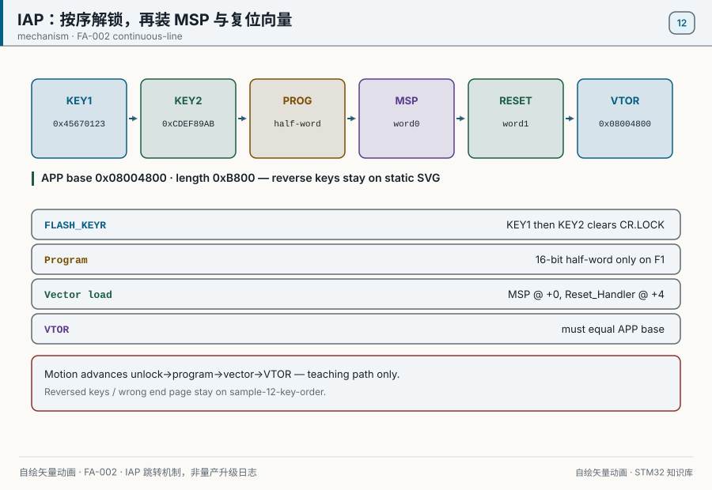
  <br><sub>▲ 自绘矢量动画（FA-002）。KEY1→KEY2→半字→向量→VTOR。</sub>
</p>


<p align="center">
  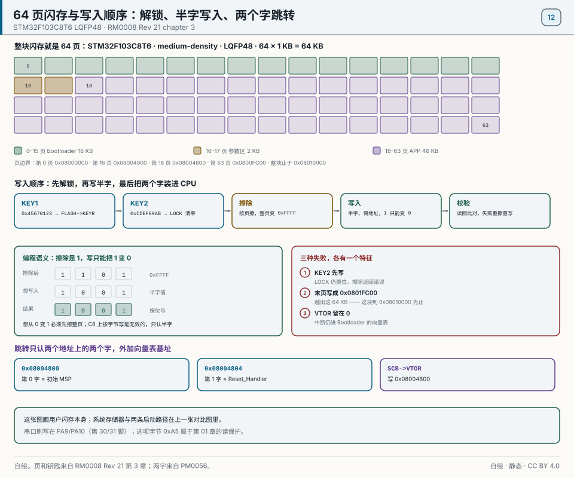
  <br><sub>▲ 自绘。看哪里：最上面把 64 KB 画成 16 × 4 共 64 个格子，一格一页 1 KB——绿色 16 页是 Bootloader、琥珀色 2 页是参数区、紫色 46 页是 APP，格子里标出第 0、16、18、63 页；中间五步是写入顺序（KEY1 → KEY2 → 擦除 → 半字写入 → 校验），每步写明地址或寄存器；下面左边是编程语义——擦除后读 0xFFFF，写入只能按位把 1 变 0，所以从 0 变 1 必须先擦整页，C8 只认半字；右边三条是三种失败各自的特征；再往下是跳转只认的三个位置：0x08004800 的 MSP、0x08004804 的复位地址、写成 0x08004800 的 VTOR。出处是 [RM0008 Rev 21 第 3 章](#source-rm0008-flash) 和 [PM0056](#source-pm0056-vector)。</sub>
</p>

<p align="center">
  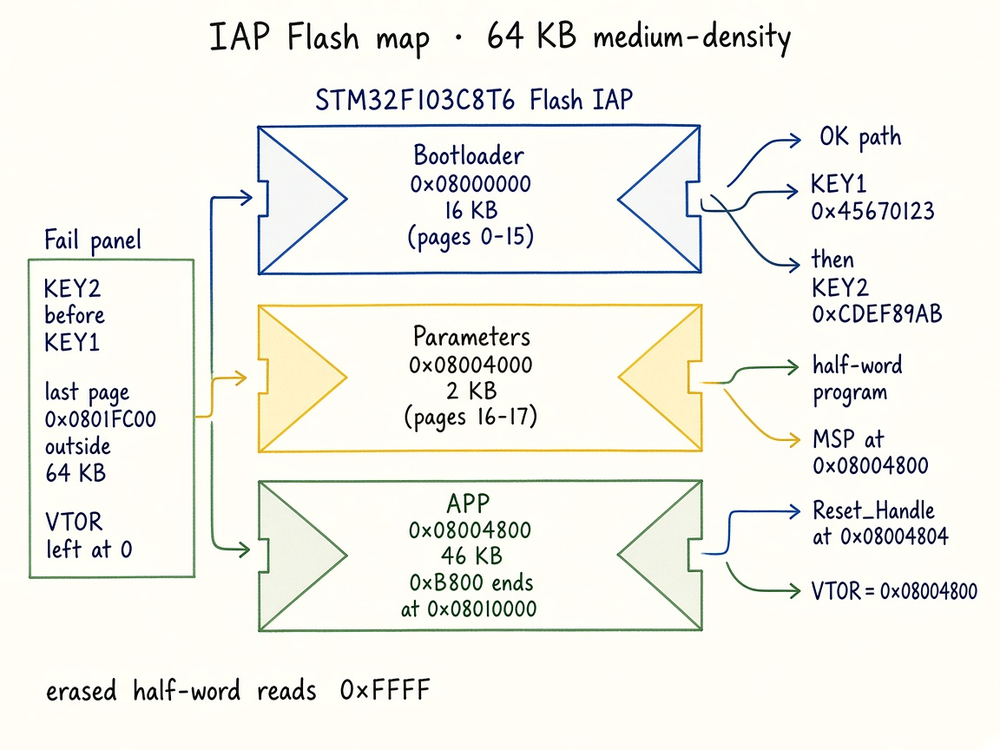
  <br><sub>▲ 知识轨（Handraw · 原理示意/非实拍）。Bootloader 16 KB + 参数 2 KB + APP 0x08004800/0xB800；KEY1→KEY2→半字→MSP/VTOR；不是实拍。</sub>
</p>

<p align="center">
  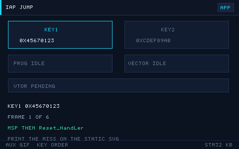
  <br><sub>▲ 动图版，演示先写 0x45670123、后写 0xCDEF89AB，一个半字写进 APP，再读出 MSP 和复位地址。印刷版只有上面的静态图。</sub>
</p>

章首动画 `flash-iap.svg` 演示的是整个升级流程，页边界、两把钥匙和跳转用的两个字以上面的静态图为准。

## 时序与状态

| 区 | 起始 | 长度 | 页数 | 结束于 |
| --- | --- | --- | --- | --- |
| Bootloader | `0x08000000` | 16 KB | 16 | `0x08004000` |
| 参数区 | `0x08004000` | 2 KB | 2 | `0x08004800` |
| APP | `0x08004800` | 46 KB，`0xB800` | 46 | `0x08010000` |
| 末页 | `0x0800FC00` | 1 KB | 第 63 页 | 落在 APP 内 |
| 失败地址 | `0x0801FC00` | — | — | 不在这 64 KB 里 |
| 钥匙 | 先 `0x45670123` | 后 `0xCDEF89AB` | — | 反序清不掉 LOCK |
| 半字 | 地址 2 字节对齐 | 一次 16 位 | 擦除态 `0xFFFF` | C8 不能按字节编程 |
| 跳转 | `0x08004800` 的字是 MSP | `0x08004804` 的字是复位 | `VTOR = 0x08004800` | `VTOR` 留在 0 仍进 Bootloader |

## 常见坑与出处


<p align="center">
  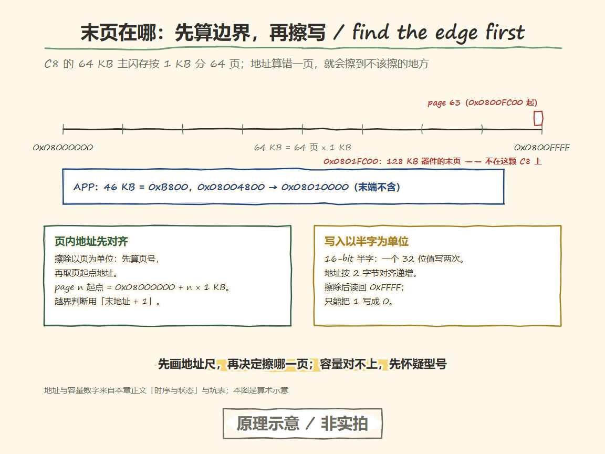
  <br><sub>▲ 知识轨（Handraw · 原理示意/非实拍）。看哪里：64 KB 地址尺、page 63 的起点、0x0801FC00 影子行、APP 46 KB 的区间。证明什么：末页边界要先算清，0x0801FC00 属于 128 KB 器件，不在这颗 C8 上。不能证明什么：不是芯片实读，也不替代 RM 的页擦除时序。出处：[RM0008](#source-rm0008-flash)、本章「时序与状态」。</sub>
</p>
| 现象 | 原因 | 处理 | 出处 | 出处里能查到什么 |
| --- | --- | --- | --- | --- |
| 注释写成小容量，页大小却对 | 密度名用错了 | 密度名改成中容量。页仍是 1 KB，共 64 页 | [RM0008](#source-rm0008-flash) | 中容量按 1 KB 擦除。2 KB 一页的是大容量型号 |
| 擦除返回错误 | 钥匙顺序反了，或地址不在页边界 | 先写 KEY1，再写 KEY2。地址落在页边界上 | [RM0008](#source-rm0008-flash) | 顺序是 `0x45670123` 然后 `0xCDEF89AB`。反序清不掉 LOCK |
| 写进去的字节读回来不对 | 没按半字写，或想把 0 写回 1 | 按半字、按偶地址写。要改 0 回 1 先擦整页 | [RM0008](#source-rm0008-flash) | 编程粒度是 16 位。擦除态是 `0xFFFF`。F103 没有按字节编程 |
| 跳转后死机，或中断跑回 Bootloader | 没装入两字，或 VTOR 仍为 0 | 从 `0x08004800` 装入 MSP 和复位，并写 `VTOR` | [PM0056](#source-pm0056-vector) | 第 0 字是栈初值，第 1 字是复位地址 |
| APP 长度和链接脚本对不上 | 长度没按 46 KB 写 | 起始 `0x08004800`，长度 `0xB800` | [本仓库例程](#source-project-examples) | `examples/iap-bootloader` 的 APP 是 46 KB，即 `0xB800` |
| 实验写到 `0x0801FC00` | 把 128 KB 料的末页套到了 C8 上 | C8 的最后一页是 `0x0800FC00` | [DS5319](#source-ds5319-swd) | STM32F103x8 的闪存是 64 KB。`0x0801FC00` 是 128 KB 型号的末页 |
| 按别的系列的无保护键解除读保护 | F103 的键值和别的系列不同 | 无保护是 `0xA5`，解除会整片擦除 | [PM0075](#source-pm0075-rdp) | RDP 为 `0xA5` 才允许读出。编程回 `0xA5` 会先整片擦除 |

## 学习目标

- [ ] 掌握 F1「页」与 F4「扇区」的 Flash 结构、擦写寿命与编程粒度。
- [ ] 会走完解锁（KEY1/KEY2）→ 擦除 → 编程 → 上锁的完整流程。
- [ ] 理解 IAP 原理，能画出 Bootloader + APP 的内存划分表。
- [ ] 掌握跳转 APP 前的关键动作：关中断、复位外设、设 MSP、设 `SCB->VTOR`。
- [ ] 了解 YMODEM/串口升级协议的基本流程。

## 核心原理

升级路径按“接收、写入、校验、跳转、应用确认”分段。每一段都要有失败出口，不能让一个未经验证的地址进入 MSP 或 PC。

### 1. Flash 组织结构


<p align="center">
  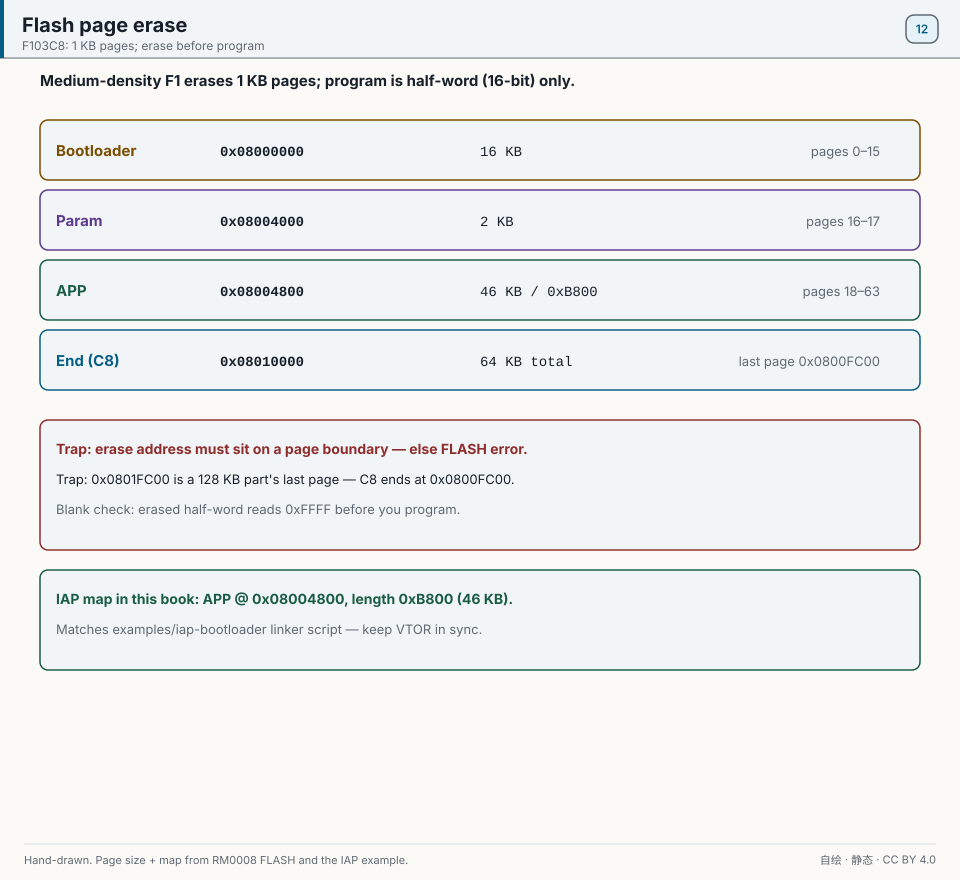
  <br><sub>▲ 自绘。中容量 1 KB/页；C8 末页是 0x0800FC00。</sub>
</p>

<p align="center">
  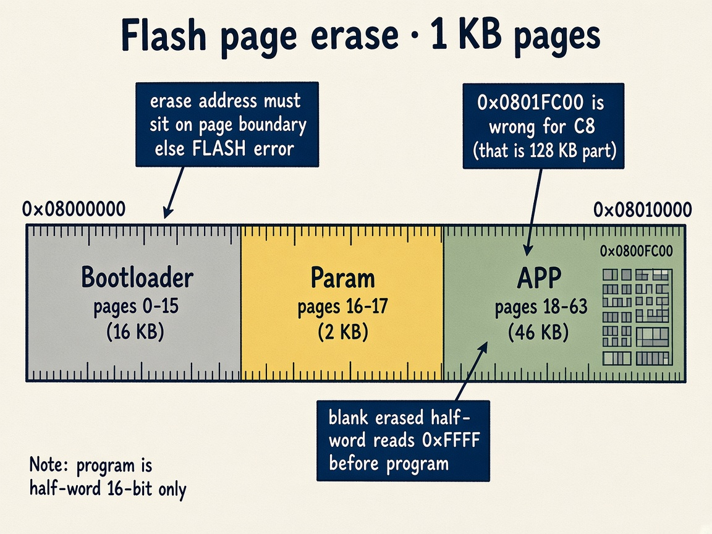
  <br><sub>▲ 知识轨（Handraw · 原理示意/非实拍）。1 KB/页；末页 0x0800FC00；擦除地址须落页边界；0x0801FC00 超出 C8 容量，不存在这个页；不是实拍。</sub>
</p>


Flash 像一本只能用铅笔写、用整页橡皮擦的笔记本。擦过的地方全是 1，写的时候只能把 1 改成 0，想把 0 改回 1 只能把一整页擦掉。所以改一个字节，也要先把整页内容读出来，擦掉这一页，再连同改过的那个字节一起写回去。每页擦写的次数是有限的，频繁写日志要轮着用不同的页。

F1 按 **1 KB/2 KB 的「页」** 擦除、以**半字（16 位）** 编程；F4 按 **16~128 KB 的「扇区」** 擦除、支持**字节/半字/字/双字**编程。

| 项 | STM32F1（RM0008 第 3 章 FLASH） | STM32F4（RM0090 第 3 章 FLASH） |
| --- | --- | --- |
| 擦除粒度 | 页：小/中容量 1 KB，大容量 2 KB | 扇区：S0–S3=16 KB，S4=64 KB，S5–S7=128 KB（F407VG） |
| 编程粒度 | 半字（16 位） | 字节/半字/字（32 位）/双字（64 位） |
| 编程电压 | 内部产生（VPP 由内部泵） | 内部产生 |
| 擦写寿命 | ≥ 10k 次（数据手册保证） | ≥ 10k 次 |
| 数据保持 | 20 年 @ 85°C | 20 年 @ 85°C |
| 擦除时间 | 页擦除 ~20~40 ms | 扇区擦除 ~0.4~4 s（越大越慢） |

> [!WARNING]
> Flash **只能按整页/整扇区擦除**，不能按字节改；改一个字节也要先擦整页。频繁写日志务必做「磨损均衡」，把写分散到不同页。


<p align="center">
  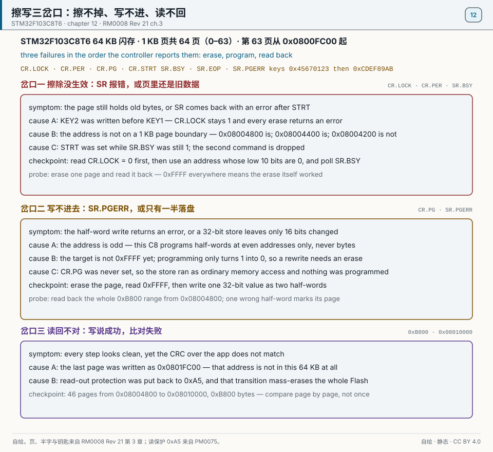
  <br><sub>▲ 自绘。排错三岔口：擦除报错先读 CR.LOCK 位与 1 KB 页边界对不对；写不进去检查是不是按半字写、目标还停在 0xFFFF；读回不对就按 0x08004800、0xB800 逐页比对。出处是 [RM0008 Flash](#source-rm0008-flash) 和 [PM0075](#source-pm0075-rdp)。</sub>
</p>

<p align="center">
  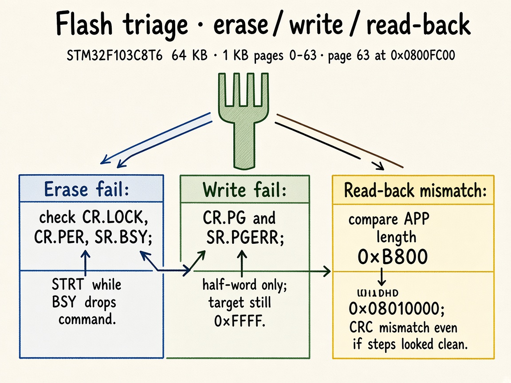
  <br><sub>▲ 知识轨（Handraw · 原理示意/非实拍）。岔口：CR.LOCK/页边界；半字与 0xFFFF；0xB800 读回比对；不是实拍。</sub>
</p>

### 2. 解锁与编程流程


<p align="center">
  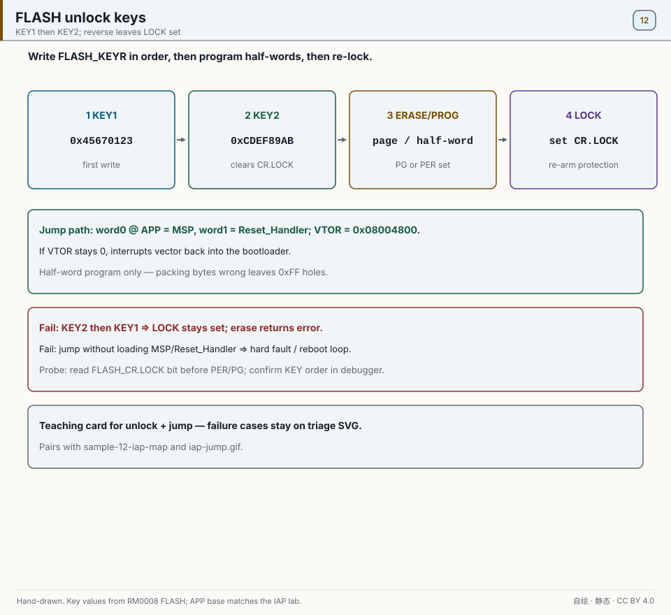
  <br><sub>▲ 自绘。钥匙顺序反了锁打不开；跳转要装 MSP 与复位向量。</sub>
</p>

<p align="center">
  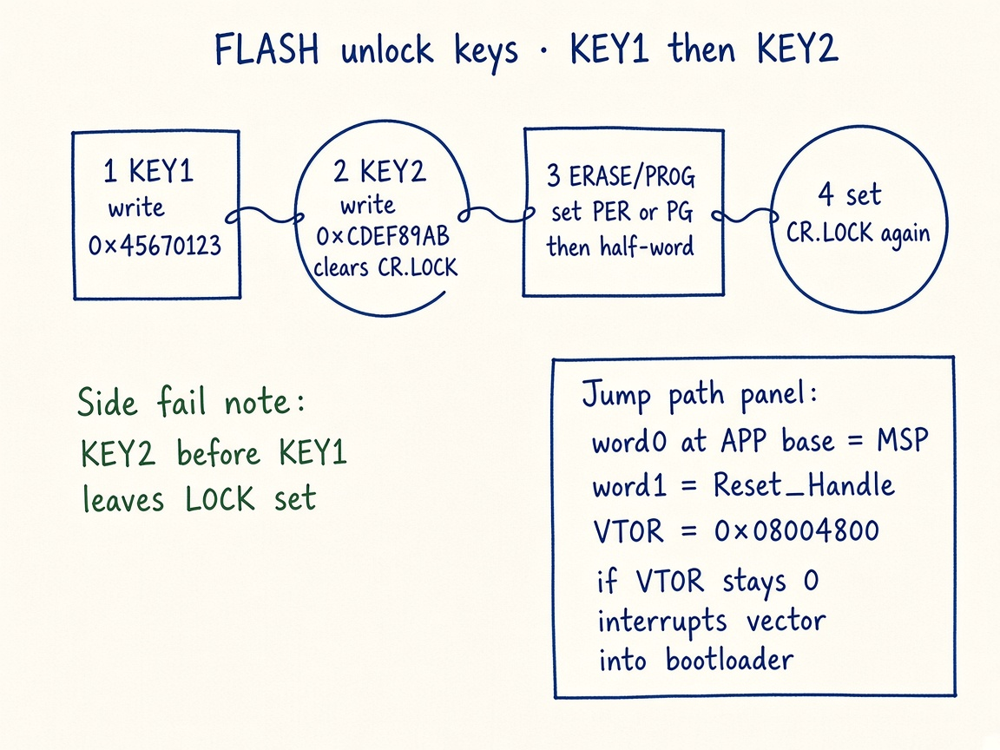
  <br><sub>▲ 知识轨（Handraw · 原理示意/非实拍）。0x45670123 再 0xCDEF89AB；顺序反了 LOCK 不消；跳转要装 MSP 与复位向量；不是实拍。</sub>
</p>


Flash 平时是锁着的，防止程序跑飞时乱写。开锁要按顺序往钥匙寄存器写两个固定的数，顺序或数值不对，Flash 会一直锁到下次复位。开锁后先擦后写，每一步都要等忙标志清零再做下一步，最后记得重新上锁。

**F1 关键流程（RM0008 第 3 章）：**

1. **解锁**：向 `FLASH_KEYR` 依次写 `0x45670123`、`0xCDEF89AB`（KEY1、KEY2），解除 `CR.LOCK`。
2. **擦除**：置 `CR.PER=1`，向 `FLASH_AR` 写目标页地址，置 `CR.STRT=1`，轮询 `SR.BSY` 直到 0，检查 `SR.EOP`。
3. **编程**：置 `CR.PG=1`，向目标地址写**半字**，轮询 `SR.BSY`。
4. **上锁**：置 `CR.LOCK=1`。

<p align="center">
  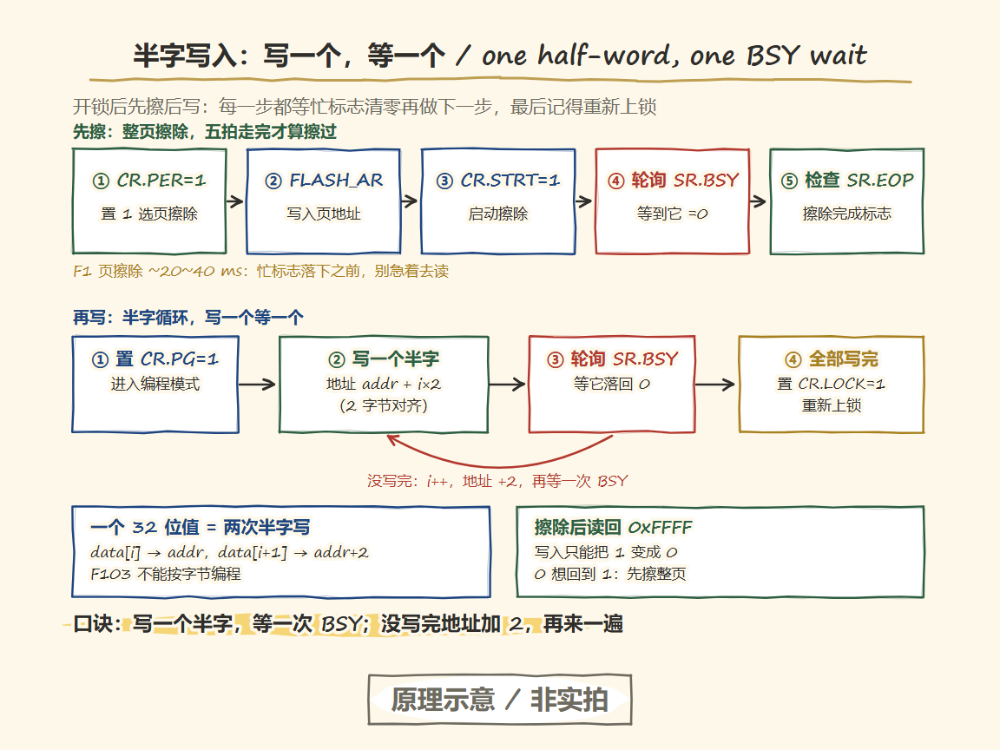
  <br><sub>▲ 知识轨（Handraw · 原理示意/非实拍）。先擦五拍 PER/AR/STRT/BSY/EOP；再写 PG=1→半字→等 BSY→地址 +2 循环；32 位分两次半字；写完 LOCK=1；不是实拍。</sub>
</p>

**F4 差异**：用 `FLASH_CR` 的 `SER` 位 + `SNB[3:0]` 选择扇区号擦除；编程用 `PSIZE` 选位宽；注意 F4 的 Flash 电压范围（`VPP`）与「编程并行位」设置。

HAL 库把上述流程封装为：

```c
HAL_FLASH_Unlock();                                  /* 解锁 */
HAL_FLASHEx_Erase(&erase, &sectorError);             /* 擦除（页/扇区） */
HAL_FLASH_Program(FLASH_TYPEPROGRAM_HALFWORD, addr, data);  /* F1 半字 */
/* F4 可用 FLASH_TYPEPROGRAM_WORD / FLASH_TYPEPROGRAM_DOUBLEWORD */
HAL_FLASH_Lock();                                    /* 上锁 */
```

### 3. IAP 原理与内存划分

IAP 是让芯片自己给自己换程序。Flash 被分成几块：最前面是一个小的 Bootloader，它永远不被覆盖；后面是放升级标志的参数区；再后面是真正的应用程序。每次上电先跑 Bootloader，它看一眼参数区，需要升级就从串口收新程序写进 APP 区，不需要就直接跳过去。

IAP 把 Flash 分成 **Bootloader 区 + 参数区 + APP 区**；上电先跑 Bootloader，判断是否升级/跳转，再跳到 APP。

**内存划分示例（STM32F103C8T6，64 KB Flash）：**

| 区域 | 起始地址 | 大小 | 内容 |
| --- | --- | --- | --- |
| Bootloader | `0x0800 0000` | 16 KB | 引导、串口升级、跳转 |
| 参数区 | `0x0800 4000` | 2 KB | 升级标志、APP 大小、CRC |
| APP | `0x0800 4800` | 46 KB | 用户应用（链接脚本起始改为 0x08004800） |

**内存划分示例（STM32F411CE，512 KB Flash）：**

| 区域 | 起始地址 | 大小 |
| --- | --- | --- |
| Bootloader | `0x0800 0000` | 32 KB |
| 参数区 | `0x0800 8000` | 独占 Sector 2（16 KB），实际只用 2 KB。Sector 3 空着 |
| APP | `0x0801 0000` | 448 KB（Sector 4–7，到 `0x0808 0000` 为止） |

> F4 擦除以扇区为单位，参数区若与 Bootloader 同扇区会被一起擦掉，所以参数区要**独占一个扇区**。

<p align="center">
  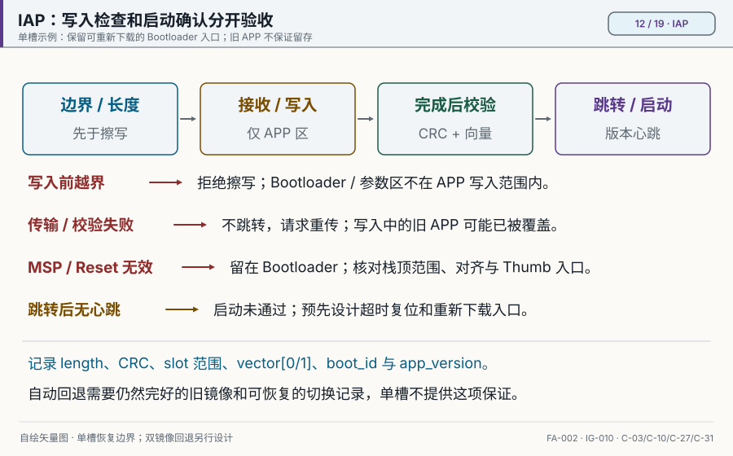
  <br><sub>▲ IAP 验收：先检查范围再擦写；传输或校验失败时留在 Bootloader 等待重传，此时旧 APP 可能已被覆盖。跳转后用版本心跳确认启动；无心跳时依靠预先设计的复位和下载入口恢复（FA-002 · IG-010 · C-03/C-10/C-27/C-31）。</sub>
</p>

<p align="center">
  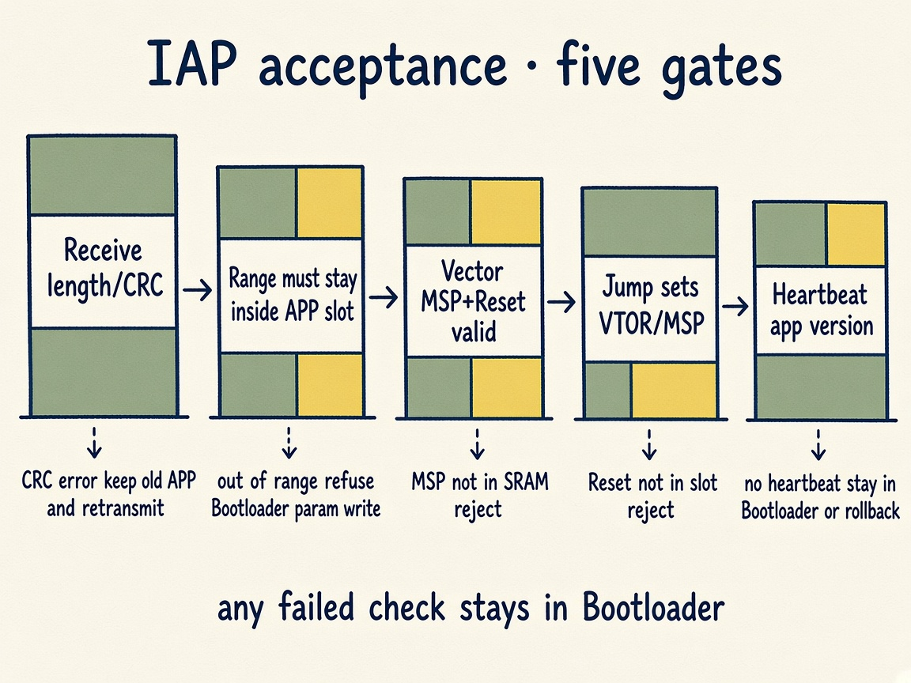
  <br><sub>▲ 知识轨（Handraw · 原理示意/非实拍）。接收/边界/向量/跳转/心跳；任一门失败留在 Bootloader；不是实拍。</sub>
</p>

### 4. 跳转到 APP 的关键动作

从 Bootloader 跳到 APP，要像交接班一样把现场收拾干净。Bootloader 开过的中断、定时器、外设要关掉，否则 APP 刚起来就会收到一个它不认识的中断。还要告诉 CPU 两件事：新的栈从哪里开始，中断向量表搬到了哪里。少做任何一步，APP 都可能在第一次进中断时跑回 Bootloader。

跳转前必须「关中断、清 NVIC 的使能与挂起位、复位外设、设 MSP、设向量表偏移」，否则 APP 里的中断会跳回 Bootloader 的向量表而死机。清空之后才开中断并立刻跳转，中间不能再执行别的代码。

```c
typedef void (*pFunction)(void);
#define APP_ADDR  0x08004800UL

void JumpToApp(void)
{
    uint32_t app_stack = *(volatile uint32_t *)APP_ADDR;         /* 向量表[0]=MSP */
    uint32_t app_entry = *(volatile uint32_t *)(APP_ADDR + 4);   /* 向量表[1]=Reset_Handler */

    /* 1) 关全局中断，关掉所有可屏蔽中断并清掉已挂起的请求；关 SysTick */
    __disable_irq();
    for (uint32_t i = 0U; i < 8U; i++) {
        NVIC->ICER[i] = 0xFFFFFFFFU;
        NVIC->ICPR[i] = 0xFFFFFFFFU;
    }
    SysTick->CTRL = 0;
    SysTick->LOAD = 0;
    SysTick->VAL  = 0;

    /* 2) 复位所有外设（把 Bootloader 用过的外设恢复默认） */
    HAL_RCC_DeInit();
    HAL_DeInit();

    /* 3) 设置主栈指针 MSP 与向量表偏移 */
    __set_MSP(app_stack);
    SCB->VTOR = APP_ADDR;

    /* 4) 开中断后立刻跳到 APP 入口，中间不能再插入任何代码。
          可屏蔽中断已在第 1 步清空；剩余窗口只有不可屏蔽的 NMI/硬件故障。 */
    __enable_irq();
    ((pFunction)app_entry)();
}
```

**APP 侧**同样要把向量表基址改到自己的起始地址（通常放在 `SystemInit()` 或 `main()` 开头）：

```c
SCB->VTOR = 0x08004800UL;   /* 必须与 Bootloader 约定一致 */
```


<p align="center">
  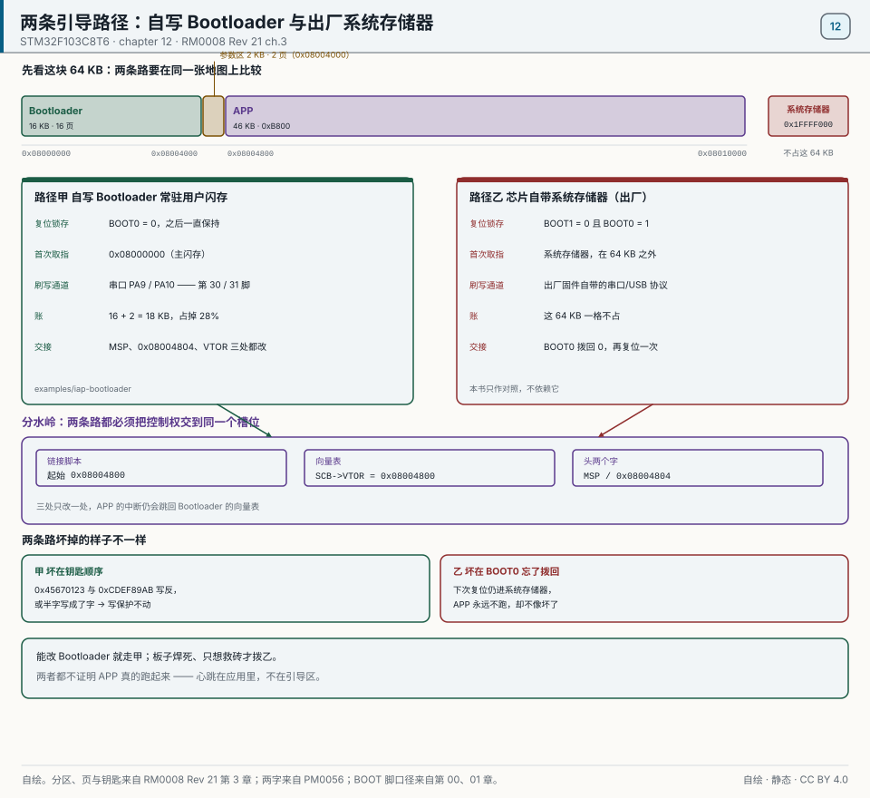
  <br><sub>▲ 自绘。看哪里：最上面是一条 64 KB 的分区尺，16 KB Bootloader、2 KB 参数、46 KB APP 三段与四个地址对齐，右侧方框是系统存储器（0x1FFFF000）——它也在芯片内部，只是不在这块 64 KB 主闪存里；下面两张卡逐行对比两条路的复位电平、首次取指、刷写通道与账面；中间的紫色块是分水岭——链接脚本、`SCB->VTOR`、头两个字三处必须一致；再下面写出两条路各自坏掉时的样子。出处是 [RM0008 Flash](#source-rm0008-flash) 和 [PM0056 向量表](#source-pm0056-vector)。</sub>
</p>

<p align="center">
  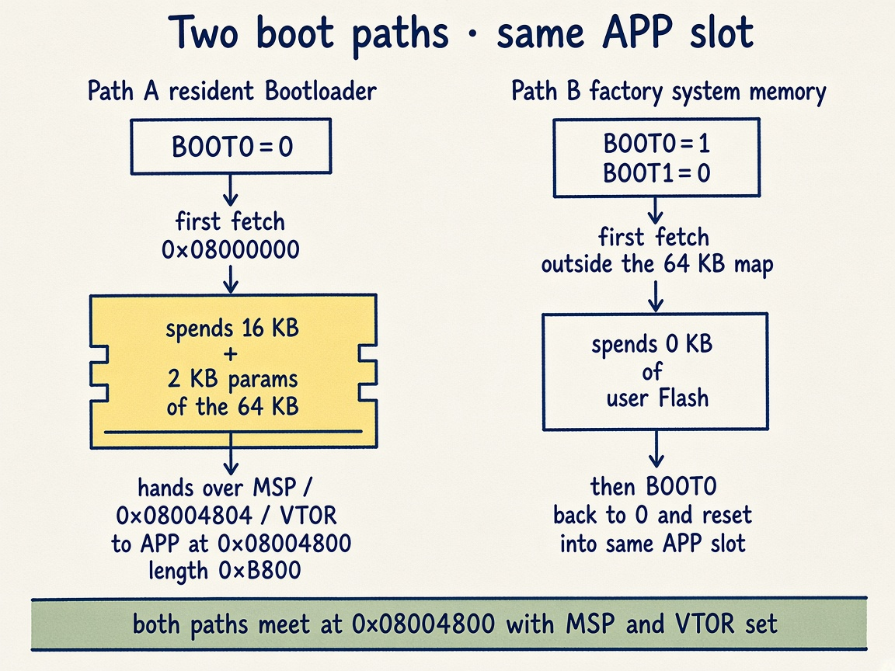
  <br><sub>▲ 知识轨（Handraw · 原理示意/非实拍）。路径甲占 18 KB 用户闪存；路径乙不占 64 KB；都交到 0x08004800；不是实拍。</sub>
</p>

### 5. YMODEM / 串口升级流程

YMODEM 是带 CRC 校验的可靠文件传输协议，配合串口即可实现通用 IAP。

1. 设备（Bootloader）进入接收模式，周期性发送字符 `'C'` 请求数据。
2. 上位机（如 SecureCRT / Xshell / 自写工具）发首包：文件名 + 大小。
3. 设备分配 APP 地址、擦除对应页，逐包接收 **128 或 1024 字节** 数据，校验 CRC16 后写 Flash，回 `ACK`。
4. 传输结束（空包）后校验整包 CRC，置「APP 有效」标志并复位/跳转。

## 硬件与接线

| 开发板 | 用途 | 引脚 | 备注 |
| --- | --- | --- | --- |
| BluePill (F103) | 串口 IAP | PA9/PA10 → USB-TTL | 用 UART1 收升级包 |
| Nucleo-F411RE | 串口 IAP | USART2（ST-Link 虚拟串口） | 免额外 USB-TTL |
| 任意 | 调试观察 | SWD（SWDIO/SWCLK） | 掉进 Bootloader 也能连 |

> IAP 不需要额外硬件，只需一个能发文件的串口工具（SecureCRT / Xshell / 自写上位机）。

<p align="center">
  
  <br><sub>▲ 知识轨（Handraw · 原理示意/非实拍）。看哪里：左侧四步的说话方（设备蓝 / 上位机绿）与右侧「卡住先查」——无 'C' 先查串口参数、NAK 循环查线或缓存、写完跳不了回到 §4 五道验收门；证明 YMODEM 的可靠性来自每包 CRC16 与整包 CRC 两道关，不是串口本身；不能替代 YMODEM 协议原文的包头字节定义，也不是实测抓包。出处 [RM0008](#source-rm0008-flash)、[本仓库例程](#source-project-examples)。</sub>
</p>

## 代码实现

**① Flash 擦除 + 编程（F1，按页）**

```c
#include "stm32f1xx_hal.h"

#define APP_ADDR     0x08004800UL
#define FLASH_PAGE   1024U        /* F103C8 中容量 1KB/页 */

/* 擦除覆盖 [addr, addr+len) 的页 */
int Flash_EraseRange(uint32_t addr, uint32_t len)
{
    FLASH_EraseInitTypeDef er = {0};
    uint32_t page_err = 0;

    HAL_FLASH_Unlock();
    er.TypeErase   = FLASH_TYPEERASE_PAGES;
    er.PageAddress = addr;
    er.NbPages     = (len + FLASH_PAGE - 1) / FLASH_PAGE;
    if (HAL_FLASHEx_Erase(&er, &page_err) != HAL_OK) {
        HAL_FLASH_Lock();
        return -1;
    }
    HAL_FLASH_Lock();
    return 0;
}

/* 按半字写入缓冲区 */
int Flash_WriteBuf(uint32_t addr, const uint16_t *data, uint32_t halfwords)
{
    HAL_FLASH_Unlock();
    for (uint32_t i = 0; i < halfwords; i++) {
        if (HAL_FLASH_Program(FLASH_TYPEPROGRAM_HALFWORD,
                              addr + i * 2, data[i]) != HAL_OK) {
            HAL_FLASH_Lock();
            return -1;
        }
    }
    HAL_FLASH_Lock();
    return 0;
}
```

**② 跳转 APP**

跳转函数与第 4 节相同：先清 NVIC 使能与挂起位、关 SysTick、复位外设，再设 MSP 与 `SCB->VTOR`，开中断后立刻跳转，这里不重复贴代码。

**③ Bootloader 主流程（框架）**

```c
int main(void)
{
    HAL_Init();
    SystemClock_Config();
    MX_USART1_UART_Init();

    /* 上电 500ms 内收到 'U' 命令则进入升级，否则跳 APP */
    if (Uart_WaitForUpgrade(500)) {
        Ymodem_Receive(APP_ADDR);        /* 收包→校验→写 Flash */
    }
    JumpToApp(APP_ADDR);
    for (;;) { }                         /* 不会执行到这里 */
}
```

> APP 工程要修改链接脚本：Flash 起始 `0x08004800`、长度相应减少；并在 `main()` 开头 `SCB->VTOR = 0x08004800;`。

<p align="center">
  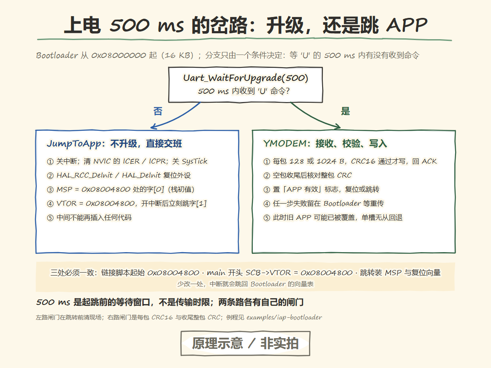
  <br><sub>▲ 知识轨（Handraw · 原理示意/非实拍）。看哪里：Uart_WaitForUpgrade(500) 只等 'U' 命令；左边 JumpToApp 五步（关中断清 NVIC、复位外设、装 MSP、设 VTOR、开中断立刻跳），右边 YMODEM 五步（128/1024 B 包 CRC16 通过才写、空包收尾核对整包 CRC、置 APP 有效标志、失败留在 Bootloader、单槽无从回退），以及三处必须一致的 0x08004800。证明什么：500 ms 是起跳前的等待窗口，不是传输时限，两条路各有自己的闸门。不能证明什么：不是真实串口波形，单槽失败时旧 APP 可能已被覆盖。出处：[RM0008 Flash](#source-rm0008-flash)、[PM0056 向量表](#source-pm0056-vector)。</sub>
</p>

## 动手实验

1. **页级写入证据**：只在链接脚本明确保留的测试页写入 256 字节已知模式，复位后逐字节读回并核对 CRC。若地址落入 APP 或 Bootloader 区，测试必须拒绝执行。
2. **坏镜像拒绝**：分别制造 CRC 错、MSP 不在 SRAM、Reset_Handler 不在 APP 槽位三种镜像。Bootloader 应打印稳定错误码并保持在升级模式，不跳转。
3. **有效升级与 A/B 回滚**：写入合法镜像后记录长度、CRC、vector[0]/vector[1] 和 app_version 心跳。A/B 方案再中断一次传输，确认旧槽仍能启动。

### 6. 选项字节：读保护、写保护和硬件看门狗

选项字节不在普通 Flash 页里。改读保护会整片擦除用户 Flash。先备份，再动手。

| 字节 | F1 | F4 |
| --- | --- | --- |
| RDP | `0xA5` 不保护；其他值都是读保护。没有 Level 2 | `0xAA` Level 0；其他非 `0xCC` 是 Level 1；`0xCC` 是 Level 2，不可逆 |
| USER | `nRST_STOP`、`nRST_STDBY`、`WDG_SW` | 同样管停机复位和硬件看门狗 |
| WRP | 按页写保护 | 按扇区写保护 |

F4 的 `0xAA` 和 `0xCC` 两档在 STM32F103C8T6 上不存在。F103 的无保护值是 `0xA5`，解除读保护会整片擦除主闪存。

`WDG_SW = 0` 时上电就启动硬件 IWDG，软件停不掉。F4 的参数区如果和 Bootloader 挤在同一个扇区，擦参数会把 Bootloader 一起擦掉，所以参数区要独占一个扇区。

只读当前配置是安全的：

```c
HAL_FLASH_OB_Unlock();
FLASH_OBProgramInitTypeDef ob = {0};
HAL_FLASHEx_OBGetConfig(&ob);   /* 看 RDPLevel / WRP，先别写 */
```

写 RDP 的调用这里不贴。它会擦整片，复制进示例工程很容易把板子锁到读保护。

<p align="center">
  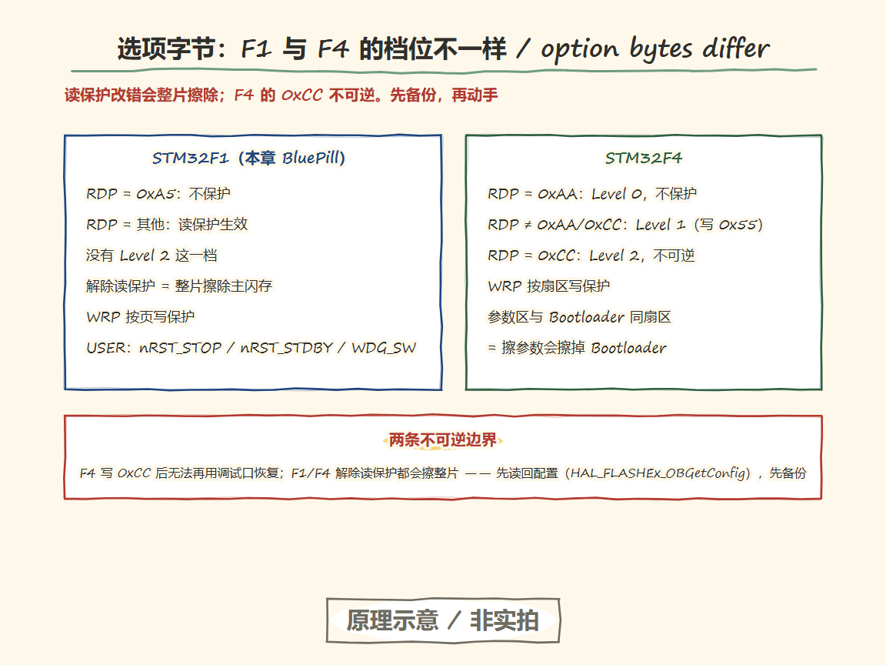
  <br><sub>▲ 知识轨（Handraw · 原理示意/非实拍）。看哪里：左栏 F1（RDP=0xA5 不保护、无 Level 2、WRP 按页）与右栏 F4（0xAA/Level 1/0xCC 三档、WRP 按扇区）的对照，和底部红框两条不可逆边界；证明档位记错不是「换个值写回去」就能挽回——F4 的 0xCC 调试口也救不回，解除读保护要付出整片擦除；不能替代 RM0090/RM0008 选项字节寄存器定义，也不是实测操作。出处 [RM0008](#source-rm0008-flash)、[RM0090](#source-rm0090)。</sub>
</p>

离开本章前，应有一份页写 CRC、三种坏镜像错误码和一次有效镜像的版本心跳；A/B 方案还要有中断升级后的旧版本启动证据。

自测：

1. F103 的 RDP 从 0xA5 改成别的值，Flash 里的程序还在吗？
2. F4 写成 0xCC 之后，还能用 ST-Link 恢复吗？
3. 为什么 F4 的 2 KB 参数区不能随便放在 Bootloader 那个扇区的尾巴上？

## 相关资源

- RM0008《STM32F10xxx 参考手册》第 3 章 Embedded Flash memory（页结构、KEY、编程流程）。
- RM0090《STM32F4 参考手册》第 3 章 FLASH（扇区结构、SER/SNB、编程位宽）。
- 数据手册 DS：擦写寿命、数据保持时间、编程/擦除时间。
- 应用笔记 AN2557《STM32F10xxx in-application programming using the USART》。
- Cortex-M3/M4 权威指南：向量表、`SCB->VTOR`、异常模型。
- 配图：`../assets/animations/flash-iap.svg`（作者自绘矢量图）。

- 手机阅读版：[第 12 章 · Flash与IAP升级（公众号图文）](https://mp.weixin.qq.com/s/_pvTj84j-zOem8Iawpqiyw)
