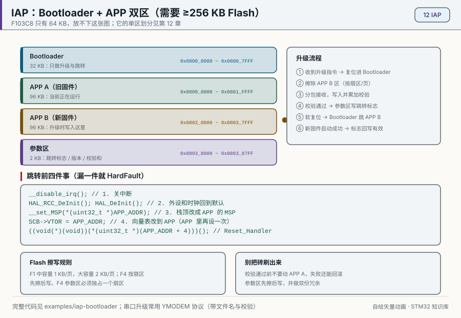
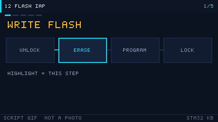

# 12 Flash 与 IAP 升级

> English: [Flash and IAP](en/12-flash-iap.md)

> 内部 Flash 存放并可在线擦写程序，IAP（在应用编程）让设备通过串口/CAN 自我升级固件，无需拆机接下载器。

<p align="center">
  
  <br><sub>▲ 动画：IAP 在线升级 Bootloader + APP 双区跳转（作者自绘矢量动画，非实拍）</sub>
</p>

<!-- video:ch12 -->
<p align="center">
  
  <br><sub>▲ 本章讲解幻灯：程序生成的 GIF（tools/gen_videos.py，可复现，不是实拍）。旁白与五帧一一对应。</sub>
</p>

**旁白（跟着画面读，大约一分钟）**

1. Flash 先解锁，再按页或扇区擦，然后才能写。写完上锁。
2. IAP 把芯片分成引导区和应用程序。引导区收完新固件，再跳过去。
3. 跳转前要关中断、设好栈顶、再把向量表偏移告诉内核。
4. 读保护不是玩笑。F1 的钥匙和 F4 的钥匙不一样，改之前先备份。
5. 口诀：0xA5 是 F1 的开门钥匙。自测：擦之前为什么必须解锁？
<!-- /video:ch12 -->


## 📌 学习目标

- [ ] 掌握 F1「页」与 F4「扇区」的 Flash 结构、擦写寿命与编程粒度。
- [ ] 会走完解锁（KEY1/KEY2）→ 擦除 → 编程 → 上锁的完整流程。
- [ ] 理解 IAP 原理，能画出 Bootloader + APP 的内存划分表。
- [ ] 掌握跳转 APP 前的关键动作：关中断、复位外设、设 MSP、设 `SCB->VTOR`。
- [ ] 了解 YMODEM/串口升级协议的基本流程。

## 🧠 核心原理

### 1. Flash 组织结构

**结论**：F1 按 **1 KB/2 KB 的「页」** 擦除、以**半字（16 位）** 编程；F4 按 **16~128 KB 的「扇区」** 擦除、支持**字节/半字/字/双字**编程。

| 项 | STM32F1（RM0008 第 3 章 FLASH） | STM32F4（RM0090 第 3 章 FLASH） |
| --- | --- | --- |
| 擦除粒度 | 页：小/中容量 1 KB，大容量 2 KB | 扇区：S0–S3=16 KB，S4=64 KB，S5–S7=128 KB（F407VG） |
| 编程粒度 | 半字（16 位） | 字节/半字/字（32 位）/双字（64 位） |
| 编程电压 | 内部产生（VPP 由内部泵） | 内部产生 |
| 擦写寿命 | ≥ 10k 次（数据手册保证） | ≥ 10k 次 |
| 数据保持 | 20 年 @ 85°C | 20 年 @ 85°C |
| 擦除时间 | 页擦除 ~20~40 ms | 扇区擦除 ~0.4~4 s（越大越慢） |

> ⚠️ Flash **只能按整页/整扇区擦除**，不能按字节改；改一个字节也要先擦整页。频繁写日志务必做「磨损均衡」，把写分散到不同页。

### 2. 解锁与编程流程

**F1 关键流程（RM0008 第 3 章）：**

1. **解锁**：向 `FLASH_KEYR` 依次写 `0x45670123`、`0xCDEF89AB`（KEY1、KEY2），解除 `CR.LOCK`。
2. **擦除**：置 `CR.PER=1`，向 `FLASH_AR` 写目标页地址，置 `CR.STRT=1`，轮询 `SR.BSY` 直到 0，检查 `SR.EOP`。
3. **编程**：置 `CR.PG=1`，向目标地址写**半字**，轮询 `SR.BSY`。
4. **上锁**：置 `CR.LOCK=1`。

**F4 差异**：用 `FLASH_CR` 的 `SER` 位 + `SNB[3:0]` 选择扇区号擦除；编程用 `PSIZE` 选位宽；注意 F4 的 Flash 电压范围（`VPP`）与「编程并行位」设置。

HAL 库把上述流程封装为：

```c
HAL_FLASH_Unlock();                                  /* 解锁 */
HAL_FLASHEx_Erase(&erase, &sectorError);             /* 擦除（页/扇区） */
HAL_FLASH_Program(FLASH_TYPEPROGRAM_HALFWORD, addr, data);  /* F1 半字 */
/* F4 可用 FLASH_TYPEPROGRAM_WORD / FLASH_TYPEPROGRAM_DOUBLEWORD */
HAL_FLASH_Lock();                                    /* 上锁 */
```

### 3. IAP 原理与内存划分

**结论**：IAP 把 Flash 分成 **Bootloader 区 + 参数区 + APP 区**；上电先跑 Bootloader，判断是否升级/跳转，再跳到 APP。

**内存划分示例（STM32F103C8T6，64 KB Flash）：**

| 区域 | 起始地址 | 大小 | 内容 |
| --- | --- | --- | --- |
| Bootloader | `0x0800 0000` | 16 KB | 引导、串口升级、跳转 |
| 参数区 | `0x0800 4000` | 2 KB | 升级标志、APP 大小、CRC |
| APP | `0x0800 4800` | 46 KB | 用户应用（链接脚本起始改为 0x08004800） |

**内存划分示例（STM32F411CE，512 KB Flash）：**

| 区域 | 起始地址 | 大小 |
| --- | --- | --- |
| Bootloader | `0x0800 0000` | 32 KB |
| 参数区 | `0x0800 8000` | 2 KB（Sector 1 内，注意 F4 最小扇区 16 KB） |
| APP | `0x0801 0000` | 480 KB |

> F4 擦除以扇区为单位，参数区若与 Bootloader 同扇区会被一起擦掉，所以参数区要**独占一个扇区**。

### 4. 跳转到 APP 的关键动作

**结论**：跳转前必须「关中断、复位外设、设 MSP、设向量表偏移」，否则 APP 里的中断会跳回 Bootloader 的向量表而死机。

```c
typedef void (*pFunction)(void);
#define APP_ADDR  0x08004800UL

void JumpToApp(void)
{
    uint32_t app_stack = *(volatile uint32_t *)APP_ADDR;         /* 向量表[0]=MSP */
    uint32_t app_entry = *(volatile uint32_t *)(APP_ADDR + 4);   /* 向量表[1]=Reset_Handler */

    /* 1) 关全局中断 + 关 SysTick，避免跳转时被中断打断 */
    __disable_irq();
    SysTick->CTRL = 0;
    SysTick->LOAD = 0;
    SysTick->VAL  = 0;

    /* 2) 复位所有外设（把 Bootloader 用过的外设恢复默认） */
    HAL_RCC_DeInit();
    HAL_DeInit();

    /* 3) 设置主栈指针 MSP 与向量表偏移 */
    __set_MSP(app_stack);
    SCB->VTOR = APP_ADDR;

    /* 4) 重新开中断并跳到 APP 入口 */
    __enable_irq();
    ((pFunction)app_entry)();
}
```

**APP 侧**同样要把向量表基址改到自己的起始地址（通常放在 `SystemInit()` 或 `main()` 开头）：

```c
SCB->VTOR = 0x08004800UL;   /* 必须与 Bootloader 约定一致 */
```

### 5. YMODEM / 串口升级流程

**结论**：YMODEM 是带 CRC 校验的可靠文件传输协议，配合串口即可实现通用 IAP。

1. 设备（Bootloader）进入接收模式，周期性发送字符 `'C'` 请求数据。
2. 上位机（如 SecureCRT / Xshell / 自写工具）发首包：文件名 + 大小。
3. 设备分配 APP 地址、擦除对应页，逐包接收 **128 或 1024 字节** 数据，校验 CRC16 后写 Flash，回 `ACK`。
4. 传输结束（空包）后校验整包 CRC，置「APP 有效」标志并复位/跳转。

## 🛠️ 硬件与接线

| 开发板 | 用途 | 引脚 | 备注 |
| --- | --- | --- | --- |
| BluePill (F103) | 串口 IAP | PA9/PA10 → USB-TTL | 用 UART1 收升级包 |
| Nucleo-F411RE | 串口 IAP | USART2（ST-Link 虚拟串口） | 免额外 USB-TTL |
| 任意 | 调试观察 | SWD（SWDIO/SWCLK） | 掉进 Bootloader 也能连 |

> IAP 不需要额外硬件，只需一个能发文件的串口工具（SecureCRT / Xshell / 自写上位机）。

## 💻 代码实现

**① Flash 擦除 + 编程（F1，按页）**

```c
#include "stm32f1xx_hal.h"

#define APP_ADDR     0x08004800UL
#define FLASH_PAGE   1024U        /* F103C8 小容量 1KB/页 */

/* 擦除覆盖 [addr, addr+len) 的页 */
int Flash_EraseRange(uint32_t addr, uint32_t len)
{
    FLASH_EraseInitTypeDef er = {0};
    uint32_t page_err = 0;

    HAL_FLASH_Unlock();
    er.TypeErase   = FLASH_TYPEERASE_PAGES;
    er.PageAddress = addr;
    er.NbPages     = (len + FLASH_PAGE - 1) / FLASH_PAGE;
    if (HAL_FLASHEx_Erase(&er, &page_err) != HAL_OK) {
        HAL_FLASH_Lock();
        return -1;
    }
    HAL_FLASH_Lock();
    return 0;
}

/* 按半字写入缓冲区 */
int Flash_WriteBuf(uint32_t addr, const uint16_t *data, uint32_t halfwords)
{
    HAL_FLASH_Unlock();
    for (uint32_t i = 0; i < halfwords; i++) {
        if (HAL_FLASH_Program(FLASH_TYPEPROGRAM_HALFWORD,
                              addr + i * 2, data[i]) != HAL_OK) {
            HAL_FLASH_Lock();
            return -1;
        }
    }
    HAL_FLASH_Lock();
    return 0;
}
```

**② 跳转 APP**

```c
typedef void (*pFunction)(void);

void JumpToApp(uint32_t app_addr)
{
    uint32_t sp    = *(volatile uint32_t *)app_addr;
    uint32_t entry = *(volatile uint32_t *)(app_addr + 4);

    __disable_irq();
    SysTick->CTRL = 0; SysTick->LOAD = 0; SysTick->VAL = 0;
    HAL_RCC_DeInit();
    HAL_DeInit();

    __set_MSP(sp);
    SCB->VTOR = app_addr;
    __enable_irq();
    ((pFunction)entry)();
}
```

**③ Bootloader 主流程（框架）**

```c
int main(void)
{
    HAL_Init();
    SystemClock_Config();
    MX_USART1_UART_Init();

    /* 上电 500ms 内收到 'U' 命令则进入升级，否则跳 APP */
    if (Uart_WaitForUpgrade(500)) {
        Ymodem_Receive(APP_ADDR);        /* 收包→校验→写 Flash */
    }
    JumpToApp(APP_ADDR);
    for (;;) { }                         /* 不会执行到这里 */
}
```

> APP 工程要修改链接脚本：Flash 起始 `0x08004800`、长度相应减少；并在 `main()` 开头 `SCB->VTOR = 0x08004800;`。

## ⚠️ 常见坑与排查

| 现象 | 原因 | 解决 |
| --- | --- | --- |
| 跳转后死机 | 未设 MSP / 未设 VTOR | 跳转前 `__set_MSP` + `SCB->VTOR` |
| 中断跳回 Bootloader | 跳转时没关中断 | `__disable_irq()` 并复位 SysTick |
| 擦除返回错误 | 地址不是页边界 / 未解锁 | 页对齐；先 `HAL_FLASH_Unlock` |
| 编程后数据错 | 未按半字对齐写 | 地址 2 字节对齐，写 16 位 |
| APP 被 Bootloader 覆盖 | 参数区与 APP 重叠 | 重新规划内存划分 |
| F4 参数区被误擦 | 参数区与 Bootloader 同扇区 | 参数区独占一个扇区 |
| 升级后不运行 | APP 大小超区 / CRC 错 | 校验大小与 CRC，失败保留旧 APP |
| 掉电升级变砖 | 升级中被断电 | 用双 APP 区（A/B）+ 引导标志 |

## 🧪 动手实验

1. **读写 Flash**：把一个 32 位变量写入 `0x0800FC00`（最后一页），复位后读出验证。预期：复位后数据仍在。
2. **最小 IAP**：Bootloader 上电打印倒计时，期间收到字符 `'U'` 则进入接收模式；把编译好的 APP bin 通过串口发过去，跳转运行。预期：设备跑起 APP，串口打印 APP 的心跳。
3. **（进阶）A/B 双区升级**：把 Flash 分为 APP_A/APP_B 两区，交替写入，用参数区记录「当前有效区」。预期：升级失败也能回退到旧版本，避免变砖。

### 6. 选项字节：读保护、写保护和硬件看门狗

**结论**：选项字节不在普通 Flash 页里。改读保护会整片擦除用户 Flash。先备份，再动手。

| 字节 | F1 | F4 |
| --- | --- | --- |
| RDP | `0xA5` 不保护；其他值都是读保护。没有 Level 2 | `0xAA` Level 0；其他非 `0xCC` 是 Level 1；`0xCC` 是 Level 2，不可逆 |
| USER | `nRST_STOP`、`nRST_STDBY`、`WDG_SW` | 同样管停机复位和硬件看门狗 |
| WRP | 按页写保护 | 按扇区写保护 |

`WDG_SW = 0` 时上电就启动硬件 IWDG，软件停不掉。F4 的参数区如果和 Bootloader 挤在同一个扇区，擦参数会把 Bootloader 一起擦掉，所以参数区要独占一个扇区。

只读当前配置是安全的：

```c
HAL_FLASH_OB_Unlock();
FLASH_OBProgramInitTypeDef ob = {0};
HAL_FLASHEx_OBGetConfig(&ob);   /* 看 RDPLevel / WRP，先别写 */
```

写 RDP 的调用这里不贴。它会擦整片，复制进示例工程很容易把板子锁到读保护。

口诀：**0xA5 是 F1 的开门钥匙，0xCC 是 F4 的单程票；改保护先备份。**

自测：

1. F103 的 RDP 从 0xA5 改成别的值，Flash 里的程序还在吗？
2. F4 写成 0xCC 之后，还能用 ST-Link 恢复吗？
3. 为什么 F4 的 2 KB 参数区不能随便放在 Bootloader 那个扇区的尾巴上？

## 🔗 相关资源

- RM0008《STM32F10xxx 参考手册》第 3 章 Embedded Flash memory（页结构、KEY、编程流程）。
- RM0090《STM32F4 参考手册》第 3 章 FLASH（扇区结构、SER/SNB、编程位宽）。
- 数据手册 DS：擦写寿命、数据保持时间、编程/擦除时间。
- 应用笔记 AN2557《STM32F10xxx in-application programming using the USART》。
- Cortex-M3/M4 权威指南：向量表、`SCB->VTOR`、异常模型。
- 配图：`../assets/animations/flash-iap.svg`（作者自绘矢量图）。