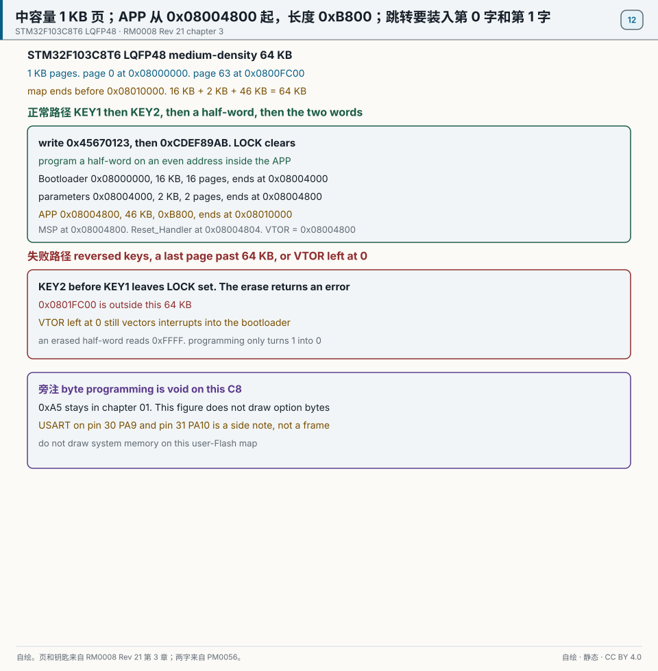
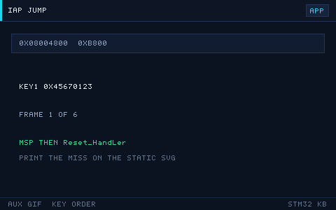

# 12 Flash 与 IAP 升级

> English: [Flash and IAP](en/12-flash-iap.md)

> 内部 Flash 存放并可在线擦写程序，IAP（在应用编程）让设备通过串口/CAN 自我升级固件，无需拆机接下载器。

<p align="center">
  
  <br><sub>▲ 动画：IAP 在线升级 Bootloader + APP 双区跳转（作者自绘矢量动画，非实拍）</sub>
</p>

<!-- video:ch12 -->
<p align="center">
  <video width="640" controls poster="../assets/video/ch12-iap.png">
    <source src="../assets/video/ch12-iap.mp4" type="video/mp4">
  </video>
  <br><sub>▲ 本章讲解 2.6 分钟。配音是微软 Edge 在线神经语音「晓晓」（zh-CN-XiaoxiaoNeural），经 edge-tts 调用。edge-tts 大部分源码为 LGPLv3，srt_composer.py 为 MIT；声线模型是微软在线服务，不是开放模型。这里提交的是合成后的 MP4，离线可看。重新生成需要联网。画面由脚本和本仓库 SVG 生成，不是实拍。 视频：<a href="../assets/video/ch12-iap.mp4">MP4</a> · 字幕：<a href="../assets/video/ch12-iap.srt">SRT</a>。由 <code>python3 tools/gen_narrated.py --speak</code> 用 ffmpeg 合成。</sub>
</p>

**旁白（与字幕、配音同一份稿）**

1. 闪存不能当内存随便改一个字节。通常要先擦，再写。擦写之前必须解锁。写到一半掉电，这一页可能是半新半旧，启动时要能认出来。
2. F103 的读保护里，选项字节 0xA5 表示不保护。改成别的值之前，先想清楚你还能不能再读出来。改保护之前，先把现有程序备份下来。
3. 到了 F4，0xCC 这一档是不可逆的读保护。手滑写进去，这颗芯片的调试口就回不来了。实验这种操作，不要放在你唯一的那块板子上。
4. 这一帧是仓库画的升级路径。正在执行的程序不要擦掉自己的脚下。新固件写到另一块区域，校验通过，再跳过去。校验失败就留在旧程序里，设备还活着。
5. 程序如果不是从默认的闪存起始跑，中断向量表的偏移也要改。只改链接脚本、不改向量表偏移，平时能跑，一进中断就飞到旧地址。
6. 跳转之前至少核对长度和校验。有条件再看版本号。没有校验就跳，等于允许任意一包噪声变成你的新程序。失败了要留在还能通信的旧程序里。
7. 擦除不是调用一下就结束。要等忙标志落下，再去读。写保护如果开着，解锁只解了闪存控制器还不够。手册里的顺序不要跳步。
8. 口诀：0xA5 是 F1 的开门钥匙，0xCC 是 F4 的单程票；改保护先备份。擦之前为什么必须解锁？因为锁着的闪存会拒绝你，或者你以为写进去了其实没有。
9. 实验选一页确定不会踩到当前程序的闪存，擦掉、写几个字、再读回来。和程序区叠在一起的实验，做完这章你就没有调试器可以后悔了。
10. 合上书，三问。擦除之前为什么必须解锁？F103 的 0xA5 表示保护还是不保护？F4 写进 0xCC 之后还能不能恢复调试？
<!-- /video:ch12 -->

## 原理与边界

这一章的页、半字和跳转只钉在订货号 STM32F103C8T6 上。它是中容量，闪存 64 KB，从 `0x08000000` 到 `0x08010000` 之前，1 KB 一页，共 64 页。页号从 0 到 63。第 63 页从 `0x0800FC00` 起。`0x0801FC00` 越出这 64 KB。大容量的 2 KB/页在这颗料上作废。见 [RM0008 Rev 21 第 3 章](#source-rm0008-flash)。

编程地址按 2 字节对齐，一次写 16 位。擦掉之后读回 `0xFFFF`。已经写成 0 的位，不擦整页就变不回 1。按字节编程是 F4 的句子，在 C8 上作废。一个 32 位值要分两次半字写完。

两把钥匙按这个顺序写进 `FLASH_KEYR`：先 `0x45670123`，再 `0xCDEF89AB`，`CR.LOCK` 才清除。顺序反了，锁还在，擦除返回错误。写完上锁。

这一章的地图是本书和 `examples/iap-bootloader` 已经在用的那一版，不是手册规定的唯一划分。Bootloader：`0x08000000`，16 KB，16 页，到 `0x08004000` 之前。参数区：`0x08004000`，2 KB，2 页，到 `0x08004800` 之前。APP：`0x08004800`，46 KB，46 页，长度 `0xB800`，到 `0x08010000` 之前。三块相加是 64 KB。链接脚本的起始和 `SCB->VTOR` 都是 `0x08004800`。只改其中一个，跳进去的仍是 Bootloader 的向量。

APP 区第 0 字是 MSP，第 1 字在 `0x08004804`，是 `Reset_Handler`。跳转前读出这两字，写 MSP，写 `VTOR`，再跳。`VTOR` 仍留在 0 时，中断仍进 Bootloader。这跟第 01 章同一笔，不另画启动别名。见 [PM0056](#source-pm0056-vector)。

无保护仍是 `0xA5`。解除会整片擦除主闪存。见 [PM0075](#source-pm0075-rdp)。这一章的 Bootloader 在用户闪存里。串口仍是第 06 章的第 30 脚 PA9、第 31 脚 PA10，这里只旁注。

## 关键插图

<p align="center">
  
  <br><sub>▲ 自绘。STM32F103C8T6，中容量，64 KB，1 KB 一页。正常路径先写 0x45670123，再写 0xCDEF89AB，半字写入 APP，再从 0x08004800 装入 MSP，从 0x08004804 装入复位，VTOR 写成 0x08004800。失败路径是钥匙反序、末页写成 0x0801FC00，或 VTOR 仍为 0。出处是 [RM0008 Rev 21 第 3 章](#source-rm0008-flash) 和 [PM0056](#source-pm0056-vector)。</sub>
</p>

<p align="center">
  
  <br><sub>▲ 网页和公众号辅图。只播放正常路径：先 0x45670123，后 0xCDEF89AB，一个半字落进 APP，然后读出 MSP 和复位。印刷以静态主图为准。反序钥匙和 0x0801FC00 不在这条 GIF 上。</sub>
</p>

`flash-iap.svg` 留作辅图。不播放它。页边界、两把钥匙和跳转用的两字都在静态主图上。

## 时序或状态

| 区 | 起始 | 长度 | 页数 | 结束于 |
| --- | --- | --- | --- | --- |
| Bootloader | `0x08000000` | 16 KB | 16 | `0x08004000` |
| 参数区 | `0x08004000` | 2 KB | 2 | `0x08004800` |
| APP | `0x08004800` | 46 KB，`0xB800` | 46 | `0x08010000` |
| 末页 | `0x0800FC00` | 1 KB | 第 63 页 | 落在 APP 内 |
| 失败地址 | `0x0801FC00` | — | — | 不在这 64 KB 里 |
| 钥匙 | 先 `0x45670123` | 后 `0xCDEF89AB` | — | 反序清不掉 LOCK |
| 半字 | 地址 2 字节对齐 | 一次 16 位 | 擦除态 `0xFFFF` | 按字节编程在 C8 上作废 |
| 跳转 | `0x08004800` 的字是 MSP | `0x08004804` 的字是复位 | `VTOR = 0x08004800` | `VTOR` 留在 0 仍进 Bootloader |

## 坑与出处卡

| 现象 | 原因 | 处理 | 出处 | 该来源允许支持的主张 |
| --- | --- | --- | --- | --- |
| 注释写成小容量，页大小却对 | 密度名用错了 | 密度名改成中容量。页仍是 1 KB，共 64 页 | [RM0008](#source-rm0008-flash) | 中容量按 1 KB 擦除。大容量的 2 KB/页在 C8 上作废 |
| 擦除返回错误 | 钥匙顺序反了，或地址不在页边界 | 先写 KEY1，再写 KEY2。地址落在页边界上 | [RM0008](#source-rm0008-flash) | 顺序是 `0x45670123` 然后 `0xCDEF89AB`。反序清不掉 LOCK |
| 写进去的字节读回来不对 | 没按半字写，或想把 0 写回 1 | 按半字、按偶地址写。要改 0 回 1 先擦整页 | [RM0008](#source-rm0008-flash) | 编程粒度是 16 位。擦除态是 `0xFFFF`。按字节编程在这颗料上作废 |
| 跳转后死机，或中断跑回 Bootloader | 没装入两字，或 VTOR 仍为 0 | 从 `0x08004800` 装入 MSP 和复位，并写 `VTOR` | [PM0056](#source-pm0056-vector) | 第 0 字是栈初值，第 1 字是复位。这一主张不新规定对齐位数 |
| APP 长度和链接脚本对不上 | 长度没按 46 KB 写 | 起始 `0x08004800`，长度 `0xB800` | [本仓库例程](#source-project-examples) | `examples/iap-bootloader` 的 APP 是 46 KB，即 `0xB800` |
| 实验写到 `0x0801FC00` | 把 128 KB 料的末页套到了 C8 上 | C8 的最后一页是 `0x0800FC00` | [DS5319](#source-ds5319-swd) | 这条来源已经写明 STM32F103x8 的闪存是 64 KB。128 KB 的末页在这颗料上作废 |
| 按别的系列的无保护键解除读保护 | 这颗料的键不是那一个 | 无保护是 `0xA5`，解除会整片擦除 | [PM0075](#source-pm0075-rdp) | RDP 为 `0xA5` 才允许读出。编程回 `0xA5` 会先整片擦除 |

## 📌 学习目标

- [ ] 掌握 F1「页」与 F4「扇区」的 Flash 结构、擦写寿命与编程粒度。
- [ ] 会走完解锁（KEY1/KEY2）→ 擦除 → 编程 → 上锁的完整流程。
- [ ] 理解 IAP 原理，能画出 Bootloader + APP 的内存划分表。
- [ ] 掌握跳转 APP 前的关键动作：关中断、复位外设、设 MSP、设 `SCB->VTOR`。
- [ ] 了解 YMODEM/串口升级协议的基本流程。

## 🧠 核心原理

### 1. Flash 组织结构

**结论**：F1 按 **1 KB/2 KB 的「页」** 擦除、以**半字（16 位）** 编程；F4 按 **16~128 KB 的「扇区」** 擦除、支持**字节/半字/字/双字**编程。

| 项 | STM32F1（RM0008 第 3 章 FLASH） | STM32F4（RM0090 第 3 章 FLASH） |
| --- | --- | --- |
| 擦除粒度 | 页：小/中容量 1 KB，大容量 2 KB | 扇区：S0–S3=16 KB，S4=64 KB，S5–S7=128 KB（F407VG） |
| 编程粒度 | 半字（16 位） | 字节/半字/字（32 位）/双字（64 位） |
| 编程电压 | 内部产生（VPP 由内部泵） | 内部产生 |
| 擦写寿命 | ≥ 10k 次（数据手册保证） | ≥ 10k 次 |
| 数据保持 | 20 年 @ 85°C | 20 年 @ 85°C |
| 擦除时间 | 页擦除 ~20~40 ms | 扇区擦除 ~0.4~4 s（越大越慢） |

> ⚠️ Flash **只能按整页/整扇区擦除**，不能按字节改；改一个字节也要先擦整页。频繁写日志务必做「磨损均衡」，把写分散到不同页。

### 2. 解锁与编程流程

**F1 关键流程（RM0008 第 3 章）：**

1. **解锁**：向 `FLASH_KEYR` 依次写 `0x45670123`、`0xCDEF89AB`（KEY1、KEY2），解除 `CR.LOCK`。
2. **擦除**：置 `CR.PER=1`，向 `FLASH_AR` 写目标页地址，置 `CR.STRT=1`，轮询 `SR.BSY` 直到 0，检查 `SR.EOP`。
3. **编程**：置 `CR.PG=1`，向目标地址写**半字**，轮询 `SR.BSY`。
4. **上锁**：置 `CR.LOCK=1`。

**F4 差异**：用 `FLASH_CR` 的 `SER` 位 + `SNB[3:0]` 选择扇区号擦除；编程用 `PSIZE` 选位宽；注意 F4 的 Flash 电压范围（`VPP`）与「编程并行位」设置。

HAL 库把上述流程封装为：

```c
HAL_FLASH_Unlock();                                  /* 解锁 */
HAL_FLASHEx_Erase(&erase, &sectorError);             /* 擦除（页/扇区） */
HAL_FLASH_Program(FLASH_TYPEPROGRAM_HALFWORD, addr, data);  /* F1 半字 */
/* F4 可用 FLASH_TYPEPROGRAM_WORD / FLASH_TYPEPROGRAM_DOUBLEWORD */
HAL_FLASH_Lock();                                    /* 上锁 */
```

### 3. IAP 原理与内存划分

**结论**：IAP 把 Flash 分成 **Bootloader 区 + 参数区 + APP 区**；上电先跑 Bootloader，判断是否升级/跳转，再跳到 APP。

**内存划分示例（STM32F103C8T6，64 KB Flash）：**

| 区域 | 起始地址 | 大小 | 内容 |
| --- | --- | --- | --- |
| Bootloader | `0x0800 0000` | 16 KB | 引导、串口升级、跳转 |
| 参数区 | `0x0800 4000` | 2 KB | 升级标志、APP 大小、CRC |
| APP | `0x0800 4800` | 46 KB | 用户应用（链接脚本起始改为 0x08004800） |

**内存划分示例（STM32F411CE，512 KB Flash）：**

| 区域 | 起始地址 | 大小 |
| --- | --- | --- |
| Bootloader | `0x0800 0000` | 32 KB |
| 参数区 | `0x0800 8000` | 2 KB（Sector 1 内，注意 F4 最小扇区 16 KB） |
| APP | `0x0801 0000` | 480 KB |

> F4 擦除以扇区为单位，参数区若与 Bootloader 同扇区会被一起擦掉，所以参数区要**独占一个扇区**。

### 4. 跳转到 APP 的关键动作

**结论**：跳转前必须「关中断、复位外设、设 MSP、设向量表偏移」，否则 APP 里的中断会跳回 Bootloader 的向量表而死机。

```c
typedef void (*pFunction)(void);
#define APP_ADDR  0x08004800UL

void JumpToApp(void)
{
    uint32_t app_stack = *(volatile uint32_t *)APP_ADDR;         /* 向量表[0]=MSP */
    uint32_t app_entry = *(volatile uint32_t *)(APP_ADDR + 4);   /* 向量表[1]=Reset_Handler */

    /* 1) 关全局中断 + 关 SysTick，避免跳转时被中断打断 */
    __disable_irq();
    SysTick->CTRL = 0;
    SysTick->LOAD = 0;
    SysTick->VAL  = 0;

    /* 2) 复位所有外设（把 Bootloader 用过的外设恢复默认） */
    HAL_RCC_DeInit();
    HAL_DeInit();

    /* 3) 设置主栈指针 MSP 与向量表偏移 */
    __set_MSP(app_stack);
    SCB->VTOR = APP_ADDR;

    /* 4) 重新开中断并跳到 APP 入口 */
    __enable_irq();
    ((pFunction)app_entry)();
}
```

**APP 侧**同样要把向量表基址改到自己的起始地址（通常放在 `SystemInit()` 或 `main()` 开头）：

```c
SCB->VTOR = 0x08004800UL;   /* 必须与 Bootloader 约定一致 */
```

### 5. YMODEM / 串口升级流程

**结论**：YMODEM 是带 CRC 校验的可靠文件传输协议，配合串口即可实现通用 IAP。

1. 设备（Bootloader）进入接收模式，周期性发送字符 `'C'` 请求数据。
2. 上位机（如 SecureCRT / Xshell / 自写工具）发首包：文件名 + 大小。
3. 设备分配 APP 地址、擦除对应页，逐包接收 **128 或 1024 字节** 数据，校验 CRC16 后写 Flash，回 `ACK`。
4. 传输结束（空包）后校验整包 CRC，置「APP 有效」标志并复位/跳转。

## 🛠️ 硬件与接线

| 开发板 | 用途 | 引脚 | 备注 |
| --- | --- | --- | --- |
| BluePill (F103) | 串口 IAP | PA9/PA10 → USB-TTL | 用 UART1 收升级包 |
| Nucleo-F411RE | 串口 IAP | USART2（ST-Link 虚拟串口） | 免额外 USB-TTL |
| 任意 | 调试观察 | SWD（SWDIO/SWCLK） | 掉进 Bootloader 也能连 |

> IAP 不需要额外硬件，只需一个能发文件的串口工具（SecureCRT / Xshell / 自写上位机）。

## 💻 代码实现

**① Flash 擦除 + 编程（F1，按页）**

```c
#include "stm32f1xx_hal.h"

#define APP_ADDR     0x08004800UL
#define FLASH_PAGE   1024U        /* F103C8 中容量 1KB/页 */

/* 擦除覆盖 [addr, addr+len) 的页 */
int Flash_EraseRange(uint32_t addr, uint32_t len)
{
    FLASH_EraseInitTypeDef er = {0};
    uint32_t page_err = 0;

    HAL_FLASH_Unlock();
    er.TypeErase   = FLASH_TYPEERASE_PAGES;
    er.PageAddress = addr;
    er.NbPages     = (len + FLASH_PAGE - 1) / FLASH_PAGE;
    if (HAL_FLASHEx_Erase(&er, &page_err) != HAL_OK) {
        HAL_FLASH_Lock();
        return -1;
    }
    HAL_FLASH_Lock();
    return 0;
}

/* 按半字写入缓冲区 */
int Flash_WriteBuf(uint32_t addr, const uint16_t *data, uint32_t halfwords)
{
    HAL_FLASH_Unlock();
    for (uint32_t i = 0; i < halfwords; i++) {
        if (HAL_FLASH_Program(FLASH_TYPEPROGRAM_HALFWORD,
                              addr + i * 2, data[i]) != HAL_OK) {
            HAL_FLASH_Lock();
            return -1;
        }
    }
    HAL_FLASH_Lock();
    return 0;
}
```

**② 跳转 APP**

```c
typedef void (*pFunction)(void);

void JumpToApp(uint32_t app_addr)
{
    uint32_t sp    = *(volatile uint32_t *)app_addr;
    uint32_t entry = *(volatile uint32_t *)(app_addr + 4);

    __disable_irq();
    SysTick->CTRL = 0; SysTick->LOAD = 0; SysTick->VAL = 0;
    HAL_RCC_DeInit();
    HAL_DeInit();

    __set_MSP(sp);
    SCB->VTOR = app_addr;
    __enable_irq();
    ((pFunction)entry)();
}
```

**③ Bootloader 主流程（框架）**

```c
int main(void)
{
    HAL_Init();
    SystemClock_Config();
    MX_USART1_UART_Init();

    /* 上电 500ms 内收到 'U' 命令则进入升级，否则跳 APP */
    if (Uart_WaitForUpgrade(500)) {
        Ymodem_Receive(APP_ADDR);        /* 收包→校验→写 Flash */
    }
    JumpToApp(APP_ADDR);
    for (;;) { }                         /* 不会执行到这里 */
}
```

> APP 工程要修改链接脚本：Flash 起始 `0x08004800`、长度相应减少；并在 `main()` 开头 `SCB->VTOR = 0x08004800;`。

## 🧪 动手实验

1. **读写 Flash**：把一个 32 位变量写入 `0x0800FC00`（最后一页），复位后读出验证。预期：复位后数据仍在。没有 IAP 划分、程序又没有铺到末页时，这一页可以拿来做擦写实验。地图一旦按 Bootloader 16 KB、参数区 2 KB、APP 46 KB 使用，这一页属于 APP，不是参数区外面的空页。
2. **最小 IAP**：Bootloader 上电打印倒计时，期间收到字符 `'U'` 则进入接收模式；把编译好的 APP bin 通过串口发过去，跳转运行。预期：设备跑起 APP，串口打印 APP 的心跳。
3. **（进阶）A/B 双区升级**：把 Flash 分为 APP_A/APP_B 两区，交替写入，用参数区记录「当前有效区」。预期：升级失败也能回退到旧版本，避免变砖。

### 6. 选项字节：读保护、写保护和硬件看门狗

**结论**：选项字节不在普通 Flash 页里。改读保护会整片擦除用户 Flash。先备份，再动手。

| 字节 | F1 | F4 |
| --- | --- | --- |
| RDP | `0xA5` 不保护；其他值都是读保护。没有 Level 2 | `0xAA` Level 0；其他非 `0xCC` 是 Level 1；`0xCC` 是 Level 2，不可逆 |
| USER | `nRST_STOP`、`nRST_STDBY`、`WDG_SW` | 同样管停机复位和硬件看门狗 |
| WRP | 按页写保护 | 按扇区写保护 |

`0xAA` 和 `0xCC` 在 STM32F103C8T6 上作废。无保护仍是 `0xA5`。解除会整片擦除主闪存。这句只留在核心原理，四块不把无保护写成 `0xAA`。

`WDG_SW = 0` 时上电就启动硬件 IWDG，软件停不掉。F4 的参数区如果和 Bootloader 挤在同一个扇区，擦参数会把 Bootloader 一起擦掉，所以参数区要独占一个扇区。

只读当前配置是安全的：

```c
HAL_FLASH_OB_Unlock();
FLASH_OBProgramInitTypeDef ob = {0};
HAL_FLASHEx_OBGetConfig(&ob);   /* 看 RDPLevel / WRP，先别写 */
```

写 RDP 的调用这里不贴。它会擦整片，复制进示例工程很容易把板子锁到读保护。

口诀：**0xA5 是 F1 的开门钥匙，0xCC 是 F4 的单程票；改保护先备份。**

自测：

1. F103 的 RDP 从 0xA5 改成别的值，Flash 里的程序还在吗？
2. F4 写成 0xCC 之后，还能用 ST-Link 恢复吗？
3. 为什么 F4 的 2 KB 参数区不能随便放在 Bootloader 那个扇区的尾巴上？

## 🔗 相关资源

- RM0008《STM32F10xxx 参考手册》第 3 章 Embedded Flash memory（页结构、KEY、编程流程）。
- RM0090《STM32F4 参考手册》第 3 章 FLASH（扇区结构、SER/SNB、编程位宽）。
- 数据手册 DS：擦写寿命、数据保持时间、编程/擦除时间。
- 应用笔记 AN2557《STM32F10xxx in-application programming using the USART》。
- Cortex-M3/M4 权威指南：向量表、`SCB->VTOR`、异常模型。
- 配图：`../assets/animations/flash-iap.svg`（作者自绘矢量图）。

- 📱 手机阅读版：[第 12 章 · Flash与IAP升级（公众号图文）](https://mp.weixin.qq.com/s/_pvTj84j-zOem8Iawpqiyw)