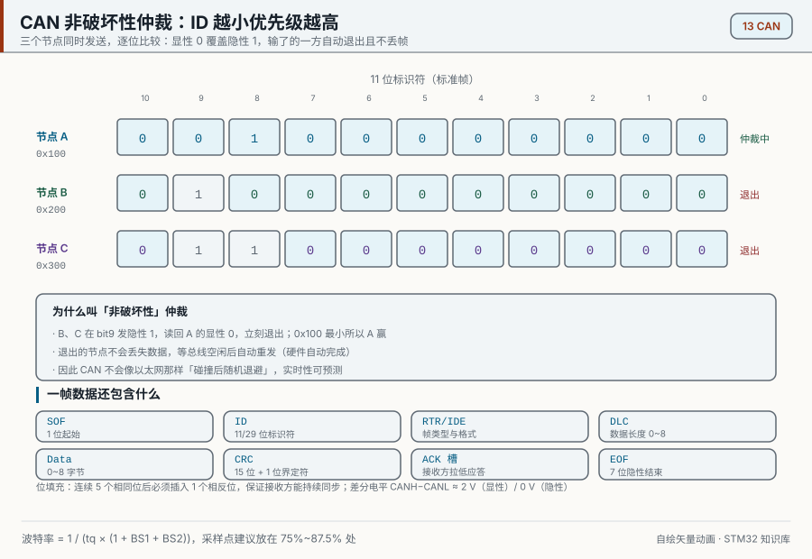
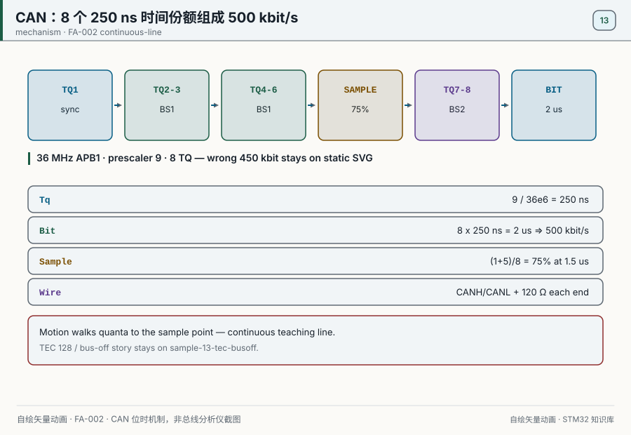
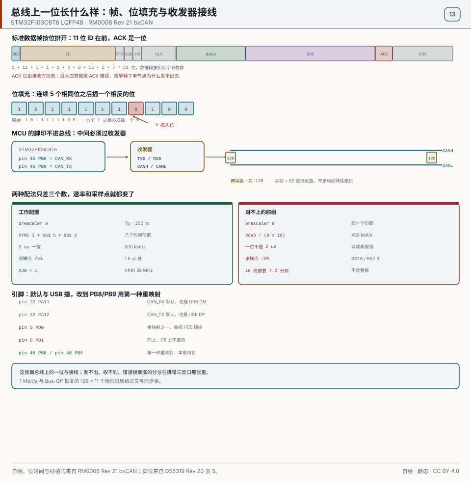
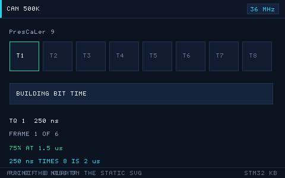
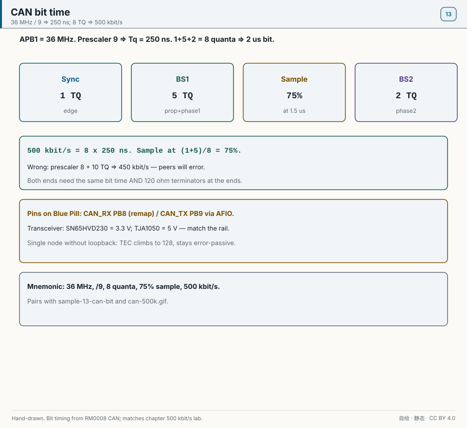
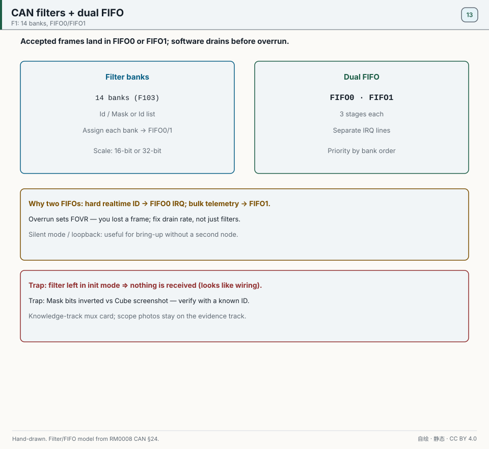
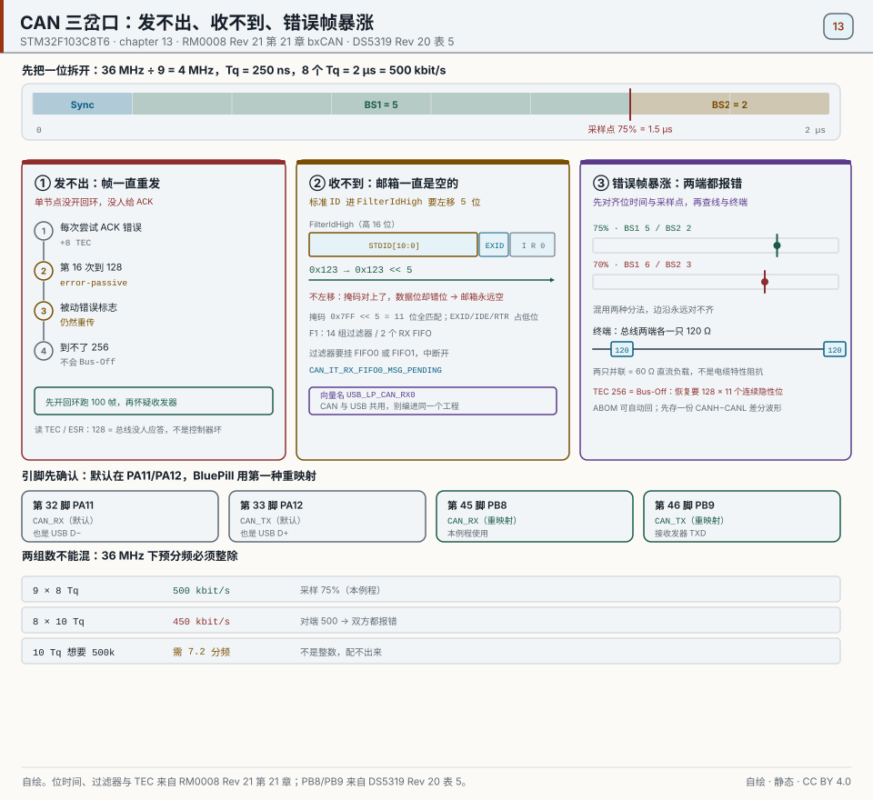
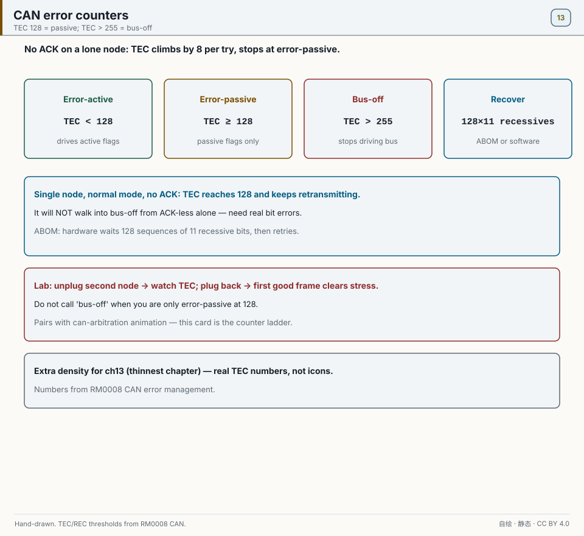

# 13 CAN 总线

> English: [CAN](en/13-can.md)

> 回环模式能证明 bxCAN 收发路径，却不能证明收发器、终端电阻和差分总线。双节点实验还要对上 CAN_H/CAN_L 波形、ESR 计数和接收 FIFO 数据。

<p align="center">
  
  <br><sub>▲ 动画：CAN 非破坏性仲裁与位填充（作者自绘矢量动画，非实拍）</sub>
</p>

<!-- video:ch13 -->
<p align="center">
  <video width="640" controls poster="../assets/video/ch13-can.png">
    <source src="../assets/video/ch13-can.mp4" type="video/mp4">
  </video>
  <br><sub>▲ 本章讲解视频（3.3 分钟）。<a href="../assets/video/ch13-can.mp4">MP4</a> · <a href="../assets/video/ch13-can.srt">字幕</a></sub>
</p>

<details>
<summary>旁白文字稿</summary>

1. CAN 发出去要有人应答。单节点又没开回环时，每次发送都收不到 ACK，错误计数每次加 8，连续十六次尝试到 128 后转 error-passive，此后只重传同一帧，不会到 Bus-Off。
2. 先把控制器配成回环，自己发给自己。能收到，说明波特率和过滤器大体对了。再接到真正的总线。示例工程默认就是这条回环路。
3. F103 的 APB1 若是 36 兆，500 千比特要用预分频 9、位段 1 是 5、位段 2 是 2。一共 8 个时间份额，采样点在 75%。原先那组除不尽，实际只有 450 千比特。
4. 这一帧是仓库画的仲裁。线上是线与，显性位能盖过隐性位。标识更小的那一帧会留下来，输的那一方安静地改去接收。所以标识不是随便填的装饰。
5. 过滤器决定哪些标识能进接收邮箱。掩码模式里，掩码为 1 的位必须相同。标准标识在 32 位过滤器里要左移到正确的位置。放错一位，总线上有帧，你的邮箱仍是空的。
6. CAN1 默认在 PA11 和 PA12，和 USB 撞车。BluePill 上改到 PB8 接收、PB9 发送，用的是 CAN1 的第一种重映射。不要配成去 PD0、PD1 的那一种，C8 没有那两只脚。
7. 自动总线恢复可以让控制器自己试着回来。关掉它，就要在错误回调里停掉再重新启动。不管哪一种，总线上的接线、终端电阻和波特率得先改对，不然它还会再闭嘴。
8. 两块板子练习时，关掉回环，两边标识对调，总线两端各放 120 欧。收发器的电平要和模块匹配。单看回环全绿，不代表两块板子已经能对话。
9. 口诀：发送错误计数超过 255 才进 Bus-Off，单节点无 ACK 只会停在 128 的 error-passive 并一直重传。单节点不要用正常模式考验自己。500 千比特在 36 兆上，记预分频 9 和一共 8 个时间份额。
10. 合上书，三问。为什么单节点、又不是回环时停在 error-passive 而不会进 Bus-Off？36 兆下 500 千比特的预分频是多少？PB8 和 PB9 哪只是接收？

</details>
<!-- /video:ch13 -->

## 原理与适用范围

本章的位时间和引脚都按 STM32F103C8T6 算。CAN1 挂在 APB1 上，时钟 36 MHz，和第 02 章的时钟配置一致。工作点是预分频 9，BS1 = 5，BS2 = 2，SJW = 1。见 [RM0008 Rev 21 bxCAN](#source-rm0008-can)。

一个时间份额 `Tq = 9 / 36e6 = 250` ns。一位由同步段 1 个、BS1 的 5 个、BS2 的 2 个组成，共 8 个时间份额。位时间 `8 × 250 ns = 2` µs，也就是 500 kbit/s。采样点在 `(1 + 5) / 8 = 75%`，即一位开始后 1.5 µs。

换一组段数时要先验算预分频是不是整数。想要 10 个时间份额、采样点 70%（BS1 = 6，BS2 = 3），预分频要 `36e6 / (500e3 × 10) = 7.2`，不是整数。写成 8 的话，速率变成 `36e6 / (8 × 10) = 450` kbit/s，和对端的 500 kbit/s 对不上，两边都会报错。1 Mbit/s 的配置在下面的核心原理里讲。

BluePill 上用第一种重映射：第 45 脚 PB8 = CAN_RX，第 46 脚 PB9 = CAN_TX。复位后的默认脚是第 32 脚 PA11 = CAN_RX、第 33 脚 PA12 = CAN_TX，但这两只脚也是 USB 的 D− 和 D+，第 14 章要用。见 [DS5319 Rev 20 表 5](#source-ds5319-usbcan)。

第二种重映射是第 5 脚 PD0、第 6 脚 PD1。LQFP48 上这两只脚接着 HSE 晶振，CAN 搬过去会停掉 8 MHz 晶振。见 [DS5319](#source-ds5319-clock)。RM0008 §9.3.3 也写明，36、48 和 64 脚的封装不能把 CAN 重映射到端口 D。第 45、46 脚同时是第 07 章 I2C1 的重映射脚，一个工程里只能给 CAN 或 I2C 之一。见 [DS5319](#source-ds5319-i2c)。

MCU 的 PB8/PB9 不能直接接总线，要先进收发器的 RXD/TXD，由收发器输出 CANH/CANL。总线两端各接一只 120 Ω，跨在 CANH 与 CANL 之间。两只并联后的直流负载是 60 Ω。60 Ω 不是电缆的特性阻抗，电缆的特性阻抗约是 120 Ω，终端电阻是按它选的。

总线上只有一个节点、又没开回环模式时，发出的帧没人应答。每次发送尝试都是 ACK 错误，发送错误计数每次加 8，连续十六次尝试到 128，节点进入 error-passive：它仍然重传，但只发被动错误标志。标准规定 error-passive 的发送方再遇到 ACK 错误时不再增加 TEC，所以无 ACK 的单节点会一直重传同一帧，不会到 256。TEC 超过 255（也就是到 256）才会 Bus-Off；恢复要等总线上出现 128 次、每次 11 个连续隐性位。过滤器用 32 位掩码时，标准 ID 写进 `FilterIdHigh` 要左移 5 位。不左移，总线上明明有帧，邮箱却一直是空的。F103 有 14 组过滤器和 2 个接收 FIFO。见 [本仓库例程](#source-project-examples)。

中容量芯片的向量表里，这条中断叫 `USB_LP_CAN_RX0`，和第 14 章 USB 共用同一条向量。互联型的表里才叫 `USB_LP_CAN1_RX0`。所以 CAN 和 USB 两个例程不要编进同一个工程。见 [RM0008](#source-rm0008-usb)。

## 关键插图


<p align="center">
  
  <br><sub>▲ 自绘矢量动画（FA-002）。Sync→BS1→75% 采样→BS2→2 µs。</sub>
</p>


<p align="center">
  
  <br><sub>▲ 自绘。STM32F103C8T6。图上半部分是正确配置：8 个 250 ns 的时间份额，采样点 75%，一位 2 µs，500 kbit/s，预分频 9，SJW = 1，CANH 与 CANL 之间接 120 Ω。下半部分是错误配置：预分频 8、10 个时间份额，得到 450 kbit/s，采样点 70%。引脚是第 45 脚 PB8 和第 46 脚 PB9。出处是 [RM0008 Rev 21 bxCAN](#source-rm0008-can) 和 [DS5319 Rev 20 表 5](#source-ds5319-usbcan)。</sub>
</p>

<p align="center">
  
  <br><sub>▲ 动图版，只演示正确配置：8 个 250 ns 的时间份额，采样点 75%，500 kbit/s。印刷版只有上面的静态图。</sub>
</p>

仲裁和位填充的过程见章首的 `can-arbitration.svg`。

## 时序与状态

| 预分频 | BS1 | BS2 | 时间份额数 | 位时间 | 速率 | 采样点 |
| --- | --- | --- | --- | --- | --- | --- |
| 9 | 5 | 2 | 8 | 2 µs | 500 kbit/s | 75%。时间份额 250 ns。正确 |
| 8 | 6 | 3 | 10 | 2.22 µs | 450 kbit/s | 70%。和对端不一致 |
| 脚位 | PB8 收 | PB9 发 | 第 45 脚、第 46 脚 | — | — | PA11/PA12 与 USB 冲突 |
| 无 ACK 单节点 | TEC 到 128 | 进入 error-passive | 只发被动错误标志 | 之后不再加 TEC | 持续重传 | 不会到 Bus-Off |
| Bus-Off | TEC 超过 255 | 停止驱动总线 | 128 次 | 每次 11 个隐性位 | ABOM 或手动重启 | 之后才可以再驱动 |
| 过滤器 | `FilterIdHigh` | 左移 5 | — | — | — | 不左移则邮箱仍空 |

## 常见坑与出处

| 现象 | 原因 | 处理 | 出处 | 出处里能查到什么 |
| --- | --- | --- | --- | --- |
| 示波器或分析仪上是 450 kbit/s | 预分频和段数配成了除不尽的那一档 | 预分频用 9，BS1 用 5，BS2 用 2 | [RM0008](#source-rm0008-can) | 8 个时间份额、预分频 9，在 36 MHz 下是 500 kbit/s。10 个时间份额配预分频 8 是 450 kbit/s |
| 单节点、正常模式，帧一直重发 | 没有应答，TEC 到 128 进入 error-passive | 先用回环模式。上总线时要有能应答的节点 | [RM0008](#source-rm0008-can) | 无 ACK 时 TEC 停在 128，节点只发被动错误标志并持续重传；TEC 超过 255 才是 Bus-Off |
| 总线上有帧，邮箱是空的 | 标准 ID 没有左移 | 写入 `FilterIdHigh` 时左移 5 | [本仓库例程](#source-project-examples) | `examples/can-bxcan` 用 `PEER_ID << 5` 填 `FilterIdHigh`。预分频宏是 9 |
| 两端都在报错 | 位时间不一致，或终端电阻没接在总线两端 | 两端用同一组位时间，CANH 与 CANL 之间两端各 120 Ω | [本仓库例程](#source-project-examples) | 例程要求两端各一只 120 Ω。例程没有规定电缆特性阻抗，也没有规定收发器是 5 V 还是 3.3 V |
| 波形在 PA11/PA12，USB 也失效 | 还停在复位默认脚上 | 重映射到第 45 脚和第 46 脚 | [DS5319](#source-ds5319-usbcan) | 复位默认 CAN 在 PA11/PA12。PB8/PB9 是重映射。PA11/PA12 同时是 USB |
| 重映射到晶振脚之后时钟停了 | 那两只脚接着 HSE | 不要把 CAN 放到第 5 脚和第 6 脚 | [DS5319](#source-ds5319-clock) | LQFP48 第 5 脚是 PD0-OSC_IN，第 6 脚是 PD1-OSC_OUT |
| 和 I2C 重映射抢同一对脚 | PB8/PB9 也是 I2C1 的重映射 | 这一对脚只给 CAN 或 I2C 之一 | [DS5319](#source-ds5319-i2c) | 第 45 脚 PB8、第 46 脚 PB9 是 I2C1 的重映射 |

## 学习目标

- [ ] 理解差分电平、显性/隐性、位填充、CRC、ACK 的作用。
- [ ] 分清数据帧/遥控帧/错误帧/过载帧，以及标准帧（11 位）与扩展帧（29 位）ID。
- [ ] 掌握非破坏性仲裁原理，理解「ID 越小优先级越高」。
- [ ] 会算波特率与采样点（BS1/BS2/SJW），并据此配置 `CAN_BTR`。
- [ ] 会配置过滤器与 F1 的双 FIFO 收发。

## 核心原理

CAN 调试分三层：控制器状态、收发器与总线电气、应用收到的帧。只看串口打印“收到 0x123”，无法证明采样点、终端和错误恢复都正确。

### 1. 物理层：差分信号与显性/隐性

CAN 用两根绞在一起的线传一位数据，看的是两根线之间的电压差，不是某一根线的绝对电压。外面的干扰会同时打在两根线上，差值不变，所以 CAN 能在汽车、工厂这种电磁环境很脏的地方跑几十上百米。差值大约 2 V 叫显性，代表 0；差值接近 0 叫隐性，代表 1。只要有一个节点发显性，整条线就是显性。

CAN 用一对差分线 `CAN_H`/`CAN_L` 传输，**显性（Dominant）代表逻辑 0、隐性（Recessive）代表逻辑 1**；显性会覆盖隐性（线与逻辑），这是仲裁的基础。

| 逻辑值 | 总线状态 | CAN_H - CAN_L 差分 | 备注 |
| --- | --- | --- | --- |
| 0 | 显性 Dominant | 约 +2 V | 任一节点拉低即可产生，**优先级高** |
| 1 | 隐性 Recessive | 约 0 V | 只有所有节点都发隐性才是隐性 |

- 总线两端各接一只 **120 Ω**，接在 CANH 与 CANL 之间，不接在 MCU 脚上。两只 120 Ω 并联，直流负载是 60 Ω。60 Ω 不是电缆的特性阻抗。
- 收发器（TJA1050 / SN65HVD230 等）负责把单片机的 `CAN_TX`/`CAN_RX` TTL 电平转换成差分电平。**MCU 内部只有 CAN 控制器，不含收发器，必须外接。**
- 速率与长度经验：1 Mbps 时总线 ≤ 40 m；125 kbps 时可到约 500 m（速率越高距离越短）。

### 2. 位填充、CRC 与 ACK

接收方没有时钟线，只能靠数据里的跳变对表。如果连着发很多个相同的位，线上半天没有跳变，接收方的表就会慢慢走偏。所以 CAN 规定连续 5 个相同位之后自动插一个相反的位，接收方再自动拿掉。CRC 用来检查有没有传错。ACK 是只要总线上有任何一个节点正确收到，就在应答位上按一下，告诉发送方「有人收到了」。

| 机制 | 作用 | 规则 |
| --- | --- | --- |
| 位填充 Bit Stuffing | 保证有足够跳变，便于接收端再同步 | 连续 5 个相同电平后自动插入 1 个相反位（CRC 定界符前的固定填充除外） |
| CRC | 检错 | 15 位 CRC + 1 位界定符，发端计算、收端校验，错则发错误帧 |
| ACK | 确认送达 | 发端在 ACK 槽发隐性；**任一正确接收的节点拉显性**表示确认 |
| 错误计数 | 节点故障隔离 | TEC/REC 计数，超过阈值进入 error-passive/bus-off |

### 3. 帧类型与 ID

CAN 的帧不写收件人，只写「这条消息是什么」，也就是 ID。比如 0x100 表示发动机转速，所有节点都能听到，自己决定要不要收。标准帧的 ID 是 11 位，扩展帧是 29 位，一帧最多带 8 字节数据。

| 帧类型 | 用途 |
| --- | --- |
| 数据帧 Data Frame | 携带 0~8 字节数据 |
| 遥控帧 Remote Frame | 请求其他节点发送指定 ID 的数据 |
| 错误帧 Error Frame | 检测到错误时主动/被动发送 |
| 过载帧 Overload Frame | 接收方需要延迟下一帧 |

**数据帧结构**：`SOF(1)` + 仲裁场（11/29 位 ID + RTR）+ 控制场（IDE/r0/DLC）+ 数据场（0~8 B）+ CRC 场 + ACK 场 + EOF（7 位隐性）+ IFS。

- **标准帧**：11 位 ID（`IDE=0`），兼容性好、开销小。
- **扩展帧**：29 位 ID（`IDE=1`），由 11 位基础 ID + 18 位扩展 ID 组成。

### 4. 非破坏性仲裁

几个节点同时开口时，大家一边发 ID 一边听总线。显性会盖过隐性，所以 ID 里先出现 0 的那一方赢。输的一方发现「我发的是 1，线上却是 0」，立刻闭嘴改成接收，等总线空了再发。赢的一方完全没被打扰，消息一位也没坏。ID 数值越小，优先级越高。

多个节点同时发送时，**逐位仲裁**——谁发隐性却监测到显性，谁就立即退出转接收；赢得仲裁的报文**不会被破坏**，故称「非破坏性」。**ID 数值越小，优先级越高。**

| ID（标准帧） | 优先级 | 典型用途 |
| --- | --- | --- |
| `0x000` | 最高 | 紧急/控制 |
| `0x100` | 较高 | 实时控制 |
| `0x500` | 中 | 状态上报 |
| `0x7FF` | 最低 | 非关键/日志 |

> 仲裁在「仲裁场」进行；一旦某节点失去仲裁，它会自动转为接收状态，等总线空闲后重发，**不消耗重传次数、也不产生错误帧**。

### 5. 波特率与采样点


<p align="center">
  
  <br><sub>▲ 自绘。采样点 75%；预分频写错会变成 450 kbit/s。</sub>
</p>


CAN 把一位的时间切成若干份小格，叫 Tq。第 1 格用来对齐边沿，后面分成采样点前的 BS1 和采样点后的 BS2。采样点放在一位的 75% 到 87.5% 处，是为了等线上的信号走完一个来回、彻底稳定了再看。同一条总线上所有节点的波特率和采样点都要一致。

一个位时间 `T_bit = 1/NBaud` 由 `SYNC_SEG(1 Tq)` + `BS1` + `BS2` 组成；采样点一般取在 **75%~87.5%**。

```text
BaudRate = f_APB1 / (Prescaler × (1 + BS1 + BS2))
采样点位置 = (1 + BS1) / (1 + BS1 + BS2) × 100%
Tq = Prescaler / f_APB1
```

以 **F1（APB1=36 MHz）** 为例：

| 目标波特率 | Prescaler | BS1 | BS2 | 采样点 | 说明 |
| --- | --- | --- | --- | --- | --- |
| 1 Mbps | 3 | 8 Tq | 3 Tq | 75% | 36 MHz / (3×12) = 1 MHz，短距离 |
| 500 kbps | 9 | 5 Tq | 2 Tq | 75% | 36 MHz / (9×8) = 500 kHz |
| 250 kbps | 18 | 5 Tq | 2 Tq | 75% | 分频再翻一倍 |
| 125 kbps | 36 | 5 Tq | 2 Tq | 75% | 长距离 |
| 100 kbps | 45 | 5 Tq | 2 Tq | 75% | 36 MHz / (45×8) = 100 kHz |

> 采样点想卡在 70%（BS1=6、BS2=3，一共 10 个 TQ）时，500 kbit/s 需要的预分频是 7.2，不是整数。上面改成能整除的 8 个 TQ、75% 采样点。示例 [`examples/can-bxcan`](../examples/can-bxcan/) 用的就是 500 kbit/s 这一行。1 Mbps 那一行是 12 个 TQ，采样点 `(1 + 8) / 12 = 75%`，同样落在推荐区间内。本章开头几节只用 500 kbit/s 这一组参数。

> **SJW（再同步跳转宽度）** 用于吸收各节点时钟误差，一般取 1~2 Tq。采样点不一致是 CAN 通信偶发错误的首要原因，多节点必须统一。

### 6. 过滤器与双 FIFO（F1）


<p align="center">
  
  <br><sub>▲ 自绘。硬实时进 FIFO0，批量进 FIFO1；溢出要提速排空。</sub>
</p>


F1 的 bxCAN 有 **14 个过滤器组** 和 **2 个接收 FIFO**；过滤器把「ID 匹配的报文」路由到 FIFO0 或 FIFO1，用中断/轮询取出。

| 模式 | 说明 | 关键寄存器 |
| --- | --- | --- |
| 掩码模式 Mask | ID + 掩码，掩码位=1 必须匹配、=0 不关心 | `CAN_FiR1`/`CAN_FiR2` |
| 列表模式 List | 多个 ID 精确匹配 | `CAN_FiR1`/`CAN_FiR2` |
| 位宽 | 32 位（标准+扩展）或 16 位（两个标准 ID） | `CAN_FS1R` |
| FIFO 分配 | 每组可关联 FIFO0 或 FIFO1 | `CAN_FFA1R` |

> F4 的 bxCAN 结构与之类似（也是 14 组过滤器 + 2 FIFO，见 RM0090 第 32 章 Controller area network），寄存器命名基本一致。


<p align="center">
  
  <br><sub>▲ 自绘。排错三岔口：APB1 36 MHz、预分频 8 配 10 个时间份额算出来是 450 kbit/s——这就是文档里的错误配置例；邮箱一直空，先查标准 ID 写 FilterIdHigh 是不是忘了左移 5 位（0x123 << 5）；错误帧暴涨多半是采样点定错。出处是 [RM0008 bxCAN](#source-rm0008-can) 和 [DS5319 Rev 20](#source-ds5319-clock)。</sub>
</p>

## 硬件与接线

| 开发板 | 外设 | 引脚 | 备注 |
| --- | --- | --- | --- |
| BluePill (F103) | CAN1 | PB8=CAN_RX、PB9=CAN_TX | 第一种重映射。第 45 脚收，第 46 脚发。PA11/PA12 是复位默认，和 USB 冲突，不走这条正常路径。外接 TJA1050/SN65HVD230 |
| BluePill | 收发器 | CANH/CANL | 两端各 120 Ω 终端电阻 |
| Nucleo-F411RE | CAN1 | PD0=CAN_RX、PD1=CAN_TX | 需外接收发器 |
| 任意 | 调试 | USART1 | 打印收发结果 |

接线：`CAN_TX → 收发器 TXD`，`CAN_RX → 收发器 RXD`，收发器 `CANH/CANL` 接总线；**收发器供电注意电平**（SN65HVD230 是 3.3 V，TJA1050 是 5 V）。

## 代码实现

**① CAN 初始化（F1，500 kbps）**

```c
#include "stm32f1xx_hal.h"

CAN_HandleTypeDef hcan;

static void MX_CAN_Init(void)
{
    hcan.Instance                  = CAN1;
    hcan.Init.Prescaler            = 9;                 /* 36MHz/(9×(1+5+2))=500k */
    hcan.Init.Mode                 = CAN_MODE_NORMAL;
    hcan.Init.SyncJumpWidth        = CAN_SJW_1TQ;
    hcan.Init.TimeSeg1             = CAN_BS1_5TQ;
    hcan.Init.TimeSeg2             = CAN_BS2_2TQ;
    hcan.Init.TimeTriggeredMode    = DISABLE;
    hcan.Init.AutoBusOff           = ENABLE;
    hcan.Init.AutoWakeUp           = DISABLE;
    hcan.Init.AutoRetransmission   = ENABLE;
    hcan.Init.ReceiveFifoLocked    = DISABLE;
    hcan.Init.TransmitFifoPriority = DISABLE;
    HAL_CAN_Init(&hcan);
}
```

**② 过滤器：只收 0x123（掩码模式）**

```c
static void CAN_Filter_Init(void)
{
    CAN_FilterTypeDef f = {0};
    f.FilterBank           = 0;
    f.FilterMode           = CAN_FILTERMODE_IDMASK;
    f.FilterScale          = CAN_FILTERSCALE_32BIT;
    f.FilterIdHigh         = 0x123 << 5;   /* 标准帧 ID 左移 5 位 */
    f.FilterIdLow          = 0x0000;
    f.FilterMaskIdHigh     = 0x7FF << 5;   /* 11 位全部必须匹配 */
    f.FilterMaskIdLow      = 0x0000;
    f.FilterFIFOAssignment = CAN_RX_FIFO0;
    f.FilterActivation     = ENABLE;
    HAL_CAN_ConfigFilter(&hcan, &f);
    HAL_CAN_Start(&hcan);
    HAL_CAN_ActivateNotification(&hcan, CAN_IT_RX_FIFO0_MSG_PENDING);
}
```

**③ 发送与接收**

```c
void CAN_Send(uint16_t std_id, uint8_t *data, uint8_t len)
{
    CAN_TxHeaderTypeDef tx = {0};
    uint32_t mailbox;
    tx.StdId = std_id;
    tx.IDE   = CAN_ID_STD;
    tx.RTR   = CAN_RTR_DATA;
    tx.DLC   = len;
    HAL_CAN_AddTxMessage(&hcan, &tx, data, &mailbox);
}

void HAL_CAN_RxFifo0MsgPendingCallback(CAN_HandleTypeDef *hcan)
{
    CAN_RxHeaderTypeDef rx;
    uint8_t data[8];
    HAL_CAN_GetRxMessage(hcan, CAN_RX_FIFO0, &rx, data);
    /* 处理 rx.StdId / data */
}
```

## 动手实验

1. **控制器闭环**：回环模式发送 100 帧递增计数，记录发送成功、FIFO 接收数和数据比对；明确这一步没有验证收发器和总线。
2. **物理总线闭环**：两节点、两端各 120Ω，保存 CAN_H/CAN_L 差分波形和解码帧。记录 BTR、采样点、ACK 与 FIFO 数据。
3. **过滤与仲裁**：过滤器只收 0x123；再让两个节点同时发 0x100 与 0x200，保存仲裁波形并核对只有 0x123 进入目标 FIFO。
4. **错误与恢复**：断开第二节点制造无 ACK，记录 TEC 升到 128、节点转入 error-passive 并持续重传；再接回应答节点，验证第一帧成功发送。要观察 Bus-Off，需另造持续增加 TEC 的发送错误，并记录 128×11 个隐性位后的 ABOM 恢复。

### 7. 总线关闭之后怎么回来


<p align="center">
  
  <br><sub>▲ 自绘。单节点无 ACK 只到 128；Bus-Off 要另造发送错误。</sub>
</p>


发送错误计数 TEC ≥ 256，节点进入 Bus-Off，不再驱动总线。恢复条件是总线上出现 **128 次、每次 11 个连续隐性位**。硬件可以自己等，这就是 ABOM。

```c
hcan.Init.AutoBusOff = ENABLE;   /* ABOM：数够 128×11 个隐性位后自动回到主动状态 */
```

没有别的节点应答时，发送方会一直报错并重传，但停在 error-passive，不会升到 Bus-Off。单板调试先用环回模式，不要以为收发器坏了。

离开本章前，应有回环计数、双节点差分波形、过滤/仲裁记录，以及一次 error-passive 和一次 Bus-Off 前后的 TEC/ESR 变化。

自测：

1. 总线上只有一个节点，它为什么停在 error-passive 而不是 Bus-Off？
2. `AutoBusOff` 打开之后，软件还要不要写“重新 Start”？
3. 标准帧 ID 0x100 仲裁时，最先和 0x200 比的是哪一位？

## 相关资源

- RM0008《STM32F10xxx 参考手册》第 21 章 Controller area network (bxCAN)（含 `CAN_BTR` 位定义、过滤器、双 FIFO）。
- RM0090《STM32F4 参考手册》第 32 章 Controller area network (bxCAN)。
- ISO 11898-1（CAN 数据链路层）与 ISO 11898-2（物理层）。
- 收发器数据手册：TJA1050、SN65HVD230。
- 配图：`../assets/animations/can-arbitration.svg`（作者自绘矢量图）。
- 可编译示例：[examples/can-bxcan](../examples/can-bxcan/)（环回、双节点、过滤器、ABOM 与软件恢复）。BluePill 上请重映射到 PB8/PB9，不要占用板载 USB 的 PA11/PA12。

- 手机阅读版：[第 13 章 · CAN总线（公众号图文）](https://mp.weixin.qq.com/s/KvjVL15tp4MOqeR_5rxUbA)
