# 14 USB

> English: [USB](en/14-usb.md)

> “未知 USB 设备”只说明枚举某一步失败。要同时对上 48 MHz 时钟、D+ 上拉、标准请求、描述符长度和端点缓冲，才能定位停在哪一步。

<p align="center">
  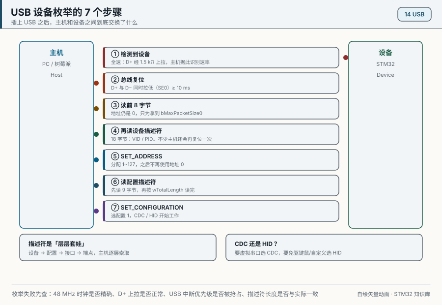
  <br><sub>▲ 动画：USB 设备枚举全过程（复位 → 取描述符 → 分配地址 → 配置）（作者自绘矢量动画，非实拍）</sub>
</p>

<!-- video:ch14 -->
<p align="center">
  <video width="640" controls poster="../assets/video/ch14-usb.png">
    <source src="../assets/video/ch14-usb.mp4" type="video/mp4">
  </video>
  <br><sub>▲ 本章讲解视频（2.7 分钟）。<a href="../assets/video/ch14-usb.mp4">MP4</a> · <a href="../assets/video/ch14-usb.srt">字幕</a></sub>
</p>

<details>
<summary>旁白文字稿</summary>

1. F103 的 USB 全速要 48 兆时钟。常见做法是 PLL 先到 72 兆，再除以 1.5。时钟差一点，主机会在读描述符时失败，设备管理器里就是未知设备。
2. 全速设备用 D+ 上的 1.5 千欧上拉告诉主机：我是全速。BluePill 上这颗电阻常常已经在了。没有上拉，主机根本不知道你插上来了。
3. 枚举是主机在提问。它先在地址 0 要设备描述符的前 8 个字节，再给你分配地址，再要整份配置，最后选择配置。卡在哪一步，口诀在这一章的正文里。
4. 这一帧是仓库画的枚举过程，不是分析仪抓的真实波形。对照它看你的描述符长度。配置描述符的总长度算错，常常卡在选择配置之前。
5. CDC 插上像一个串口，适合传字节流。HID 插上像键盘或鼠标，系统自带驱动，但每次只能按报告格式送很少的字节。数据采集走 CDC，按键走 HID。
6. 在 F103 上，USB 的低优先级中断和 CAN 接收邮箱 0 共用一个入口。两套一起开的时候，服务函数里要分清是谁在叫。只复制一个空的中断函数，另一边就会丢。
7. 示例里 CDC 的配置描述符是 67 个字节。HID 的报告描述符也要自己数，别让总长度字段和真实字节数打架。设置地址要等这一次状态传输走完再生效。
8. 示例用的厂商号是 0x1209，产品号只是实验占位，并没有在 pid.codes 注册。可以在自己的电脑上认设备，不要把这组号印到准备送人的产品上。
9. 枚举卡在哪一步就查哪处：卡在读描述符，多半是 48 兆时钟或描述符字段；卡在读配置，多半是总长度；卡在最后一步，多半是端点没准备好。
10. 示例里的 0x1209 和产品号只是实验占位，没有在 pid.codes 注册。自己的电脑能认出设备就够了，别把这一组数字印到要送人的产品上。

</details>
<!-- /video:ch14 -->
## 原理与适用范围

本章的时钟和描述符都按 STM32F103C8T6 算。USB 时钟来自第 02 章配好的 72 MHz PLL。`USBPRE = 0` 时 PLL 再除以 1.5，USB 时钟是 48 MHz，正好是全速 USB 要的频率。`USBPRE = 1` 时不分频，USB 时钟是 72 MHz，主机读描述符时就会失败。见 [RM0008](#source-rm0008-rcc)。

第 32 脚 PA11 = USB_DM，第 33 脚 PA12 = USB_DP。全速设备要在 D+ 和 3.3 V 之间接一只 1.5 kΩ 上拉，也就是接在第 33 脚这一侧。主机靠哪根线被拉高来判断设备速度：上拉接到第 32 脚 D− 上，主机会把它当成低速设备，不会按全速去认。见 [DS5319 Rev 20 表 5](#source-ds5319-usbcan)。1.5 kΩ 这个阻值印在 DS5319 表 45 注 2 里。RM0008 只说要外接上拉，没写阻值。

<p align="center">
  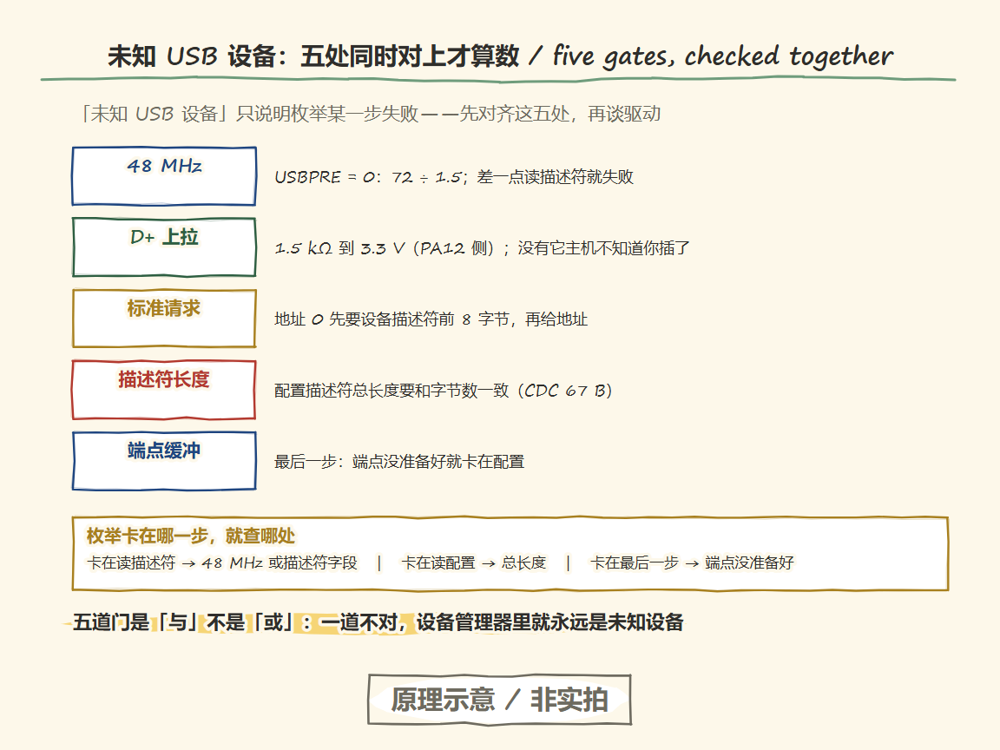
  <br><sub>▲ 知识轨（Handraw · 原理示意/非实拍）。看哪里：五道门各一行——48 MHz（USBPRE = 0，72 ÷ 1.5）、D+ 1.5 kΩ 上拉（PA12 侧）、标准请求（地址 0 先要前 8 字节）、描述符长度（配置总长度要和字节数一致，CDC 67 B）、端点缓冲；下面一行给出卡点对照：读描述符→时钟或字段，读配置→总长度，最后一步→端点没准备好。证明什么：五道门是「与」，一道不对设备管理器里就永远是未知设备。不能证明什么：这是排障清单不是分析仪抓包，不涉及具体主机 OS 的驱动匹配。出处是 [RM0008](#source-rm0008-rcc) 和 [DS5319 Rev 20 表 5](#source-ds5319-usbcan)。</sub>
</p>

F103 的 USB 是全速设备，不是主机，不能接 U 盘或键盘。全速是 12 Mbit/s。低速 1.5 Mbit/s 不是它的工作模式。见 [RM0008](#source-rm0008-usb)。

本仓库例程的设备描述符长度是 `0x12`，即 18 字节，`bMaxPacketSize0` 是 64。VID 是 `0x1209`，PID 是 `0x0001`，这是给实验板用的占位号。网上 ST 例程常见的 `0x0483/0x5740` 不是这份描述符的值。配置描述符集合的 `wTotalLength` 是 `0x0043`，即 67 字节，是配置、接口、端点等描述符加起来的总长，不是 18。`bMaxPower = 0x32`，单位是 2 mA，所以是 100 mA。见 [本仓库例程](#source-project-examples)。

全速下批量端点和中断端点的最大包长都是 64 字节。1023 字节只适用于全速等时端点。例程的通知端点是 8 字节，批量端点是 64 字节，都在上限以内。

PA11/PA12 复位后也是 CAN 的默认脚，第 13 章已经把 CAN 重映射到 PB8/PB9。中容量芯片的向量表里，USB 低优先级中断叫 `USB_LP_CAN_RX0`，和 CAN 接收中断是同一条。互联型的表里才叫 `USB_LP_CAN1_RX0`。所以 USB 和 CAN 两个例程不要编进同一个工程。

## 关键插图


<p align="center">
  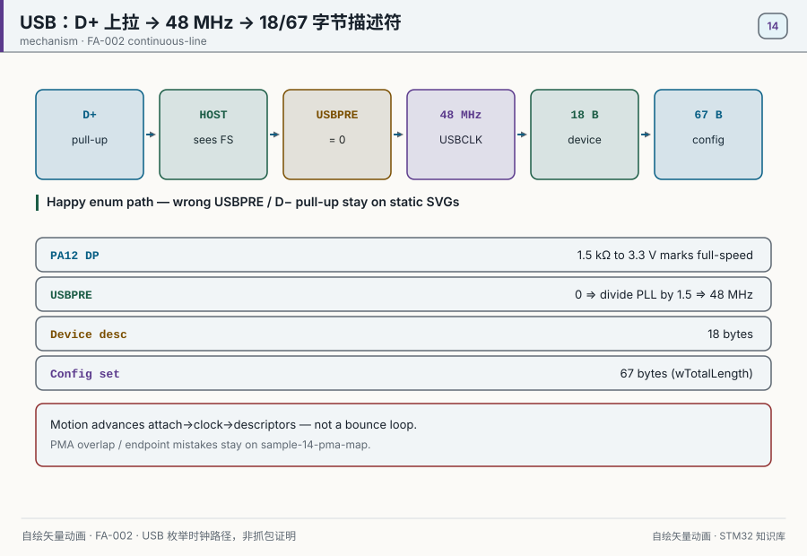
  <br><sub>▲ 自绘矢量动画（FA-002）。上拉→主机看见→USBPRE→描述符。</sub>
</p>


<p align="center">
  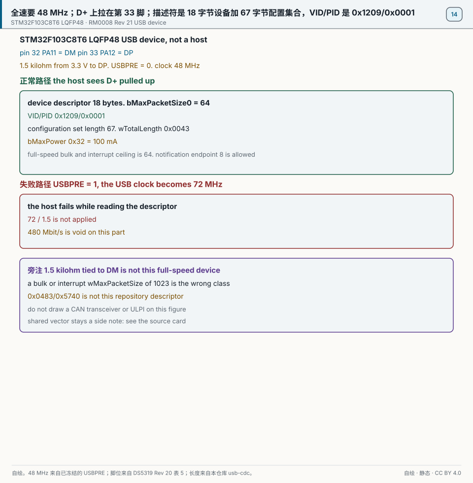
  <br><sub>▲ 自绘。STM32F103C8T6。图中正确的配置是 USBPRE = 0、48 MHz、第 33 脚 D+ 上接 1.5 kΩ、设备描述符 18 字节、配置集合 67 字节。错误配置是 USBPRE = 1，USB 时钟变成 72 MHz。0x0483/0x5740 不是这份描述符的值。出处是 [RM0008](#source-rm0008-rcc)、[DS5319](#source-ds5319-usbcan) 和 [usb-cdc](#source-project-examples)。</sub>
</p>

<p align="center">
  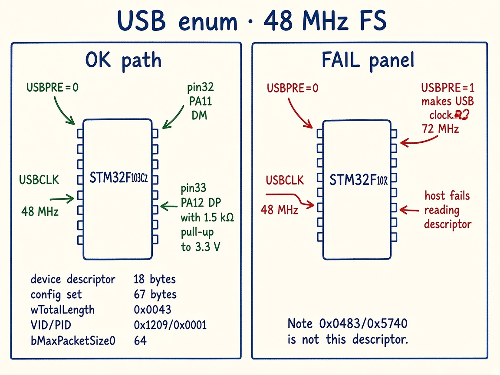
  <br><sub>▲ 知识轨（Handraw · 原理示意/非实拍）。USBPRE=0→48 MHz；D+ 1.5 kΩ；设备 18 字节+配置 67 字节；USBPRE=1 变 72 MHz 失败；不是实拍。</sub>
</p>

<p align="center">
  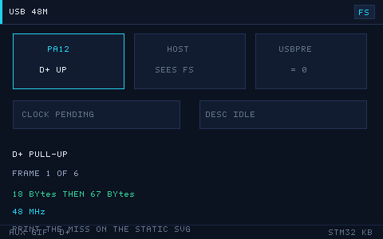
  <br><sub>▲ 动图版，只演示正常枚举：D+ 被上拉、48 MHz、18 字节、67 字节。印刷版只有上面的静态图。</sub>
</p>

枚举的完整过程见章首的 `usb-enumeration.svg`。

## 时序与状态

| 项目 | 值 | 说明 |
| --- | --- | --- |
| `USBPRE = 0` | 48 MHz | 正确。72 / 1.5 = 48 |
| `USBPRE = 1` | 72 MHz | 错误，枚举失败 |
| 设备描述符 | 长度 18，`bMaxPacketSize0` 64 | VID `0x1209`，PID `0x0001` |
| 配置集合 | `wTotalLength` 67，即 `0x0043` | `bMaxPower` `0x32` = 100 mA |
| 包长 | 批量和中断上限 64 | 1023 只属于等时。通知端点 8 字节没问题 |
| 脚位 | 第 32 脚 DM，第 33 脚 DP | 上拉接 DP。接到 DM 主机会当成低速设备 |

## 常见坑与出处

| 现象 | 原因 | 处理 | 出处 | 出处里能查到什么 |
| --- | --- | --- | --- | --- |
| 设备管理器里描述符请求失败 | USB 时钟不是 48 MHz | `USBPRE` 保持 0 | [RM0008](#source-rm0008-rcc) | `USBPRE=0` 时 72 MHz ÷1.5 = 48 MHz。`USBPRE=1` 得到 72 MHz |
| 主机完全看不到设备 | 上拉不在 D+ | 上拉接在第 33 脚 D+，不要接到 DM。阻值是 1.5 kΩ | [DS5319](#source-ds5319-usbcan) | 第 32 脚 PA11 的复用含 USB_DM，第 33 脚 PA12 的复用含 USB_DP。表 45 注 2 印出 D+ 上的 1.5 kΩ |
| 枚举到的是别人的 VID | 抄了 ST 例程那一对 | 用本仓库的 `0x1209/0x0001`。`0x0483/0x5740` 不是这份描述符 | [本仓库例程](#source-project-examples) | `examples/usb-cdc` 的设备描述符是 18 字节。VID/PID 是 `0x1209/0x0001`。PID 只给实验板占位 |
| 配置集合长度和字节数对不上 | 把 18 写成了总长 | `wTotalLength` 写成 67 | [本仓库例程](#source-project-examples) | 配置描述符里的总长是 `0x0043`。`bMaxPower` 的 `0x32` 是 100 mA |
| 中断或批量端点写成 1023 | 用了等时的上限 | 全速这两类的上限是 64。1023 只给等时 | [本仓库例程](#source-project-examples) | 例程批量端点是 64 字节，通知端点是 8 字节 |
| 和 CAN 例程链在一起，接收中断串了 | 两条例程共用一条向量 | 两个例程分开。CAN 不要留在 PA11/PA12 | [RM0008](#source-rm0008-usb) | 中容量表印 `USB_LP_CAN_RX0`，互联型表印 `USB_LP_CAN1_RX0`。F103 的 USB 是设备，不是主机 |

## 学习目标

- [ ] 分清 USB 2.0 低速(1.5 Mbps)/全速(12 Mbps)/高速(480 Mbps)，以及 STM32 各型号支持哪种。
- [ ] 掌握四种传输类型（控制/批量/中断/等时）的特点与适用场景。
- [ ] 读懂描述符层级：设备 → 配置 → 接口 → 端点，以及各字段含义。
- [ ] 背下枚举 7 步流程，能判断「设备管理器里不认」卡在哪一步。
- [ ] 说清 CDC 虚拟串口与 HID 的差异，并会在 CubeMX 里挂中间件。
- [ ] 会用 ST USB Device 库写一个 CDC 收发 + HID 自定义设备。

## 核心原理

USB 调试不能只看设备管理器。固件状态、PMA/端点寄存器、主机抓包和 D+/D− 电气波形各自证明不同层，结论不能互相替代。

### 1. USB 速率与 STM32 外设


<p align="center">
  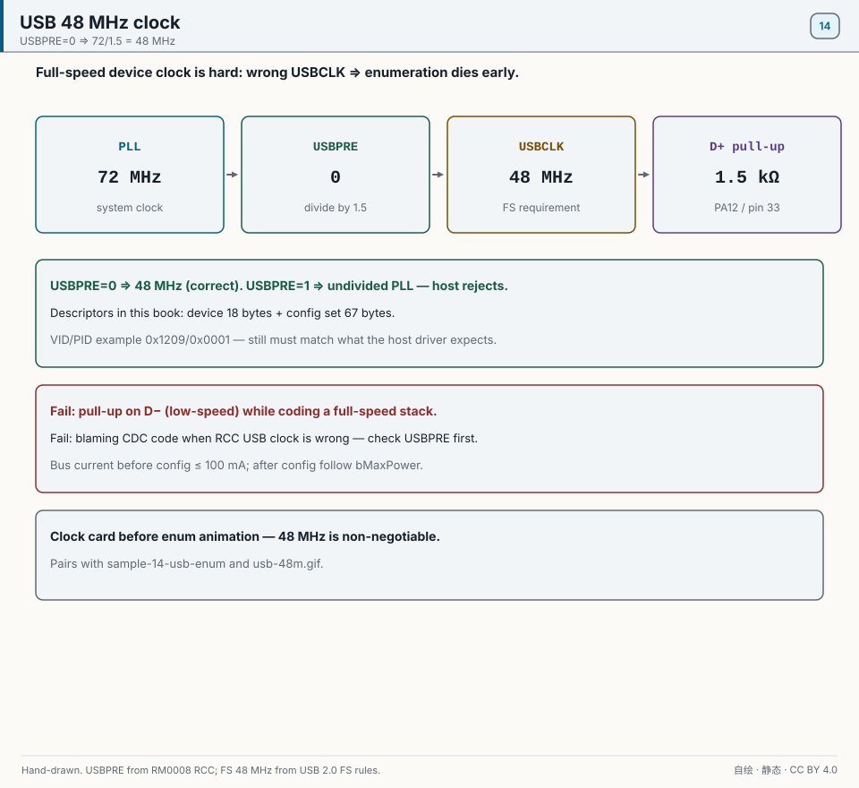
  <br><sub>▲ 自绘。全速硬性 48 MHz；USBPRE=1 会枚举失败。</sub>
</p>

<p align="center">
  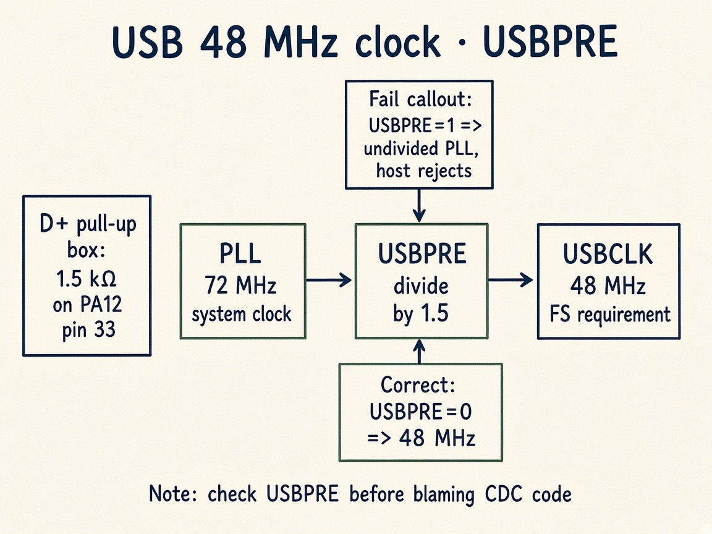
  <br><sub>▲ 知识轨（Handraw · 原理示意/非实拍）。PLL 72 MHz÷1.5=48 MHz；USBPRE=1 主机拒读；先查时钟再怪 CDC；不是实拍。</sub>
</p>


USB 更像一场由电脑主持的对话。主机点到谁，谁才能回答；设备不能看见数据就自己抢着说。F103 里只有一套 12 Mbps 的全速设备外设，能做键盘、虚拟串口，却当不了 U 盘的主机。要跑 480 Mbps，不只名字里要有 `OTG_HS`，还得有对应的高速 PHY。

USB 主机发起一切通信，设备只能「被轮询」；STM32 最常见的是**全速(FS)设备**，只有带 `OTG_HS` 的型号才支持高速(HS)。

| 速率 | 标称 | 位速率 | STM32 支持情况 |
| --- | --- | --- | --- |
| 低速 Low Speed | USB 1.1 | 1.5 Mbps | 设备端（如 HID 鼠标），STM32 一般不做 |
| 全速 Full Speed | USB 1.1/2.0 | 12 Mbps | **F0/F1/F3/L4 的 USB 外设、F4/F7/H7 的 OTG_FS** |
| 高速 High Speed | USB 2.0 | 480 Mbps | 仅 **OTG_HS**（需外接 ULPI PHY 或内置 HS PHY 的型号） |

| 系列 | USB 外设 | 说明 | 参考手册章节 |
| --- | --- | --- | --- |
| STM32F1 | USB Device FS | 仅设备模式，12 Mbps，无 OTG 主机 | RM0008 第 23 章 USB device |
| STM32F4 | OTG_FS + OTG_HS | FS 内置 PHY；HS 需外接 ULPI PHY | RM0090 第 30 章 OTG_FS / 第 31 章 OTG_HS |
| STM32F7/H7 | OTG_FS + OTG_HS | 部分型号 HS 内置 PHY | 对应 RM 的 OTG 章节 |

> [!WARNING]
> **F103 的 USB 是纯设备（Device only），不能做主机**；F1 的 USB 引脚是 **PA11(DM)/PA12(DP)**。F103 上 USB 和 CAN 共用这两只脚，也共用那 512 字节的专用 SRAM，两者不能同时工作，二选一。F411 的 `OTG_FS` 也在 PA11/PA12，但 F411 没有 CAN，不存在这个冲突。

### 2. 四种传输类型

四种传输是在分配同一条总线。控制传输先把设备介绍清楚；批量传输像运货，宁可晚一点也要把错包重发；中断传输给键盘这类小消息留固定的问询机会；等时传输给声音和画面留固定时段，错过的包不回头补，因为补来的旧声音已经没用了。

按「实时性 vs 可靠性」取舍——**控制**用于枚举配置，**批量**用于大数据（可靠性优先），**中断**用于小数据低延迟，**等时**用于音频视频（实时优先，允许丢）。

| 类型 | 特点 | 典型用途 | 带宽保证 |
| --- | --- | --- | --- |
| 控制 Control | 端点 0 专用，可靠，每帧预留 | 枚举、配置、类请求 | 有 |
| 批量 Bulk | 可靠，无带宽保证，出错重传 | 虚拟串口 CDC、U 盘、打印机 | 无 |
| 中断 Interrupt | 可靠，有轮询间隔，延迟有界 | HID 键盘鼠标、小数据上报 | 有（小带宽） |
| 等时 Isochronous | 有带宽保证，**不重传、允许丢** | USB 音频、摄像头 | 有 |

### 3. 端点 Endpoint


<p align="center">
  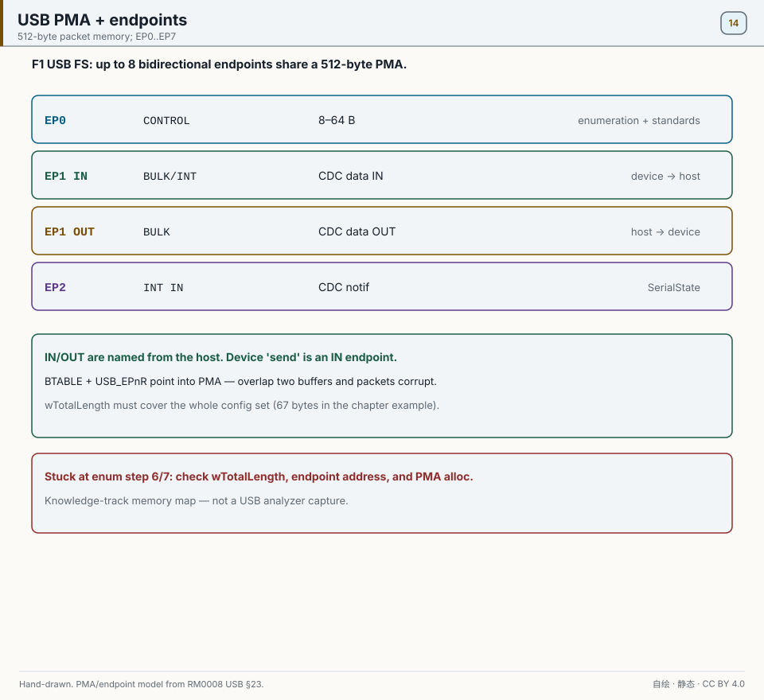
  <br><sub>▲ 自绘。IN/OUT 站在主机侧；PMA 重叠会毁掉包。</sub>
</p>

<p align="center">
  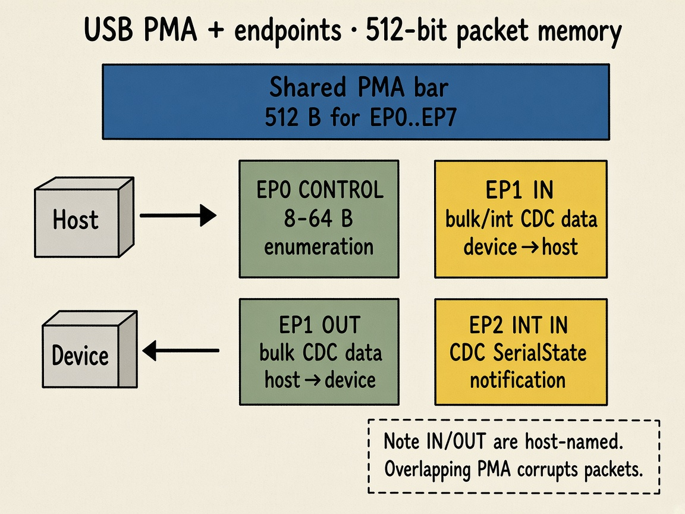
  <br><sub>▲ 知识轨（Handraw · 原理示意/非实拍）。512 字节 PMA 共享 EP0..EP7；IN/OUT 站在主机侧；重叠会毁包；不是实拍。</sub>
</p>


端点可以看成设备里的几个编号收发窗口。主机把数据送进 OUT 窗口，设备从里面取；设备把数据放进 IN 窗口，等主机来拿。这里的 IN、OUT 都站在主机一侧命名，初学时最容易看反。每个窗口还要约定传输类型、最大包长，并在那 512 字节 PMA 里留出缓冲区。

端点是主机与设备之间数据传输的「逻辑管道」，除端点 0 外**每个端点只支持一个方向**（IN 或 OUT）。

| 端点 | 方向 | 用途 |
| --- | --- | --- |
| EP0 | IN + OUT（双向） | 控制端点，枚举与标准请求 |
| EPn IN | 设备 → 主机 | 上报数据（如 CDC 的 TX） |
| EPn OUT | 主机 → 设备 | 接收数据（如 CDC 的 RX） |

F1 全速设备最多 **8 个双向端点（EP0~EP7）**；端点 FIFO 共享 **512 字节** 的 PMA（Packet Memory Area），需手工分配（见 RM0008 第 23 章 `USB_EPnR`、`BTABLE`）。

### 4. 描述符层级

设备刚插上时，电脑只看见 D+ 被拉高，还不知道它能做什么。于是电脑从最外层开始问：你是谁，有几套配置；这套配置里有几个功能；每个功能用哪些端点收发。描述符就是设备交出的这份自我介绍。字节数、层级或总长度有一处对不上，主机就没法继续往下读。

主机通过读取一串**描述符**来认识设备，层级为「设备 → 配置 → 接口 → 端点」，接口是功能的载体，一个配置可含多个接口。

```text
设备描述符 Device Descriptor          (VID / PID / 支持的配置数)
 └─ 配置描述符 Configuration Descriptor (供电方式 / 最大电流 / 接口数)
     ├─ 接口描述符 Interface Descriptor  (类/子类/协议，如 CDC / HID)
     │   ├─ 端点描述符 Endpoint Descriptor (地址/方向/类型/包长/间隔)
     │   └─ 端点描述符 Endpoint Descriptor
     └─ 接口描述符 Interface Descriptor
         └─ 端点描述符 Endpoint Descriptor
```

| 描述符 | 关键字段 | 说明 |
| --- | --- | --- |
| 设备 | `idVendor`/`idProduct` | ST 官方例程常用 0x0483/0x5740。本仓库 examples/usb-cdc 不是这一对，用 0x1209/0x0001 |
| 设备 | `bNumConfigurations` | 配置数量，一般 1 |
| 配置 | `bMaxPower` | 最大电流，单位 2 mA（0x32 = 100 mA） |
| 接口 | `bInterfaceClass` | 0x02=CDC、0x03=HID、0x08=MSC、0xFF=厂商自定义 |
| 端点 | `bmAttributes` | 传输类型：0=控制 2=批量 3=中断 1=等时 |
| 端点 | `wMaxPacketSize` | 全速批量和中断最大都是 64 字节；1023 只属于全速等时 |

全速中断的 `wMaxPacketSize` 最大是 64 字节。1023 是全速等时的上限，不是中断的上限。本仓库 `examples/usb-cdc` 的批量端点是 64 字节，通知端点是 8 字节。

<p align="center">
  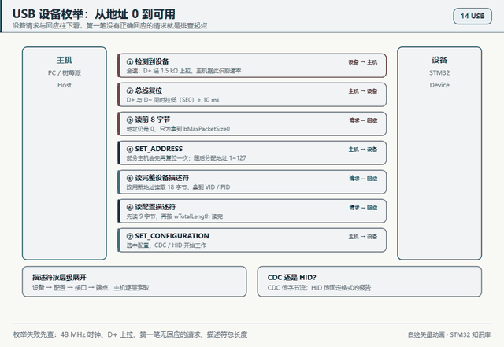
  <br><sub>▲ 枚举逐步关系：抓包中的请求顺序应与状态机一致。动画能说明控制传输顺序，不能证明 48 MHz 精度、D+/D− 波形或描述符字段内容正确。</sub>
</p>

### 5. 枚举 7 步

刚复位的 USB 设备都在地址 0。主机先用这个临时地址读够最基本的信息，再发一个新地址；从那以后，后续请求都送往新地址。接着主机把整套配置读完并选中一套，设备才算真正上线。抓包时按这条顺序往后找，第一笔没有得到正确回应的请求就是排查起点。

枚举是主机「复位设备 → 读描述符 → 分配地址 → 读配置 → 选择配置」的过程，**任何一步失败，设备管理器就报「未知设备 / 设备描述符请求失败」**。

| 步 | 动作 | 说明 |
| --- | --- | --- |
| 1 | 主机检测到设备（D+ 上拉） | 全速设备在 D+ 拉 1.5 kΩ 上拉，主机据此判断速率 |
| 2 | 复位总线 Reset | D+/D- 同时拉低 ≥ 10 ms |
| 3 | 默认地址 0 读设备描述符前 8 字节 | 拿到 `bMaxPacketSize0` |
| 4 | 再次复位后设置地址 Set Address | 设备获得唯一地址（1~127） |
| 5 | 用新地址读完整设备描述符(18 字节) | 拿到 VID/PID |
| 6 | 读配置描述符(9 字节) → 读完整配置集合 | 拿到接口/端点信息 |
| 7 | 选择配置 Set Configuration | 设备进入「已配置」状态，功能可用 |

> 卡在第 3/4 步时先核对设备描述符长度与 48 MHz；卡在第 6 步核对 `wTotalLength`；卡在第 7 步核对端点地址、PMA 和缓冲区是否已就绪。

<p align="center">
  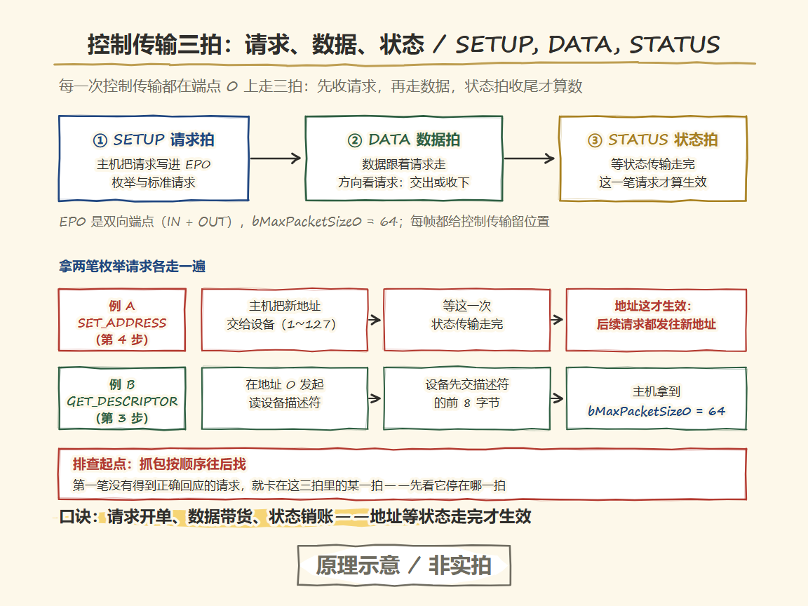
  <br><sub>▲ 知识轨（Handraw · 原理示意/非实拍）。SETUP 请求→DATA 数据→STATUS 状态；EP0 双向、bMaxPacketSize0 = 64；SET_ADDRESS 等状态传输走完再生效；GET_DESCRIPTOR 地址 0 先交前 8 字节；不是实拍。</sub>
</p>


<p align="center">
  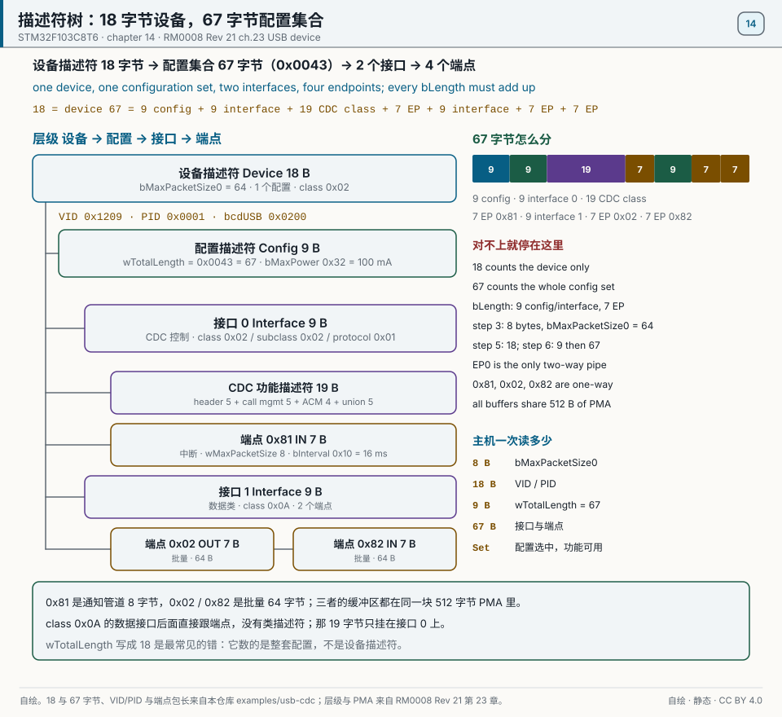
  <br><sub>▲ 自绘。描述符层级树：设备描述符 18 字节，配置集合 67 字节 = 9+9+5+5+4+5+7+9+7+7；VID/PID 0x1209/0x0001；批量端点 64 字节、通知端点 8 字节——CDC 的两个端点就挂在这棵树上，下一节的 CDC 与 HID 差异都在配置集合里。出处是 [RM0008 USB](#source-rm0008-usb) 和 [usb-cdc 例程](#source-project-examples)。</sub>
</p>

<p align="center">
  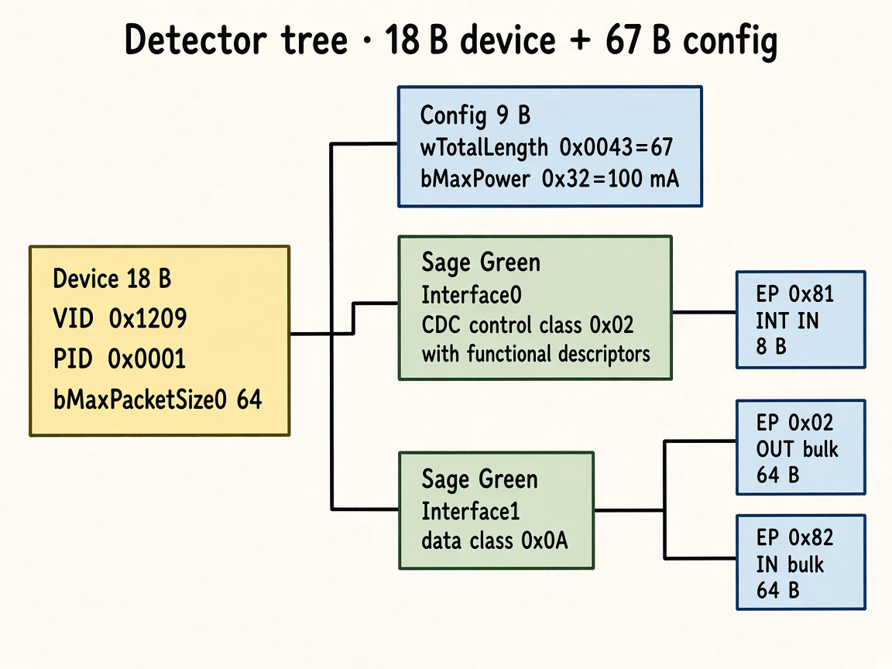
  <br><sub>▲ 知识轨（Handraw · 原理示意/非实拍）。设备 18 字节；配置集合 67=0x0043；VID/PID 0x1209/0x0001；不是实拍。</sub>
</p>

### 6. CDC 虚拟串口 vs HID

CDC 交付的是一串字节，应用自己决定哪里是一条消息；HID 交付的是一张张格式固定的报告，按键、坐标和状态各占哪几位要事先写进报告描述符。只想把日志和采样数据送到电脑，CDC 更省事。要让系统直接把设备当成键盘、鼠标或手柄，才选 HID。

想「插上就变成串口」用 **CDC**（免驱、带宽高、适合传数据）；想「插上被识别成键盘/鼠标/自定义手柄」用 **HID**（免驱、系统原生支持、可被游戏/上位机直接读）。

| 维度 | CDC（通信设备类） | HID（人机接口设备） |
| --- | --- | --- |
| 用途 | 虚拟串口，收发任意字节流 | 键盘/鼠标/自定义报告 |
| 驱动 | Windows 10+ 免驱，老系统需 .inf | 全平台免驱 |
| 端点 | 通常 1 批量 IN + 1 批量 OUT + 1 中断 IN | 1 中断 IN（+ 可选 OUT） |
| 带宽 | 高（可跑满全速） | 低（每帧几十字节，受 `bInterval` 限） |
| 数据单位 | 字节流 | 固定格式「报告 Report」 |
| 典型场景 | 调试串口、数据采集卡 | 自定义手柄、宏键盘、扫码枪 |

<p align="center">
  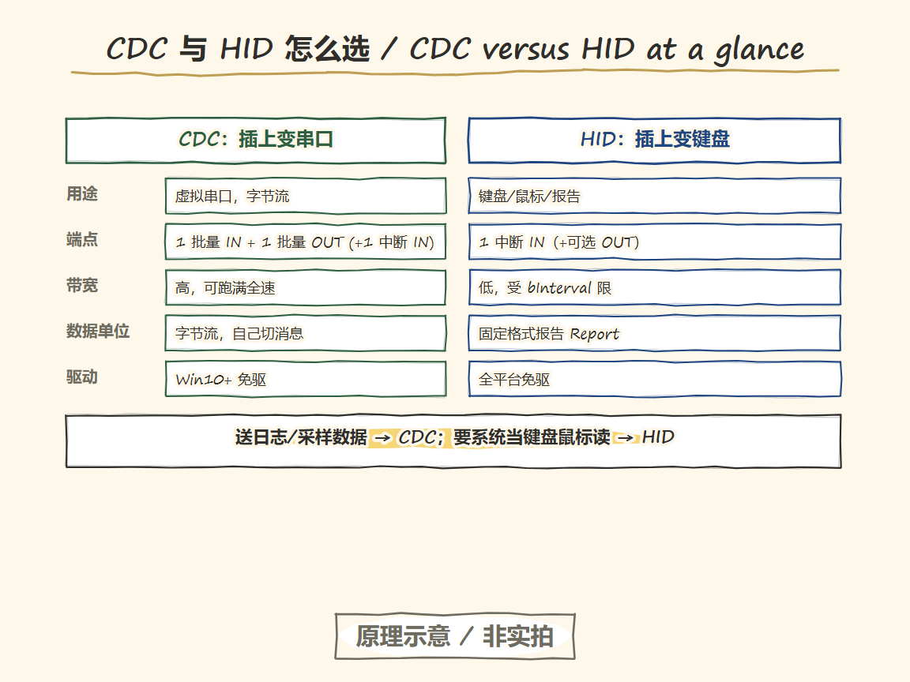
  <br><sub>▲ 知识轨（Handraw · 原理示意/非实拍）。看哪里：五维对照行（用途/端点/带宽/数据单位/驱动）与底条选型结论——送日志/采样数据选 CDC，要系统当键盘鼠标读选 HID；证明两类差异都落在配置集合里，不是换个类名就完事；不能替代实际枚举抓包，也不是设备管理器截图。出处 [RM0008 USB](#source-rm0008-usb)。</sub>
</p>

### 7. CubeMX 中间件配置要点

CubeMX 里的几个页面其实在拼同一台设备：RCC 提供 48 MHz 时钟，USB 外设接管 D+/D- 和中断，中间件给出描述符、端点和类处理函数。三层少一层都不能枚举。最常见的误判是只盯着 CDC 代码改，实际坏在 48 MHz 时钟或 VBUS 检测上。

| 配置项 | 位置 | 取值/说明 |
| --- | --- | --- |
| USB 外设 | Connectivity → USB / USB_OTG_FS | Device (FS)；F4 选 `Device_Only` 或 `OTG` |
| 类选择 | Middleware → USB_DEVICE → Class | `Communication Device Class (CDC)` 或 `HID` |
| 设备参数 | `USBD_DEVICE` 配置 | VID/PID、厂商/产品字符串 |
| CDC 参数 | `CDC` 子项 | 接口数、TX/RX 缓冲大小（默认 APP_TX/RX_DATA_SIZE=2048） |
| VBUS 检测 | `VBUS sensing` | 自供电板需接 VBUS 或关掉 sensing |
| 中断优先级 | NVIC → USB_LP / OTG_FS | 建议较高优先级 |
| 时钟 | RCC | FS 要求 USB 时钟 **48 MHz**（F1 由 PLL 分频；F4 由 PLL48CLK） |

> **48 MHz 时钟是硬性要求**：F1 全速 USB 需要 `USBCLK = 48 MHz`。PLL 72 MHz 且寄存器位 `USBPRE = 0` 表示 ÷1.5，`72 / 1.5 = 48` MHz。时钟不准会导致枚举失败或随机掉线。

## 硬件与接线

| 开发板 | 外设 | 引脚 | 备注 |
| --- | --- | --- | --- |
| BluePill (F103) | USB Device | PA11=USB_DM、PA12=USB_DP | 板载 micro-USB，D+ 已接 1.5 kΩ 上拉 |
| BluePill | 调试 | SWD PA13/PA14 | 保留，便于边调边看 |
| Nucleo-F411RE | OTG_FS | PA11=DM、PA12=DP | 板载 mini-USB 到 ST-Link 是虚拟串口，**非** OTG |
| F4-Discovery | OTG_FS | PA11/PA12 | 板载 micro-AB USB OTG 口 |
| BlackPill (F411) | USB | PA11/PA12 | 板载 Type-C 直连 MCU（DFU/自定义设备） |

接线要点：
- **USB 差分线尽量等长、靠近走线、90 Ω 差分阻抗**，别用杜邦线飞线，否则全速都可能枚举失败。
- 自绘裸板做 USB 时，**D+ 到 3.3 V 需接 1.5 kΩ 上拉**（全速设备标识），很多开发板已焊好。
- 供电：USB 口可取 5 V，板载 LDO 转 3.3 V；注意总线电流（未配置前 ≤ 100 mA）。

<p align="center">
  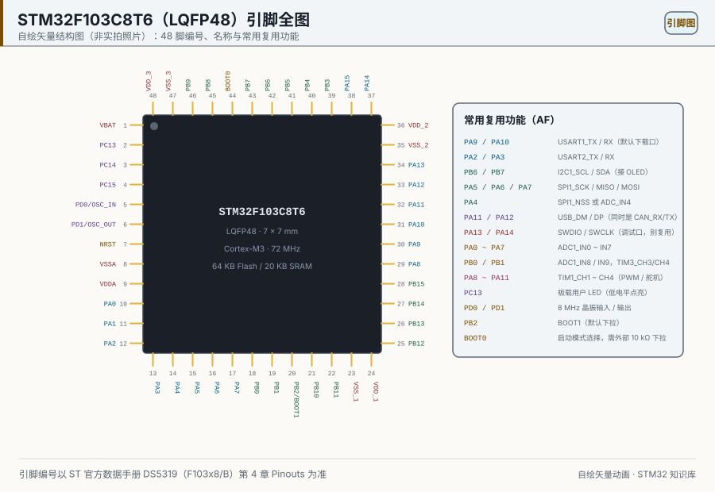
  <br><sub>▲ PA11/PA12 是 USB 差分线，PA9/PA10 是另一套 UART 调试通道。引脚图用于定位，不证明克隆板的 D+ 上拉、电阻或走线满足 USB 电气要求。</sub>
</p>

## 代码实现

用 CubeMX 生成 USB CDC 工程后，真正要写代码的地方只有 **`USB_DEVICE/App/usbd_cdc_if.c`** 的回调。下面给出可用的收发实现。

**① CDC 初始化（`main.c`，CubeMX 生成）**

```c
#include "stm32f1xx_hal.h"
#include "usb_device.h"        /* CubeMX 生成：包含 MX_USB_DEVICE_Init 声明 */
#include "usbd_cdc_if.h"       /* CDC 收发接口 */

int main(void)
{
    HAL_Init();
    SystemClock_Config();      /* 必须保证 USB 时钟 = 48 MHz */
    MX_GPIO_Init();
    MX_USB_DEVICE_Init();      /* 初始化 USB 设备栈并连接 */

    uint8_t msg[] = "STM32 CDC ready\r\n";

    while (1)
    {
        /* 非阻塞发送；返回 USBD_OK 表示已交给 USB 栈 */
        CDC_Transmit_FS(msg, sizeof(msg) - 1);
        HAL_Delay(1000);
    }
}
```

**② CDC 接收回调（`usbd_cdc_if.c`）**

```c
#include "usbd_cdc_if.h"

static int8_t CDC_Receive_FS(uint8_t *Buf, uint32_t *Len)
{
    /* Buf 指向内部接收缓冲，*Len 为本包长度 */
    /* 例：回显 —— 收到什么原样发回（注意不要在中断里长时间阻塞） */
    CDC_Transmit_FS(Buf, *Len);

    /* 关键：重新挂载接收，否则只能收到一包 */
    USBD_CDC_SetRxBuffer(&hUsbDeviceFS, &Buf[0]);
    USBD_CDC_ReceivePacket(&hUsbDeviceFS);
    return (USBD_OK);
}
```

**③ 发送函数原型（ST 库提供）**

```c
/* 由 ST 的 usbd_cdc_if.c 导出，应用层直接调用 */
uint8_t CDC_Transmit_FS(uint8_t *Buf, uint16_t Len);
```

> 发送是**异步**的：`CDC_Transmit_FS` 把数据交给 USB 栈后立即返回，真正上线由 USB 中断完成。若上一包未发完又调用，会返回 `USBD_BUSY`，需要重试或加标志。

**④ 自定义 HID 报告描述符片段（把设备做成「自定义手柄」）**

```c
/* 一个 4 字节输入报告：3 个按钮 + X/Y 相对坐标 */
__ALIGN_BEGIN static uint8_t HID_ReportDesc[] __ALIGN_END =
{
    0x05, 0x01,        /* Usage Page (Generic Desktop) */
    0x09, 0x02,        /* Usage (Mouse)                  */
    0xA1, 0x01,        /* Collection (Application)       */
    0x09, 0x01,        /*   Usage (Pointer)              */
    0xA1, 0x00,        /*   Collection (Physical)        */
    0x05, 0x09,        /*     Usage Page (Button)        */
    0x19, 0x01,        /*     Usage Minimum (1)          */
    0x29, 0x03,        /*     Usage Maximum (3)          */
    0x15, 0x00, 0x25, 0x01,   /* Logical Min/Max 0..1     */
    0x95, 0x03, 0x75, 0x01,   /* 3 个 1 位按钮            */
    0x81, 0x02,        /*     Input (Data,Var,Abs)       */
    0x95, 0x01, 0x75, 0x05,   /* 补齐 5 位                */
    0x81, 0x03,        /*     Input (Const)              */
    0x05, 0x01, 0x09, 0x30, 0x09, 0x31,  /* X, Y               */
    0x15, 0x81, 0x25, 0x7F,   /* Logical Min/Max -127..127 */
    0x75, 0x08, 0x95, 0x02,   /* 2 个 8 位字段            */
    0x81, 0x06,        /*     Input (Data,Var,Rel)       */
    0xC0, 0xC0         /* End Collection ×2              */
};
```

**⑤ 发送 HID 报告**

```c
/* 把 4 字节报告通过中断端点 IN 发出 */
USBD_HID_SendReport(&hUsbDeviceFS, report, sizeof(report));
```

## 动手实验

1. **枚举证据**：保存 GET_DESCRIPTOR、SET_ADDRESS、SET_CONFIGURATION 抓包，并记录 USBCLK、D+ 上拉和 `wTotalLength`。故意改错总长度一次，确认失败停点可重复。
2. **CDC 数据闭环**：发送 1、64、65、256 字节四种长度，记录 `USBD_BUSY` 次数、主机收到长度和 CRC。上一包未完成时不得覆盖发送缓冲区。
3. **HID 报告闭环**：按键触发固定 4 字节报告，抓包核对端点地址、报告长度和主机状态。属性页变化只是现象，报告字节才是证据。

<p align="center">
  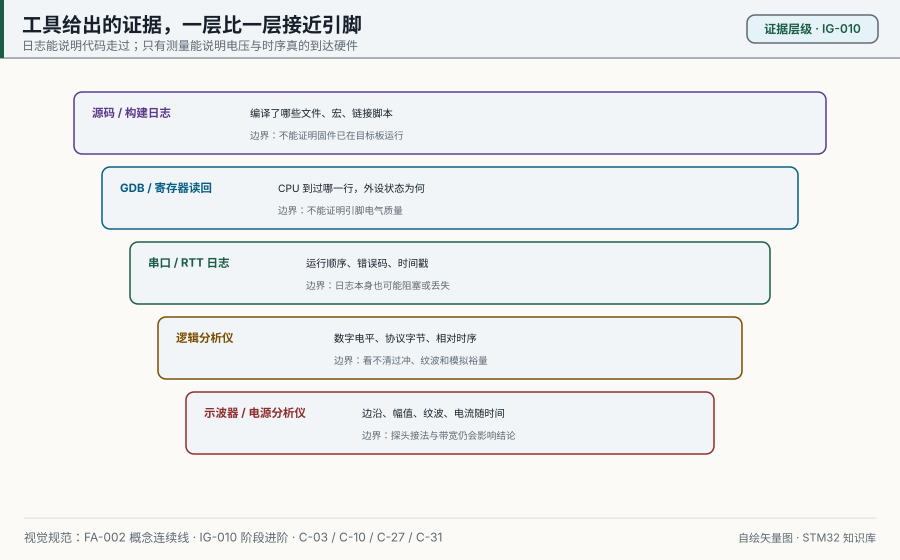
  <br><sub>▲ USB 各层证据不能互换：抓包能说明标准请求与描述符，示波器才说明 D+/D− 电气质量；设备管理器出现 COM 口也不能证明所有长度的 CDC 传输都正确（FA-002 · IG-010 · C-03/C-10/C-27/C-31）。</sub>
</p>

<p align="center">
  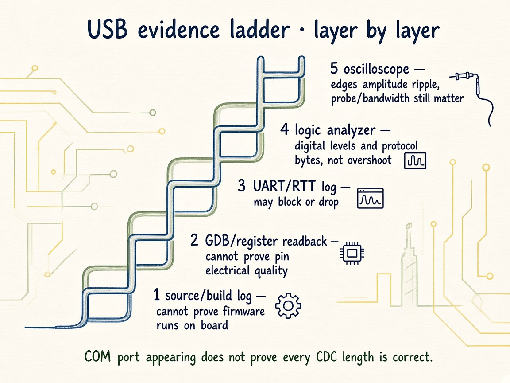
  <br><sub>▲ 知识轨（Handraw · 原理示意/非实拍）。日志→寄存器→串口→逻辑分析仪→示波器；COM 口出现不证明一切 CDC 长度都对；不是实拍。</sub>
</p>

仓库里的两个示例不附带 ST USB 中间件，直接用 HAL PCD 完成枚举：

- [examples/usb-cdc](../examples/usb-cdc/)：虚拟串口，回显，DTR 有效后每秒一行 `cdc tick`。
- [examples/usb-hid](../examples/usb-hid/)：启动式键盘，PA0 按下送一个字母 `a`。

两份都把 PLL 设成 72 MHz，USB 时钟选 PLL/1.5。F103 的 `USB_LP_CAN1_RX0` 与 bxCAN 接收是同一条中断，不要和 CAN 示例编进同一个工程。

离开本章前，应有完整枚举抓包、错误 `wTotalLength` 的失败停点、四种 CDC 长度的 CRC 和一份 HID 报告字节记录。

## 相关资源

- RM0008《STM32F10xxx 参考手册》第 23 章 USB device（`USB_EPnR`、PMA、`BTABLE`）。
- RM0090《STM32F4 参考手册》第 30 章 USB OTG_FS、第 31 章 USB OTG_HS。
- USB 2.0 规范（usb.org）：第 9 章设备框架（描述符、枚举、标准请求）。
- 应用笔记 AN4879《USB hardware and PCB guidelines using STM32 MCUs》（差分走线/阻抗）。
- 数据手册 DS：USB 电气参数、PA11/PA12 复用。
- 配图：`../assets/animations/usb-enumeration.svg`（作者自绘矢量图）。


- 手机阅读版：[第 14 章 · USB（公众号图文）](https://mp.weixin.qq.com/s/iSVv3wSvz9Rl4LOVxeOfdg)
