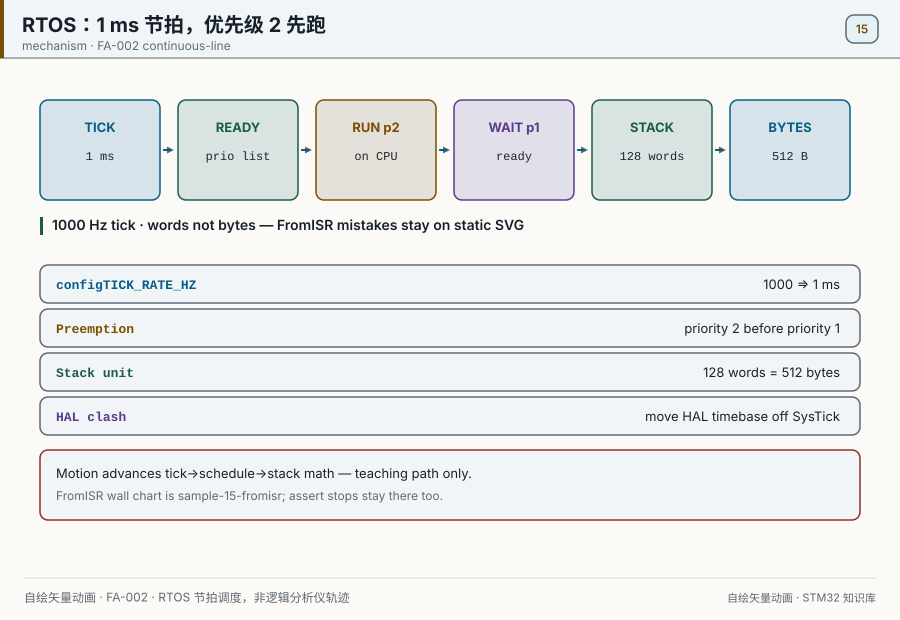
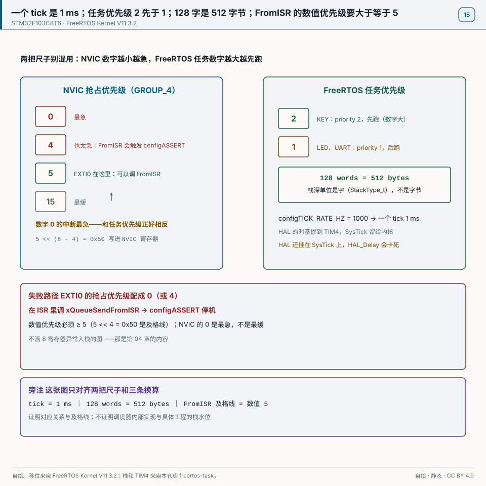
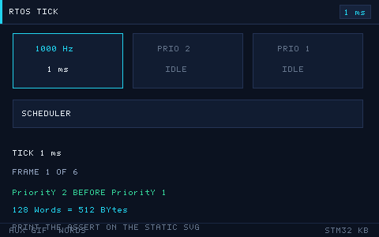
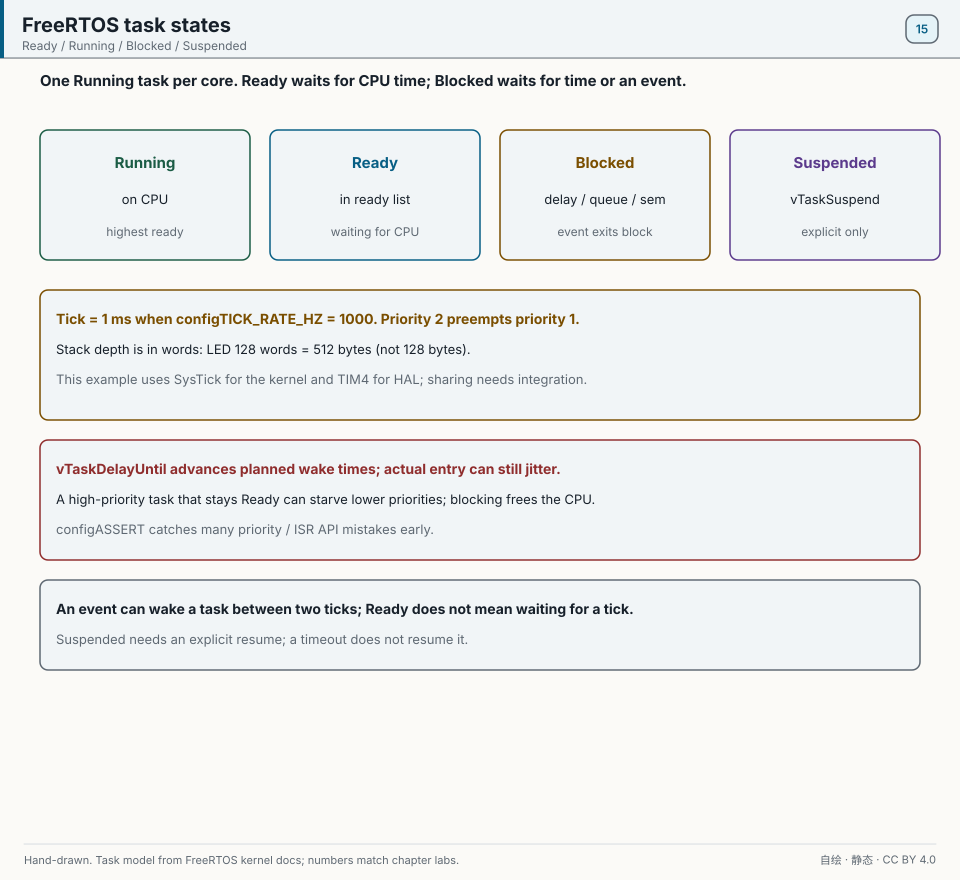
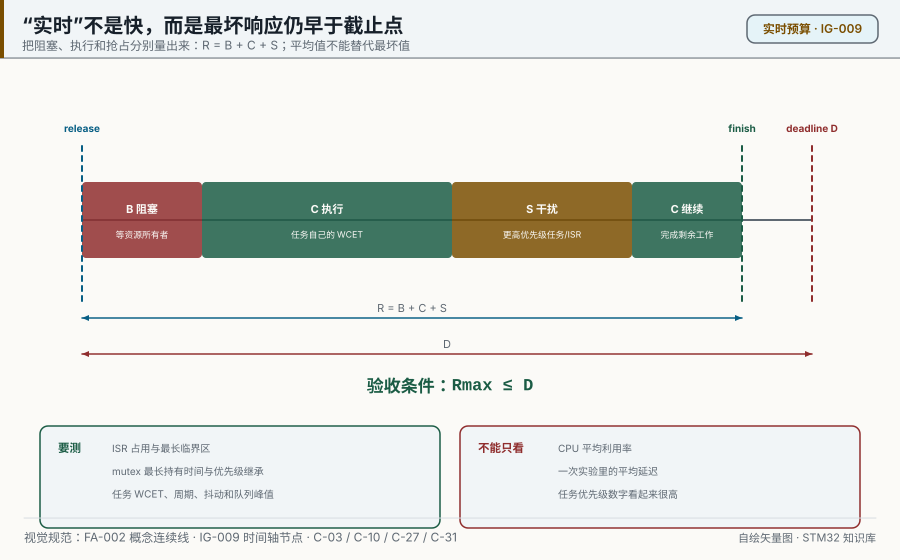
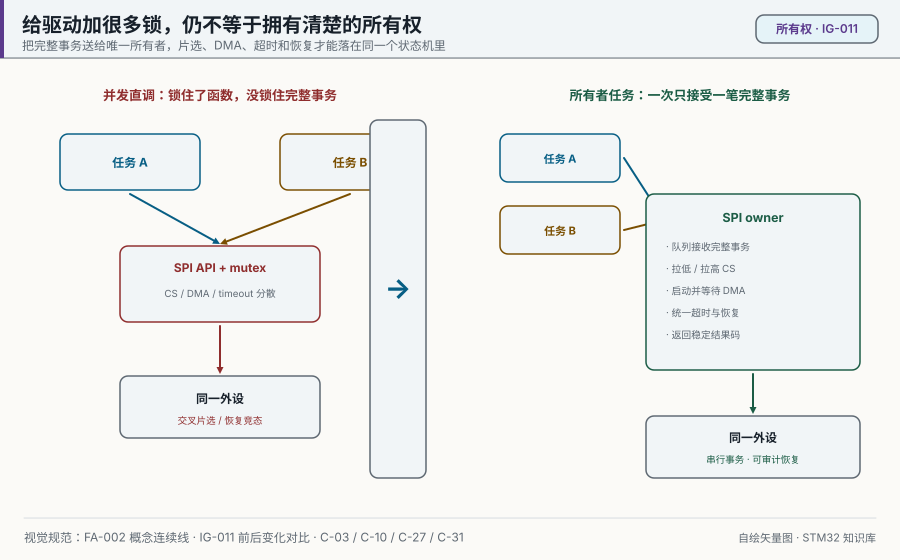
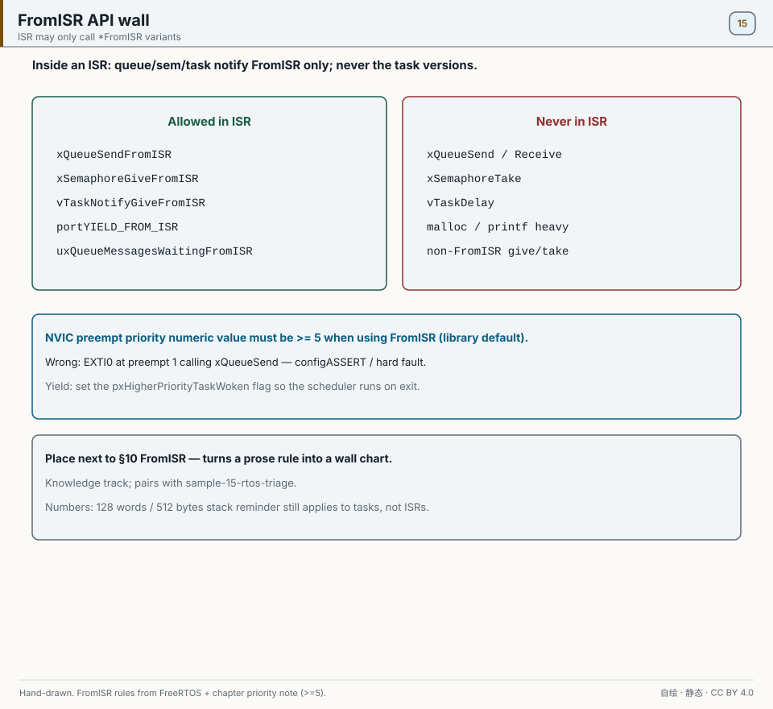
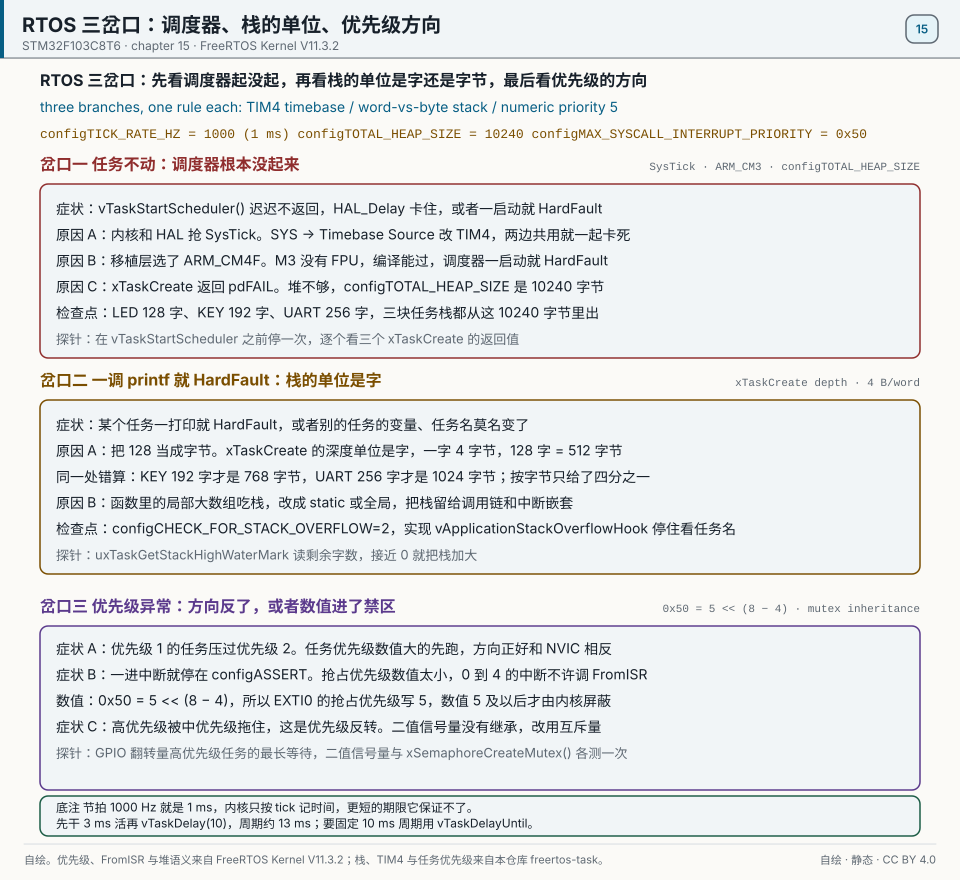
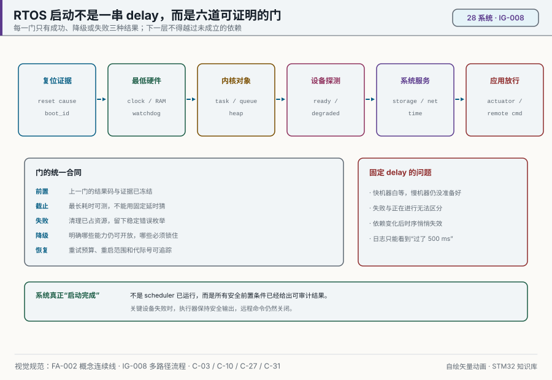

# 15 FreeRTOS 入门

> English: [FreeRTOS](en/15-freertos.md)

> 两个任务都在闪灯，不代表系统满足实时要求。要量任务周期、最长阻塞、栈余量和队列峰值，并证明 FromISR 优先级没有越过内核边界。

<p align="center">
  
  <br><sub>▲ 动画：FreeRTOS 任务状态迁移与抢占式调度（作者自绘矢量动画，非实拍）</sub>
</p>

<!-- video:ch15 -->
<p align="center">
  <video width="640" controls poster="../assets/video/ch15-rtos.png">
    <source src="../assets/video/ch15-rtos.mp4" type="video/mp4">
  </video>
  <br><sub>▲ 本章讲解视频（2.6 分钟）。<a href="../assets/video/ch15-rtos.mp4">MP4</a> · <a href="../assets/video/ch15-rtos.srt">字幕</a></sub>
</p>

<details>
<summary>旁白文字稿</summary>

1. 单核上没有真正的同时。FreeRTOS 让每件要长期做的事变成一个任务，各自有栈。调度器决定这一毫秒谁占用 CPU。你要为每个任务留够栈。
2. 两个任务优先级相同，时间片用完就换另一个。更高优先级的任务一旦就绪，可以抢过来。所以不是谁先创建谁就永远占着。
3. 普通延时是从现在起再睡一会儿，执行时间会累进误差。周期任务要用「下次几点醒」，把已经花掉的时间扣掉。节拍因此才稳。
4. 这一帧是仓库画的调度。任务在就绪、运行和阻塞之间转。阻塞往往是因为在等队列、信号量或延时。一直就绪又永远轮不到，先看有没有人优先级更高还不让出 CPU。
5. 信号量告诉你事情发生了。队列把数据搬过去。互斥量表示这会儿归我用。事件组用来等好几面旗一起到齐。够用时，任务通知可以少建一个对象。
6. 软件定时器的回调里不准睡觉，也不准等队列。它跑在定时器任务的上下文里，你一阻塞，别的定时器也停。需要等待的活，通知一个普通任务去做。
7. HAL 的延时默认也用 SysTick。FreeRTOS 也要这个节拍。两个都当主人，延时会卡住。用 Cube 时把 HAL 的时基改到别的定时器，这件事要在创建任务之前做完。
8. 口诀：相对延时是再等一会儿，绝对延时是下次几点醒。定时器回调里不准睡觉。信号量、队列、互斥，不要拿一个去代替另一个。
9. 实验做两个任务，两颗灯用不同的周期闪。如果一创建任务就进故障，先把栈调大，再看优先级。不要一开始就上五个队列。
10. 合上书，三问。两个同优先级任务，时间片用完会发生什么？周期任务该用哪种延时？软件定时器回调里可以等待队列吗？

</details>
<!-- /video:ch15 -->

## 原理与适用范围

本章的数字都按 STM32F103C8T6 和仓库例程 `examples/freertos-task` 算。中断优先级分组和第 04 章一样：`NVIC_PRIORITYGROUP_4`，4 位全给抢占，子优先级 0 位。

`configTICK_RATE_HZ = 1000`，内核每 1 ms 醒一次，这一下叫一个 tick。内核只按 tick 记时间，所以比 1 ms 更短的期限它保证不了。SysTick 归内核用，HAL 自己的时基就得换一只定时器，例程用的是 TIM4（README 里写着）。如果两边都去抢 SysTick，`HAL_Delay` 会一直卡着不返回。见 [本仓库例程](#source-project-examples)。

任务优先级是数字越大越先跑，正好和 NVIC 反过来。例程里 KEY 是 2，LED 和 UART 是 1，三个同时就绪时 KEY 先跑。NVIC 还是数字越小越急，两套规则别混着记。空闲任务的优先级是 0。

调用 `...FromISR` 的中断，抢占优先级数值必须大于等于 5。这个 5 来自 `configMAX_SYSCALL_INTERRUPT_PRIORITY = 0x50`：芯片只用高 4 位，`5 << (8 − 4) = 0x50`。比 5 更急的中断（0 到 4）内核不会屏蔽，在里面调 FromISR 会撞上内核正在改的数据，所以内核直接停在 `configASSERT` 提醒你。例程把 `EXTI0` 设成 5。见 [FreeRTOS Kernel V11.3.2](#source-freertos-syscall)。

`xTaskCreate` 的栈深度按字算，一字 4 字节。LED 128 字 = 512 字节，KEY 192 字 = 768 字节，UART 256 字 = 1024 字节。把 128 当成 128 字节，栈只给了四分之一，`printf` 一调就溢出。

`vTaskDelay(10)` 是「从现在起再等 10 个 tick」。任务先干了 3 ms 活再调它，周期就变成约 13 ms。要固定 10 ms 周期，用 `vTaskDelayUntil`，它从上一次醒来的时刻算。几个任务共用串口时用互斥量，它带优先级继承，二值信号量没有。heap_4 会把相邻的空闲块合并，碎片少一些。

## 关键插图


<p align="center">
  
  <br><sub>▲ 自绘矢量动画（FA-002）。节拍→就绪→prio2→128 字。</sub>
</p>


<p align="center">
  
  <br><sub>▲ 自绘。STM32F103C8T6。上半部分是例程正常跑的样子：SysTick 1 ms 一格，HAL 时基在 TIM4，优先级 2 在跑、优先级 1 在等，LED 栈 128 字 = 512 字节，EXTI0 抢占优先级 5。下半部分是把 EXTI0 的抢占优先级写成 0：中断里一调 FromISR，就停在 configASSERT。出处是 [FreeRTOS Kernel V11.3.2](#source-freertos-syscall) 和 [freertos-task](#source-project-examples)。</sub>
</p>

<p align="center">
  
  <br><sub>▲ 动图版，只演示正常运行：1 ms 一格，优先级 2 在跑，优先级 1 在等，128 words = 512 bytes。印刷版只有上面的静态图。</sub>
</p>

## 时序与状态

| 对象 | 数值 | 谁先走 |
| --- | --- | --- |
| tick | 1000 Hz | 1 ms |
| 任务 | 优先级 2 与优先级 1 | 2 先于 1。方向和 NVIC 相反 |
| 栈 | 128 字 = 512 字节 | KEY 192 字 = 768 字节。UART 256 字 = 1024 字节 |
| 中断 | 数值 5 可以调用 FromISR | 数值 0 停在 `configASSERT`。`0x50 = 5 << 4` |
| 时基 | 内核用 SysTick | HAL 用 TIM4 |
| 延时 | 工作 3 ms 再 `vTaskDelay(10)` | 周期接近 13 ms。`vTaskDelayUntil` 的 10 ms 仍是 10 ms |

## 常见坑与出处

| 现象 | 原因 | 处理 | 出处 | 出处里能查到什么 |
| --- | --- | --- | --- | --- |
| `HAL_Delay` 卡住，或调度器起不来 | HAL 和内核抢 SysTick | HAL 时基改到 TIM4 | [本仓库例程](#source-project-examples) | `examples/freertos-task` 的 README 把时基源写成 TIM4 |
| 一进中断就停在 `configASSERT` | 抢占优先级数值比 5 更小 | `EXTI0` 写成 5 或更靠后的数 | [FreeRTOS](#source-freertos-syscall) | 4 位优先级时，5 左移 4 位是 `0x50`。数值更小的中断不得调用 FromISR |
| 优先级 1 的任务压过优先级 2 | 把任务优先级当成了 NVIC | 任务优先级数值大的先跑 | [FreeRTOS](#source-freertos-syscall) | 任务优先级数值更大的先跑 |
| 例程里 KEY 没有压过 LED | 两个任务写成了同一个优先级 | KEY 写 2，LED 和 UART 写 1 | [本仓库例程](#source-project-examples) | `examples/freertos-task` 里 KEY 的任务优先级是 2，LED 和 UART 是 1 |
| 栈说明书写 128，一打印就溢出 | 把字当成了字节 | 128 的单位是字，等于 512 字节 | [本仓库例程](#source-project-examples) | LED 128 字，KEY 192 字，UART 256 字 |
| 按键中断一进来就断言 | EXTI 抢占优先级过急 | `EXTI0` 的抢占优先级写成 5 | [本仓库例程](#source-project-examples) | 例程把 `EXTI0` 的抢占优先级设成 5 |
| 两个任务的串口叠在一起 | 用二值信号量保护了资源 | 用互斥量 | [FreeRTOS](#source-freertos-syscall) | 互斥量有优先级继承。二值信号量没有 |
| 周期越来越长 | `vTaskDelay(10)` 不包含调用前已经花掉的时间 | 固定周期用 `vTaskDelayUntil` | [FreeRTOS](#source-freertos-syscall) | 一个 tick 是 1 ms 时，调用前已经花掉的时间不包含在 `vTaskDelay` 里 |

## 学习目标

- [ ] 说清「裸机前后台」与「RTOS 多任务」的差异，判断项目该不该上 RTOS。
- [ ] 掌握任务 5 种状态（就绪/运行/阻塞/挂起/删除）与迁移条件。
- [ ] 理解 SysTick 节拍、抢占式调度，以及与 HAL 时基的冲突及解决办法。
- [ ] 会选 IPC：队列 / 信号量 / 互斥量 / 事件组 / 任务通知的对比与取舍。
- [ ] 会估算任务栈大小，理解优先级反转与优先级继承。
- [ ] 分清 heap_1~heap_5，并牢记「中断里只能用 FromISR API」。

## 核心原理

FreeRTOS 解决的是调度与同步，不会自动保证截止时间。任务优先级、阻塞关系和最坏执行时间必须一起测，平均 CPU 利用率不能代替最坏响应。

### 1. 裸机前后台 vs RTOS

裸机是「主循环 + 中断（前后台）」，任务越多、时序越紧就越难维护；RTOS 用**任务 + 调度器**把并发显式化，代价是少量 RAM 与 CPU 开销。

| 维度 | 裸机前后台 | FreeRTOS 多任务 |
| --- | --- | --- |
| 结构 | `while(1)` 主循环 + 中断 | 多个独立任务，各写各的 |
| 并发 | 靠状态机 + 标志位手工拆分 | 调度器自动切换 |
| 阻塞 | 只能用忙等/延时，占 CPU | `vTaskDelay`/阻塞等队列，不占 CPU |
| 实时性 | 靠中断优先级，长任务会拖慢响应 | 高优先级任务可抢占 |
| RAM 开销 | 极小 | 每任务栈 + TCB + 内核，几 KB 起 |
| 适合 | 单一功能、资源紧张 | 多外设并发、通信协议栈、复杂逻辑 |

> 判断标准：**当主循环里出现「好几件事都想按各自节奏跑」时，就该考虑 RTOS**；只是点灯+读串口，裸机足矣。

### 2. 任务状态迁移


<p align="center">
  
  <br><sub>▲ 自绘。1 ms 节拍；128 字=512 字节；别和 HAL 抢 SysTick。</sub>
</p>


任务在「运行 / 就绪 / 阻塞 / 挂起 / 删除」间迁移；**高优先级任务一旦就绪就会抢占正在运行的低优先级任务，同优先级任务按时间片轮转，`taskYIELD` 也能主动让出 CPU**。阻塞的作用不是「让 CPU 能切换」，而是不占 CPU 地等待，并让低优先级任务有机会运行；一直就绪又不阻塞的任务会让低优先级任务长期得不到 CPU，若关闭时间片轮转，同优先级任务也会互相饿死。

| 状态 | 含义 | 进入方式 | 退出方式 |
| --- | --- | --- | --- |
| 运行 Running | 正在占用 CPU | 调度器选中 | 被抢占/阻塞/挂起 |
| 就绪 Ready | 可运行，等 CPU | 创建、延时到期、事件到达 | 被调度器选中 |
| 阻塞 Blocked | 等待时间或事件 | `vTaskDelay`、`xQueueReceive` 等 | 超时或事件到达 |
| 挂起 Suspended | 主动暂停 | `vTaskSuspend` | `vTaskResume` |
| 删除 Deleted | 已删除 | `vTaskDelete` | — |

```text
                 vTaskResume
   ┌───────────► Ready ◄────────────┐
   │               │  调度器选中      │ 事件到达/超时
   │  vTaskSuspend │                 │
   ▼               ▼                 │
Suspended       Running ─────────► Blocked
                   │  阻塞(延时/等队列)   │
                   └────────────────────┘
```

### 3. SysTick 与调度器（关键：和 HAL 抢时基）

FreeRTOS 默认用 **SysTick** 产生 1 ms 节拍（`configTICK_RATE_HZ`）；而 HAL 也用 SysTick 做 `HAL_Delay`。**两者不能共用**——上 RTOS 时要把 HAL 时基改到别的定时器。

| 冲突点 | 现象 | 解决 |
| --- | --- | --- |
| FreeRTOS 与 HAL 抢 SysTick | `HAL_Delay` 卡死、tick 异常 | CubeMX：SYS → Timebase Source 改为 **TIM4** |
| 节拍频率 | `configTICK_RATE_HZ` 默认 1000（1 ms） | 时间片越小实时性越好、开销越大 |
| 时间片轮转 | 同优先级任务共享 CPU | `configUSE_TIME_SLICING=1`（默认开） |

### 4. 优先级与抢占

FreeRTOS 中**数值越大优先级越高**（与 Cortex-M 中断相反！）；`configUSE_PREEMPTION=1` 时高优先级就绪会立即抢占当前任务。

STM32F103C8T6 是 Cortex-M3，没有 FPU。移植层要选 `ARM_CM3`，选了带 FPU 的 `ARM_CM4F`，编译照样能过，可调度器一启动就进 HardFault，因为 M3 不认浮点指令。

| 项 | 规则 |
| --- | --- |
| 优先级范围 | `0 ~ configMAX_PRIORITIES-1`，0 最低（空闲任务） |
| 抢占 | 高优先级任务就绪 → 立即切换（抢占式） |
| 时间片 | 同优先级任务按 tick 轮转 |
| 空闲任务 | 优先级 0，系统自动创建，可挂钩子 |
| 与中断优先级关系 | 中断优先级数值越小越高（Cortex-M），与任务优先级方向相反 |

### 5. 临界区与中断优先级

<p align="center">
  
  <br><sub>▲ 实时预算：`R = B + C + S`，验收看最坏响应 `Rmax` 是否早于截止点。图不能替代实际测量；ISR、互斥量持有时间、任务执行时间和队列峰值都要记录（FA-002 · IG-009 · C-03/C-10/C-27/C-31）。</sub>
</p>

临界区用 `taskENTER_CRITICAL()` / `taskEXIT_CRITICAL()` 关中断保护共享数据；**调用任何 `xxxFromISR` 的中断，其优先级数值必须 ≥ `configMAX_SYSCALL_INTERRUPT_PRIORITY`**。

| 宏 | 作用 |
| --- | --- |
| `taskENTER_CRITICAL()` / `taskEXIT_CRITICAL()` | 任务级临界区，可嵌套 |
| `taskENTER_CRITICAL_FROM_ISR()` | 中断级临界区 |
| `configMAX_SYSCALL_INTERRUPT_PRIORITY` | 能调用 FreeRTOS API 的中断优先级下限（数值越大优先级越低） |
| `configKERNEL_INTERRUPT_PRIORITY` | 内核自身中断（PendSV/SysTick）优先级 |

> [!WARNING]
> 常见断言 `configASSERT` 死循环，就是**中断优先级数值设得太小（优先级太高）**，超过了 `configMAX_SYSCALL_INTERRUPT_PRIORITY` 允许的范围。STM32 用 4 位优先级时，该宏常配成 `5 << (8-4) = 0x50`，即中断优先级数值要 ≥ 5。

### 6. 任务间通信（IPC）对比

**队列**传数据、**信号量**做同步/计数、**互斥量**保护共享资源、**事件组**做多条件等待、**任务通知**做轻量点对点——选错了会写出难查的 bug。

| 机制 | 用途 | 能否传数据 | 开销 | 中断安全 API |
| --- | --- | --- | --- | --- |
| 队列 Queue | 任务/中断间传数据 | 可以，任意长度 | 中 | `xQueueSendFromISR` |
| 二值信号量 Binary Semaphore | 事件同步（ISR→任务） | 不能 | 小 | `xSemaphoreGiveFromISR` |
| 计数信号量 Counting | 资源计数/事件累计 | 不能 | 小 | `xSemaphoreGiveFromISR` |
| 互斥量 Mutex | 保护共享资源（含优先级继承） | 不能 | 中 | 不能在 ISR 用 |
| 递归互斥量 | 同一任务可重复获取 | 不能 | 中 | 不能在 ISR 用 |
| 事件组 Event Group | 等待多个事件（与/或） | 只能传位标志 | 小 | `xEventGroupSetBitsFromISR` |
| 任务通知 Task Notify | 轻量点对点同步/传值 | 可以，32 位值 | **最小** | `xTaskNotifyFromISR` |

选择对象时先问是否传数据、是否保护资源、是否等待多个条件。传数据用队列，保护资源用互斥量，单次点对点通知优先考虑任务通知。

### 7. 任务栈大小估算

`xTaskCreate` 的栈参数单位是**字（4 字节）**不是字节；栈太小会溢出到别的任务/堆，表现为随机 HardFault。

| 估算方法 | 说明 |
| --- | --- |
| 经验值起步 | 简单任务 128 字，含 printf/浮点 256~512 字 |
| 实测水位 | 用 `uxTaskGetStackHighWaterMark()` 看剩余最小空闲字数 |
| 局部大数组 | 函数内大数组占栈，尽量改 `static` 或全局 |
| 中断嵌套 | ISR 用当前任务的栈，栈要留足中断开销 |
| 溢出检测 | `configCHECK_FOR_STACK_OVERFLOW=2` + 实现 `vApplicationStackOverflowHook` |

```c
/* 运行期查看任务剩余栈（单位：字），接近 0 就要加大 */
UBaseType_t free_words = uxTaskGetStackHighWaterMark(xTask);
```

### 8. 优先级反转与优先级继承

**优先级反转**是高优先级任务被低优先级任务（间接）拖住；FreeRTOS 的**互斥量**内置**优先级继承**，能把它压到很短。

| 概念 | 现象 | 对策 |
| --- | --- | --- |
| 优先级反转 | 高任务等低任务释放的资源，中任务却抢先跑 | 用**互斥量**而非二值信号量 |
| 优先级继承 | 低任务临时继承高任务优先级，尽快释放 | FreeRTOS Mutex 自动做 |
| 死锁 | 两任务各持一把锁互相等 | 统一加锁顺序，用超时 `xSemaphoreTake(..., timeout)` |

> 二值信号量**没有**优先级继承，只适合「事件通知」；保护资源一定要用 `xSemaphoreCreateMutex()`。

<p align="center">
  
  <br><sub>▲ 互斥量只能保护一次函数调用；包含片选、DMA、等待和恢复的完整事务更适合交给唯一所有者任务。图不能证明队列深度和截止时间足够，仍要测峰值与最长响应（FA-002 · IG-011 · C-03/C-10/C-27/C-31）。</sub>
</p>

### 9. heap_1 ~ heap_5

FreeRTOS 自带 5 种堆实现，用哪个由 `configTOTAL_HEAP_SIZE` 和「是否需要 free」决定；**入门最常用 heap_4**。

| 实现 | 支持 free | 碎片 | 说明 |
| --- | --- | --- | --- |
| heap_1 | 不支持 | 无 | 最简单，只分配不释放，适合任务固定不变 |
| heap_2 | 支持 | 严重 | 支持释放但不合并，已不推荐 |
| heap_3 | 支持 | 依赖 malloc | 包装标准库 `malloc/free`，需要线程安全 |
| heap_4 | 支持 | 好（相邻合并） | **最常用**，支持释放且合并空闲块 |
| heap_5 | 支持 | 好 | 同 heap_4，且支持**多块不连续内存区** |

```c
/* CubeMX 里改堆大小：FreeRTOS → TOTAL_HEAP_SIZE（字节） */
#define configTOTAL_HEAP_SIZE   ( ( size_t ) ( 10240 ) )
```

### 10. 中断里只能用 FromISR API


<p align="center">
  
  <br><sub>▲ 自绘。队列/信号量任务版 API 禁止进中断。</sub>
</p>


**中断服务程序里绝不能调用会阻塞的普通 API**（如 `xQueueSend`），必须用 `xxxFromISR` 版本，并配合 `portYIELD_FROM_ISR` 决定是否立即切换。

| 普通 API（任务中用） | 中断 API（ISR 中用） |
| --- | --- |
| `xQueueSend` | `xQueueSendFromISR` |
| `xQueueReceive` | `xQueueReceiveFromISR` |
| `xSemaphoreGive` | `xSemaphoreGiveFromISR` |
| `xEventGroupSetBits` | `xEventGroupSetBitsFromISR` |
| `xTaskNotify` | `xTaskNotifyFromISR` |

```c
void HAL_GPIO_EXTI_Callback(uint16_t pin)
{
    BaseType_t woken = pdFALSE;
    uint8_t evt = 1;
    xQueueSendFromISR(g_key_queue, &evt, &woken);  /* 中断安全 */
    portYIELD_FROM_ISR(woken);                     /* 需要则立即切换 */
}
```


<p align="center">
  
  <br><sub>▲ 自绘。排错三岔口：任务不动先看调度器起没起，tick 是 1 ms 一格；栈溢出记住 128 字 = 512 字节；中断里用错 API，FromISR 的抢占优先级数值至少要 5。出处是 [FreeRTOS Kernel V11.3.2](#source-freertos-syscall) 和 [freertos-task](#source-project-examples)。</sub>
</p>

## 硬件与接线

| 开发板 | 外设 | 引脚 | 备注 |
| --- | --- | --- | --- |
| BluePill (F103) | LED | PC13 | 板上已接，低电平点亮 |
| BluePill | 按键 | PA0 | 一端 PA0，另一端 GND，下降沿中断 |
| BluePill | USB-TTL | PA9/PA10 | 交叉连接 + 共地，115200 |
| Nucleo-F411RE | 板载 | PA5(LD2)、PC13(B1) | 免外接 |

> 本仓库完整示例见 [`examples/freertos-task/`](../examples/freertos-task/)（三任务 + 队列 + 互斥量 + FromISR），其 `README.md` 给出了 CubeMX 逐项配置表。

## 代码实现

下面给出一个「LED 闪烁 + 按键中断 → 队列 → 按键任务 + 串口任务（互斥量保护）」的最小可用框架，完整工程见 [`examples/freertos-task/main.c`](../examples/freertos-task/main.c)。

**① 创建对象与任务，启动调度器**

```c
#include "stm32f1xx_hal.h"
#include "FreeRTOS.h"
#include "task.h"
#include "queue.h"
#include "semphr.h"

static QueueHandle_t     g_key_queue  = NULL;   /* 传递按键事件 */
static SemaphoreHandle_t g_uart_mutex = NULL;   /* 保护串口 */

int main(void)
{
    HAL_Init();
    SystemClock_Config();
    bsp_init();

    g_key_queue  = xQueueCreate(8, sizeof(uint8_t));       /* 队列深度 8 */
    g_uart_mutex = xSemaphoreCreateMutex();                /* 互斥量 */
    if (!g_key_queue || !g_uart_mutex) { error_handler(); } /* 堆不足 */

    xTaskCreate(vLedTask,  "LED",  128, NULL, 1, NULL);
    xTaskCreate(vKeyTask,  "KEY",  192, NULL, 2, NULL);    /* 优先级更高 */
    xTaskCreate(vUartTask, "UART", 256, NULL, 1, NULL);

    vTaskStartScheduler();          /* 启动后不再返回 */
    for (;;) { }
}
```

**② 中断中用 FromISR 送事件**

```c
void HAL_GPIO_EXTI_Callback(uint16_t GPIO_Pin)
{
    if (GPIO_Pin == KEY_PIN)
    {
        uint8_t key_id = 1;
        BaseType_t woken = pdFALSE;
        xQueueSendFromISR(g_key_queue, &key_id, &woken);
        portYIELD_FROM_ISR(woken);
    }
}
```

**③ 任务阻塞等队列（不占 CPU）**

```c
static void vKeyTask(void *argument)
{
    uint8_t key_id;
    (void)argument;
    for (;;)
    {
        /* 队列空时任务被挂起（Blocked），事件到来才唤醒 */
        if (xQueueReceive(g_key_queue, &key_id, portMAX_DELAY) == pdTRUE)
        {
            uart_print("KEY pressed\r\n");
        }
    }
}
```

**④ 互斥量保护共享串口**

```c
static void uart_print(const char *s)
{
    if (xSemaphoreTake(g_uart_mutex, pdMS_TO_TICKS(100)) == pdTRUE)
    {
        HAL_UART_Transmit(&huart1, (uint8_t *)s, strlen(s), 100);
        xSemaphoreGive(g_uart_mutex);   /* 用完必须归还 */
    }
}
```

**⑤ 栈溢出钩子（排查神器）**

```c
void vApplicationStackOverflowHook(TaskHandle_t xTask, char *pcTaskName)
{
    (void)xTask; (void)pcTaskName;
    __disable_irq();
    for (;;) { }                        /* 断点停在这里看是哪个任务溢出 */
}
```

> **CubeMX 最关键一步**：`SYS → Timebase Source` 从 **SysTick 改成 TIM4**，否则 HAL 和 FreeRTOS 抢 SysTick，`HAL_Delay` 会卡死。

## 动手实验

1. **周期证据**：两个任务用 `vTaskDelayUntil` 运行 500ms 与 200ms 周期，在任务入口翻转 GPIO。采集 100 个周期，记录最大/最小/平均间隔。
2. **队列与 FromISR**：按键 ISR 发送递增序号，任务接收并核对连续性。压测到队列满，记录峰值深度、丢弃数和 `woken` 导致的立即切换。
3. **互斥量与反转**：三个任务制造优先级反转，分别用二值信号量和互斥量，GPIO 测量高优先级任务最长等待；记录优先级继承前后差异。
4. **栈证据**：逐步缩小一个任务栈，用 `uxTaskGetStackHighWaterMark` 记录余量，最后在受控构建中触发溢出钩子并保存任务名。

<p align="center">
  
  <br><sub>▲ `vTaskStartScheduler()` 返回不了并不等于系统已可用。每道启动门要给出成功、降级或失败结果；关键设备未就绪时，执行器和远程命令仍应保持关闭（FA-002 · IG-008 · C-03/C-10/C-27/C-31）。</sub>
</p>

### 11. 相对延时、绝对周期，和软件定时器

`vTaskDelay(n)` 从**这一次调用**再等 n 个 tick，任务自己干活的时间会把周期越拖越长。要固定周期，用 `vTaskDelayUntil`。

```c
TickType_t last = xTaskGetTickCount();
for (;;)
{
    do_work();                                   /* 这里花掉的时间不算进周期误差 */
    vTaskDelayUntil(&last, pdMS_TO_TICKS(10));   /* 每 10 ms 醒一次 */
}
```

软件定时器用 `xTimerCreate`。回调跑在定时器服务任务里，里面不能再 `vTaskDelay`，也不能拿一个可能被别人占用的互斥量。优先级数字越大越先跑，这和 NVIC“数字越小越优先”相反。同一时刻只有一个任务占着 CPU。

离开本章前，应有 100 周期抖动数据、队列峰值与丢弃计数、互斥量前后的最长等待，以及各任务栈高水位。

自测：

1. 任务里先干 3 ms 再 `vTaskDelay(10)`，实际周期更接近 10 ms 还是 13 ms？
2. 软件定时器回调里调用 `vTaskDelay`，会卡住谁？
3. 优先级 3 的任务和优先级 1 的任务同时就绪，FreeRTOS 先跑哪一个？

## 相关资源

- FreeRTOS 官方文档与《Mastering the FreeRTOS Real Time Kernel》（任务、队列、信号量、调度章节）。
- RM0008《STM32F10xxx 参考手册》：SysTick（Cortex-M3 系统时基）、NVIC 与 EXTI（第 9 章）、USART（第 27 章）。
- 本仓库示例：[`examples/freertos-task/`](../examples/freertos-task/)（含 CubeMX 配置与完整 `main.c`）。
- 相关章节：第 04 章中断与 NVIC、第 17 章调试与性能优化（DWT 计时）。
- 配图：`../assets/animations/freertos-scheduler.svg`（作者自绘矢量图）。


- 手机阅读版：[第 15 章 · FreeRTOS入门（公众号图文）](https://mp.weixin.qq.com/s/uw4_JRCRLkRFQ1EoezUXHg)
