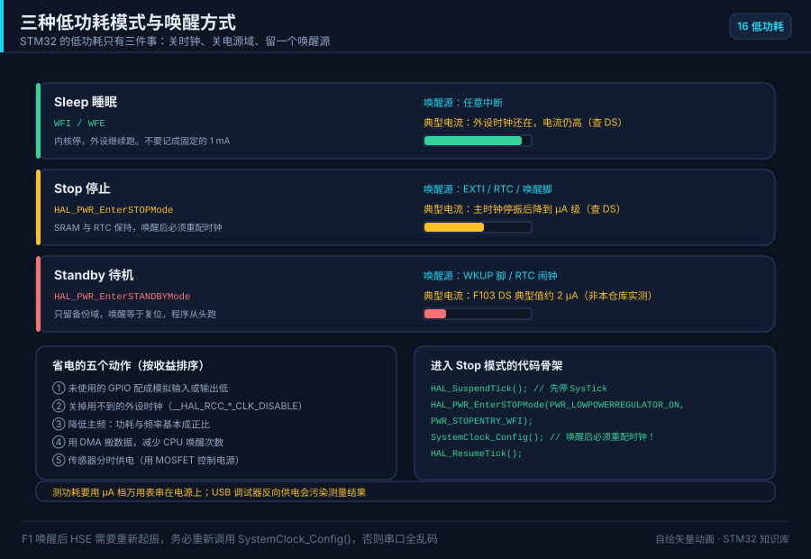
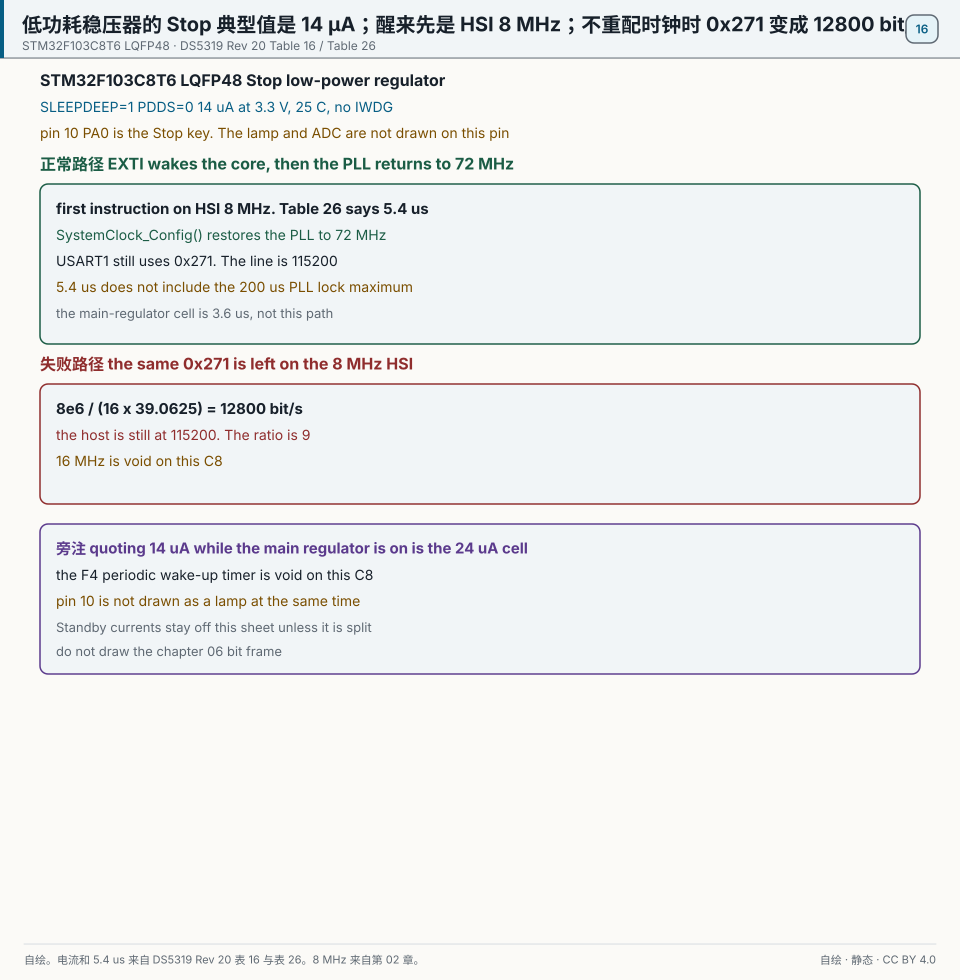
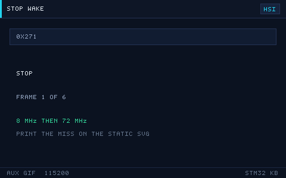

# 16 低功耗设计

> English: [Low power](en/16-low-power.md)

> 电池设备靠「睡眠/停止/待机」三档把电流从几十 mA 压到几 µA，只在需要时被事件或 RTC 唤醒。

<p align="center">
  
  <br><sub>▲ 动画：睡眠/停止/待机三种低功耗模式与唤醒源（作者自绘矢量动画，非实拍）</sub>
</p>

<!-- video:ch16 -->
<p align="center">
  <video width="640" controls poster="../assets/video/ch16-lp.png">
    <source src="../assets/video/ch16-lp.mp4" type="video/mp4">
  </video>
  <br><sub>▲ 本章讲解 2.5 分钟。配音是微软 Edge 在线神经语音「晓晓」（zh-CN-XiaoxiaoNeural），经 edge-tts 调用。edge-tts 大部分源码为 LGPLv3，srt_composer.py 为 MIT；声线模型是微软在线服务，不是开放模型。这里提交的是合成后的 MP4，离线可看。重新生成需要联网。画面由脚本和本仓库 SVG 生成，不是实拍。 视频：<a href="../assets/video/ch16-lp.mp4">MP4</a> · 字幕：<a href="../assets/video/ch16-lp.srt">SRT</a>。由 <code>python3 tools/gen_narrated.py --speak</code> 用 ffmpeg 合成。</sub>
</p>

**旁白（与字幕、配音同一份稿）**

1. Sleep 只是 CPU 停了，不少外设还在耗电。Stop 会停掉大部分时钟，才算真的睡。Standby 更接近掉电，醒来像复位。先分清你要的是哪一种。
2. 从 Stop 醒来，PLL 通常已经停了，系统时钟回到默认。第一件事是把时钟按你的配置再装回去。不装就去用串口和定时器，波特率和节拍全是错的。
3. 可编程电压检测是掉电通知，不是备用电池。电压跌到门槛时，你还有很短的时间把关键数据写进备份域或闪存。不要等它真的掉下去再保存。
4. 这一帧是仓库画的唤醒路径。引脚或 RTC 可以把你叫起来。叫起来不等于世界还是睡前那样。时钟、引脚的复用，该恢复的要在进业务之前恢复。
5. 调试器接着的时候，芯片往往睡不深，电流也不诚实。测睡眠电流要拔掉调试器，卸掉亮着的灯。手册封面上的微安是芯片的典型值，不是你这块板子的读数。
6. 进低功耗之前，不用的外设时钟关掉，不用的脚不要浮空。浮空的脚会在中间电平上来回，漏电比你省下来的还多。模拟输入常常是睡眠前比较安静的一种模式。
7. 唤醒源要在睡着之前武装好。用按键就配置好边沿和中断，用 RTC 就设好闹钟。醒来把标志清掉，不然你刚睡下又会被同一面旗叫起来。
8. 口诀：掉电检测是通知；Sleep 还在耗电，Stop 才真的睡。Stop 醒来第一件事，是把时钟装回去。
9. 实验在进 Stop 之前用串口打一句，按键唤醒后再打一句。第二句的波特率如果乱了，就是时钟没装回去。不要先用万用表追求微安。
10. 合上书，三问。Sleep 和 Stop，谁还在让很多外设耗电？从 Stop 醒来第一件事是什么？手册上的微安能不能直接当成整块板的电流？
<!-- /video:ch16 -->
## 原理与边界

这一章的工作点是 STM32F103C8T6 的 Stop，稳压器在低功耗模式，对应 `PWR_LOWPOWERREGULATOR_ON`。电流整格照抄 DS5319 Rev 20 表 16 在 3.3 V、25°C 的典型值。见 [DS5319 表 16](#source-ds5319-pwr)。

低功耗稳压器、振荡器关、无独立看门狗：14 µA。主稳压器仍开、其余条件相同：24 µA。20 µA 不是表 16 的格子。85°C 的 200 µA 和 180 µA 是最大值，不写成典型值。1.4 µA 是备份域在 LSE 与 RTC 开着时的 `IDD_VBAT`，不是整机 Standby。

Standby 分成三格。2 µA 只属于 LSI、IWDG、LSE、RTC 都关的那一格。LSI 开着是 3.2 µA。LSI 和 IWDG 都开是 3.4 µA。IWDG 在 Stop 和 Standby 里继续计数，这句跟第 11 章同一笔。14 µA 那一格的条件写着无独立看门狗。开着 IWDG 去引用 14 µA，是失败旁注。表 16 没有单独印出「Stop 加 IWDG」的微安，这里不编一个新的微安。见 [RM0008 看门狗](#source-rm0008-wdg)。

Sleep 在 72 MHz、外设全开时典型 14.4 mA，外设全关时典型 5.5 mA，条件仍是 25°C、3.3 V。

Stop 退出后系统时钟是 HSI 8 MHz，不是 16 MHz，也不是 72 MHz。见 [RM0008 时钟](#source-rm0008-rcc)。表 26 的 5.4 µs 是低功耗稳压器那一格，从唤醒事件到第一条用户指令，时钟仍是这只 8 MHz。主稳压器那格是 3.6 µs。Sleep 是 1.8 µs，而且沿用睡前的时钟。Standby 是 50 µs 到第一条指令，然后走复位。PLL 锁定的最大值是 200 µs，不和 5.4 µs 加在一起叫成唤醒时间。

本书时钟树 PPRE2 不分频。在 `SystemClock_Config()` 之前，USART1 的内核时钟是 8 MHz。BRR 若仍是 `0x271`，`8e6 / (16 × 39.0625) = 12800`。主机若还停在 115200，比是 9。正常路径是先把 PLL 装回 72 MHz，再发下一字节，线上仍是 115200。见 [RM0008 USART](#source-rm0008-usart)。不重画第 06 章的帧。

Sleep 沿用睡前的时钟。`examples/freertos-task` 的节拍是 1000 Hz，也就是 1 ms。节拍留在这个频率时，Sleep 每 1 ms 被叫醒。Stop 期间这只 SysTick 不跳。见 [本仓库例程](#source-project-examples)。

`PDDS=1` 时 SRAM 和普通寄存器丢失，醒来从复位向量进。WKUP 是第 10 脚 PA0 的上升沿。下降沿的 EXTI 能唤醒 Stop，不能当成 Standby 的 WKUP。见 [DS5319 第 10 脚](#source-ds5319-adc)。第 03 章的 270 Ω 灯和第 09 章的 ADC12_IN0 是同一只脚的别的用途，不在这一章同时接上。

F4 的周期唤醒定时器在这颗料上作废。定时叫醒交叉引用第 11 章：32.768 kHz，PRL = 32767。见 [RM0008 RTC](#source-rm0008-rtc)。

## 关键插图

<p align="center">
  
  <br><sub>▲ 自绘。STM32F103C8T6，LQFP48。正常路径是 SLEEPDEEP=1、PDDS=0，14 µA，3.3 V、25°C、无 IWDG，5.4 µs 后第一条指令在 HSI 8 MHz 上，然后 PLL 回到 72 MHz，0x271 仍是 115200。失败路径是同一只 0x271 在 8 MHz 上变成 12800 bit/s。主稳压器那一格是 24 µA。出处是 [DS5319 Rev 20 表 16 和表 26](#source-ds5319-pwr)。</sub>
</p>

<p align="center">
  
  <br><sub>▲ 网页和公众号辅图。只播放正常路径：从 Stop 醒来，时钟从 8 MHz 装回 72 MHz，线上 115200。印刷以静态主图为准。12800 和 24 µA 不在这条 GIF 上。</sub>
</p>

`lowpower-wakeup.svg` 留作辅图。不播放它。14 µA、8 MHz 和 12800 都在静态主图上。

## 时序或状态

| 步骤 | 时钟或电流 | 对错 |
| --- | --- | --- |
| 进入 Stop，低功耗稳压器，无 IWDG | 14 µA，3.3 V，25°C | 正常 |
| 同一模式但主稳压器开着 | 24 µA | 不是 14 µA 那一格 |
| 唤醒，低功耗稳压器 | 5.4 µs 后第一条指令，HSI 8 MHz | 正常 |
| 主稳压器那格的唤醒 | 3.6 µs | 不是 5.4 µs |
| Sleep | 1.8 µs，沿用睡前的时钟 | 正常 |
| 重配 | PLL 回到 72 MHz 之后 USART1 为 115200 | 正常 |
| 没有重配，`0x271` 仍在 | 8 MHz 下是 12800 | 失败 |
| Sleep，72 MHz，外设全开 | 14.4 mA | 正常 |
| Sleep，外设全关 | 5.5 mA | 正常 |
| SysTick 1000 Hz | 每 1 ms 醒一次 | Sleep 里成立，Stop 期间不成立 |
| Standby，`PDDS=1` | 从复位向量重启；到第一条指令 50 µs | 正常 |
| Standby 电流 | 2 µA 只在 LSI、IWDG、LSE、RTC 都关时；LSI 开是 3.2 µA；IWDG 也开是 3.4 µA | 不要写成 2~3 µA |
| 备份域 | 1.4 µA，LSE 与 RTC 开 | 不是整机 Standby |
| 第 10 脚 PA0 | Stop 按键用上升沿的 WKUP，或这一章的 EXTI | 不和灯、ADC 同时画上 |

## 坑与出处卡

| 现象 | 原因 | 处理 | 出处 | 该来源允许支持的主张 |
| --- | --- | --- | --- | --- |
| 手册把 Stop 的两格并成一个区间 | 两格被并成了一个区间 | 低功耗稳压器写 14 µA，主稳压器写 24 µA | [DS5319](#source-ds5319-pwr) | 两格都是 3.3 V、25°C 的典型值，并且无独立看门狗。20 µA 不是表 16 的格子 |
| 待机被说成 2~3 µA | 三格被并成了一个区间 | 按 LSI 和 IWDG 写成 2 µA、3.2 µA 或 3.4 µA | [DS5319](#source-ds5319-pwr) | 2 µA 那一格要求 LSI、IWDG、LSE、RTC 都关。1.4 µA 是备份域，不是整机 |
| 醒来第一帧串口乱码 | 时钟还停在 HSI，BRR 却是按 72 MHz 算的 | 先 `SystemClock_Config()`，再发字节 | [RM0008 USART](#source-rm0008-usart) | HSI 为 8 MHz 且 BRR 仍是 `0x271` 时，波特率是 12800。72 MHz 那一格才是 115200 |
| 注释把 HSI 写成两只频率 | 把别的系列的 16 MHz 写进了这颗料 | 这颗料写 8 MHz | [RM0008 时钟](#source-rm0008-rcc) | F1 上电默认的 HSI 是 8 MHz。16 MHz 在 C8 上作废 |
| Sleep 里电流下不来，注释却说每秒醒一次 | 节拍留在 1000 Hz | 那就是每 1 ms，不是每 1 s。进 Sleep 前挂起这只节拍 | [本仓库例程](#source-project-examples) | `examples/freertos-task` 把节拍写成 1000 Hz，1 ms 一个 tick。这一行不证明 Stop 期间 SysTick 还在跳 |
| 调用了 F4 的周期唤醒 API | 这颗料没有那只定时器 | 用第 11 章的 RTC 闹钟 | [RM0008 RTC](#source-rm0008-rtc) | F103 的定时叫醒不是那只 F4 API。PRL = 32767 才是 1 Hz |
| 开着 IWDG 还引用 14 µA | 14 µA 那一格不含独立看门狗 | 不要用 14 µA 去盖住开着的 IWDG | [RM0008 看门狗](#source-rm0008-wdg) | IWDG 在 Stop 和 Standby 里继续计数。不新编「Stop 加 IWDG」的微安 |
| 按键下降沿唤醒了 Stop，Standby 却不醒 | Standby 的 WKUP 是上升沿 | 第 10 脚 PA0 用上升沿 | [DS5319](#source-ds5319-adc) | 第 10 脚是 PA0-WKUP。这一行不把 270 Ω 的灯画成同时有效 |
## 📌 学习目标

- [ ] 用一张表说清 Sleep / Stop / Standby 三档的电流、唤醒源、唤醒时间与状态保持。
- [ ] 掌握 `WFI` 与 `WFE` 的区别，以及各自的唤醒条件。
- [ ] 记住 STOP 唤醒后**必须重新配置时钟**，否则外设全乱。
- [ ] 会关闭无用外设与时钟、把 GPIO 配成不耗电状态。
- [ ] 了解电池供电的选型要点与功耗测量方法。

## 🧠 核心原理

### 1. 三种低功耗模式对比

**结论**：省电越多、唤醒越慢、保持的状态越少——**Sleep 保 CPU 状态、Stop 保 SRAM/寄存器、Standby 几乎全丢（只剩 RTC/备份域）**。

| 项 | Sleep（睡眠） | Stop（停止） | Standby（待机） |
| --- | --- | --- | --- |
| 内核 | 停止（时钟关） | 停止 | 断电 |
| 典型电流（F1 @3.3 V、25°C） | 外设全开 14.4 mA；外设全关 5.5 mA | 低功耗稳压器 14 µA；主稳压器 24 µA。两格都要求无独立看门狗 | LSI、IWDG、LSE、RTC 都关是 2 µA；LSI 开是 3.2 µA；LSI 和 IWDG 都开是 3.4 µA。1.4 µA 是备份域 |
| 时钟 | 系统时钟仍运行 | HSI/HSE/PLL 关，仅 LSI/LSE | 全部关，仅 LSI/LSE |
| SRAM/寄存器 | 全部保持 | 全部保持 | **丢失**（除备份域） |
| 唤醒源 | 任意中断/事件 | EXTI（16 条）、RTC、IWDG、USB 唤醒 | WKUP 引脚、RTC 闹钟、IWDG、NRST |
| 唤醒时间 | 1.8 µs，沿用睡前的时钟 | 低功耗稳压器 5.4 µs，主稳压器 3.6 µs，时钟是 8 MHz HSI；不含把 PLL 装回 72 MHz | 50 µs 到第一条指令，然后从复位向量重启 |
| 唤醒后 | 从 `WFI` 下一条继续 | 从 `WFI` 下一条继续（先配时钟） | **从复位向量重启** |
| 对应寄存器 | `SLEEPDEEP=0` | `SLEEPDEEP=1`,`PDDS=0` | `SLEEPDEEP=1`,`PDDS=1` |

> 记忆：**Sleep = 打个盹；Stop = 睡一觉（醒来要重新对表）；Standby = 关机（醒来相当于重启）。**

### 2. WFI 与 WFE

**结论**：`WFI`（Wait For Interrupt）等**任意中断**唤醒；`WFE`（Wait For Event）等**事件**唤醒，可用 `SEV` 主动触发，适合「无中断的多核/流水线同步」场景。

| 指令 | 唤醒条件 | 说明 |
| --- | --- | --- |
| `__WFI()` | 有使能的挂起中断/事件 | 最常用，任何 NVIC 使能中断都能唤醒 |
| `__WFE()` | 事件寄存器置位（含 `SEV`、中断） | 事件可来自外设或软件 `SEV` |
| `__SEV()` | — | 软件发事件，配合 WFE |

```c
/* 进入 Sleep：等任意中断唤醒 */
__WFI();
```

### 3. STOP 唤醒后时钟恢复

**结论**：进入 Stop 后 HSE/PLL 被关闭，**唤醒后系统时钟是 HSI 8 MHz**，不是 16 MHz。必须重新调用 `SystemClock_Config()`。BRR 若仍是 `0x271`，线上是 12800 bit/s，不是 115200。

```c
/* 唤醒后必须重配时钟 */
HAL_PWR_EnterSTOPMode(PWR_LOWPOWERREGULATOR_ON, PWR_STOPENTRY_WFI);
SystemClock_Config();          /* ← 重新把 PLL 拉起来，恢复 72MHz */
```

| 唤醒后现象 | 原因 | 解决 |
| --- | --- | --- |
| 串口乱码 | 时钟变成 HSI，波特率错 | 唤醒后 `SystemClock_Config()` |
| 定时器变慢 | SYSCLK 变低 | 同上，重配时钟树 |
| 外设不工作 | 时钟未恢复 | 重新使能所需外设时钟 |

### 4. 外设关闭与 GPIO 配置

**结论**：省电的关键不只是进模式，更是**关掉不需要的外设时钟、把 GPIO 配成不耗电状态**。悬空的输入脚会因输入缓冲翻转而漏电。

| 处理项 | 做法 | 原因 |
| --- | --- | --- |
| 外设时钟 | `__HAL_RCC_xxx_CLK_DISABLE()` | 未用外设的时钟白耗电 |
| 悬空输入引脚 | 配成模拟输入 `GPIO_MODE_ANALOG` | 关掉施密特触发器，消除翻转漏电 |
| 输出引脚 | 设为固定电平（避免负载） | 悬空输出可能震荡 |
| 上/下拉电阻 | 不必要时禁用 | 持续漏流 |
| 调试口 | 关 SWD/JTAG 引脚 | 调试逻辑耗电（`__HAL_RCC_GPIOA_CLK` 相关） |
| LED/分压电阻 | 用 MOS 开关断开 | 静态电流杀手 |

### 5. 电池供电要点

**结论**：电池设备要**算总账**——平均电流 = 工作电流×占空比 + 睡眠电流，再除以电池容量得续航。

| 要点 | 说明 |
| --- | --- |
| 平均电流 | `I_avg = I_active×t_active/T + I_sleep` |
| 续航估算 | `续航(h) = 电池容量(mAh) / I_avg(mA)` |
| LDO 静态电流 | 选低 Iq LDO（如 <1 µA），否则待机被 LDO 吃掉 |
| 上拉/下拉 | 每个 10 kΩ 上拉在 3.3 V 下约 0.33 mA，多个就致命 |
| 分压采样 | 采样电阻会持续漏电，采样时再用 MOS 接通 |
| 看门狗 | IWDG 在 Stop 下仍走 LSI，规划好喂狗/唤醒 |

> 例：下面两个电流都是假设，不是表 16 或表 18 的格子。节点每 60 s 唤醒 100 ms 采集（活跃按 20 mA 假设），其余按 20 µA 假设：
> `I_avg ≈ 20 mA × (0.1/60) + 0.02 mA ≈ 0.053 mA`，用 1000 mAh 电池理论续航 ≈ **780 天**。

### 6. 功耗测量方法

| 方法 | 工具 | 适用 |
| --- | --- | --- |
| 万用表串联 | 数字万用表 µA 档 | 静态电流（注意量程压降） |
| 专用功耗计 | Nordic PPK2 / Joulescope | 动态波形、平均电流一键出 |
| 采样电阻 + 示波器 | 0.1 Ω 采样电阻 + 差分探头 | 看唤醒瞬间的电流尖峰 |
| 分段测量 | 拔掉外设逐个测 | 定位耗电大户 |

> 测量技巧：万用表 µA 档内阻大，测动态电流会「拖低」电压导致误判；测动态务必用采样电阻+示波器或专用功耗计。

### 7. 低功耗设计检查清单

**结论**：进模式前，按下面清单逐项排查，绝大多数「待机电流降不下来」都是漏了其中一条。

| 检查项 | 该做什么 | 典型漏电/浪费 |
| --- | --- | --- |
| 时钟 | 关掉不用的 HSE/PLL/外设时钟 | 未用外设时钟白耗电 |
| GPIO | 未用脚配模拟输入，输出脚定电平 | 悬空输入翻转漏电 |
| 上拉/下拉 | 只保留必要的，能删就删 | 每个 10 kΩ ≈ 0.33 mA |
| LED/指示 | 用 MOS 开关控制，别常亮 | 一颗 2 mA LED 就很致命 |
| 外设电源 | 传感器不用时断 VCC（MOS） | 传感器静态电流常被忽略 |
| 调试口 | 生产固件关 SWD/JTAG | 调试逻辑持续耗电 |
| LDO | 选低 Iq（<1 µA）型号 | LDO 自身吃掉待机电流 |
| 唤醒源 | 只保留必要的中断/RTC | 多余中断导致频繁唤醒 |
| 看门狗 | 规划好 Stop 下的喂狗与唤醒 | IWDG 在 Stop 仍走 LSI |

> 经验：先把**所有**可能耗电的东西关掉，测到一个干净的底电流，再逐个打开，用「差值法」找出真正的耗电大户。

## 🛠️ 硬件与接线

| 开发板 | 外设 | 引脚 | 备注 |
| --- | --- | --- | --- |
| BluePill (F103) | 唤醒按键 | PA0 | 配成 EXTI 下降沿，可从 Stop 唤醒 |
| BluePill | RTC 周期唤醒 | PC14/PC15(LSE) | 焊 32.768 kHz 晶振，实现定时唤醒 |
| BluePill | 板载 LED | PC13 | 唤醒后指示，进入前熄灭省电 |
| Nucleo-F411RE | 板载按键 | PC13(B1) | 可从 Stop 唤醒 |
| 任意 | 电流测量 | 3V3 串采样电阻 | 用功耗计或示波器观察 |

> ⚠️ BluePill 的板载 **LED 与 LDO、USB 芯片都会漏电**，想测真实 µA 级电流，建议用裸芯片最小系统板，并断开调试器与 LED。

## 💻 代码实现

**① Sleep 模式（等任意中断）**

```c
#include "stm32f1xx_hal.h"

void Enter_Sleep(void)
{
    HAL_SuspendTick();                    /* Sleep 里节拍若是 1000 Hz，就是每 1 ms，不是每 1 s */
    HAL_PWR_EnterSLEEPMode(PWR_MAINREGULATOR_ON, PWR_SLEEPENTRY_WFI);
    HAL_ResumeTick();                     /* 唤醒后恢复 tick */
}
```

**② Stop 模式 + 唤醒后恢复时钟（最常用）**

```c
void Enter_Stop(void)
{
    /* 唤醒源：EXTI 按键。提前配置好 NVIC 与 EXTI */
    HAL_SuspendTick();
    HAL_PWR_EnterSTOPMode(PWR_LOWPOWERREGULATOR_ON, PWR_STOPENTRY_WFI);
    HAL_ResumeTick();

    /* 关键：唤醒后时钟切回 HSI，必须重新配置 */
    SystemClock_Config();                 /* 恢复 HSE+PLL=72MHz */
}
```

**③ Standby 模式（最低功耗，唤醒=复位）**

```c
void Enter_Standby(void)
{
    /* 清 WKUP 标志并允许 WKUP 引脚唤醒 */
    __HAL_PWR_CLEAR_FLAG(PWR_FLAG_WU);
    HAL_PWR_EnableWakeUpPin(PWR_WAKEUP_PIN1);

    HAL_PWR_EnterSTANDBYMode();           /* 不再返回；醒来从复位向量重启 */
}
```

**④ 定时叫醒**

STM32F103C8T6 没有 F4 的周期唤醒定时器。不要调用那只 API。定时叫醒走第 11 章：32.768 kHz，PRL = 32767。

**⑤ 降低 GPIO 漏电**

```c
/* 进入低功耗前，把悬空引脚配成模拟输入，消除输入缓冲翻转电流 */
GPIO_InitTypeDef io = {0};
io.Pin  = GPIO_PIN_All;
io.Mode = GPIO_MODE_ANALOG;
io.Pull = GPIO_NOPULL;
HAL_GPIO_Init(GPIOA, &io);   /* 对未使用的端口逐个处理 */
```

**⑥ 关闭无用外设时钟**

```c
__HAL_RCC_ADC1_CLK_DISABLE();
__HAL_RCC_SPI1_CLK_DISABLE();
__HAL_RCC_USART2_CLK_DISABLE();
/* 只保留 RTC/PWR/唤醒源所需时钟 */
```


## 🧪 动手实验

1. **Sleep 省电**：主循环里点灯 + 空闲时 `Enter_Sleep()`，对比进/不进 Sleep 的电流（串 0.1 Ω 采样电阻看波形）。预期：Sleep 时电流明显下降。
2. **Stop + 按键唤醒**：进入 Stop，按 PA0 唤醒并恢复时钟、翻转 LED。预期：按键唤醒，串口仍正常（说明时钟已恢复）。
3. **RTC 定时唤醒**：每 5 s 从 Stop 唤醒采集一次 ADC（见第 09 章）再睡。预期：RTC 精确唤醒，平均电流大幅下降。
4. **（进阶）测真实待机电流**：断开 LED 与调试器，进 Standby，用功耗计测 µA 级电流。预期：接近数据手册的待机典型值。
5. **（进阶）续航估算验证**：按第 5 节公式估算续航，再实测平均电流对比。预期：估算与实测在同一量级。

### 8. 掉电前的最后一声：PVD

**结论**：PVD 监视 VDD。电压掉到阈值就进中断，用来在真正复位前把关键变量写进备份寄存器。它不替代看门狗，也不给出“还能撑多少毫秒”这种数字——阈值和迟滞以参考手册的电平表为准。

```c
PWR_PVDTypeDef pvd = {0};
pvd.PVDLevel = PWR_PVDLEVEL_6;          /* 具体电压见 RM，不要把档位背成一个毫伏数 */
pvd.Mode     = PWR_PVD_MODE_IT_RISING_FALLING;
HAL_PWR_ConfigPVD(&pvd);
HAL_PWR_EnablePVD();
```

Sleep 的电流也不是一个固定的 1 mA。内核停了，外设时钟还在，电流通常仍是毫安这一档；Stop 才进到微安这一档。上面对比表里的数字是数据手册的量级，不是本仓库某块板的实测。要写进论文或电池预算，打开对应型号的 DS，按你关了哪些时钟的那一列抄。

口诀：**PVD 是掉电通知；Sleep 还在耗电，Stop 才真的睡。**

自测：

1. 为什么不能把 Sleep 电流记成“72 MHz 下约 1 mA”？
2. PVD 中断里适合做哪一件事，不适合做哪一件事？
3. Standby 唤醒之后，程序从 `WFI` 的下一行继续，还是从复位向量重来？

## 🔗 相关资源

- RM0008《STM32F10xxx 参考手册》第 5 章 Power control (PWR)（`PWR_CR` 的 `LPDS/PDDS/CWUF`、WFI/WFE）。
- RM0090《STM32F4 参考手册》第 5 章 PWR、第 26 章 RTC（周期唤醒）。
- 数据手册 DS：各模式典型/最大电流、唤醒时间、VBAT 参数。
- 应用笔记 AN4365《STM32F4 提高 ADC 精度的方法》（含低功耗采样相关）及 ST 低功耗设计应用笔记。
- 相关章节：第 11 章 RTC 与看门狗、第 09 章 ADC。
- 配图：`../assets/animations/lowpower-wakeup.svg`（作者自绘矢量图）。


- 📱 手机阅读版：[第 16 章 · 低功耗设计（公众号图文）](https://mp.weixin.qq.com/s/x8qCGZ124ymEZGBRE8tfig)