# 16 低功耗设计

> English: [Low power](en/16-low-power.md)

> 数据手册写 14µA，不代表 BluePill 就能测到 14µA。开发板漏电、调试器、唤醒峰值和活跃时间都要进入同一张电流波形与平均电流账。

<p align="center">
  
  <br><sub>▲ 三条唤醒路径。移动点表示执行顺序，速度不代表真实耗时；Stop 的普通返回与 Standby 的复位启动分开画。自绘矢量动画，非实测。</sub>
</p>

<!-- video:ch16 -->
<p align="center">
  <video width="640" controls poster="../assets/video/ch16-lp.png">
    <source src="../assets/video/ch16-lp.mp4" type="video/mp4">
  </video>
  <br><sub>▲ 本章讲解视频（2.8 分钟）。<a href="../assets/video/ch16-lp.mp4">MP4</a> · <a href="../assets/video/ch16-lp.srt">字幕</a></sub>
</p>

<details>
<summary>旁白文字稿</summary>

1. Sleep 只是 CPU 停了，不少外设还在耗电。Stop 会停掉大部分时钟，才算真的睡。Standby 更接近掉电，醒来像复位。先分清你要的是哪一种。
2. 从 Stop 醒来，PLL 通常已经停了，系统时钟回到默认。第一件事是把时钟按你的配置再装回去。不装就去用串口和定时器，波特率和节拍全是错的。
3. 可编程电压检测是掉电通知，不是备用电池。电压跌到门槛时，你还有很短的时间把关键数据写进备份域或闪存。不要等它真的掉下去再保存。
4. 这一帧是仓库画的唤醒路径。引脚或 RTC 可以把你叫起来。叫起来不等于世界还是睡前那样。时钟、引脚的复用，该恢复的要在进业务之前恢复。
5. 调试器接着的时候，芯片往往睡不深，电流也不诚实。测睡眠电流要拔掉调试器，卸掉亮着的灯。手册封面上的微安是芯片的典型值，不是你这块板子的读数。
6. 进低功耗之前，不用的外设时钟关掉，不用的脚不要浮空。浮空的脚会在中间电平上来回，漏电比你省下来的还多。模拟输入常常是睡眠前比较安静的一种模式。
7. 唤醒源要在睡着之前武装好。用按键就配置好边沿和中断，用 RTC 就设好闹钟。醒来把标志清掉，不然你刚睡下又会被同一面旗叫起来。
8. 三档深浅要分清：掉电检测只是一条通知；Sleep 还在让外设耗电；Stop 才真的睡。Stop 醒来第一件事，是把时钟装回去。
9. 实验在进 Stop 之前用串口打一句，按键唤醒后再打一句。第二句的波特率如果乱了，就是时钟没装回去。不要先用万用表追求微安。
10. 手册封面的微安是芯片典型值：板上的 LDO、LED 会抬高整板电流，串口和调试器也会吃掉你的睡眠。数字要对上条件再比。

</details>
<!-- /video:ch16 -->
## 原理与适用范围

先做一个不依赖微安表的实验：让程序从 Stop 醒来，再发对一帧串口数据。

在本书的 72 MHz 工程中，用 PA0 的 EXTI 下降沿作唤醒源。在唤醒 ISR 入口翻转一个空闲 GPIO，`SystemClock_Config()` 完成后再翻转另一个 GPIO，随后用 USART1 发送 `0x55`。逻辑分析仪同时接 PA0、这两路 GPIO 和 TX。恢复后，115200 bit/s 的单个位宽应约为 8.68 µs；若 BRR 仍是 `0x271` 而时钟停在 HSI 8 MHz，位宽会变成 78.125 µs，对应 12800 bit/s。

PA0 边沿到首个 GPIO 标记包含中断入口和软件延迟，不能直接当作数据手册的 5.4 µs。第二个标记用来分开时钟恢复阶段。确认这些顺序和位宽之后，再接电流仪器，记录一次完整的睡眠、唤醒和采集周期。

这一章的工作点是 STM32F103C8T6 的 Stop，稳压器在低功耗模式，对应 `PWR_LOWPOWERREGULATOR_ON`。下面的电流都取 DS5319 Rev 20 表 16 在 3.3 V、25°C 下的典型值，每个数字对应表里的一格，条件不同的格子不能混用。见 [DS5319 表 16](#source-ds5319-pwr)。

低功耗稳压器、振荡器关、无独立看门狗：14 µA。主稳压器仍开、其余条件相同：24 µA。20 µA 不是表 16 的格子。85°C 的 200 µA 和 180 µA 是最大值，不写成典型值。1.4 µA 是备份域在 LSE 与 RTC 开着时的 `IDD_VBAT`，不是整机 Standby。

Standby 分成三格。2 µA 只属于 LSI、IWDG、LSE、RTC 都关的那一格。LSI 开着是 3.2 µA。LSI 和 IWDG 都开是 3.4 µA。IWDG 一旦启动就停不下来，在 Stop 和 Standby 里也继续计数（第 11 章讲过）。14 µA 那一格的条件是没开独立看门狗，所以开着 IWDG 时不能引用 14 µA。表 16 没有给出「Stop 加 IWDG」的电流，要知道就得自己用电流表量。见 [RM0008 看门狗](#source-rm0008-wdg)。

Sleep 在 72 MHz、外设全开时典型 14.4 mA，外设全关时典型 5.5 mA，条件仍是 25°C、3.3 V。

Stop 退出后系统时钟是 HSI 8 MHz，不是 16 MHz，也不是 72 MHz。见 [RM0008 时钟](#source-rm0008-rcc)。表 26 的 5.4 µs 是低功耗稳压器那一格，从唤醒事件到第一条用户指令，时钟仍是这只 8 MHz。主稳压器那格是 3.6 µs。Sleep 是 1.8 µs，而且沿用睡前的时钟。Standby 经复位启动，50 µs 到第一条指令。PLL 锁定的最大值是 200 µs，不和 5.4 µs 加在一起叫成唤醒时间。

本书时钟树 PPRE2 不分频。在 `SystemClock_Config()` 之前，USART1 的内核时钟是 8 MHz。BRR 若仍是 `0x271`，其原始整数值为 625，按 16 倍过采样解码的 `USARTDIV = 39.0625`，所以 `8e6 / (16 × 39.0625) = 12800`。主机若还停在 115200，两者相差 9 倍。正确做法是醒来后先把 PLL 装回 72 MHz，再发下一字节，线上就仍是 115200。见 [RM0008 USART](#source-rm0008-usart)。帧格式和第 06 章相同。

Sleep 沿用睡前的时钟。`examples/freertos-task` 的节拍是 1000 Hz，也就是 1 ms。节拍留在这个频率时，Sleep 每 1 ms 被叫醒。Stop 期间这只 SysTick 不跳。见 [本仓库例程](#source-project-examples)。

Standby（`SLEEPDEEP=1`、`PDDS=1`）不保留普通 SRAM 和寄存器，退出后从复位向量启动；`PWR_CSR.SBF` 可用来识别此前是否进入 Standby。退出源包括 WKUP、RTC 闹钟、NRST 和 IWDG 复位。WKUP 是第 10 脚 PA0 的上升沿。下降沿的 EXTI 能唤醒 Stop，不能当成 Standby 的 WKUP。见 [DS5319 第 10 脚](#source-ds5319-adc)。第 03 章在这只脚上接了 270 Ω 的灯，第 09 章把它当 ADC12_IN0。做本章实验时，这只脚只接唤醒按键。

<p align="center">
  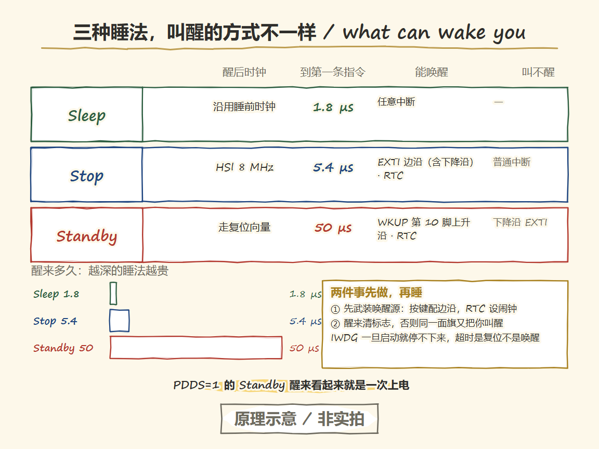
  <br><sub>▲ Sleep 保留原时钟，Stop 从 HSI 8 MHz 恢复，Standby 从复位向量重启。IWDG 超时属于复位，不能当成 Stop 的普通返回。手绘原理示意，非实测；时间取自 [DS5319 Rev 20 表 26](#source-ds5319-pwr)，RTC 路由见 [RM0008 Rev 21](#source-rm0008-rtc)。</sub>
</p>

F103 没有 F4 那种周期唤醒定时器。要定时叫醒，用第 11 章的 RTC 闹钟：LSE 32.768 kHz，PRL = 32767，得到 1 Hz 的秒计数。见 [RM0008 RTC](#source-rm0008-rtc)。

## 关键插图


<p align="center">
  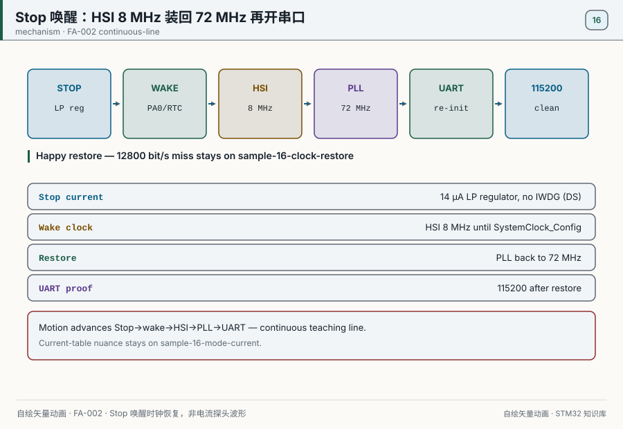
  <br><sub>▲ 自绘矢量动画（FA-002）。Stop→唤醒→HSI→PLL→115200。</sub>
</p>


<p align="center">
  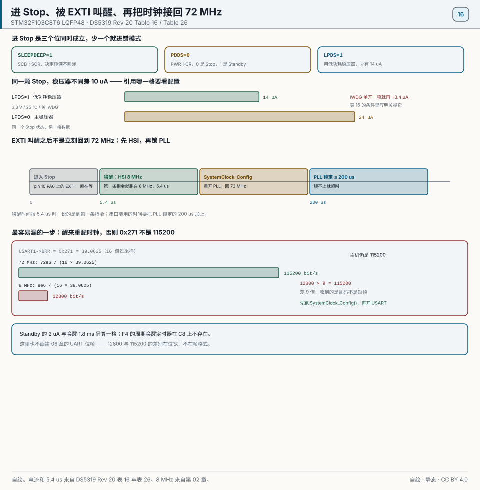
  <br><sub>▲ 自绘。SLEEPDEEP 与 PDDS 选择模式，LPDS 选择稳压器。5.4 µs 是唤醒事件到第一条指令的典型时间；恢复 72 MHz 还要等待 HSE、PLL 和软件配置。下方用同一个 BRR `0x271` 算出 115200 与 12800 bit/s。电流与时间条件见 [DS5319 Rev 20 表 16、26](#source-ds5319-pwr)。</sub>
</p>

<p align="center">
  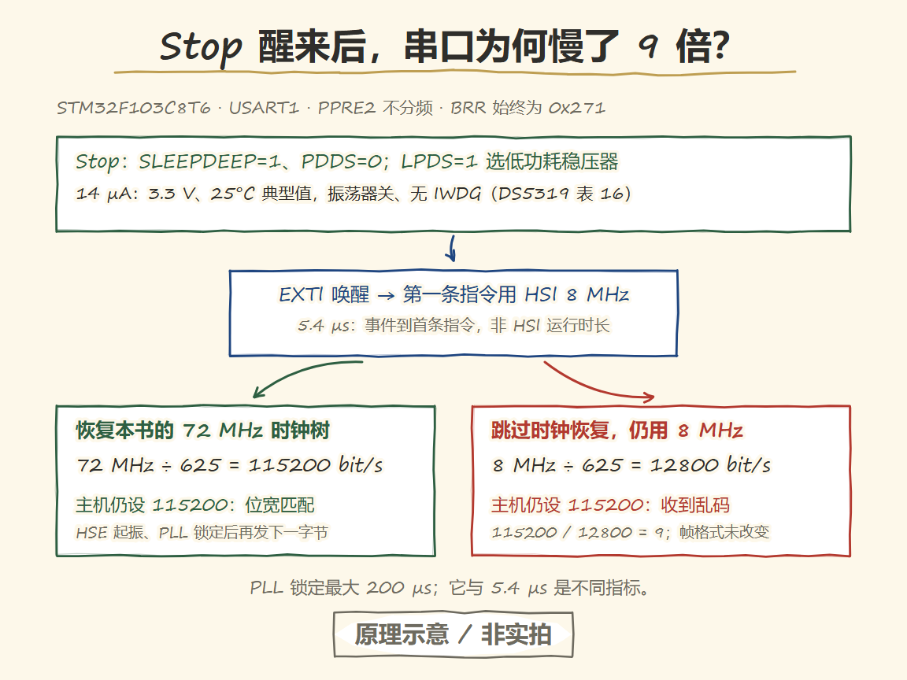
  <br><sub>▲ 唤醒后分成两条路：恢复 72 MHz，原 BRR 对应 115200；停在 HSI 8 MHz，同一 BRR 只有 12800 bit/s。14 µA 还要求低功耗稳压器、3.3 V、25°C、无 IWDG 等条件。手绘原理示意，非实测。</sub>
</p>

<p align="center">
  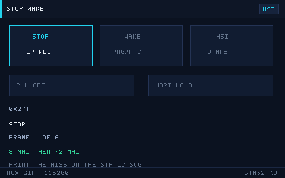
  <br><sub>▲ 动图版，只演示正确流程：从 Stop 醒来，时钟从 8 MHz 装回 72 MHz，线上 115200。印刷版只有上面的静态图。</sub>
</p>

章首的 `lowpower-wakeup.svg` 动画画的是几种模式的唤醒顺序，具体数字以上面的静态图为准。

## 时序与状态

| 步骤 | 时钟或电流 | 对错 |
| --- | --- | --- |
| 进入 Stop，低功耗稳压器，无 IWDG | 14 µA，3.3 V，25°C | 正常 |
| 同一模式但主稳压器开着 | 24 µA | 不是 14 µA 那一格 |
| 唤醒，低功耗稳压器 | 5.4 µs 后第一条指令，HSI 8 MHz | 正常 |
| 主稳压器那格的唤醒 | 3.6 µs | 不是 5.4 µs |
| Sleep | 1.8 µs，沿用睡前的时钟 | 正常 |
| 重配 | PLL 回到 72 MHz 之后 USART1 为 115200 | 正常 |
| 没有重配，`0x271` 仍在 | 8 MHz 下是 12800 | 失败 |
| Sleep，72 MHz，外设全开 | 14.4 mA | 正常 |
| Sleep，外设全关 | 5.5 mA | 正常 |
| SysTick 1000 Hz | 每 1 ms 醒一次 | Sleep 里成立，Stop 期间不成立 |
| Standby，`PDDS=1` | 从复位向量重启；到第一条指令 50 µs | 正常 |
| Standby 电流 | 2 µA 只在 LSI、IWDG、LSE、RTC 都关时；LSI 开是 3.2 µA；IWDG 也开是 3.4 µA | 不要写成 2~3 µA |
| 备份域 | 1.4 µA，LSE 与 RTC 开 | 不是整机 Standby |
| 第 10 脚 PA0 | 本章 Stop 用 EXTI 下降沿；Standby 用 WKUP 上升沿 | 这时不再接灯或当 ADC 输入 |

## 常见坑与出处

| 现象 | 原因 | 处理 | 出处 | 出处里能查到什么 |
| --- | --- | --- | --- | --- |
| 手册把 Stop 的两格并成一个区间 | 两格被并成了一个区间 | 低功耗稳压器写 14 µA，主稳压器写 24 µA | [DS5319](#source-ds5319-pwr) | 两格都是 3.3 V、25°C 的典型值，并且无独立看门狗。20 µA 不是表 16 的格子 |
| 待机被说成 2~3 µA | 三格被并成了一个区间 | 按 LSI 和 IWDG 写成 2 µA、3.2 µA 或 3.4 µA | [DS5319](#source-ds5319-pwr) | 2 µA 那一格要求 LSI、IWDG、LSE、RTC 都关。1.4 µA 是备份域，不是整机 |
| 醒来第一帧串口乱码 | 时钟还停在 HSI，BRR 却是按 72 MHz 算的 | 先 `SystemClock_Config()`，再发字节 | [RM0008 USART](#source-rm0008-usart) | HSI 为 8 MHz 且 BRR 仍是 `0x271` 时，波特率是 12800。72 MHz 那一格才是 115200 |
| 注释把 HSI 写成两只频率 | 把别的系列的 16 MHz 写到了 F103 上 | F103 写 8 MHz | [RM0008 时钟](#source-rm0008-rcc) | F1 上电默认的 HSI 是 8 MHz。16 MHz 是 F4 等系列的 HSI |
| Sleep 里电流下不来，注释却说每秒醒一次 | 节拍留在 1000 Hz | 每 1 ms 都可能唤醒；裸机可挂起 HAL tick，RTOS 应通过 tickless idle 处理 | [本仓库例程](#source-project-examples) | `examples/freertos-task` 的节拍为 1000 Hz。Stop 期间 SysTick 停止；HAL 时基和调度器节拍的归属须按工程核对 |
| 调用了 F4 的周期唤醒 API | F103 没有那只定时器 | 用第 11 章的 RTC 闹钟 | [RM0008 RTC](#source-rm0008-rtc) | F103 的定时叫醒不是那只 F4 API。PRL = 32767 才是 1 Hz |
| 开着 IWDG 还引用 14 µA | 14 µA 那一格不含独立看门狗 | 不要用 14 µA 去盖住开着的 IWDG | [RM0008 看门狗](#source-rm0008-wdg) | IWDG 在 Stop 和 Standby 里继续计数。表 16 没有「Stop 加 IWDG」的电流 |
| 按键下降沿唤醒了 Stop，Standby 却不醒 | Standby 的 WKUP 是上升沿 | 第 10 脚 PA0 用上升沿 | [DS5319](#source-ds5319-adc) | 第 10 脚是 PA0-WKUP |
## 学习目标

- [ ] 用一张表说清 Sleep / Stop / Standby 三档的电流、唤醒源、唤醒时间与状态保持。
- [ ] 掌握 `WFI` 与 `WFE` 的区别，以及各自的唤醒条件。
- [ ] 能判断 Stop 唤醒后的 HSI 是否满足业务要求，并在恢复本书的 72 MHz 时钟树后再使用原外设参数。
- [ ] 会关闭无用外设与时钟、把 GPIO 配成不耗电状态。
- [ ] 了解电池供电的选型要点与功耗测量方法。

## 核心原理

低功耗验收至少要记录静态底电流、唤醒峰值、活跃时长、周期和唤醒原因。只测一个稳定数字，既算不出续航，也发现不了时钟恢复后的串口错误。


<p align="center">
  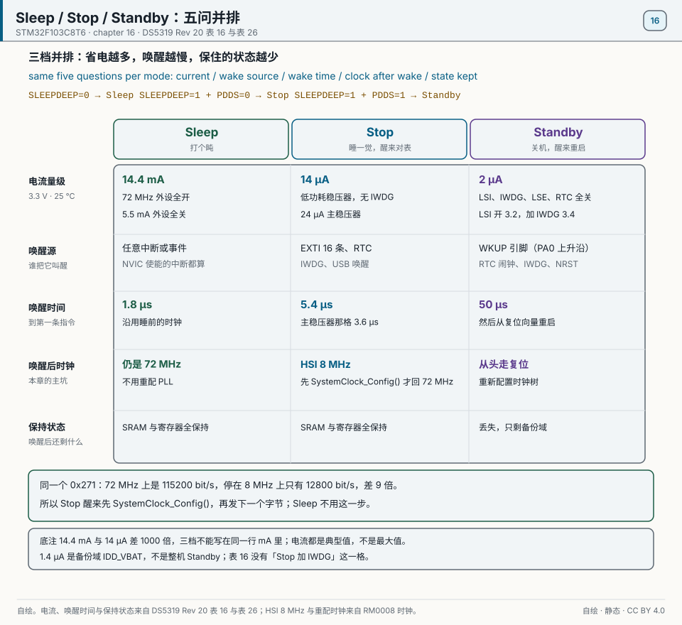
  <br><sub>▲ 自绘对比表。电流一行同时给出条件：Sleep 按 72 MHz 与外设开关区分，Stop 按稳压器区分，Standby 按 LSI/IWDG 等配置区分。唤醒源与程序去向另列，避免把 IWDG 复位当成中断返回。出处：[DS5319 Rev 20 表 16、26](#source-ds5319-pwr) 与 [RM0008 时钟](#source-rm0008-rcc)。</sub>
</p>

<p align="center">
  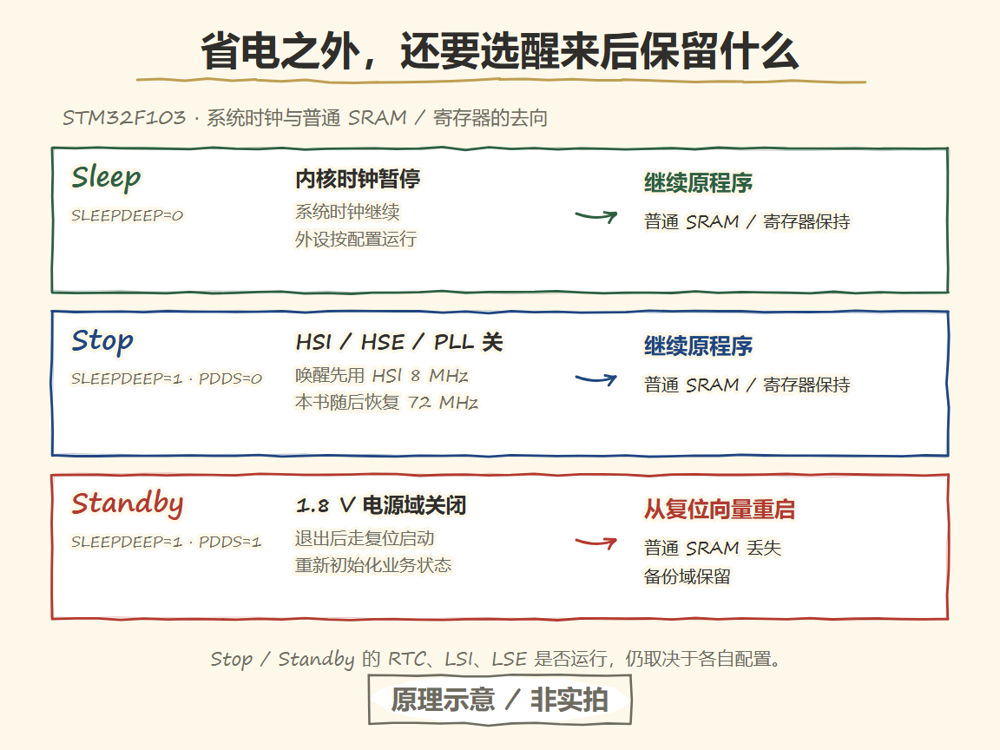
  <br><sub>▲ 先按程序需要保留的状态选模式：Sleep 保留原时钟，Stop 保留 SRAM 但醒来改用 HSI，Standby 重新启动。RTC、LSI、LSE 是否运行仍取决于配置。手绘原理示意，非实测。</sub>
</p>

### 1. 三种低功耗模式对比


<p align="center">
  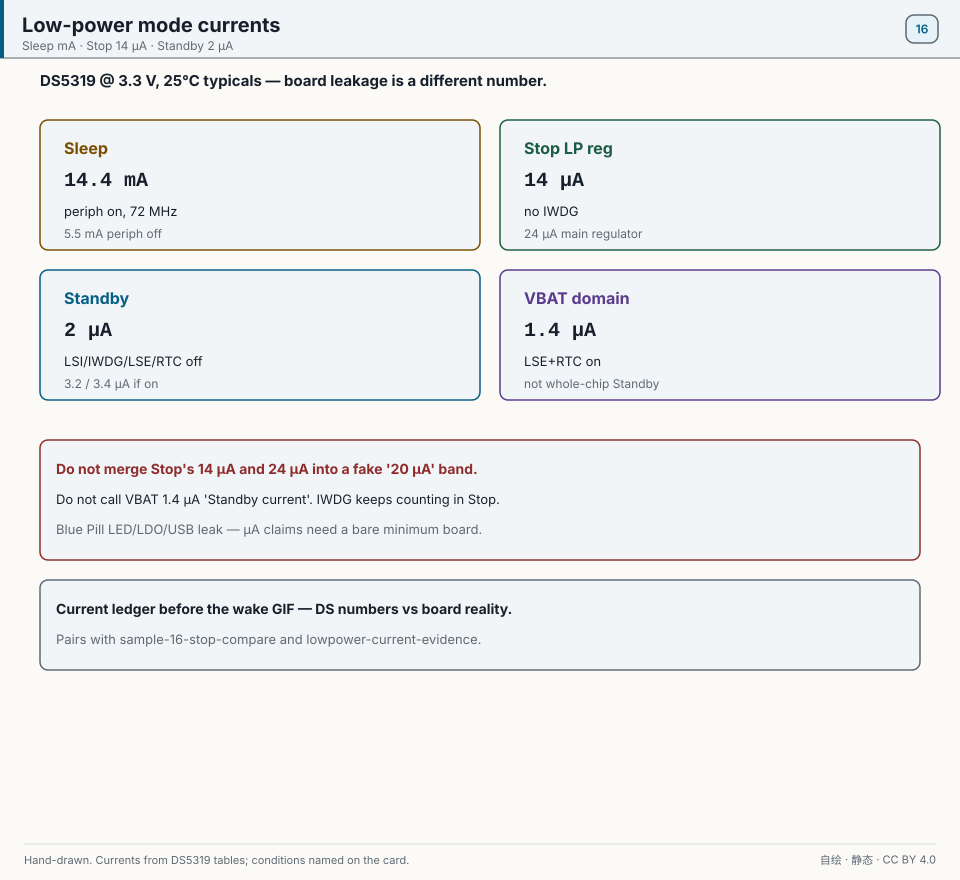
  <br><sub>▲ 自绘。勿把 14/24 µA 并成 20；1.4 µA 是备份域不是整机。</sub>
</p>

<p align="center">
  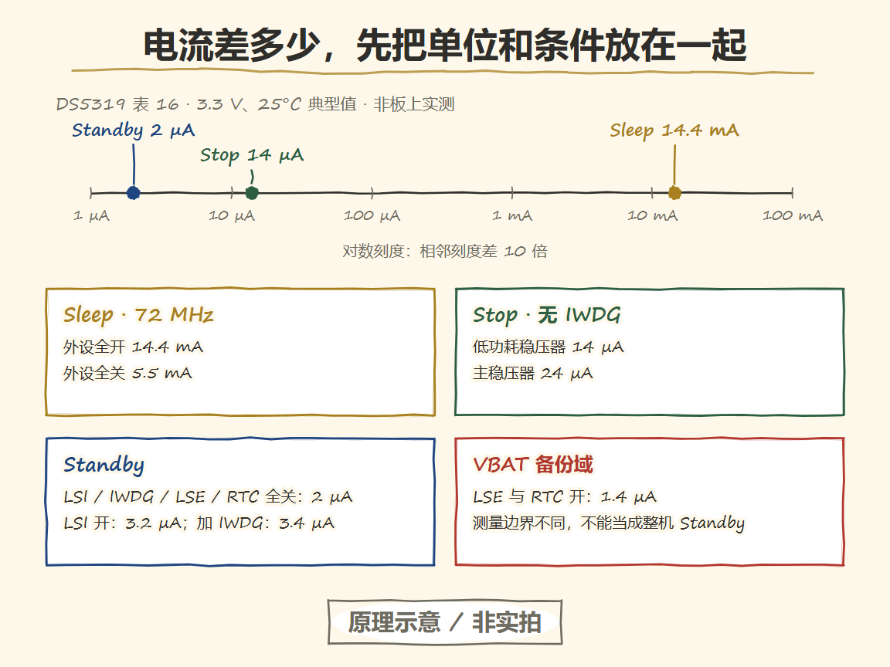
  <br><sub>▲ 知识轨（Handraw · 原理示意/非实拍）。DS5319 @ 3.3 V、25°C 典型值；板级漏电另算；不是实拍。</sub>
</p>


本章三个工作点的唤醒时间依次增加。**Sleep 和 Stop 都保留普通 SRAM 与寄存器；Standby 关闭主电源域，主要保留备份域与待机电路。**电流数值仍须带上各自的时钟和稳压器条件。

| 项 | Sleep（睡眠） | Stop（停止） | Standby（待机） |
| --- | --- | --- | --- |
| 内核 | 停止（时钟关） | 停止 | 断电 |
| 典型电流（F1 @3.3 V、25°C） | 外设全开 14.4 mA；外设全关 5.5 mA | 低功耗稳压器 14 µA；主稳压器 24 µA。两格都要求无独立看门狗 | LSI、IWDG、LSE、RTC 都关是 2 µA；LSI 开是 3.2 µA；LSI 和 IWDG 都开是 3.4 µA。1.4 µA 是备份域 |
| 时钟 | 系统时钟仍运行 | HSI/HSE/PLL 关，仅 LSI/LSE | 全部关，仅 LSI/LSE |
| SRAM/寄存器 | 全部保持 | 全部保持 | **丢失**（除备份域） |
| 唤醒或退出源 | WFI：满足 NVIC/优先级条件的中断；WFE：事件 | EXTI 中断或事件；RTC 闹钟走 EXTI17，USB 唤醒走 EXTI18。IWDG 超时和 NRST 走复位 | WKUP 引脚上升沿、RTC 闹钟、IWDG 复位、NRST；均走复位启动 |
| 唤醒时间 | 1.8 µs，沿用睡前的时钟 | 低功耗稳压器 5.4 µs，主稳压器 3.6 µs，时钟是 8 MHz HSI；不含把 PLL 装回 72 MHz | 经复位启动，50 µs 到第一条指令 |
| 唤醒后 | 通常先处理 IRQ，再继续；WFE 事件不一定进 ISR | 通常先处理 IRQ，再继续；业务前按需恢复时钟 | **从复位向量重启** |
| 对应寄存器 | `SLEEPDEEP=0` | `SLEEPDEEP=1`,`PDDS=0` | `SLEEPDEEP=1`,`PDDS=1` |

> 记住程序去向：Sleep 保留原时钟；Stop 保留状态，醒来换成 HSI；Standby 重新启动。这三种模式仍有电源域在工作，不能把 Standby 当成整板断电。

### 2. WFI 与 WFE

本章 F103 是单核。`WFI`（Wait For Interrupt）等待满足条件的中断；`WFE`（Wait For Event）还可以接收不进入 ISR 的事件。两者都要先配置唤醒路径，不能只换一条指令。

| 指令 | 唤醒条件 | 说明 |
| --- | --- | --- |
| `__WFI()` | NVIC 使能且满足当前优先级条件的中断等 | 常见路径是唤醒、进入 ISR、返回后继续；PRIMASK 可推迟 ISR，而不一定阻止唤醒 |
| `__WFE()` | 事件寄存器置位；若已为 1，则清零并立即返回 | F103 可配置 EXTI 事件；`SEVONPEND` 可在中断变为挂起时产生事件 |
| `__SEV()` | — | 软件发事件，配合 WFE |

在 Stop 中，WFI 需要 EXTI 中断及对应 NVIC 通道使能；WFE 需要 EXTI 事件配置。入睡前按外设规定处理旧标志，并检查条件是否仍成立，避免刚入睡就退出。事件寄存器只记“发生过”，不是可累计次数的队列。Arm 的唤醒条件还包括异常屏蔽与当前优先级，不能把“退出等待”与“立刻执行中断函数”混为一谈。

```c
/* 进入 Sleep：等任意中断唤醒 */
__WFI();
```

### 3. STOP 唤醒后时钟恢复


<p align="center">
  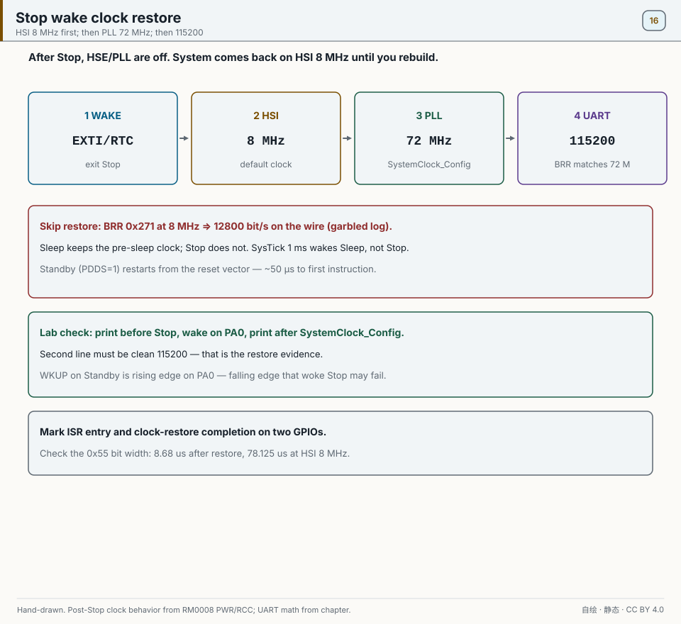
  <br><sub>▲ 自绘。不重配时钟时 0x271 在 8 MHz 下是 12800。</sub>
</p>

<p align="center">
  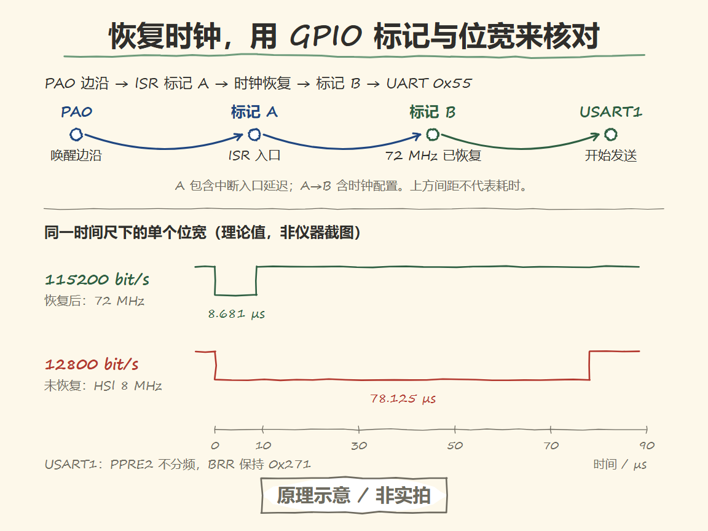
  <br><sub>▲ 上方两个 GPIO 标记分开 ISR 入口和时钟恢复；下方按同一时间尺画出 8.681 µs 与 78.125 µs 的位宽。用 `0x55` 便于观察交替边沿。自绘理论图，非仪器截图。</sub>
</p>


进入 Stop 后 HSE/PLL 被关闭，**唤醒后系统时钟是 HSI 8 MHz**，不是 16 MHz。本书用 `SystemClock_Config()` 恢复 72 MHz，再使用原串口与定时器参数。若业务本来就按 HSI 设计，可以继续用 HSI，但外设分频和软件时基也要与之匹配。BRR 若仍是 `0x271`，线上是 12800 bit/s，不是 115200。

```c
/* 唤醒后必须重配时钟 */
HAL_PWR_EnterSTOPMode(PWR_LOWPOWERREGULATOR_ON, PWR_STOPENTRY_WFI);
SystemClock_Config();          /* ← 重新把 PLL 拉起来，恢复 72MHz */
```

| 唤醒后现象 | 原因 | 解决 |
| --- | --- | --- |
| 串口乱码 | 时钟变成 HSI，波特率错 | 唤醒后 `SystemClock_Config()` |
| 定时器变慢 | SYSCLK 变低 | 同上，重配时钟树 |
| 外设不工作 | 时钟未恢复 | 重新使能所需外设时钟 |

### 4. 外设关闭与 GPIO 配置

省电的关键不只是进模式，更是**关掉不需要的外设时钟、把 GPIO 配成不耗电状态**。悬空的输入脚会因输入缓冲翻转而漏电。

| 处理项 | 做法 | 原因 |
| --- | --- | --- |
| 外设时钟 | `__HAL_RCC_xxx_CLK_DISABLE()` | 未用外设的时钟白耗电 |
| 悬空输入引脚 | 配成模拟输入 `GPIO_MODE_ANALOG` | 关掉施密特触发器，消除翻转漏电 |
| 输出引脚 | 按外部电路选择睡眠电平 | 避免带载、总线争用和向已断电外设反向供电 |
| 上/下拉电阻 | 只保留偏置和唤醒所需电阻 | 与相反电平形成通路时会产生持续电流 |
| 调试口 | 核对 DBGMCU 的低功耗调试保留位，测量时断开探针 | 保留调试时钟与探针反向供电都可能改变结果；不必一律禁用 SWD |
| LED/分压电阻 | 用 MOS 开关断开 | 静态电流杀手 |

### 5. 电池供电要点

续航用电池容量除以平均电流。先把一个周期内各段的电流乘以持续时间，再除以周期；唤醒峰值也占时间，不能只看 Stop 的底电流。

| 要点 | 说明 |
| --- | --- |
| 两状态平均电流 | `I_avg = [I_active×t_active + I_sleep×(T−t_active)] / T` |
| 小占空比近似 | `t_active ≪ T` 时，`I_avg ≈ I_active×t_active/T + I_sleep` |
| 续航估算 | `续航(h) = 电池容量(mAh) / I_avg(mA)` |
| LDO 静态电流 | 选低 Iq LDO（如 <1 µA），否则待机被 LDO 吃掉 |
| 上拉/下拉 | 10 kΩ 电阻两端压差为 3.3 V 时流过约 0.33 mA；上拉输入保持高电平时不能照此计入 |
| 分压采样 | 采样电阻会持续漏电，采样时再用 MOS 接通 |
| 看门狗 | IWDG 在 Stop 下仍走 LSI，规划好喂狗/唤醒 |

> 例：下面两个电流都是假设，不是表 16 或表 18 的格子。节点每 60 s 唤醒 100 ms 采集（活跃按 20 mA 假设），其余按 20 µA 假设：
> `I_avg ≈ 20 mA × (0.1/60) + 0.02 mA ≈ 0.053 mA`，用 1000 mAh 电池理论续航 ≈ **780 天**。

这个估算没有计入电池自放电、可用容量变化、稳压器损耗和额外唤醒。若实际波形分成多段，用 `I_avg = Σ(I_k×t_k)/T`，或直接积分整周期电流。

### 6. 功耗测量方法

| 方法 | 工具 | 适用 |
| --- | --- | --- |
| 万用表串联 | 数字万用表 µA 档 | 静态电流（注意量程压降） |
| 专用功耗计 | Nordic PPK2 / Joulescope | 动态波形、平均电流一键出 |
| 采样电阻 + 示波器 | 0.1 Ω 采样电阻 + 差分探头 | 看唤醒瞬间的电流尖峰 |
| 分段测量 | 拔掉外设逐个测 | 定位耗电大户 |

> 测量技巧：万用表 µA 档内阻大，测动态电流会「拖低」电压导致误判；测动态务必用采样电阻+示波器或专用功耗计。

<p align="center">
  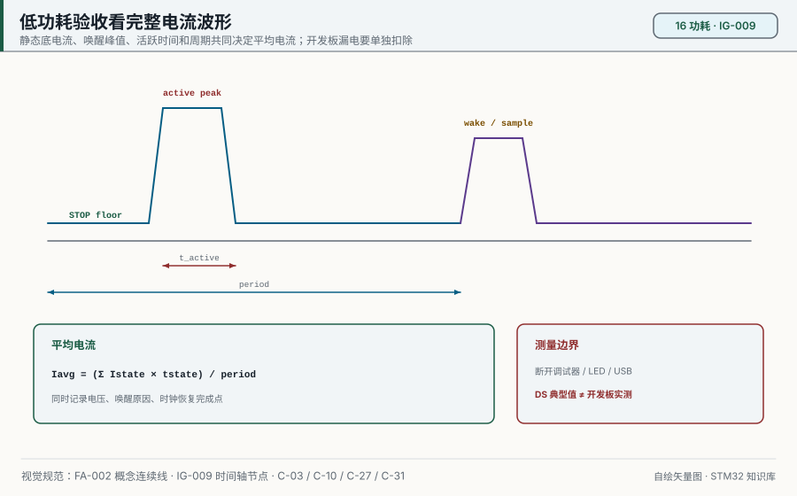
  <br><sub>▲ 电流账：底电流和峰值都要与时间一起积分，才能算平均电流。数据手册典型值、开发板实测和裸芯片实测属于不同边界；未断开 LED、USB 与调试器时不能据此评价 MCU 的 µA 指标（FA-002 · IG-009 · C-03/C-10/C-27/C-31）。</sub>
</p>

### 7. 低功耗设计检查清单

能正常睡眠和唤醒后，再按下面的电路项目排查底电流。

| 检查项 | 该做什么 | 典型漏电/浪费 |
| --- | --- | --- |
| 时钟 | 关掉不用的 HSE/PLL/外设时钟 | 未用外设时钟白耗电 |
| GPIO | 未用脚配模拟输入，输出脚定电平 | 悬空输入翻转漏电 |
| 上拉/下拉 | 保留偏置和唤醒所需电阻 | 10 kΩ 两端压差 3.3 V 时约 0.33 mA |
| LED/指示 | 用 MOS 开关控制，别常亮 | 一颗 2 mA LED 就很致命 |
| 外设电源 | 传感器不用时断 VCC（MOS） | 传感器静态电流常被忽略 |
| 调试口 | 关闭不需要的低功耗调试保留，断开探针后复测 | 查 DBGMCU 保留位与反向供电路径 |
| LDO | 选低 Iq（<1 µA）型号 | LDO 自身吃掉待机电流 |
| 唤醒源 | 只保留必要的中断/RTC | 多余中断导致频繁唤醒 |
| 看门狗 | 规划好 Stop 下的喂狗与唤醒 | IWDG 在 Stop 仍走 LSI |

先保留供电与唤醒必需电路，测出基线，再逐个接回负载。每次只改一项，电流差值才有明确归属。

## 硬件与接线

| 开发板 | 外设 | 引脚 | 备注 |
| --- | --- | --- | --- |
| BluePill (F103) | 唤醒按键 | PA0 | 配成 EXTI 下降沿，可从 Stop 唤醒 |
| BluePill | RTC 周期唤醒 | PC14/PC15(LSE) | 焊 32.768 kHz 晶振，实现定时唤醒 |
| BluePill | 板载 LED | PC13 | 唤醒后指示，进入前熄灭省电 |
| Nucleo-F411RE | 板载按键 | PC13(B1) | 可从 Stop 唤醒 |
| 任意 | 电流测量 | 3V3 串采样电阻 | 用功耗计或示波器观察 |

> [!WARNING]
> BluePill 整板输入电流包含 LED、LDO 静态电流和实际接入的 USB、串口、传感器等负载。F103 的 USB 外设在芯片内部；外部上拉与供电接法要看具体板子的原理图。要测 MCU 支路的 µA 级电流，应隔离这些负载，并检查调试器或信号线是否反向供电。

## 代码实现

下面的 Sleep/Stop 片段按裸机 HAL、HAL 时基由 SysTick 驱动来读。RTOS 工程应通过调度器的 tickless idle 与时间补偿机制接入低功耗，不能直接挂起调度器节拍。Stop 返回时仍是 HSI；例中先恢复 HAL tick，供时钟配置中的超时使用，时钟恢复后还须确认时基重新匹配。唤醒 ISR 只记录原因、处理标志，恢复完成前不要用原 UART 参数打印。

**① Sleep 模式（等任意中断）**

```c
#include "stm32f1xx_hal.h"

void Enter_Sleep(void)
{
    HAL_SuspendTick();                    /* Sleep 里节拍若是 1000 Hz，就是每 1 ms，不是每 1 s */
    HAL_PWR_EnterSLEEPMode(PWR_MAINREGULATOR_ON, PWR_SLEEPENTRY_WFI);
    HAL_ResumeTick();                     /* 唤醒后恢复 tick */
}
```

**② Stop 模式 + 唤醒后恢复时钟（最常用）**

```c
void Enter_Stop(void)
{
    /* 唤醒源：EXTI 按键。提前配置好 NVIC 与 EXTI */
    HAL_SuspendTick();
    HAL_PWR_EnterSTOPMode(PWR_LOWPOWERREGULATOR_ON, PWR_STOPENTRY_WFI);
    HAL_ResumeTick();

    /* 关键：唤醒后时钟切回 HSI，必须重新配置 */
    SystemClock_Config();                 /* 恢复 HSE+PLL=72MHz */
}
```

**③ Standby 模式（最低功耗，唤醒=复位）**

```c
void Enter_Standby(void)
{
    /* 清 WKUP 标志并允许 WKUP 引脚唤醒 */
    __HAL_PWR_CLEAR_FLAG(PWR_FLAG_WU);
    HAL_PWR_EnableWakeUpPin(PWR_WAKEUP_PIN1);

    HAL_PWR_EnterSTANDBYMode();           /* 不再返回；醒来从复位向量重启 */
}
```

**④ 定时叫醒**

STM32F103C8T6 没有 F4 的周期唤醒定时器。不要调用那只 API。定时叫醒走第 11 章：32.768 kHz，PRL = 32767。

**⑤ 降低 GPIO 漏电**

先列出真正未用的引脚掩码，再替换下面的 `GPIO_PIN_All`。本章 PA0 是唤醒源，PA13/PA14 是 SWD，引脚还可能连接传感器或外部上拉；这些都不能随整端口改成模拟输入。

```c
/* 进入低功耗前，把悬空引脚配成模拟输入，消除输入缓冲翻转电流 */
GPIO_InitTypeDef io = {0};
io.Pin  = GPIO_PIN_All;
io.Mode = GPIO_MODE_ANALOG;
io.Pull = GPIO_NOPULL;
HAL_GPIO_Init(GPIOA, &io);   /* 对未使用的端口逐个处理 */
```

**⑥ 关闭无用外设时钟**

```c
__HAL_RCC_ADC1_CLK_DISABLE();
__HAL_RCC_SPI1_CLK_DISABLE();
__HAL_RCC_USART2_CLK_DISABLE();
/* 只保留 RTC/PWR/唤醒源所需时钟 */
```


<p align="center">
  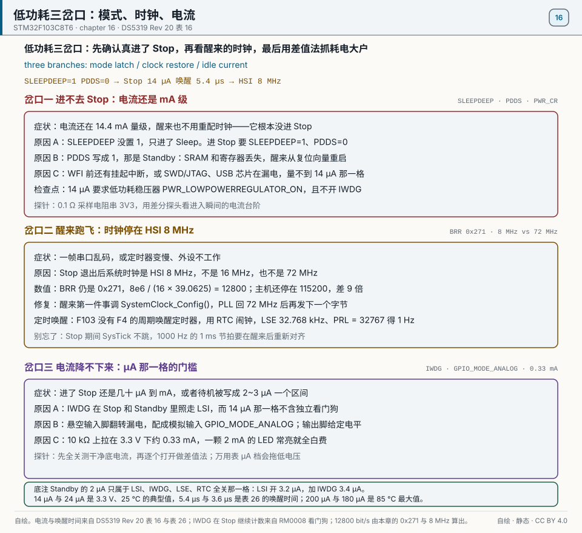
  <br><sub>▲ 自绘排查表。模式不对先读位与标志；醒后串口不对查时钟；电流偏高再查稳压器、常开时钟和板上负载。SLEEPDEEP=1、PDDS=0 只选择 Stop，不能保证测到 14 µA。条件见 [DS5319 Rev 20 表 16](#source-ds5319-pwr) 与 [RM0008 时钟](#source-rm0008-rcc)。</sub>
</p>

<p align="center">
  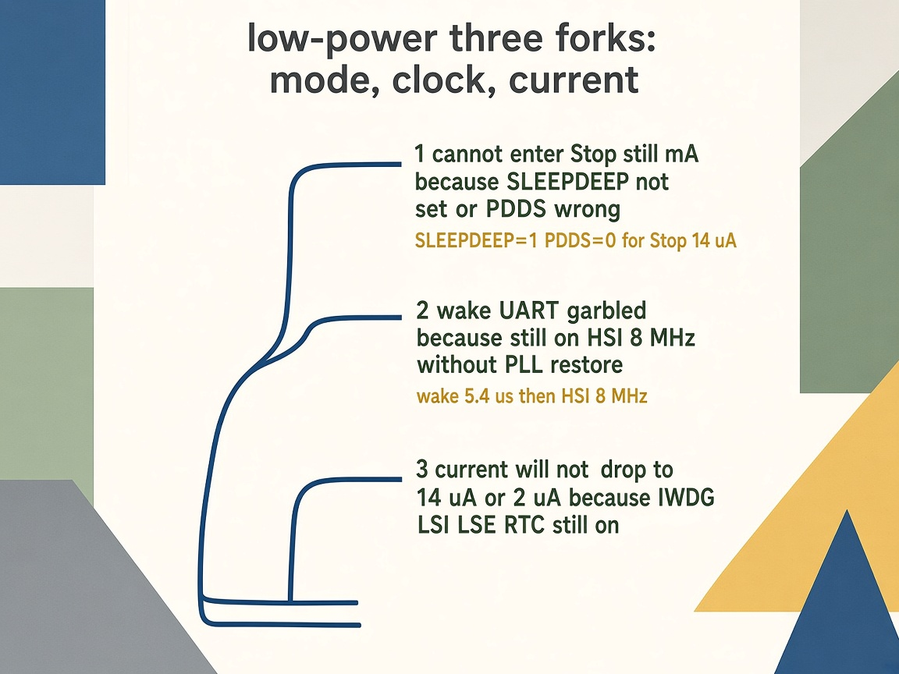
  <br><sub>▲ 知识轨（Handraw · 原理示意/非实拍）。进不去 Stop、醒来乱码、电流降不下来：先查 SLEEPDEEP/PDDS，再查 PLL 恢复，最后查 IWDG/LSI/LSE/RTC；不是实拍。</sub>
</p>

## 动手实验

1. **模式基线**：同一硬件依次测 Run、Sleep、Stop、Standby。记录供电电压、板上负载、静态电流和唤醒方式，不把开发板结果写成芯片指标。
2. **Stop 恢复证据**：同时采 PA0 边沿、ISR 入口与 `SystemClock_Config()` 完成后的 GPIO 标记，区分唤醒响应与恢复阶段；随后发送 `0x55`，确认 UART 恢复到 115200。GPIO 标记包含软件延迟，不直接等同于手册的首条指令指标。
3. **周期平均电流**：RTC 每 5s 唤醒、采 ADC、发送一帧再睡。保存完整电流波形，积分得到 Iavg，并与状态×时间公式比较。
4. **泄漏排查**：依次断开调试器、LED、USB、传感器，每一步记录底电流差值；最后对照目标芯片数据手册的相同模式与温度条件。

### 8. 掉电前的最后一声：PVD

PVD 监视 VDD。配置好 EXTI16 和 NVIC 后，跨过所选阈值可触发中断，用来尽早记录掉电状态。下面只列检测器配置，未列中断入口。能否在复位前写完备份寄存器或 Flash，要看供电余量、写入时间和最低工作电压；PVD 不提供固定的剩余毫秒数。阈值与迟滞以参考手册为准。

```c
PWR_PVDTypeDef pvd = {0};
pvd.PVDLevel = PWR_PVDLEVEL_6;          /* 具体电压见 RM，不要把档位背成一个毫伏数 */
pvd.Mode     = PWR_PVD_MODE_IT_RISING_FALLING;
HAL_PWR_ConfigPVD(&pvd);
HAL_PWR_EnablePVD();
```

<p align="center">
  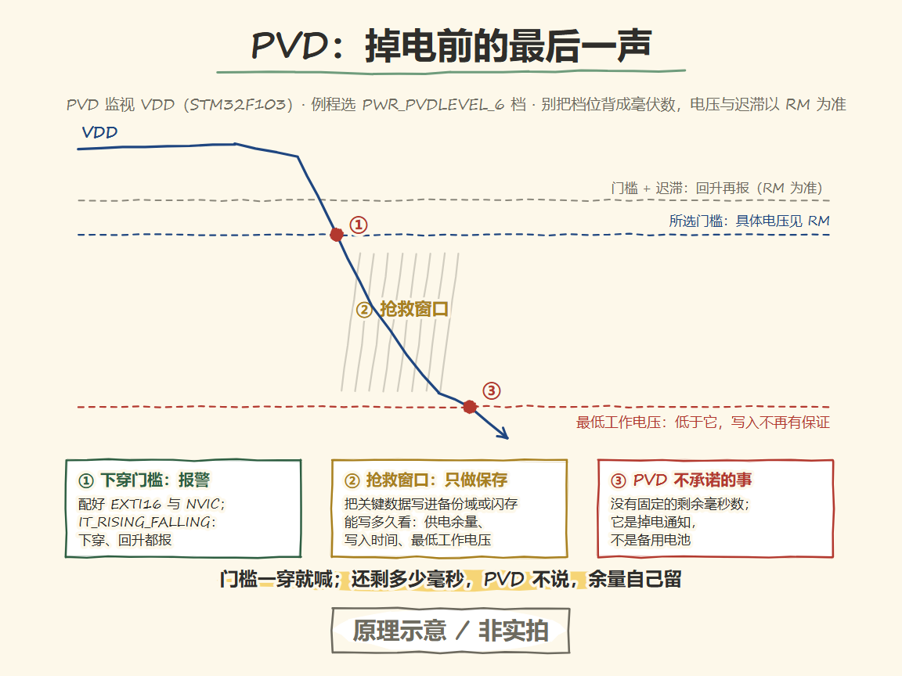
  <br><sub>▲ 知识轨（Handraw · 原理示意/非实拍）。PVD 监视 VDD，配好 EXTI16 与 NVIC 后下穿所选门槛触发中断，中断里把关键数据写进备份域或闪存；能写多久看供电余量、写入时间和最低工作电压，PVD 不给固定的剩余毫秒数；图中门槛为相对位置、非毫伏值；不是实拍。</sub>
</p>

Sleep 的电流也不是一个固定的 1 mA。内核停了，外设时钟还在，电流通常仍是毫安这一档；Stop 才进到微安这一档。上面对比表里的数字是数据手册的量级，不是本仓库某块板的实测。要写进论文或电池预算，打开对应型号的 DS，按你关了哪些时钟的那一列抄。

离开本章前，应有四种模式基线、Stop 唤醒与 115200 恢复证据、一张周期电流积分图和逐项断开负载的差值表。

自测：

1. 为什么不能把 Sleep 电流记成“72 MHz 下约 1 mA”？
2. PVD 中断里适合做哪一件事，不适合做哪一件事？
3. Standby 唤醒之后，程序从 `WFI` 的下一行继续，还是从复位向量重来？

## 相关资源

- RM0008《STM32F10xxx 参考手册》第 5 章 Power control (PWR)（`PWR_CR` 的 `LPDS/PDDS/CWUF`、WFI/WFE）。
- RM0090《STM32F4 参考手册》第 5 章 PWR、第 26 章 RTC（周期唤醒）。
- 数据手册 DS：各模式典型/最大电流、唤醒时间、VBAT 参数。
- Arm《Cortex-M3 Devices Generic User Guide》（ARM DUI 0552A）§2.5 Power management、WFI/WFE 指令与 SCR；用于区分唤醒和中断处理条件。
- 相关章节：第 11 章 RTC 与看门狗、第 09 章 ADC。
- 配图：`../assets/animations/lowpower-wakeup.svg`（作者自绘矢量图）。


- 手机阅读版：[第 16 章 · 低功耗设计（公众号图文）](https://mp.weixin.qq.com/s/x8qCGZ124ymEZGBRE8tfig)
