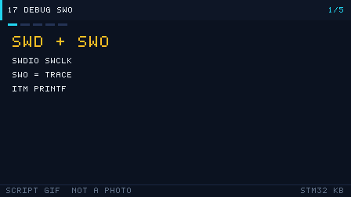

# 17 调试与性能优化

> English: [Debug](en/17-debug.md)

> 会调试的人用 SWD 断点 + SWO 打印 + HardFault 寄存器三件套，几分钟定位别人一天的 bug；会优化的人用 DWT 计时和 DMA 把算力榨干。

<p align="center">
  
  <br><sub>▲ 动画：SWD 调试 + SWO/ITM 打印跟踪（作者自绘矢量动画，非实拍）</sub>
</p>

<!-- video:ch17 -->
<p align="center">
  
  <br><sub>▲ 本章讲解幻灯：程序生成的 GIF（tools/gen_videos.py，可复现，不是实拍）。旁白与五帧一一对应。</sub>
</p>

**旁白（跟着画面读，大约一分钟）**

1. SWD 两根线调试。SWO 再加一根，就能把 printf 从 ITM 送出来，不必占 UART。
2. HardFault 时先看栈里的 PC。那条指令附近就是现场。
3. DWT 的周期计数器能给一段代码打表，比 GPIO 翻转更细。
4. 优化打开以后，局部变量可能不在内存里。调试版和发布版要分开看。
5. 自测：SWO 占用哪只脚？Fault 里最先看的寄存器是什么？
<!-- /video:ch17 -->


## 📌 学习目标

- [ ] 分清 SWD 与 JTAG 的引脚与取舍，理解为什么 SWD 是主流。
- [ ] 会用 SWO/ITM 做「不占串口」的 `printf` 跟踪。
- [ ] 知道硬件断点/软件断点的数量限制与差异。
- [ ] 掌握 HardFault 定位三件套：`CFSR`/`HFSR`/`BFAR` + 栈回溯 + `addr2line`。
- [ ] 会用逻辑分析仪/示波器测量信号与 DWT 测量代码耗时。
- [ ] 记住 `-O2`/`-Os`、DMA、Cache 等常见优化手段与注意事项。

## 🧠 核心原理

### 1. SWD vs JTAG

**结论**：**SWD 只用 2 根信号线（SWDIO+SWCLK）+ GND**，比 JTAG 省引脚，是 Cortex-M 的首选调试接口；JTAG 主要用于多器件菊花链或老旧工具。

| 项 | SWD | JTAG |
| --- | --- | --- |
| 信号线 | SWCLK、SWDIO（2 根） | TCK、TMS、TDI、TDO（4 根，+TRST 可选） |
| 引脚占用 | 少（PA13/PA14） | 多（PB3/PB4/PA15 + PA13/PA14） |
| 速度 | 快（可达 10+ MHz） | 快 |
| 多器件 | 不支持菊花链 | 支持 |
| 典型工具 | ST-Link、J-Link、DAPLink | J-Link、老式 JTAG 探头 |
| STM32 支持 | ✅（推荐） | 支持但少用 |

> ⚠️ STM32 复位后默认 **PA13(SWDIO)/PA14(SWCLK)** 保留给调试口；若把它们配成普通 GPIO 且关掉调试，会「烧录后连不上」——留 `SWD` 或 `HAL_DBGMCU` 保底。

### 2. SWO / ITM / printf 跟踪

**结论**：**SWO（单线输出）** 让 MCU 通过 `ITM` 把调试信息从 SWO 引脚输出，**不占用 UART**、不阻塞，是最优雅的日志方式。

| 机制 | 说明 |
| --- | --- |
| ITM (Instrumentation Trace Macrocell) | 内核内的跟踪单元，可输出 32 个通道（Port 0 常作 printf） |
| SWO (Serial Wire Output) | 复用 SWD 的物理线，额外输出 ITM 数据（需 3 线 SWD + SWO） |
| `ITM_SendChar` | 重定向 `printf` 的底层函数 |
| 前提 | 调试器支持 SWO（ST-Link V2-1/J-Link），并在 IDE 里配置 SWO 时钟 |

```c
/* 把 printf 重定向到 ITM，无需串口 */
int __io_putchar(int ch)
{
    ITM_SendChar(ch);
    return ch;
}
```

### 3. 断点类型与数量限制

**结论**：硬件断点数量**非常有限**（Cortex-M3/M4 通常 **6 个**，M7 通常 **8 个**），且数量由芯片 FPB 单元决定；软件断点无限但会**改写 Flash 内容**。

| 类型 | 原理 | 数量 | 限制 |
| --- | --- | --- | --- |
| 硬件断点 | FPB 比较地址 | 6 个（M3/M4）/ 8 个（M7） | 数量固定，不能设在 RAM 数据地址 |
| 软件断点 | 替换指令为 `BKPT` | 无限 | 需可写内存（Flash 需调试器改写），打断点处会短暂改内容 |
| 数据观察点 | DWT 比较数据地址 | 2~4 个 | 观察变量被读写时暂停 |

> 断点打不上、或数量超限时，删掉旧断点；调试器一般会自动用软件断点补足。

### 4. HardFault 定位三件套

**结论**：进 HardFault 后，先读 **`CFSR`（可配置故障状态）→ `HFSR`（硬故障状态）→ `BFAR`（总线故障地址）**，再**从栈里还原出错时的 PC**，最后用 **`addr2line`/`.map`** 定位到源码行。

| 寄存器 | 全称 | 关键位 | 含义 |
| --- | --- | --- | --- |
| `SCB->CFSR` | Configurable Fault Status | `MMARVALID/BFARVALID` | 是否记录了出错地址 |
| `SCB->CFSR` | 同上 | `IMPRECISERR` 等 | 精确/非精确总线错误 |
| `SCB->HFSR` | HardFault Status | `FORCED` | 是否由升级而来的故障强制进入 |
| `SCB->BFAR` | BusFault Address | 地址值 | 非法访问的地址（若 `BFARVALID=1`） |
| `SCB->MMFAR` | MemManage Address | 地址值 | MPU 违规地址 |

**栈回溯**：异常进入时内核会把 `R0-R3,R12,LR,PC,xPSR` 压栈，PC 就是出错指令地址。

```c
/* 从 MSP/PSP 还原出错 PC */
void HardFault_Handler(void)
{
    __asm volatile (
        "TST LR, #4        \n"   /* 判断用的是 MSP 还是 PSP */
        "ITE EQ            \n"
        "MRSEQ R0, MSP     \n"
        "MRSNE R0, PSP     \n"
        "B hard_fault_handler_c \n"
    );
}
```

```c
void hard_fault_handler_c(uint32_t *stack)
{
    volatile uint32_t r0  = stack[0];
    volatile uint32_t r1  = stack[1];
    volatile uint32_t r2  = stack[2];
    volatile uint32_t r3  = stack[3];
    volatile uint32_t r12 = stack[4];
    volatile uint32_t lr  = stack[5];
    volatile uint32_t pc  = stack[6];    /* ← 出错指令地址 */
    volatile uint32_t psr = stack[7];
    volatile uint32_t cfsr = SCB->CFSR;
    volatile uint32_t hfsr = SCB->HFSR;
    volatile uint32_t bfar = SCB->BFAR;

    (void)r0;(void)r1;(void)r2;(void)r3;(void)r12;(void)lr;(void)psr;
    (void)cfsr;(void)hfsr;(void)bfar;
    for (;;) { }                         /* 在此处断点，查看上述变量 */
}
```

**用 addr2line 把 PC 变成源码行**（GCC 工具链）：

```bash
arm-none-eabi-addr2line -e build/app.elf -f -C 0x08001a3c
# 输出：函数名 + 文件名:行号
```

> 若用 Keil，出错 PC 可在 `.map` 里查符号范围；或用 IDE 的 Call Stack 窗口。

### 5. 逻辑分析仪 / 示波器

| 工具 | 看什么 | 典型用途 |
| --- | --- | --- |
| 逻辑分析仪（8 通道 24 MHz+） | 数字时序 | 抓 I2C/SPI/UART/CAN 时序，解码协议 |
| 示波器 | 模拟波形 | 看 PWM 上升沿、电源纹波、信号完整性 |
| 混合信号示波器 MSO | 数字+模拟 | 时序与模拟联动分析 |
| 电流探头/功耗计 | 电流波形 | 低功耗验证（见第 16 章） |

> 逻辑分析仪擅长「协议对不对」，示波器擅长「信号好不好」；调试总线偶发错误两者都要用。

### 6. 代码优化手段

**结论**：先**测量**再优化（DWT 计时），常见手段按收益排序：**DMA 卸载搬运 > 编译器优化等级 > 减少浮点/除法 > Cache/预取 > 汇编**。

| 手段 | 做法 | 注意 |
| --- | --- | --- |
| 编译器优化 | `-O2`（速度）/`-Os`（体积） | `-O0` 便于单步调试但慢；用 `volatile` 防被优化 |
| DMA | 串口/ADC/SPI 数据搬运交给 DMA | 见第 10 章；注意 Cache 一致性 |
| 位带/位运算 | 用位操作代替除法/取模 | 除法比移位慢十几倍 |
| 定点代替浮点 | 用 Q 格式定点 | 无 FPU 的 M3 尤其明显 |
| FPU | M4F/M7 开启硬件浮点 | 编译选项 `-mfpu=fpv4-sp-d16 -mfloat-abi=hard` |
| Cache/ART | F4 的 ART 加速器、H7 的 I/D-Cache | H7 DMA 需维护 Cache |
| 内联/宏 | 热函数 `static inline` | 过度内联增大体积 |
| 查表 | 用 LUT 代替实时计算 | 牺牲 Flash 换速度 |

**DWT 计时（精度到 CPU 周期）**：

```c
/* 用 DWT 的 CYCCNT 计数器测代码耗时（F1/F4 都支持） */
static void DWT_Init(void)
{
    CoreDebug->DEMCR |= CoreDebug_DEMCR_TRCENA_Msk;  /* 使能跟踪 */
    DWT->CYCCNT = 0;
    DWT->CTRL  |= DWT_CTRL_CYCCNTENA_Msk;            /* 使能周期计数 */
}

static uint32_t DWT_Cycles(void) { return DWT->CYCCNT; }

void Measure(void)
{
    DWT_Init();
    uint32_t t0 = DWT_Cycles();
    /* 被测代码 */
    for (volatile int i = 0; i < 1000; i++) { }
    uint32_t dt = DWT_Cycles() - t0;                 /* 周期数 */
    float us = (float)dt / (SystemCoreClock / 1000000.0f);
    (void)us;                                        /* 换算成微秒 */
}
```

### 7. HardFault 常见原因表

| 现象/故障位 | 常见原因 | 解决 |
| --- | --- | --- |
| `IMPRECISERR` + `BFARVALID` | 访问未使能时钟的外设 / 野指针 | 先 `__HAL_RCC_xxx_CLK_ENABLE`；查 `BFAR` |
| `PRECISERR` | 非法内存访问（空指针、越界） | 检查指针与数组边界 |
| `UNDEFINSTR` | 跳到非法地址（函数指针错/栈被冲） | 检查函数指针、栈大小 |
| `INVSTATE` | 跳转目标不是 Thumb 指令（bit0=0） | 入口地址 bit0 必须为 1 |
| `INVPC` | 异常返回时 LR 非法 | 中断里破坏 LR / 栈错乱 |
| `FORCED` 且 `CFSR=0` | 升级故障、缺向量 | 检查向量表 `SCB->VTOR` 与链接脚本 |
| 除零（未开 DIV_0_TRP 时不报） | 未使能除零捕获 | `SCB->CCR |= SCB_CCR_DIV_0_TRP_Msk` |
| 栈溢出 | 局部大数组/递归过深 | 加大栈；用栈溢出检测 |

## 🛠️ 硬件与接线

| 开发板 | 接口 | 引脚 | 备注 |
| --- | --- | --- | --- |
| BluePill (F103) | SWD | PA13=SWDIO、PA14=SWCLK、GND、3V3 | 4 线即可下载调试 |
| BluePill | SWO | PB3（可选，需 `AFIO_MAPR` 的 SWJ_CFG） | 仅 J-Link/ST-Link V2-1 支持 |
| Nucleo-F411RE | SWD+SWO | 板载 ST-Link，SB 跳线 | SWO 直接可用 |
| J-Link | SWD | 同上 | 支持 SWO/ITM、RTT |
| 任意 | 逻辑分析仪 | 夹住 SCL/SDA/MOSI 等 | 抓时序解码 |
| 任意 | 示波器 | 探针接被测信号 | 看波形质量 |

> ⚠️ SWD 只需 **SWCLK/SWDIO/GND/3V3** 四根；**GND 必须共地**，否则连不上。若板子被配成「关调试」，用「上电瞬间按住复位再连」或 BOOT0 拉高从系统存储器启动来救砖。

## 💻 代码实现

**① SWO/ITM printf 重定向（完整可用）**

```c
#include "stm32f1xx_hal.h"
#include <stdio.h>

/* 重定向底层字符输出到 ITM 端口 0（SWO） */
int __io_putchar(int ch)
{
    ITM_SendChar((uint32_t)ch);
    return ch;
}

void Log_Init(void)
{
    /* 无需额外初始化，CubeMX 里使能 SWD 即可；
       在 IDE 里配置 SWO 时钟 = 内核时钟，即可看到 printf 输出 */
}

void Log_Demo(void)
{
    printf("sysclk = %lu Hz\r\n", (unsigned long)SystemCoreClock);
}
```

**② 保留 SWD 引脚（防止误配后连不上）**

```c
/* 若必须复用 PA13/PA14，至少保留 SWD；否则烧录后可能无法再连接 */
__HAL_RCC_AFIO_CLK_ENABLE();
__HAL_AFIO_REMAP_SWJ_NOJTAG();   /* 只关 JTAG，保留 SWD（PA13/PA14 仍可调试） */
```

**③ 使能除零/非法访问捕获（让隐藏 bug 变成 HardFault）**

```c
void Fault_Enable(void)
{
    SCB->CCR |= SCB_CCR_DIV_0_TRP_Msk;   /* 除零触发 UsageFault */
    SCB->SHCSR |= SCB_SHCSR_USGFAULTENA_Msk
               |  SCB_SHCSR_BUSFAULTENA_Msk
               |  SCB_SHCSR_MEMFAULTENA_Msk;  /* 分别使能三类故障 */
}
```

**④ HardFault 处理（配 4 节的栈回溯，直接打印寄存器）**

```c
void hard_fault_handler_c(uint32_t *stack)
{
    printf("HardFault! PC=0x%08lX LR=0x%08lX\r\n",
           (unsigned long)stack[6], (unsigned long)stack[5]);
    printf("CFSR=0x%08lX HFSR=0x%08lX BFAR=0x%08lX\r\n",
           (unsigned long)SCB->CFSR,
           (unsigned long)SCB->HFSR,
           (unsigned long)SCB->BFAR);
    for (;;) { }
}
```

**⑤ DWT 计时（对比 memcpy vs DMA 等）**

```c
static inline void DWT_DelayInit(void)
{
    CoreDebug->DEMCR |= CoreDebug_DEMCR_TRCENA_Msk;
    DWT->CYCCNT = 0;
    DWT->CTRL  |= DWT_CTRL_CYCCNTENA_Msk;
}

/* 用法：
   DWT_DelayInit();
   uint32_t t0 = DWT->CYCCNT;  ...被测代码...  uint32_t dt = DWT->CYCCNT - t0;
   耗时(us) = dt / (SystemCoreClock / 1000000)  */
```

> 编译优化建议：Release 用 `-O2`（速度）或 `-Os`（体积）；调试用 `-Og`（可单步）。**优化后可能看不到变量**，用 `volatile` 或 `-O0` 局部排查。

## ⚠️ 常见坑与排查

| 现象 | 原因 | 解决 |
| --- | --- | --- |
| 烧录后连不上板子 | PA13/PA14 被配成 GPIO 并关调试 | 上电瞬间按住复位再连；保留 SWD |
| SWO 无输出 | 未配置 SWO 时钟/引脚 | IDE 里设 SWO 频率=内核时钟，接 SWO 线 |
| printf 卡死 | 用了半主机 `_sys_write` 阻塞 | 重定向到 ITM 或 UART，勿用半主机 |
| 断点打不上 | 硬件断点用尽/打在只读区 | 删旧断点；用软件断点 |
| 单步乱跳 | `-O2` 优化重排 | 调试改 `-O0/-Og` |
| HardFault 但 CFSR=0 | 未使能各 Fault 或为 FORCED | 使能 `SHCSR` 各位；查向量表 |
| PC 定位不到源码 | 没有 `.elf`/`.map` | 用同一次编译的 elf 跑 `addr2line` |
| 优化后逻辑错 | 共享变量未加 `volatile` | 中断/主循环共享变量加 `volatile` |
| 计时为 0 | DWT 未使能或复位后未 init | 调用 `DWT_DelayInit()` |
| 逻辑分析仪抓不到 | 采样率不足/共地 | 提高采样率，务必共地 |

## 🧪 动手实验

1. **SWO 打印**：把 `printf` 重定向到 ITM，在 IDE 的 SWV/ITM 窗口看输出。预期：不接串口也能看到日志。
2. **制造并定位 HardFault**：写一句 `*(volatile uint32_t*)0xDEADBEEF = 1;`，进 HardFault 后打印 `CFSR/BFAR/PC`，用 `addr2line` 定位。预期：能指回那一行。
3. **DWT 计时对比**：用 DWT 分别测「软件 `memcpy`」与「DMA 搬运」同样数据量的耗时（见第 10 章）。预期：DMA 版 CPU 耗时接近 0。
4. **（进阶）逻辑分析仪解码 I2C**：抓一次 OLED 写事务（第 07 章），用解码器还原地址与数据。预期：能看到 0x3C 地址与 ACK。
5. **（进阶）优化等级对比**：同一段浮点密集代码在 `-O0`/`-O2` 下用 DWT 测周期。预期：`-O2` 快数倍。

## 🔗 相关资源

- RM0008/RM0090 的 Debug support (DBGMCU) 章节（调试口配置、低功耗下调试）。
- 《ARM Cortex-M3/M4 权威指南》：故障异常、`CFSR/HFSR/BFAR`、栈帧结构。
- ARMv7-M 架构参考手册（ARM DDI 0403）：异常模型、FPB/DWT。
- 工具文档：ST-Link/J-Link 的 SWO/ITM 配置、`arm-none-eabi-addr2line`。
- 相关章节：第 10 章 DMA、第 16 章低功耗（功耗测量）、第 04 章中断与 NVIC。
- 配图：`../assets/animations/debug-swo.svg`（作者自绘矢量图）。
