# 17 调试与性能优化

> English: [Debug](en/17-debug.md)

> HardFault 发生后先冻结栈帧与 CFSR/HFSR，再判断 BFAR/MMFAR 是否有效，最后用同一个 ELF 做 addr2line。先改优化级别或注释代码会把现场抹掉。

<p align="center">
  
  <br><sub>▲ 动画：SWD 调试 + SWO/ITM 打印跟踪（作者自绘矢量动画，非实拍）</sub>
</p>

<!-- video:ch17 -->
<p align="center">
  <video width="640" controls poster="../assets/video/ch17-debug.png">
    <source src="../assets/video/ch17-debug.mp4" type="video/mp4">
  </video>
  <br><sub>▲ 本章讲解视频（3.0 分钟）。<a href="../assets/video/ch17-debug.mp4">MP4</a> · <a href="../assets/video/ch17-debug.srt">字幕</a></sub>
</p>

<details>
<summary>旁白文字稿</summary>

1. 会调试的人先收集证据：断点停在哪、关键寄存器是多少、线上到底有没有边沿。不会调试的人靠改一行试试。这一章把证据的三件套配齐。
2. SWD 两根线就能断点。再加 SWO，可以把打印从 ITM 送出来，不必占串口。F103 上 SWO 在 PB3，还要看调试脚的重映射。把这些脚改成普通输出，探针就哑了。
3. 进了硬故障，先读可配置故障状态 CFSR，再读硬故障状态 HFSR，需要时再看总线故障地址 BFAR。然后从栈里把当时的 PC 捞出来，用 addr2line 对回源码行。
4. 这一帧是仓库画的 SWD 加 SWO，不是逻辑分析仪的截图。它提醒你：日志不一定要占 USART。但是调试器要支持 SWO，时钟也要配成它能听懂的频率。
5. 觉得慢，先用 DWT 的周期计数把那段量出来，跑多次取个数。没有数字就去展开汇编，很容易优化了一个根本不占时间的循环。量完再决定要不要交给 DMA。
6. 实验可以故意写一个非法地址，让它进硬故障。如果你能把 CFSR 和栈里的 PC 对回那一行，这套流程才算你的。只在文章里看过，真故障来时还会慌。
7. 功能还不对时，不要先把优化开到最高。优化会把你以为按顺序发生的读写重排。和硬件时序有关的变量要老实标记，优化之后再跑一遍原来的测试。
8. 硬故障的第一站是 CFSR，再看 HFSR 和栈里的 PC。F103 的 SWO 占 PB3。没有证据就不要改第二处。
9. 调试时一次只改一处，改完立刻复现刚才的现象。同时改三处，好了也不知道是谁的功劳，坏了更不知道是谁的错。版本管理就是为了能回到上一版。
10. 优化之前先有周期计数：DWT 的 CYCCNT 给出最坏值，再看分布。凭感觉说“应该快了”，不是证据。

</details>
<!-- /video:ch17 -->
## 原理与适用范围

本章按 STM32F103C8T6 讲。它是 Cortex-M3 内核，没有 FPU。下面的故障寄存器地址属于 Cortex-M3 内核的系统控制块，所有 M3 都一样。见 [PM0056](#source-pm0056)。

先用后文的 `Measure()` 做一次对照：运行到两次 `DWT_Cycles()` 之后再停住，查看 `dt`；再把被测循环换成空窗口，比较两次结果。空窗口也包含读计数器的开销。计时区间内保持内核连续运行，结果应能区分循环与空窗口；若两次都是 0，先检查计数器是否在走。这里不预设循环要花多少周期。

遇到 HardFault，先保存现场，再判读 `CFSR`（`0xE000ED28`）与 `HFSR`（`0xE000ED2C`）。`HFSR.FORCED` 是 bit 30，值 `0x40000000`，表示可配置故障升级为硬故障，应继续查 `CFSR`。地址寄存器是 `MMFAR`（`0xE000ED34`）和 `BFAR`（`0xE000ED38`）。采集时先保存地址，再读取对应有效位；更高优先级异常可能更新这些寄存器，分散读数不一定属于同一现场。

`BFARVALID` 是 `CFSR` bit 15。为 1 时，保存的 `BFAR` 是有效的总线故障地址；为 0 时不能据它定位，里面可能仍是旧值。`MMFAR` 对应 `MMARVALID`（bit 7）。`IMPRECISERR` 本身不更新 `BFAR`；若它与精确故障位同时出现，不能把有效地址直接归给最早的那次写操作。

正常完成异常压栈后，基本栈帧依次为 R0、R1、R2、R3、R12、LR、PC、xPSR。以 R0 为第 0 个字，PC 在 `stack[6]`，即该栈帧起点 SP + 0x18。`PRECISERR` 对应的 PC 指向出错指令；`IMPRECISERR` 的 PC 可能已经越过原始写操作。若有 `STKERR` 或 `MSTKERR`，压栈可能不完整，应先核对栈地址与内容，不能直接解引用。

计时前把 `DEMCR`（`0xE000EDFC`）的 bit 24（`TRCENA`）置 1，再将 `DWT_CYCCNT`（`0xE0001004`）清零并使能 `CYCCNTENA`。72 MHz 下 72 个计数是 1 µs。缺少任一使能都会使计数停住；零差还应检查是否在单步、是否读了同一份旧变量，以及被测代码是否保留在汇编中。见 [PM0056 DWT](#source-pm0056-dwt)。

这颗 M3 有 6 个硬件断点，在 Flash 里打第 7 个断点时调试器会报错或不停。STM32F7 和 H7 上的 Cortex-M7 是 8 个，网上的教程如果是 H7 的，数字不能照搬。

<p align="center">
  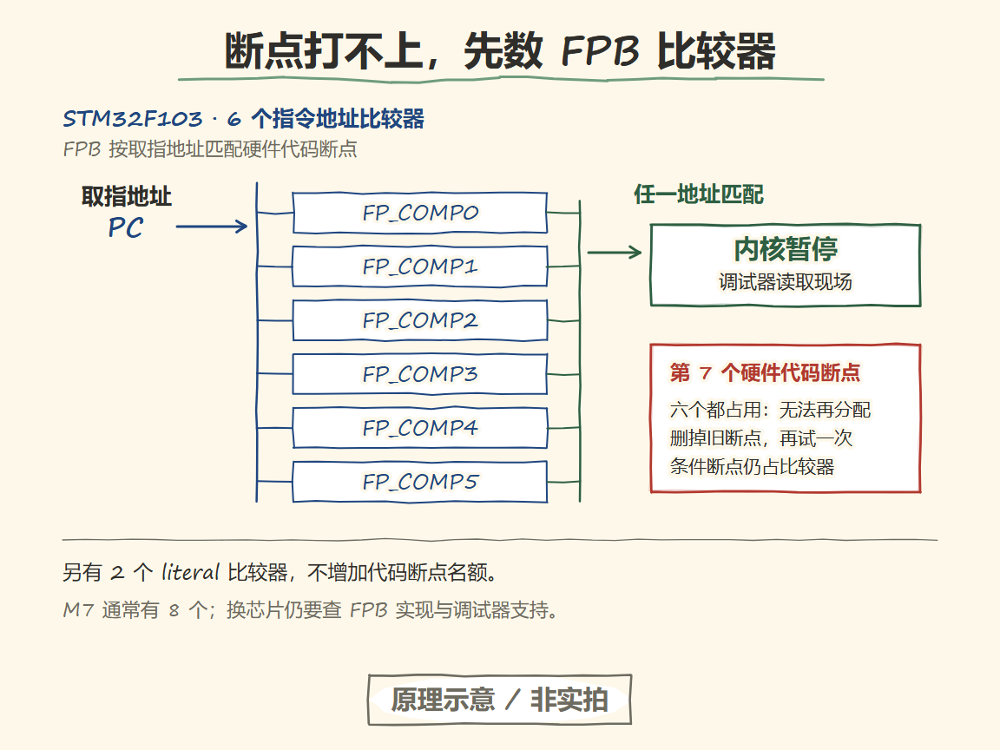
  <br><sub>▲ 知识轨（Handraw · 原理示意/非实拍）。F103 的 6 个代码比较器用完后，要释放旧断点或换一种观测方法。给硬件断点加条件仍会占比较器；M7 的 8 个不能套到这里。见 [PM0056 DWT](#source-pm0056-dwt)。</sub>
</p>

在 LQFP48 封装上，第 34 脚 PA13 是 SWDIO，第 37 脚 PA14 是 SWCLK，第 39 脚 PB3 复位后是 JTDO。异步 TRACESWO 要求探针使用 Serial Wire 模式，并配置跟踪输出；可关闭 JTAG 只保留 SWD，但这一步不能代替跟踪配置。只接上 PB3 还不会自动有日志。见 [DS5319](#source-ds5319-swd)。

## 关键插图


<p align="center">
  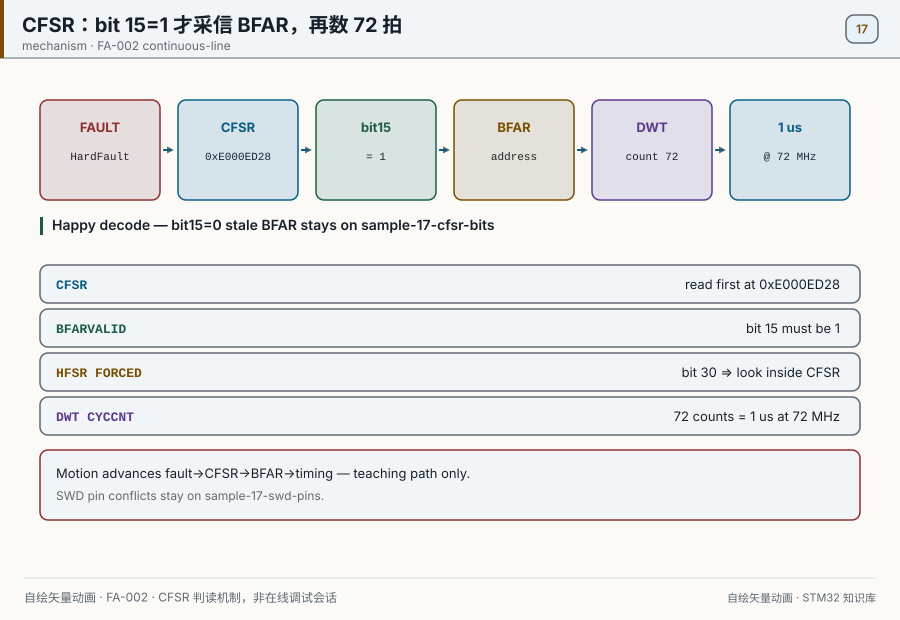
  <br><sub>▲ 自绘矢量动画。先保存现场，再检查 BFARVALID 并解释地址；DWT 周期计数是另一项独立检查。</sub>
</p>


<p align="center">
  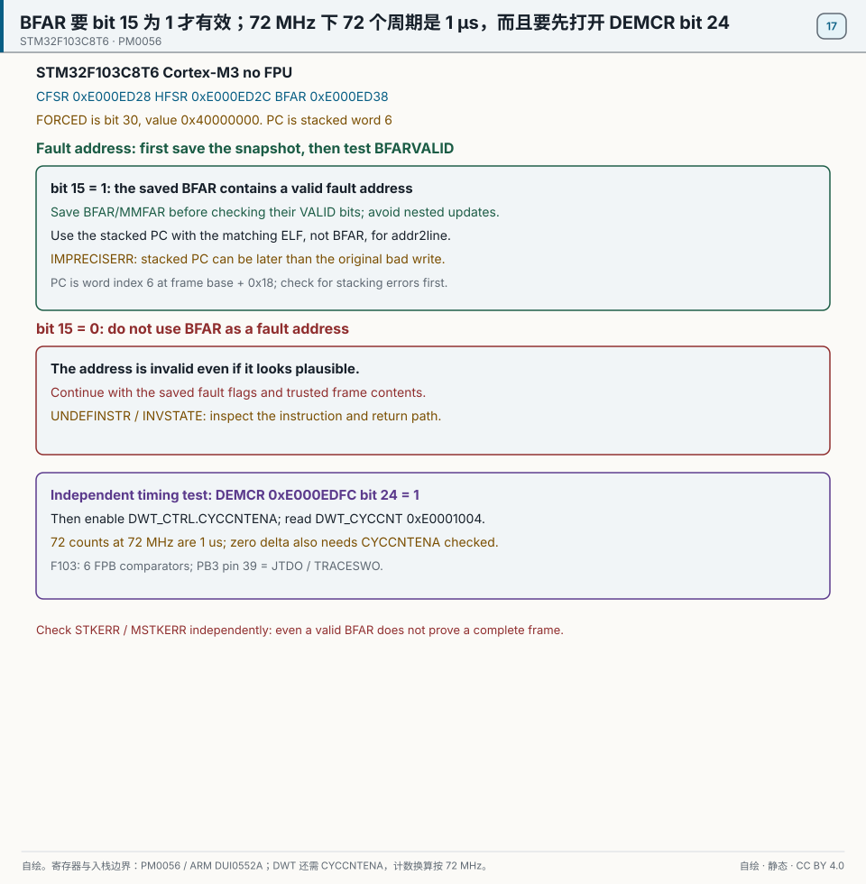
  <br><sub>▲ 自绘。BFARVALID 决定能否使用保存的 BFAR；DWT 则需同时使能 TRCENA 与 CYCCNTENA。72 个计数仅在 72 MHz 下等于 1 µs；故障地址与耗时应分开判断。见 [PM0056](#source-pm0056) 和 [PM0056 DWT](#source-pm0056-dwt)。</sub>
</p>

<p align="center">
  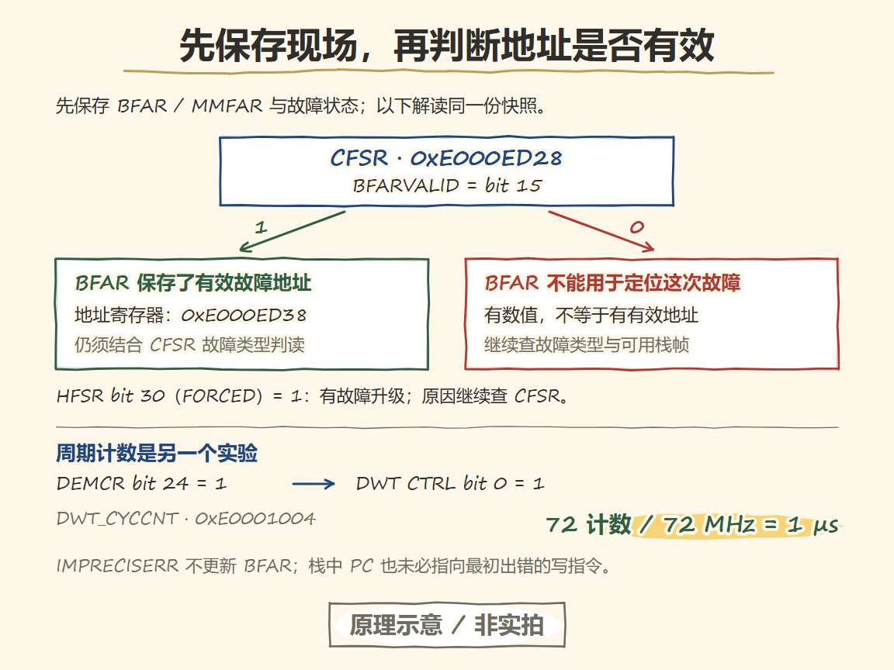
  <br><sub>▲ 知识轨（Handraw · 原理示意/非实拍）。上半检查故障地址是否有效，下半检查周期计数是否启用。72 MHz 下 72 计数 = 1 µs，两项检查互不构成因果。</sub>
</p>

<p align="center">
  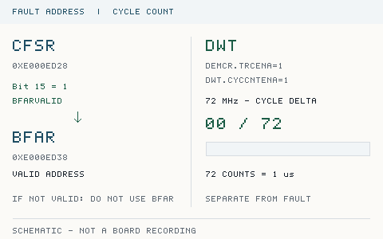
  <br><sub>▲ 左侧保留地址有效条件，右侧独立演示 72 MHz 下的周期换算，播放速度不代表实际耗时。印刷版可对照上方静态图。</sub>
</p>

SWO 和 ITM 打印见章首的 `debug-swo.svg` 动画，上面的静态图只讲故障寄存器和周期计数。

## 时序与状态

| 寄存器或计数 | 地址或位 | 什么时候有效 |
| --- | --- | --- |
| `CFSR` | `0xE000ED28` | 保存现场后解码 |
| `HFSR` bit 30 | `0x40000000` | `FORCED` |
| `MMFAR` | `0xE000ED34` | 它自己的有效标志为 1 时 |
| `BFAR` | `0xE000ED38` | 仅 bit 15 为 1 |
| 地址无效 | bit 15 为 0 | BFAR 不可用于定位，可能保留旧值 |
| DWT | `0xE000EDFC` bit 24 与 `CYCCNTENA` 置位，再读 `0xE0001004` | 72 MHz 下 72 个计数等于 1 µs |
| 计数停住 | bit 24 为 0 或 `CYCCNTENA` 为 0 | 连续运行时也读不到增长 |
| 硬件断点 | 6 个 | Cortex-M3。M7 是 8 个 |
| 脚位 | 第 34 脚 PA13，第 37 脚 PA14 | SWD。第 39 脚 PB3 默认 JTDO |

## 常见坑与出处

| 现象 | 原因 | 处理 | 出处 | 出处里能查到什么 |
| --- | --- | --- | --- | --- |
| `BFAR` 里有个数，但对不上这次访问 | 地址无效，或多种故障同时置位 | 核对快照中的 `CFSR` bit 15 和故障类别 | [PM0056](#source-pm0056) | bit 15 为 0 时不可使用 `BFAR`；`IMPRECISERR` 本身不记录地址 |
| 一进 HardFault 就只复位 | 没留下故障寄存器 | 先留下 `CFSR` 和压栈的 PC | [PM0056](#source-pm0056) | `CFSR` 在 `0xE000ED28`。`FORCED` 是 `HFSR` bit 30，值 `0x40000000` |
| DWT 测出来是 0 | 计数未启用，或测量窗口没有按预期执行 | 核对 `DEMCR` bit 24 与 `CYCCNTENA`，连续运行后查看原始计数 | [PM0056 DWT](#source-pm0056-dwt) | 两项使能都需要；72 MHz 下 72 个计数是 1 µs |
| 断点打到第 7 个就不停 | 比较器用完了 | 这颗 M3 只有 6 个硬件断点 | [PM0056 DWT](#source-pm0056-dwt) | Cortex-M3 是 6 个，Cortex-M7 是 8 个 |
| SWO 没有波形，PB3 却当成已经打开 | 复位后它不是 SWO | 第 39 脚是 JTDO | [DS5319](#source-ds5319-swd) | TRACESWO 在重映射列。它不是 PA13，也不是 PA14 |
| 优化之后断言还在，时序却变了 | 没有同条件的周期数 | 先有 bit 24 和 `CYCCNT` 的对照，再改优化等级 | [PM0056 DWT](#source-pm0056-dwt) | 改优化等级前后各测一次周期数，才能说清快了多少 |
## 学习目标

- [ ] 分清 SWD 与 JTAG 的引脚与取舍，理解为什么 SWD 是主流。
- [ ] 会用 SWO/ITM 做「不占串口」的 `printf` 跟踪。
- [ ] 知道硬件断点/软件断点的数量限制与差异。
- [ ] 掌握 HardFault 定位三件套：`CFSR`/`HFSR`/`BFAR` + 栈回溯 + `addr2line`。
- [ ] 会用逻辑分析仪/示波器测量信号与 DWT 测量代码耗时。
- [ ] 记住 `-O2`/`-Os`、DMA、Cache 等常见优化手段与注意事项。

## 核心原理

调试证据有顺序：先保存现场，再分类故障，再定位源码，最后做最小复现。性能优化也一样，先测周期、总线与波形，再决定改算法、DMA、编译器还是硬件。

### 1. SWD vs JTAG


<p align="center">
  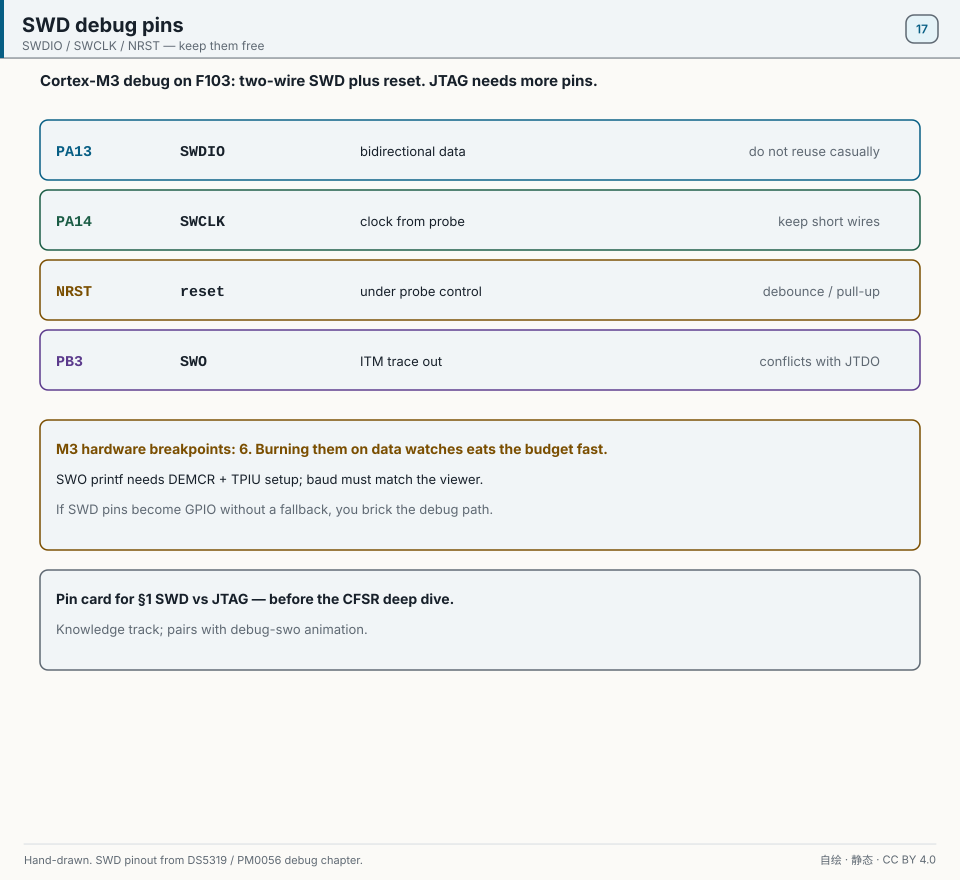
  <br><sub>▲ 自绘。PA13/PA14 承担 SWD，PB3 可输出 SWO。误把 SWD 脚改成 GPIO 后，通常需要通过复位下连接恢复。</sub>
</p>

<p align="center">
  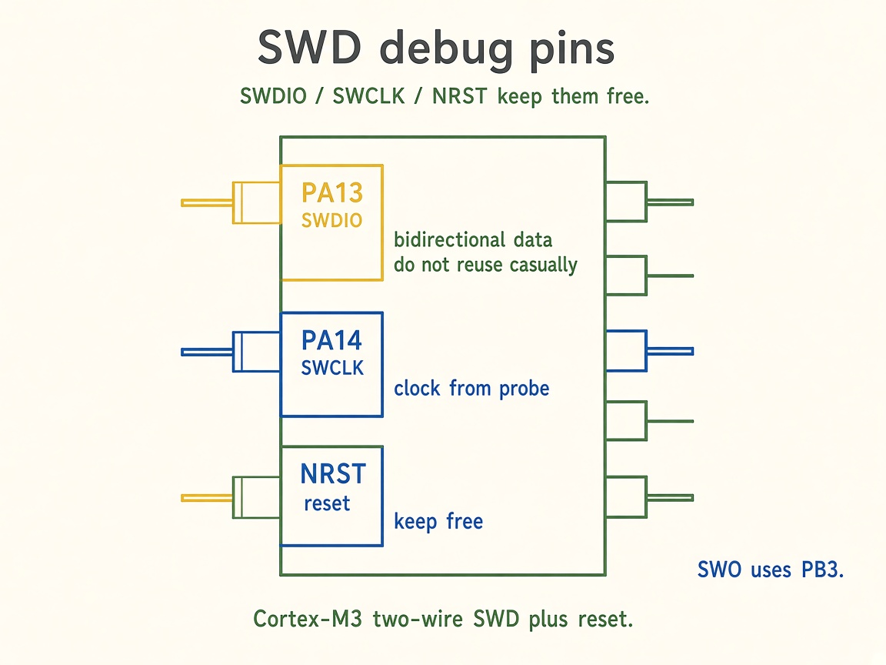
  <br><sub>▲ 知识轨（Handraw · 原理示意/非实拍）。SWDIO 双向传输，SWCLK 由探针驱动；SWO 从 PB3 单向返回。GND 共地，VTref 用于感知目标电压，NRST 供复位下连接使用。</sub>
</p>


**SWD 只用 2 根信号线（SWDIO+SWCLK）+ GND**，比 JTAG 省引脚，是 Cortex-M 的首选调试接口；JTAG 主要用于多器件菊花链或老旧工具。

| 项 | SWD | JTAG |
| --- | --- | --- |
| 信号线 | SWCLK、SWDIO（2 根） | TCK、TMS、TDI、TDO（4 根，+TRST 可选） |
| 引脚占用 | 少（PA13/PA14） | 多（PB3/PB4/PA15 + PA13/PA14） |
| 速度 | 快，上限看探针和接线 | 快 |
| 多器件 | 不支持菊花链 | 支持 |
| 典型工具 | ST-Link、J-Link、DAPLink | J-Link、老式 JTAG 探头 |
| STM32 支持 | 支持，推荐 | 支持但少用 |

> [!WARNING]
> STM32 复位后默认 **PA13(SWDIO)/PA14(SWCLK)** 保留给调试口。应用程序禁用 SWD 或复用这两脚后，探针可能无法正常连接；保留 SWD，并在调试接口引出 NRST，方便使用 connect under reset。

SWD 能跑多快，ST 的手册没有给一个数，常见的 4 MHz、10 MHz 是探针厂商自己的标称。杜邦线长了就要往下调。


<p align="center">
  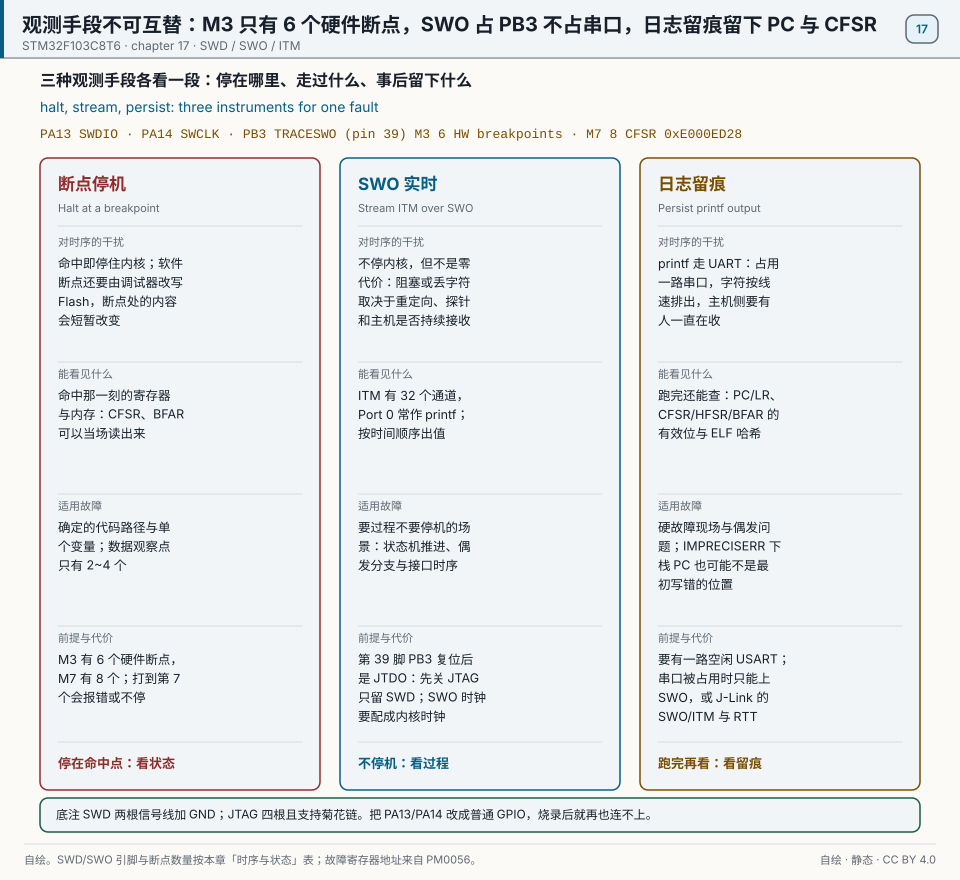
  <br><sub>▲ 自绘。断点会暂停内核，SWO 在运行中传出跟踪数据，故障记录保存 PC 与 CFSR 供事后分析。条件硬件断点仍占用比较器；记录能否留存取决于存储位置与复位方式。见 [PM0056 调试](#source-pm0056) 和 [DS5319 SWD](#source-ds5319-swd)。</sub>
</p>

<p align="center">
  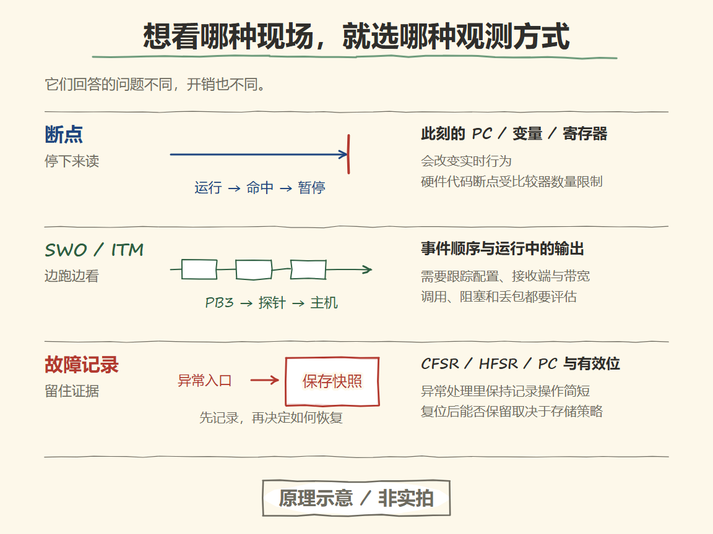
  <br><sub>▲ 知识轨（Handraw · 原理示意/非实拍）。停住看变量、运行时跟踪、故障后留存，分别回答不同问题；选择时还要考虑时序扰动和记录是否完整。</sub>
</p>

### 2. SWO / ITM / printf 跟踪

**SWO（单线输出）** 让 MCU 通过 `ITM` 从 SWO 引脚输出调试信息，**不占用 UART**。是否阻塞或丢字符取决于重定向实现、探针和主机是否持续接收，不能把它当成零代价日志。

| 机制 | 说明 |
| --- | --- |
| ITM (Instrumentation Trace Macrocell) | 内核内的跟踪单元，可输出 32 个通道（Port 0 常作 printf） |
| SWO (Serial Wire Output) | SWD 两根线之外再加一根 SWO 线，F103 上是 PB3，用来输出 ITM 数据 |
| `ITM_SendChar` | 重定向 `printf` 的底层函数 |
| 前提 | 调试器支持 SWO（ST-Link V2-1/J-Link），并在 IDE 里配置 SWO 时钟 |

F103 还需在 `DBGMCU_CR` 中使能 `TRACE_IOEN`，并以 `TRACE_MODE=00` 选择异步跟踪；ITM、TPIU 协议与分频也要配置。IDE 中填写的内核时钟须与实际 HCLK 一致，探针的接收速率须与 TPIU 输出一致。调试工具可能代办这些设置，但仅关闭 JTAG 并不能完成初始化。

```c
/* 把 printf 重定向到 ITM，无需串口 */
int __io_putchar(int ch)
{
    ITM_SendChar(ch);
    return ch;
}
```

### 3. 断点类型与数量限制

硬件执行断点由 FPB 比较指令地址。这颗 F103 有 **6 个代码比较器**；M3/M4 常见配置为 6 个，M7 常见为 8 个，迁移时仍要查目标实现。软件断点把指令替换为 `BKPT`，是否支持 Flash、能放多少个，由调试器和存储器条件决定。

| 类型 | 原理 | 数量 | 限制 |
| --- | --- | --- | --- |
| 硬件断点 | FPB 比较指令地址 | 6 个（M3/M4 常见）/ 8 个（M7 常见） | 比较器有限；观察数据读写应用 DWT |
| 软件断点 | 替换指令为 `BKPT` | 取决于工具与存储条件 | RAM 需可写；Flash 需要调试器提供改写支持 |
| 数据观察点 | DWT 比较数据地址 | F103 的 DWT 有 4 个比较器 | 与 FPB 独立；观察变量读写，或承担其他 DWT 跟踪任务 |

> 断点超限时，先删掉旧断点，再确认工具是否支持该位置的软件断点。条件硬件断点仍要占一个比较器；有些条件还需要暂停后由主机判断，会扰动时序。

<p align="center">
  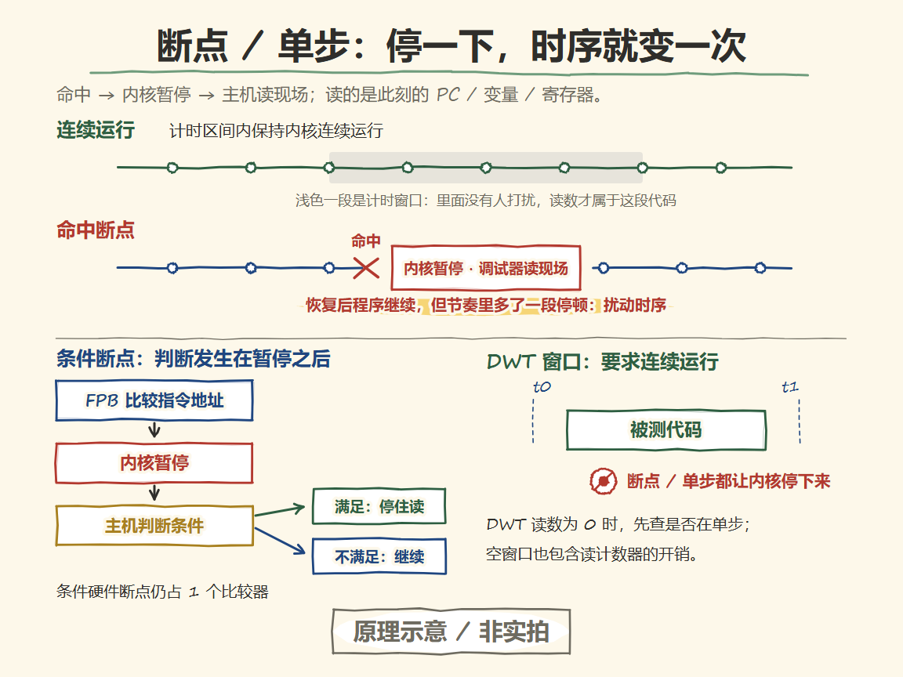
  <br><sub>▲ 知识轨（Handraw · 原理示意/非实拍）。命中后内核暂停，调试器读的是此刻的 PC / 变量 / 寄存器；条件硬件断点仍占 1 个比较器，有些条件由主机在暂停后判断，会扰动时序。计时区间内保持内核连续运行；空窗口也包含读计数器的开销；不是实拍。</sub>
</p>

### 4. HardFault 定位三件套


<p align="center">
  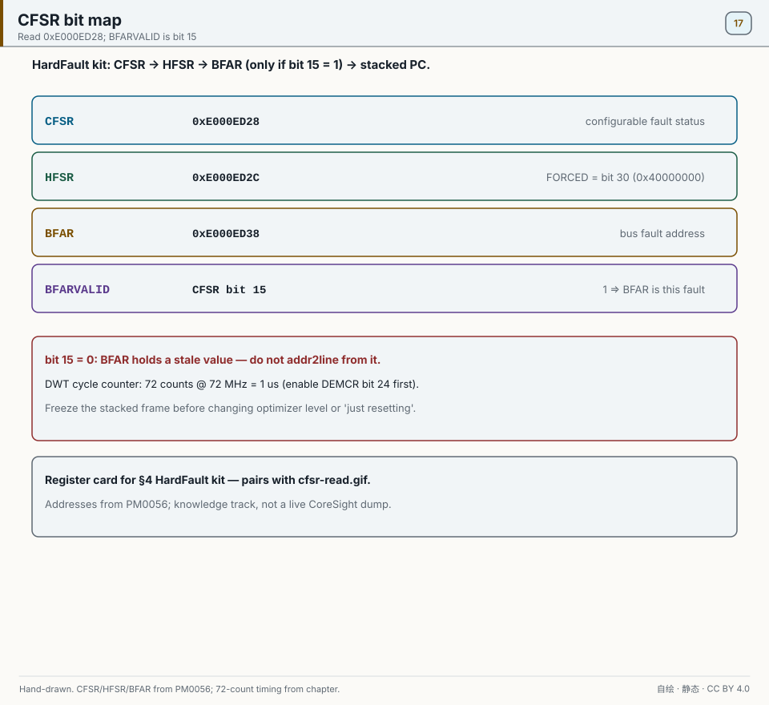
  <br><sub>▲ 自绘。判读 CFSR 时分清故障类别与地址有效位；周期换算另按实际内核时钟计算。</sub>
</p>

<p align="center">
  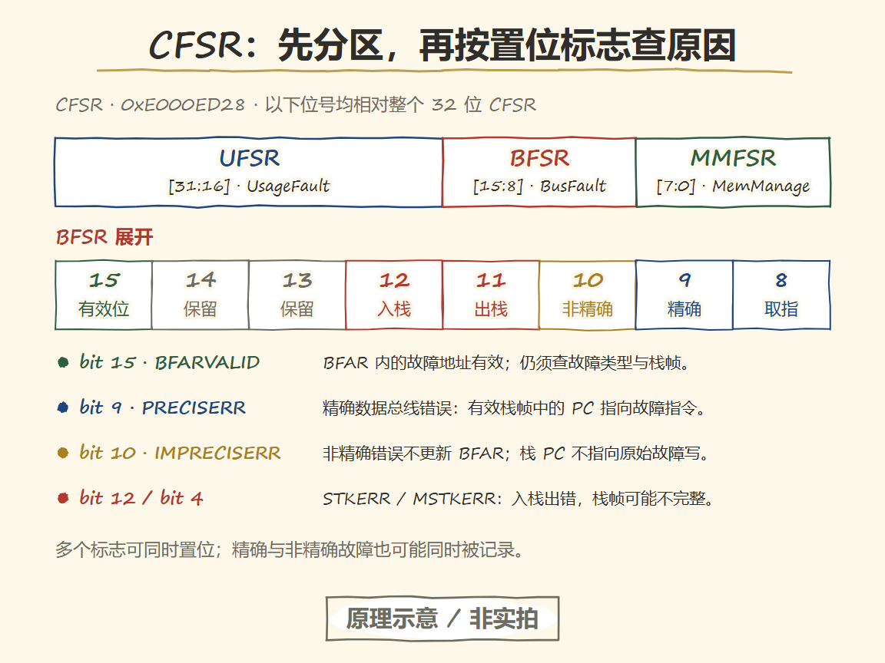
  <br><sub>▲ 知识轨（Handraw · 原理示意/非实拍）。CFSR 的三个分区分别记录内存管理、总线和用法故障。先区分精确、非精确与压栈错误，再判断地址和栈 PC 是否可用。</sub>
</p>


进 HardFault 后先保留故障寄存器、异常入口 LR 和栈指针。判读时用 `CFSR` 分类、用 `HFSR` 检查升级原因，再按有效位解释保存的 `BFAR`/`MMFAR`。确认栈帧可用后，取 PC 并用故障发生时的同一份 ELF 执行 `addr2line`；重新编译后的地址布局可能已经改变。

| 寄存器 | 全称 | 关键位 | 含义 |
| --- | --- | --- | --- |
| `SCB->CFSR` | Configurable Fault Status | `MMARVALID/BFARVALID` | 是否记录了出错地址 |
| `SCB->CFSR` | 同上 | `IMPRECISERR` 等 | 精确/非精确总线错误 |
| `SCB->HFSR` | HardFault Status | `FORCED` | 是否由升级而来的故障强制进入 |
| `SCB->BFAR` | BusFault Address | 地址值 | 有效的总线故障地址（若 `BFARVALID=1`） |
| `SCB->MMFAR` | MemManage Address | 地址值 | 内存管理故障地址（若 `MMARVALID=1`） |

**栈帧判读**：正常完成异常压栈时，内核保存 `R0-R3,R12,LR,PC,xPSR`。只有故障类型支持且栈帧完整，PC 才能用来定位出错指令；`IMPRECISERR` 不保证这一点，`STKERR`/`MSTKERR` 则要求先检查栈。

下面展示 GCC 的 MSP/PSP 选择逻辑，入口汇编须在编译器改动 SP/LR 之前执行。普通 C 函数可能生成序言，实际工程需使用工具链支持的裸入口或独立汇编，并检查反汇编；这段片段未包含入口属性和栈地址校验。下方 C 处理函数只适用于已确认完整、可读的基本栈帧。

```c
/* 从 MSP/PSP 还原出错 PC */
void HardFault_Handler(void)
{
    __asm volatile (
        "TST LR, #4        \n"   /* 判断用的是 MSP 还是 PSP */
        "ITE EQ            \n"
        "MRSEQ R0, MSP     \n"
        "MRSNE R0, PSP     \n"
        "B hard_fault_handler_c \n"
    );
}
```

```c
void hard_fault_handler_c(uint32_t *stack)
{
    volatile uint32_t r0  = stack[0];
    volatile uint32_t r1  = stack[1];
    volatile uint32_t r2  = stack[2];
    volatile uint32_t r3  = stack[3];
    volatile uint32_t r12 = stack[4];
    volatile uint32_t lr  = stack[5];
    volatile uint32_t pc  = stack[6];    /* ← 出错指令地址 */
    volatile uint32_t psr = stack[7];
    volatile uint32_t cfsr = SCB->CFSR;
    volatile uint32_t hfsr = SCB->HFSR;
    volatile uint32_t bfar = SCB->BFAR;

    (void)r0;(void)r1;(void)r2;(void)r3;(void)r12;(void)lr;(void)psr;
    (void)cfsr;(void)hfsr;(void)bfar;
    for (;;) { }                         /* 在此处断点，查看上述变量 */
}
```

**用 addr2line 把 PC 变成源码行**（GCC 工具链）：

```bash
arm-none-eabi-addr2line -e build/app.elf -f -C 0x08001a3c
# 输出：函数名 + 文件名:行号
```

> 若用 Keil，出错 PC 可在 `.map` 里查符号范围；或用 IDE 的 Call Stack 窗口。

<p align="center">
  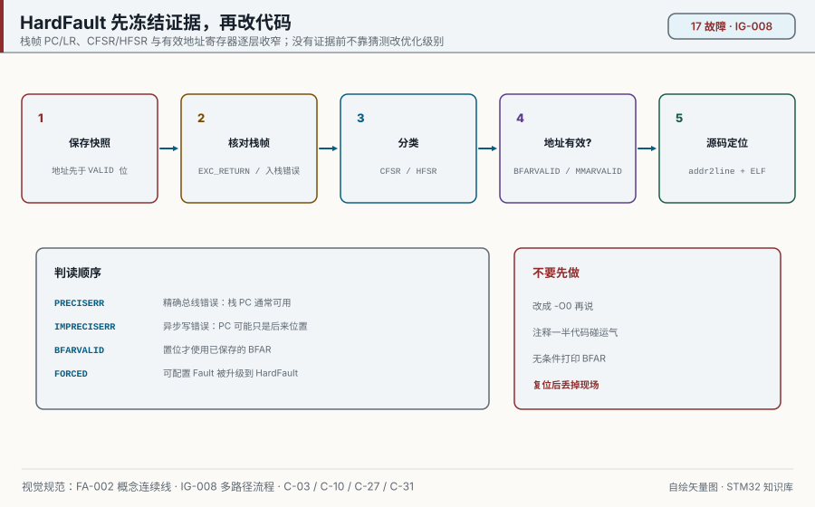
  <br><sub>▲ 故障阶梯。BFARVALID/MMARVALID 决定地址能否使用；`IMPRECISERR` 下栈 PC 可能已越过原始写操作。确认栈帧和故障类型后，再用同一份 ELF 定位源码。</sub>
</p>

### 5. 逻辑分析仪 / 示波器

| 工具 | 看什么 | 典型用途 |
| --- | --- | --- |
| 逻辑分析仪（8 通道 24 MHz+） | 数字时序 | 抓 I2C/SPI/UART/CAN 时序，解码协议 |
| 示波器 | 模拟波形 | 看 PWM 上升沿、电源纹波、信号完整性 |
| 混合信号示波器 MSO | 数字+模拟 | 时序与模拟联动分析 |
| 电流探头/功耗计 | 电流波形 | 低功耗验证（见第 16 章） |

> 逻辑分析仪擅长「协议对不对」，示波器擅长「信号好不好」；调试总线偶发错误两者都要用。

### 6. 代码优化手段

先用 DWT 找出耗时段，再选择改法。数据搬运可比较 DMA，计算密集段可比较算法与编译选项；收益取决于数据量、总线竞争和启动开销，没有通用排名。

| 手段 | 做法 | 注意 |
| --- | --- | --- |
| 编译器优化 | 比较 `-O2`、`-Os` 的速度与体积 | `-O0` 便于排查；`volatile` 只约束对应访问，不保证原子性或线程同步 |
| DMA | 串口/ADC/SPI 数据搬运交给 DMA | 见第 10 章；注意 Cache 一致性 |
| 位带/位运算 | 按操作语义选择位访问或运算 | 无符号数除以 2 的幂可用移位表达，编译器通常会优化；耗时看目标汇编 |
| 定点代替浮点 | 用 Q 格式定点 | 无 FPU 的 M3 尤其明显 |
| FPU | M4F/M7 按实际 FPU 配置编译 | `-mfpu=fpv4-sp-d16 -mfloat-abi=hard` 适用于对应单精度实现，不能套到所有 M7 |
| Cache/ART | F4 的 ART 加速器、H7 的 I/D-Cache | H7 DMA 需维护 Cache |
| 内联/宏 | 热函数 `static inline` | 过度内联增大体积 |
| 查表 | 用 LUT 代替实时计算 | 牺牲 Flash 换速度 |

<p align="center">
  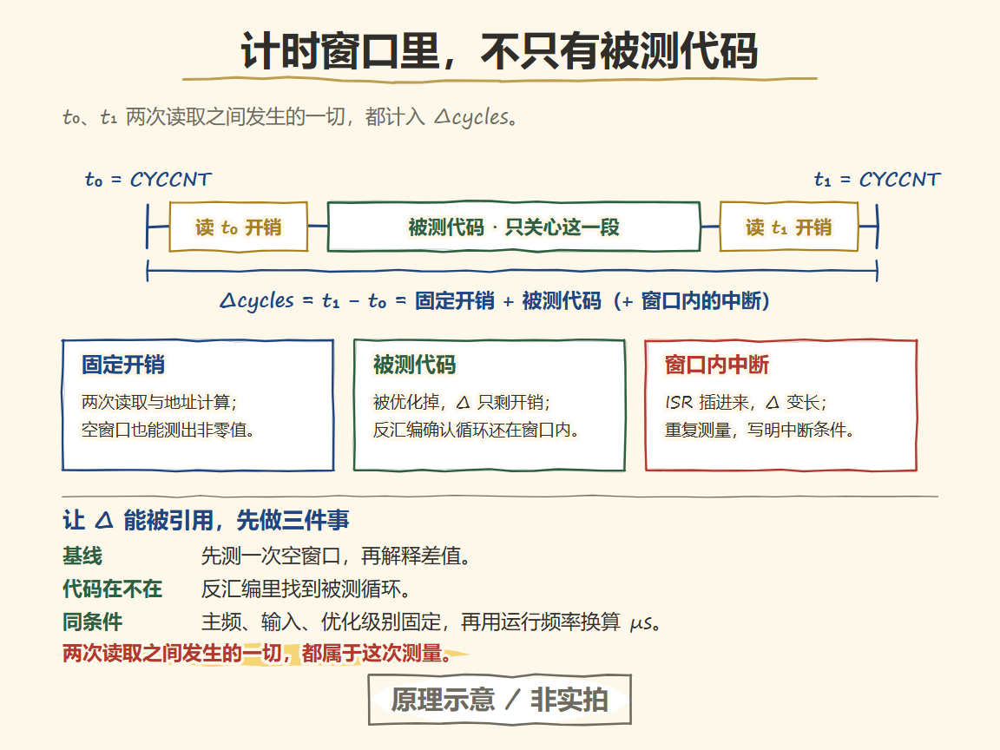
  <br><sub>▲ 知识轨（Handraw · 原理示意/非实拍）。看哪里：t₀ 与 t₁ 两次读取之间整段都计入 Δcycles，两端读取开销和窗口内的中断都会混进差值；证明 Δ 只有在测过空窗口基线、反汇编确认被测代码仍在窗口内、条件一致时才可比较；不能证明换输入或换主频后仍同样快，也不是实测。出处 [PM0056 DWT](#source-pm0056-dwt)。</sub>
</p>

**DWT 计时（精度到 CPU 周期）**：

```c
/* 用 DWT 的 CYCCNT 计数器测代码耗时（F1/F4 都支持） */
static void DWT_Init(void)
{
    CoreDebug->DEMCR |= CoreDebug_DEMCR_TRCENA_Msk;  /* 使能跟踪 */
    DWT->CYCCNT = 0;
    DWT->CTRL  |= DWT_CTRL_CYCCNTENA_Msk;            /* 使能周期计数 */
}

static uint32_t DWT_Cycles(void) { return DWT->CYCCNT; }

void Measure(void)
{
    DWT_Init();
    uint32_t t0 = DWT_Cycles();
    /* 被测代码 */
    for (volatile int i = 0; i < 1000; i++) { }
    uint32_t dt = DWT_Cycles() - t0;                 /* 周期数 */
    float us = (float)dt / (SystemCoreClock / 1000000.0f);
    (void)us;                                        /* 换算成微秒 */
}
```

### 7. HardFault 常见原因表

| 现象/故障位 | 常见原因 | 解决 |
| --- | --- | --- |
| `IMPRECISERR` | 内核先前发出的写操作异步报错 | 检查此前写操作；该位本身不记录 BFAR，栈 PC 不定位原始写指令 |
| `PRECISERR` | 精确的数据总线访问错误 | 结合有效 BFAR 与栈 PC 检查地址；普通数组越界未必触发总线错误 |
| `UNDEFINSTR` | 跳到非法地址（函数指针错/栈被冲） | 检查函数指针、栈大小 |
| `INVSTATE` | 跳转目标不是 Thumb 指令（bit0=0） | 入口地址 bit0 必须为 1 |
| `INVPC` | 异常返回时 LR 非法 | 中断里破坏 LR / 栈错乱 |
| `FORCED` 且 `CFSR=0` | 快照不完整，或状态已被清除等 | 核对采集与清标志流程；向量读取错误另查 `HFSR.VECTTBL` |
| 除零（未开 DIV_0_TRP 时不报） | 未使能除零捕获 | `SCB->CCR |= SCB_CCR_DIV_0_TRP_Msk` |
| 栈溢出 | 局部大数组/递归过深 | 加大栈；用栈溢出检测 |

## 硬件与接线

| 开发板 | 接口 | 引脚 | 备注 |
| --- | --- | --- | --- |
| BluePill (F103) | SWD | PA13=SWDIO、PA14=SWCLK、GND、3V3 | 4 线即可下载调试 |
| BluePill | SWO | PB3（可选，需 `AFIO_MAPR` 的 SWJ_CFG） | 仅 J-Link/ST-Link V2-1 支持 |
| Nucleo-F411RE | SWD+SWO | 板载 ST-Link，SB 跳线 | SWO 直接可用 |
| J-Link | SWD | 同上 | 支持 SWO/ITM、RTT |
| 任意 | 逻辑分析仪 | 夹住 SCL/SDA/MOSI 等 | 抓时序解码 |
| 任意 | 示波器 | 探针接被测信号 | 看波形质量 |

表中 3V3 在探针端通常是目标电压参考 VTref，是否兼作供电要查具体探针；不要把两个电源输出直接相连。SWO 支持也不限于表中两个型号，仍需核对具体硬件、固件和接线。Nucleo 的 SWO 路径是否连通，应按板卡版本与焊桥配置确认。

> [!WARNING]
> **GND 必须共地**，并为探针提供正确的目标电压参考。建议一并连接 NRST，以便 connect under reset。若应用程序关掉调试，可尝试复位下连接；也可按芯片启动配置进入系统存储器，使应用暂不执行，再重新烧录。


<p align="center">
  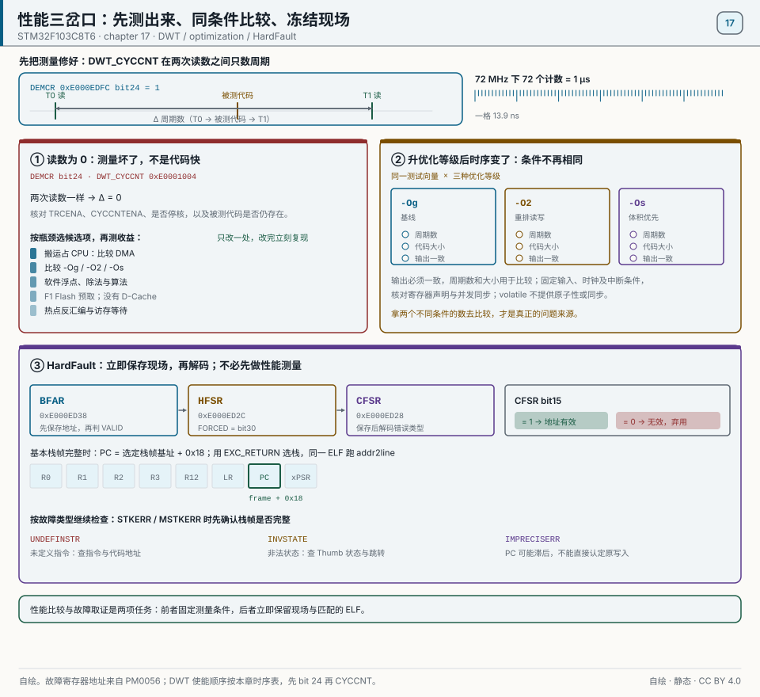
  <br><sub>▲ 自绘。DWT 用两次读数夹住被测区间；比较 -Og/-O2/-Os 时，同时记录周期、代码大小和输出一致性。图中故障判读与性能测量是两套检查，BFAR 仍需通过 bit 15 验证。见 [PM0056 DWT](#source-pm0056-dwt) 和 [PM0056](#source-pm0056)。</sub>
</p>

<p align="center">
  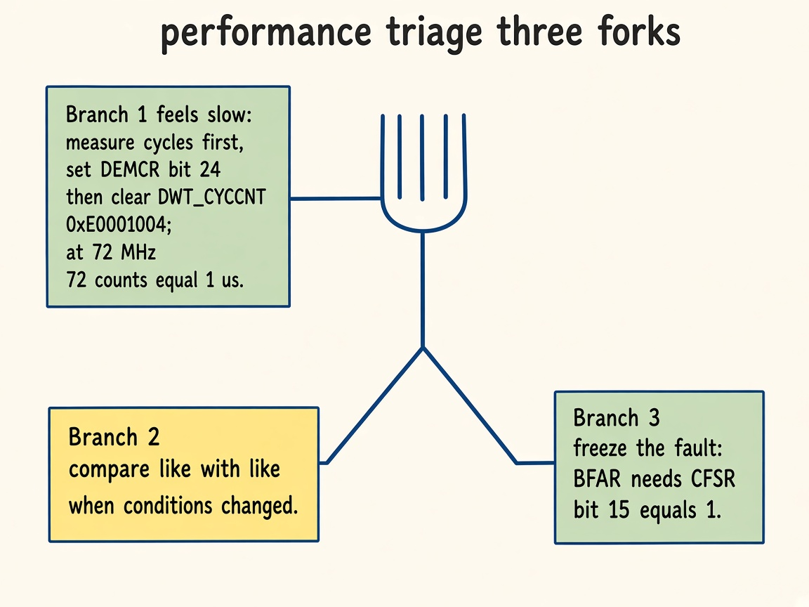
  <br><sub>▲ 知识轨（Handraw · 原理示意/非实拍）。t0、t1 夹住被测代码；零差先查 TRCENA、CYCCNTENA 和运行方式。72 计数 = 1 µs 的前提是内核运行于 72 MHz。</sub>
</p>

## 代码实现

**① SWO/ITM printf 重定向**

以下代码只提供字符重定向，不负责配置跟踪硬件。`Log_Init()` 中的注释把初始化简化了；实际仍须完成前述 DBGMCU、ITM、TPIU 与探针设置，且 IDE 中的内核时钟和 SWO 线速是两个参数。

<p align="center">
  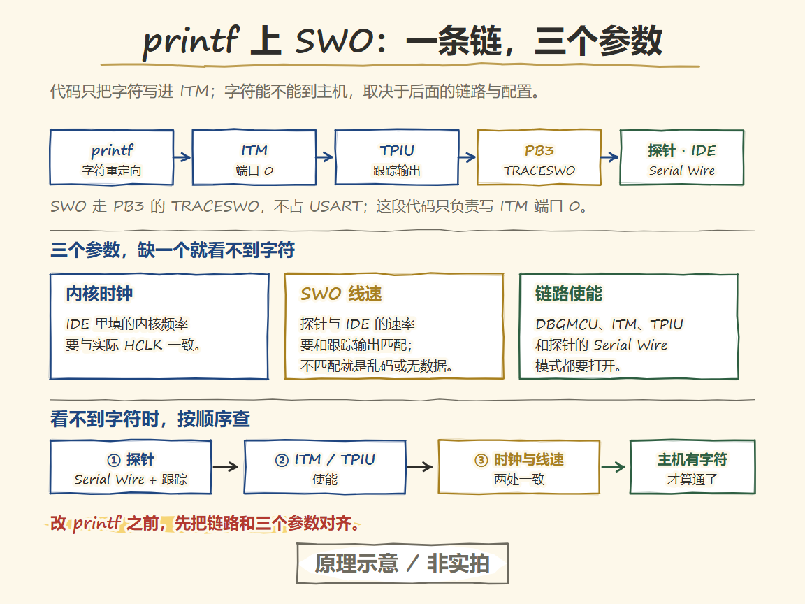
  <br><sub>▲ 知识轨（Handraw · 原理示意/非实拍）。看哪里：顶行五框链 printf → ITM 端口 0 → TPIU → PB3 TRACESWO → 探针，中段「三个参数」卡（内核时钟、SWO 线速、链路使能缺一即无字符），底行「按顺序查」三步；证明字符到不了主机先查链路与参数而不是改 printf；不能替代探针实测，也不是跟踪波形。出处 [PM0056 ITM/TPIU](#source-pm0056)。</sub>
</p>

```c
#include "stm32f1xx_hal.h"
#include <stdio.h>

/* 重定向底层字符输出到 ITM 端口 0（SWO） */
int __io_putchar(int ch)
{
    ITM_SendChar((uint32_t)ch);
    return ch;
}

void Log_Init(void)
{
    /* 无需额外初始化，CubeMX 里使能 SWD 即可；
       在 IDE 里配置 SWO 时钟 = 内核时钟，即可看到 printf 输出 */
}

void Log_Demo(void)
{
    printf("sysclk = %lu Hz\r\n", (unsigned long)SystemCoreClock);
}
```

**② 保留 SWD 引脚（防止误配后连不上）**

```c
/* 若必须复用 PA13/PA14，至少保留 SWD；否则烧录后可能无法再连接 */
__HAL_RCC_AFIO_CLK_ENABLE();
__HAL_AFIO_REMAP_SWJ_NOJTAG();   /* 只关 JTAG，保留 SWD（PA13/PA14 仍可调试） */
```

**③ 使能除零与可配置故障捕获**

使能后，满足条件的故障先进入各自的 UsageFault、BusFault 或 MemManage 处理函数；未使能、优先级不允许等情况下才可能升级为 HardFault。工程需提供这些处理入口。

```c
void Fault_Enable(void)
{
    SCB->CCR |= SCB_CCR_DIV_0_TRP_Msk;   /* 除零触发 UsageFault */
    SCB->SHCSR |= SCB_SHCSR_USGFAULTENA_Msk
               |  SCB_SHCSR_BUSFAULTENA_Msk
               |  SCB_SHCSR_MEMFAULTENA_Msk;  /* 分别使能三类故障 */
}
```

**④ HardFault 处理（配 4 节的栈回溯，直接打印寄存器）**

这版用于已验证栈帧和日志通道的受控调试。故障现场里的 `printf` 可能阻塞、再次触发异常或使用已损坏的栈；正式故障记录应先保存固定长度数据，再在安全环境输出。

```c
void hard_fault_handler_c(uint32_t *stack)
{
    printf("HardFault! PC=0x%08lX LR=0x%08lX\r\n",
           (unsigned long)stack[6], (unsigned long)stack[5]);
    printf("CFSR=0x%08lX HFSR=0x%08lX BFAR=0x%08lX\r\n",
           (unsigned long)SCB->CFSR,
           (unsigned long)SCB->HFSR,
           (unsigned long)SCB->BFAR);
    for (;;) { }
}
```

**⑤ DWT 计时（对比 memcpy vs DMA 等）**

```c
static inline void DWT_DelayInit(void)
{
    CoreDebug->DEMCR |= CoreDebug_DEMCR_TRCENA_Msk;
    DWT->CYCCNT = 0;
    DWT->CTRL  |= DWT_CTRL_CYCCNTENA_Msk;
}

/* 用法：
   DWT_DelayInit();
   uint32_t t0 = DWT->CYCCNT;  ...被测代码...  uint32_t dt = DWT->CYCCNT - t0;
   耗时(us) = dt / (SystemCoreClock / 1000000)  */
```

> 比较 `-O2` 与 `-Os` 时，以本项目的速度和体积结果决定取舍；`-Og` 通常便于调试。变量被优化掉时先看汇编，必要时局部降低优化；给普通变量添加 `volatile` 会改变被测程序，不能用来代替同步或内存屏障。


## 动手实验

1. **HardFault 证据包**：在受控 Debug 构建中访问非法地址，保存栈中 PC/LR、CFSR、HFSR、BFAR/MMFAR 有效位和 ELF 哈希，再用 addr2line 定位。
2. **精确与非精确错误**：在目标总线确实会返回错误的受控地址上，比较同步数据访问与内核缓冲写报错，记录 `PRECISERR`、`IMPRECISERR` 和栈 PC。DMA 是独立总线主设备，其传输错误应查 DMA 状态，不能据此假定内核会置 `IMPRECISERR`；未复现的分支如实留空。
3. **DWT 基线**：对同一 4KB 数据量记录 `memcpy` CPU 周期、DMA 启动 CPU 周期和 DMA 完成墙钟时间；不要把“启动快”写成“搬运已完成”。
4. **工具边界**：抓一次 I2C 事务，同时保存解码结果和 SCL/SDA 示波器波形；前者证明协议字节，后者证明上升沿与电平裕量。
5. **优化回归**：同一测试向量在 `-Og`、`-O2`、`-Os` 下记录周期、代码大小和输出一致性，只有结果一致时才接受优化。

离开本章前，应有完整 HardFault 证据包、精确/非精确错误对照、DMA 与 memcpy 的两类时间，以及一组协议解码/电气波形对照。

## 相关资源

- RM0008/RM0090 的 Debug support (DBGMCU) 章节（调试口配置、低功耗下调试）。
- 《ARM Cortex-M3/M4 权威指南》：故障异常、`CFSR/HFSR/BFAR`、栈帧结构。
- ARMv7-M 架构参考手册（ARM DDI 0403）：异常模型、FPB/DWT。
- 工具文档：ST-Link/J-Link 的 SWO/ITM 配置、`arm-none-eabi-addr2line`。
- 相关章节：第 10 章 DMA、第 16 章低功耗（功耗测量）、第 04 章中断与 NVIC。
- 配图：`../assets/animations/debug-swo.svg`（作者自绘矢量图）。


- 手机阅读版：[第 17 章 · 调试与性能优化（公众号图文）](https://mp.weixin.qq.com/s/gcVAbLuaw_bDTj9hH6SEuw)
