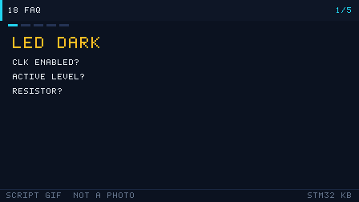

# 18 常见问题 FAQ

> 把新手最常踩的坑按「编译链接 / 下载调试 / 外设 / 硬件 / RTOS 与工具链」分类，给出**现象 / 原因 / 解决**，遇到问题先来这里搜关键词。

  
   ▲ 动画：编译 → 链接 → 烧录 → 运行的数据流（作者自绘矢量图，非实拍）

<!-- video:ch18 -->

  
   ▲ 本章讲解幻灯：程序生成的 GIF（tools/gen_videos.py，可复现，不是实拍）。旁白与五帧一一对应。

**旁白（跟着画面读，大约一分钟）**

1. 灯不亮，先看三件事：时钟开了没、电平反了没、电阻有没有。
2. 下载失败，先看 SWD 还在不在、BOOT0 是不是被拉高、线松了没。
3. 串口乱码，先看波特率、共地、TX/RX 是不是接反。
4. 中断进不去，先看 NVIC 使能、优先级、是不是在更高级里死循环。
5. 把这张表当成诊所。先对现象，再动手改代码。
<!-- /video:ch18 -->

## 📌 学习目标

- [ ] 建立「按现象分类检索」的排错习惯，而不是盲目改代码。
- [ ] 记住每类问题的**头号原因**，先查高频项。
- [ ] 会用最小化验证（点灯、回环）快速隔离问题。
- [ ] 知道哪些坑是「配置问题」、哪些是「硬件问题」、哪些是「时序问题」。

> 使用说明：本表 38 条，编号 `C*`=编译链接、`D*`=下载调试、`P*`=外设、`H*`=硬件、`R*`=RTOS 与工具链。

## 一、编译与链接

**C1 找不到 `stm32f1xx_hal.h`**
- **现象**：编译报 `fatal error: stm32f1xx_hal.h: No such file or directory`。
- **原因**：头文件搜索路径（Include Paths）没加 HAL 的 `Inc` 目录。
- **解决**：在工程/`CMakeLists.txt` 的 include 路径里加入 `Drivers/STM32F1xx_HAL_Driver/Inc` 与 `Core/Inc`。

**C2 链接报 `undefined reference to HAL_GPIO_Init`**
- **现象**：编译通过，链接报未定义符号。
- **原因**：对应的 HAL 源文件没加入编译（`stm32f1xx_hal_gpio.c`）。
- **解决**：把用到的 HAL 源文件加入工程；CubeMX 工程用 `HAL_MODULE_ENABLED` 宏控制。

**C3 `region FLASH overflowed by N bytes`**
- **现象**：链接报 ROM 区超出。
- **原因**：代码/常量超出芯片 Flash 容量（如 F103C8 只有 64 KB）。
- **解决**：开 `-Os` 优化、去掉 `printf` 浮点、删无用库；或换更大 Flash 型号。

**C4 `region RAM overflowed`**
- **现象**：链接报 RAM 不足。
- **原因**：全局数组过大或栈/堆设置过大（F103C8 只有 20 KB RAM）。
- **解决**：减小全局缓冲、改链接脚本里的 `_Min_Heap_Size`/`_Min_Stack_Size`。

**C5 重定义错误 `multiple definition of 'xxx'`**
- **现象**：链接报符号重复定义。
- **原因**：变量写在头文件里且未加 `static`/`extern`，被多个 `.c` 包含。
- **解决**：头文件只放 `extern` 声明，定义放 `.c`。

**C6 `printf` 输出乱码或没有输出**
- **现象**：串口收到乱码或空白。
- **原因**：`printf` 的浮点/半主机配置、或 `_write`/`__io_putchar` 未重定向。
- **解决**：重定向 `__io_putchar` 到 UART；开启 `-u _printf_float`（如需浮点）。

**C7 编译报 `arm-none-eabi-gcc: not found`**
- **现象**：命令行编译失败。
- **原因**：工具链未安装或未加入 PATH。
- **解决**：安装 GNU Arm Embedded Toolchain 并配置环境变量；或用 CubeIDE 自带工具链。

**C8 生成的 bin/hex 大小异常大**
- **现象**：固件体积远超预期。
- **原因**：包含未用的库、调试信息、`printf` 全格式支持。
- **解决**：开 `-Os`、`-ffunction-sections -fdata-sections` + `--gc-sections` 去死代码。

## 二、下载与调试

**D1 `No target connected` / 连不上目标**
- **现象**：下载器报找不到目标。
- **原因**：SWD 线接反、没共地、板子没供电，或调试口被关。
- **解决**：核对 SWDIO/SWCLK/GND/3V3；单独给板供电；按住复位再连。

**D2 烧录后板子像「变砖」，再也连不上**
- **现象**：程序下载后 SWD 失联。
- **原因**：程序把 PA13/PA14 配成普通 GPIO 并关闭了 SWD。
- **解决**：上电瞬间按住 NRST 再点下载；或 BOOT0 拉高从系统存储器启动后用 STM32CubeProgrammer 擦除。

**D3 `Flash Download failed - Target DLL has been cancelled`**
- **现象**：下载到一半失败。
- **原因**：Flash 算法/时钟不匹配，或芯片被读保护。
- **解决**：核对 Flash 算法与型号；解除读保护（`Option Bytes` 的 RDP）。

**D4 调试时断点不生效**
- **现象**：断点被跳过或提示数量超限。
- **原因**：硬件断点用尽（M3/M4 仅 6 个）或代码在 Flash 只读区。
- **解决**：删多余断点，用软件断点；调试关优化（`-O0/-Og`）。

**D5 单步执行「乱跳」**
- **现象**：单步时行号跳来跳去。
- **原因**：编译器优化重排指令、内联。
- **解决**：调试配置改 `-O0` 或 `-Og`。

**D6 ST-Link 提示固件过旧**
- **现象**：连接时提示升级 ST-Link 固件。
- **原因**：旧固件与新版工具不兼容。
- **解决**：用 ST-Link Upgrade 工具升级；克隆 ST-Link 慎升级（可能变砖）。

**D7 程序一进调试就停在 `HardFault_Handler`**
- **现象**：调试启动即 HardFault。
- **原因**：时钟/外设初始化越界、向量表错、栈太小。
- **解决**：查 `CFSR/BFAR` 与出错 PC（见第 17 章）；核对链接脚本。

## 三、外设

**P1 GPIO 写了不动作**
- **现象**：`HAL_GPIO_WritePin` 后引脚无变化。
- **原因**：忘记使能 GPIO 时钟。
- **解决**：`__HAL_RCC_GPIOx_CLK_ENABLE()`。

**P2 按键触发一次却进多次中断**
- **现象**：按一下打印多条。
- **原因**：机械抖动未消抖。
- **解决**：软件延时消抖或 RC 硬件消抖；EXTI 里加时间戳判断。

**P3 串口乱码**
- **现象**：收到的都是乱码。
- **原因**：波特率不匹配、未共地、时钟不是预期频率。
- **解决**：两端统一波特率；共地；确认 SYSCLK（如 HSE 起振失败会退回 HSI）。

**P4 I2C 通信卡在 `HAL_I2C_Master_Transmit`**
- **现象**：程序卡死或超时。
- **原因**：缺上拉电阻、地址错、总线被拉死。
- **解决**：SCL/SDA 各接 4.7 kΩ 上拉；核对 7 位地址；做总线恢复（9 个时钟脉冲）。

**P5 SPI 读 Flash 全 FF**
- **现象**：读回数据全是 0xFF。
- **原因**：CS 没拉低、CPOL/CPHA 模式错、MISO 未接。
- **解决**：核对模式（W25Q 用 Mode0）、片选时序、接线。

**P6 ADC 读数跳动大**
- **现象**：采样值不稳定。
- **原因**：参考电压不稳、采样时间过短、输入阻抗高。
- **解决**：VDDA 加去耦、加长采样时间、输入加小电容缓冲。

**P7 定时器 PWM 无输出**
- **现象**：示波器看不到波形。
- **原因**：没启动 PWM（`HAL_TIM_PWM_Start`）、引脚 AF 未配、通道错。
- **解决**：调用 `HAL_TIM_PWM_Start`，核对复用引脚与通道。

**P8 DMA 只搬一次**
- **现象**：DMA 传完一次就停。
- **原因**：配了普通模式却期望循环。
- **解决**：改 `DMA_CIRCULAR`。

**P9 RTC 上电归零 / 不走时**
- **现象**：断电后时间丢失。
- **原因**：LSE 未起振、VBAT 未接电池、负载电容过大。
- **解决**：接 32.768 kHz 晶振 + 6 pF 电容 + VBAT 电池。

## 四、硬件

**H1 LED 不亮**
- **现象**：接上 LED 无反应。
- **原因**：极性接反、限流电阻过大、驱动能力不足。
- **解决**：核对阳极/阴极；电阻取 220~1 kΩ；大电流用三极管/MOS 驱动。

**H2 芯片发热严重**
- **现象**：手摸发烫。
- **原因**：引脚短路、5 V 直灌 3.3 V 引脚、电源接反。
- **解决**：立刻断电，检查短路与电压；核对电源极性。

**H3 上电没反应、电流为 0**
- **现象**：板子完全无电流。
- **原因**：供电没接、保险丝/二极管断路、BOOT 配置错。
- **解决**：量 3.3 V；核对 BOOT0=0 从 Flash 启动。

**H4 复位一直在抖**
- **现象**：芯片反复复位。
- **原因**：NRST 悬空被干扰、看门狗误复位。
- **解决**：NRST 加 100 nF 到地；检查喂狗。

**H5 外部晶振不起振**
- **现象**：HSE/LSE 超时，退回内部时钟。
- **原因**：负载电容不匹配、晶振虚焊、走线太长。
- **解决**：按晶振手册选负载电容；缩短走线；换质量好的晶振。

**H6 面包板接触不良**
- **现象**：时好时坏，晃动就复位。
- **原因**：杜邦线/面包板接触电阻大、线太长。
- **解决**：换线、缩短连线、关键信号焊死。

**H7 串口/下载「共地」问题**
- **现象**：不共地就乱码/连不上。
- **原因**：两个电源地电位不同。
- **解决**：务必把 GND 连在一起。

## 五、RTOS 与工具链

**R1 上 RTOS 后 `HAL_Delay` 卡死**
- **现象**：调用 `HAL_Delay` 不返回。
- **原因**：FreeRTOS 与 HAL 抢 SysTick。
- **解决**：CubeMX 把 Timebase Source 改为 TIMx。

**R2 `configASSERT` 死循环**
- **现象**：程序停在断言。
- **原因**：中断优先级数值太小（优先级过高），或传了空指针。
- **解决**：中断优先级 ≥ `configMAX_SYSCALL_INTERRUPT_PRIORITY`；检查参数。

**R3 任务创建返回失败**
- **现象**：`xTaskCreate` 失败。
- **原因**：`configTOTAL_HEAP_SIZE` 不够。
- **解决**：调大堆，或减少任务数/栈。

**R4 中断里调用普通 API 崩溃**
- **现象**：ISR 里 `xQueueSend` 导致 HardFault。
- **原因**：ISR 中只能用 `FromISR` 版本。
- **解决**：改 `xQueueSendFromISR` + `portYIELD_FROM_ISR`。

**R5 程序莫名进 HardFault（带 RTOS）**
- **现象**：随机 HardFault。
- **原因**：任务栈溢出。
- **解决**：加大栈 + `configCHECK_FOR_STACK_OVERFLOW` 定位。

**R6 工具链报 `cannot open linker script`**
- **现象**：链接找不到 `.ld` 脚本。
- **原因**：链接脚本路径/名称错，或换工程未同步。
- **解决**：核对 `-T` 指向的 `.ld` 文件路径；CubeIDE/Keil 各自管理链接脚本。

**R7 CubeMX 生成代码覆盖了自己的修改**
- **现象**：重新生成后手写代码丢失。
- **原因**：代码写在了 `USER CODE BEGIN/END` 之外。
- **解决**：所有自定义代码放进 `/* USER CODE BEGIN xxx */ ... /* USER CODE END xxx */` 区间。

## 🧭 排错方法论（先做这 5 步）

遇到问题别急着改代码，按下面顺序缩小范围，90% 的问题能在前两步定位。

| 步 | 动作 | 目的 |
| --- | --- | --- |
| 1 | **复现**：确认现象可稳定复现，记录触发条件 | 不可复现的问题先怀疑硬件/接触 |
| 2 | **最小化**：退回到「只点灯 / 只回环」的最小工程 | 隔离是配置问题还是逻辑问题 |
| 3 | **二分**：注释掉一半代码/逐个外设使能 | 快速定位引入问题的模块 |
| 4 | **看证据**：串口日志、逻辑分析仪波形、`CFSR/BFAR` | 用数据代替猜测 |
| 5 | **对照手册**：查 RM/DS 的寄存器与时序 | 确认「以为对」的地方是否真对 |

> 三条铁律：**能测就别猜**、**先共地再看信号**、**改一处只改一处**。

## 🧪 动手实验（排错训练）

1. **故意制造 C1**：删掉一个 Include 路径，观察报错，再恢复。预期：学会读「找不到头文件」类错误。
2. **故意制造 P4**：把 I2C 的上拉电阻去掉，观察 `HAL_I2C_Master_Transmit` 超时。预期：理解上拉的重要性。
3. **故意制造 D2**：把 PA13/PA14 配成输出并关 SWD，体验「变砖」与救砖（BOOT0 拉高）。预期：学会救砖流程。
4. **故意制造 R1**：上 FreeRTOS 但不改时基，观察 `HAL_Delay` 卡死。预期：理解 SysTick 冲突。
5. **（进阶）建一张自己的坑表**：把你在项目中遇到的新问题按「现象/原因/解决」补进本表。预期：形成个人排错手册。

## 🔗 相关资源

- 本仓库各章「常见坑与排查」小节：第 03~17 章逐外设覆盖。
- RM0008 / RM0090 参考手册：寄存器位定义与时序，是排错的最终依据。
- 数据手册 DS：电气参数（电压/电流/时钟），判断「是不是硬件超规格」。
- 官方工具：STM32CubeProgrammer（读保护/选项字节）、STM32CubeMX（配置核对）。
- 相关章节：第 01 章开发环境搭建、第 17 章调试与性能优化、第 20 章学习资源与工具链。
- 配图：`../assets/animations/toolchain-flow.svg`（作者自绘矢量图）。

