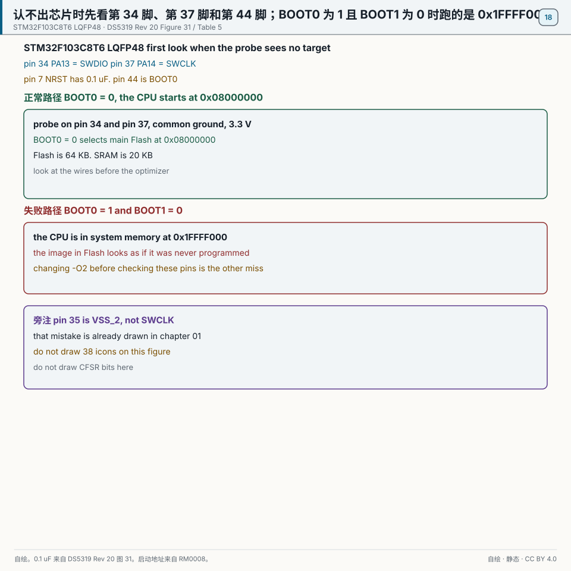
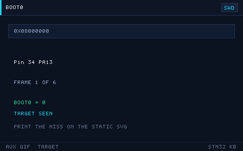

# 18 常见问题 FAQ

> English: [FAQ](en/18-faq.md)

> 把新手最常踩的坑按「编译链接 / 下载调试 / 外设 / 硬件 / RTOS 与工具链」分类，给出**现象 / 原因 / 解决**，遇到问题先来这里搜关键词。

  
   ▲ 动画：编译 → 链接 → 烧录 → 运行的数据流（作者自绘矢量图，非实拍）

<!-- video:ch18 -->

  <video width="640" controls poster="../assets/video/ch18-faq.png">
    <source src="../assets/video/ch18-faq.mp4" type="video/mp4">
  </video>
   ▲ 本章讲解 2.5 分钟。配音是微软 Edge 在线神经语音「晓晓」（zh-CN-XiaoxiaoNeural），经 edge-tts 调用。edge-tts 大部分源码为 LGPLv3，srt_composer.py 为 MIT；声线模型是微软在线服务，不是开放模型。这里提交的是合成后的 MP4，离线可看。重新生成需要联网。画面由脚本和本仓库 SVG 生成，不是实拍。 视频：<a href="../assets/video/ch18-faq.mp4">MP4</a> · 字幕：<a href="../assets/video/ch18-faq.srt">SRT</a>。由 <code>python3 tools/gen_narrated.py --speak</code> 用 ffmpeg 合成。

**旁白（与字幕、配音同一份稿）**

1. 排错不要从改代码开始。先让现象稳定复现，再退到只点灯或只回环的最小工程。最小工程是好的，问题就在你后来加的那一块里。
2. 这一章的五步是：复现，最小化，二分，看证据，对照手册。前两步能解决大多数问题。一上来就二分一大坨新代码，你会把时间花在来回编译上。
3. 编译报一长串时，先看第一处真正的错误。找不到头文件，多半是包含路径，不是语法突然坏了。链接报未定义的符号，再去看你有没有把对应的源文件加进工程。
4. 这一帧是仓库画的分层。现象在引脚上，就同时怀疑引脚模式和接线。现象在 HAL 返回值里，就打印那个状态码，再对照它碰过的寄存器。不要每一层同时盲改。
5. 下载失败时，先看供电、地、SWD 两根线和复位。芯片认不出，就不要查优化等级。BOOT0 被拉高时，它跑的是系统存储器，你的程序看起来像没烧进去。
6. 外设完全没反应，老三样：时钟开了没有，引脚复用对不对，该清的标志清了没有。这三样过完，再去看波特率、过滤器和采样时间。顺序反了，会在细节里耗掉一个晚上。
7. 三条铁律：能测就别猜，先共地再看信号，一次只改一处。猜测式修改会让两个错误叠在一起，最后谁也不认领。
8. 这一章建议你故意制造一次错误，比如删掉一个头文件路径，看编译器怎么说，再改回来。见过真实报错的人，下次不会从最后一行开始慌。
9. 口诀：先复现，再缩到最小。前两步走完还不知道范围，再去二分和看证据。能测就别猜。
10. 合上书，三问。排错五步的前两步是什么？调试器认不出芯片时，先查代码还是先查线和 BOOT？为什么一次只改一处？
<!-- /video:ch18 -->
## 原理与边界

这一章是索引，不是第二套外设教程。订货号仍是 STM32F103C8T6。38 条都留着。C1 到 C8 是 8 条，D1 到 D7 是 7 条，P1 到 P9 是 9 条，H1 到 H7 是 7 条，R1 到 R7 是 7 条。`8 + 7 + 9 + 7 + 7 = 38`。

下载器报没有目标时，先看第 34 脚 PA13 = SWDIO、第 37 脚 PA14 = SWCLK、共地、3.3 V，以及第 7 脚 NRST。图 31 的外部复位电容是 0.1 µF。然后再看代码和优化等级。线还没核对就改 `-O2`，是失败路径。见 [DS5319 SWD](#source-ds5319-swd)。

第 44 脚 BOOT0 = 0 时，从主闪存 `0x08000000` 启动。BOOT1 = 0 且 BOOT0 = 1 时，进系统存储器 `0x1FFFF000`。互联型的 `0x1FFFB000` 在这颗 C8 上作废。锁存在复位后 SYSCLK 的第 4 个上升沿，跟第 00 章同一笔。第 35 脚是 VSS_2，不是 SWCLK。那张旧图在第 01 章，这里不重画。见 [RM0008 启动](#source-rm0008-boot)。

闪存 64 KB，SRAM 20 KB，跟已有的 SWD 卡片同一笔。HSE 没起来时 SYSCLK 是 HSI 8 MHz。USART1 的 `0x271` 在这只时钟上是 12800，不是 115200。这句和第 16 章同一笔，这一章不另画位帧。见 [RM0008 USART](#source-rm0008-usart)。

LSE 仍是 32.768 kHz，第 3 脚和第 4 脚，第 1 脚 VBAT，PRL = 32767。电容按 5 pF 到 15 pF 的范围跟晶振一起选。6 pF 不是必须值。见 [DS5319 LSE](#source-ds5319-lse)。

仓库例程把 HAL 时基放在 TIM4，不是笼统的 TIMx。SysTick 留给内核。一个 tick 是 1 ms。见 [本仓库例程](#source-project-examples)。数值大于等于 5 才能调用 FromISR。`5 << 4 = 0x50`。跟第 15 章同一笔，不重画那张优先级图。见 [FreeRTOS](#source-freertos-syscall)。

外接灯跟第 03 章：第 10 脚、270 Ω。第 2 脚 PC13 不拿来源出电流。见 [DS5319 GPIO](#source-ds5319-gpio)。

## 关键插图

  
   ▲ 自绘。正常路径是第 44 脚 BOOT0 = 0，从 0x08000000 启动，探针接在第 34 脚 PA13 和第 37 脚 PA14。第 7 脚 NRST 上是图 31 的 0.1 µF。失败路径是 BOOT0 = 1 且 BOOT1 = 0，CPU 在 0x1FFFF000；或者还没看这四只脚就改优化等级。第 35 脚是 VSS_2，指向第 01 章。出处是 [DS5319](#source-ds5319-swd) 图 31 和表 5，以及 [RM0008 启动](#source-rm0008-boot)。

  
   ▲ 网页和公众号辅图。只播放正常路径：第 44 脚为 0，探针接在第 34 脚和第 37 脚，目标出现。印刷以静态主图为准。BOOT0 为 1 和「先改优化等级」不在这条 GIF 上。

`toolchain-flow.svg` 留作辅图。编译箭头不进这张静态主图。

## 时序或状态

| 先看什么 | 值 | 下一步 |
| --- | --- | --- |
| 第 34 脚和第 37 脚 | PA13 = SWDIO，PA14 = SWCLK，共地，3.3 V | 还没接好就不要改代码 |
| NRST | 第 7 脚，0.1 µF | 图 31。这一行不写上拉的千欧 |
| BOOT | BOOT0 = 0，主闪存 `0x08000000` | 正常路径 |
| 失败 | BOOT0 = 1 且 BOOT1 = 0，`0x1FFFF000` | 用户程序看起来像没烧进去。`0x1FFFB000` 在 C8 上作废 |
| 优化 | 线还没核对就改 `-O2` | 失败 |
| 容量 | 闪存 64 KB，SRAM 20 KB | 跟 SWD 卡片同一笔 |
| 串口 | HSI 8 MHz 且 `0x271` 仍在 | 12800 |
| 时基 | TIM4，1 ms | 不是笼统的 TIMx |
| 优先级 | 数值大于等于 5 | `5 << 4 = 0x50` |
| 晶振 | 5 pF 到 15 pF，按晶振选 | 6 pF 不是必须值 |

## 坑与出处卡

| 现象 | 原因 | 处理 | 出处 | 该来源允许支持的主张 |
| --- | --- | --- | --- | --- |
| 下载器报没有目标 | 线还没核对 | 先看第 34 脚、第 37 脚、地和 3.3 V | [DS5319 SWD](#source-ds5319-swd) | 第 34 脚 PA13 是 SWDIO，第 37 脚 PA14 是 SWCLK。第 35 脚是 VSS_2 |
| 程序像没烧进去 | 第 44 脚被拉高 | 把 BOOT0 放回 0 | [RM0008 启动](#source-rm0008-boot) | BOOT1=0 且 BOOT0=1 时进 `0x1FFFF000`。C8 不是互联型 |
| 复位脚空着，板子自己在复位 | 电容不在图 31 那一格 | 按图 31 加 0.1 µF | [DS5319 NRST](#source-ds5319-nrst) | 图 31 的外部复位电路是 0.1 µF。这一行不新写上拉的千欧 |
| 链接说 Flash 或 RAM 不够 | 按更大的料在估 | 先按 C8 的 64 KB 和 20 KB | [DS5319 SWD](#source-ds5319-swd) | xB 的 128 KB 在 C8T6 上作废 |
| 串口乱码，时钟却没核对 | 掉回了 HSI | 确认没有停在 8 MHz | [RM0008 USART](#source-rm0008-usart) | `0x271` 在 72 MHz 下是 115200，在 8 MHz 下是 12800 |
| 按 P9 焊了 6 pF | 把一只电容当成必须值 | 电容按晶振在 5 pF 到 15 pF 里选 | [DS5319 LSE](#source-ds5319-lse) | 6 pF 不是 LSE 节印出的必须值。32.768 kHz 和 PRL = 32767 仍以第 11 章为准 |
| 上了 FreeRTOS 之后 `HAL_Delay` 不返回 | 时基还在 SysTick | 时基改到 TIM4 | [本仓库例程](#source-project-examples) | `examples/freertos-task` 的时基是 TIM4。不写成笼统的 TIMx |
| 一进中断就停在 `configASSERT` | 数值优先级太靠前 | 写成 5 或更靠后的数 | [FreeRTOS](#source-freertos-syscall) | `5 << 4 = 0x50`。数值更小的中断不得调用 FromISR |
| 外接灯不亮，电阻却在一个区间里乱试 | 脚和电阻都没钉住 | 外接灯用第 03 章的第 10 脚和 270 Ω | [DS5319 GPIO](#source-ds5319-gpio) | 第 2 脚 PC13 不能当电流源。这一行不新造一只电阻 |
## 📌 学习目标

- [ ] 建立「按现象分类检索」的排错习惯，而不是盲目改代码。
- [ ] 记住每类问题的**头号原因**，先查高频项。
- [ ] 会用最小化验证（点灯、回环）快速隔离问题。
- [ ] 知道哪些坑是「配置问题」、哪些是「硬件问题」、哪些是「时序问题」。

> 使用说明：本表 38 条，编号 `C*`=编译链接、`D*`=下载调试、`P*`=外设、`H*`=硬件、`R*`=RTOS 与工具链。

## 一、编译与链接

**C1 找不到 `stm32f1xx_hal.h`**
- **现象**：编译报 `fatal error: stm32f1xx_hal.h: No such file or directory`。
- **原因**：头文件搜索路径（Include Paths）没加 HAL 的 `Inc` 目录。
- **解决**：在工程/`CMakeLists.txt` 的 include 路径里加入 `Drivers/STM32F1xx_HAL_Driver/Inc` 与 `Core/Inc`。

**C2 链接报 `undefined reference to HAL_GPIO_Init`**
- **现象**：编译通过，链接报未定义符号。
- **原因**：对应的 HAL 源文件没加入编译（`stm32f1xx_hal_gpio.c`）。
- **解决**：把用到的 HAL 源文件加入工程；CubeMX 工程用 `HAL_MODULE_ENABLED` 宏控制。

**C3 `region FLASH overflowed by N bytes`**
- **现象**：链接报 ROM 区超出。
- **原因**：代码/常量超出芯片 Flash 容量（如 F103C8 只有 64 KB）。
- **解决**：开 `-Os` 优化、去掉 `printf` 浮点、删无用库；或换更大 Flash 型号。

**C4 `region RAM overflowed`**
- **现象**：链接报 RAM 不足。
- **原因**：全局数组过大或栈/堆设置过大（F103C8 只有 20 KB RAM）。
- **解决**：减小全局缓冲、改链接脚本里的 `_Min_Heap_Size`/`_Min_Stack_Size`。

**C5 重定义错误 `multiple definition of 'xxx'`**
- **现象**：链接报符号重复定义。
- **原因**：变量写在头文件里且未加 `static`/`extern`，被多个 `.c` 包含。
- **解决**：头文件只放 `extern` 声明，定义放 `.c`。

**C6 `printf` 输出乱码或没有输出**
- **现象**：串口收到乱码或空白。
- **原因**：`printf` 的浮点/半主机配置、或 `_write`/`__io_putchar` 未重定向。
- **解决**：重定向 `__io_putchar` 到 UART；开启 `-u _printf_float`（如需浮点）。

**C7 编译报 `arm-none-eabi-gcc: not found`**
- **现象**：命令行编译失败。
- **原因**：工具链未安装或未加入 PATH。
- **解决**：安装 GNU Arm Embedded Toolchain 并配置环境变量；或用 CubeIDE 自带工具链。

**C8 生成的 bin/hex 大小异常大**
- **现象**：固件体积远超预期。
- **原因**：包含未用的库、调试信息、`printf` 全格式支持。
- **解决**：开 `-Os`、`-ffunction-sections -fdata-sections` + `--gc-sections` 去死代码。

## 二、下载与调试

**D1 `No target connected` / 连不上目标**
- **现象**：下载器报找不到目标。
- **原因**：SWD 线接反、没共地、板子没供电，或调试口被关。
- **解决**：核对 SWDIO/SWCLK/GND/3V3；单独给板供电；按住复位再连。

**D2 烧录后板子像「变砖」，再也连不上**
- **现象**：程序下载后 SWD 失联。
- **原因**：程序把 PA13/PA14 配成普通 GPIO 并关闭了 SWD。
- **解决**：上电瞬间按住 NRST 再点下载；或 BOOT0 拉高从系统存储器启动后用 STM32CubeProgrammer 擦除。

**D3 `Flash Download failed - Target DLL has been cancelled`**
- **现象**：下载到一半失败。
- **原因**：Flash 算法/时钟不匹配，或芯片被读保护。
- **解决**：核对 Flash 算法与型号；解除读保护（`Option Bytes` 的 RDP）。

**D4 调试时断点不生效**
- **现象**：断点被跳过或提示数量超限。
- **原因**：硬件断点用尽（M3/M4 仅 6 个）或代码在 Flash 只读区。
- **解决**：删多余断点，用软件断点；调试关优化（`-O0/-Og`）。

**D5 单步执行「乱跳」**
- **现象**：单步时行号跳来跳去。
- **原因**：编译器优化重排指令、内联。
- **解决**：调试配置改 `-O0` 或 `-Og`。

**D6 ST-Link 提示固件过旧**
- **现象**：连接时提示升级 ST-Link 固件。
- **原因**：旧固件与新版工具不兼容。
- **解决**：用 ST-Link Upgrade 工具升级；克隆 ST-Link 慎升级（可能变砖）。

**D7 程序一进调试就停在 `HardFault_Handler`**
- **现象**：调试启动即 HardFault。
- **原因**：时钟/外设初始化越界、向量表错、栈太小。
- **解决**：先看 `CFSR`。`BFAR` 只有 bit 15 为 1 才是这次的地址（见第 17 章）；核对链接脚本。

## 三、外设

**P1 GPIO 写了不动作**
- **现象**：`HAL_GPIO_WritePin` 后引脚无变化。
- **原因**：忘记使能 GPIO 时钟。
- **解决**：`__HAL_RCC_GPIOx_CLK_ENABLE()`。

**P2 按键触发一次却进多次中断**
- **现象**：按一下打印多条。
- **原因**：机械抖动未消抖。
- **解决**：软件延时消抖或 RC 硬件消抖；EXTI 里加时间戳判断。

**P3 串口乱码**
- **现象**：收到的都是乱码。
- **原因**：波特率不匹配、未共地、时钟不是预期频率。
- **解决**：两端统一波特率；共地；确认 SYSCLK。HSE 没起来时 SYSCLK 是 HSI 8 MHz，USART1 的 `0x271` 在这只时钟上是 12800，不是 115200。

**P4 I2C 通信卡在 `HAL_I2C_Master_Transmit`**
- **现象**：程序卡死或超时。
- **原因**：缺上拉电阻、地址错、总线被拉死。
- **解决**：SCL/SDA 各接 4.7 kΩ 上拉；核对 7 位地址；做总线恢复（9 个时钟脉冲）。

**P5 SPI 读 Flash 全 FF**
- **现象**：读回数据全是 0xFF。
- **原因**：CS 没拉低、CPOL/CPHA 模式错、MISO 未接。
- **解决**：核对模式（W25Q 用 Mode0）、片选时序、接线。

**P6 ADC 读数跳动大**
- **现象**：采样值不稳定。
- **原因**：参考电压不稳、采样时间过短、输入阻抗高。
- **解决**：VDDA 加去耦、加长采样时间、输入加小电容缓冲。

**P7 定时器 PWM 无输出**
- **现象**：示波器看不到波形。
- **原因**：没启动 PWM（`HAL_TIM_PWM_Start`）、引脚 AF 未配、通道错。
- **解决**：调用 `HAL_TIM_PWM_Start`，核对复用引脚与通道。

**P8 DMA 只搬一次**
- **现象**：DMA 传完一次就停。
- **原因**：配了普通模式却期望循环。
- **解决**：改 `DMA_CIRCULAR`。

**P9 RTC 上电归零 / 不走时**
- **现象**：断电后时间丢失。
- **原因**：LSE 未起振、VBAT 未接电池、负载电容过大。
- **解决**：接 32.768 kHz 晶振，负载电容在 5 pF 到 15 pF 里按晶振选，6 pF 不是必须值；VBAT 接电池。第 3 脚和第 4 脚，PRL = 32767，见第 11 章。

## 四、硬件

**H1 LED 不亮**
- **现象**：接上 LED 无反应。
- **原因**：极性接反、限流电阻过大、驱动能力不足。
- **解决**：核对阳极/阴极。外接灯用第 03 章的第 10 脚和 270 Ω。第 2 脚 PC13 不能当电流源。大电流用三极管或 MOSFET 驱动。

**H2 芯片发热严重**
- **现象**：手摸发烫。
- **原因**：引脚短路、5 V 直灌 3.3 V 引脚、电源接反。
- **解决**：立刻断电，检查短路与电压；核对电源极性。

**H3 上电没反应、电流为 0**
- **现象**：板子完全无电流。
- **原因**：供电没接、保险丝/二极管断路、BOOT 配置错。
- **解决**：量 3.3 V；核对 BOOT0=0 从 Flash 启动。

**H4 复位一直在抖**
- **现象**：芯片反复复位。
- **原因**：NRST 悬空被干扰、看门狗误复位。
- **解决**：按图 31 在第 7 脚 NRST 加 0.1 µF 到地。看门狗只指向第 11 章，不在这里重算 1 秒。

**H5 外部晶振不起振**
- **现象**：HSE/LSE 超时，退回内部时钟。
- **原因**：负载电容不匹配、晶振虚焊、走线太长。
- **解决**：按晶振手册选负载电容；缩短走线；换质量好的晶振。

**H6 面包板接触不良**
- **现象**：时好时坏，晃动就复位。
- **原因**：杜邦线/面包板接触电阻大、线太长。
- **解决**：换线、缩短连线、关键信号焊死。

**H7 串口/下载「共地」问题**
- **现象**：不共地就乱码/连不上。
- **原因**：两个电源地电位不同。
- **解决**：务必把 GND 连在一起。

## 五、RTOS 与工具链

**R1 上 RTOS 后 `HAL_Delay` 卡死**
- **现象**：调用 `HAL_Delay` 不返回。
- **原因**：FreeRTOS 与 HAL 抢 SysTick。
- **解决**：仓库例程把 HAL 时基放在 TIM4，不是笼统的 TIMx。SysTick 留给内核。一个 tick 是 1 ms。

**R2 `configASSERT` 死循环**
- **现象**：程序停在断言。
- **原因**：中断优先级数值太小（优先级过高），或传了空指针。
- **解决**：数值大于等于 5 才能调用 FromISR。`5 << 4 = 0x50`。数值更小的中断不得调用 FromISR。

**R3 任务创建返回失败**
- **现象**：`xTaskCreate` 失败。
- **原因**：`configTOTAL_HEAP_SIZE` 不够。
- **解决**：调大堆，或减少任务数/栈。

**R4 中断里调用普通 API 崩溃**
- **现象**：ISR 里 `xQueueSend` 导致 HardFault。
- **原因**：ISR 中只能用 `FromISR` 版本。
- **解决**：改 `xQueueSendFromISR` + `portYIELD_FROM_ISR`。

**R5 程序莫名进 HardFault（带 RTOS）**
- **现象**：随机 HardFault。
- **原因**：任务栈溢出。
- **解决**：加大栈 + `configCHECK_FOR_STACK_OVERFLOW` 定位。

**R6 工具链报 `cannot open linker script`**
- **现象**：链接找不到 `.ld` 脚本。
- **原因**：链接脚本路径/名称错，或换工程未同步。
- **解决**：核对 `-T` 指向的 `.ld` 文件路径；CubeIDE/Keil 各自管理链接脚本。

**R7 CubeMX 生成代码覆盖了自己的修改**
- **现象**：重新生成后手写代码丢失。
- **原因**：代码写在了 `USER CODE BEGIN/END` 之外。
- **解决**：所有自定义代码放进 `/* USER CODE BEGIN xxx */ ... /* USER CODE END xxx */` 区间。

## 🧭 排错方法论（先做这 5 步）

遇到问题别急着改代码，按下面顺序缩小范围。前两步先核对线和最小工程。这个顺序不是测量出来的百分比。

| 步 | 动作 | 目的 |
| --- | --- | --- |
| 1 | **复现**：确认现象可稳定复现，记录触发条件 | 不可复现的问题先怀疑硬件/接触 |
| 2 | **最小化**：退回到「只点灯 / 只回环」的最小工程 | 隔离是配置问题还是逻辑问题 |
| 3 | **二分**：注释掉一半代码/逐个外设使能 | 快速定位引入问题的模块 |
| 4 | **看证据**：串口日志、逻辑分析仪波形、`CFSR/BFAR` | 用数据代替猜测 |
| 5 | **对照手册**：查 RM/DS 的寄存器与时序 | 确认「以为对」的地方是否真对 |

> 三条铁律：**能测就别猜**、**先共地再看信号**、**改一处只改一处**。

## 🧪 动手实验（排错训练）

1. **故意制造 C1**：删掉一个 Include 路径，观察报错，再恢复。预期：学会读「找不到头文件」类错误。
2. **故意制造 P4**：把 I2C 的上拉电阻去掉，观察 `HAL_I2C_Master_Transmit` 超时。预期：理解上拉的重要性。
3. **故意制造 D2**：把 PA13/PA14 配成输出并关 SWD，体验「变砖」与救砖（BOOT0 拉高）。预期：学会救砖流程。
4. **故意制造 R1**：上 FreeRTOS 但不改时基，观察 `HAL_Delay` 卡死。预期：理解 SysTick 冲突。
5. **（进阶）建一张自己的坑表**：把你在项目中遇到的新问题按「现象/原因/解决」补进本表。预期：形成个人排错手册。

## 🔗 相关资源

- 本仓库各章「常见坑与排查」小节：第 03~17 章逐外设覆盖。
- RM0008 / RM0090 参考手册：寄存器位定义与时序，是排错的最终依据。
- 数据手册 DS：电气参数（电压/电流/时钟），判断「是不是硬件超规格」。
- 官方工具：STM32CubeProgrammer（读保护/选项字节）、STM32CubeMX（配置核对）。
- 相关章节：第 01 章开发环境搭建、第 17 章调试与性能优化、第 20 章学习资源与工具链。
- 配图：`../assets/animations/toolchain-flow.svg`（作者自绘矢量图）。

- 📱 手机阅读版：[第 18 章 · 常见问题FAQ（公众号图文）](https://mp.weixin.qq.com/s/sbFdlK69-8L85F2KzWdTjg)