# 18 常见问题 FAQ

> English: [FAQ](en/18-faq.md)

> 先按现象找到第一条可验证边界：有没有 ELF、探针能否读 ID、引脚有没有波形、状态寄存器是什么。FAQ 给的是下一项检查，不是让你一次改五处配置。

  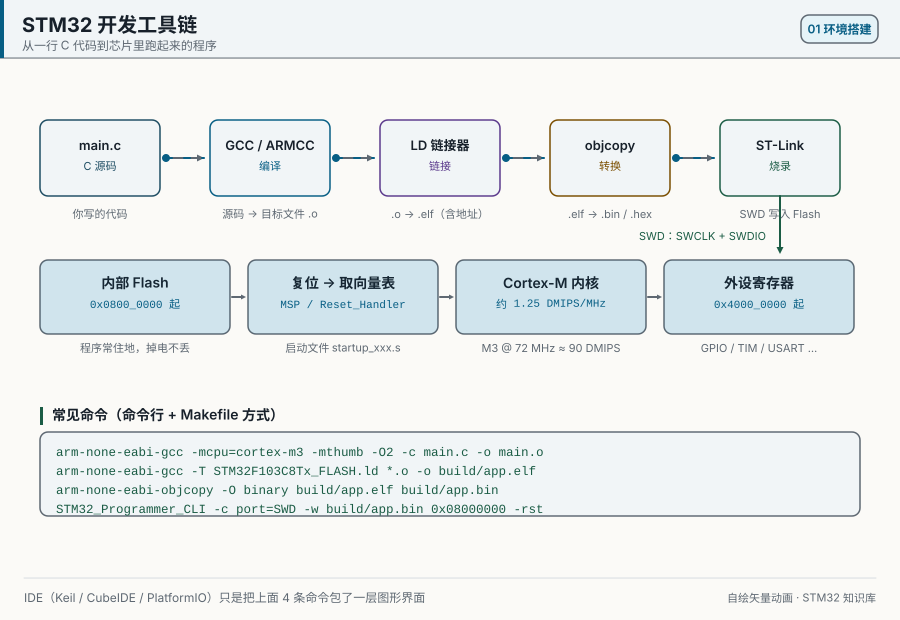
   ▲ 动画：编译 → 链接 → 烧录 → 运行的数据流（作者自绘矢量图，非实拍）

<!-- video:ch18 -->

  <video width="640" controls poster="../assets/video/ch18-faq.png">
    <source src="../assets/video/ch18-faq.mp4" type="video/mp4">
  </video>
   ▲ 本章讲解视频（2.5 分钟）。<a href="../assets/video/ch18-faq.mp4">MP4</a> · <a href="../assets/video/ch18-faq.srt">字幕</a>

旁白文字稿

1. 排错不要从改代码开始。先让现象稳定复现，再退到只点灯或只回环的最小工程。最小工程是好的，问题就在你后来加的那一块里。
2. 这一章的五步是：复现，最小化，二分，看证据，对照手册。前两步能解决大多数问题。一上来就二分一大坨新代码，你会把时间花在来回编译上。
3. 编译报一长串时，先看第一处真正的错误。找不到头文件，多半是包含路径，不是语法突然坏了。链接报未定义的符号，再去看你有没有把对应的源文件加进工程。
4. 这一帧是仓库画的分层。现象在引脚上，就同时怀疑引脚模式和接线。现象在 HAL 返回值里，就打印那个状态码，再对照它碰过的寄存器。不要每一层同时盲改。
5. 下载失败时，先看供电、地、SWD 两根线和复位。芯片认不出，就不要查优化等级。BOOT0 被拉高时，它跑的是系统存储器，你的程序看起来像没烧进去。
6. 外设完全没反应，老三样：时钟开了没有，引脚复用对不对，该清的标志清了没有。这三样过完，再去看波特率、过滤器和采样时间。顺序反了，会在细节里耗掉一个晚上。
7. 三条铁律：能测就别猜，先共地再看信号，一次只改一处。猜测式修改会让两个错误叠在一起，最后谁也不认领。
8. 这一章建议你故意制造一次错误，比如删掉一个头文件路径，看编译器怎么说，再改回来。见过真实报错的人，下次不会从最后一行开始慌。
9. 排错五步有顺序：先复现，再缩到最小。前两步走完还不知道范围，再去二分和看证据。能测就别猜。
10. 这一章的失败大多分两层：调试器认不出芯片，先查线和 BOOT，不是代码；编译链接报错，先查路径和宏，也不是代码。

<!-- /video:ch18 -->
## 原理与适用范围

先保存第一条完整报错。若已有可下载的 ELF，就让探针连接并读取 Device ID：读不到时查供电、接线与复位；能读到而应用不运行时，再查启动选择与程序现场。把这两个结果分开记录，再选择连接或启动的检查项。

本章以 STM32F103C8T6 为例，共 38 条：C1–C8 编译链接、D1–D7 下载调试、P1–P9 外设、H1–H7 硬件、R1–R7 RTOS 与工具链。每条给出候选原因和下一项检查，机制回到对应章节。

LQFP48 封装的第 34 脚 PA13 = SWDIO、第 37 脚 PA14 = SWCLK，第 7 脚是 NRST。先核对共地、目标 3.3 V 与探针电压参考；电压参考是否兼作供电要查具体探针。DS5319 图 31 的外部复位电容为 0.1 µF。第 35 脚是 VSS_2，不是 SWCLK。见 [DS5319 SWD](#source-ds5319-swd)。

第 44 脚 BOOT0 = 0 时从主闪存 `0x08000000` 启动，与 BOOT1 无关；BOOT0 = 1 时，BOOT1 = 0 选系统存储器 `0x1FFFF000`，BOOT1 = 1 选 SRAM（`0x20000000`）。`0x1FFFB000` 属于互联型 F105/F107，不能套给 C8。BOOT 脚在复位后 SYSCLK 的第 4 个上升沿锁存（第 00 章）。这些选择决定从哪里执行，不会仅因 BOOT0 拉高就使 SWD 无法读取 ID。见 [RM0008 启动](#source-rm0008-boot)。

C8 的闪存是 64 KB，SRAM 是 20 KB。复位后先以 HSI 8 MHz 工作；HSE 启动失败后程序是停在错误处理还是改用其他时钟，取决于启动代码。启用 CSS 后的运行中 HSE 故障另有硬件切换机制。串口要按 USART1 的实际 PCLK2 计算：AHB、APB2 分频均为 1 且 BRR 仍为 `0x271` 时，SYSCLK 72 MHz 对应 115200 bit/s，HSI 8 MHz 对应 12800 bit/s。第 16 章的 Stop 退出则明确先选 HSI，恢复时钟前同样要核对 BRR。见 [RM0008 USART](#source-rm0008-usart)。

LSE 仍是 32.768 kHz，第 3 脚和第 4 脚，第 1 脚 VBAT，PRL = 32767。电容按 5 pF 到 15 pF 的范围跟晶振一起选。6 pF 不是必须值。见 [DS5319 LSE](#source-ds5319-lse)。

仓库例程把 HAL 的 1 ms 时基放在 TIM4，SysTick 留给内核；RTOS tick 的长度另由 `configTICK_RATE_HZ` 决定。见 [本仓库例程](#source-project-examples)。按本书 4 位优先级、系统调用阈值为 5 的配置，调用 FromISR 的中断数值优先级须大于等于 5；`5 << 4 = 0x50`。换配置后须重查阈值，原因见第 15 章。见 [FreeRTOS](#source-freertos-syscall)。

外接灯按第 03 章接：第 10 脚 PA0，串 270 Ω。第 2 脚 PC13 接在备份域的电源开关后面，数据手册注 5 限定它只能灌电流、不超过 3 mA、速度不超过 2 MHz，不能当电流源点灯。板载灯就是用灌电流的接法。见 [DS5319 GPIO](#source-ds5319-gpio)。

## 关键插图

  
   ▲ 自绘矢量动画。BOOT0/BOOT1 决定复位后的启动位置；SWD 是否连通应独立检查。

  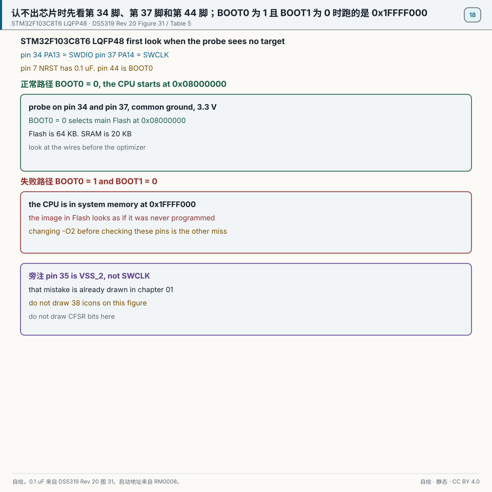
   ▲ 自绘。PA13/PA14、供电与 NRST 用于连接检查；BOOT0/BOOT1 用于判断启动位置。系统存储器启动不等于芯片认不出，也不表示 Flash 已被擦除。见 [DS5319](#source-ds5319-swd) 图 31、表 5 和 [RM0008 启动](#source-rm0008-boot)。

  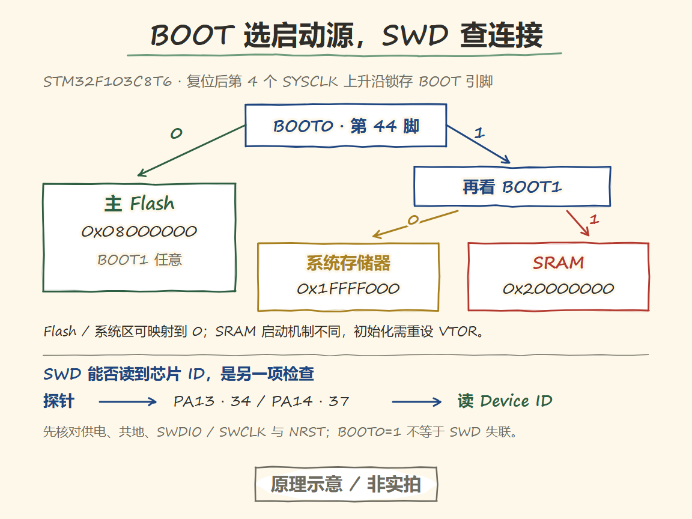
   ▲ 知识轨（Handraw · 原理示意/非实拍）。BOOT0=0 选 Flash；BOOT0=1 时再由 BOOT1 区分系统存储器与 SRAM。连接失败和选错启动位置是两条排查路径。

  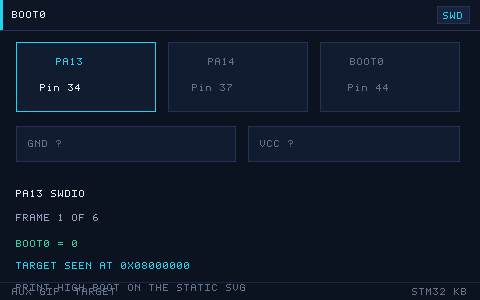
   ▲ 六帧演示 BOOT0=0 时的 Flash 映射、MSP 与复位向量读取；右侧的 SWD 接线独立检查。选中 Flash 后仍要核对镜像，印刷版可看上方静态图。

从编译到下载的完整流程见章首的 `toolchain-flow.svg` 动画。

## 时序与状态

| 先看什么 | 值 | 下一步 |
| --- | --- | --- |
| 第 34 脚和第 37 脚 | PA13 = SWDIO，PA14 = SWCLK，共地，3.3 V | 还没接好就不要改代码 |
| NRST | 第 7 脚，0.1 µF | 按 DS5319 图 31 |
| Flash 启动 | BOOT0 = 0，主闪存 `0x08000000` | 检查用户程序入口 |
| 系统存储器启动 | BOOT0 = 1 且 BOOT1 = 0，`0x1FFFF000` | Flash 应用未执行；`0x1FFFB000` 属互联型 |
| SRAM 启动 | BOOT0 = 1 且 BOOT1 = 1，`0x20000000` | 需要有效的 SRAM 程序与向量配置 |
| 容量 | 闪存 64 KB，SRAM 20 KB | 链接脚本按这个写 |
| USART1 | PCLK2 = 8 MHz 且 BRR = `0x271` | 12800 bit/s |
| HAL 时基 | 例程使用 TIM4，1 ms | 与 RTOS tick 分开核对 |
| FromISR 优先级 | 本书阈值为 5，4 位优先级 | 数值大于等于 5，`5 << 4 = 0x50` |
| 晶振 | 5 pF 到 15 pF，按晶振选 | 6 pF 不是必须值 |

## 常见坑与出处

| 现象 | 原因 | 处理 | 出处 | 出处里能查到什么 |
| --- | --- | --- | --- | --- |
| 下载器报没有目标 | 线还没核对 | 先看第 34 脚、第 37 脚、地和 3.3 V | [DS5319 SWD](#source-ds5319-swd) | 第 34 脚 PA13 是 SWDIO，第 37 脚 PA14 是 SWCLK。第 35 脚是 VSS_2 |
| 程序像没烧进去 | 第 44 脚被拉高 | 把 BOOT0 放回 0 | [RM0008 启动](#source-rm0008-boot) | BOOT1=0 且 BOOT0=1 时进 `0x1FFFF000`。C8 不是互联型 |
| 芯片反复复位 | 电源跌落、外部干扰或看门狗等 | 先读复位原因标志，再查电源和 NRST 波形 | [DS5319 NRST](#source-ds5319-nrst) | NRST 有内部上拉；图 31 的外部电容为 0.1 µF |
| 链接说 Flash 或 RAM 不够 | 按更大的料在估 | 先按 C8 的 64 KB 和 20 KB | [DS5319 SWD](#source-ds5319-swd) | 128 KB 是 xB（如 C8 的兄弟 CB）的容量，C8T6 是 64 KB |
| 串口乱码，时钟却没核对 | PCLK2 或 BRR 与预期不符 | 读 SWS、AHB/APB2 分频和 BRR | [RM0008 USART](#source-rm0008-usart) | BRR=`0x271`：PCLK2=72 MHz 时 115200，8 MHz 时 12800 |
| 按 P9 焊了 6 pF | 把一只电容当成必须值 | 电容按晶振在 5 pF 到 15 pF 里选 | [DS5319 LSE](#source-ds5319-lse) | 6 pF 不是 LSE 节印出的必须值。32.768 kHz 和 PRL = 32767 仍以第 11 章为准 |
| 上了 FreeRTOS 之后 `HAL_Delay` 不返回 | 时基还在 SysTick | 时基改到 TIM4 | [本仓库例程](#source-project-examples) | `examples/freertos-task` 的时基是 TIM4 |
| 一进中断就停在 `configASSERT` | 数值优先级太靠前 | 写成 5 或更靠后的数 | [FreeRTOS](#source-freertos-syscall) | `5 << 4 = 0x50`。数值更小的中断不得调用 FromISR |
| 外接灯不亮，电阻却在一个区间里乱试 | 脚和电阻都没定下来 | 外接灯用第 03 章的第 10 脚和 270 Ω | [DS5319 GPIO](#source-ds5319-gpio) | 第 2 脚 PC13 不能当电流源 |
## 学习目标

- [ ] 建立「按现象分类检索」的排错习惯，而不是盲目改代码。
- [ ] 能为每类现象找到第一项可区分原因的检查。
- [ ] 会用最小化验证（点灯、回环）快速隔离问题。
- [ ] 知道哪些坑是「配置问题」、哪些是「硬件问题」、哪些是「时序问题」。

> 使用说明：本表 38 条，编号 `C*`=编译链接、`D*`=下载调试、`P*`=外设、`H*`=硬件、`R*`=RTOS 与工具链。

## 一、编译与链接

  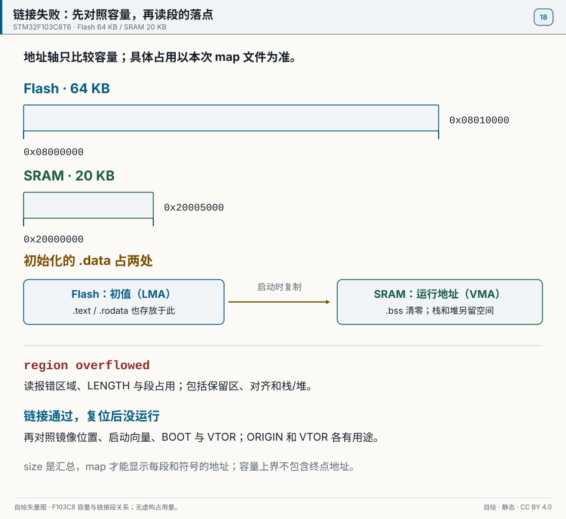
   ▲ 自绘。C8=64 KB/20 KB；先读 region 再改 C。

  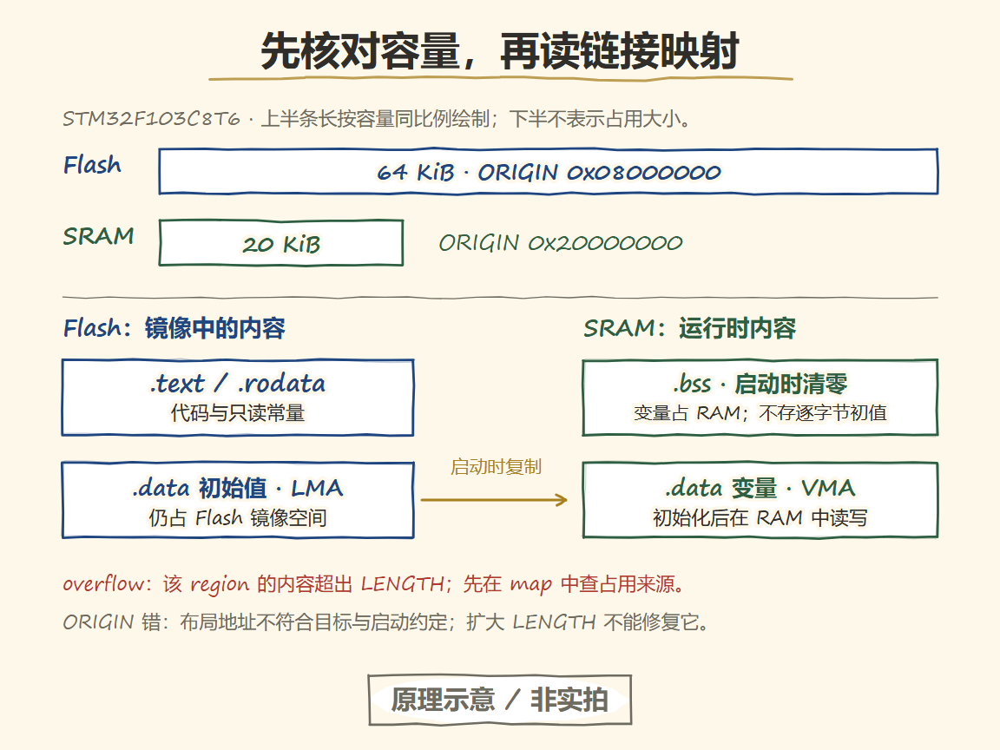
   ▲ 知识轨（Handraw · 原理示意/非实拍）。先在 map 中核对区域起点与长度，再分清 .text、.data 的加载大小和 .bss 的 RAM 占用。

**C1 找不到 `stm32f1xx_hal.h`**

- **现象**：编译报 `fatal error: stm32f1xx_hal.h: No such file or directory`。
- **原因**：头文件搜索路径（Include Paths）没加 HAL 的 `Inc` 目录。
- **解决**：在工程/`CMakeLists.txt` 的 include 路径里加入 `Drivers/STM32F1xx_HAL_Driver/Inc` 与 `Core/Inc`。

**C2 链接报 `undefined reference to HAL_GPIO_Init`**

- **现象**：编译通过，链接报未定义符号。
- **原因**：`stm32f1xx_hal_gpio.c` 没加入构建，或 GPIO 模块被条件编译关闭。
- **解决**：检查该源文件是否实际编译并参与链接，以及 `stm32f1xx_hal_conf.h` 中的 `HAL_GPIO_MODULE_ENABLED`。`HAL_MODULE_ENABLED` 是总开关，不能代替具体模块宏。

**C3 `region FLASH overflowed by N bytes`**

- **现象**：链接报 ROM 区超出。
- **原因**：代码/常量超出芯片 Flash 容量（如 F103C8 只有 64 KB）。
- **解决**：开 `-Os` 优化、去掉 `printf` 浮点、删无用库；或换更大 Flash 型号。

**C4 `region RAM overflowed`**

- **现象**：链接报 RAM 不足。
- **原因**：全局数组过大或栈/堆设置过大（F103C8 只有 20 KB RAM）。
- **解决**：用 map 找出 .data/.bss 与堆栈预留各占多少，再缩减缓冲或调整 `_Min_Heap_Size`/`_Min_Stack_Size`；降低预留前要验证实际峰值，不能只让链接通过。

**C5 重定义错误 `multiple definition of 'xxx'`**

- **现象**：链接报符号重复定义。
- **原因**：同一个外部符号在多个翻译单元中定义。头文件中的 `int count;` 是暂定定义，多个 `.c` 包含后，在 `-fno-common` 下通常会报错；`-fcommon` 可能把它们合并。
- **解决**：共享变量在头文件只放 `extern int count;`，由一个 `.c` 提供定义。改成 `static` 会给每个翻译单元各建一份私有变量，不能代替共享变量的唯一拥有者。

  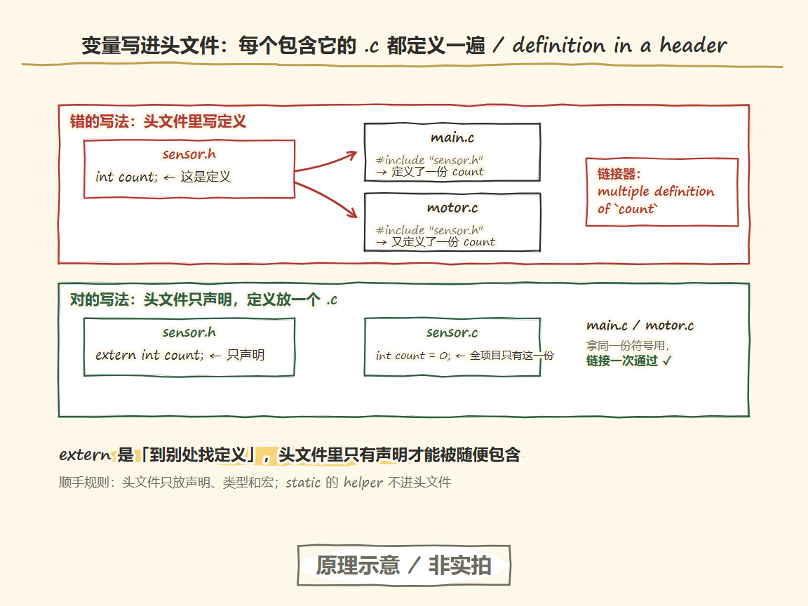
   ▲ 知识轨（Handraw · 原理示意/非实拍）。上方的初始化定义 `int count = 0;` 随头文件进入两个翻译单元，产生重复符号。改为 `extern int count;` 声明，由一个 .c 文件负责定义；头文件保护宏只防同一翻译单元内重复包含。见 [examples/](#source-project-examples)。

**C6 `printf` 输出乱码或没有输出**

- **现象**：串口收到乱码或空白。
- **原因**：`printf` 的浮点/半主机配置、或 `_write`/`__io_putchar` 未重定向。
- **解决**：重定向 `__io_putchar` 到 UART；开启 `-u _printf_float`（如需浮点）。

**C7 编译报 `arm-none-eabi-gcc: not found`**

- **现象**：命令行编译失败。
- **原因**：工具链未安装或未加入 PATH。
- **解决**：安装 GNU Arm Embedded Toolchain 并配置环境变量；或用 CubeIDE 自带工具链。

**C8 生成的 bin/hex 大小异常大**

- **现象**：固件体积远超预期。
- **原因**：可加载段中带入过多代码/常量，或错误的链接地址在 bin 中形成大间隙；完整 `printf` 也可能增大镜像。普通 `.debug_*` 段通常只增大 ELF，不进入 bin/hex 的加载数据。
- **解决**：先区分 ELF 文件大小、bin 地址跨度与 hex 文本大小，再用 map/段表定位。可用 `-Os`、`-ffunction-sections -fdata-sections` + `--gc-sections` 删除未引用代码；地址间隙则需修链接布局。

## 二、下载与调试

  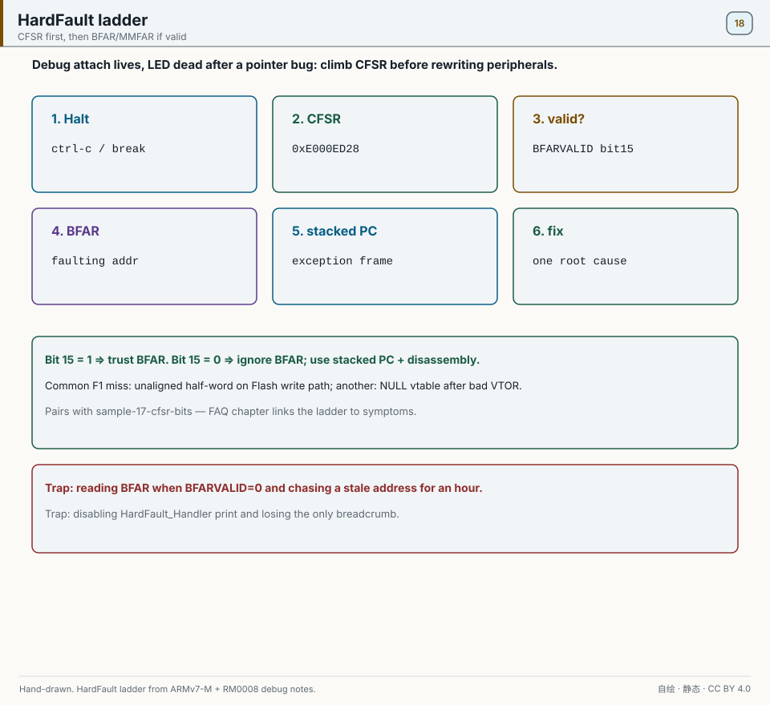
   ▲ 自绘。先保存 BFAR/MMFAR 与现场，再判读有效位。BFAR 是数据访问地址，栈 PC 是指令地址；两者不能互相替代。

  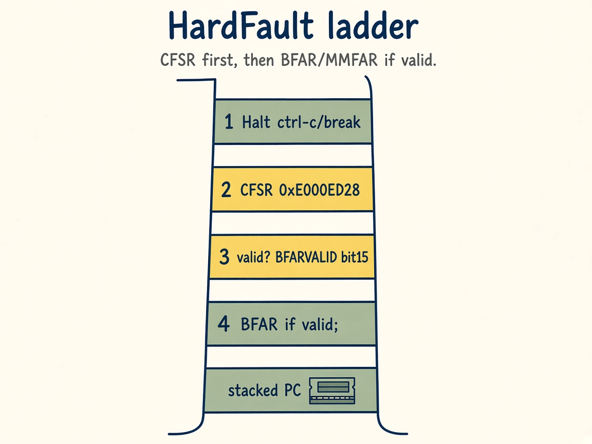
   ▲ 知识轨（Handraw · 原理示意/非实拍）。CFSR（0xE000ED28）用于分类，bit 15 标记 BFAR 有效；IMPRECISERR 不保证 PC 指向原始写操作，压栈错误须先检查栈帧。

**D1 `No target connected` / 连不上目标**

- **现象**：下载器报找不到目标。
- **原因**：SWD 线接反、没共地、板子没供电，或调试口被关。
- **解决**：核对 SWDIO/SWCLK、共地、目标供电和探针电压参考；连接 NRST 后尝试 connect under reset。BOOT0 拉高本身不会阻断 SWD ID 读取。

**D2 烧录后板子像「变砖」，再也连不上**

- **现象**：程序下载后 SWD 失联。
- **原因**：程序把 PA13/PA14 配成普通 GPIO 并关闭了 SWD。
- **解决**：先用复位下连接暂停应用；也可设 BOOT0=1、BOOT1=0 后复位，从系统存储器启动，避开应用，再用 STM32CubeProgrammer 恢复固件。仅拉高 BOOT0 不能确定进入系统存储器。

**D3 `Flash Download failed - Target DLL has been cancelled`**

- **现象**：下载到一半失败。
- **原因**：Flash 算法/时钟不匹配，或芯片被读保护。
- **解决**：先核对型号、Flash 算法和 RDP 状态；需要解除读保护时，确认 F1 的保护回退会擦除主 Flash，再执行对应选项字节操作。

**D4 调试时断点不生效**

- **现象**：断点被跳过或提示数量超限。
- **原因**：F103 的 6 个 FPB 代码比较器已占用，或当前代码与调试符号不匹配。Flash 只读并不妨碍硬件断点。
- **解决**：删旧断点，确认 ELF 与目标固件一致；软件断点须由工具支持相应存储位置。条件硬件断点仍占比较器。DWT 的 4 个比较器另用于数据观察，与 FPB 预算独立；源码行对应不清时再查 `-O0/-Og` 构建。

**D5 单步执行「乱跳」**

- **现象**：单步时行号跳来跳去。
- **原因**：编译器优化重排指令、内联。
- **解决**：调试配置改 `-O0` 或 `-Og`。

**D6 ST-Link 提示固件过旧**

- **现象**：连接时提示升级 ST-Link 固件。
- **原因**：旧固件与新版工具不兼容。
- **解决**：用 ST-Link Upgrade 工具升级；克隆 ST-Link 慎升级（可能变砖）。

**D7 程序一进调试就停在 `HardFault_Handler`**

- **现象**：调试启动即 HardFault。
- **原因**：时钟/外设初始化越界、向量表错、栈太小。
- **解决**：先保存地址寄存器与故障现场，再按 `CFSR` 分类；bit 15 为 1 只表示 BFAR 保存有效的总线故障地址。确认栈帧完整并区分精确/非精确故障后，再用 PC 和同一份 ELF 定位，详见第 17 章。

  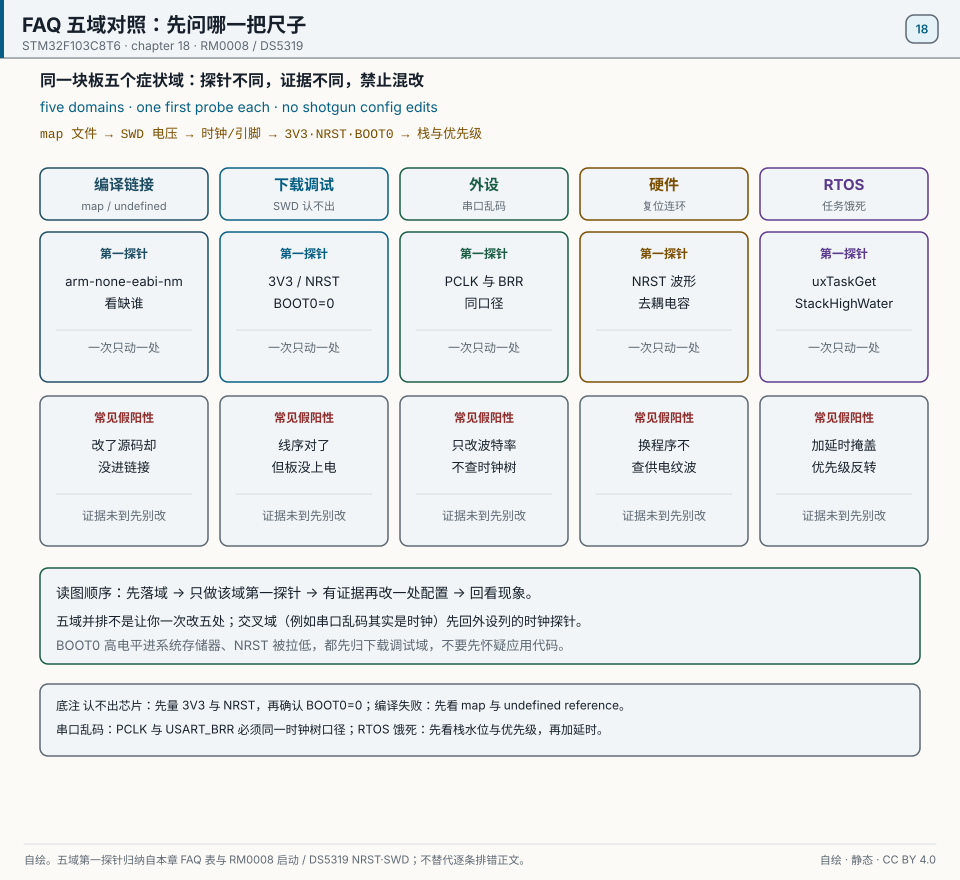
   ▲ 自绘。编译查日志与 map，连接查 ID，串口查位宽，复位查电源和 NRST，任务未运行时查状态与阻塞点。保留读数，再决定改哪一处。见 [RM0008 启动](#source-rm0008-boot) 和 [DS5319 NRST/SWD](#source-ds5319-nrst)。

  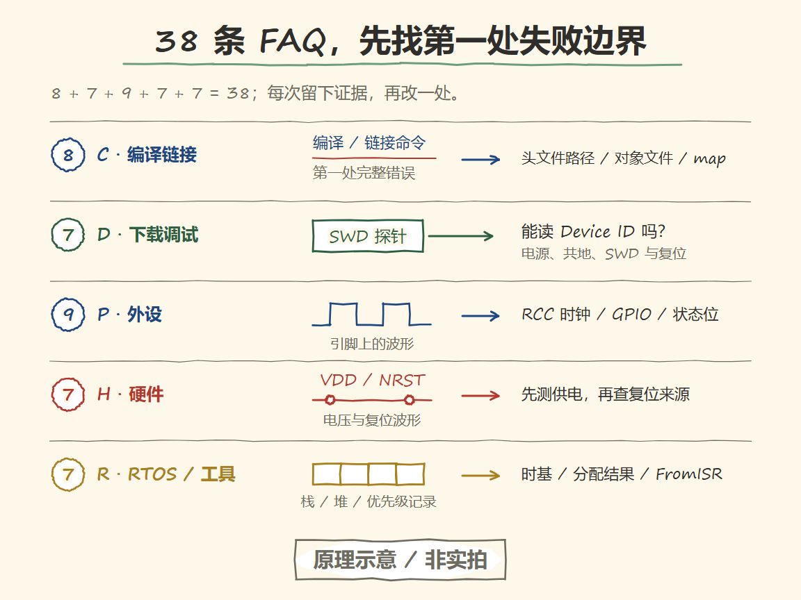
   ▲ 知识轨（Handraw · 原理示意/非实拍）。五类现象各选一项能区分原因的证据，保留修改前后的结果。

## 三、外设

  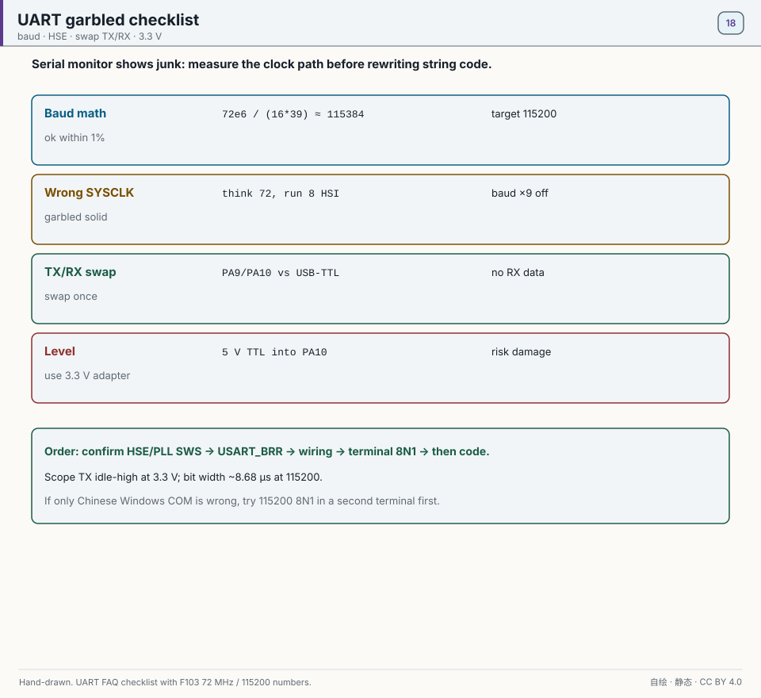
   ▲ 自绘。先确认 SWS/BRR，再怀疑字符串代码。

  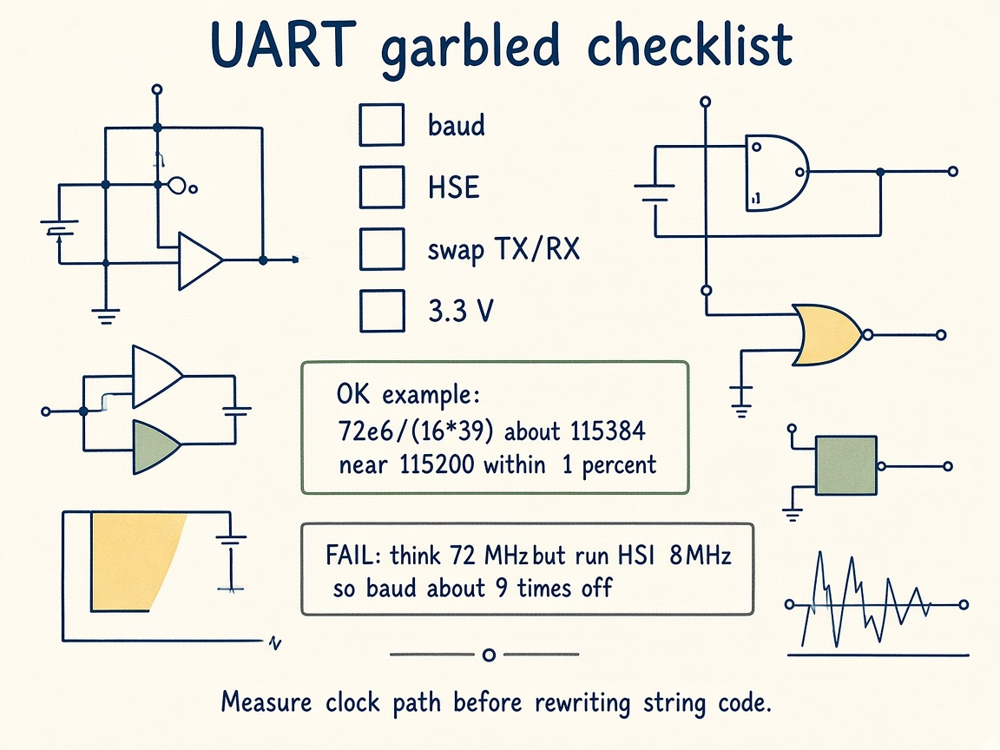
   ▲ 知识轨（Handraw · 原理示意/非实拍）。先量位宽，再核对 USART 时钟和 BRR；TX 接对端 RX，电平须兼容且共地。

**P1 GPIO 写了不动作**

- **现象**：`HAL_GPIO_WritePin` 后引脚无变化。
- **原因**：忘记使能 GPIO 时钟。
- **解决**：`__HAL_RCC_GPIOx_CLK_ENABLE()`。

**P2 按键触发一次却进多次中断**

- **现象**：按一下打印多条。
- **原因**：机械抖动未消抖。
- **解决**：用时间戳或任务定时确认稳定电平，也可采用 RC 消抖；EXTI 中只记录事件，不长时间阻塞延时。

**P3 串口乱码**

- **现象**：收到的都是乱码。
- **原因**：波特率不匹配、未共地、时钟不是预期频率。
- **解决**：统一波特率并共地，读取 SWS、AHB/APB2 分频和 BRR。USART1 的 `0x271` 在 PCLK2=72 MHz 时为 115200，PCLK2=8 MHz 时为 12800；HSE 失败后的执行路径还要查启动代码和 CSS 配置。

**P4 I2C 通信卡在 `HAL_I2C_Master_Transmit`**

- **现象**：程序卡死或超时。
- **原因**：缺上拉电阻、地址错、总线被拉死。
- **解决**：SCL/SDA 各接 4.7 kΩ 上拉；核对 7 位地址；做总线恢复（9 个时钟脉冲）。

**P5 SPI 读 Flash 全 FF**

- **现象**：读回数据全是 0xFF。
- **原因**：CS 没拉低、CPOL/CPHA 模式错、MISO 未接。
- **解决**：核对模式（W25Q 用 Mode0）、片选时序、接线。

**P6 ADC 读数跳动大**

- **现象**：采样值不稳定。
- **原因**：参考电压不稳、采样时间过短、输入阻抗高。
- **解决**：VDDA 加去耦、加长采样时间、输入加小电容缓冲。

**P7 定时器 PWM 无输出**

- **现象**：示波器看不到波形。
- **原因**：没启动 PWM（`HAL_TIM_PWM_Start`）、引脚 AF 未配、通道错。
- **解决**：调用 `HAL_TIM_PWM_Start`，核对复用引脚与通道。

**P8 DMA 只搬一次**

- **现象**：DMA 传完一次就停。
- **原因**：配了普通模式却期望循环。
- **解决**：改 `DMA_CIRCULAR`。

**P9 RTC 上电归零 / 不走时**

- **现象**：断电后时间丢失。
- **原因**：LSE 未起振、VBAT 未接电池、负载电容过大。
- **解决**：接 32.768 kHz 晶振，负载电容在 5 pF 到 15 pF 里按晶振选，6 pF 不是必须值；VBAT 接电池。第 3 脚和第 4 脚，PRL = 32767，见第 11 章。

## 四、硬件

**H1 LED 不亮**

- **现象**：接上 LED 无反应。
- **原因**：极性接反、限流电阻过大、驱动能力不足。
- **解决**：核对阳极/阴极。外接灯用第 03 章的第 10 脚和 270 Ω。第 2 脚 PC13 不能当电流源。大电流用三极管或 MOSFET 驱动。

**H2 芯片发热严重**

- **现象**：手摸发烫。
- **原因**：引脚短路、5 V 直灌 3.3 V 引脚、电源接反。
- **解决**：立刻断电，检查短路与电压；核对电源极性。

**H3 上电没反应、电流为 0**

- **现象**：板子完全无电流。
- **原因**：供电断路、测量接法错误，或读数低于仪表量程；BOOT 配置错误不能解释芯片完全不耗电。
- **解决**：先量芯片电源脚的 3.3 V 并确认电流表接法；供电正常但应用未运行时，再查 BOOT0/BOOT1 与复位状态。

**H4 复位一直在抖**

- **现象**：芯片反复复位。
- **原因**：电源跌落、复位线受干扰，或看门狗触发。NRST 有内部上拉，外部未接不等于逻辑悬空。
- **解决**：保存 RCC 复位原因标志，再测电源与 NRST；外部电容按图 31 在第 7 脚接 0.1 µF 到地。看门狗周期与调试行为见第 11 章。

**H5 外部晶振不起振**

- **现象**：等待 HSERDY 或 LSERDY 超时；应用可能停在错误处理。
- **原因**：负载电容不匹配、晶振虚焊、走线太长。
- **解决**：按晶振手册选负载电容，检查焊接与走线；再查软件的超时路径。HSE 启动失败不等于必然完成 HSI 回退，LSE 失败也不会自动替 RTC 换时钟源。

**H6 面包板接触不良**

- **现象**：时好时坏，晃动就复位。
- **原因**：杜邦线/面包板接触电阻大、线太长。
- **解决**：换线、缩短连线、关键信号焊死。

**H7 串口/下载「共地」问题**

- **现象**：不共地就乱码/连不上。
- **原因**：两个电源地电位不同。
- **解决**：务必把 GND 连在一起。

## 五、RTOS 与工具链

**R1 上 RTOS 后 `HAL_Delay` 卡死**

- **现象**：调用 `HAL_Delay` 不返回。
- **原因**：HAL 计数没有递增，例如 SysTick 处理被替换、时基中断未使能，或在阻塞时基中断的上下文调用延时。
- **解决**：先观察 `HAL_GetTick()` 是否增长。仓库例程用 TIM4 提供 HAL 的 1 ms 时基，SysTick 留给内核；RTOS tick 周期另查 `configTICK_RATE_HZ`。

**R2 `configASSERT` 死循环**

- **现象**：程序停在断言。
- **原因**：中断优先级数值太小（优先级过高），或传了空指针。
- **解决**：先看触发断言的位置。按本书 4 位优先级、阈值为 5 的配置，调用 FromISR 的中断数值优先级须大于等于 5，`5 << 4 = 0x50`；更小的数不得调用。换配置后重查阈值。

**R3 任务创建返回失败**

- **现象**：`xTaskCreate` 失败。
- **原因**：当前动态分配器无法为任务控制块与栈提供内存，可能是容量不足或碎片化。
- **解决**：查所选 heap 实现、剩余内存与任务栈需求。使用静态堆数组的实现再核对 `configTOTAL_HEAP_SIZE`；不能把所有分配器都按这个宏处理。

**R4 中断里调用普通 API 崩溃**

- **现象**：ISR 里 `xQueueSend` 导致 HardFault。
- **原因**：ISR 中只能用 `FromISR` 版本。
- **解决**：改 `xQueueSendFromISR` + `portYIELD_FROM_ISR`。

**R5 程序莫名进 HardFault（带 RTOS）**

- **现象**：随机 HardFault。
- **原因**：任务栈溢出、越界写或无效指针等，需要现场区分。
- **解决**：先保存故障寄存器与栈信息，再结合栈高水位和 `configCHECK_FOR_STACK_OVERFLOW` 排查；该检查不能保证捕获所有栈破坏。

**R6 工具链报 `cannot open linker script`**

- **现象**：链接找不到 `.ld` 脚本。
- **原因**：链接脚本路径/名称错，或换工程未同步。
- **解决**：核对 `-T` 指向的 `.ld` 文件路径；CubeIDE/Keil 各自管理链接脚本。

**R7 CubeMX 生成代码覆盖了自己的修改**

- **现象**：重新生成后手写代码丢失。
- **原因**：代码写在了 `USER CODE BEGIN/END` 之外。
- **解决**：生成文件内的修改放进对应 `/* USER CODE BEGIN xxx */ ... /* USER CODE END xxx */` 区间，并确认保留用户代码选项；独立业务逻辑放在自有源文件中。

## 排错方法论（先做这 5 步）

保留触发条件和失败现场，再缩到最小工程。每次只验证一个假设，修改后用同一条件复测；偶发故障也要记录发生频率、运行负载与中断条件。

| 步 | 动作 | 目的 |
| --- | --- | --- |
| 1 | **复现**：记录触发条件、频率和运行负载 | 区分稳定失败与时序、接触等偶发问题 |
| 2 | **最小化**：退回到「只点灯 / 只回环」的最小工程 | 隔离是配置问题还是逻辑问题 |
| 3 | **二分**：注释掉一半代码/逐个外设使能 | 快速定位引入问题的模块 |
| 4 | **看证据**：串口日志、逻辑分析仪波形、`CFSR/BFAR` | 用数据代替猜测 |
| 5 | **对照手册**：查 RM/DS 的寄存器与时序 | 确认「以为对」的地方是否真对 |

> 三条铁律：**能测就别猜**、**先共地再看信号**、**改一处只改一处**。

  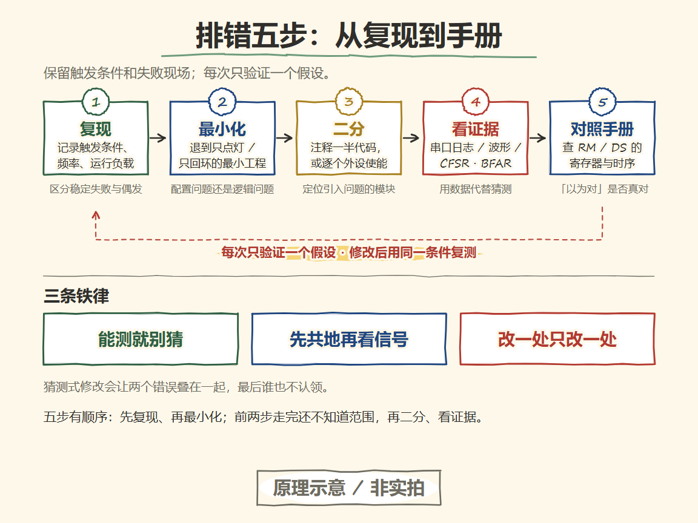
   ▲ 知识轨（Handraw · 原理示意/非实拍）。五步与各自的目的取自正文表格；每次只验证一个假设，修改后用同一条件复测；三条铁律同页；不是实拍。

## 动手实验（排错训练）

1. **构建边界**：在临时分支移除一个 Include 路径，保存完整首条错误、编译命令和修复后的退出码；不要只截最后一行。
2. **总线边界**：断电后暂时拔掉一只 I2C 上拉，保存空闲电平、NACK/超时和恢复后的 ACK 波形，再断电复原。
3. **调试边界**：断电后暂时断开 SWCLK，记录 `No target connected`；恢复接线后确认能读 Device ID。不要烧入关闭 SWD 的固件来练习。
4. **RTOS 时基边界**：在受控构建中保留 SysTick 冲突，记录 tick、HAL 时基和卡住位置；改用 TIM4 后保存相同测试的恢复结果。
5. **个人故障卡**：每次只记录症状、首个分歧边界、最小证据、修复和防复发检查，不把猜测写成原因。

离开本章前，应有四组“失败证据 → 单一修复 → 恢复证据”，并能说明每组为什么只改一个变量。

## 相关资源

- 本仓库各章「常见坑与排查」小节：第 03~17 章逐外设覆盖。
- RM0008 / RM0090 参考手册：寄存器位定义与时序，是排错的最终依据。
- 数据手册 DS：电气参数（电压/电流/时钟），判断「是不是硬件超规格」。
- 官方工具：STM32CubeProgrammer（读保护/选项字节）、STM32CubeMX（配置核对）。
- 相关章节：第 01 章开发环境搭建、第 17 章调试与性能优化、第 20 章学习资源与工具链。
- 配图：`../assets/animations/toolchain-flow.svg`（作者自绘矢量图）。

- 手机阅读版：[第 18 章 · 常见问题FAQ（公众号图文）](https://mp.weixin.qq.com/s/sbFdlK69-8L85F2KzWdTjg)
