# 19 项目实战合集

> English: [Projects](en/19-projects.md)

> 选项目先看证据链能否闭合：输入怎么测、状态怎么记录、输出怎么验收、失败后怎么恢复。功能数量和预计晚上数都不能替代可交付结果。

<p align="center">
  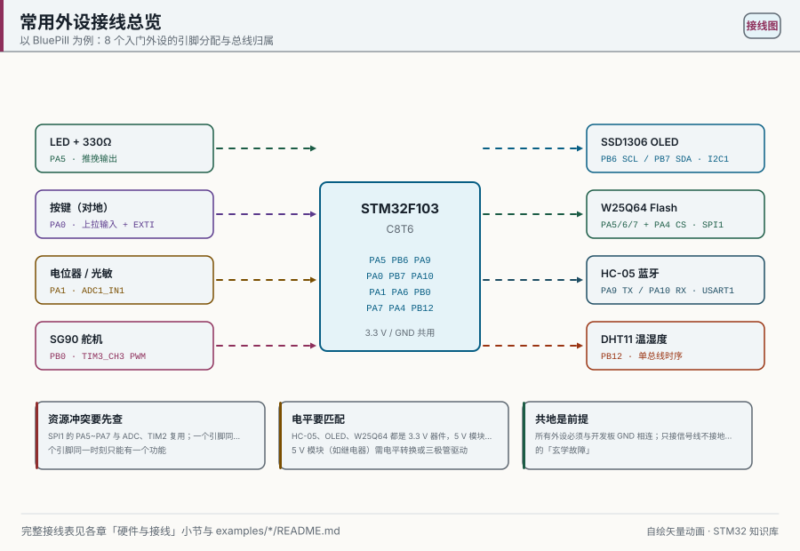
  <br><sub>▲ 图：常用外设接线总览，多数项目都从这张图起步（作者自绘矢量图，非实拍）</sub>
</p>

<!-- video:ch19 -->
<p align="center">
  <video width="640" controls poster="../assets/video/ch19-projects.png">
    <source src="../assets/video/ch19-projects.mp4" type="video/mp4">
  </video>
  <br><sub>▲ 本章讲解视频（2.4 分钟）。<a href="../assets/video/ch19-projects.mp4">MP4</a> · <a href="../assets/video/ch19-projects.srt">字幕</a></sub>
</p>

<details>
<summary>旁白文字稿</summary>

1. 做项目最容易散的地方，是一个周末同时加上蓝牙、显示和存储。规矩只有一条：每一轮新增加的不确定，只允许有一个外设。坏了，你知道是谁。
2. 动手前用一句话写完完成标准。比如温度每分钟记一条，掉电不丢。没有这句话，你会一直调，不知道哪天算做完。失败怎样看出来，也要先写下来。
3. 不要从空白文件开始堆。先让仓库里对应的示例在你的板上跑起来，再加这一个项目需要的外设。示例和你的板子不一致时，先改时钟和引脚，别改算法。
4. 这一帧是仓库画的工程结构。应用、板级、驱动分开，后面你才敢换一颗芯片。所有代码堆在一个 main 里，项目做完你也不敢再打开它。
5. 温湿度记录仪先保证读数和时间是对的，掉电不丢，再去画曲线。曲线很好看，但是如果时间是错的，记录就没有意义。显示是最后一层糖。
6. 蓝牙小车先让两个轮子按你的命令转，再加遥控。自平衡是挑战题，不要当第一周的作业。底盘力学和编码器还没稳，算法只会放大抖动。
7. 多机 CAN 先做通两个节点，USB 采集先做通枚举和回显，再把采样挂上去。链路不通时叠协议，你无法判断是包错了还是采样错了。
8. 你的下一个项目，新增加的外设只有哪一个？说不出名字，就还没准备好开工。说得出，就先把别的欲望写进下一轮。
9. 做完不是指灯亮过一次。别人按你的说明能复现，你能说出还没做的部分。仓库里的十个题目，选一个做到这个程度，比十个都开了头有用。
10. 动手前核对三处：板上的晶振和示例假设一致吗，闪存容量对得上型号吗，调试器接口和丝印一致吗。三处都对上，再写第一行。

</details>
<!-- /video:ch19 -->
## 原理与适用范围

先选一个项目，把输入、一次可观察输出和失败条件写下来，再核对硬件表。下面的容量示例以 STM32F103C8T6 的 Flash 64 KB、SRAM 20 KB 为基准；各项目还会选用资源更多的型号，不能把所有片段直接放进同一块 BluePill。地址和换算应与第 12 章、第 09 章保持一致。

一张 APP。Bootloader 从 `0x08000000` 起 16 KB，参数区从 `0x08004000` 起 2 KB，APP 从 `0x08004800` 起 46 KB，长度 `0xB800`，到 `0x08010000` 之前。`16 + 2 + 46 = 64`。这是第 12 章和 `examples/iap-bootloader` 的地图。见 [本仓库例程](#source-project-examples)。

再放一张同样的 `0xB800`，合计 `16 + 2 + 46 + 46 = 110` KB。`0x08000000 + 0x1B800 = 0x0801B800`，越过 C8 的结束边界 `0x08010000`。第 12 章只有一个 APP 槽；把剩余 46 KB 平分为两个 23 KB 只是容量算术，仍需另行设计向量对齐、镜像链接、元数据和回滚状态，不能据此认定双槽方案已成立。见 [DS5319](#source-ds5319-swd)。

<p align="center">
  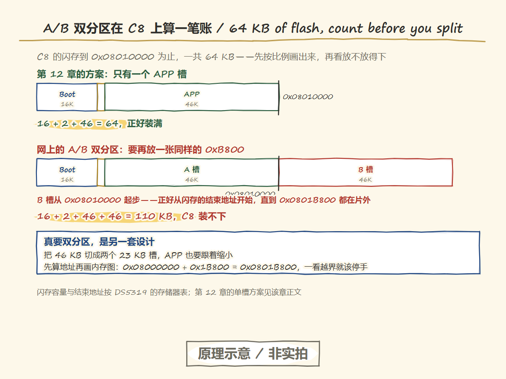
  <br><sub>▲ 知识轨（Handraw · 原理示意/非实拍）。两条 Flash 使用同一比例：单 APP 布局占满 64 KB；再加一张 46 KB 镜像便越过 0x08010000。容量放得下只是第一步，校验和回滚还需独立设计。见 [DS5319](#source-ds5319-swd)。</sub>
</p>

`64 * 1024 = 65536`。C8 的 SRAM 是 20 KB，也就是 20480 字节。65536 大于 20480。所以逻辑分析仪项目里 64 KB 的采样缓冲在 C8 上链接不过，要么缩到十几 KB，要么换 SRAM 更大的芯片，先查它的数据手册。

12 位 ADC 的名义 LSB 为 Vref/4096；按该比例换算，码 2048 在名义 3.3 V 下为 1.65 V。用 4095 做满端点缩放会得到不同斜率，差异随码值变化，接近满码时约一个 LSB，并非每个码都恰差一 LSB。实际电压还取决于 Vref、偏置和增益误差。见 [RM0008 ADC](#source-rm0008-adc)。

应用帧 `4 + 128 + 1 = 133` 字节。第 14 章全速批量的一包上限是 64 字节。133 字节要拆成 64 + 64 + 5 三包发送，端点描述符的 `wMaxPacketSize` 仍写 64，不能写 133。USB 时钟 48 MHz 和 VID/PID `0x1209/0x0001` 见第 14 章。

<p align="center">
  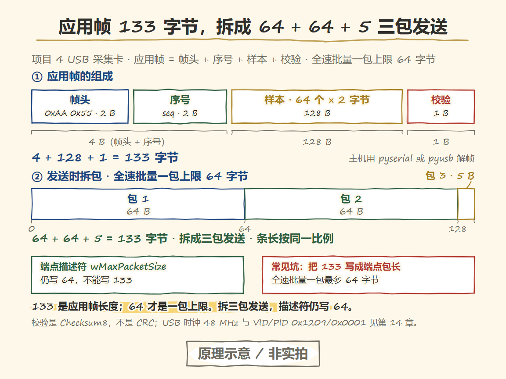
  <br><sub>▲ 知识轨（Handraw · 原理示意/非实拍）。应用帧 4 + 128 + 1 = 133 字节；全速批量一包上限 64 字节，拆成三包发送，端点描述符 `wMaxPacketSize` 仍写 64；不是实拍。</sub>
</p>

项目 8 的两端各 120 Ω、工作脚 PB8/PB9、500 kbit/s，和第 13 章一致。收发器用 5 V 还是 3.3 V 的型号，按硬件清单选。见 [本仓库例程](#source-project-examples)。

本章接线安排中，第 10 脚 PA0 已预留给灯、ADC 或唤醒实验，电机方向另选空闲 GPIO 并同步修改 `MOTOR_DIR_PIN`。PA0-WKUP 和 ADC12_IN0 是可选功能，并不表示 PA0 不能作为普通输出；要避免的是同一工程同时占用。见 [DS5319 ADC](#source-ds5319-adc)。

做项目时一轮只加一个新外设，调通了再加下一个。这样出问题时只有一个可疑对象。项目 6 里 WS2812 的时序微秒数来自灯珠厂商的数据手册，不是 RM0008。

## 关键插图


<p align="center">
  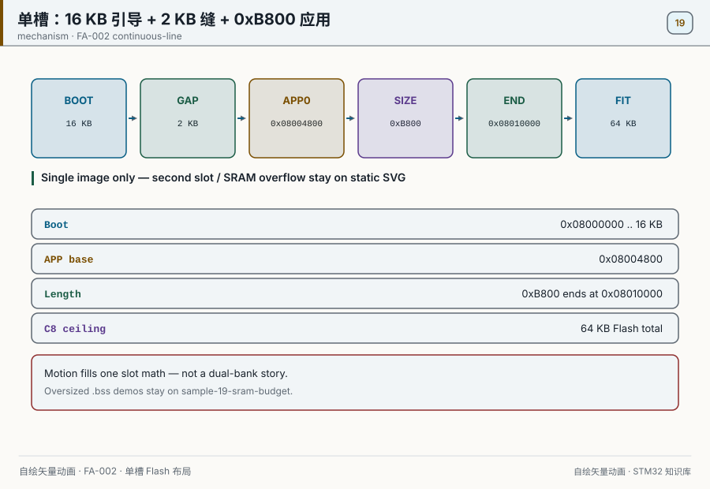
  <br><sub>▲ 自绘矢量动画（FA-002）。单镜像布局算术。</sub>
</p>


<p align="center">
  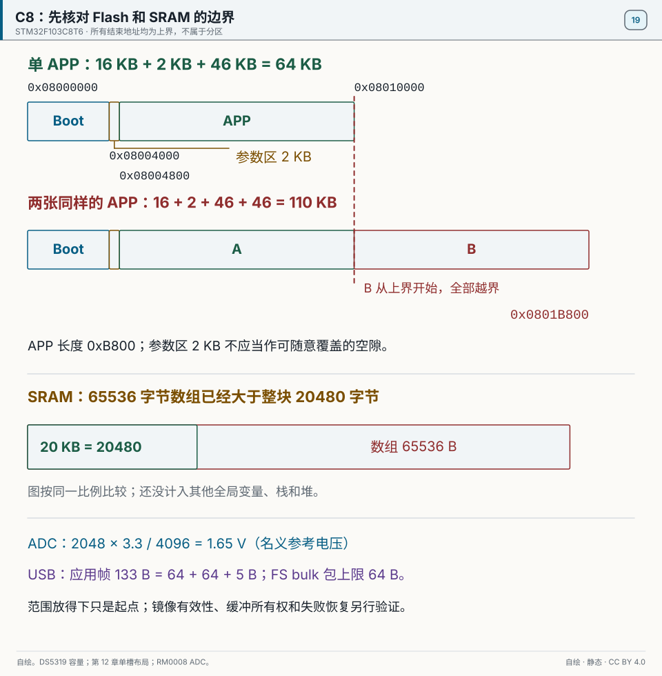
  <br><sub>▲ 自绘。先算 Flash 与 SRAM，再核对 ADC 比例和 USB 分包。C8 的 64 KB Flash 不能容纳两张 46 KB APP，20 KB SRAM 也放不下 65536 字节缓冲。见第 12 章布局和 [DS5319](#source-ds5319-swd)。</sub>
</p>

<p align="center">
  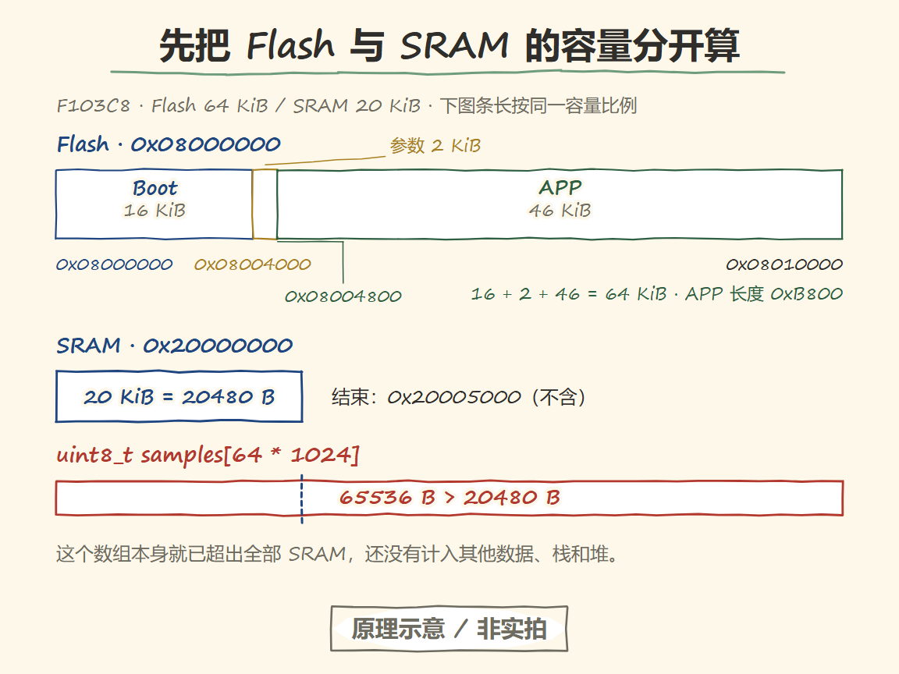
  <br><sub>▲ 知识轨（Handraw · 原理示意/非实拍）。Flash 中留一张 0xB800 的 APP；SRAM 缓冲须与栈、全局变量共同分配，不能只比较单个数组。</sub>
</p>

<p align="center">
  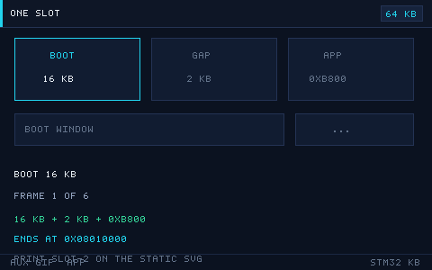
  <br><sub>▲ 动图版，只演示放得下的布局：16 KB、2 KB 和一张 0xB800 依次填到 0x08010000 为止。印刷版只有上面的静态图。</sub>
</p>

各项目的接线总览见 `peripheral-wiring.svg`，它只管接线，放不放得下还要看上面这张图。

## 时序与状态

| 对象 | 长度 | 结束于 | 放不放得下 |
| --- | --- | --- | --- |
| Bootloader | 16 KB | `0x08004000` | 放下 |
| 参数区 | 2 KB | `0x08004800` | 放下 |
| 一张 APP | `0xB800` | `0x08010000` | 放下 |
| 两张 `0xB800` | 110 KB | `0x0801B800` | 放不下。第 12 章只有一个 APP 槽 |
| SRAM | 20480 字节 | 片内 | 放下 |
| 65536 字节的数组 | `64 * 1024` | 超出 SRAM | 在 C8 上放不下 |
| ADC | 名义比例 Vref/4096 | Vref=3.3 V 时，码 2048 为 1.65 V | 与满端点缩放及实测校准区分 |
| USB | 应用帧 133 字节 | 一包上限 64 字节 | 133 要拆开送 |

## 常见坑与出处

| 现象 | 原因 | 处理 | 出处 | 出处里能查到什么 |
| --- | --- | --- | --- | --- |
| 升级方案写成两张 APP，并注明见第 12 章 | 把另一份设计写成了这一章的地图 | C8 上先按一张 `0xB800` 做通 | [本仓库例程](#source-project-examples) | `examples/iap-bootloader` 的 APP 长度是 `0xB800`。第 12 章没有第二张槽 |
| 第二张镜像链接到 `0x08010000` 之后 | 64 KB 已经结束 | 停在 `0x08010000` | [DS5319](#source-ds5319-swd) | STM32F103x8 的闪存是 64 KB。两张 46 KB 加上 16 KB 和 2 KB 是 110 KB |
| 逻辑分析仪缓冲在 C8 上链不过 | `64 * 1024` 大于 C8 的 SRAM | 不要把 65536 字节编进 C8 | [DS5319](#source-ds5319-swd) | SRAM 是 20 KB，即 20480 字节。65536 更大 |
| 示波器电压与名义换算不符 | 比例、Vref 或校准条件不同 | 先按 Vref/4096 核对，再查参考电压与误差 | [RM0008 ADC](#source-rm0008-adc) | 码 2048 在名义 3.3 V 下为 1.65 V；4095 与 4096 的差异随码值变化 |
| 采集卡把 133 字节写成端点包长 | 把应用帧当成了包上限 | 全速批量一包最多 64 字节 | [本仓库例程](#source-project-examples) | 133 是 `4 + 128 + 1`。它不是第 14 章的包上限 |
| 小车方向写在 PA0 | 和第 10 脚的其他用途撞在一起 | 换离第 10 脚 | [DS5319 ADC](#source-ds5319-adc) | 第 10 脚是 PA0-WKUP，也是 ADC12_IN0 |
| 两个 CAN 节点速率对不上 | 两边的位时间参数不一致 | 用 500 kbit/s，两端各 120 Ω | [本仓库例程](#source-project-examples) | 例程的预分频是 9，工作脚是 PB8/PB9 |
## 学习目标


<p align="center">
  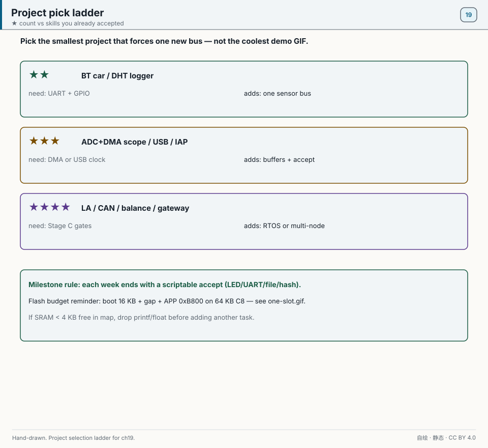
  <br><sub>▲ 自绘。选最小能逼出一条新总线的项目。</sub>
</p>

<p align="center">
  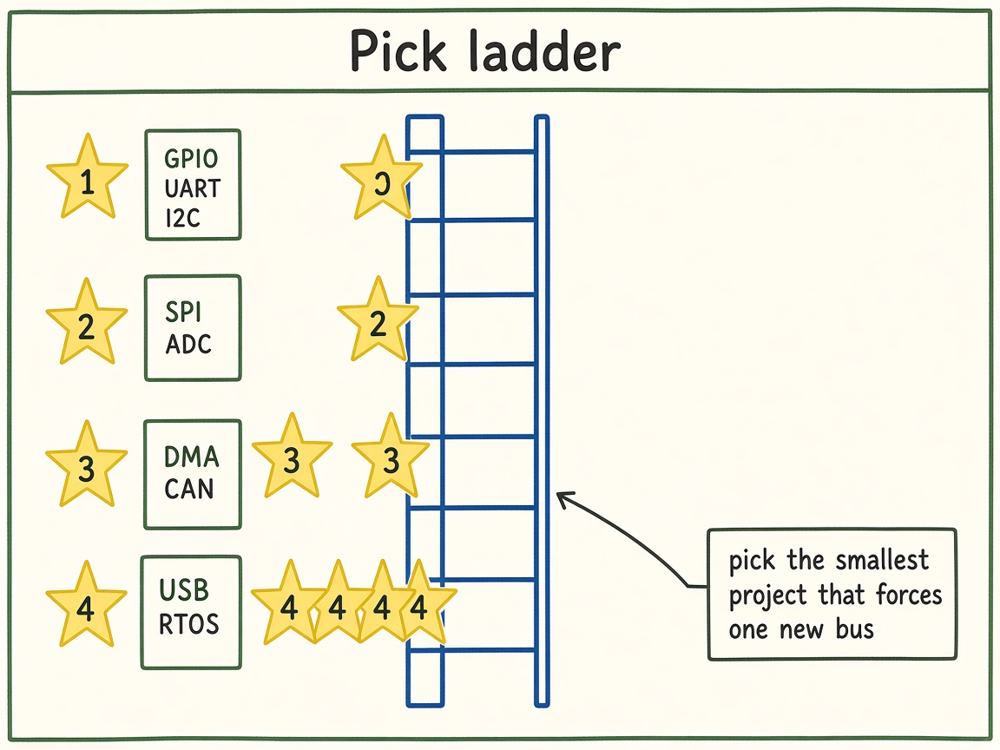
  <br><sub>▲ 知识轨（Handraw · 原理示意/非实拍）。按已经掌握的采集、通信和缓冲技能选题，每轮新增一种尚未验证的能力。</sub>
</p>


- [ ] 学会把「一个想法」拆成需求 → 硬件 → 方案 → 模块 → 测试的工程流程。
- [ ] 通过 10 个递进项目，把 GPIO/UART/I2C/SPI/ADC/DMA/TIM/RTOS 串起来用。
- [ ] 掌握每个项目的「最小可用版本」，先跑通再迭代。
- [ ] 明确每个项目的难度、工时与可扩展方向，方便自选。

> 难度与工时均为**单人有 C 基础、边查手册边做**的经验值，仅供规划参考。所有项目都建议先做「最小可用版本」（MVP）。

## 1. 蓝牙小车（★★ 入门级）

**需求**：手机通过蓝牙遥控小车前进/后退/左右转/停止，支持调速。

| 项 | 内容 |
| --- | --- |
| 硬件清单 | BluePill + HC-05 蓝牙模块 + L298N 电机驱动 + 2/4 个直流减速电机 + 18650 电池 + 车架 |
| 关键外设 | USART1（蓝牙）、TIM3/TIM4（PWM 调速）、GPIO（方向） |
| 工时 | 2~4 天 |
| 难度 | ★★ |

**技术方案**：接收手机 App 的 `F/B/L/R/S` 指令，在任务或主循环中设置方向与 PWM。`L298N` 每个电机需要 `IN1/IN2` 和使能端 `ENA`；下段 `SetMotor` 每路只有一个 DIR 输出，尚未实现这组接线。需先按驱动器真值表补齐正反转、制动与滑行；`S` 只把 PWM 置零，不能据此认定采用了哪种停止方式。编译前还要在 `Car_HandleCmd` 前声明静态 `SetMotor`。

**关键代码片段**：

```c
/* 解析蓝牙指令并驱动电机（F103，TIM3 CH1/CH2 PWM） */
void Car_HandleCmd(char c)
{
    switch (c)
    {
    case 'F': SetMotor(1, 60); SetMotor(2, 60); break;   /* 前进 60% */
    case 'B': SetMotor(1, -60); SetMotor(2, -60); break; /* 后退 */
    case 'L': SetMotor(1, 0); SetMotor(2, 60); break;    /* 左转 */
    case 'R': SetMotor(1, 60); SetMotor(2, 0); break;    /* 右转 */
    case 'S': SetMotor(1, 0); SetMotor(2, 0); break;     /* 停止 */
    default: break;
    }
}

/* duty: -100~100，符号表示方向 */
static void SetMotor(uint8_t id, int8_t duty)
{
    uint32_t pwm = (uint32_t)((duty < 0 ? -duty : duty) * 999 / 100); /* 0~999 */
    if (id == 1) {
        /* 不要把方向脚放在第 10 脚 PA0。它和灯、ADC、WKUP 撞在一起。这里不新指定一只替代脚。 */
        HAL_GPIO_WritePin(MOTOR_DIR_PORT, MOTOR_DIR_PIN, duty >= 0 ? GPIO_PIN_SET : GPIO_PIN_RESET);
        __HAL_TIM_SET_COMPARE(&htim3, TIM_CHANNEL_1, pwm);
    } else {
        HAL_GPIO_WritePin(GPIOA, GPIO_PIN_1, duty >= 0 ? GPIO_PIN_SET : GPIO_PIN_RESET);
        __HAL_TIM_SET_COMPARE(&htim3, TIM_CHANNEL_2, pwm);
    }
}
```

**可扩展方向**：加超声波避障、加编码器做里程/闭环、加 OLED 显示速度、改 PS2/2.4G 遥控。

<p align="center">
  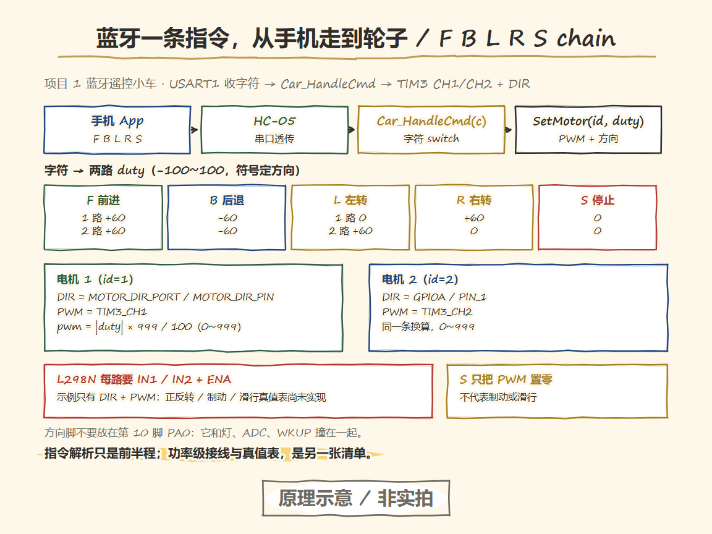
  <br><sub>▲ 知识轨（Handraw · 原理示意/非实拍）。看哪里：手机 F/B/L/R/S → HC-05 → Car_HandleCmd → SetMotor 的映射（F/B 两路 ±60，L 左 0 右 +60，R 左 +60 右 0，S 全 0）与两路 DIR/PWM。证明什么：duty 先按 |duty| × 999 / 100 换成 0–999 再写 TIM3 CH1/CH2，电机 2 的方向脚是 GPIOA PIN_1。不能证明什么：示例只到 DIR + PWM 一路，L298N 的 IN1/IN2 + ENA 真值表未实现，S 只把 PWM 置零、不代表制动或滑行，方向脚也不要用 PA0。出处：[DS5319 ADC](#source-ds5319-adc)、[本仓库例程](#source-project-examples)。</sub>
</p>

## 2. 温湿度记录仪（★★ 入门级）

**需求**：定时采集温湿度并显示，存储历史数据，可通过串口导出。

| 项 | 内容 |
| --- | --- |
| 硬件清单 | BluePill + DHT11/DHT22 或 SHT30 + SSD1306 OLED + W25Q64 Flash + RTC 晶振 + 纽扣电池 |
| 关键外设 | 单总线/I2C（传感器）、I2C（OLED）、SPI（Flash）、RTC |
| 工时 | 3~5 天 |
| 难度 | ★★ |

**技术方案**：RTC 到期后读传感器、更新显示并写入 W25Q64，再通过串口导出 CSV。下段只展示记录格式与地址递增：重启后 `wr` 回到 `LOG_BASE`，回卷也只擦首个扇区，既未覆盖整区擦除，也未实现磨损均衡。可用日志还需逐扇区预擦、写完成检查、提交标记或校验，以及重启扫描恢复写指针；掉电时保留哪些记录应通过断电测试确认。

<p align="center">
  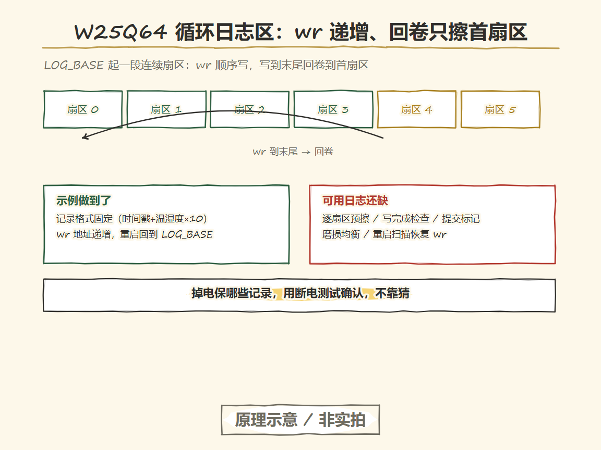
  <br><sub>▲ 知识轨（Handraw · 原理示意/非实拍）。看哪里：扇区条与回卷箭头——wr 顺序写、到末尾回卷只擦首扇区；左下绿卡「示例做到了」（固定记录格式、wr 递增），右下红卡「可用日志还缺」（预擦/写完成检查/提交标记/磨损均衡），底条「掉电保哪些记录用断电测试确认」；证明示例代码只是起点不是可用日志；不能替代实际断电测试，也不是 Flash 实测。出处 本章项目 2 技术方案。</sub>
</p>

**关键代码片段**：

```c
/* 每 5 分钟记录一条：RTC 时间戳 + 温度 + 湿度，写入 Flash 循环区 */
typedef struct __attribute__((packed)) {
    uint32_t ts;        /* Unix 时间戳 */
    int16_t  temp_x10;  /* 温度 ×10，如 253 = 25.3℃ */
    uint16_t humi_x10;  /* 湿度 ×10 */
} Record_t;

void Log_Append(const Record_t *r)
{
    static uint32_t wr = LOG_BASE;               /* 当前写指针 */
    if (wr + sizeof(Record_t) > LOG_END) {
        wr = LOG_BASE;                           /* 循环回卷（简易磨损均衡） */
        Flash_EraseSector(LOG_BASE);
    }
    Flash_Write(wr, (const uint8_t *)r, sizeof(Record_t));
    wr += sizeof(Record_t);
}
```

**可扩展方向**：加 SD 卡存更多数据、加 LoRa/NB-IoT 上传云平台、加低功耗进入 Stop（第 16 章）。

## 3. DMA + ADC 迷你示波器（★★★ 进阶）

**需求**：单通道采集 0~3.3 V 信号，屏幕上画实时波形，显示峰峰值与频率。

| 项 | 内容 |
| --- | --- |
| 硬件清单 | Nucleo-F411RE 或 F103 + OLED/SPI TFT + 待测信号源 |
| 关键外设 | ADC + DMA（循环）、TIM（触发）、SPI（屏幕） |
| 工时 | 1~2 周 |
| 难度 | ★★★ |

**技术方案**：TIM 触发 ADC，DMA 循环填充缓冲。HT 回调交出前半区，TC 回调交出后半区；每次触发完成一次单通道采样且无丢触发时，采样率才等于 TIM 触发频率。下段在回调中直接绘图，只展示两个半区的索引；实际应通知任务或主循环处理，并在 DMA 再写该半区前完成读取或复制。512 点缓冲的半区时间为 `256 / 采样率` 秒，超时须记录丢块，不能靠“无缝刷新”的注释保证。

**关键代码片段**：

```c
#define ADC_BUF_LEN 512
static uint16_t adc_buf[ADC_BUF_LEN];

/* DMA 循环 + 半传输：填前半时画后半，实现无缝刷新 */
void HAL_ADC_ConvHalfCpltCallback(ADC_HandleTypeDef *hadc)
{
    Scope_Draw(&adc_buf[0], ADC_BUF_LEN / 2);
}
void HAL_ADC_ConvCpltCallback(ADC_HandleTypeDef *hadc)
{
    Scope_Draw(&adc_buf[ADC_BUF_LEN / 2], ADC_BUF_LEN / 2);
}

/* 电压换算：V = code × Vref / 4096（12 位 ADC）。码 2048 在名义 3.3 V 下是 1.65 V。分母 4095 会偏一个 LSB。 */
static float Code2Volt(uint16_t code)
{
    return (float)code * 3.3f / 4096.0f;
}
```

**可扩展方向**：加触发阈值与边沿、加 FFT 看频谱、双通道对比、用 DWT 测刷新率。

<p align="center">
  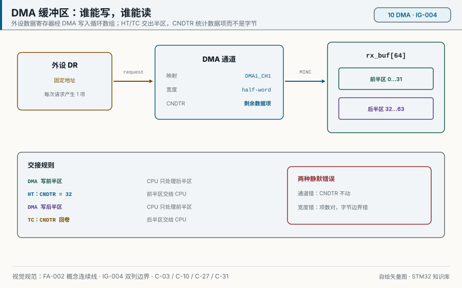
  <br><sub>▲ HT/TC 交出刚完成的半区，CPU 的处理时间受下一次回写限制。采样率和模拟精度还需分别核对定时器、ADC 与输入电压。</sub>
</p>

## 4. USB 数据采集卡（★★★ 进阶）

**需求**：通过 USB（CDC 或自定义批量端点）把多通道 ADC 数据高速上传到电脑，上位机绘图。

| 项 | 内容 |
| --- | --- |
| 硬件清单 | F103/F411（带 USB）+ 传感器/信号源 |
| 关键外设 | ADC + DMA + USB Device（CDC 或厂商自定义类） |
| 工时 | 1~2 周 |
| 难度 | ★★★ |

**技术方案**：ADC+DMA 采集后，封装帧头、序号和校验并上传，主机用 pyserial 或 pyusb 解帧。下段调用的是 `Checksum8`，不能据此称为 CRC；CDC 数据通道本就使用批量端点，改厂商类是否更快取决于协议、缓冲与主机实现。

`CDC_Transmit_FS` 通常异步持有发送缓冲，所以下段局部栈数组 `frame` 返回后可能失效；忽略 BUSY 也会丢帧。实际需让缓冲存活到发送完成，处理 BUSY、断连和队列背压。133 字节应用帧仍按 64 + 64 + 5 分包，主机不能把一次读取等同一帧。

**关键代码片段**：

```c
/* 一帧：帧头 + 序号 + N 个样本 + 校验 */
#define FRAME_N 64
static void Upload_Frame(uint16_t *samples, uint16_t seq)
{
    uint8_t frame[4 + FRAME_N * 2 + 1];
    frame[0] = 0xAA; frame[1] = 0x55;
    frame[2] = (uint8_t)(seq >> 8);
    frame[3] = (uint8_t)(seq & 0xFF);
    for (int i = 0; i < FRAME_N; i++) {
        frame[4 + i * 2]     = (uint8_t)(samples[i] & 0xFF);
        frame[4 + i * 2 + 1] = (uint8_t)(samples[i] >> 8);
    }
    frame[4 + FRAME_N * 2] = Checksum8(frame, 4 + FRAME_N * 2);
    CDC_Transmit_FS(frame, sizeof(frame));   /* 4 + 128 + 1 = 133。这不是第 14 章全速批量的 64 字节包上限 */
}
```

**可扩展方向**：加时间戳与触发、做数据存盘、加多通道同步、上位机做实时 FFT。

<p align="center">
  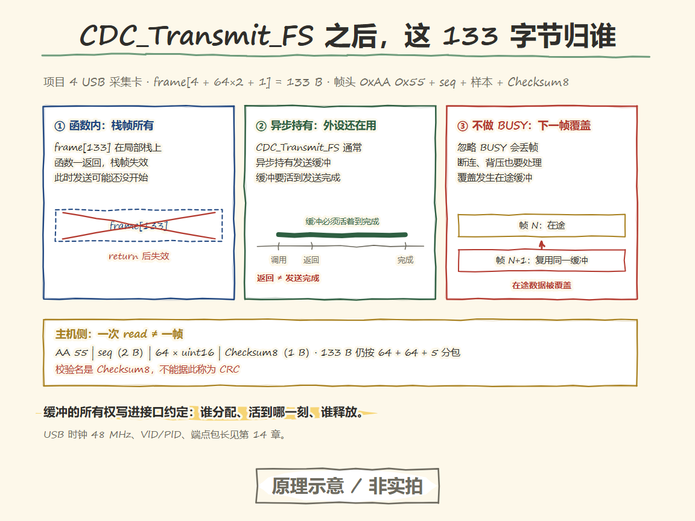
  <br><sub>▲ 知识轨（Handraw · 原理示意/非实拍）。看哪里：① 局部栈帧 frame[133] 返回即失效 ② CDC_Transmit_FS 通常异步持有发送缓冲、缓冲要活到发送完成 ③ 忽略 BUSY 时下一帧覆盖在途缓冲；以及主机侧的 AA 55 | seq | 样本 | Checksum8 帧格式。证明什么：缓冲的所有权要写进接口约定，BUSY、断连与队列背压都要处理。不能证明什么：133 字节仍按 64 + 64 + 5 分包，主机一次 read 不等于一帧，Checksum8 也不是 CRC。出处：[本仓库例程](#source-project-examples)、[DS5319 SWD](#source-ds5319-swd)。</sub>
</p>

## 5. IAP 远程升级（★★★ 进阶）

**需求**：通过串口/CAN/网络接收并校验新固件；升级中断后仍能回到恢复接收路径。保留旧版本回滚需要额外的镜像存储与状态设计。

| 项 | 内容 |
| --- | --- |
| 硬件清单 | BluePill（或任意带 Flash 的型号）+ 上位机/网关 |
| 关键外设 | USART/CAN + 内部 Flash |
| 工时 | 1~2 周 |
| 难度 | ★★★ |

**技术方案**：先实现第 12 章的单 APP：Bootloader 为 `0x08000000` 起 16 KB，参数区为 `0x08004000` 起 2 KB，APP 为 `0x08004800` 起 `0xB800`，结束边界 `0x08010000`。再放一张同长镜像将占 110 KB、到 `0x0801B800`。单槽擦写后没有旧 APP 可回滚，失败应留在 Bootloader 等待重传；两个 23 KB 槽仍只是另一套设计的容量起点。

下段是双槽选择的接口草图，不能直接用于上述单槽：`pending`、`active` 未检查范围，`p.app_crc[p.pending]` 可能越界；`Crc32(p.pending)` 也没有给出镜像地址、长度和算法约定。实现前须补齐槽内边界、向量检查和元数据的掉电提交规则，不能凭 `magic` 就认定镜像有效。

**关键代码片段**：

```c
/* 参数区结构：记录当前有效区与升级请求 */
typedef struct {
    uint32_t magic;       /* 0x5A5A0001 表示有效。这是本项目自定的标记，跟第 12 章的 Flash 解锁钥匙无关。按第 12 章的布局，C8 只放得下一个 APP 槽。 */
    uint32_t active;      /* 0 = A 区，1 = B 区 */
    uint32_t pending;     /* 请求切换到的区 */
    uint32_t app_size[2];
    uint32_t app_crc[2];
} BootParam_t;

/* Bootloader 选择要跳转的区 */
uint32_t Boot_SelectApp(void)
{
    BootParam_t p;
    Flash_Read(PARAM_ADDR, (uint8_t *)&p, sizeof(p));
    if (p.magic != 0x5A5A0001) return APP_A_ADDR;
    if (p.pending != 0xFFFFFFFF && Crc32(p.pending) == p.app_crc[p.pending]) {
        p.active = p.pending; p.pending = 0xFFFFFFFF;   /* 升级生效 */
        Flash_EraseParam(); Flash_WriteParam(&p);
    }
    return (p.active == 0) ? APP_A_ADDR : APP_B_ADDR;
}
```

**可扩展方向**：加 YMODEM/自定义分包、加签名校验、加 CAN 多机批量升级、加断点续传。

<p align="center">
  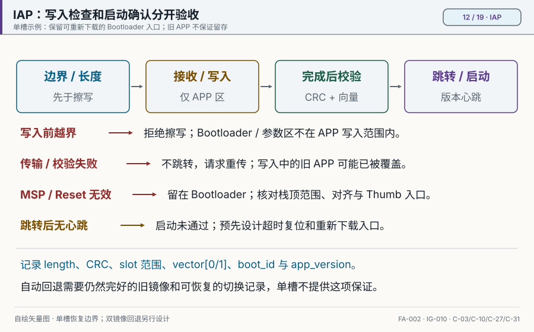
  <br><sub>▲ 从镜像范围与校验走到向量、跳转和应用心跳。坏镜像应进入恢复路径；单槽重新接收与保留旧镜像回滚是不同能力。</sub>
</p>

<p align="center">
  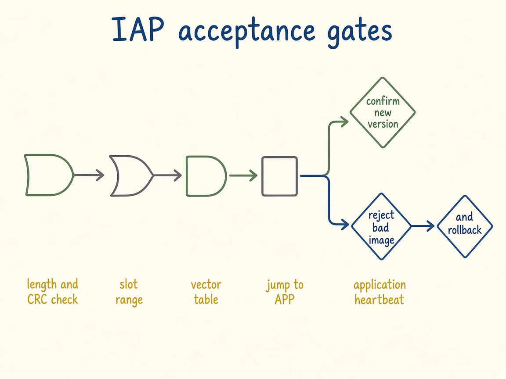
  <br><sub>▲ 知识轨（Handraw · 原理示意/非实拍）。每一关都需有拒绝或恢复出口。回滚依赖旧镜像仍然存在，不能由单 APP 布局自动获得。</sub>
</p>

## 6. WS2812 灯带控制器（★★ 进阶）

**需求**：驱动 WS2812/WS2812B 灯带，做流水、呼吸、彩虹等效果，可调亮度与数量。

| 项 | 内容 |
| --- | --- |
| 硬件清单 | BluePill + WS2812 灯带 + 5 V 电源（与灯带电流匹配） |
| 关键外设 | TIM + DMA（精确 800 kHz 时序）、或 SPI |
| 工时 | 3~5 天 |
| 难度 | ★★ |

**技术方案**：按具体灯珠版本的数据手册编码 GRB。常见示例中的 `T0H=0.4µs`、`T1H=0.8µs`、周期 `1.25µs` 不能覆盖所有 WS2812/WS2812B 修订版，复位低电平时间也须另查。PWM+DMA 通常每个位周期更新一个 CCR，高电平宽度由 CCR 决定，低电平由同一周期剩余部分形成。

下段把高、低时长当成连续两个 CCR，普通 PWM 模式会输出两个 PWM 周期，并非一个正确数据位。这是待纠正的编码草图，不能直接烧录使用；需改为每位一个比较值，并核对 DMA 请求时机、CCR 预装载、传输宽度、`n <= LED_NUM` 和复位时长后测量波形。

**关键代码片段**：

```c
/* 用 TIM2 CH1 PWM + DMA 产生 WS2812 时序（简化示意） */
#define LED_NUM     60
#define RESET_SLOTS 50                      /* 复位低电平周期数 */

static uint16_t pwm_buf[LED_NUM * 24 * 2 + RESET_SLOTS];

/* 把 GRB 数据编码进 pwm_buf：1 位 = 高+低两个比较值 */
void WS2812_Encode(const uint8_t *grb, uint16_t n)
{
    uint32_t idx = 0;
    for (uint16_t i = 0; i < n * 3; i++) {
        for (int b = 7; b >= 0; b--) {
            uint8_t bit = (grb[i] >> b) & 1;
            pwm_buf[idx++] = bit ? T1H : T0H;   /* 高电平宽度 */
            pwm_buf[idx++] = bit ? (PERIOD - T1H) : (PERIOD - T0H);
        }
    }
    for (int i = 0; i < RESET_SLOTS; i++) pwm_buf[idx++] = 0;  /* 复位 */
    HAL_TIM_PWM_Start_DMA(&htim2, TIM_CHANNEL_1, (uint32_t *)pwm_buf, idx);
}
```

**可扩展方向**：加音频律动、加红外/蓝牙控制、改多灯带级联、用 SPI+DMA 更省 RAM。

## 7. 简易逻辑分析仪（★★★★ 挑战）

**需求**：采样 4~8 路数字信号，通过 USB 上传到电脑，上位机按协议解码（UART/I2C/SPI）。

| 项 | 内容 |
| --- | --- |
| 硬件清单 | F411/F407（高主频）+ USB，输入加保护电阻 |
| 关键外设 | TIM + DMA（定时采样 GPIO）、USB 上传、环形缓冲 |
| 工时 | 2~4 周 |
| 难度 | ★★★★ |

**技术方案**：下段实际采用 TIM 中断读取 GPIOC 低 8 位，并未配置 DMA；中断延迟、其他中断和读端口耗时都会影响采样间隔。DMA 采 GPIO 是另一种实现，须核对目标的请求映射和总线路径。先验证采样周期与输入保护，再添加触发与主机解码。


<p align="center">
  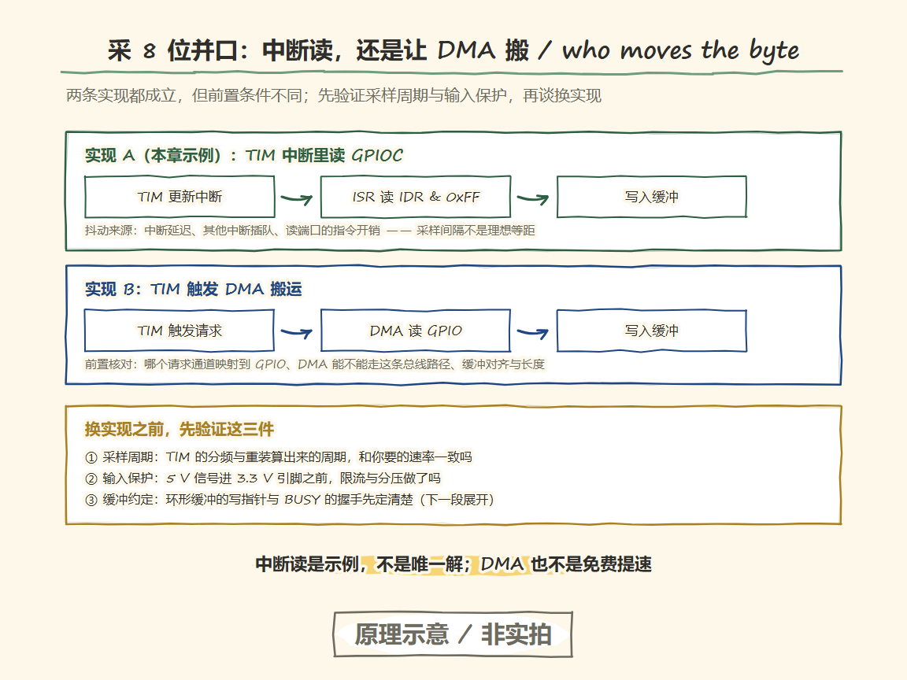
  <br><sub>▲ 知识轨（Handraw · 原理示意/非实拍）。看哪里：实现 A 是 TIM 中断读 GPIOC，实现 B 是 TIM 触发 DMA，底部列出换实现前先验证的三件事。证明什么：示例片段不含 DMA，采样间隔抖动来自中断路径；换 DMA 要另核请求映射与总线路径。不能证明什么：不是采样波形实测，环形缓冲与 BUSY 的完整约定在下一段才展开。出处：本章 §7、[DS5319](#source-ds5319-swd)。</sub>
</p>
`65536 / 采样率` 秒后环形缓冲会被覆盖；停止后还须按 `la_wr` 找到最旧样本再输出。`LA_Upload()` 的循环未等待 CDC 发送完成或处理 BUSY，不能保证 512 字节块全部送出；上传期间也不能重启采样改写缓冲。TIM 回调还需检查实例，避免被其他定时器误调用。

**关键代码片段**：

```c
/* 64 * 1024 = 65536，大于 C8 的 SRAM 20480 字节。这只数组在 STM32F103C8T6 上放不下，要换 SRAM 更大的芯片。 */
#define LA_DEPTH  (64 * 1024)
static uint8_t la_buf[LA_DEPTH];
static volatile uint32_t la_wr = 0;
static volatile uint8_t  la_run = 0;

/* TIM 定时中断：一次采 8 路（整端口） */
void HAL_TIM_PeriodElapsedCallback(TIM_HandleTypeDef *htim)
{
    if (!la_run) return;
    la_buf[la_wr++ & (LA_DEPTH - 1)] = (uint8_t)(GPIOC->IDR & 0xFF);
}

/* 停止后分块经 USB 上传（见第 14 章） */
void LA_Upload(void)
{
    for (uint32_t off = 0; off < LA_DEPTH; off += 512)
        CDC_Transmit_FS(&la_buf[off], 512);
}
```

**可扩展方向**：加可调采样率与触发、加模拟通道、加协议解码器插件、用双缓冲提升速率。


## 8. 多机 CAN 网络（★★★★ 挑战）

**需求**：3 个以上节点用 CAN 组网，主节点轮询、从节点上报传感器数据，带 ID 规划与错误处理。

| 项 | 内容 |
| --- | --- |
| 硬件清单 | 3× BluePill + 3× TJA1050/SN65HVD230 + 双绞线 + 2×120Ω 终端电阻 |
| 关键外设 | CAN1、USART（调试） |
| 工时 | 1~2 周 |
| 难度 | ★★★★ |

**技术方案**：规划 ID 空间（如 `0x100~0x1FF` 从节点上报、`0x200` 主节点广播），用过滤器分流（见第 13 章），采样点统一。加入心跳与掉线检测。

**关键代码片段**：

```c
/* ID 规划：低 4 位 = 节点号，高 7 位 = 功能码 */
#define ID_FUNC_STATUS 0x100u
#define ID_FUNC_CMD    0x200u

#define MAKE_ID(func, node)  ((uint16_t)(((func) & 0x7F0u) | ((node) & 0x0Fu)))
#define GET_NODE(id)         ((id) & 0x0Fu)

void Node_Report(uint8_t node, int16_t temp_x10, uint16_t humi_x10)
{
    uint8_t data[4];
    data[0] = (uint8_t)(temp_x10 >> 8);
    data[1] = (uint8_t)(temp_x10 & 0xFF);
    data[2] = (uint8_t)(humi_x10 >> 8);
    data[3] = (uint8_t)(humi_x10 & 0xFF);
    CAN_Send(MAKE_ID(ID_FUNC_STATUS, node), data, 4);   /* 见第 13 章 */
}
```

**可扩展方向**：加 CANopen 协议、加 Bootloader 升级、加网关转以太网/4G。

<p align="center">
  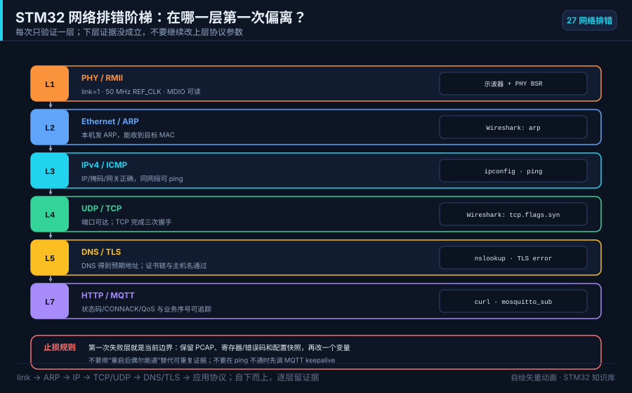
  <br><sub>▲ 多节点项目按最先失败的边界排查，不从应用日志直接跳到“总线坏了”。每层都要留下可复现证据和恢复动作。</sub>
</p>

## 9. 自平衡小车（★★★★ 挑战）

**需求**：两轮自平衡小车，能直立、受扰后回正、可由遥控前进/转向。

| 项 | 内容 |
| --- | --- |
| 硬件清单 | F103/F411 + MPU6050（陀螺+加速度）+ TB6612/L298N + 带编码器电机 + 车架 + 电池 |
| 关键外设 | I2C（MPU6050）、TIM（编码器+PWM）、UART（遥控）、高频率控制环 |
| 工时 | 3~6 周 |
| 难度 | ★★★★ |

**技术方案**：先核对姿态估计的轴向、单位和电机极性，再调直立环。下段只有角度 P 加陀螺反馈 D，没有积分项、速度环或完整串级 PID。5 ms 是调度目标，需实测执行时间与抖动；若 IMU 读取会阻塞，应移出 ISR，再验证控制任务的截止时间。参数 25.0/0.8 仅为示例，不能直接当作底盘的稳定参数。

**关键代码片段**：

```c
/* 直立环 PID（角度误差 → PWM），周期 5ms */
static float g_kp = 25.0f, g_kd = 0.8f;
static float target_angle = 0.0f;      /* 目标倾角 0° */

float Balance_Update(float angle, float gyro)
{
    float err = target_angle - angle;
    /* PD：P 纠正倾角，D 用陀螺抑制振荡 */
    float out = g_kp * err - g_kd * gyro;
    return out;                        /* 限幅后送电机 */
}

/* 固定周期控制环：TIM 中断中调用 */
void Control_Loop_5ms(void)
{
    float angle = IMU_GetAngle();      /* 互补滤波后的倾角 */
    float gyro  = IMU_GetGyroY();
    float pwm   = Balance_Update(angle, gyro);
    Motor_SetBoth((int16_t)Clamp(pwm, -1000, 1000));
}
```

**可扩展方向**：加蓝牙遥控、加 OLED 调参、加视觉寻线、用卡尔曼滤波替代互补滤波。

<p align="center">
  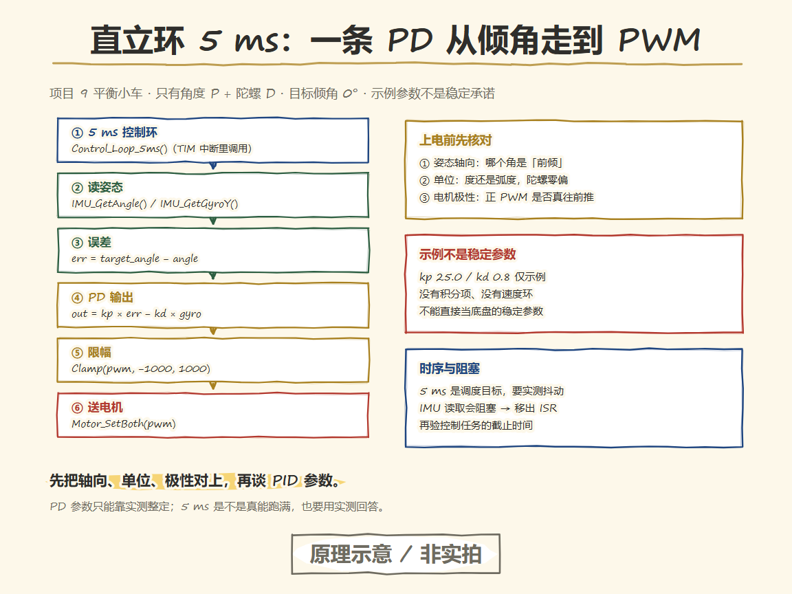
  <br><sub>▲ 知识轨（Handraw · 原理示意/非实拍）。看哪里：5 ms 控制环 → 读姿态 → err = target − angle → out = kp × err − kd × gyro → Clamp ±1000 → Motor_SetBoth，右侧是上电前核对轴向、单位与电机极性。证明什么：这套环只有角度 P 加陀螺 D，没有积分项、没有速度环。不能证明什么：25.0/0.8 只是示例，5 ms 是调度目标要实测执行时间与抖动，IMU 读取会阻塞时应移出 ISR。出处：[本仓库例程](#source-project-examples)。</sub>
</p>

## 10. FreeRTOS 智能网关（★★★★ 挑战）

**需求**：多协议网关——本地传感器采集 + OLED 显示 + 串口/CAN 转发 + 低功耗管理，多任务协同。

| 项 | 内容 |
| --- | --- |
| 硬件清单 | F411/F407 + 传感器 + OLED + CAN 收发器 + USB-TTL |
| 关键外设 | 多外设 + FreeRTOS（任务/队列/事件组/信号量） |
| 工时 | 3~6 周 |
| 难度 | ★★★★ |

**技术方案**：采集、显示、通信分任务，队列传数据，互斥量保护共享外设。带 CAN 的方案应选择有 bxCAN 的 F407，或给 F411 增加外部 CAN 控制器；只有收发器不能补出控制器。Stop 需由内核的空闲/tickless 路径确认可休眠，并处理唤醒时钟恢复与时间补偿，不能让管理任务看见队列空就直接睡眠。

下段假设队列和事件组已创建且成功，队列项大小为 `sizeof(SensorData_t)`，所有发送字段都已初始化。`xQueueSend` 复制一个队列项，事件位只表示条件，不把 `d` 交给显示任务，也不累计每个样本。显示与通信若都需同一份数据，须单独分发或使用受保护快照；两个消费者从同一队列接收不会得到广播副本。

**关键代码片段**：

```c
/* 采集任务 → 队列 → 通信任务；事件组做「采集完成」同步 */
static QueueHandle_t      g_data_q;
static EventGroupHandle_t g_evt;

#define EVT_OLED_READY  (1 << 0)

static void vSampleTask(void *arg)
{
    SensorData_t d;
    for (;;) {
        d.temp = Sensor_ReadTemp();
        xQueueSend(g_data_q, &d, portMAX_DELAY);      /* 交给通信任务 */
        xEventGroupSetBits(g_evt, EVT_OLED_READY);    /* 通知显示任务 */
        vTaskDelay(pdMS_TO_TICKS(1000));              /* 阻塞 1s，让出 CPU */
    }
}

static void vCommTask(void *arg)
{
    SensorData_t d;
    for (;;) {
        if (xQueueReceive(g_data_q, &d, portMAX_DELAY) == pdTRUE) {
            Comm_SendFrame(&d);                       /* 串口/CAN 转发 */
        }
    }
}
```

**可扩展方向**：加 MQTT/Modbus 协议栈、加 OTA 升级、加任务运行统计（`vTaskGetRunTimeStats`）、加掉电数据保护。

<p align="center">
  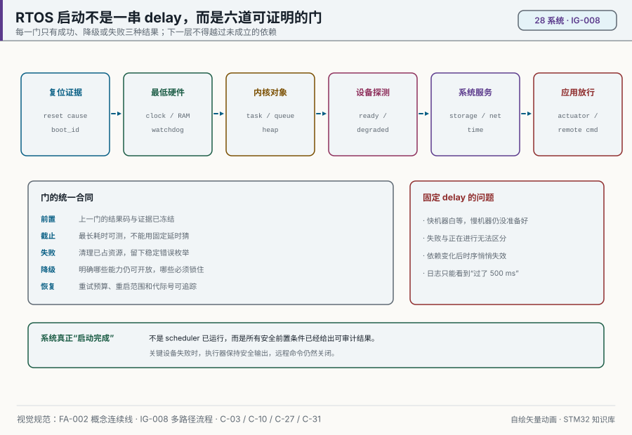
  <br><sub>▲ 网关类项目只有在关键设备、队列、存储和通信都给出结果后才放行业务。调度器已运行不等于系统已准备好。</sub>
</p>


<p align="center">
  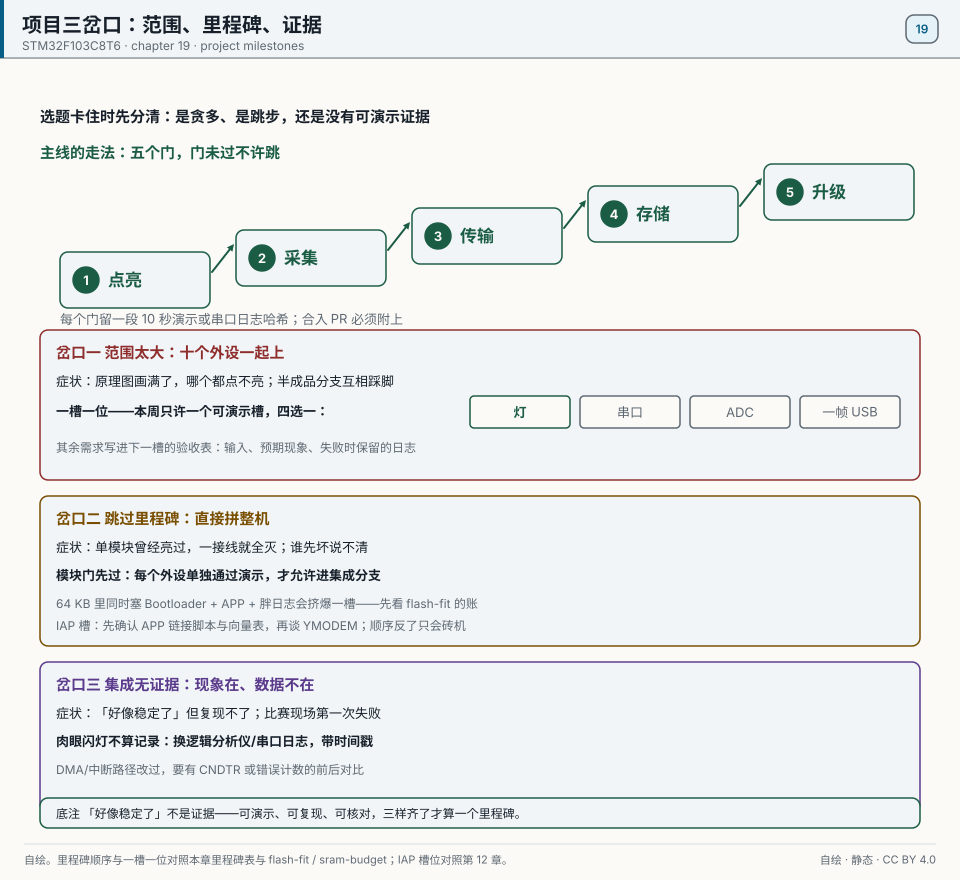
  <br><sub>▲ 自绘。项目三岔口：贪多 / 跳步 / 无证据。出处是 [配套例程](#source-project-examples) 与本章验收门图。</sub>
</p>

<p align="center">
  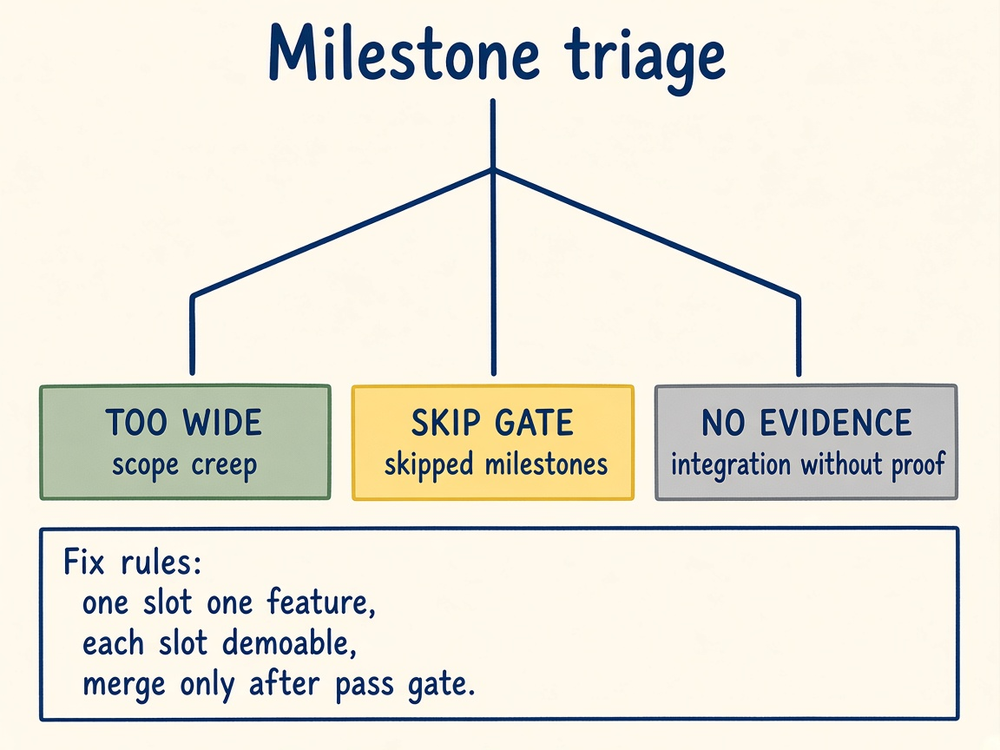
  <br><sub>▲ 知识轨（Handraw · 原理示意/非实拍）。每轮新增一种能力，完成独立测试再集成；失败时保留输入、状态和恢复结果。</sub>
</p>

## 动手实验（选题与推进）


<p align="center">
  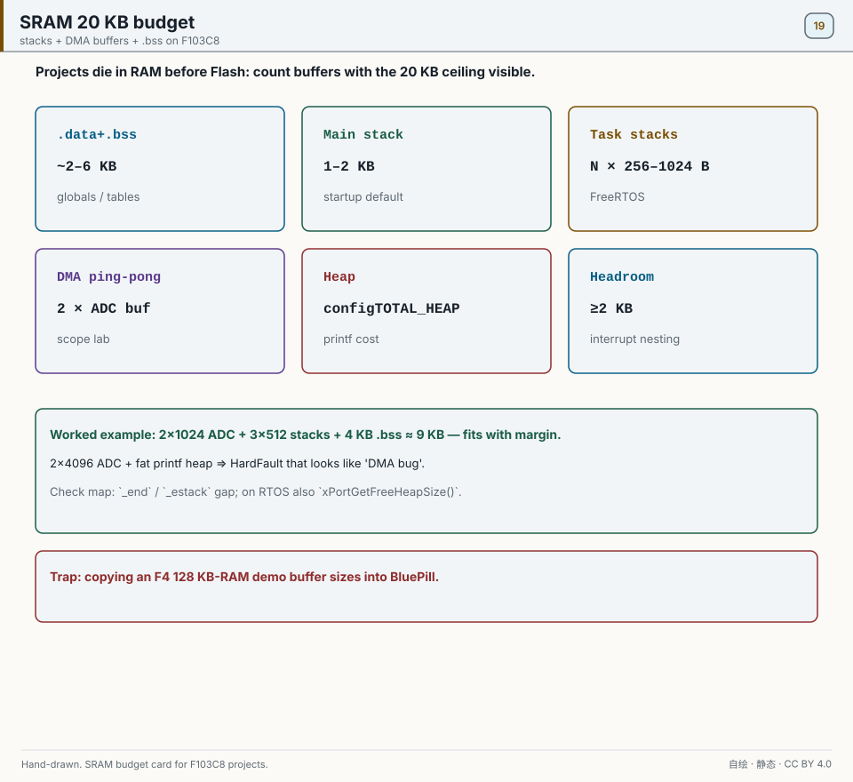
  <br><sub>▲ 自绘预算示例。heap_4 的 ucHeap 已计入静态占用，动态任务栈和内核对象在其中分配，不能再次加到总量上。</sub>
</p>

<p align="center">
  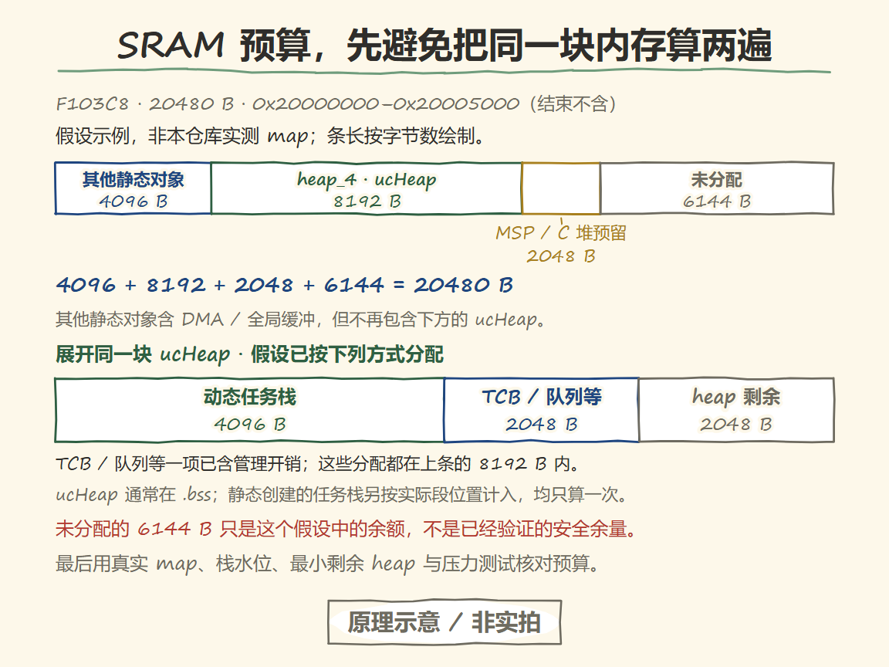
  <br><sub>▲ 知识轨（Handraw · 原理示意/非实拍）。C8 的 20480 字节从 0x20000000 起分配；全局缓冲、堆和任务栈都要进入同一份预算。</sub>
</p>


1. **冻结交付合同**：写清输入范围、输出格式、时序/容量预算、失败状态和恢复路径，先不写业务代码。
2. **模块证据**：每个模块至少保留一个可运行测试、一个失败注入和一份测量或缓冲区记录；通过后再组合。
3. **系统预算**：汇总 Flash/RAM、最坏响应、平均电流、带宽和队列峰值。任何一项超预算都先缩功能或换目标芯片。
4. **交付包**：从干净环境重建，附 ELF/map、配置、接线、验收记录、已知限制和恢复步骤，让另一个人能复现。

## 相关资源

- 各章节技术细节：第 03~17 章（GPIO/UART/I2C/SPI/ADC/DMA/TIM/RTC/Flash/CAN/USB/RTOS/低功耗/调试）。
- 示例工程：[`examples/`](../examples/)（gpio-blink、uart-dma-idle、i2c-oled、adc-dma、rtc-alarm、freertos-task、iap-bootloader）。
- 参考手册：RM0008 / RM0090（外设寄存器与总线）。
- 相关章节：第 12 章 IAP、第 13 章 CAN、第 14 章 USB、第 15 章 FreeRTOS。
- 配图：`../assets/boards/peripheral-wiring.svg`（作者自绘矢量图）。


- 手机阅读版：[第 19 章 · 项目实战合集（公众号图文）](https://mp.weixin.qq.com/s/3e90XX9-VNMOecY8mv9kWQ)
