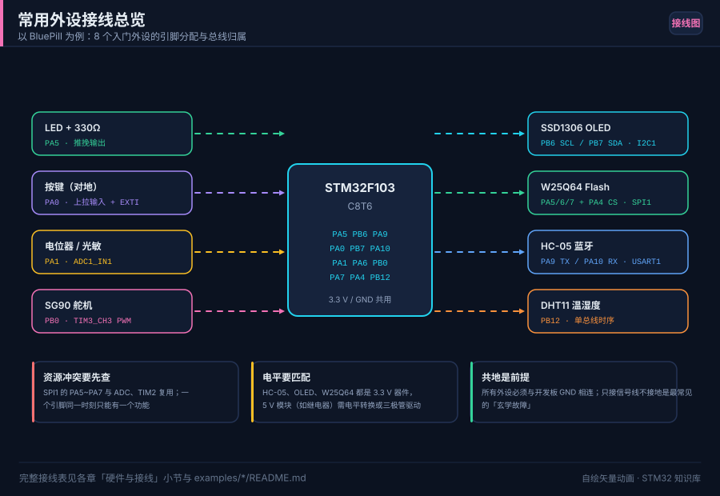

# 19 项目实战合集

> English: [Projects](en/19-projects.md)

> 从蓝牙小车到 FreeRTOS 网关，10 个由易到难的项目，每个都给出需求、硬件清单、技术方案、关键代码与工时估算，照着做即可完成。

<p align="center">
  
  <br><sub>▲ 图：常用外设接线总览，多数项目都从这张图起步（作者自绘矢量图，非实拍）</sub>
</p>

<!-- video:ch19 -->
<p align="center">
  <video width="640" controls poster="../assets/video/ch19-projects.png">
    <source src="../assets/video/ch19-projects.mp4" type="video/mp4">
  </video>
  <br><sub>▲ 本章讲解 2.4 分钟。配音是微软 Edge 在线神经语音「晓晓」（zh-CN-XiaoxiaoNeural），经 edge-tts 调用。edge-tts 大部分源码为 LGPLv3，srt_composer.py 为 MIT；声线模型是微软在线服务，不是开放模型。这里提交的是合成后的 MP4，离线可看。重新生成需要联网。画面用文泉驿微米黑绘制，插图是本仓库 SVG，不是实拍。 字幕：<a href="../assets/video/ch19-projects.srt">SRT</a>。由 <code>python3 tools/gen_narrated.py --speak</code> 用 ffmpeg 合成。</sub>
</p>

**旁白（与字幕、配音同一份稿）**

1. 做项目最容易散的地方，是一个周末同时加上蓝牙、显示和存储。规矩只有一条：每一轮新增加的不确定，只允许有一个外设。坏了，你知道是谁。
2. 动手前用一句话写完完成标准。比如温度每分钟记一条，掉电不丢。没有这句话，你会一直调，不知道哪天算做完。失败怎样看出来，也要先写下来。
3. 不要从空白文件开始堆。先让仓库里对应的示例在你的板上跑起来，再加这一个项目需要的外设。示例和你的板子不一致时，先改时钟和引脚，别改算法。
4. 这一帧是仓库画的工程结构。应用、板级、驱动分开，后面你才敢换一颗芯片。所有代码堆在一个 main 里，项目做完你也不敢再打开它。
5. 温湿度记录仪先保证读数和时间是对的，掉电不丢，再去画曲线。曲线很好看，但是如果时间是错的，记录就没有意义。显示是最后一层糖。
6. 蓝牙小车先让两个轮子按你的命令转，再加遥控。自平衡是挑战题，不要当第一周的作业。底盘力学和编码器还没稳，算法只会放大抖动。
7. 多机 CAN 先做通两个节点，USB 采集先做通枚举和回显，再把采样挂上去。链路不通时叠协议，你无法判断是包错了还是采样错了。
8. 口诀：你的下一个项目，新增加的外设只有哪一个？说不出名字，就还没准备好开工。说得出，就先把别的欲望写进下一轮。
9. 做完不是指灯亮过一次。别人按你的说明能复现，你能说出还没做的部分。仓库里的十个题目，选一个做到这个程度，比十个都开了头有用。
10. 合上书，三问。你下一轮只允许新加哪一个外设？怎样算做完？板上的时钟和示例不一致时，你先改哪一部分？
<!-- /video:ch19 -->
## 📌 学习目标

- [ ] 学会把「一个想法」拆成需求 → 硬件 → 方案 → 模块 → 测试的工程流程。
- [ ] 通过 10 个递进项目，把 GPIO/UART/I2C/SPI/ADC/DMA/TIM/RTOS 串起来用。
- [ ] 掌握每个项目的「最小可用版本」，先跑通再迭代。
- [ ] 明确每个项目的难度、工时与可扩展方向，方便自选。

> 难度与工时均为**单人有 C 基础、边查手册边做**的经验值，仅供规划参考。所有项目都建议先做「最小可用版本」（MVP）。

## 1. 蓝牙小车（★★ 入门级）

**需求**：手机通过蓝牙遥控小车前进/后退/左右转/停止，支持调速。

| 项 | 内容 |
| --- | --- |
| 硬件清单 | BluePill + HC-05 蓝牙模块 + L298N 电机驱动 + 2/4 个直流减速电机 + 18650 电池 + 车架 |
| 关键外设 | USART1（蓝牙）、TIM3/TIM4（PWM 调速）、GPIO（方向） |
| 工时 | 2~4 天 |
| 难度 | ★★ |

**技术方案**：手机 App 发单字符指令（`F/B/L/R/S`）→ 串口中断/空闲中断收包 → 解析后设置电机方向与 PWM 占空比。`L298N` 的 `IN1/IN2` 控制方向、`ENA` 接 PWM 调速。

**关键代码片段**：

```c
/* 解析蓝牙指令并驱动电机（F103，TIM3 CH1/CH2 PWM） */
void Car_HandleCmd(char c)
{
    switch (c)
    {
    case 'F': SetMotor(1, 60); SetMotor(2, 60); break;   /* 前进 60% */
    case 'B': SetMotor(1, -60); SetMotor(2, -60); break; /* 后退 */
    case 'L': SetMotor(1, 0); SetMotor(2, 60); break;    /* 左转 */
    case 'R': SetMotor(1, 60); SetMotor(2, 0); break;    /* 右转 */
    case 'S': SetMotor(1, 0); SetMotor(2, 0); break;     /* 停止 */
    default: break;
    }
}

/* duty: -100~100，符号表示方向 */
static void SetMotor(uint8_t id, int8_t duty)
{
    uint32_t pwm = (uint32_t)((duty < 0 ? -duty : duty) * 999 / 100); /* 0~999 */
    if (id == 1) {
        HAL_GPIO_WritePin(GPIOA, GPIO_PIN_0, duty >= 0 ? GPIO_PIN_SET : GPIO_PIN_RESET);
        __HAL_TIM_SET_COMPARE(&htim3, TIM_CHANNEL_1, pwm);
    } else {
        HAL_GPIO_WritePin(GPIOA, GPIO_PIN_1, duty >= 0 ? GPIO_PIN_SET : GPIO_PIN_RESET);
        __HAL_TIM_SET_COMPARE(&htim3, TIM_CHANNEL_2, pwm);
    }
}
```

**可扩展方向**：加超声波避障、加编码器做里程/闭环、加 OLED 显示速度、改 PS2/2.4G 遥控。

## 2. 温湿度记录仪（★★ 入门级）

**需求**：定时采集温湿度并显示，存储历史数据，可通过串口导出。

| 项 | 内容 |
| --- | --- |
| 硬件清单 | BluePill + DHT11/DHT22 或 SHT30 + SSD1306 OLED + W25Q64 Flash + RTC 晶振 + 纽扣电池 |
| 关键外设 | 单总线/I2C（传感器）、I2C（OLED）、SPI（Flash）、RTC |
| 工时 | 3~5 天 |
| 难度 | ★★ |

**技术方案**：RTC 周期唤醒（见第 11 章）→ 读传感器 → 显示到 OLED → 写入 W25Q64 的循环日志区 → 串口命令导出 CSV。SHT30 走 I2C，精度与稳定性优于 DHT11。

**关键代码片段**：

```c
/* 每 5 分钟记录一条：RTC 时间戳 + 温度 + 湿度，写入 Flash 循环区 */
typedef struct __attribute__((packed)) {
    uint32_t ts;        /* Unix 时间戳 */
    int16_t  temp_x10;  /* 温度 ×10，如 253 = 25.3℃ */
    uint16_t humi_x10;  /* 湿度 ×10 */
} Record_t;

void Log_Append(const Record_t *r)
{
    static uint32_t wr = LOG_BASE;               /* 当前写指针 */
    if (wr + sizeof(Record_t) > LOG_END) {
        wr = LOG_BASE;                           /* 循环回卷（简易磨损均衡） */
        Flash_EraseSector(LOG_BASE);
    }
    Flash_Write(wr, (const uint8_t *)r, sizeof(Record_t));
    wr += sizeof(Record_t);
}
```

**可扩展方向**：加 SD 卡存更多数据、加 LoRa/NB-IoT 上传云平台、加低功耗进入 Stop（第 16 章）。

## 3. DMA + ADC 迷你示波器（★★★ 进阶）

**需求**：单通道采集 0~3.3 V 信号，屏幕上画实时波形，显示峰峰值与频率。

| 项 | 内容 |
| --- | --- |
| 硬件清单 | Nucleo-F411RE 或 F103 + OLED/SPI TFT + 待测信号源 |
| 关键外设 | ADC + DMA（循环）、TIM（触发）、SPI（屏幕） |
| 工时 | 1~2 周 |
| 难度 | ★★★ |

**技术方案**：TIM 触发 ADC 等间隔采样 → DMA 循环搬运到缓冲区 → 半传输/传输完成中断里把「后半区」数据画到屏幕。采样率 = `TIM 触发频率`，靠调节定时器实现时基档位。

**关键代码片段**：

```c
#define ADC_BUF_LEN 512
static uint16_t adc_buf[ADC_BUF_LEN];

/* DMA 循环 + 半传输：填前半时画后半，实现无缝刷新 */
void HAL_ADC_ConvHalfCpltCallback(ADC_HandleTypeDef *hadc)
{
    Scope_Draw(&adc_buf[0], ADC_BUF_LEN / 2);
}
void HAL_ADC_ConvCpltCallback(ADC_HandleTypeDef *hadc)
{
    Scope_Draw(&adc_buf[ADC_BUF_LEN / 2], ADC_BUF_LEN / 2);
}

/* 电压换算：V = code × Vref / 4095（12 位 ADC） */
static float Code2Volt(uint16_t code)
{
    return (float)code * 3.3f / 4095.0f;
}
```

**可扩展方向**：加触发阈值与边沿、加 FFT 看频谱、双通道对比、用 DWT 测刷新率。

## 4. USB 数据采集卡（★★★ 进阶）

**需求**：通过 USB（CDC 或自定义批量端点）把多通道 ADC 数据高速上传到电脑，上位机绘图。

| 项 | 内容 |
| --- | --- |
| 硬件清单 | F103/F411（带 USB）+ 传感器/信号源 |
| 关键外设 | ADC + DMA + USB Device（CDC 或厂商自定义类） |
| 工时 | 1~2 周 |
| 难度 | ★★★ |

**技术方案**：ADC+DMA 采一帧 → 打包（含帧头、序号、CRC）→ `CDC_Transmit_FS` 上传。为提速可用厂商自定义类 + 批量端点（免去 CDC 开销）。上位机用 Python（pyserial/pyusb）解析并实时绘图。

**关键代码片段**：

```c
/* 一帧：帧头 + 序号 + N 个样本 + 校验 */
#define FRAME_N 64
static void Upload_Frame(uint16_t *samples, uint16_t seq)
{
    uint8_t frame[4 + FRAME_N * 2 + 1];
    frame[0] = 0xAA; frame[1] = 0x55;
    frame[2] = (uint8_t)(seq >> 8);
    frame[3] = (uint8_t)(seq & 0xFF);
    for (int i = 0; i < FRAME_N; i++) {
        frame[4 + i * 2]     = (uint8_t)(samples[i] & 0xFF);
        frame[4 + i * 2 + 1] = (uint8_t)(samples[i] >> 8);
    }
    frame[4 + FRAME_N * 2] = Checksum8(frame, 4 + FRAME_N * 2);
    CDC_Transmit_FS(frame, sizeof(frame));   /* 见第 14 章 */
}
```

**可扩展方向**：加时间戳与触发、做数据存盘、加多通道同步、上位机做实时 FFT。
## 5. IAP 远程升级（★★★ 进阶）

**需求**：设备出厂后，通过串口/CAN/网络接收新固件并自升级，失败可回退，不变砖。

| 项 | 内容 |
| --- | --- |
| 硬件清单 | BluePill（或任意带 Flash 的型号）+ 上位机/网关 |
| 关键外设 | USART/CAN + 内部 Flash |
| 工时 | 1~2 周 |
| 难度 | ★★★ |

**技术方案**：Flash 划分 Bootloader + 参数区 + APP_A + APP_B（见第 12 章）。升级时把新固件写入空闲区，校验 CRC 后写「启动标志」并复位；Bootloader 依据标志跳转到有效区，失败则回退。

**关键代码片段**：

```c
/* 参数区结构：记录当前有效区与升级请求 */
typedef struct {
    uint32_t magic;       /* 0x5A5A0001 表示有效 */
    uint32_t active;      /* 0 = A 区，1 = B 区 */
    uint32_t pending;     /* 请求切换到的区 */
    uint32_t app_size[2];
    uint32_t app_crc[2];
} BootParam_t;

/* Bootloader 选择要跳转的区 */
uint32_t Boot_SelectApp(void)
{
    BootParam_t p;
    Flash_Read(PARAM_ADDR, (uint8_t *)&p, sizeof(p));
    if (p.magic != 0x5A5A0001) return APP_A_ADDR;
    if (p.pending != 0xFFFFFFFF && Crc32(p.pending) == p.app_crc[p.pending]) {
        p.active = p.pending; p.pending = 0xFFFFFFFF;   /* 升级生效 */
        Flash_EraseParam(); Flash_WriteParam(&p);
    }
    return (p.active == 0) ? APP_A_ADDR : APP_B_ADDR;
}
```

**可扩展方向**：加 YMODEM/自定义分包、加签名校验、加 CAN 多机批量升级、加断点续传。

## 6. WS2812 灯带控制器（★★ 进阶）

**需求**：驱动 WS2812/WS2812B 灯带，做流水、呼吸、彩虹等效果，可调亮度与数量。

| 项 | 内容 |
| --- | --- |
| 硬件清单 | BluePill + WS2812 灯带 + 5 V 电源（与灯带电流匹配） |
| 关键外设 | TIM + DMA（精确 800 kHz 时序）、或 SPI |
| 工时 | 3~5 天 |
| 难度 | ★★ |

**技术方案**：WS2812 靠**单线归零码**（`T0H=0.4µs`、`T1H=0.8µs`、周期 1.25µs）传 24 位 GRB。用 **TIM+DMA** 输出精确波形：把每位编码成两个比较值，DMA 循环送出。

**关键代码片段**：

```c
/* 用 TIM2 CH1 PWM + DMA 产生 WS2812 时序（简化示意） */
#define LED_NUM     60
#define RESET_SLOTS 50                      /* 复位低电平周期数 */

static uint16_t pwm_buf[LED_NUM * 24 * 2 + RESET_SLOTS];

/* 把 GRB 数据编码进 pwm_buf：1 位 = 高+低两个比较值 */
void WS2812_Encode(const uint8_t *grb, uint16_t n)
{
    uint32_t idx = 0;
    for (uint16_t i = 0; i < n * 3; i++) {
        for (int b = 7; b >= 0; b--) {
            uint8_t bit = (grb[i] >> b) & 1;
            pwm_buf[idx++] = bit ? T1H : T0H;   /* 高电平宽度 */
            pwm_buf[idx++] = bit ? (PERIOD - T1H) : (PERIOD - T0H);
        }
    }
    for (int i = 0; i < RESET_SLOTS; i++) pwm_buf[idx++] = 0;  /* 复位 */
    HAL_TIM_PWM_Start_DMA(&htim2, TIM_CHANNEL_1, (uint32_t *)pwm_buf, idx);
}
```

**可扩展方向**：加音频律动、加红外/蓝牙控制、改多灯带级联、用 SPI+DMA 更省 RAM。

## 7. 简易逻辑分析仪（★★★★ 挑战）

**需求**：采样 4~8 路数字信号，通过 USB 上传到电脑，上位机按协议解码（UART/I2C/SPI）。

| 项 | 内容 |
| --- | --- |
| 硬件清单 | F411/F407（高主频）+ USB，输入加保护电阻 |
| 关键外设 | TIM + DMA（定时采样 GPIO）、USB 上传、环形缓冲 |
| 工时 | 2~4 周 |
| 难度 | ★★★★ |

**技术方案**：TIM 高频触发，ISR 里把整组 GPIO 的 IDR 读成 1 字节存环形缓冲；触发条件满足后停止，通过 USB 批量上传。上位机做协议解码与显示（类似 PulseView 的轻量版）。

**关键代码片段**：

```c
#define LA_DEPTH  (64 * 1024)
static uint8_t la_buf[LA_DEPTH];
static volatile uint32_t la_wr = 0;
static volatile uint8_t  la_run = 0;

/* TIM 定时中断：一次采 8 路（整端口） */
void HAL_TIM_PeriodElapsedCallback(TIM_HandleTypeDef *htim)
{
    if (!la_run) return;
    la_buf[la_wr++ & (LA_DEPTH - 1)] = (uint8_t)(GPIOC->IDR & 0xFF);
}

/* 停止后分块经 USB 上传（见第 14 章） */
void LA_Upload(void)
{
    for (uint32_t off = 0; off < LA_DEPTH; off += 512)
        CDC_Transmit_FS(&la_buf[off], 512);
}
```

**可扩展方向**：加可调采样率与触发、加模拟通道、加协议解码器插件、用双缓冲提升速率。


## 8. 多机 CAN 网络（★★★★ 挑战）

**需求**：3 个以上节点用 CAN 组网，主节点轮询、从节点上报传感器数据，带 ID 规划与错误处理。

| 项 | 内容 |
| --- | --- |
| 硬件清单 | 3× BluePill + 3× TJA1050/SN65HVD230 + 双绞线 + 2×120Ω 终端电阻 |
| 关键外设 | CAN1、USART（调试） |
| 工时 | 1~2 周 |
| 难度 | ★★★★ |

**技术方案**：规划 ID 空间（如 `0x100~0x1FF` 从节点上报、`0x200` 主节点广播），用过滤器分流（见第 13 章），采样点统一。加入心跳与掉线检测。

**关键代码片段**：

```c
/* ID 规划：低 4 位 = 节点号，高 7 位 = 功能码 */
#define ID_FUNC_STATUS 0x100u
#define ID_FUNC_CMD    0x200u

#define MAKE_ID(func, node)  ((uint16_t)(((func) & 0x7F0u) | ((node) & 0x0Fu)))
#define GET_NODE(id)         ((id) & 0x0Fu)

void Node_Report(uint8_t node, int16_t temp_x10, uint16_t humi_x10)
{
    uint8_t data[4];
    data[0] = (uint8_t)(temp_x10 >> 8);
    data[1] = (uint8_t)(temp_x10 & 0xFF);
    data[2] = (uint8_t)(humi_x10 >> 8);
    data[3] = (uint8_t)(humi_x10 & 0xFF);
    CAN_Send(MAKE_ID(ID_FUNC_STATUS, node), data, 4);   /* 见第 13 章 */
}
```

**可扩展方向**：加 CANopen 协议、加 Bootloader 升级、加网关转以太网/4G。

## 9. 自平衡小车（★★★★ 挑战）

**需求**：两轮自平衡小车，能直立、受扰后回正、可由遥控前进/转向。

| 项 | 内容 |
| --- | --- |
| 硬件清单 | F103/F411 + MPU6050（陀螺+加速度）+ TB6612/L298N + 带编码器电机 + 车架 + 电池 |
| 关键外设 | I2C（MPU6050）、TIM（编码器+PWM）、UART（遥控）、高频率控制环 |
| 工时 | 3~6 周 |
| 难度 | ★★★★ |

**技术方案**：姿态解算（互补滤波/卡尔曼）得到倾角 → **串级 PID**：外环角度、内环角速度，再叠加编码器速度环 → 输出 PWM。控制周期固定（如 5 ms），用定时器中断或 RTOS 任务保证实时。

**关键代码片段**：

```c
/* 直立环 PID（角度误差 → PWM），周期 5ms */
static float g_kp = 25.0f, g_kd = 0.8f;
static float target_angle = 0.0f;      /* 目标倾角 0° */

float Balance_Update(float angle, float gyro)
{
    float err = target_angle - angle;
    /* PD：P 纠正倾角，D 用陀螺抑制振荡 */
    float out = g_kp * err - g_kd * gyro;
    return out;                        /* 限幅后送电机 */
}

/* 固定周期控制环：TIM 中断中调用 */
void Control_Loop_5ms(void)
{
    float angle = IMU_GetAngle();      /* 互补滤波后的倾角 */
    float gyro  = IMU_GetGyroY();
    float pwm   = Balance_Update(angle, gyro);
    Motor_SetBoth((int16_t)Clamp(pwm, -1000, 1000));
}
```

**可扩展方向**：加蓝牙遥控、加 OLED 调参、加视觉寻线、用卡尔曼滤波替代互补滤波。

## 10. FreeRTOS 智能网关（★★★★ 挑战）

**需求**：多协议网关——本地传感器采集 + OLED 显示 + 串口/CAN 转发 + 低功耗管理，多任务协同。

| 项 | 内容 |
| --- | --- |
| 硬件清单 | F411/F407 + 传感器 + OLED + CAN 收发器 + USB-TTL |
| 关键外设 | 多外设 + FreeRTOS（任务/队列/事件组/信号量） |
| 工时 | 3~6 周 |
| 难度 | ★★★★ |

**技术方案**：任务划分——采集任务、显示任务、通信任务、管理任务。用**队列**传数据、**事件组**做多条件同步、**互斥量**保护共享外设（I2C 总线）。管理任务做看门狗喂狗与低功耗调度（空闲时进 Stop）。

**关键代码片段**：

```c
/* 采集任务 → 队列 → 通信任务；事件组做「采集完成」同步 */
static QueueHandle_t      g_data_q;
static EventGroupHandle_t g_evt;

#define EVT_OLED_READY  (1 << 0)

static void vSampleTask(void *arg)
{
    SensorData_t d;
    for (;;) {
        d.temp = Sensor_ReadTemp();
        xQueueSend(g_data_q, &d, portMAX_DELAY);      /* 交给通信任务 */
        xEventGroupSetBits(g_evt, EVT_OLED_READY);    /* 通知显示任务 */
        vTaskDelay(pdMS_TO_TICKS(1000));              /* 阻塞 1s，让出 CPU */
    }
}

static void vCommTask(void *arg)
{
    SensorData_t d;
    for (;;) {
        if (xQueueReceive(g_data_q, &d, portMAX_DELAY) == pdTRUE) {
            Comm_SendFrame(&d);                       /* 串口/CAN 转发 */
        }
    }
}
```

**可扩展方向**：加 MQTT/Modbus 协议栈、加 OTA 升级、加任务运行统计（`vTaskGetRunTimeStats`）、加掉电数据保护。

## 🧪 动手实验（选题与推进）

1. **先做 MVP**：任选一个项目，只做「能跑通的最小版本」（如蓝牙小车先只做前进/停止）。预期：半天到 1 天内看到现象。
2. **模块化拆解**：把项目拆成 3~5 个可独立测试的模块，逐个验证。预期：每模块都能单独跑通。
3. **加一个进阶特性**：在 MVP 上叠加一个扩展方向（如加 OLED 显示）。预期：功能渐进增强。
4. **写复盘文档**：记录踩过的坑与解决（补进第 18 章）。预期：形成自己的工程经验库。

## 🔗 相关资源

- 各章节技术细节：第 03~17 章（GPIO/UART/I2C/SPI/ADC/DMA/TIM/RTC/Flash/CAN/USB/RTOS/低功耗/调试）。
- 示例工程：[`examples/`](../examples/)（gpio-blink、uart-dma-idle、i2c-oled、adc-dma、rtc-alarm、freertos-task、iap-bootloader）。
- 参考手册：RM0008 / RM0090（外设寄存器与总线）。
- 相关章节：第 12 章 IAP、第 13 章 CAN、第 14 章 USB、第 15 章 FreeRTOS。
- 配图：`../assets/boards/peripheral-wiring.svg`（作者自绘矢量图）。

