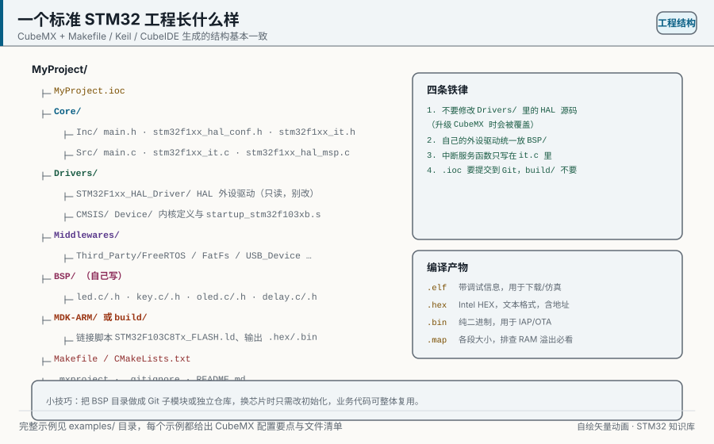
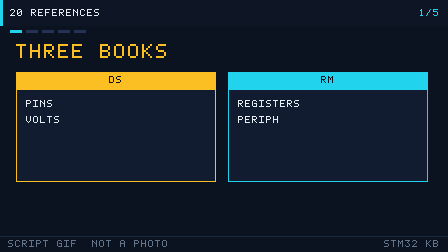

# 20 学习资源与工具链

> 一张图理清 ST 官方资料体系（RM/DS/PM/AN）与工具链，附社区资源、开源固件库和「怎么查手册」的具体检索示例。

<p align="center">
  
  <br><sub>▲ 图：一个标准 STM32 工程目录结构（作者自绘矢量图，非实拍）</sub>
</p>

<!-- video:ch20 -->
<p align="center">
  
  <br><sub>▲ 本章讲解幻灯：程序生成的 GIF（tools/gen_videos.py，可复现，不是实拍）。旁白与五帧一一对应。</sub>
</p>

**旁白（跟着画面读，大约一分钟）**

1. 数据手册管引脚和电气，参考手册管寄存器，编程手册管内核。
2. 文件名能认：DS 是数据手册，RM 是参考手册，PM 是编程手册。
3. Cube 固件包是例子，不是法律。和法律冲突时，以手册为准。
4. 社区帖子要核对型号。F1 的答案抄到 H7 上，常常是错的。
5. 自测：想查 CAN 过滤器的位，该打开 DS 还是 RM？
<!-- /video:ch20 -->


## 📌 学习目标

- [ ] 认全 ST 官方资源：官网、CubeMX、CubeIDE、CubeProgrammer、CubeMonitor。
- [ ] 分清 RM / DS / PM / AN / UM 五种手册各自的用途与命名规律。
- [ ] 知道去哪找社区与中文资源，以及常用工具（逻辑分析仪、J-Link、示波器、串口助手、PlatformIO、OpenOCD、KiCad）。
- [ ] 了解主流开源固件库（libopencm3 / ChibiOS / Zephyr / RT-Thread / FreeRTOS）的定位。
- [ ] 掌握「带着问题查手册」的三步法与三个具体检索示例。

## 🧠 核心原理

### 1. 官方资源地图

**结论**：ST 的资料全部免费，从 **st.com** 出发；开发用 **CubeMX（配置）+ CubeIDE（编译调试）+ CubeProgrammer（烧录/选项字节）** 三件套即可覆盖 90% 场景。

| 资源 | 网址/名称 | 用途 |
| --- | --- | --- |
| ST 官网 | st.com | 数据手册、参考手册、应用笔记下载 |
| STM32CubeMX | st.com/stm32cubemx | 图形化配置引脚/时钟/外设，生成初始化代码 |
| STM32CubeIDE | st.com/stm32cubeide | 基于 Eclipse+GCC 的集成开发环境（编译/调试） |
| STM32CubeProgrammer | st.com/stm32cubeprogrammer | 烧录 hex/bin、读写选项字节、解除读保护 |
| STM32CubeMonitor | st.com/stm32cubemonitor | 运行时变量可视化、功耗监测（配合 X-NUCLEO） |
| STM32Cube MCU Packages | GitHub STMicroelectronics | 各系列的 HAL/LL 驱动与例程 |
| ST 社区 | community.st.com | 官方论坛，问题检索质量高 |

### 2. 手册命名规则（重点）

**结论**：**RM 讲寄存器（怎么写）、DS 讲参数（是什么）、PM 讲封装引脚、AN 讲怎么做、UM 讲工具怎么用**——查「寄存器位」找 RM，查「电气参数/引脚定义」找 DS。

| 前缀 | 全称 | 内容 | 典型例子 |
| --- | --- | --- | --- |
| **RM** | Reference Manual | 存储器映射、外设寄存器位定义、功能描述 | RM0008（F1）、RM0090（F4） |
| **DS** | Datasheet | 引脚定义、电气特性、封装、订购信息、绝对最大额定值 | DS5319（F103C8） |
| **PM** | Product/ Package Manual | 封装与引脚映射细节（部分系列单独出） | 各系列 Pinout 手册 |
| **AN** | Application Note | 具体问题的解决方案与设计指导 | AN4031（DMA）、AN2557（IAP） |
| **UM** | User Manual | 工具/评估板/库的使用说明 | UM 系列（CubeMX/CubeIDE） |
| **ES** | Errata Sheet | 芯片已知缺陷与规避方法 | 各型号 ES |

> 记忆：**R 看寄存器、D 看数据、A 看应用、U 看工具**。RM 是「字典」，DS 是「体检报告」，AN 是「教程」。

### 3. 社区与中文资源

| 类型 | 资源 | 说明 |
| --- | --- | --- |
| 官方 | community.st.com | ST 官方论坛 |
| 官方 | GitHub: STMicroelectronics | Cube 包、HAL 驱动、例程 |
| 中文 | 正点原子 / 野火 / 硬石 | 教程与例程（配套大板） |
| 中文 | 电子发烧友 / 21ic / CSDN / 博客园 | 问题检索（注意甄别版本） |
| 英文 | Stack Overflow、EEVblog 论坛 | 深度问题 |
| 视频 | ST 官方 YouTube、B 站 | 演示与培训 |

> 检索技巧：中文搜不到时，用**英文关键词 + 手册编号**（如 `RM0008 TIM PWM register`）命中率更高。

### 4. 开源固件库对比

**结论**：**HAL/LL 是官方主流**；想跨厂商/追求轻量可用 **libopencm3**；想做完整 RTOS 生态用 **ChibiOS/Zephyr/RT-Thread**；**FreeRTOS** 是最通用的实时内核。

| 库 | 类型 | 特点 | 适用 |
| --- | --- | --- | --- |
| STM32 HAL/LL | 官方驱动 | CubeMX 生成，跨系列统一 | 绝大多数项目 |
| libopencm3 | 轻量驱动库 | 纯 C、无 IDE 依赖、小而快 | 追求精简/裸机 |
| ChibiOS | RTOS + HAL | 实时性强，自带 HAL | 高性能实时系统 |
| Zephyr | RTOS + 生态 | 跨厂商、模块化、Linux 基金会 | 大型/物联网项目 |
| RT-Thread | 国产 RTOS | 组件丰富，中文社区活跃 | 国内物联网产品 |
| FreeRTOS | RTOS 内核 | 最轻量通用，AWS 维护 | 通用实时任务 |

### 5. 如何查手册（三步法 + 3 个示例）

**结论**：查手册的三步是——**① 先定手册（RM 还是 DS）→ ② 用 Ctrl+F 搜寄存器名/位名 → ③ 顺着「功能描述」章节看时序与公式**。

| 步 | 动作 | 要点 |
| --- | --- | --- |
| 1 | 定手册 | 寄存器/时序 → RM；引脚/电气 → DS；具体问题 → AN |
| 2 | 搜关键词 | 直接搜寄存器名（如 `TIMx_CCR1`）或位名（如 `CEN`） |
| 3 | 读上下文 | 看「功能描述」章节的时序图与公式，再回寄存器位 |

**示例 1：查「TIM1 的 PWM 占空比怎么算」**
- 打开 **RM0008**，搜 `CCR1` → 定位到第 15 章 Advanced-control timers。
- 读「PWM mode」小节：占空比 = `CCR1 / (ARR+1)`，频率 = `fCK_CNT / (ARR+1)`。
- 回寄存器表确认 `CCMR1.OC1M` 选 PWM 模式、`CCER.CC1E` 使能输出。

**示例 2：查「F103C8T6 的 PA11 能不能做 USB」**
- 打开 **DS5319**（F103C8 数据手册），搜 `PA11` → 看引脚表的 Alternate functions 列。
- 确认 PA11 = `USB_DM`（同时也可能是 `CAN_RX`），查「Pinouts and pin description」表。
- 若要复用冲突细节，回 **RM0008** 第 9 章 AFIO 看重映射。

**示例 3：查「为什么 DMA 传输偶发错误」**
- 先用 **AN4031**《Using the STM32F2/F4 DMA controller》看推荐配置。
- 再回 **RM0090** 第 9 章 DMA，搜 `FIFO`、`BURST`、`PL` 位，核对 FIFO 阈值与突发大小。
- 结合「DMA 与总线矩阵」章节，理解优先级与总线争抢。

## 🛠️ 硬件与接线

本章的「硬件」指**工具与仪器**——它们决定了你调试与学习的效率。下表给出常用工具选型。

| 工具 | 典型型号 | 用途 | 预算（¥） |
| --- | --- | --- | --- |
| 调试器 | ST-Link V2 / J-Link EDU | 下载 + SWD 调试（J-Link 支持 RTT/SWO） | 15~300 |
| 逻辑分析仪 | 8 通道 24 MHz（克隆 Saleae） | 抓 I2C/SPI/UART/CAN 时序并解码 | 15~60 |
| 示波器 | 入门数字示波器 / MSO | 看模拟波形、PWM、纹波 | 300~2000 |
| 串口助手 | 任意 USB-TTL + 上位机软件 | 收发调试信息 | 8~20 |
| 万用表 | 入门数字表 | 量电压/通断/电流 | 30~80 |
| 功耗计 | Nordic PPK2 / Joulescope | 低功耗验证（第 16 章） | 300~1500 |
| 焊接 | 电烙铁 + 助焊剂 | 焊排针/晶振/贴片 | 50~200 |

| 软件工具 | 用途 | 备注 |
| --- | --- | --- |
| STM32CubeMX | 图形化配置生成代码 | 必装 |
| STM32CubeIDE | 一站式编译调试 | 基于 GCC |
| Keil MDK / IAR | 商业 IDE | 生态成熟 |
| PlatformIO | 跨平台命令行/IDE 构建 | 基于 GCC + Python |
| OpenOCD | 开源调试服务器 | 配 GDB/命令行 |
| KiCad | 开源 EDA，画原理图/PCB | 见第 21 章 |
| STM32CubeMonitor | 运行时变量/功耗可视化 | 免写上位机 |
| PulseView | 逻辑分析仪上位机 + 协议解码 | 配 8 通道分析仪 |

## 💻 代码实现

**① OpenOCD 命令行烧录（无需 IDE）**

```bash
# 用 ST-Link 烧录一个 elf（openocd.cfg 指定接口与目标）
openocd -f interface/stlink.cfg -f target/stm32f1x.cfg \
        -c "program build/app.elf verify reset exit"
```

**② OpenOCD + GDB 调试**

```bash
# 终端 A：启动调试服务器
openocd -f interface/stlink.cfg -f target/stm32f1x.cfg

# 终端 B：用 GDB 连接并调试
arm-none-eabi-gdb build/app.elf
(gdb) target extended-remote localhost:3333
(gdb) monitor reset halt
(gdb) load
(gdb) break main
(gdb) continue
```

**③ PlatformIO 工程配置（platformio.ini）**

```ini
; 一个 F103C8T6 的 PlatformIO 工程配置
[env:bluepill_f103c8]
platform  = ststm32
board     = bluepill_f103c8
framework = stm32cube            ; 用 STM32Cube(HAL) 框架
upload_protocol = stlink         ; 用 ST-Link 下载
debug_tool = stlink

build_flags =
    -Os                          ; 体积优化
    -Wall
    -D HSE_VALUE=8000000UL       ; 外部晶振 8MHz
```

```bash
pio run              # 编译
pio run -t upload    # 编译并下载
pio device monitor   # 打开串口监视器
pio debug            # 进入调试
```

**④ 用 CubeProgrammer 解除读保护（救砖）**

```bash
# 命令行解除 RDP 读保护（会整片擦除 Flash！）
STM32_Programmer_CLI -c port=SWD mode=UR -ob RDP=0xAA
```

**⑤ Makefile 里加 addr2line 定位（配合第 17 章）**

```makefile
# 把 HardFault 打印的 PC 转成源码行
addr2line -e build/app.elf -f -C $(PC)
```

> 提示：**能用命令行就用命令行**——CI/自动化、批量烧录、无 IDE 环境都靠它；图形界面适合交互调试。

## ⚠️ 常见坑与排查

| 现象 | 原因 | 解决 |
| --- | --- | --- |
| 找不到对应型号的手册 | 按系列而非型号搜 | 搜「RM0008」「DS5319」等编号 |
| 手册里寄存器名搜不到 | 搜了 HAL 名字而非寄存器名 | HAL 的 `Instance`/字段对应 `TIMx_CR1` 等 |
| 中文教程代码跑不通 | 教程版本/库不一致 | 以官方 HAL 与 RM 为准 |
| PlatformIO 下载失败 | 上传协议/端口没配 | `upload_protocol=stlink` 或指定 `upload_port` |
| OpenOCD 连不上 | cfg 文件选错目标 | 目标用 `stm32f1x.cfg`/`stm32f4x.cfg` |
| CubeProgrammer 报 RDP | 芯片被读保护 | 解除 RDP（会擦除）后重新下载 |
| KiCad 打开官方符号库报错 | 库路径未配置 | 设置符号/封装库路径 |
| 逻辑分析仪解码乱 | 采样率不足/电平不匹配 | 提高采样率，确认 3.3 V 电平 |
| J-Link 用盗版被锁 | 克隆 J-Link 被检测 | 用 ST-Link 或正版 |

## 🧪 动手实验

1. **命令行工具链全流程**：用 OpenOCD 编译→烧录→GDB 打断点，全程不点鼠标。预期：能独立完成一次命令行调试。
2. **PlatformIO 建工程**：用 `platformio.ini` 建一个 F103 工程，编译并下载点灯。预期：理解跨平台构建。
3. **手册检索训练**：按第 5 节三个示例，各查一次手册并记下页码。预期：形成「带问题查手册」的肌肉记忆。
4. **（进阶）PulseView 解码**：用逻辑分析仪抓一次 SPI 读 Flash（第 08 章），用解码器还原命令。预期：看到 `0x03` 读命令与数据。
5. **（进阶）开源库尝鲜**：用 libopencm3 或 Zephyr 点一次灯，对比 HAL 的差异。预期：理解不同抽象的取舍。

## 🔗 相关资源

- ST 官网：st.com（手册下载中心）；官方论坛 community.st.com。
- 工具官网：STM32CubeMX / STM32CubeIDE / STM32CubeProgrammer / STM32CubeMonitor（均在 st.com 下载）。
- 开源库：libopencm3、ChibiOS、Zephyr、RT-Thread、FreeRTOS（GitHub 均可找到）。
- 手册编号：RM0008 / RM0090（参考手册）、DS5319（F103C8 数据手册）、AN4031 / AN2557（应用笔记）。
- 相关章节：第 01 章开发环境搭建、第 17 章调试与性能优化、第 21 章原理图与实物图鉴。
- 配图：`../assets/diagrams/project-structure.svg`（作者自绘矢量图）。
