# 20 学习资源与工具链

> English: [Resources](en/20-resources.md)

> 同一个问题可能要查 DS 的电气边界、RM 的寄存器和 ES 的勘误。先写清要证明什么，再选文档与工具；搜索结果和 IDE 提示都不能替代证据边界。

<p align="center">
  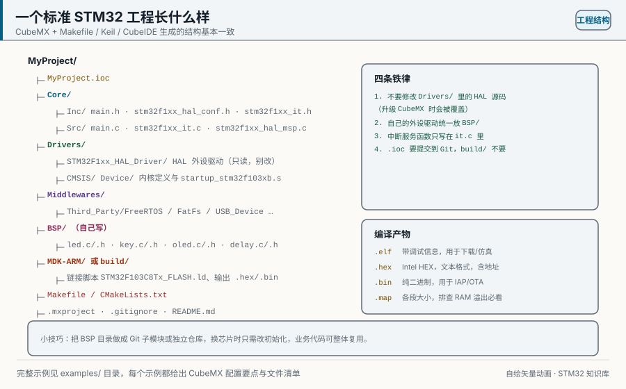
  <br><sub>▲ 图：一个标准 STM32 工程目录结构（作者自绘矢量图，非实拍）</sub>
</p>

<!-- video:ch20 -->
<p align="center">
  <video width="640" controls poster="../assets/video/ch20-refs.png">
    <source src="../assets/video/ch20-refs.mp4" type="video/mp4">
  </video>
  <br><sub>▲ 本章讲解视频（2.6 分钟）。<a href="../assets/video/ch20-refs.mp4">MP4</a> · <a href="../assets/video/ch20-refs.srt">字幕</a></sub>
</p>

<details>
<summary>旁白文字稿</summary>

1. 学习用的官方资料不用找网盘。从 ST 的网站下载数据手册和参考手册。配置用 CubeMX，编译调试用 CubeIDE，烧录和选项字节用 CubeProgrammer。
2. 查引脚和电气参数，翻数据手册。查寄存器每一位，翻参考手册。查内核指令和故障，翻编程手册。应用笔记讲一种做法，用户手册讲一种工具。
3. 想查 CAN 过滤器的位，打开参考手册，不是数据手册。数据手册会告诉你这颗芯片有没有 CAN、引脚叫什么。两本同时开着，比靠记忆力可靠。
4. 这一帧还是仓库的分层图。你读例程时，先找它停在哪一层。停在 HAL，就去看函数的返回值；停在寄存器，就去参考手册对那一位。不要拿应用笔记的图去代替参考手册的位定义。
5. 各系列的 HAL 包里有现成例程。先跑和你的外设最接近的那个，确认板子和工具链是通的，再把需要的文件剪进自己的工程。整包复制，你会分不清哪些文件真的在编译。
6. STM32、Nucleo 这些名字是厂商的商标。本仓库用来学习，和厂商没有隶属关系。这里的图都是程序画的，不是产品照片，不要拿去当官方宣传图。
7. 例程能跑、你的工程不能跑，经常是包的版本不同。把 Cube 版本、固件包版本和板子丝印写进笔记。问人的时候带上这三样，回答会具体很多。
8. 口诀：寄存器的位去参考手册，引脚和电气去数据手册，内核去编程手册。先选对书，再搜索关键词。
9. 今天就给你的芯片下载数据手册和参考手册，文件名要对上型号和修订号。以后章节里写的 DS 和 RM，指的就是这两本，不是搜索引擎的第一篇文章。
10. 合上书，三问。CAN 过滤器的位定义在数据手册还是参考手册？引脚电气在哪本？读写选项字节用 Cube 家族里的哪一个工具？

</details>
<!-- /video:ch20 -->
## 学习目标

- [ ] 认全 ST 官方资源：官网、CubeMX、CubeIDE、CubeProgrammer、CubeMonitor。
- [ ] 分清 RM / DS / PM / AN / UM 五种手册各自的用途与命名规律。
- [ ] 知道去哪找社区与中文资源，以及常用工具（逻辑分析仪、J-Link、示波器、串口助手、PlatformIO、OpenOCD、KiCad）。
- [ ] 了解主流开源固件库（libopencm3 / ChibiOS / Zephyr / RT-Thread / FreeRTOS）的定位。
- [ ] 掌握「带着问题查手册」的三步法与三个具体检索示例。

## 遇到问题时去哪找证据


<p align="center">
  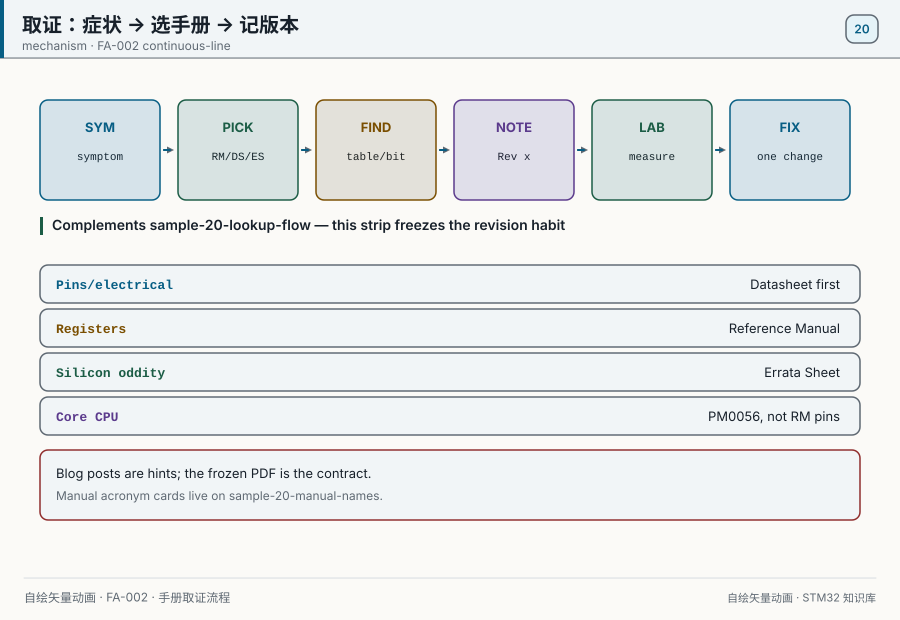
  <br><sub>▲ 自绘矢量动画（FA-002）。博客是线索，冻结 PDF 是契约。</sub>
</p>


<p align="center">
  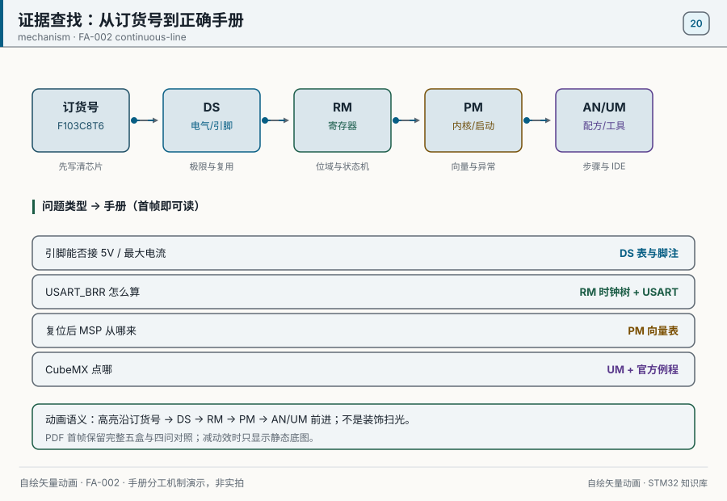
  <br><sub>▲ 动画：订货号 → DS → RM → PM → AN/UM（作者自绘矢量动画，非实拍）。出处是本章手册地图与 [项目致谢](#source-project-credits)。</sub>
</p>

### 1. 官方资源地图

ST 的资料全部免费，从 **st.com** 出发；开发用 **CubeMX（配置）+ CubeIDE（编译调试）+ CubeProgrammer（烧录/选项字节）** 三件套即可覆盖 90% 场景。

| 资源 | 网址/名称 | 用途 |
| --- | --- | --- |
| ST 官网 | st.com | 数据手册、参考手册、应用笔记下载 |
| STM32CubeMX | st.com/stm32cubemx | 图形化配置引脚/时钟/外设，生成初始化代码 |
| STM32CubeIDE | st.com/stm32cubeide | 基于 Eclipse+GCC 的集成开发环境（编译/调试） |
| STM32CubeProgrammer | st.com/stm32cubeprogrammer | 烧录 hex/bin、读写选项字节、解除读保护 |
| STM32CubeMonitor | st.com/stm32cubemonitor | 运行时变量可视化、功耗监测（配合 X-NUCLEO） |
| STM32Cube MCU Packages | GitHub STMicroelectronics | 各系列的 HAL/LL 驱动与例程 |
| ST 社区 | community.st.com | 官方论坛，问题检索质量高 |

### 2. 手册命名规则（重点）


<p align="center">
  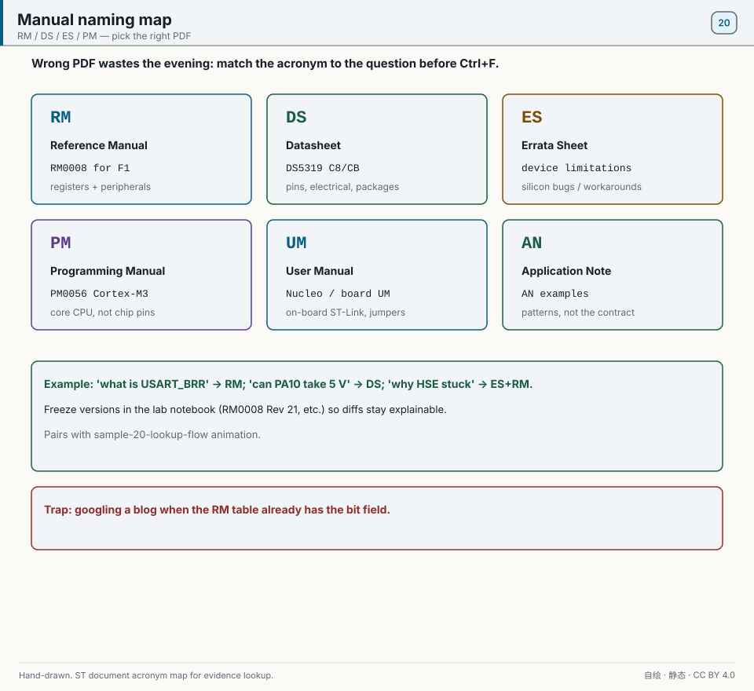
  <br><sub>▲ 自绘。先选对 PDF，再 Ctrl+F。</sub>
</p>

<p align="center">
  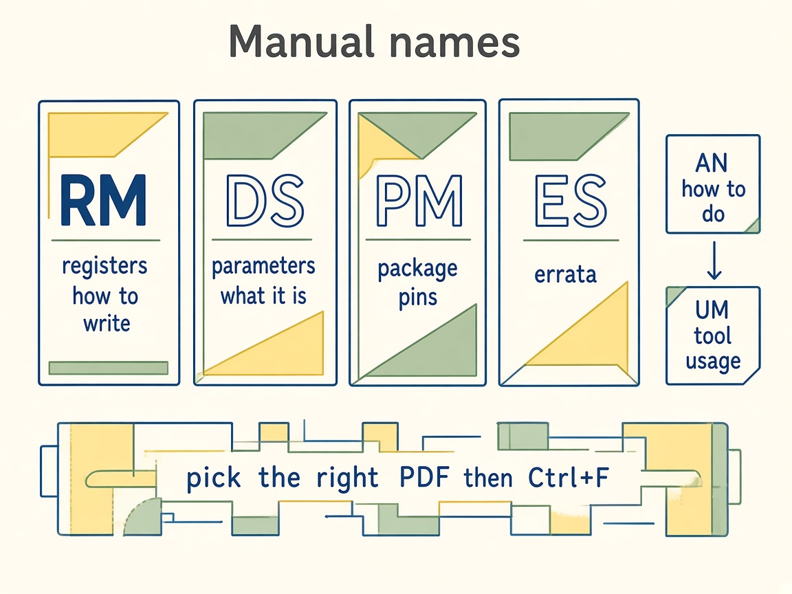
  <br><sub>▲ 知识轨（Handraw · 原理示意/非实拍）。先选对 PDF 再 Ctrl+F；RM 寄存器、DS 参数、PM 封装、ES 勘误；不是实拍。</sub>
</p>


**RM 讲寄存器（怎么写）、DS 讲参数（是什么）、PM 讲封装引脚、AN 讲怎么做、UM 讲工具怎么用**——查「寄存器位」找 RM，查「电气参数/引脚定义」找 DS。

| 前缀 | 全称 | 内容 | 典型例子 |
| --- | --- | --- | --- |
| **RM** | Reference Manual | 存储器映射、外设寄存器位定义、功能描述 | RM0008（F1）、RM0090（F4） |
| **DS** | Datasheet | 引脚定义、电气特性、封装、订购信息、绝对最大额定值 | DS5319（F103C8） |
| **PM** | Product/ Package Manual | 封装与引脚映射细节（部分系列单独出） | 各系列 Pinout 手册 |
| **AN** | Application Note | 具体问题的解决方案与设计指导 | AN4031（DMA）、AN2557（IAP） |
| **UM** | User Manual | 工具/评估板/库的使用说明 | UM 系列（CubeMX/CubeIDE） |
| **ES** | Errata Sheet | 芯片已知缺陷与规避方法 | 各型号 ES |

先看下图左侧的问题，再决定第一本打开的文档。它能把检索范围缩到正确的资料类型，但不能替你确认具体订货号、封装和 silicon revision；这些身份信息仍要在 DS 与 ES 中对账。图由 `tools/gen_diagrams.py` 生成。

<p align="center">
  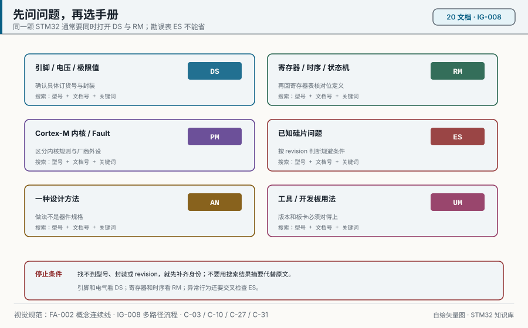
  <br><sub>▲ 决策图：先问问题，再选手册（FA-002 · IG-008；作者自绘矢量图）</sub>
</p>

<p align="center">
  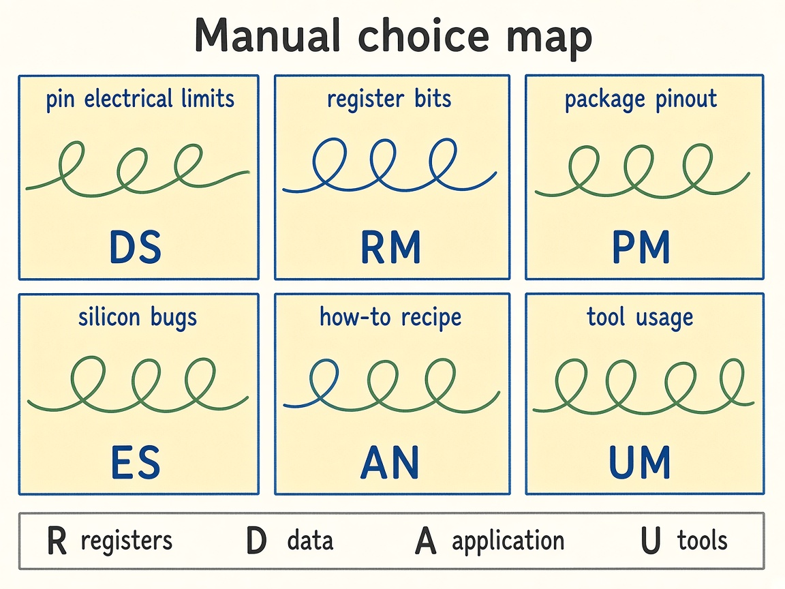
  <br><sub>▲ 知识轨（Handraw · 原理示意/非实拍）。先问问题再选手册；R 寄存器、D 数据、A 应用、U 工具；不是实拍。</sub>
</p>

> 记忆：**R 看寄存器、D 看数据、A 看应用、U 看工具**。RM 是「字典」，DS 是「体检报告」，AN 是「教程」。

### 3. 社区与中文资源

| 类型 | 资源 | 说明 |
| --- | --- | --- |
| 官方 | community.st.com | ST 官方论坛 |
| 官方 | GitHub: STMicroelectronics | Cube 包、HAL 驱动、例程 |
| 中文 | 正点原子 / 野火 / 硬石 | 教程与例程（配套大板） |
| 中文 | 电子发烧友 / 21ic / CSDN / 博客园 | 问题检索（注意甄别版本） |
| 英文 | Stack Overflow、EEVblog 论坛 | 深度问题 |
| 视频 | ST 官方 YouTube、B 站 | 演示与培训 |

> 检索技巧：中文搜不到时，用**英文关键词 + 手册编号**（如 `RM0008 TIM PWM register`）命中率更高。

### 4. 开源固件库对比


<p align="center">
  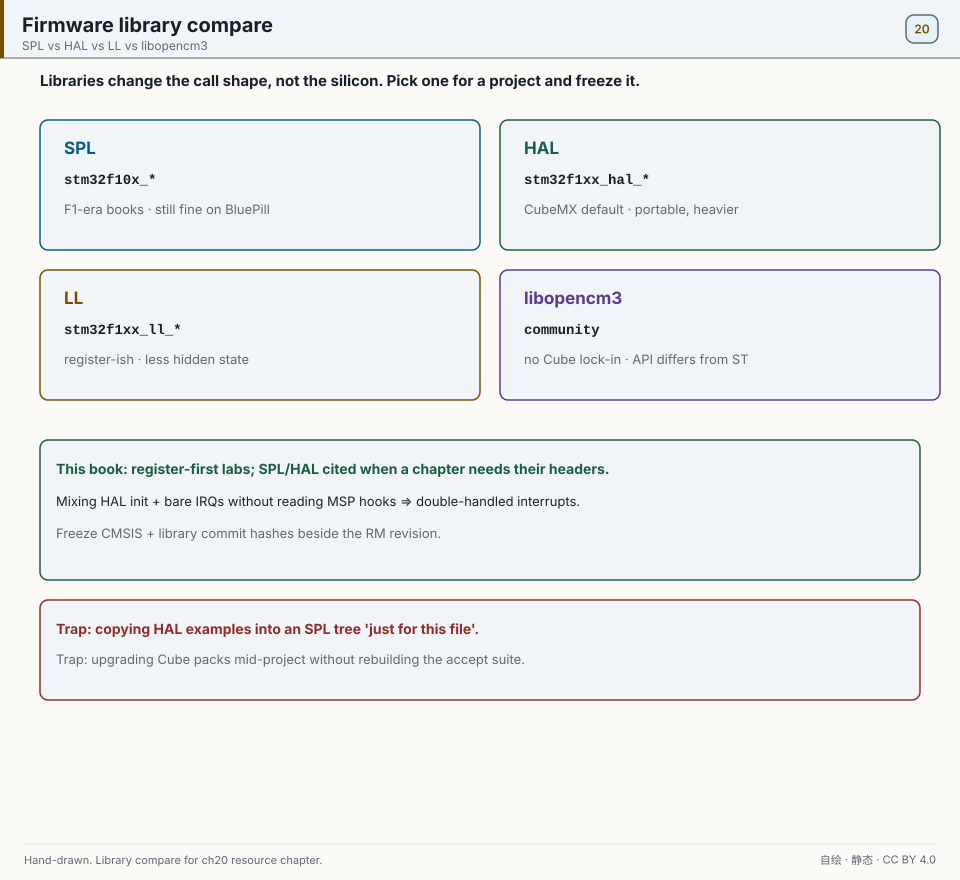
  <br><sub>▲ 自绘。一个项目冻结一套库与版本。</sub>
</p>

<p align="center">
  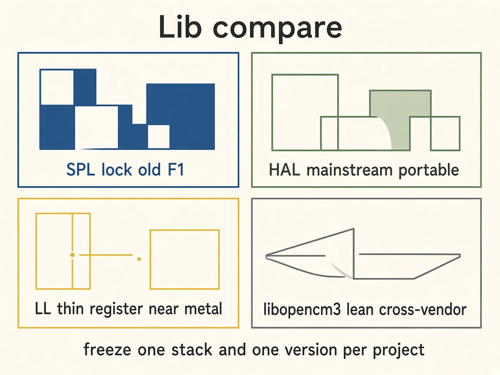
  <br><sub>▲ 知识轨（Handraw · 原理示意/非实拍）。一个项目冻结一套库与版本；HAL 主流、SPL 锁旧 F1、LL 近寄存器、libopencm3 轻量；不是实拍。</sub>
</p>


**HAL/LL 是官方主流**；STM32F10x SPL 用于维护或迁移锁定版本的旧 F1 工程；想跨厂商/追求轻量可用 **libopencm3**；想做完整 RTOS 生态用 **ChibiOS/Zephyr/RT-Thread**；**FreeRTOS** 是最通用的实时内核。

| 库 | 类型 | 特点 | 适用 |
| --- | --- | --- | --- |
| STM32 HAL/LL | 官方驱动 | CubeMX 生成，跨系列统一 | 绝大多数新项目 |
| STM32F10x SPL V3.5.0 | 官方遗留驱动 | F1 专用、结构体 + 函数 API、无 CubeMX 生成 | 维护/迁移已锁定版本的 F1 旧工程；见[第 26 章](26-STM32F10x标准外设库SPL.md) |
| libopencm3 | 轻量驱动库 | 纯 C、无 IDE 依赖、小而快 | 追求精简/裸机 |
| ChibiOS | RTOS + HAL | 实时性强，自带 HAL | 高性能实时系统 |
| Zephyr | RTOS + 生态 | 跨厂商、模块化、Linux 基金会 | 大型/物联网项目 |
| RT-Thread | 国产 RTOS | 组件丰富，中文社区活跃 | 国内物联网产品 |
| FreeRTOS | RTOS 内核 | 最轻量通用，AWS 维护 | 通用实时任务 |

下图不是给固件库排高低，而是把四种约束放到各自位置。它支持“新项目优先 HAL/LL，锁版 F1 旧工程才继续用 SPL”这一判断；认证冻结、已有资产和团队能力可能改变选择，但不会消除单一外设所有权的要求。图由 `tools/gen_diagrams.py` 生成。

<p align="center">
  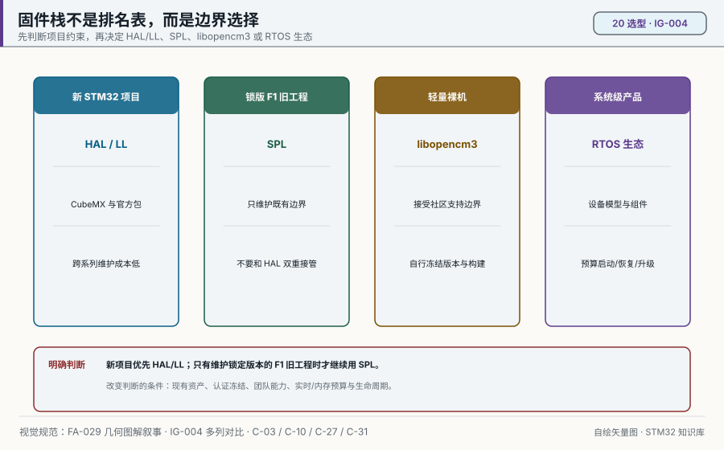
  <br><sub>▲ 对比图：固件栈按项目边界选择，不按抽象高低排名（FA-029 · IG-004；作者自绘矢量图）</sub>
</p>

### 5. 如何查手册（三步法 + 3 个示例）

查手册的三步是——**① 先定手册（RM 还是 DS）→ ② 用 Ctrl+F 搜寄存器名/位名 → ③ 顺着「功能描述」章节看时序与公式**。

| 步 | 动作 | 要点 |
| --- | --- | --- |
| 1 | 定手册 | 寄存器/时序 → RM；引脚/电气 → DS；具体问题 → AN |
| 2 | 搜关键词 | 直接搜寄存器名（如 `TIMx_CCR1`）或位名（如 `CEN`） |
| 3 | 读上下文 | 看「功能描述」章节的时序图与公式，再回寄存器位 |

**示例 1：查「TIM1 的 PWM 占空比怎么算」**
- 打开 **RM0008**，搜 `CCR1` → 定位到第 15 章 Advanced-control timers。
- 读「PWM mode」小节：占空比 = `CCR1 / (ARR+1)`，频率 = `fCK_CNT / (ARR+1)`。
- 回寄存器表确认 `CCMR1.OC1M` 选 PWM 模式、`CCER.CC1E` 使能输出。

**示例 2：查「F103C8T6 的 PA11 能不能做 USB」**
- 打开 **DS5319**（F103C8 数据手册），搜 `PA11` → 看引脚表的 Alternate functions 列。
- 确认 PA11 = `USB_DM`（同时也可能是 `CAN_RX`），查「Pinouts and pin description」表。
- 若要复用冲突细节，回 **RM0008** 第 9 章 AFIO 看重映射。

**示例 3：查「为什么 F4 的 DMA 传输偶发错误」**（F1 的 DMA 没有 FIFO 和突发档位，不能照搬）
- 先用 **AN4031**《Using the STM32F2/F4 DMA controller》看推荐配置。
- 再回 **RM0090** 第 9 章 DMA，搜 `FIFO`、`BURST`、`PL` 位，核对 FIFO 阈值与突发大小。
- 结合「DMA 与总线矩阵」章节，理解优先级与总线争抢。

## 硬件与接线

本章的「硬件」指**工具与仪器**——它们决定了你调试与学习的效率。下表给出常用工具选型。

| 工具 | 典型型号 | 用途 | 预算（¥） |
| --- | --- | --- | --- |
| 调试器 | ST-Link V2 / J-Link EDU | 下载 + SWD 调试（J-Link 支持 RTT/SWO） | 15~300 |
| 逻辑分析仪 | 8 通道 24 MHz（克隆 Saleae） | 抓 I2C/SPI/UART/CAN 时序并解码 | 15~60 |
| 示波器 | 入门数字示波器 / MSO | 看模拟波形、PWM、纹波 | 300~2000 |
| 串口助手 | 任意 USB-TTL + 上位机软件 | 收发调试信息 | 8~20 |
| 万用表 | 入门数字表 | 量电压/通断/电流 | 30~80 |
| 功耗计 | Nordic PPK2 / Joulescope | 低功耗验证（第 16 章） | 300~1500 |
| 焊接 | 电烙铁 + 助焊剂 | 焊排针/晶振/贴片 | 50~200 |

| 软件工具 | 用途 | 备注 |
| --- | --- | --- |
| STM32CubeMX | 图形化配置生成代码 | 必装 |
| STM32CubeIDE | 编译与调试在同一个工程里 | 基于 GCC |
| Keil MDK / IAR | 商业 IDE | 生态成熟 |
| PlatformIO | 跨平台命令行/IDE 构建 | 基于 GCC + Python |
| CLion | CMake 工程、代码导航、OpenOCD 调试 | 与命令行共用 CMake Preset，适合大型 C/C++ 工程 |
| VS Code | CMake Tools + Cortex-Debug，或 PlatformIO | 前者复用已有 CMake；后者由 PlatformIO 管理框架与包 |
| OpenOCD | 开源调试服务器 | 配 GDB/命令行 |
| KiCad | 开源 EDA，画原理图/PCB | 见第 21 章 |
| STM32CubeMonitor | 运行时变量/功耗可视化 | 免写上位机 |
| PulseView | 逻辑分析仪上位机 + 协议解码 | 配 8 通道分析仪 |

工具越靠近引脚，证据越接近真实电气行为。下图要看每一级的“能证明”和“不能证明”：调试器能读到寄存器，不等于引脚边沿合格；示波器看到波形，也不能替代构建版本记录。图由 `tools/gen_diagrams.py` 生成，不是仪器截图或实验数据。

<p align="center">
  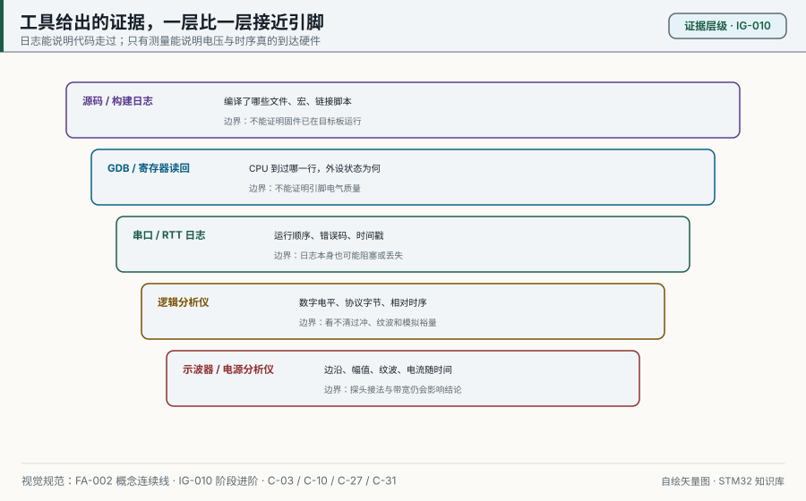
  <br><sub>▲ 证据阶梯：每种工具回答不同问题（FA-002 · IG-010；作者自绘矢量图，非测量截图）</sub>
</p>

<p align="center">
  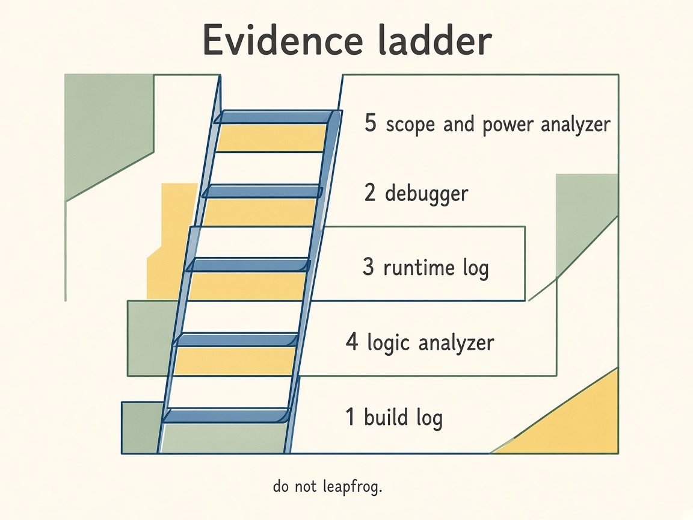
  <br><sub>▲ 知识轨（Handraw · 原理示意/非实拍）。构建日志 → 调试器 → 运行日志 → 逻辑分析仪 → 示波器/电源分析；不要越级；不是实拍。</sub>
</p>

## 代码实现

**① OpenOCD 命令行烧录（无需 IDE）**

```bash
# 用 ST-Link 烧录一个 elf（openocd.cfg 指定接口与目标）
openocd -f interface/stlink.cfg -f target/stm32f1x.cfg \
        -c "program build/app.elf verify reset exit"
```

**② OpenOCD + GDB 调试**

```bash
# 终端 A：启动调试服务器
openocd -f interface/stlink.cfg -f target/stm32f1x.cfg

# 终端 B：用 GDB 连接并调试
arm-none-eabi-gdb build/app.elf
(gdb) target extended-remote localhost:3333
(gdb) monitor reset halt
(gdb) load
(gdb) break main
(gdb) continue
```

**③ PlatformIO 工程配置（platformio.ini）**

```ini
; 一个 F103C8T6 的 PlatformIO 工程配置
[env:bluepill_f103c8]
platform  = ststm32
board     = bluepill_f103c8
framework = stm32cube            ; 用 STM32Cube(HAL) 框架
upload_protocol = stlink         ; 用 ST-Link 下载
debug_tool = stlink

build_flags =
    -Os                          ; 体积优化
    -Wall
    -D HSE_VALUE=8000000UL       ; 外部晶振 8MHz
```

```bash
pio run              # 编译
pio run -t upload    # 编译并下载
pio device monitor   # 打开串口监视器
pio debug            # 进入调试
```

**④ CLion / VS Code 共用 CMake 构建合同**

四个入口必须汇入同一个 preset，再从同一份定义产出 ELF、map 和 bin。下图证明的是构建所有权，不证明生成的固件功能正确；功能仍需调试器和仪器闭环。图由 `tools/gen_diagrams.py` 生成。

<p align="center">
  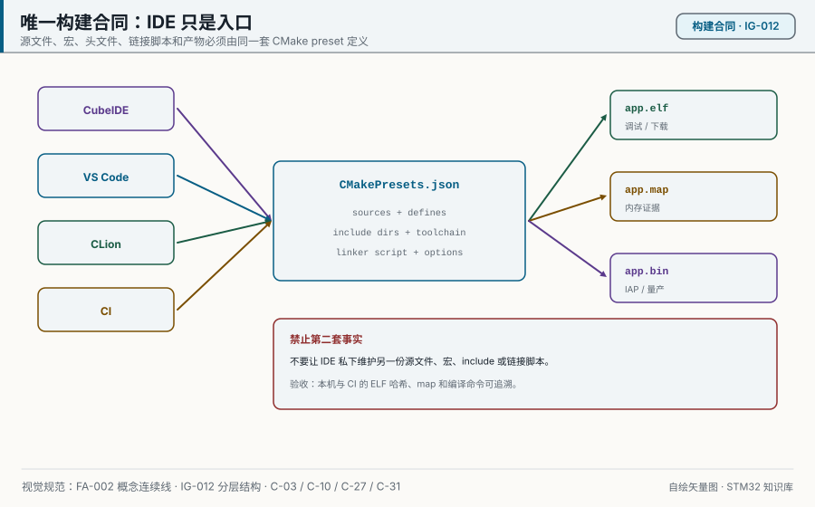
  <br><sub>▲ 构建合同：IDE 只是入口，preset 才是唯一事实来源（FA-002 · IG-012；作者自绘矢量图）</sub>
</p>

```bash
# IDE 也必须调用这两个命令，而不是维护第二套源文件/宏/include 配置
cmake --preset debug
cmake --build --preset debug

# 生成 ELF 后，才进入烧录/调试边界
openocd -f openocd/bluepill-stlink.cfg \
  -c "program build/debug/app.elf verify reset exit"
```

CLion 用 OpenOCD Download & Run，VS Code 用 Cortex-Debug；两者应引用同一个 ELF 和同一个 OpenOCD 配置。完整实物工程、preset、toolchain file、task 与 launch 配置见 [`examples/spl-f1-blink/`](../examples/spl-f1-blink/)。

**⑤ 用 CubeProgrammer 解除读保护（救砖）**

```bash
# 命令行解除 RDP 读保护（会整片擦除 Flash！）
STM32_Programmer_CLI -c port=SWD mode=UR -ob RDP=0xAA
```

**⑥ Makefile 里加 addr2line 定位（配合第 17 章）**

```makefile
# 把 HardFault 打印的 PC 转成源码行
addr2line -e build/app.elf -f -C $(PC)
```

> 提示：**能用命令行就用命令行**——CI/自动化、批量烧录、无 IDE 环境都靠它；图形界面适合交互调试。


<p align="center">
  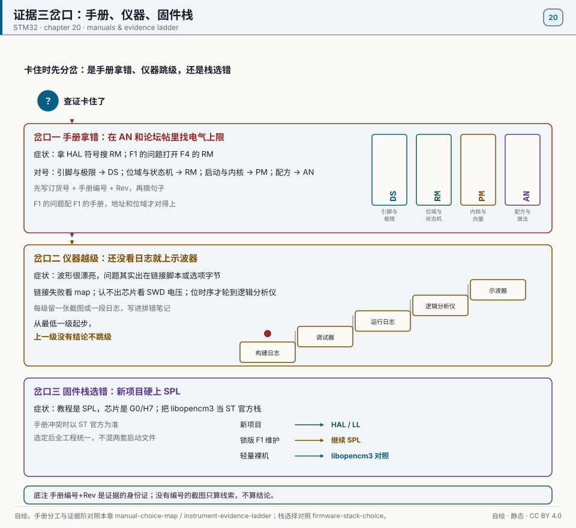
  <br><sub>▲ 自绘。证据三岔口。出处是 [手册选择地图](#source-project-credits) 与 [stlink 工具集](#source-stlink-tools)。</sub>
</p>

<p align="center">
  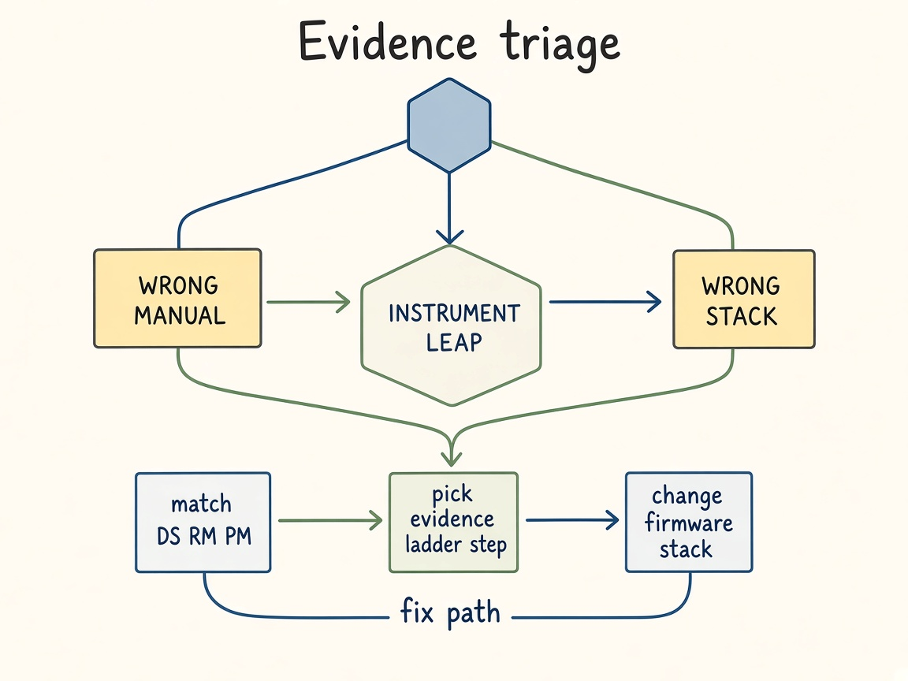
  <br><sub>▲ 知识轨（Handraw · 原理示意/非实拍）。先 DS/RM/PM 对号，再选证据阶，最后才动固件栈；不是实拍。</sub>
</p>

## 常见坑与排查

| 现象 | 原因 | 解决 |
| --- | --- | --- |
| 找不到对应型号的手册 | 按系列而非型号搜 | 搜「RM0008」「DS5319」等编号 |
| 手册里寄存器名搜不到 | 搜了 HAL 名字而非寄存器名 | HAL 的 `Instance`/字段对应 `TIMx_CR1` 等 |
| 中文教程代码跑不通 | 教程版本/库不一致 | 以官方 HAL 与 RM 为准 |
| PlatformIO 下载失败 | 上传协议/端口没配 | `upload_protocol=stlink` 或指定 `upload_port` |
| OpenOCD 连不上 | cfg 文件选错目标 | 目标用 `stm32f1x.cfg`/`stm32f4x.cfg` |
| CubeProgrammer 报 RDP | 芯片被读保护 | 解除 RDP（会擦除）后重新下载 |
| KiCad 打开官方符号库报错 | 库路径未配置 | 设置符号/封装库路径 |
| 逻辑分析仪解码乱 | 采样率不足/电平不匹配 | 提高采样率，确认 3.3 V 电平 |
| J-Link 用盗版被锁 | 克隆 J-Link 被检测 | 用 ST-Link 或正版 |

## 动手实验

1. **可复现构建**：命令行生成 ELF、map、bin，记录编译器版本、preset 和 ELF 哈希；CLion、VS Code 与 CI 必须调用同一构建入口。
2. **证据检索**：为引脚、电气上限、寄存器位、勘误各写一个问题，分别找到 DS、RM、ES 的页码与 revision，并写下该来源不能证明什么。
3. **工具边界**：同一次 SPI 读 Flash 保存构建日志、寄存器读回、运行日志、逻辑解码和示波器波形，说明五层证据各自覆盖的范围。
4. **重建验证**：清空可重建的 build 目录，从固定依赖重新生成并比较 ELF/map；差异必须能追到工具链、宏、源文件或链接脚本。

离开本章前，应有一份构建环境清单、四张带 revision/页码的来源卡、一组五层工具证据和一次干净重建对比。

## 相关资源

- ST 官网：st.com（手册下载中心）；官方论坛 community.st.com。
- 工具官网：STM32CubeMX / STM32CubeIDE / STM32CubeProgrammer / STM32CubeMonitor（均在 st.com 下载）。
- 开源库：libopencm3、ChibiOS、Zephyr、RT-Thread、FreeRTOS（GitHub 均可找到）。
- 手册编号：RM0008 / RM0090（参考手册）、DS5319（F103C8 数据手册）、AN4031 / AN2557（应用笔记）。
- 相关章节：第 01 章开发环境搭建、第 17 章调试与性能优化、第 21 章原理图与实物图鉴。
- 配图：`../assets/diagrams/project-structure.svg`（作者自绘矢量图）。


- 手机阅读版：[第 20 章 · 学习资源与工具链（公众号图文）](https://mp.weixin.qq.com/s/mi9S11AVnfAfw8UKVmjdWw)
