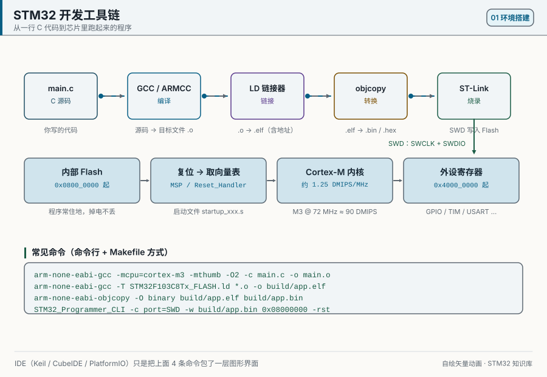
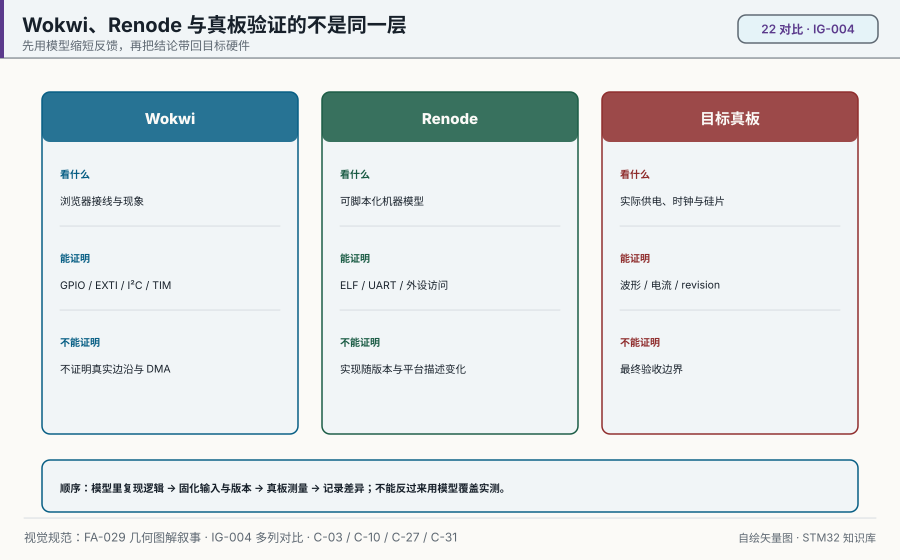
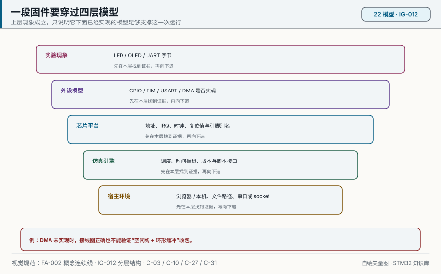
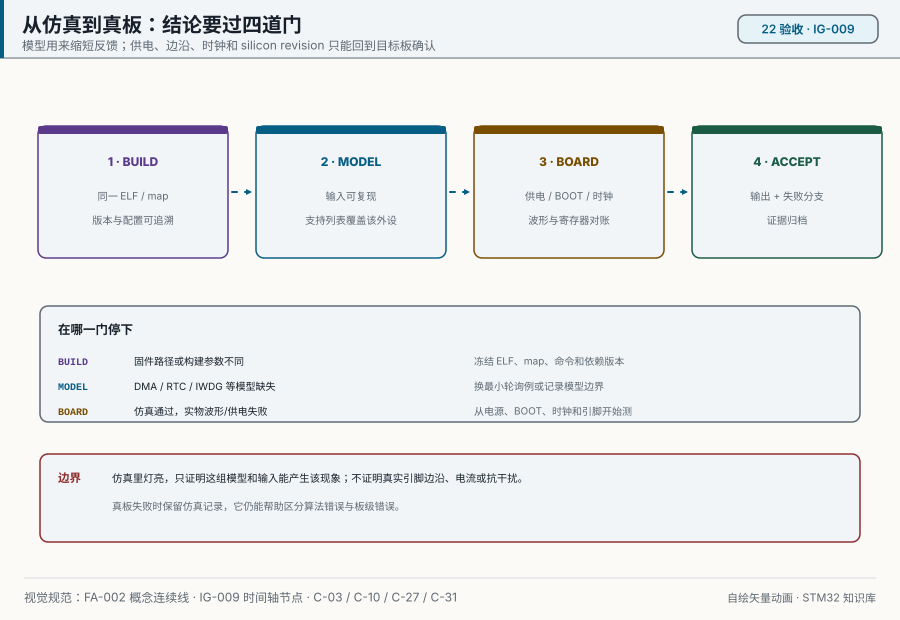

# 22 仿真实验：Wokwi 与 Renode

> English: [Wokwi and Renode](en/22-simulation-wokwi-renode.md)

> 仿真里灯闪了，只能证明 ELF 与当前模型配合。把同一个 ELF 放到真板后，还要重新验证供电、引脚、电气波形、时钟和功耗。

<p align="center">
  
  <br><sub>▲ 动画：固件从编译走到运行（作者自绘矢量动画，非实拍）</sub>
</p>

<!-- video:ch22 -->
<p align="center">
  <video width="640" controls poster="../assets/video/ch22-sim.png">
    <source src="../assets/video/ch22-sim.mp4" type="video/mp4">
  </video>
  <br><sub>▲ 本章讲解视频（2.7 分钟）。<a href="../assets/video/ch22-sim.mp4">MP4</a> · <a href="../assets/video/ch22-sim.srt">字幕</a></sub>
</p>

<details>
<summary>旁白文字稿</summary>

1. Wokwi 适合在浏览器里看灯和接线。Renode 适合在命令行里加载程序、看串口字节。口诀：浏览器里看灯，命令行里看字节。两家都代替不了真板的时序。
2. Wokwi 的 BluePill 上，引脚键名是 A0、C13 这种。A0 接到 PA0，C13 接到 PC13。写成 PA0 这样的芯片名，图会接不上。依据是板子自己的描述文件。
3. 仿真图里 PC13 的灯已经在板上，低电平亮。练习点灯时不必再外接一颗。你如果再接，要分清看的是哪一颗，不然会以为极性反了。
4. 这一帧是仓库画的 BluePill 结构，不是照片。拿它和 Wokwi 的图对照：先找 C13 的灯，再找你例程用的 A0、A9 那些键名。对上键名，再谈固件。
5. 仓库里不预置编译好的 ELF。配置文件指向 build 目录下的固件，要你自己编译出来再仿真。没有这文件时，打开图只能看接线，灯不会按程序闪。
6. Wokwi 的这块 BluePill 模型，DMA 还没有实现。串口空闲线收包和 ADC 连续采样的示例，在这里只能核对接线。要看 DMA 真的在搬，请上真板。
7. Renode 的两条脚本都引用官方的 F103 平台描述。串口那条把 USART1 接到一个套接字，端口是 3456。你用网络终端连上去，才能看见字节。这也要有你自己编译的程序。
8. 口诀：仿真看现象，真板对时序。仿真里的灯会亮，不代表上升沿在真板上也那么干净。结论要回到板子上再确认一次。
9. 今天把 GPIO 示例的图打开，编译出固件，确认 C13 的灯在闪。做不到，先别开串口和 I2C 的图。能闪，再换下一张图，一次只换一个不确定的点。
10. 合上书，三问。Wokwi 里 PC13 的灯还要再外接一颗吗？A0 接到芯片的哪只脚？串口 DMA 收包能在这个模型里验证吗？

</details>
<!-- /video:ch22 -->
## 学习目标

- [ ] 能在 Wokwi 里打开本仓库的 BluePill 图，并说清引脚别名。
- [ ] 能用 Renode 加载 `stm32f103.repl` 和一份 ELF。
- [ ] 知道哪些示例在当前仿真器里能跑完，哪些只能看接线。

## 先选哪一家

想看灯、按键、PWM、OLED，用 Wokwi。想在终端里单步、看 USART1 字节流，用 Renode。两家都吃你自己编译出来的 ELF，仓库里没有预编译固件。

| | Wokwi | Renode |
| --- | --- | --- |
| 在哪跑 | 浏览器或 VS Code 插件 | 本机命令行 |
| 配置 | 示例目录里的 `diagram.json` + `wokwi.toml` | `sim/renode/*.resc` |
| 板子 | `board-stm32-bluepill`（STM32F103C8） | `platforms/cpus/stm32f103.repl` |
| 适合 | 接线、GPIO、EXTI、定时器、I2C | 加载 ELF、USART1 终端、外设访问日志 |
| 官方说明 | [Blue Pill 零件页](https://docs.wokwi.com/parts/board-stm32-bluepill)、[wokwi.toml](https://docs.wokwi.com/vscode/project-config) | Renode 仓库里的 `platforms/cpus/stm32f103.repl` |

别把两列理解成高低关系。下图把 Wokwi、Renode 和目标真板放到同一条验证链上：前两者缩短反馈，真板决定电气与时序结论。图能说明工具边界，不能替代你正在使用的版本支持表。图由 `tools/gen_diagrams.py` 生成。

<p align="center">
  
  <br><sub>▲ 对比图：浏览器看接线，机器模型看访问，最终在真板验收（FA-029 · IG-004；作者自绘矢量图）</sub>
</p>

## Wokwi：图怎么读

引脚名字不是 `PA0`，而是 Wokwi 板文件里的键。出处是
[wokwi-boards 的 `boards/stm32-bluepill/board.json`](https://github.com/wokwi/wokwi-boards/blob/main/boards/stm32-bluepill/board.json)：

| 图里的名字 | 接到芯片的脚 | 本仓库谁在用 |
| --- | --- | --- |
| `C13` | PC13（板载灯，原理图里已接好，低电平亮） | gpio-blink |
| `A0` | PA0 | gpio-blink 外接灯、exti-key 按键、adc 通道 0 |
| `A1` / `A4` | PA1 / PA4 | adc-dma |
| `A6` | PA6 = TIM3_CH1 | timer-pwm |
| `A9` / `A10` | PA9 / PA10 = USART1 | uart-dma-idle（串口监视器） |
| `B6` / `B7` | PB6 / PB7 = I2C1 | i2c-oled |
| `GND.1` `3V3.1` | 地 / 3.3 V | 所有外接零件 |

板载灯已经焊在 PC13 上，点灯实验不用再画一颗灯也能看到闪。`gpio-blink` 的图额外画了 PA0 那颗外接灯，对应示例里的第二盏。

### 核心示例各有一份图

| 示例 | 图里有什么 | 当前 Wokwi 模型能不能跑完 |
| --- | --- | --- |
| [gpio-blink](../examples/gpio-blink/diagram.json) | 板子 + PA0 经 270Ω 到红色 LED | 能。GPIO 在支持列表里 |
| [exti-key](../examples/exti-key/diagram.json) | PA0 对地按键 | 能。EXTI 在支持列表里 |
| [timer-pwm](../examples/timer-pwm/diagram.json) | PA6 经 270Ω 到绿色 LED | 能。TIM1–TIM4 在支持列表里 |
| [i2c-oled](../examples/i2c-oled/diagram.json) | `board-ssd1306`，地址 `0x3c`，SCL/SDA 各 4.7 kΩ 上拉 | I2C 在支持列表里。屏要等固件按 SSD1306 时序写 |
| [uart-dma-idle](../examples/uart-dma-idle/diagram.json) | 只有板子，字节走串口监视器 | **DMA 未实现**，空闲帧收包跑不完 |
| [adc-dma](../examples/adc-dma/diagram.json) | 三只电位器接到 A0/A1/A4 | ADC1 基本转换有，**DMA 搬运没有** |

支持情况以 Wokwi 文档那张表为准（GPIO、USART、I2C、SPI、TIM、EXTI 有；DMA、RTC、IWDG 没有）。表会改，以你打开文档的那一版为准。

灯亮只是最上层现象。下图从实验现象一直追到宿主环境，适合定位“接线对了但固件没动”的问题；它不能证明某个版本确实实现了某外设，仍要查支持表或最小复现实验。图由 `tools/gen_diagrams.py` 生成。

<p align="center">
  
  <br><sub>▲ 分层图：一段固件要穿过哪些模型才能出现可见现象（FA-002 · IG-012；作者自绘矢量图）</sub>
</p>

`wokwi.toml` 里固件路径写成 `build/firmware.elf`。STM32 在 Wokwi 接受 `.elf`、`.hex`、`.bin`。先在 CubeIDE 或 PlatformIO 里编出来，再把 `firmware` / `elf` 两行改成你的真实路径。Wokwi 不负责编译。

## Renode：两条脚本

脚本在 [`sim/renode/`](../sim/renode/)。它们做的事只有四件：建机器、加载官方 F103 平台描述、加载 ELF、启动。

| 脚本 | 做什么 |
| --- | --- |
| [gpio-blink.resc](../sim/renode/gpio-blink.resc) | 打开 USART1 分析器，并把 `gpioPortC` 的访问打到日志。板载灯是 PC13 |
| [uart-usart1.resc](../sim/renode/uart-usart1.resc) | 把 `usart1` 接到本机 3456 端口，另开终端 `telnet localhost 3456` |

```bash
# 默认找当前目录的 firmware.elf，可用 -e 换路径
renode -e '$bin=@/path/to/firmware.elf' sim/renode/gpio-blink.resc
renode -e '$bin=@/path/to/firmware.elf' sim/renode/uart-usart1.resc
```

`usart1` 这个名字和地址 `0x40013800` 写在 Renode 的 `stm32f103.repl` 里，对应参考手册里的 USART1，也就是 PA9/PA10。不要把它说成 USART2。

uart 示例走 DMA。Renode 的 `stm32f103.repl` 里挂了 DMA 节点，但是否能完整搬完「空闲线 + 环形缓冲」，取决于你装的 Renode 版本。对不上时，先用第 06 章的轮询收发确认字节，再回到 DMA。

## 仿真替不了的事

| 现象 | 原因 | 怎么办 |
| --- | --- | --- |
| Wokwi 提示找不到固件 | `wokwi.toml` 的路径是占位 | 改成你刚编出来的 ELF |
| 灯不闪但图是对的 | 固件时钟或 BOOT 和仿真模型不一致 | 先在真板确认，再对照模型支持表 |
| 串口一个字节都没有 | 示例在等 DMA 空闲中断 | 换轮询，或上真板 |
| OLED 一片黑 | 地址写成了 0x78 但零件默认 0x3c | 图里 `i2cAddress` 是 7 位地址 `0x3c`，和 HAL 左移后的 0x78 是同一个从机 |
| Renode 报平台找不到 | 版本里没有这份 repl | 在 Renode 提示符里 `ls @platforms/cpus` 看实际文件名 |

从模型迁到硬件时，按下图四道门留证据。动画依次高亮构建、模型、目标板和验收；即使 PDF 只保留第一帧，四道门和停止条件也完整可读。它规定验收顺序，不声称本仓库已经测过你的板。动画由 `tools/anim_sys.py` 生成。

<p align="center">
  
  <br><sub>▲ 动画：从仿真到真板的连续验收门（FA-002 · IG-009；作者自绘矢量动画，首帧可独立阅读）</sub>
</p>

## 动手实验

1. **同一 ELF**：记录 ELF 哈希，在 Wokwi 跑 GPIO/EXTI，在 Renode 跑 USART1；分别保存现象、模型配置和不支持项。
2. **故障注入**：在模型中改错引脚或外设连接，确认失败可重复，并把它归到固件、平台描述或外设模型中的一层。
3. **真板迁移**：把同一 ELF 烧到 BluePill，重新完成构建校验、`main` 断点、PC13 周期、USART 波形和供电电压；差异单独记录。
4. **边界结论**：为每个实验写“仿真证明了什么、真板新增证明了什么、仍未证明什么”，不把模型行为写成硅片规格。

离开本章前，应有同一 ELF 的双仿真记录、一次模型故障注入和一份真板迁移差异表。

自测：

1. Wokwi 图里的 `A6` 是芯片的哪只脚？
2. 为什么 uart-dma-idle 的图只有一块板子？
3. Renode 脚本加载的平台文件叫什么？

## 相关资源

- Wokwi：[STM32 Blue Pill](https://docs.wokwi.com/parts/board-stm32-bluepill)、[diagram.json](https://docs.wokwi.com/diagram-format)、[wokwi.toml](https://docs.wokwi.com/vscode/project-config)、[SSD1306 板](https://docs.wokwi.com/parts/board-ssd1306)、[电位器](https://docs.wokwi.com/parts/wokwi-potentiometer)
- 板脚定义原文：[wokwi-boards `board.json`](https://github.com/wokwi/wokwi-boards/blob/main/boards/stm32-bluepill/board.json)
- Renode 平台原文：`platforms/cpus/stm32f103.repl`（`usart1` @ `0x40013800`，`gpioPortC` @ `0x40011000`）
- 示例索引：[examples/README.md](../examples/README.md)
- 手机阅读版：[第 22 章 · 仿真实验Wokwi与Renode（公众号图文）](https://mp.weixin.qq.com/s/l4umxuun79wKPeHBQtq6rQ)
- 免责声明：这里没有仿真器截图。接线以 JSON 为准，能力以两家文档的支持表为准。
