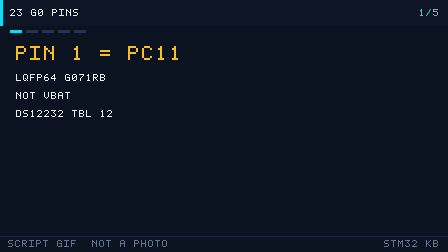

# 23 STM32G0 引脚（G071RB）

> G0 把 BOOT0 和调试时钟焊在同一只脚上。先认封装，再谈复用。

  
   ▲ 引脚图：64 脚的名字和顺序来自 DS12232 Rev 5 Table 12 的 LQFP64 列（Figure 9 同一封装）。颜色只是阅读辅助，不是手册上的涂色。脚本生成，不是实拍。

<!-- video:ch23 -->

  
   ▲ 本章讲解幻灯：程序生成的 GIF（tools/gen_videos.py，可复现，不是实拍）。旁白与五帧一一对应。

**旁白（跟着画面读，大约一分钟）**

1. G071RB 是 LQFP64。左上角第 1 脚是 PC11，不是 F103 那种 VBAT。出处是 DS12232 Rev 5 的 Table 12。
2. BOOT0 和 SWCLK 焊在同一只脚 PA14 上。复位后这只脚内部下拉，既是调试时钟，也是启动选择。
3. 封面特性里有 UCPD，没有 bxCAN，也没有 USB 全速设备。不要在这张图上找 CAN_TX。
4. PC13 到 PC15 只能灌大约 3 mA，输出别超过 2 MHz。这颗料不适合用 PC13 点灯。
5. 口诀：G071 的 R 是 64 只脚，B 是 128 KB。自测：第 1 脚叫什么？USB 外设叫 UCPD 还是 Device FS？
<!-- /video:ch23 -->

## 📌 学习目标

- [ ] 能从 LQFP64 的左上角数到第 1 脚，并认出它是 PC11 而不是 VBAT。
- [ ] 能指出 USART、I2C、SPI、SWD 在这颗料上的默认脚。
- [ ] 说清它和 F1 的三处不一样：没有 bxCAN、没有 USB 全速设备、BOOT0 与 SWCLK 共用。

## 🧠 这颗料是谁

对照的是 **STM32G071RB**，LQFP64。出处都在 **DS12232 Rev 5**：

| 事实 | 出处 |
| --- | --- |
| 家族最高 64 MHz，Cortex-M0+，供电 1.7 V 到 3.6 V | 封面特性 |
| Flash 最高 128 KB，SRAM 36 KB | 封面；Table 2 |
| STM32G071RB：R = 64 脚，B = 128 KB Flash | 第 7 章订购信息 |
| 低功耗模式：Sleep、Stop、Standby、Shutdown | 封面特性 |
| 通信口：2×I2C、4×USART、1×LPUART、2×SPI、USB Type-C PD（UCPD） | 封面特性。特性列表里没有 CAN，也没有 USB 全速设备控制器 |

口诀：**G071 的 R 是 64 只脚，B 是 128 KB。没有 CAN，别在图上找 CAN_TX。**

## 🛠️ 和 F1 / F4 比，脚上差在哪

| 点 | F103（LQFP48，见 BluePill 图） | G071RB（本图） |
| --- | --- | --- |
| 第 1 脚 | VBAT | **PC11**（Table 12，LQFP64 列第 1 行） |
| 复位 | 专用 NRST | **PF2-NRST**。配成复位时是 RST 结构，配成 GPIO 时是 FT（Table 12 注 3） |
| BOOT | 专用 BOOT0，要外部下拉 | **PA14-BOOT0**，和 SWCLK 是同一只脚（Table 12 注 6：复位后 PA14 内部下拉） |
| 复位后的 GPIO | F1 多为浮空输入 | Table 11：除非另有说明，复位后 I/O 是模拟输入 |
| USB | PA11/PA12 是 USB DM/DP | 这颗料是 **UCPD**（Type-C 供电协商），不是 F1 那种设备控制器。PA8 的附加功能是 UCPD1_CC1，PB15 是 UCPD1_CC2（Table 12） |
| CAN | bxCAN，默认可到 PA11/PA12 | **没有 CAN 控制器** |
| PC13–PC15 | 备份域，驱动能力小 | Table 12 注 1：开关只能灌大约 3 mA，输出别超过 2 MHz、负载别超过 30 pF，不要拿来点灯 |

F4 的复用靠 AFR 编号。G0 也是 AFR，但 AF 表要看 **DS12232 Table 13（端口 A）和 Table 14（端口 B）**，不要把 F407 的 AF 号抄过来。

## 🛠️ 关键复用（只列 Table 12 / 13 / 14 里写明的）

| 功能 | 脚 | 依据 |
| --- | --- | --- |
| SWDIO / SWCLK | PA13 / PA14-BOOT0 | Table 12 注 6：复位后就是调试复用 |
| USART1_TX / RX | PA9 / PA10；另一组 PC4 / PC5 | Table 13、Table 12 |
| USART2_TX / RX | PA2 / PA3 | Table 13 |
| I2C1_SCL / SDA | PB6 / PB7；也可 PB8 / PB9 | Table 14 |
| SPI1_SCK / MISO / MOSI | PA5 / PA6 / PA7 | Table 13 |
| SPI1_NSS | PA4 或 PB0 | Table 13、Table 14 |
| LSE | PC14-OSC32_IN / PC15-OSC32_OUT | Table 12 脚名 |
| HSE | PF0-OSC_IN / PF1-OSC_OUT | Table 12 脚名 |
| 调试时别动 | PA13、PA14 | 动了 PA14 就同时动了 BOOT0 |

PA11 / PA12 复位后就是 PA11 / PA12。Table 12 注 5：可以用 SYSCFG_CFGR1 把 PA9/PA10 重映射到 PA11/PA12 的位置。没改寄存器之前，不要把 PA11 叫成 PA9。

## ⚠️ 从 F1 抄代码时最容易摔的三下

| 现象 | 原因 | 解决 |
| --- | --- | --- |
| 上电能进系统存储器，SWD 也怪 | PA14 既是 SWCLK 又是 BOOT0 | 先看注 6 的上下拉，再改复用 |
| 找遍图没有 CANH | G071 没有 CAN | 换带 FDCAN 的 G0 子系列，或改用 USART |
| PC13 推挽点灯很暗、边沿软 | 注 1 的电流和速度限制 | 灯改到普通 GPIO |

## 🧪 动手实验

1. 打印这张图，用铅笔从第 1 脚数到 PF2-NRST，核对是不是第 12 脚。
2. 在数据手册 Table 13 里找出 PA9 的 AF 列表，圈出 USART1_TX。
3. 回答：如果原理图把 LED 接到 PC13，为什么这颗料不合适？

自测：

1. G071RB 的第 1 脚叫什么？
2. BOOT0 和哪根调试线是同一只脚？
3. 这颗料的 USB 外设叫 UCPD 还是 USB Device FS？

## 🔗 相关资源

- DS12232 Rev 5：封面特性、Table 1、Table 2、Table 11–14、第 7 章订购信息、Figure 9。
- 参考手册 RM0444（RTC 域对 PC13–PC15 的说明，Table 12 注 2 指向它）。
- 对照图：[BluePill LQFP48](../assets/boards/pinout-bluepill.svg)。
- 低功耗模式名字见封面；电流数字本章不写，因为封面没有给 G071 的典型微安值，避免凭印象填。
