# 23 STM32G0 引脚（G071RB）

> English: [STM32G0 pins](en/23-stm32g0-pins.md)

> G071 的 PA14 同时承担 BOOT0 输入和 SWCLK。恢复前必须同时读选项字节、互补值、PA14 外部电平和 RDP，不能只反复拉高一根线。

  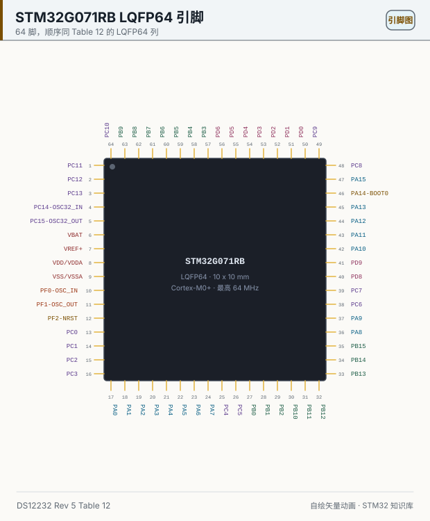
   ▲ 引脚图：64 脚的名字和顺序来自 DS12232 Rev 5 Table 12 的 LQFP64 列（Figure 9 同一封装）。颜色只是阅读辅助，不是手册上的涂色。脚本生成，不是实拍。

  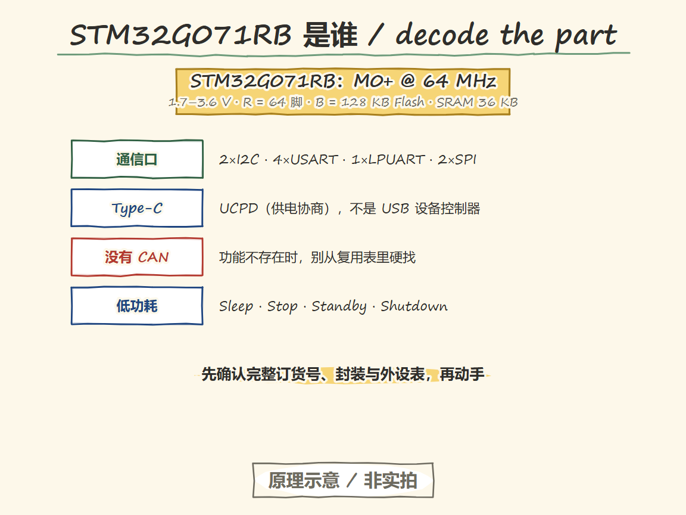
   ▲ 知识轨（Handraw · 原理示意/非实拍）。M0+ @ 64 MHz、R=64 脚、B=128 KB；UCPD 不是 USB 设备控制器；无 CAN；不是实拍。

<!-- video:ch23 -->

  <video width="640" controls poster="../assets/video/ch23-g0-pins.png">
    <source src="../assets/video/ch23-g0-pins.mp4" type="video/mp4">
  </video>
   ▲ 本章讲解视频（2.6 分钟）。<a href="../assets/video/ch23-g0-pins.mp4">MP4</a> · <a href="../assets/video/ch23-g0-pins.srt">字幕</a>

旁白文字稿

1. 这一章对着 STM32G071RB 的 64 脚封装。订购信息里 R 是 64 只脚，B 是 128 KB 闪存。出处是 DS12232 第 5 版，不是凭封装外形猜的。
2. 图的左上角、第 1 脚是 PC11。F103 那种小封装第 1 脚常常是 VBAT，这里不是。数脚时从左边往下，不要从你习惯的那个角开始。
3. 封面的通信口有 I2C、USART、LPUART、SPI，还有 USB Type-C 的 UCPD。没有 CAN，也没有 F1 那种全速设备控制器。别在图上找 CAN 发送脚。
4. 这一帧是仓库按 DS12232 表 12 画的引脚图，不是芯片照片。请你自己核对左上角是不是 PC11。颜色只帮助阅读，不代表手册里的分类。
5. 复位功能在 PF2。BOOT 和 SWCLK 共用 PA14。手册注解说，复位之后 PA14 内部下拉。把它当成 F1 那种独立的 BOOT0 焊盘，下载方式会对不上。
6. 表 12 的注把 PC13 到 PC15 限制得很紧：开关电流大约 3 毫安，输出别超过 2 兆赫，负载电容别超过 30 皮法。不要拿这三只脚去点灯。
7. 除非另有说明，复位之后这些脚是模拟输入。这和 F1 上常见的浮空输入不同。没经过初始化的脚，不要假设它已经是推挽输出。
8. 口诀：G071 的 R 是 64 只脚，B 是 128 KB。没有 CAN，别在图上找 CAN 发送。USB 这里是 UCPD，不是设备全速。
9. G0 这一章故意不写待机多少微安。封面摘录里没有一条可以单独引用的典型电流，与其编一个，不如你去电气特性那一章自己查。
10. 离开前做三张对照卡：第 1 脚是 PC11，复位在 PF2，USB 是 UCPD 不是设备控制器。和 F1 对照着记，迁移才不会踩空。

<!-- /video:ch23 -->
## 学习目标

- [ ] 能从 LQFP64 的左上角数到第 1 脚，并认出它是 PC11 而不是 VBAT。
- [ ] 能指出 USART、I2C、SPI、SWD 在这颗料上的默认脚。
- [ ] 说清它和 F1 的三处不一样：没有 bxCAN、没有 USB 全速设备、BOOT0 与 SWCLK 共用。
- [ ] 能按 `BOOT_LOCK`、`nBOOT1`、PA14、`nBOOT_SEL`、`nBOOT0` 判定 Main Flash、System memory 或 SRAM。
- [ ] 能在 PA13/PA14 被应用改写或启动异常时，按 RDP/`DBG_SWEN` 判定连接与恢复可达性，并在操作成功后读回验证。

## 这颗料是谁

对照的是 **STM32G071RB**，LQFP64。出处都在 **DS12232 Rev 5**：

| 事实 | 出处 |
| --- | --- |
| 家族最高 64 MHz，Cortex-M0+，供电 1.7 V 到 3.6 V | 封面特性 |
| Flash 最高 128 KB，SRAM 36 KB | 封面；Table 2 |
| STM32G071RB：R = 64 脚，B = 128 KB Flash | 第 7 章订购信息 |
| 低功耗模式：Sleep、Stop、Standby、Shutdown | 封面特性 |
| 通信口：2×I2C、4×USART、1×LPUART、2×SPI、USB Type-C PD（UCPD） | 封面特性。特性列表里没有 CAN，也没有 USB 全速设备控制器 |

迁移到 G071 时先确认完整订货号、封装与外设表。G071RB 是 64 脚、128 KB，并不包含 CAN；功能不存在时不要从复用表里硬找。

## 和 F1 / F4 比，脚上差在哪

| 点 | F103（LQFP48，见 BluePill 图） | G071RB（本图） |
| --- | --- | --- |
| 第 1 脚 | VBAT | **PC11**（Table 12，LQFP64 列第 1 行） |
| 复位 | 专用 NRST | **PF2-NRST**。配成复位时是 RST 结构，配成 GPIO 时是 FT（Table 12 注 3） |
| BOOT | 专用 BOOT0，要外部下拉 | **PA14-BOOT0**，和 SWCLK 是同一只脚（Table 12 注 6：复位后 PA14 内部下拉） |
| 复位后的 GPIO | F1 多为浮空输入 | Table 11：除非另有说明，复位后 I/O 是模拟输入 |
| USB | PA11/PA12 是 USB DM/DP | 这颗料是 **UCPD**（Type-C 供电协商），不是 F1 那种设备控制器。PA8 的附加功能是 UCPD1_CC1，PB15 是 UCPD1_CC2（Table 12） |
| CAN | bxCAN，默认可到 PA11/PA12 | **没有 CAN 控制器** |
| PC13–PC15 | 备份域，驱动能力小 | Table 12 注 1：开关只能灌大约 3 mA，输出别超过 2 MHz、负载别超过 30 pF，不要拿来点灯 |

F4 的复用靠 AFR 编号。G0 也是 AFR，但 AF 表要看 **DS12232 Table 13（端口 A）和 Table 14（端口 B）**，不要把 F407 的 AF 号抄过来。

  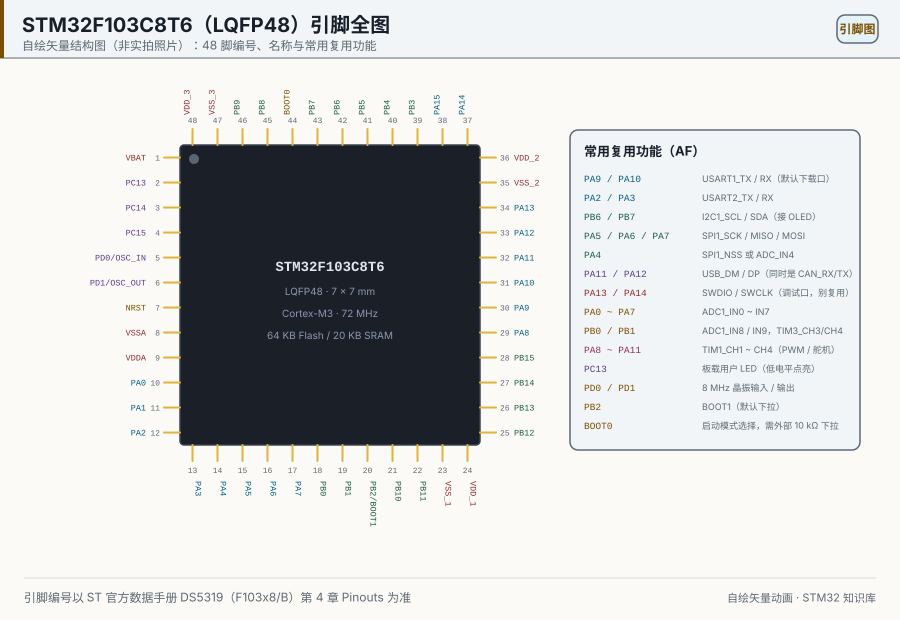
   ▲ 迁移对照只比较边界：电源脚、BOOT、SWD 和目标外设。F1 的引脚号、启动规则和寄存器不能直接套到 G0；具体结论仍以 G071 的 DS/RM 为准。

  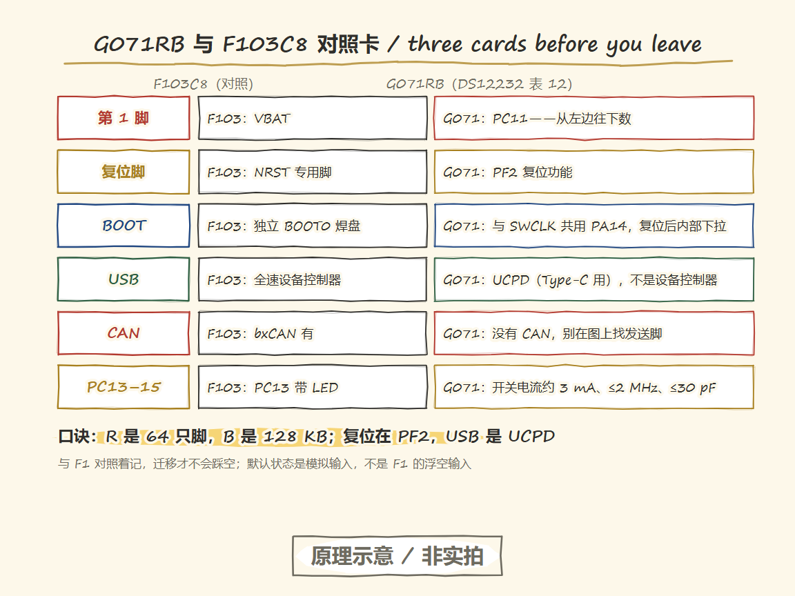
   ▲ 知识轨（Handraw · 原理示意/非实拍）。看哪里：六行对照——第 1 脚是 PC11 不是 VBAT；复位在 PF2；BOOT 与 SWCLK 共用 PA14，复位后内部下拉；USB 是 UCPD 不是设备控制器；没有 CAN；PC13–15 只能灌约 3 mA、≤2 MHz、≤30 pF。证明什么：离开本章前带走的对照卡，与 F1 对照着记迁移才不踩空；复位后默认模拟输入。不能证明什么：这是表 12 的转述不是封装图，脚位与注解以 DS12232 原表为准。出处是 [DS12232](#source-ds12232)。

## BOOT0 与 SWCLK 共脚：先判定启动来源

  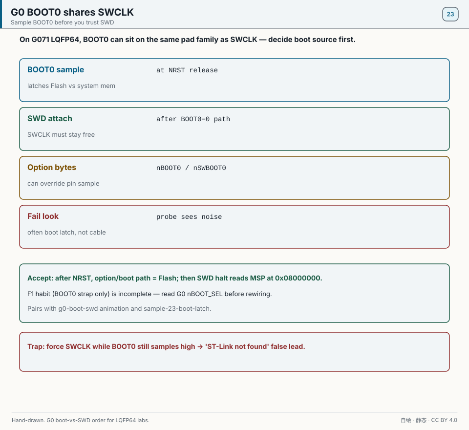
   ▲ 自绘。先判定启动来源，再驱动 SWCLK。

  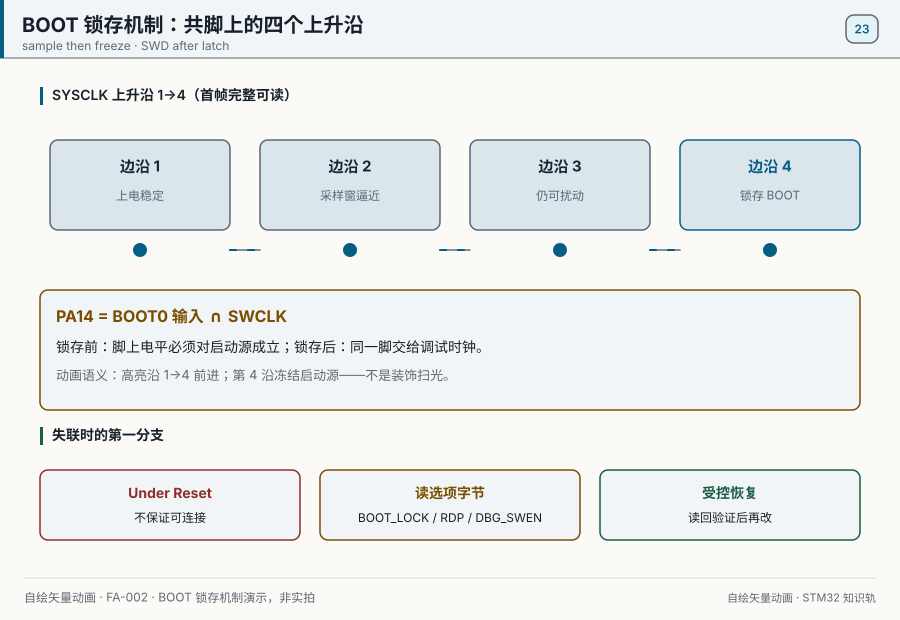
   ▲ 动画：四个 SYSCLK 上升沿后锁存启动源（作者自绘矢量动画，非实拍）。出处是 [DS12232](#source-ds12232)、[RM0444](#source-rm0444) 与 [AN2606](#source-an2606)；开源对照见 [配套例程](#source-project-examples)。

  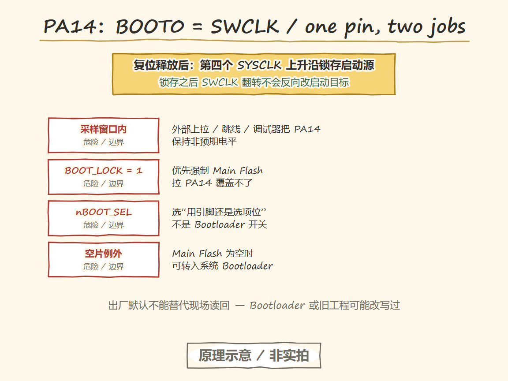
   ▲ 知识轨（Handraw · 原理示意/非实拍）。第四个 SYSCLK 上升沿锁存启动源；BOOT_LOCK / nBOOT_SEL 边界；不是实拍。

  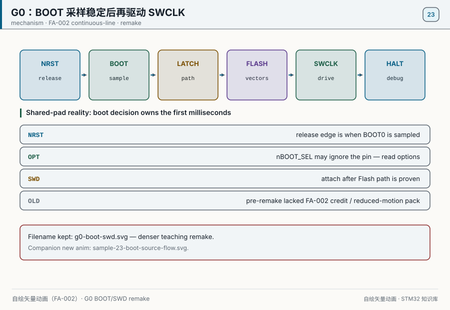
   ▲ 动画：复位后的启动配置在第四个 SYSCLK 上升沿锁存；nBOOT_SEL 决定看 PA14 还是选项位。Under Reset 只是受控连接尝试，RDP 与 DBG_SWEN 还会限制恢复可达性。程序生成示意，不是示波器实测。

**PA14 是启动输入和调试时钟的复用点，不是启动结果本身。**ST 的启动 FAQ 说明：复位释放后，启动配置在第四个 SYSCLK 上升沿锁存。锁存之后 SWCLK 正常翻转不会反向改变本次启动目标；真正危险的是采样窗口内，外部上拉、跳线或调试器把 PA14 保持在非预期电平。

RM0444/AN5096 的 G0x1 启动表如下。`X` 表示该项不影响该行结果；不要把 `nBOOT_SEL` 误当成“系统 Bootloader 开关”，它选择的是**使用引脚还是选项位路径**。

| BOOT_LOCK | nBOOT1 | BOOT0 脚（PA14） | nBOOT_SEL | nBOOT0 | 选中启动区域 |
| ---: | ---: | ---: | ---: | ---: | --- |
| 1 | X | X | X | X | **Main Flash** |
| 0 | X | 0 | 0 | X | Main Flash |
| 0 | 1 | 1 | 0 | X | System memory |
| 0 | 0 | 1 | 0 | X | Embedded SRAM |
| 0 | X | X | 1 | 1 | Main Flash |
| 0 | 1 | X | 1 | 0 | System memory |
| 0 | 0 | X | 1 | 0 | Embedded SRAM |

三条边界必须一起记：

1. `BOOT_LOCK=1` 优先强制 Main Flash，不能靠拉 PA14 覆盖它。
2. `nBOOT_SEL=0` 才使用 PA14；`=1` 时由 `nBOOT0/nBOOT1` 决定。默认出厂值不能替代现场读回，因为 Bootloader、旧工程或生产配置可能已经改写过。
3. 若选择 Main Flash 而空 Flash 检查判定用户区为空，器件可转入系统 Bootloader。这是 DS12232/AN2606 的额外路径，不能把“表上选 Main”理解成“空片也一定从 0x08000000 执行”。

### 共脚硬件：采样稳定与调试驱动要同时成立

  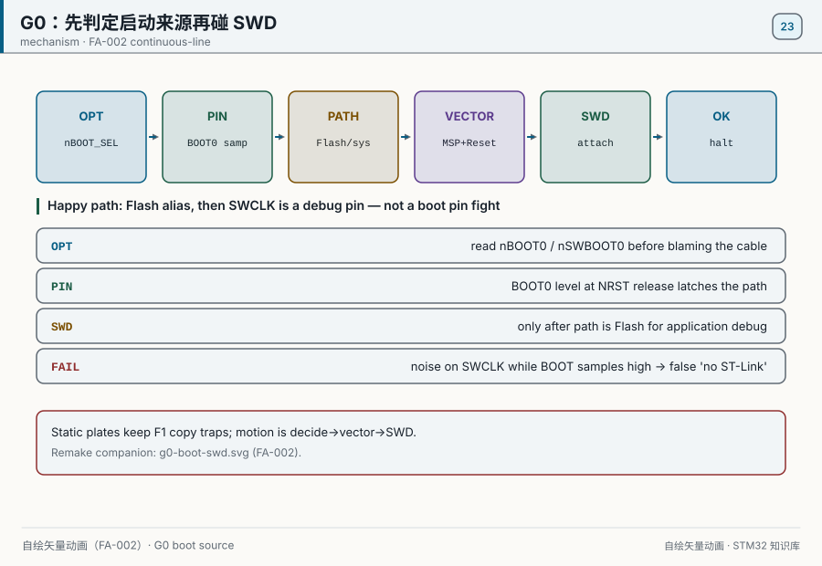
   ▲ 自绘矢量动画（FA-002）。option → BOOT0 → 向量 → SWD。

- DS12232 Table 12 注 6：复位后 PA13 内部上拉、PA14 内部下拉，并进入 SWD 复用。内部下拉不是任何外部强上拉的“抵消器”。
- 使用 PA14 选择启动时，按 AN5096 和调试器驱动能力核对上下拉、串阻与跳线；不要用强上拉把 SWCLK 固定住。产品若不需要现场 Boot 引脚，可选 `nBOOT_SEL=1, nBOOT0=1` 的 Main Flash 配置，减少启动对 PA14 电平的依赖。
- 应用若在运行后把 PA13/PA14 改成 GPIO、关掉调试或进入低功耗，启动后的 SWD 仍可能失败。这与“本次启动选错区域”是两个不同故障边界，先分开验证。

### SWD 失联：受控连接与保护分支

1. **保留现场**：记录当前启动去向、是否能进系统 Bootloader、最近是否改过 PA13/PA14、低功耗或选项字节。连接 SWDIO、SWCLK、NRST、GND 与目标供电参考。
2. **尝试受控连接，但不预设必能连接**：在 STM32CubeProgrammer 选择 **Under Reset**（或探针等价模式），利用 NRST 在复位期间连接。若 `BOOT_LOCK=1` 且 RDP 为 Level 1，RM0444 规定调试能力停止，`FLASH_ACR.DBG_SWEN` 复位值为 0；若应用复位后未置位它，手册明确说无法从该状态恢复。此时不要反复重连或把 Under Reset 当成必通路径。
3. **先读再写**：能连接时，读回并保存 `BOOT_LOCK`、`nBOOT1`、`nBOOT_SEL`、`nBOOT0`、RDP 和启动相关配置；不能连接时，把保护状态和应用是否设置 `DBG_SWEN` 列为未决证据。第一处分歧是“启动/保护输入与预期不同”，不是“芯片一定坏了”。
4. **按 RDP 与保护状态分支，不承诺原位修复**：
   - RDP Level 0：可按目标清除或保持 `BOOT_LOCK`。常规 Main Flash 可选 `BOOT_LOCK=0, nBOOT_SEL=1, nBOOT0=1`；确需 PA14 legacy 选择时用 `BOOT_LOCK=0, nBOOT_SEL=0`，再按真值表设置 `nBOOT1` 和外部电平。
   - RDP Level 1：不能把 `BOOT_LOCK=1` 直接清成 0。RM0444 只允许在已经是 Level 0 时清除，或在 **Level 1 → Level 0 且执行 full mass-erase** 后清除。整片擦除会毁掉用户内容，必须有明确授权、备份与维护流程；还要先确认存在可执行该操作的路径，不能把它写成默认恢复按钮。
   - RDP Level 2：不可逆，不提供靠降级 RDP 恢复的路径。`BOOT_LOCK=1 + RDP Level 1` 且应用未设置 `DBG_SWEN` 时，也不能承诺 Under Reset、Bootloader 或 mass-erase 一定可达。
5. **仅在操作实际成功后复位并读回**：按工具执行 option-byte launch 或规定的复位流程，重新读取选项字节，再验证 Main Flash 启动和 SWD 热连接。写操作返回成功不等于新值已经在本轮启动生效；无法写入或无法连接应保留为失败结果，不进入“已恢复”结论。

> **RDP 与互补值边界**：不要为了“解锁”盲目降低 RDP。Level 2 不可逆；Level 1 → Level 0 会触发整片擦除。`BOOT_LOCK` 可随时置位，但清除受上述 RDP 条件限制。**选项字节与互补值不匹配会强制 `BOOT_LOCK=1`，RDP 不匹配时默认进入 Level 1**；因此读回必须同时检查值与互补值，不能只验证一个字段。恢复流程先保护现场和需要的数据，不能把 mass erase 当成默认修复按钮。

## 关键复用（只列 Table 12 / 13 / 14 里写明的）

| 功能 | 脚 | 依据 |
| --- | --- | --- |
| SWDIO / SWCLK | PA13 / PA14-BOOT0 | Table 12 注 6：复位后就是调试复用 |
| USART1_TX / RX | PA9 / PA10；另一组 PC4 / PC5 | Table 13、Table 12 |
| USART2_TX / RX | PA2 / PA3 | Table 13 |
| I2C1_SCL / SDA | PB6 / PB7；也可 PB8 / PB9 | Table 14 |
| SPI1_SCK / MISO / MOSI | PA5 / PA6 / PA7 | Table 13 |
| SPI1_NSS | PA4 或 PB0 | Table 13、Table 14 |
| LSE | PC14-OSC32_IN / PC15-OSC32_OUT | Table 12 脚名 |
| HSE | PF0-OSC_IN / PF1-OSC_OUT | Table 12 脚名 |
| 调试时别动 | PA13、PA14 | 动了 PA14 就同时动了 BOOT0 |

PA11 / PA12 复位后就是 PA11 / PA12。Table 12 注 5：可以用 SYSCFG_CFGR1 把 PA9/PA10 重映射到 PA11/PA12 的位置。没改寄存器之前，不要把 PA11 叫成 PA9。

  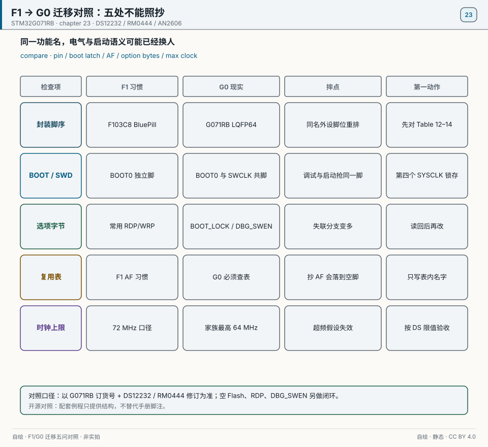
   ▲ 自绘。F1→G0 迁移五问对照。出处是 [DS12232](#source-ds12232) / [RM0444](#source-rm0444)；例程结构仅对照 [配套例程](#source-project-examples)。

  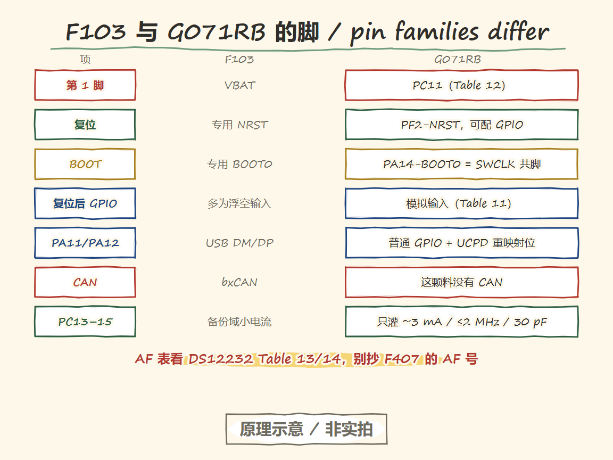
   ▲ 知识轨（Handraw · 原理示意/非实拍）。第 1 脚、NRST、BOOT/SWD 共脚、复位后模拟输入；AF 看 DS12232 Table 13/14；不是实拍。

## 从 F1 抄代码时最容易摔的几处

  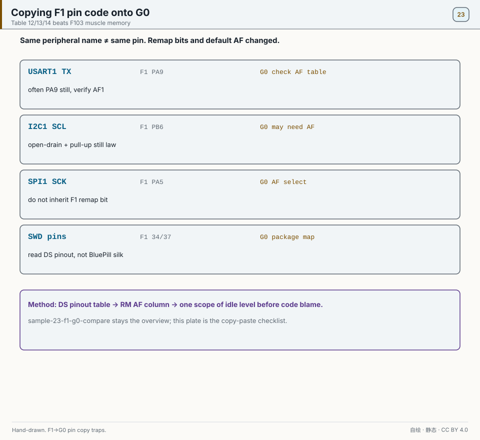
   ▲ 自绘。同名外设 ≠ 同脚；以 DS 表为准。

  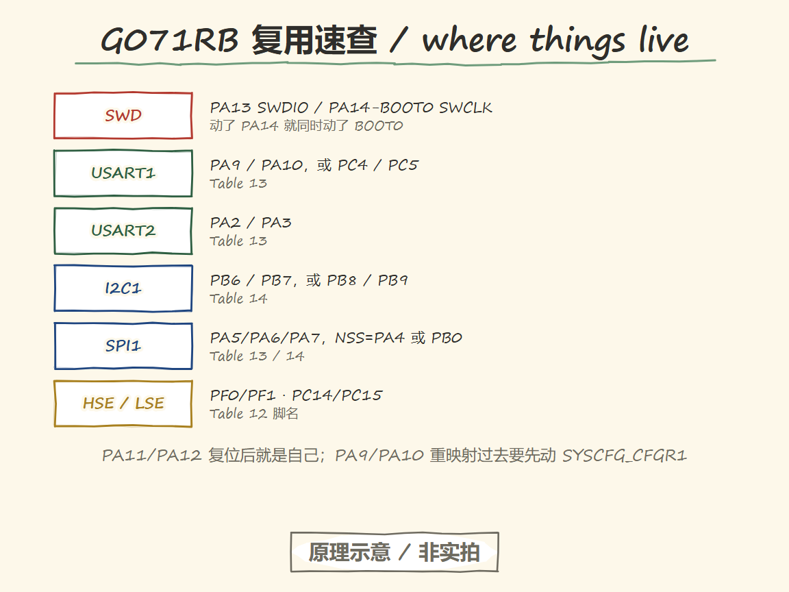
   ▲ 知识轨（Handraw · 原理示意/非实拍）。PA14=BOOT0+SWCLK；USART/I2C/SPI 脚位；PA9/PA10 重映射先动 SYSCFG_CFGR1；不是实拍。

| 现象 | 原因 | 解决 |
| --- | --- | --- |
| 上电能进系统存储器，SWD 也怪 | PA14 既是 SWCLK 又是 BOOT0 | 先读 `BOOT_LOCK/nBOOT_SEL/nBOOT0/nBOOT1`，区分启动源错误与应用改写调试脚，再决定恢复路径 |
| 找遍图没有 CANH | G071 没有 CAN | 换带 FDCAN 的 G0 子系列，或改用 USART |
| PC13 推挽点灯很暗、边沿软 | 注 1 的电流和速度限制 | 灯改到普通 GPIO |
| 拉高 PA14 仍进不了 Bootloader | `BOOT_LOCK=1`，或 `nBOOT_SEL=1` 使引脚不参与选择 | 先按真值表读回全部输入，不重复改电平 |
| 选项字节写完仍走旧启动区 | 新值尚未经过规定复位/加载流程，或只看了写入返回值 | 执行规定 option-byte launch/reset，复位后读回并验证启动与 SWD |

## 动手实验

1. **封装对账**：从 Pin 1 数到 PF2-NRST，记录关键电源、PA14 与 NRST 的脚号，并和 PCB 封装逐项核对。
2. **复用证据**：从 Table 13 抄出 PA9 的完整 AF 行，标出 USART1_TX 和冲突功能；CubeMX 只作交叉检查。
3. **只读启动审计**：记录 `BOOT_LOCK/nBOOT1/nBOOT_SEL/nBOOT0`、互补值、RDP 和 PA14 电平，代入真值表，不写选项字节。
4. **受控恢复**：在可恢复板上做 Under Reset，记录连接参数、读回值、复位后 Main Flash 启动和热连接结果；任何 mass erase 都另行备份。

离开本章前，应有封装对账表、PA9 复用来源、完整启动输入快照和一次不依赖擦除的 SWD 恢复记录。

自测：

1. G071RB 的第 1 脚叫什么？
2. BOOT0 和哪根调试线是同一只脚？
3. 这颗料的 USB 外设叫 UCPD 还是 USB Device FS？
4. `nBOOT_SEL=0` 与 `=1` 分别选择哪条启动判定路径？
5. `BOOT_LOCK=0, nBOOT_SEL=1, nBOOT0=1` 启动到哪里？若 `nBOOT0=0`，`nBOOT1=1` 和 `=0` 又各到哪里？
6. 为什么拉高 PA14 不一定进入 System memory，选项字节写入成功也不一定立即改变下一次启动？选项字节与互补值不匹配会怎样？
7. 应用改写 PA13/PA14 导致 SWD 失联时，恢复的前两步是什么？为什么 Under Reset 和清除 `BOOT_LOCK` 都不是无条件可达，为什么不能默认降低 RDP？

## 相关资源

- RM0444 Rev 5 第 2.5 节及 FLASH_SECR/选项字节说明：启动真值表、`BOOT_LOCK + RDP Level 1` 的 `DBG_SWEN` 限制、清除条件与互补值不匹配规则；AN5096 Table 3 用于交叉核对启动表；AN2606：系统 Bootloader、激活 pattern 与空 Flash 等附加边界。

- DS12232 Rev 5：封面特性、Table 1、Table 2、Table 11–14、第 7 章订购信息、Figure 9；PA14 复位下拉与空 Flash 检查边界。
- RM0444 第 2.5 节与 AN5096 Table 3：启动真值表；AN2606：系统 Bootloader、激活 pattern 与空 Flash 等附加边界。
- ST 官方 *FAQ STM32 boot process*：第四个 SYSCLK 上升沿锁存启动配置、选项字节加载与 RDP 边界；它不是替代 RM0444 的规范。
- 对照图：[BluePill LQFP48](../assets/boards/pinout-bluepill.svg)。
- 低功耗模式名字见封面；电流数字本章不写，因为封面没有给 G071 的典型微安值，避免凭印象填。

- 手机阅读版：[第 23 章 · STM32G0引脚（公众号图文）](https://mp.weixin.qq.com/s/XgdjiTiqGF1r0UGuBv9fcQ)
