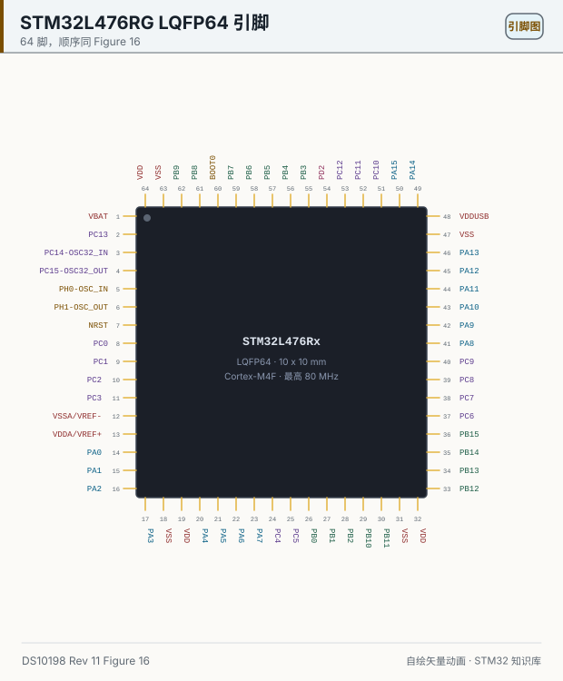
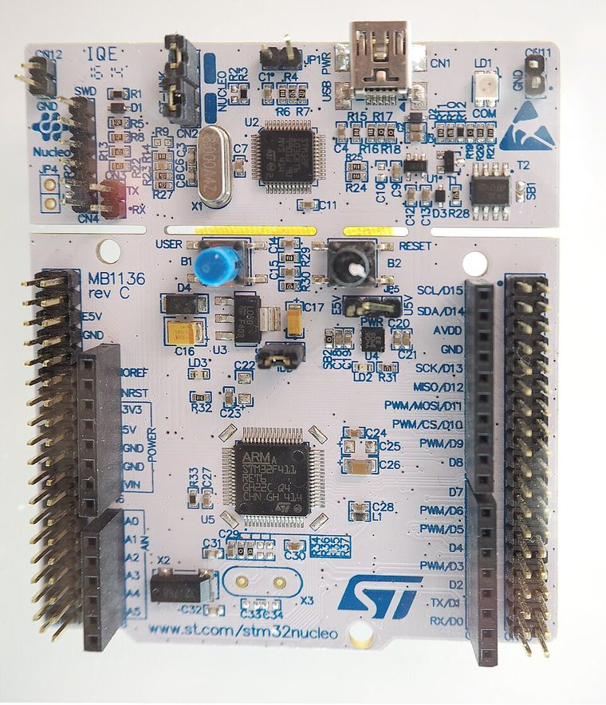
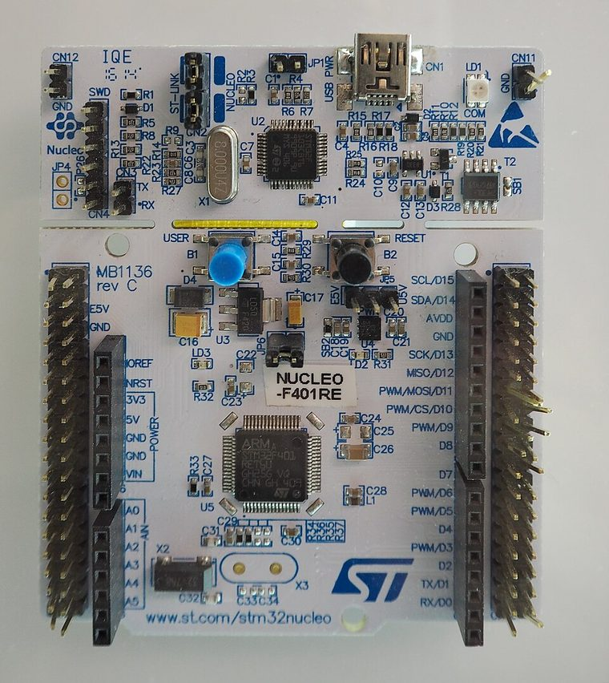
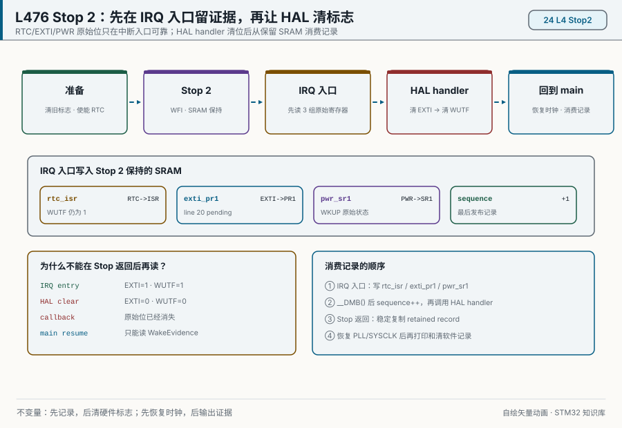
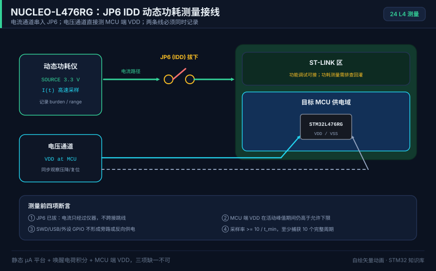

# 24 STM32L4 引脚（L476RG）

> English: [STM32L4 pins](en/24-stm32l4-pins.md)

> L4 的第 1 脚回到了 VBAT，但旁边多了独立的 VDDUSB。USB 和 CAN 仍在抢 PA11。

<p align="center">
  
  <br><sub>▲ 引脚图：顺序来自 DS10198 Rev 11 Figure 16，并与 Table 16 的 LQFP64 列逐脚核对。颜色是阅读辅助。脚本生成，不是实拍。</sub>
</p>

<!-- video:ch24 -->
<p align="center">
  <video width="640" controls poster="../assets/video/ch24-l4-pins.png">
    <source src="../assets/video/ch24-l4-pins.mp4" type="video/mp4">
  </video>
  <br><sub>▲ 本章讲解 2.6 分钟。配音是微软 Edge 在线神经语音「晓晓」（zh-CN-XiaoxiaoNeural），经 edge-tts 调用。edge-tts 大部分源码为 LGPLv3，srt_composer.py 为 MIT；声线模型是微软在线服务，不是开放模型。这里提交的是合成后的 MP4，离线可看。重新生成需要联网。画面由脚本和本仓库 SVG 生成，不是实拍。 视频：<a href="../assets/video/ch24-l4-pins.mp4">MP4</a> · 字幕：<a href="../assets/video/ch24-l4-pins.srt">SRT</a>。由 <code>python3 tools/gen_narrated.py --speak</code> 用 ffmpeg 合成。</sub>
</p>

**旁白（与字幕、配音同一份稿）**

1. 这一章的图是 STM32L476 的 64 脚封装，Nucleo-L476RG 用的就是这一类。脚序对照 DS10198 第 11 版的图 16，并和表 16 对过。
2. 第 1 脚是 VBAT，旁边第 2 脚才是 PC13。高速晶振换到了 PH0 和 PH1，不再是 F1 上的 PD0、PD1。抄原理图时这两只最容易接错。
3. F1 没有单独的 USB 电源脚。这里第 48 脚是 VDDUSB，第 47 脚是旁边的地。USB 电源空着，软件写得再对，枚举也不会老实。
4. 这一帧是仓库按手册画的引脚图，不是照片。请核对左上角第 1 脚是 VBAT。图上的颜色只是为了让电源脚好认，不增加手册里没有的含义。
5. PA11 和 PA12 既能做 CAN，也能做 USB 全速。两家不要同时占这一对。CAN 还可以改到 PB8 和 PB9。下板之前先决定这一对脚归谁。
6. BOOT0 是第 60 脚，不和 SWCLK 共用。SWD 的 PA13、PA14 在第 46 和 49 脚。这和 G0 把启动和调试时钟绑在一起的做法不同。
7. 手册封面写了 Stop 2 的典型电流，那是芯片的数字，不是本仓库测出来的，更不是整块板的电流。板上的稳压器和发光管会把读数抬高。不要拿封面去验收万用表。
8. 口诀：L4 第 1 脚是 VBAT，USB 另有供电脚。真睡在 Stop 2。封面的纳安是芯片，不是整块板。
9. 封面写的是带浮点的 Cortex-M4，最高 80 兆，供电大约 1.71 伏到 3.6 伏。不要把 F103 的 72 兆时钟树原样搬过来，等待周期和外设时钟都会错。
10. 合上书，三问。第 1 脚叫什么？PA11 同时被哪两类外设看上？封面上的纳安能不能当成你这块开发板的电流？
<!-- /video:ch24 -->
## 📌 学习目标

- [ ] 能在 LQFP64 上指出 VBAT、VDDUSB、BOOT0、SWD 各自的脚号。
- [ ] 能列出 USART1、I2C1、SPI1、CAN1、OTG_FS 的脚，并知道 PA11/PA12 被两家同时看上。
- [ ] 能按 RM0351 区分 Sleep、Stop 0/1/2、Standby、Shutdown 的返回方式与状态保持边界。
- [ ] 能写出 Stop 2 的“准备 → 进入 → 识别唤醒源 → 恢复时钟 → 恢复外设 → 验证”闭环。
- [ ] 能把活动段、唤醒段和睡眠段的电流积分成 `I_avg`，并写全电压、温度、仪器带宽和板级负载。
- [ ] 记住 DS10198 的典型电流不是保证值，也不是这块开发板的实测值；量产前还要核对 ES0250。

## 🧠 这颗料是谁

图上是 **STM32L476Rx LQFP64**（Nucleo-L476RG 用的就是这个封装）。出处 **DS10198 Rev 11**：

| 事实 | 出处 |
| --- | --- |
| Cortex-M4F，最高 80 MHz，供电 1.71 V 到 3.6 V | 封面 |
| Flash 最高 1 MB，SRAM 128 KB | 封面 |
| USB OTG 2.0 全速，带 LPM 和 BCD | 封面 |
| CAN（2.0B Active） | 封面 |
| VBAT 模式 300 nA；Shutdown 30 nA；Standby 120 nA；带 RTC 的 Standby 420 nA | 封面 |
| Stop 2：1.1 µA，带 RTC 为 1.4 µA；从 Stop 唤醒 4 µs | 封面 |
| Run：LDO 模式 100 µA/MHz；3.3 V SMPS 模式 39 µA/MHz | 封面 |

这些电流是手册封面的家族典型值，不是本仓库测出来的。板子上的 LDO、LED 会把整板电流抬高，不要拿封面数字去验收你的万用表。

口诀：**L4 真睡在 Stop 2；封面的纳安是芯片，不是整块板。**

## 📷 实物认识：Nucleo-64 外形家族

<p align="center">
  
  
  <br><sub>▲ 左：Nucleo-F411RE；右：Nucleo-F401RE。两张都是 Nucleo-64 家族实拍，可用于识别上半区 ST-LINK、下半区目标 MCU 和排针布局，但<strong>都不是 NUCLEO-L476RG</strong>。摄影：Ordercrazy / Thomas Springer，Wikimedia Commons，CC0 1.0。L476RG 的确切硬件版本以 <a href="https://www.st.com/en/evaluation-tools/nucleo-l476rg.html">ST 官方产品页</a>和 UM1724 为准。</sub>
</p>

实拍帮助建立板级空间概念，不能替代原理图：同为 Nucleo-64，目标 MCU、焊桥、跳线与供电选项仍会随板卡型号和 MB revision 改变。下文涉及 JP6 (IDD) 时只对 UM1724 所列的 MB1136 / NUCLEO-L476RG 负责。

## 🛠️ 和 F1 / F4 比

| 点 | F103 LQFP48 | L476RG LQFP64（Figure 16） |
| --- | --- | --- |
| 第 1 脚 | VBAT | **VBAT**（和第 2 脚 PC13 相邻） |
| 高速晶振 | PD0/PD1 | **PH0-OSC_IN / PH1-OSC_OUT**（脚 5、6） |
| USB 供电 | 没有单独的 VDDUSB | **脚 48 是 VDDUSB**，和旁边的 VSS（脚 47）分开 |
| BOOT | 专用 BOOT0 | **脚 60 就是 BOOT0**，不和 SWCLK 共用 |
| SWD | PA13 / PA14 | **脚 46 PA13、脚 49 PA14** |
| USB | 设备 FS，PA11/PA12 | **OTG_FS**，DM/DP 仍在 PA11/PA12（Table 16 的附加功能） |
| CAN | bxCAN | **CAN 2.0B**。PA11/PA12 和 PB8/PB9 都能做 CAN1（Table 16） |
| 低功耗 | Sleep / Stop / Standby | 多了 **Shutdown** 和 **Stop 2**（封面） |

F4 也有 OTG_FS 和独立 USB 电源脚，这一点 L4 更像 F4，不像 F103。内核和低功耗档则两边都不同：L4 是 M4F，Stop 2 会停更多时钟，醒来要重配系统时钟，和第 16 章同一条纪律。

## 💤 低功耗模式与状态保持（RM0351）

**先按“醒来后从哪里继续”分两类**：Sleep/Stop 从 `WFI/WFE` 的下一条指令继续；Standby/Shutdown 的唤醒走复位路径。把这两类混在一起，最常见的后果是把已经丢失的 RAM 当成还在，或在 Stop 2 醒来后直接使用尚未恢复时钟的串口。

| 模式 | CPU / 主时钟 | SRAM 与寄存器 | 醒来路径 | 选型边界 |
| --- | --- | --- | --- | --- |
| Sleep | CPU 停，所选外设时钟可继续 | 保持 | 中断后继续执行 | 等待很短、外设仍要运行 |
| Low-power run / sleep | 限制频率与稳压器工作点 | 保持 | 继续执行 | 持续低速任务；频率、电压范围按 RM0351 校验 |
| Stop 0 | PLL/HSE 等停止，保留能力最多的 Stop 档 | SRAM1/2 与大多数寄存器保持 | 从 `WFI/WFE` 后继续 | 优先短唤醒延迟，不追最低静态电流 |
| Stop 1 | 比 Stop 0 更深 | SRAM1/2 与大多数寄存器保持 | 从 `WFI/WFE` 后继续 | 功耗与唤醒能力折中 |
| Stop 2 | 更深地关闭 VCORE 域；PLL 在 Stop 中关闭 | SRAM1/2 与大多数寄存器保持 | 先由 MSI 或 HSI16 接管，再继续执行 | L476 的常用深睡档；醒后必须恢复目标时钟和被改写的 GPIO/外设 |
| Standby | VCORE 关闭 | 主 SRAM/普通寄存器丢失；部分器件可选 SRAM2 保持 | 唤醒相当于复位 | 用 RTC/备份寄存器保存最小状态，并检查复位标志 |
| Shutdown | 比 Standby 更深 | 主 SRAM 丢失；RTC/备份域是否保持取决于供电与配置 | 唤醒相当于复位 | 最低静态功耗优先，接受完整重启 |

这张表是**决策入口**，不是外设可唤醒清单。RTC、WKUP、EXTI、IWDG、LPUART、LPTIM、I2C 等能否在目标模式工作，还取决于具体实例、内核时钟和芯片修订；逐项查 RM0351 的 PWR/RCC/对应外设章节。Standby 的 SRAM2 保持也必须由目标料号和 `RRS` 配置确认，不能从别的 L4 料号照抄。

<p align="center">
  
  <br><sub>▲ 动画：原始 RTC/EXTI/PWR 位必须在 IRQ 入口写入 Stop 2 保持的 SRAM；HAL handler 清位后，主循环消费的是软件记录而不是已经消失的硬件标志。程序生成示意，不是逻辑分析仪实测。</sub>
</p>


Stop 0/1/2 醒来后，RCC 可按 `STOPWUCK` 选择 MSI 或 HSI16 作为临时系统时钟。**“CPU 已继续执行”不等于“80 MHz PLL 已恢复”**：PLL 在 Stop 中被关闭，Flash 等待周期、SysTick、UART 波特率、定时器周期和 USB 时钟都要重新对账。

## 🛠️ 关键复用（Table 16 的 LQFP64 行）

| 功能 | 脚 | 脚号 | Table 16 里能对上的名字 |
| --- | --- | --- | --- |
| USART2_TX / RX | PA2 / PA3 | 16 / 17 | USART2_TX、USART2_RX |
| USART1_TX / RX | PA9 / PA10 | 42 / 43 | USART1_TX、USART1_RX |
| SPI1 | PA5 SCK、PA6 MISO、PA7 MOSI、PA4 NSS | 21–23、20 | SPI1_SCK / MISO / MOSI / NSS |
| I2C1_SCL / SDA | PB6 / PB7；另一组 PB8 / PB9 | 58 / 59；61 / 62 | I2C1_SCL、I2C1_SDA |
| CAN1_RX / TX | PA11 / PA12；另一组 PB8 / PB9 | 44 / 45；61 / 62 | CAN1_RX、CAN1_TX |
| OTG_FS_DM / DP | PA11 / PA12 | 44 / 45 | OTG_FS_DM、OTG_FS_DP |
| SWD | PA13、PA14 | 46、49 | JTMS-SWDIO、JTCK-SWCLK |
| USB 电源 | VDDUSB | 48 | 电源脚，不是 GPIO |

PA11/PA12 同时出现在 CAN1 和 OTG_FS 上。同一时刻只能选一家，和 F103 上 USB 与 CAN 抢脚是同一类坑。要两样都要，CAN 改到 PB8/PB9。

## 🔄 Stop 2 进入、唤醒与时钟恢复闭环

### 1. 进入前：先证明可以睡

1. 等待 UART/DMA/Flash 写入等不可中断事务结束；记录仍由谁拥有缓冲区。
2. 配置 RTC、EXTI、WKUP、LPTIM 等**唯一预期唤醒源**；先禁用，再清外设标志、EXTI/NVIC pending 和 PWR 唤醒标志，最后重新使能，避免旧标志让芯片立即醒来。
3. 除唤醒脚和必须保持的总线外，把不用的 GPIO 设为模拟无上下拉；外部上拉、传感器和 VDDUSB 仍会产生板级电流。
4. 选择 Stop 唤醒时钟。ST 的 L476 Stop 2 示例显式选择 MSI：`__HAL_RCC_WAKEUPSTOP_CLK_CONFIG(RCC_STOP_WAKEUPCLOCK_MSI)`。
5. 暂停 SysTick；否则 1 ms tick 会成为第一个中断，测到的是“每毫秒醒一次”而不是 Stop 2。

### 2. IRQ 入口：先留证据，再交给 HAL 清标志

固定的 STM32CubeL4 示例中，`RTC_WKUP_IRQHandler()` 直接调用 `HAL_RTCEx_WakeUpTimerIRQHandler()`；固定的 HAL driver `71a58f9d...` 会先清 EXTI RTC 唤醒线，再清 `RTC_FLAG_WUTF`，最后才调用 callback。因此，**HAL callback 已经太晚**，`HAL_PWREx_EnterSTOP2Mode()` 返回后再读原始位更晚。

下面是 RTC 作为唯一预期唤醒源时的最小留证据路径。`WakeEvidence` 放在链接脚本确认会被 Stop 2 保持的普通 SRAM，而不是 Standby/Shutdown 会丢失的区域；项目生成的空 `RTC_WKUP_IRQHandler()` 必须被这份实现替换，不能保留两个同名 handler。

```c
/* app_wake_evidence.h：main.c 与 stm32l4xx_it.c 共用 */
typedef struct {
    uint32_t rtc_isr;
    uint32_t exti_pr1;
    uint32_t pwr_sr1;
    uint32_t sequence;                 /* 最后发布，标记一条完整记录 */
} WakeEvidence;

extern volatile WakeEvidence g_stop2_wake_evidence;

/* stm32l4xx_it.c */
extern RTC_HandleTypeDef hrtc;
volatile WakeEvidence g_stop2_wake_evidence;

void RTC_WKUP_IRQHandler(void)
{
    g_stop2_wake_evidence.rtc_isr = RTC->ISR;
    g_stop2_wake_evidence.exti_pr1 = EXTI->PR1;
    g_stop2_wake_evidence.pwr_sr1 = PWR->SR1;
    __DMB();
    g_stop2_wake_evidence.sequence++;  /* 发布完整快照 */

    HAL_RTCEx_WakeUpTimerIRQHandler(&hrtc); /* 此后 HAL 可以清硬件位 */
}
```

主循环用 `sequence` 做稳定复制：若另一个中断恰好在复制期间更新记录，前后序号不同就重读。单次 32 位读写在 Cortex-M4 上是原子的，`__DMB()` 则固定“字段先于序号发布”的次序。

```c
/* main.c */
static uint32_t s_consumed_sequence;

static bool ConsumeStop2WakeEvidence(WakeEvidence *out)
{
    uint32_t before;
    uint32_t after;

    do {
        before = g_stop2_wake_evidence.sequence;
        __DMB();
        out->rtc_isr = g_stop2_wake_evidence.rtc_isr;
        out->exti_pr1 = g_stop2_wake_evidence.exti_pr1;
        out->pwr_sr1 = g_stop2_wake_evidence.pwr_sr1;
        __DMB();
        after = g_stop2_wake_evidence.sequence;
    } while (before != after);

    if (after == s_consumed_sequence) {
        return false;                  /* RTC handler 没产生新记录 */
    }
    out->sequence = after;
    s_consumed_sequence = after;
    return true;
}
```

若工程允许 RTC 以外的唤醒源，每个对应 IRQ 都要在自己的 HAL handler **之前**写入统一的软件记录，并增加 `source` 字段；不能把“没有 RTC 记录”误判为“没有唤醒”。

### 3. 醒来后：消费记录，恢复时钟，再恢复通信

下面函数只负责**可独立复用的 RTC Stop 2 与时钟边界**。`SystemClock_Config()` 必须是本工程已经验证过的 80 MHz 配置；若 HAL 超时依赖 SysTick，按 ST 官方示例先恢复 tick，再调用时钟恢复函数。

```c
#include <stdbool.h>

#define EXPECTED_SYSCLK_HZ 80000000UL

static bool RestoreClockAfterStop2(void)
{
    SystemClock_Config();              /* MSI/PLL、总线分频、Flash latency */
    SystemCoreClockUpdate();

    return (__HAL_RCC_GET_SYSCLK_SOURCE() ==
            RCC_SYSCLKSOURCE_STATUS_PLLCLK) &&
           (HAL_RCC_GetSysClockFreq() == EXPECTED_SYSCLK_HZ) &&
           (SystemCoreClock == EXPECTED_SYSCLK_HZ);
}

static void EnterStop2Once(WakeEvidence *wake)
{
    bool have_rtc_evidence;

    __HAL_RCC_WAKEUPSTOP_CLK_CONFIG(RCC_STOP_WAKEUPCLOCK_MSI);
    HAL_SuspendTick();
    HAL_PWREx_EnterSTOP2Mode(PWR_STOPENTRY_WFI);
    HAL_ResumeTick();

    /* Stop 返回后消费保留 SRAM；此时绝不再假装读取“原始硬件标志”。 */
    have_rtc_evidence = ConsumeStop2WakeEvidence(wake);

    if (!RestoreClockAfterStop2()) {
        Error_Handler();               /* 禁止在错误波特率下继续通信 */
    }
    if (!have_rtc_evidence) {
        Error_Handler();               /* RTC-only 实验中出现非预期唤醒 */
    }
}
```

ST 官方 `PWR_STOP2` 示例不是只调用 `HAL_PWREx_EnterSTOP2Mode()`：它还暂停/恢复 SysTick、重新使能 PLL、重新选择 PLL 为 SYSCLK。RTC 版本还会重新初始化进入睡眠前被改成模拟模式的 GPIO。工程若使用自定义 HAL time base，恢复函数不能再依赖一个仍停止的计时器；应先恢复该 time base，或在恢复阶段使用独立、不会停的超时源。

### 4. 恢复完成的四项证据

| 边界 | 证据 | 失败时禁止做什么 |
| --- | --- | --- |
| 唤醒源 | IRQ 入口在 HAL 清位前快照 RTC/EXTI/PWR，Stop 返回后稳定复制保留 SRAM 记录 | 不要在 callback 或主循环里补读已清零的硬件位，也不要只打印“醒了” |
| 系统时钟 | RCC `SWS=PLL`，`HAL_RCC_GetSysClockFreq()` 与 `SystemCoreClock` 都为目标值 | 不要启动 UART、USB、精确定时器 |
| 外设内核时钟 | 核对 CCIPR 等选择和外设实际输入频率 | 不要假定寄存器保持就等于波特率保持 |
| 引脚/外设状态 | 恢复睡前改成模拟模式的 GPIO，重新确认 DMA/IRQ 所有权 | 不要在引脚仍高阻时发送数据 |

功能诊断固件可用 MCO、定时器翻转或 UART 字节测时钟；**测电流固件不要开 MCO/串口日志**，否则观测手段本身会抬高电流。两份固件使用同一低功耗路径，只在证据输出上不同。

## 📐 可复算的电流测量与续航账

### 1. 测量边界：JP6 只切 MCU 的 IDD 路径

对 MB1136 版 NUCLEO-L476RG，UM1724 规定：移除 `JP6 (IDD)`，在两端串入电流表，可测 STM32 微控制器电流。它不自动等于整板输入电流，也不替你排除 ST-Link、LED、外部模块经 GPIO 的回灌。

| 必记条件 | 最少记录内容 |
| --- | --- |
| 器件与软件 | 完整料号、封装、芯片 revision、固件 commit、编译优化、HAL/CubeL4 版本 |
| 电源与环境 | MCU 引脚处 VDD、温度、稳压器模式、VDDUSB/VBAT 供电状态 |
| 睡眠配置 | Stop 档、RTC/LSI/LSE、唤醒周期、保留 RAM、IWDG、GPIO 模式和外部上下拉 |
| 调试与板级负载 | SWD 是否断开、LED、传感器、USB、串口、外接上拉以及是否存在回灌 |
| 仪器 | 型号、量程、分流电阻/电流探头、零点、带宽、采样率、负担电压 |

万用表适合看稳定睡眠平台，但自动量程和**负担电压**可能让 MCU 的实际 VDD 下跌，甚至在唤醒尖峰时复位。动态功耗分析仪或低阻分流器更适合同时捕获微安睡眠和毫安唤醒；至少在最短活动脉冲内取得约 10 个样本，即把采样率下限写成 `f_s >= 10 / t_min`。同时测 MCU 端 VDD，不能只记电源设定值。

<p align="center">
  
  <br><sub>▲ 接线图：电流仪串入 JP6，电压通道直接看 MCU 端 VDD，并排查 SWD、USB 和 GPIO 回灌。程序生成示意，不代表本仓库已经取得某个实测电流值。</sub>
</p>


### 2. 从波形积分，而不是平均两个读数

一个周期拆成活动、恢复和睡眠三段：

```text
Q_active  ~= sum(I[k] * delta_t)             # 活动段离散积分
Q_wakeup  ~= sum(I[k] * delta_t)             # 唤醒 + 时钟/传感器恢复
Q_sleep    = I_stop * t_stop
I_avg      = (Q_active + Q_wakeup + Q_sleep) / T_cycle
E_cycle    = sum(V[k] * I[k] * delta_t)       # 电压变化时用能量积分
```

例：每 1 s 醒来一次，活动与恢复合计 8 ms、平均 5 mA，其余 992 ms 为 2 µA：

```text
Q_active+wakeup = 5 mA * 0.008 s   = 0.040000 mA·s
Q_sleep         = 0.002 mA * 0.992 s = 0.001984 mA·s
I_avg           = 0.041984 mA      = 41.984 µA
```

理想化 1000 mAh 电池得到 `1000 / 0.041984 = 23818 h ≈ 2.72 年`。这只是能量账，不是寿命承诺：有效容量随温度、倍率和截止电压变化，自放电、稳压器静态电流、传感器漏电和电池老化都要另列。若仪器漏掉 8 ms 峰值，结果会从约 42 µA 错看成约 2 µA。

### 3. 可比较结果的验收格式

每个配置至少抓 10 个完整周期，报告睡眠平台、活动峰值、`Q_cycle`、`I_avg` 的最小/平均/最大值，并保存原始波形。与 DS10198 对比时，只能对比同一 VDD、温度、模式、RTC/保留项和调试条件；典型值不是上下限。量产前再按完整料号与 revision 核对 ES0250，勘误优先于参考手册和应用笔记的一般描述。

## ⚠️ 抄 F1 工程或做低功耗时

| 现象 | 第一分歧边界 | 处理 |
| --- | --- | --- |
| 晶振脚写成 PD0/PD1 | L4 的 HSE 在 PH0/PH1 | 改原理图网络名 |
| USB 枚举不起来 | 脚 48 VDDUSB 悬空 | 接到规定电源，并按 DS10198 核对去耦与供电范围 |
| 一进 Stop 2 就醒 | SysTick、旧 EXTI/RTC/PWR 标志或浮空唤醒脚仍有效 | 暂停 tick；按“禁用 → 清标志/pending → 重新使能”处理唯一唤醒源 |
| 醒来后串口乱码、定时器变慢 | CPU 已返回，但 PLL/SYSCLK/外设内核时钟未恢复 | 恢复时钟并验证频率后才允许通信 |
| Stop 2 电流偏大 | 调试器、GPIO 上下拉、LED、外设电源、IWDG/RTC 或回灌仍在 | 一次只断开一个负载，保留前后波形和配置 |
| 串表后随机复位 | 仪表负担电压或自动量程切换使 VDD 瞬降 | 同时测 MCU 端 VDD，改用低阻分流器/动态功耗仪 |
| 测得接近 2 µA，却续航很差 | 只读睡眠平台，漏掉周期性唤醒电荷 | 积分完整周期并计算 `I_avg` |
| 把封面 1.1 µA 当成验收上限 | 这是指定条件下的典型芯片值 | 按实测条件、DS10198 和 ES0250 建立自己的限值 |

## 🧪 动手实验

**实验 A：功能闭环（带证据输出）**

1. 用 RTC 每 5 s 唤醒一次 Stop 2；入睡前关闭 LED，并保留一个 GPIO 作为示波器标记。
2. 在 `RTC_WKUP_IRQHandler()` 入口、调用 HAL handler 之前快照 RTC/EXTI/PWR；Stop 返回后消费保留 SRAM 记录，再恢复 PLL/SYSCLK，并断言 `HAL_RCC_GetSysClockFreq()` 与 `SystemCoreClock` 均为 80 MHz。
3. 恢复一个定时器输出和 UART，分别测频率与一帧已知字节。故意跳过时钟恢复一次，记录第一个偏离期望的边界，然后恢复代码。

**实验 B：测量闭环（无日志固件）**

1. 关闭 MCO、UART 日志、LED 和无关传感器；按 UM1724 从 JP6 串入仪器，并同时测 MCU 端 VDD。
2. 记录表中全部条件，采样率满足 `f_s >= 10 / t_min`；抓至少 10 个完整的 5 s 周期。
3. 分别积分活动/恢复段和 Stop 2 段，计算每周期 `Q_cycle`、`I_avg` 与理想续航；再接回调试器重复一次，量化调试造成的差异。
4. 保存原始波形和脚本。不要用功能固件的 MCO/串口波形冒充低功耗固件结果。

自测：

1. Stop 2 醒来是复位，还是从 `WFI/WFE` 后继续？
2. 为什么 CPU 已经执行代码，UART 仍可能乱码？
3. 进入 Stop 2 前为什么要暂停 SysTick？
4. JP6 测到的是 MCU IDD 还是整板输入电流？
5. `I_avg` 为什么不能用“活动电流与睡眠电流除以二”？
6. 量程越小分辨率越高，为什么仍可能让板子复位？
7. DS10198、RM0351、AN4746、UM1724、ES0250 分别回答什么问题？
8. 为什么 `HAL_RTCEx_WakeUpTimerEventCallback()` 里再读 WUTF 已经太晚？

## 🔗 相关资源

- **DS10198 Rev 11**：L476 料号、引脚、电气条件和典型低功耗数字。
- **RM0351**：L47/L48/L49/L4A 的 PWR、RCC、Stop/Standby/Shutdown、唤醒源和状态保持边界。
- **AN4746**：STM32L4/L4+ 功耗与性能优化方法；用于设计模式切换，不替代目标数据手册条件。
- **UM1724**：MB1136 Nucleo-64 板卡与 JP6 (IDD) 测量路径。
- **STM32CubeL4**：固定 commit `485c092549f9495079fcb39f17f66cbaa0930118` 的 `NUCLEO-L476RG/Examples/PWR/PWR_STOP2*`，用于核对 Stop 2 进入/恢复顺序；其中 HAL driver 固定为 `71a58f9d417139d332e448a46c9e6ba5181181dc`，`stm32l4xx_hal_rtc_ex.c` 用于核对“清 EXTI → 清 WUTF → callback”的中断顺序。
- **ES0250**：L471/L475/L476/L486 器件勘误；量产前按芯片 revision 逐项核对。
- 低功耗通用方法：[16 低功耗设计](16-低功耗设计.md)；系列对照：[G0 引脚](23-STM32G0引脚.md)、[H7 引脚](25-STM32H7引脚.md)。


- 📱 手机阅读版：[第 24 章 · STM32L4引脚（公众号图文）](https://mp.weixin.qq.com/s/s3QHWsPuNZXO6eneWdUWrg)