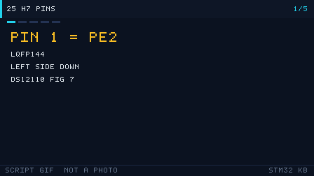

# 25 STM32H7 引脚（H743ZI）

> English: [STM32H7 pins](en/25-stm32h7-pins.md)

> H7 的 LQFP144 有 144 只脚、两只 VCAP，还有一只专门喂 USB 的 VDD33USB。数脚时先找左上角的 PE2。

  
   ▲ 引脚图：144 脚的名字和顺序来自 DS12110 Rev 11 Figure 7（图号 MSv41917V4）。VCAP1 是脚 71，VCAP2 是脚 106，以该图上的标注为准。颜色是阅读辅助。脚本生成，不是实拍。

<!-- video:ch25 -->

  
   ▲ 本章讲解幻灯：程序生成的 GIF（tools/gen_videos.py，可复现，不是实拍）。旁白与五帧一一对应。

**旁白（跟着画面读，大约一分钟）**

1. H743 的 LQFP144 从左上角的 PE2 开始数。左边向下，底边向右，右边向上，顶边向左。出处是 DS12110 Rev 11 Figure 7。
2. 图上脚 71 是 VCAP1，脚 106 是 VCAP2。电容值本章不写，封面摘录里没有一条可以单独引用的数字。
3. CAN 换成 FDCAN，不再是 F1 的 bxCAN。FDCAN1 仍能放在 PA11、PA12，也能改到 PD0、PD1 或 PB8、PB9。
4. 电源分成 D1、D2、D3 三个域。USB 有自己的 VDD33USB。本章不写待机电流，避免凭印象填微安。
5. 口诀：144 脚先找 PE2，两只 VCAP 分开标。自测：第 1 脚叫什么？CAN 控制器叫 bxCAN 还是 FDCAN？
<!-- /video:ch25 -->

## 📌 学习目标

- [ ] 能从第 1 脚 PE2 顺着左边数到 NRST，不把顶边的脚号数反。
- [ ] 能指出 FDCAN1、OTG_FS、USART1、I2C1、SWD 至少一组脚。
- [ ] 说清和 F1/F4 的结构差别：三个电源域、FDCAN 而不是 bxCAN、内核要外接 VCAP。

## 🧠 这颗料是谁

图上是 **STM32H743xI 的 LQFP144**。订购信息里 Z = 144 脚，I = 2 MB Flash，所以 Nucleo 上常见的 **STM32H743ZI** 就是这个封装和这个 Flash 档。出处 **DS12110 Rev 11**：

| 事实 | 出处 |
| --- | --- |
| Cortex-M7，最高 480 MHz，带双精度 FPU 和 16 KB I/D Cache | 封面 |
| Flash 最高 2 MB；订购字母 I = 2 MB，Z = 144 脚 | 封面；第 346 页附近的订购信息 |
| 供电 1.62 V 到 3.6 V | 封面 |
| 三个电源域 D1 / D2 / D3，可以分别关时钟或断电 | 封面 |
| 2 个 CAN 控制器，带 CAN FD；目录写的是 FDCAN1、FDCAN2 | 封面特性与目录 |
| 2 个 USB OTG（1 个 FS，1 个 HS/FS） | 封面 |
| 专用 USB 电源，内部 3.3 V 调节器喂 PHY | 封面 |

本章不写 H7 的待机电流。封面摘录里没有一条可以单独引用的微安数字，与其估一个，不如让你自己翻电气特性那一章。

口诀：**144 脚从 PE2 数起；VCAP 有两只，USB 电源不叫 VDD。**

## 🛠️ 和 F1 / F4 比

| 点 | F1 / F4 | H743 LQFP144（Figure 7） |
| --- | --- | --- |
| 第 1 脚 | F103C8 是 VBAT | **PE2** |
| 内核供电 | F1 内部，没有 VCAP 脚 | **脚 71 VCAP1、脚 106 VCAP2**。外接电容的取值以 DS12110 的 VCAP 电气节为准，图上不标电容值 |
| USB 电源 | F1 没有；F4 有 VDDUSB 一类脚 | **脚 95 名称为 VDD33USB** |
| 掉电复位控制 | 无此脚 | **脚 143 PDR_ON** |
| BOOT | F1 专用脚；G0 与 SWCLK 合并 | **脚 138 BOOT0**，和 PA13/PA14 分开 |
| SWD | PA13 / PA14 | **脚 105 PA13、脚 109 PA14** |
| CAN | F1/F4 是 bxCAN | **FDCAN**。PA11/PA12、PD0/PD1、PB8/PB9 都能做 FDCAN1（Table 9） |
| 调试器看变量 | 无 Cache | 有 L1 Cache。DMA 缓冲要按第 10 章处理一致性，否则调试器里的数组和总线不一致 |

顶边的脚号是从右往左增大的：靠近右边的是脚 109，最左上是脚 144（VDD）。左边才是脚 1 往下数。这和 G0、L4 的图是同一套数法。

## 🛠️ 关键复用（DS12110 Table 9，只写表里出现过的）

| 功能 | 脚 | LQFP144 脚号 | Table 9 里的功能名 |
| --- | --- | --- | --- |
| USART1_TX / RX | PA9 / PA10 | 101 / 102 | USART1_TX、USART1_RX |
| USART1 另一组 | PB6 / PB7 | 136 / 137 | USART1_TX、USART1_RX |
| I2C1_SCL / SDA | PB6 / PB7；也可 PB8 / PB9 | 136 / 137；139 / 140 | I2C1_SCL、I2C1_SDA |
| SPI1_SCK / NSS | PA5 / PA4 | 41 / 40 | SPI1_SCK、SPI1_NSS |
| FDCAN1_RX / TX | PA11 / PA12 | 103 / 104 | FDCAN1_RX、FDCAN1_TX |
| FDCAN1 另一组 | PD0 / PD1 | 114 / 115 | FDCAN1_RX、FDCAN1_TX |
| FDCAN1 第三组 | PB8 / PB9 | 139 / 140 | FDCAN1_RX、FDCAN1_TX |
| OTG_FS_DM / DP | PA11 / PA12 | 103 / 104 | OTG_FS_DM、OTG_FS_DP |
| SWD | PA13 / PA14 | 105 / 109 | JTMS-SWDIO；PA14 在 Figure 7 上 |
| HSE | PH0-OSC_IN / PH1-OSC_OUT | 23 / 24 | 脚名 |
| LSE | PC14-OSC32_IN / PC15-OSC32_OUT | 8 / 9 | 脚名 |

PA11/PA12 同时是 FDCAN1 和 OTG_FS。要两样都要，FDCAN1 改到 PD0/PD1 或 PB8/PB9。PB6/PB7 也同时出现在 USART1 和 I2C1 上，同一只脚不要配两个复用。

模拟脚 PC2_C、PC3_C（脚 28、29）名字里的 `_C` 是手册图上的写法，表示可接到模数转换的专用路径。不要在原理图里改成普通的 PC2。

## ⚠️ 从 F4 迁过来

| 现象 | 原因 | 解决 |
| --- | --- | --- |
| 内核不起振或随机死 | VCAP1/VCAP2 没按电气节装电容 | 只按 DS12110 的 VCAP 节选值，不凭 F4 的经验 |
| USB 完全无枚举 | 脚 95 VDD33USB 没供电 | 这是 USB 电源，不是任意 VDD |
| 「CAN」初始化失败 | 外设名是 FDCAN，寄存器和 bxCAN 不是同一章 | 打开 RM 里的 FDCAN 章，不要贴 F407 的 bxCAN 代码 |
| DMA 缓冲区在调试器里是旧的 | D1 有 Cache | 按第 10 章做 Cache 维护 |

## 🧪 动手实验

1. 在图上圈出脚 1、71、95、103、104、105、106、138、143。旁边用一句话写功能。
2. 打开 Table 9 里 PA12 那一行，确认同一行里既有 FDCAN1_TX 也有 OTG_FS_DP。
3. 回答：为什么 H743 的第 1 脚不是 VBAT？VBAT 在第几脚？

自测：

1. LQFP144 的第 1 脚叫什么？
2. VCAP1 和 VCAP2 各是第几脚？
3. FDCAN1 不想占用 PA11 时，Table 9 还给出哪一组？

## 🔗 相关资源

- DS12110 Rev 11：封面（内核、电源域、CAN FD、USB）、Figure 7、Table 9、订购信息里的 Z 与 I。
- 对照：[23 G0](23-STM32G0引脚.md)、[24 L4](24-STM32L4引脚.md)、[10 DMA](10-DMA.md) 的 Cache 说明。
- 图由 `tools/gen_pinouts.py` 生成。改脚名只能改脚本里那份与手册一致的列表，不要在 SVG 里手改。
