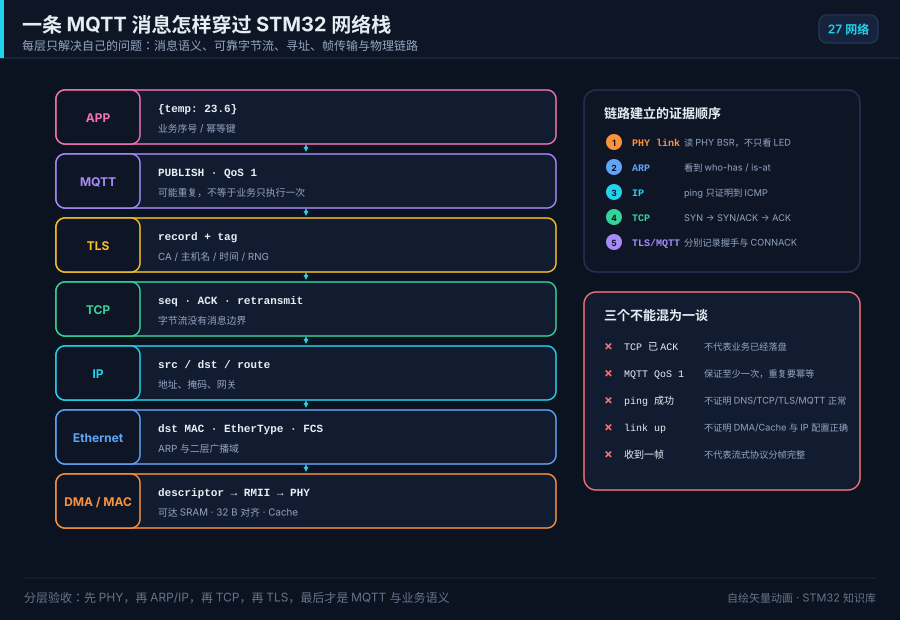
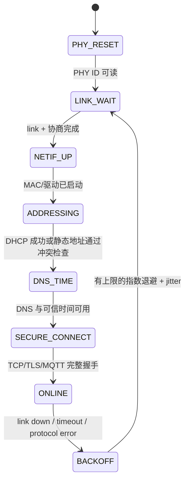
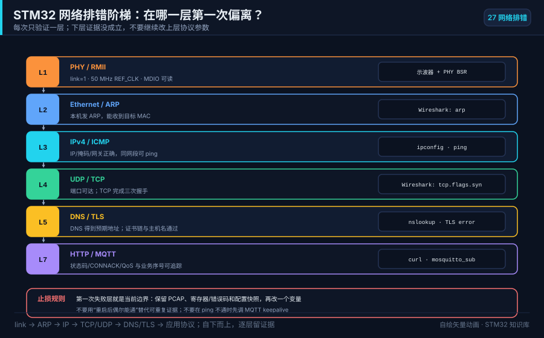

# 27 STM32 网络与协议栈：Ethernet、lwIP、MQTT 与 TLS

> 网络不是“再加一个外设”。它把 PHY 时钟、DMA/Cache、协议栈线程、字节流分帧、重连策略、证书时间和业务幂等同时放进一个系统。

<p align="center">
  
  <br><sub>▲ 动画：一条 MQTT 消息穿过应用层、lwIP 与 Ethernet 硬件。每层的“成功”只证明该层，不自动证明上一层业务完成。</sub>
</p>

<!-- video:ch27 -->
<p align="center">
  <video width="640" controls poster="../assets/video/ch27-network.png">
    <source src="../assets/video/ch27-network.mp4" type="video/mp4">
  </video>
  <br><sub>▲ 本章讲解 3.1 分钟。配音是微软 Edge 在线神经语音「晓晓」（zh-CN-XiaoxiaoNeural），经 edge-tts 调用。edge-tts 大部分源码为 LGPLv3，srt_composer.py 为 MIT；声线模型是微软在线服务，不是开放模型。这里提交的是合成后的 MP4，离线可看。重新生成需要联网。画面由脚本和本仓库 SVG 生成，不是实拍。 视频：<a href="../assets/video/ch27-network.mp4">MP4</a> · 字幕：<a href="../assets/video/ch27-network.srt">SRT</a>。由 <code>python3 tools/gen_narrated.py --speak</code> 用 ffmpeg 合成。</sub>
</p>

**旁白（与字幕、配音同一份稿）**

1. STM32 联网不是勾一个 lwIP 选项。数据先经过网线、变压器和 PHY，再走 RMII 到 MAC，最后由 DMA 搬进内存。链路灯只证明 PHY 看见链路脉冲，不证明 IP 和应用已经通。
2. 第一层证据是用 MDIO 读到正确的 PHY 标识、链路、速率和双工。地址脚、复位脚或五十兆参考时钟不对时，反复改 DHCP 和 MQTT 没有意义。先找到最底层的第一处分歧。
3. H7 的 Ethernet DMA 不能访问 DTCM。描述符和缓冲要放进 DMA 可达的内存，并独占三十二字节缓存行。只在源码上写一个 section 名不算完成，要从链接 map 核对最终地址。
4. 这一帧是仓库画的消息旅程，不是真实抓包。一条 MQTT 消息向下经过 TLS、TCP 和 IP，再进 Ethernet DMA、RMII 和 PHY；接收时反向上来。每一层只能证明自己的边界。
5. lwIP raw API 必须在核心线程使用，应用任务通常用 Netconn 或 socket。ISR 只投递 DMA 事件，不能直接调用 tcp write。
6. TCP 是可靠有序字节流，不保留消息边界。应用定义长度和业务序号。部分发送或暂时不可写时，所有重试共享一个单调时钟截止点。
7. TCP ACK 只证明字节到了对端协议栈。MQTT QoS 一允许重发，所以仍可能收到重复消息。设备执行命令或写入存储时，要用业务序号和幂等键判断同一动作是否已经完成。
8. TLS 客户端至少要有受信 CA、匹配的主机名、可靠随机数和可信时间。把认证模式关掉虽然可能握手成功，却失去服务器身份保证。时间没有建立前，证书有效期也无法正确判断。
9. 排错从 PHY 和 MDIO 到 ARP、IP、DNS，再到 TCP、TLS、MQTT 和业务 ACK。每一级保留 PCAP、错误码和状态日志，不能用 ping 通替代整条验收。
10. 合上书，三问。链路灯只能证明哪一层？TCP ACK 为什么不能证明业务已经落盘？H7 的 Ethernet 描述符为什么不能随手放进 DTCM？
<!-- /video:ch27 -->
## 📌 学习目标

- [ ] 能在“内置 MAC + 外部 PHY”“SPI Ethernet”“Wi-Fi/蜂窝 socket offload”“PPP”之间做边界清楚的选型。
- [ ] 能画出 STM32 → MAC DMA → RMII → PHY → 磁性器件 → RJ45 的硬件路径，并逐项验证时钟、复位与链路状态。
- [ ] 能按目标系列的总线矩阵安排描述符和缓冲区，解释 H7 上 DTCM、D1/D2 SRAM、32 字节 Cache line 的差别。
- [ ] 能区分 lwIP raw、Netconn 与 BSD socket API 的线程模型，不从错误的任务或中断调用协议栈。
- [ ] 能解释 TCP 字节流、UDP 数据报、DHCP、DNS、MQTT QoS 和 TLS 分别保证什么、不保证什么。
- [ ] 能实现带长度字段的 TCP 应用帧、限时收发、指数退避重连和业务幂等。
- [ ] 能用 PHY 寄存器、Wireshark PCAP、协议错误码和状态机日志定位第一处分歧。

## 🧭 先选网络路径，不要先勾 CubeMX

| 路径 | MCU 看到的接口 | TCP/IP 在哪里 | 优点 | 代价与边界 |
| --- | --- | --- | --- | --- |
| 内置 Ethernet MAC + 外部 PHY | RMII/MII、MDIO/MDC | MCU 上的 lwIP/RTOS | 吞吐高、可抓完整协议状态、适合网关 | PCB、PHY 时钟、DMA/Cache、RAM 和协议栈都由你负责 |
| W5500 等 SPI Ethernet | SPI + IRQ | 芯片内硬件 socket | 上手快，MCU RAM 压力小 | socket 数、协议能力和诊断深度受芯片限制；SPI 吞吐是上限 |
| Wi-Fi/4G 模组 AT socket | UART/SPI + AT 命令 | 模组内 | 射频与认证工作少 | AT 状态机、异步 URC、固件版本和掉线恢复成为主要复杂度 |
| Wi-Fi/蜂窝 PPP | UART/USB 上的 PPP netif | MCU 上的 lwIP | 应用统一使用 socket，协议可控 | RAM、CPU、串口流控和拨号状态机都要验收 |
| RTOS/Zephyr/RT-Thread 网络栈 | 驱动抽象 | OS 网络子系统 | 组件和驱动生态完整 | 版本、Kconfig/组件配置和线程模型不同，不能照抄裸机 lwIP 代码 |

**决策顺序**：先写吞吐、延迟、并发连接、TLS、功耗、认证、现场升级和诊断要求，再选硬件路径。只因为“CubeMX 能勾选”就上内置 Ethernet，通常会把板级和 Cache 风险留到联调最后。

## 🔌 硬件闭环：MAC、RMII、PHY 与 RJ45

NUCLEO-H743ZI2 所属 MB1364 板卡在 UM2407 中提供 10/100 Mbit/s Ethernet PHY 与集成 RJ45。板卡可以缩短硬件 bring-up，但**不能替代目标板原理图检查**；旧 NUCLEO-H743ZI、ZI2 和自研板的时钟源、焊桥、PHY 地址与复位网络可能不同。

### 1. RMII 最少要对清这些信号

| 类别 | 典型信号 | 先验证什么 |
| --- | --- | --- |
| 参考时钟 | `REF_CLK` 50 MHz | 频率、幅度、启动时序；时钟来自 PHY 还是 MCU 输出 |
| 发送 | `TXD0/1`、`TX_EN` | 复用脚、速度等级、走线与 PHY 端对应关系 |
| 接收 | `RXD0/1`、`CRS_DV` | PHY link 后是否出现活动；中断/轮询路径是否取走帧 |
| 管理接口 | `MDC`、`MDIO` | 能否稳定读取 PHY ID、BSR 链路位和协商结果 |
| 控制 | `NRST`、地址绑带 | 复位释放时间、PHY 地址、strap 上下拉是否被其他器件干扰 |
| 线侧 | 磁性器件、RJ45、差分对 | 中心抽头供电、端接、ESD、线序与布局规则 |

### 2. link LED 只是线索，不是验收

LED 亮通常只说明 PHY 检测到链路脉冲。固件还要记录：

1. 读取到的 PHY OUI/型号是否符合 BOM；
2. Basic Status Register 的 link 与 auto-negotiation 状态；
3. 协商出的 10/100 Mbit/s、全/半双工；
4. MAC 配置是否同步为同一速率/双工；
5. 拔线、重插和交换机端口重启后，状态机能否重新配置 MAC。

若 MDIO 读不到 PHY，先停在硬件层。不要通过反复改 IP 地址“修复”一个不存在的 PHY。

## 🧠 H7 最容易错的地方：DMA 看见的内存与 CPU 看见的不一样

固定的 STM32CubeH7 源码 `8ec3113d...` 中，NUCLEO-H743ZI 的 `LwIP_HTTP_Server_Netconn_RTOS` 示例明确写出：Ethernet DMA 不能访问 `0x20000000` 的 DTCM；DMA 数据必须放到可达的 D1/D2 SRAM。若缓冲区可缓存，还要按 32 字节 L1 Cache line 对齐并做一致性维护。

### 1. 链接脚本先回答三个问题

```text
ETH descriptors 在哪一段？    DMA 能访问吗？    地址和大小满足描述符要求吗？
RX/TX buffers 在哪一段？      CPU 是否缓存？    起止地址是否 32 B 对齐？
lwIP heap / pbuf 在哪一段？   是否可能落进 DTCM？容量峰值是多少？
```

不要只在 C 文件里写 `__attribute__((section))`；链接脚本必须真的建立该 section，并在 map 文件里核对最终地址。

### 2. Cache 维护的方向

| 所有权切换 | CPU 在交接前做什么 | 交接后的不变量 |
| --- | --- | --- |
| CPU → DMA（发送） | 对 CPU 写过的完整 Cache line 做 clean | DMA 读到最新 payload 与描述符 |
| DMA → CPU（接收） | DMA 完成后，对接收范围做 invalidate | CPU 不再读到旧 Cache line |
| DMA 再次接管 RX 缓冲 | 确保 lwIP/应用写过的 line 已按驱动策略处理 | 不能把脏数据留给下一次接收 |

**危险操作**：对未按 Cache line 对齐的窄区间直接 invalidate。首尾 line 里可能还有别的脏变量，会一起丢失。安全方案是独占并对齐缓冲区，或由驱动统一管理 ownership 与维护范围。

### 3. pbuf 是所有权，不只是一个指针

- 收到 `pbuf` 后，谁持有引用、何时 `pbuf_free()` 必须唯一；
- zero-copy RX 不能在 DMA 仍可能覆写时交给上层；
- `pbuf` 可能是链，不保证一整个应用消息连续；
- 发送 API 返回成功通常只表示数据进入本地队列，不表示对端业务已经处理。

## 🧵 lwIP 三套 API 与线程边界

lwIP 官方 pitfalls 把执行模型分成两类：`NO_SYS` 主循环模式与带 `tcpip_thread` 的 OS 模式。最常见的网络“玄学”不是协议错误，而是从错误上下文调用 raw API。

| API | 编程模型 | 允许的调用上下文 | 适用 |
| --- | --- | --- | --- |
| raw callback API | 事件驱动、零拷贝空间大 | `NO_SYS` 的唯一主循环，或 OS 模式的 `tcpip_thread` / `tcpip_callback()` | 资源极紧、愿意维护状态机 |
| Netconn | 阻塞式 sequential API | 应用任务；通过邮箱与 `tcpip_thread` 通信 | FreeRTOS 服务任务，ST 官方 HTTP 示例 |
| BSD socket | `socket/connect/send/recv/select` | 应用任务；底层仍依赖 lwIP 配置 | 可移植应用层、TLS/HTTP/MQTT 库 |

**禁止**：在 Ethernet IRQ、定时器 IRQ 或任意应用任务里直接调用 raw `tcp_write()` / `udp_send()`。IRQ 只收集事件、归还描述符或唤醒正确的处理上下文。

`LWIP_ASSERT_CORE_LOCKED()` 是开发期应保留的断言。若选择 `LWIP_TCPIP_CORE_LOCKING`，锁不能从中断获取，RTOS 还必须正确处理优先级反转。

## 🌐 从 link 到可用网络的启动状态机



每次状态变化至少记录 `monotonic_ms`、旧状态、新状态、原因码、重试次数与 link/IP。不要只打“network error”。生产日志不能打印 Wi-Fi 密码、私钥、token 或完整客户 payload。

### DHCP、静态地址、DNS 与时间

- DHCP 成功前，地址 `0.0.0.0` 不是“偶尔也能用”的正常状态；记录 Discover、Offer、Request、ACK 的缺失点。
- 静态地址必须一起配置 IP、掩码、网关和 DNS；先做重复地址检查或由网络管理员分配。
- DNS 失败与 TCP 失败要分开：记录查询名、返回码、解析地址和 TTL，不把临时失败永久缓存。
- TLS 证书校验依赖可信时间。优先使用出厂写入/RTC 保持的近似时间，再经认证后的 SNTP 或业务通道校准；不要为了“先连上”关闭证书时间检查。

## 📦 TCP 是字节流：必须自己定义消息边界

一次 `send()` 不对应一次 `recv()`。4 KB 消息可能分成多次接收，多个小消息也可能一次读到。应用协议至少要定义：魔数/版本、长度、消息类型、业务序号和完整性字段。

```text
0               15              31
+---------------+---------------+
| magic 0x534E  | ver |  type   |
+---------------+---------------+
| payload_len (network byte order) |
+-------------------------------+
| sequence                      |
+-------------------------------+
| payload ...                   |
+-------------------------------+
| CRC32 (可选；TLS 不能替代业务存储校验) |
+-------------------------------+
```

接收器先累积固定头，再校验 `payload_len <= MAX_PAYLOAD`，最后累积 payload。长度超限、版本未知或超时都要关闭连接并记录原因，不能继续在错位流上“找下一帧”。

非阻塞 `send()` 可能只接受一部分数据，也可能返回 `EWOULDBLOCK`。下面用 `MSG_DONTWAIT` 保证单次 `send()` 不阻塞，再用 `select()` 等待可写；所有重试共享同一个由 `sys_now()` 产生的单调时钟截止点，不能在循环里重置超时。该写法依赖 lwIP 默认启用的 `LWIP_SOCKET_SELECT=1`，不依赖默认关闭的 `LWIP_SO_SNDTIMEO`：

```c
#include <errno.h>
#include <stddef.h>
#include <stdint.h>

#include "lwip/sockets.h"
#include "lwip/sys.h"

typedef enum {
    SEND_ALL_OK,
    SEND_ALL_TIMEOUT,
    SEND_ALL_CLOSED,
    SEND_ALL_ERROR
} send_all_result_t;

/* deadline_ms 必须由调用者计算一次：sys_now() + timeout_ms。
 * 只要 timeout_ms < INT32_MAX，强制转换后的差值可跨 sys_now() 回绕。 */
send_all_result_t send_all_until(int fd, const uint8_t *buf, size_t len,
                                 uint32_t deadline_ms)
{
    size_t sent = 0;

    while (sent < len) {
        int n = lwip_send(fd, buf + sent, len - sent, MSG_DONTWAIT);
        if (n > 0) {
            sent += (size_t)n;          /* 部分发送：继续剩余字节 */
            continue;
        }
        if (n == 0) {
            return SEND_ALL_CLOSED;
        }
        if (errno == EINTR) {
            continue;                   /* 仍使用原截止点 */
        }
        if (errno != EAGAIN && errno != EWOULDBLOCK) {
            return SEND_ALL_ERROR;
        }

        uint32_t now = sys_now();
        int32_t remaining_ms = (int32_t)(deadline_ms - now);
        if (remaining_ms <= 0) {
            return SEND_ALL_TIMEOUT;
        }

        fd_set writable;
        FD_ZERO(&writable);
        FD_SET(fd, &writable);
        struct timeval wait = {
            .tv_sec = remaining_ms / 1000,
            .tv_usec = (remaining_ms % 1000) * 1000
        };

        int ready = lwip_select(fd + 1, NULL, &writable, NULL, &wait);
        if (ready > 0) {
            continue;
        }
        if (ready == 0) {
            return SEND_ALL_TIMEOUT;
        }
        if (errno != EINTR) {
            return SEND_ALL_ERROR;
        }
        /* select() 被信号中断：回到循环，重新计算同一截止点的余量。 */
    }
    return SEND_ALL_OK;
}
```

调用处只计算一次截止点，例如 `send_all_until(fd, frame, frame_len, sys_now() + 2000U)`。`SEND_ALL_TIMEOUT` 表示本地发送窗口在 2 s 内始终没有推进；它仍不证明服务端已处理数据。需要“业务已落盘”时，由应用层返回带同一 `sequence` 的 ACK，并在服务端用幂等键去重。

## 🚀 UDP 与 TCP 怎么选

| 需求 | UDP | TCP |
| --- | --- | --- |
| 消息边界 | 每个 datagram 保留 | 无边界，必须自行分帧 |
| 丢失/乱序/重复 | 应用处理 | TCP 在连接内重传、排序、去重字节流 |
| 拥塞控制 | 应用负责，不能无节制发送 | 协议内置 |
| 多播/广播 | 支持 | 不支持 |
| 典型场景 | 发现、遥测、音视频、局域网控制 | 配置、文件、HTTP、MQTT、远程命令 |

UDP 不是“更实时的 TCP”。如果应用需要重传、窗口、顺序和分片，最终可能重新实现一个更差的 TCP。反过来，周期传感器数据若允许下一帧覆盖上一帧，UDP 可以减少队头阻塞，但仍要带序号和时间戳。

## 📨 MQTT：QoS 不等于业务 exactly-once

OASIS MQTT 5.0 定义三档 QoS：

| QoS | 传输语义 | 设备端必须处理 |
| --- | --- | --- |
| 0 | 至多一次，允许丢失 | 周期数据可由新值覆盖；不要等待 PUBACK |
| 1 | 至少一次，允许重复 | payload 带业务幂等键；收到 PUBACK 前保留消息 |
| 2 | MQTT 协议流中恰好一次 | 状态与报文更多；仍不能替代数据库事务或执行器幂等 |

还要显式设计：

- `ClientID` 是否稳定且唯一；
- Clean Start / Session Expiry 是否要保留订阅和离线消息；
- Keep Alive 与设备睡眠周期是否冲突；
- Last Will 如何表示“非正常掉线”，何时会误报；
- retained message 是否表示“最新状态”还是“最后一条命令”；**不要 retain 有副作用的控制命令**；
- broker 最大包长、Receive Maximum 与 MCU 缓冲区上限。

## 🔐 TLS：能握手不等于安全

Mbed TLS 的嵌入式集成至少需要：可信 CA、主机名、随机数、可信时间、允许的算法、私钥策略和收发回调。

**生产不变量**：

1. `mbedtls_ssl_conf_authmode(..., MBEDTLS_SSL_VERIFY_REQUIRED)`；示例里的 `VERIFY_NONE` 只能用于隔离实验，不能进入产品配置。
2. 调用 `mbedtls_ssl_set_hostname()`，同时验证证书链和目标主机名。
3. CTR_DRBG 必须由真实熵源播种；若 MCU 有硬件 RNG，也要处理健康检测和错误返回。
4. 私钥/token 不进 Git、不进普通日志；量产设备应有唯一凭据，并规划吊销与轮换。
5. 限制 TLS record、证书链和握手并发，先测峰值堆/栈，而不是只看空闲时内存。
6. 关闭连接时区分正常 `close_notify`、TCP reset、超时与证书错误；证书错误不要进入无限快速重试。

MQTT/TLS 常见端口只是部署约定，不是安全证据。真正的证据是认证模式、验证结果、协商版本/套件和对端身份。

## 📶 Wi-Fi 与蜂窝模组：网络栈移走了，状态机没有消失

### AT socket offload

将 UART 接收做成持续 DMA + ring buffer，解析器必须同时处理命令响应与异步 URC。典型失败包括：

- 命令超时后迟到的 `OK` 被下一条命令消费；
- `+IPD`/接收 URC 与发送响应交错；
- 模组重启但 MCU 仍认为 socket 在线；
- 没有 RTS/CTS，突发数据让 UART 溢出；
- 固件升级后 AT 语义或错误码变化。

因此命令必须有 transaction id/状态、deadline、取消路径和“回到已知态”的复位流程。不要在多个任务里直接向同一 UART 写 AT 命令。

### PPP

PPP 把蜂窝/Wi-Fi 串行链路变成 lwIP `netif`。应用获得统一 socket API，但要额外管理拨号、认证、MTU、流控、链路费用与弱信号重连。PPP link up 之后仍要按 IP→DNS→TLS→应用逐层验收。

## 🧯 断网恢复：有上限的指数退避

```text
backoff_n = min(B_max, B_base * 2^min(n, n_cap)) + random(0, jitter)
```

- link down 时不要继续创建 TCP socket；
- DNS/TCP/TLS/MQTT 分别计数，避免一个总错误码掩盖根因；
- 成功稳定运行一段时间后再清零退避等级；
- 设总连接 deadline，不能让 DNS、connect、TLS 各自无限阻塞；
- 看门狗喂狗条件应包含网络任务仍能推进，而不是每次循环无条件喂；
- 离线队列必须有字节上限、时间上限和淘汰策略，不能把 Flash 写爆。

对于执行器命令，断线重放前检查命令有效期、设备状态和幂等键；“网络恢复后把所有旧命令执行一遍”是危险策略。

## 🔍 分层排错与 Wireshark 证据

<p align="center">
  
  <br><sub>▲ 排错图：第一处失败层就是当前边界。保留 PCAP、寄存器/错误码与配置快照，然后一次只改一个变量。</sub>
</p>

| 现象 | 第一分歧边界 | 最小证据 | 下一步 |
| --- | --- | --- | --- |
| PHY ID 读不到 | MDIO/MDC、复位、地址 | 示波器 + PHY ID 寄存器 | 停止改 IP，先修硬件/时钟 |
| link up 但没有任何包 | DMA 描述符、IRQ、Cache | 描述符 ownership、ETH 状态、PCAP | 检查 SRAM 域、对齐和 clean/invalidate |
| 有 ARP 请求，无响应 | IP/掩码/目标不在同一二层 | `arp` 过滤 PCAP | 核对本机地址、VLAN、交换机端口 |
| ping 通，TCP 不通 | 端口/防火墙/服务端监听 | SYN 是否有 SYN/ACK | 检查目标端口与服务端日志 |
| TCP 通，DNS 失败 | DNS 配置/服务器不可达 | 查询名、返回码、UDP/TCP 53 | 修 DNS，不要硬编码临时 IP 当永久方案 |
| TLS 握手失败 | 时间、CA、主机名、算法 | Mbed TLS 负错误码与 verify flags | 保留认证，修时间/证书/配置 |
| MQTT 连上后频繁掉 | keepalive、阻塞、broker 策略 | PINGREQ/PINGRESP、CONNACK/DISCONNECT reason | 检查任务饥饿、包长和会话参数 |
| 长时间后内存耗尽 | pbuf/socket/消息 ownership | lwIP stats、heap low-water、连接数 | 按连接生命周期找未释放资源 |
| 吞吐低且 CPU 高 | 拷贝、Cache、窗口、任务调度 | goodput、重传、窗口、CPU profile | 先定位瓶颈，再改 MSS/window/buffer |

### 建议的 PCAP 验收过滤器

```text
arp
icmp
udp.port == 67 || udp.port == 68        # DHCP
udp.port == 53 || tcp.port == 53         # DNS
tcp.flags.syn == 1
tls.handshake.type == 1                  # ClientHello
mqtt                                     # Wireshark 能识别时
```

报告必须同时写板卡/PHY、固件 commit、MAC/IP、网络拓扑、抓包点、时间范围和预期。只截一张“有绿色行”的图，不足以复现问题。

## 📐 容量、时延与吞吐要可复算

至少建立四本账：

```text
RAM_net = descriptor_bytes + RX_pool + TX_pool + lwIP_heap
        + socket_buffers + TLS_peak + application_offline_queue

goodput = application_payload_bytes / observation_time
loss_or_retry_rate = retried_or_lost_messages / attempted_messages
recovery_time = first_application_success - fault_injection_time
```

同时报告峰值而不是只报平均值：最小空闲堆、每任务最小剩余栈、最大 pbuf 使用数、最大并发连接、TLS 握手峰值、最坏 DNS/TCP/TLS 延迟。网络稳定性验收至少包含拔线、交换机重启、DHCP 租约变化、DNS 失败、服务端重启、证书错误和弱网丢包。

## 🧪 四个递进实验

### 实验 A：只做到 ARP 与 ping

1. 读取并记录 PHY ID、link、速率和双工。
2. 先用静态 IP，同网段 PC 抓包；确认板卡发出 ARP 并回应 ARP/ICMP。
3. 拔线 10 s 再插回，要求状态机回到可 ping，记录恢复时间。
4. 预期：没有 TCP/MQTT 代码也能独立证明 L1–L3。

### 实验 B：TCP echo 与分帧

1. 使用长度前缀协议发送 1、MSS−1、MSS、MSS+1 和最大允许 payload。
2. PC 端故意拆分写、合并写，证明 MCU 接收器不依赖一次 `recv()` 的边界。
3. 注入长度超限、半包超时和对端 reset；要求连接关闭且错误原因可区分。
4. 预期：1000 次消息无错位；业务 ACK 的 sequence 与请求一致。

### 实验 C：DHCP、DNS 与 MQTT

1. 启用 DHCP，记录 DORA 四步；随后让 DHCP 服务器不可用，确认进入有上限的退避。
2. 用域名连接 broker；分别注入 DNS 不可达、TCP 拒绝和 broker 鉴权失败。
3. QoS 1 发布时故意在 PUBACK 前断线，确认重连后的重复消息由业务幂等键消除。
4. 预期：日志能指出失败层，不出现无限快速重连和离线队列无界增长。

### 实验 D：TLS 与长期运行

1. 使用受信 CA、正确主机名和可信时间连接测试服务；记录握手峰值 RAM/栈。
2. 分别换成过期证书、错误主机名和未知 CA，必须失败；不得自动切到 `VERIFY_NONE`。
3. 连续运行 24 h，周期注入拔线、服务端重启与 DNS 变化，保存 PCAP 和资源低水位。
4. 预期：凭据不出现在日志；连接可恢复；堆、pbuf 与任务栈不随重连次数单调恶化。

完整记录字段、可执行 TCP soak/故障对端和验收报告结构见 [`labs/ethernet-24h/`](../labs/ethernet-24h/)。该工具的 localhost smoke 只验证主机端，不得冒充 STM32 真板记录。

## ✅ 自测

1. NUCLEO 板上 link LED 已亮，为什么仍不能说明 lwIP 已经收到帧？
2. H7 的 Ethernet DMA 为什么不能直接使用 DTCM 缓冲区？
3. RX 缓冲区为什么要按 Cache line 独占并对齐？
4. raw API、Netconn 和 socket API 的线程边界分别是什么？
5. 为什么一次 `send()` 不对应一次 `recv()`？
6. TCP 已 ACK 为什么仍不能证明对端业务已执行？
7. MQTT QoS 1 为什么要求业务幂等？
8. TLS 客户端为什么同时需要可信 CA、主机名、随机数和可信时间？
9. ping 通但 MQTT 不通，应按什么顺序继续定位？
10. AT 模组把 TCP/IP 移走后，MCU 端还必须保留哪些状态机？

## 🔗 权威来源与冻结点

- **RM0433**：STM32H742/H743/H753/H750 的总线矩阵、Ethernet MAC/MTL/DMA、描述符与寄存器；使用时按目标芯片 revision 同时核对 ES0392。
- **UM2407**：STM32H7 Nucleo-144（MB1364）板卡 Ethernet PHY、RJ45、焊桥与硬件版本边界。
- **UM1713**：STM32Cube 与 lwIP 的 HAL、middleware 及有/无 RTOS 应用结构。
- **STM32CubeH7**：固定 commit `8ec3113d4039d30ba9dc2bf0cb6eefc756b48d06`；lwIP 子模块 `07680c8172fa5fc135adefa3f7711c14f4938dc9`，Mbed TLS 子模块 `cdadeb9ba09fd4e913f0f8599832e960545a367d`。官方 NUCLEO-H743ZI Netconn/FreeRTOS HTTP 示例用于核对 D1/D2 SRAM、DTCM 不可达和 32 B Cache line 边界。
- **lwIP upstream Common pitfalls**：`NO_SYS`/OS 执行上下文、raw API 线程边界、DMA zero-copy 与 Cache line 风险。
- **IETF**：RFC 9293（TCP）、RFC 768（UDP）、RFC 2131（DHCP）、RFC 1035（DNS）、RFC 8446（TLS 1.3）。
- **OASIS MQTT 5.0**：QoS、会话、Keep Alive、Last Will、错误处理与安全章节。
- **Mbed TLS tutorial**：嵌入式 TLS 的 RNG、认证模式、主机名、CA 链、收发回调与资源释放。
- 相关章节：[DMA](10-DMA.md)、[FreeRTOS](15-FreeRTOS入门.md)、[调试与性能](17-调试与性能优化.md)、[H7 引脚/内存域](25-STM32H7引脚.md)。
