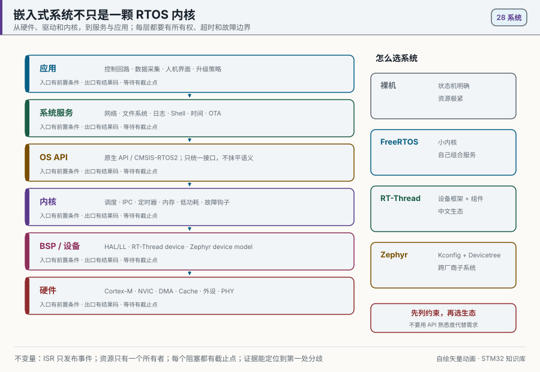
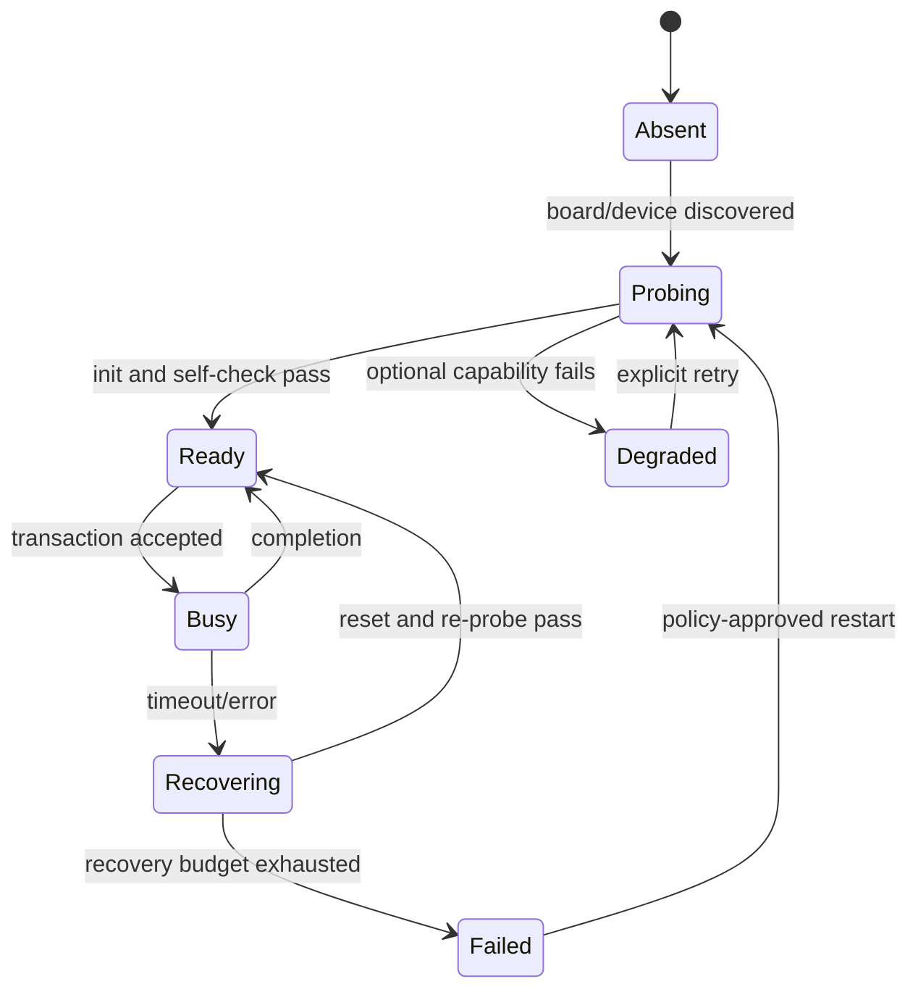

# 28 嵌入式系统与 RTOS 生态：FreeRTOS、RT-Thread、Zephyr

> 一颗 RTOS 内核只负责调度、同步、时间和内存等基础机制。真正可交付的嵌入式系统，还要明确驱动所有权、启动顺序、故障隔离、资源预算、升级路径与可观测性。

<p align="center">
  
  <br><sub>▲ 动画：RTOS 系统分层与生态选型。作者自绘矢量动画，不代表任何项目的实测时序。</sub>
</p>

<!-- video:ch28 -->
<p align="center">
  <video width="640" controls poster="../assets/video/ch28-rtos-system.png">
    <source src="../assets/video/ch28-rtos-system.mp4" type="video/mp4">
  </video>
  <br><sub>▲ 本章讲解 3.0 分钟。配音是微软 Edge 在线神经语音「晓晓」（zh-CN-XiaoxiaoNeural），经 edge-tts 调用。edge-tts 大部分源码为 LGPLv3，srt_composer.py 为 MIT；声线模型是微软在线服务，不是开放模型。这里提交的是合成后的 MP4，离线可看。重新生成需要联网。画面由脚本和本仓库 SVG 生成，不是实拍。 视频：<a href="../assets/video/ch28-rtos-system.mp4">MP4</a> · 字幕：<a href="../assets/video/ch28-rtos-system.srt">SRT</a>。由 <code>python3 tools/gen_narrated.py --speak</code> 用 ffmpeg 合成。</sub>
</p>

**旁白（与字幕、配音同一份稿）**

1. RTOS 内核解决调度、同步、时间和基础内存问题，不会自动替你设计驱动所有权、启动顺序、升级和诊断。能创建任务，只说明底座能工作，不说明产品系统已经完成。
2. 选系统先列最坏响应、内存、驱动、网络和维护约束。功能少时裸机更容易证明；已有 Cube 工程常用 FreeRTOS；需要完整设备框架，再比较 RT-Thread 与 Zephyr。
3. 把执行上下文分成事件入口、实时控制、系统服务和管理策略。ISR 只取时间戳并发布事实；实时任务做有界计算；服务任务拥有设备；管理任务才决定重连、降级或重启。
4. 这张图展示从硬件、设备层、内核到系统服务和应用的分层。一个有状态外设只给一个所有者。其他任务发送完整事务，不要把片选、DMA 完成和超时恢复拆给多个调用者。
5. 实时性来自预算。区分响应、执行和端到端时延。一个事务只创建一个单调截止点。CPU 利用率小于一，只证明总时间没超额，不证明每个截止时间满足。
6. 队列、邮箱、事件和任务通知不能按名字互换。二值信号量表示事件，互斥量表示所有权并支持优先级继承。CMSIS RTOS2 统一接口名，不统一底层语义。
7. 启动别靠固定延时。先记录复位原因、版本和启动槽，再创建内核对象并探测关键设备，按依赖启动服务。安全前置条件全部满足后，才开放执行器和远程命令。
8. 每个任务自己喂狗会制造假健康。关键任务完成一轮有效工作后，只更新自己的健康纪元。监督者检查所有纪元、队列积压、内存水位和状态机，全部健康时才刷新硬件看门狗。
9. 把 WFI 放进 idle hook 只是入口。能否进入 Stop，还取决于截止点、DMA、Flash 和唤醒时钟。H7 的 M7 加 M4 通常按 AMP 设计，不是对称 SMP。
10. 合上书，三问。有状态外设应该有几个所有者？什么条件满足时，监督者才能刷新看门狗？系统迁移为什么先做硬件事件到任务输出的垂直切片？
<!-- /video:ch28 -->
## 📌 学习目标

- [ ] 分清**实时内核、RTOS 发行版、设备框架与完整系统服务**，不把“能创建线程”当成系统已经设计完成。
- [ ] 能按最坏响应、RAM/Flash、设备驱动、网络、安全维护和团队能力选择裸机、FreeRTOS、RT-Thread 或 Zephyr。
- [ ] 能把 ISR、实时任务、服务任务和管理任务分层，并给每个共享资源指定唯一所有者。
- [ ] 能写出任务栈、队列、堆、CPU 利用率和端到端时延预算，并用运行数据修正预算。
- [ ] 理解 FreeRTOS、RT-Thread、Zephyr 与 CMSIS-RTOS2 的对象映射，同时知道这些 API **并不保证语义完全相同**。
- [ ] 能设计可诊断的启动、降级、重启与看门狗健康证明，而不是只在每个任务里“喂一下狗”。

---

## 🧭 先把四个概念分开

| 层级 | 负责什么 | 不自动负责什么 |
| --- | --- | --- |
| **内核 Kernel** | 线程调度、IPC、软件定时器、临界区、内存分配 | 板级驱动、文件系统、网络、安全更新、日志策略 |
| **RTOS 组件层** | 设备模型、网络、文件系统、Shell、软件包、POSIX 子集 | 产品需求、资源预算、故障恢复策略 |
| **BSP / 驱动层** | 启动、时钟、引脚、外设、中断、DMA、Cache | 业务帧、任务所有权、端到端超时 |
| **产品系统** | 状态机、控制策略、数据模型、升级、证据与验收 | 不能把正确性外包给某个 RTOS 名字 |

**FreeRTOS Kernel** 是小型实时内核；网络、TLS、OTA、文件系统通常由项目自行组合。**RT-Thread** 在内核之外提供设备框架、FinSH/MSH、DFS、SAL 和软件包生态。**Zephyr** 把 Kconfig、Devicetree、设备模型、驱动和大量子系统放进统一构建体系。三者都能做出好系统，也都能被错误的所有权和超时设计拖垮。

> 决策顺序：先列硬约束，再看现有驱动与维护周期，最后才看 API 是否熟悉。

## ⚖️ 什么时候选哪一种

| 约束 | 裸机前后台 | FreeRTOS | RT-Thread | Zephyr |
| --- | --- | --- | --- | --- |
| 功能很少、状态机可穷举 | **合适** | 可用但可能过度 | 通常过重 | 通常过重 |
| Cube/HAL 工程，需要少量并发 | 状态复杂后难维护 | **常见且直接** | 可行 | 可行 |
| 希望统一设备访问、Shell、文件系统、软件包 | 需自建 | 需自己组合 | **强项** | **强项** |
| 中文文档、国内 MCU/BSP 与 RT-Thread Studio | 弱 | 社区资料多 | **强项** | 取决于具体板卡 |
| 跨厂商板卡、Kconfig/Devicetree、协议子系统 | 手工维护 | 手工组合 | 有设备模型与组件 | **强项** |
| 已有量产代码与认证证据 | 维持现状通常风险最低 | 看冻结版本和证据 | 看冻结版本和证据 | 看冻结版本和证据 |
| 极长维护周期 | 自己承担全部维护 | 冻结内核和依赖 | 冻结 BSP/组件/软件包 | 冻结 west manifest 和模块 |

选型表不是排行榜。一个已有稳定 FreeRTOS 驱动和测试体系的产品，为“生态更丰富”改成 Zephyr，迁移风险通常大于收益；反过来，一个要支持多厂商无线芯片、标准设备模型和大量协议的新品，自己在 FreeRTOS 上拼装每层也会形成长期维护债务。

## 🧱 推荐的四层执行模型

| 层 | 典型执行上下文 | 允许做什么 | 禁止做什么 |
| --- | --- | --- | --- |
| 事件入口 | ISR、DMA 回调 | 取时间戳、清硬件条件、发布定长事件 | 等锁、动态分配、大量格式化、访问慢设备 |
| 实时控制 | 高优先级周期任务 | 读取快照、控制计算、写执行器命令 | DNS/TLS、Flash 擦除、无界日志、等待低优先级服务 |
| 系统服务 | 驱动所有者、网络、存储、日志任务 | 串行化设备访问、执行有界事务、返回结果 | 长时间占锁、无限重试、静默吞错 |
| 管理策略 | 状态机、升级、诊断任务 | 决定重连、降级、重启、持久化策略 | 直接从多个上下文抢同一硬件 |

核心不变量：

1. **ISR 只发布事实，不执行策略。**
2. **一个有状态外设只有一个所有者。**其他任务发送命令，不直接并发调用 HAL。
3. **每个等待都有截止点。**超时返回给策略层，不在底层无限重试。
4. **每个队列都有满时策略。**丢最新、丢最旧、背压或进入故障，必须明确。
5. **每次跨层都保留可关联的序号、时间戳和结果码。**

### 所有者任务：比“到处加互斥量”更容易证明

以 SPI Flash 为例，多个任务都直接调用 `HAL_SPI_TransmitReceive()`，即使加了互斥量，片选、命令、DMA 完成和超时恢复仍可能被拆开。更稳妥的结构是：

```c
typedef enum { FLASH_READ, FLASH_WRITE, FLASH_ERASE } flash_op_t;

typedef struct {
    flash_op_t op;
    uint32_t address;
    void *buffer;
    size_t length;
    TaskHandle_t requester;
    uint32_t sequence;
} flash_request_t;

/* 只有 flash_task 能碰 SPI、CS 和 DMA 状态。 */
static void flash_task(void *argument)
{
    flash_request_t req;
    (void)argument;
    for (;;) {
        if (xQueueReceive(g_flash_requests, &req, portMAX_DELAY) != pdTRUE) {
            continue;
        }
        flash_result_t result = flash_execute_until(&req, xTaskGetTickCount() + pdMS_TO_TICKS(500));
        xTaskNotify(req.requester, pack_result(req.sequence, result), eSetValueWithOverwrite);
    }
}
```

互斥量适合保护短小、可重入边界；所有者任务适合包含片选、DMA、状态机与恢复动作的事务。代价是多一次消息传递和队列容量预算，收益是状态只有一个写入者。

## ⏱️ 实时性来自预算，不来自 RTOS 名字

### 三种时间必须区分

| 时间 | 含义 | 常见错误 |
| --- | --- | --- |
| 响应时间 | 事件发生到任务开始处理 | 只测 ISR 入口，漏掉被更高优先级任务阻塞的时间 |
| 执行时间 | 任务实际占用 CPU 的时间 | 用平均值代替最坏值；打开日志后条件变了 |
| 端到端时延 | 传感器到执行器或网络 ACK 的全过程 | 每层各有一个超时，叠加后远超产品要求 |

单核系统可先做保守利用率账：

$$U = \sum_i \frac{C_i}{T_i}$$

其中 $C_i$ 是一次最坏执行时间，$T_i$ 是周期。$U<1$ 只是 CPU 时间总量没有超额，**不证明截止时间一定满足**；共享资源阻塞、ISR、Cache miss、Flash 等待和优先级关系仍要计入响应时间分析。

示例预算：

| 任务 | 周期/触发 | 预算执行时间 | 利用率 |
| --- | ---: | ---: | ---: |
| 电流环计算 | 1 ms | 80 µs | 8% |
| 传感器融合 | 10 ms | 420 µs | 4.2% |
| CAN 服务 | 事件驱动，折算 2 ms | 70 µs | 3.5% |
| 日志编码 | 100 ms | 1.5 ms | 1.5% |
| **已知任务合计** | — | — | **17.2%** |

这笔账必须再加入 ISR、内核、协议栈和最坏突发裕量。表中的数字只是可复算示例，不是任何 STM32 型号的测量结论。

### 周期、超时与截止点

- 周期任务用绝对唤醒点，避免执行时间累积到周期漂移。
- 一个事务只创建**一个单调时钟截止点**，每次等待都计算剩余时间。
- 超时不是“再试一次”的同义词；只有策略层知道是否允许重试、重试几次、是否会造成重复执行。
- Tick 换算要处理向上取整和溢出。小于一个 tick 的期限不能假装被内核精确保证。
- Tickless idle 会改变空闲时的 tick 产生方式，不会自动降低每个外设和板级负载的功耗。

## 🚨 中断与内核边界

Cortex-M 的异常优先级与 RTOS 任务优先级是两套空间。任务优先级通常“数值越大越高”；NVIC 则“数值越小越高”。绝不能拿任务优先级数字去填 NVIC。

| 系统 | ISR 中典型允许入口 | 必须避免 |
| --- | --- | --- |
| FreeRTOS | `xQueueSendFromISR`、`vTaskNotifyGiveFromISR`，随后按需 `portYIELD_FROM_ISR` | 普通阻塞 API、互斥量、动态日志 |
| RT-Thread | 文档标明可在中断上下文调用的 IPC/设备回调；用 `rt_interrupt_enter/leave` 的端口约定 | 在 ISR 中等待 IPC、关闭中断后调用调度相关操作 |
| Zephyr | `k_sem_give` 等明确标为 ISR-ok 的 API、提交 `k_work` | `K_FOREVER` 等待、在 ISR 中执行不可睡眠驱动路径 |
| CMSIS-RTOS2 | 每个 API 页面列出是否可从 ISR 调用；ISR 中等待时间必须为 0 | 假设所有 `os*` API 都可在 ISR 使用 |

**第一处分歧检查**：硬件 pending 位是否出现 → NVIC 是否使能 → ISR 是否进入 → 事件是否成功入队 → 目标线程是否就绪 → 调度器是否切换。不要直接从“任务没打印”跳到“RTOS 坏了”。

## 🔄 IPC 的语义比名字重要

| 意图 | FreeRTOS | RT-Thread | Zephyr | CMSIS-RTOS2 |
| --- | --- | --- | --- | --- |
| 传定长消息 | Queue | message queue | `k_msgq` | Message Queue |
| 单生产者轻量通知 | Task Notification | event/semaphore/mailbox，按数据需求选 | `k_event`/`k_sem`/`k_poll_signal` | Thread Flags |
| 计数资源 | Counting Semaphore | semaphore | `k_sem` | Semaphore |
| 保护资源 | Mutex | mutex | `k_mutex` | Mutex |
| 多条件位 | Event Group | event | `k_event` | Event Flags |
| 推迟 ISR 工作 | 通知任务/队列 | IPC 唤醒线程 | `k_work`/workqueue | flags/queue 唤醒线程 |

映射不等于完全等价：

- FreeRTOS 任务通知绑定具体任务，通常比独立队列轻，但不适合多个接收者。
- RT-Thread mailbox 传机器字，message queue 拷贝定长消息；不要只因名字相近互换。
- Zephyr workqueue 的工作项共享工作线程；某项阻塞会拖住同一队列中的其他工作。
- CMSIS-RTOS2 统一 API 名称，但底层内核的调度细节、内存布局和可用扩展仍可能不同。
- 二值信号量表示事件；互斥量表示所有权并支持优先级继承。二者不能因“初始值都是 1”而替换。

## 🧠 内存：栈、内核堆、系统堆和 DMA 不是一回事

| 区域 | 谁使用 | 主要风险 | 验证方法 |
| --- | --- | --- | --- |
| 线程栈 | 调用帧、局部变量、保存上下文 | 最坏调用链、printf/浮点、嵌套中断导致溢出 | 填充水位、溢出钩子、故意压测 |
| 内核对象池/堆 | TCB、队列、定时器等 | 启动后动态创建失败、碎片 | 启动前预算，运行期最小空闲记录 |
| C 库堆 | `malloc/new`、部分 libc | 是否线程安全、与 RTOS 堆重复计数 | 明确唯一分配器与锁策略 |
| DMA 缓冲 | 外设与 CPU 共享 | 可达性、对齐、Cache 一致性、所有权翻转 | 链接 map、地址断言、Cache/MPU 规则 |
| 持久化区 | Flash/备份 SRAM | 掉电撕裂、版本不兼容、写放大 | 双副本、CRC、版本与故障注入 |

量产系统优先在初始化阶段静态创建长期对象。确需动态生命周期时，必须定义：谁分配、谁释放、失败怎样回滚、重复释放怎样发现。把 `malloc` 失败改成返回空数据会隐藏资源耗尽，不是恢复策略。

## 🟦 FreeRTOS V11.3.2：小内核，自行组合系统

本章冻结 **FreeRTOS Kernel V11.3.2**。内核提供任务、队列、互斥量、信号量、通知、事件组、软件定时器和多种堆实现。它不要求项目采用某套设备模型，也不自动提供 STM32 驱动、Shell 或文件系统。

适合的工程结构：

```text
app/        产品状态机与业务协议
services/   storage / network / update / log
drivers/    每个外设的唯一所有者与异步事务
rtos/       FreeRTOSConfig.h、静态对象和钩子
bsp/        时钟、引脚、中断、链接脚本、HAL/LL
```

### 配置必须形成“可审计合同”

至少冻结并审查：

- `configTICK_RATE_HZ`、`configMAX_PRIORITIES`、`configUSE_PREEMPTION`
- `configMAX_SYSCALL_INTERRUPT_PRIORITY` 与 Cortex-M 实现的优先级位数
- 静态/动态分配开关和选定的 `heap_x.c`
- 栈溢出、malloc 失败、idle/tick hook 是否启用
- 软件定时器任务优先级、栈和命令队列长度
- tickless idle 的前置条件与唤醒时基
- 运行统计时钟是否独立于内核 tick

V11 系列包含 SMP 调度支持，但多数 STM32 Cortex-M 工程仍是单核端口。STM32H745 这类 M7+M4 芯片通常是两个不同内核分别运行固件，通过共享内存交换数据、用 HSEM 硬件信号量完成核间同步；不能因为“有两颗核”就把它当成对称 SMP。

### H745 双核协作：五份契约，不是一个“核间 API”

HSEM 提供原子占用和中断通知；它既不搬运 payload，也不替 Cortex-M7 维护数据 Cache。评审核间通道时，把下面五层分别冻结：

| 层 | 必须冻结 | 最小故障注入与证据 |
| --- | --- | --- |
| 共享存储 | 两核都可访问的 SRAM 区域、起始地址、长度、对齐和结构体布局；共享区不得藏进某一核私有的栈或链接段 | 注入越界长度、错误对齐和非法状态，接收端必须拒绝而不是继续解引用 |
| 所有权与可见性 | 单写者/读者切换规则；共享区设为不可缓存，或按所有权在发布/读取边界执行目标相关的 clean/invalidate 与内存屏障 | 连续更新序号和 payload，读端只能接受同一代数据；Cache 策略必须进入链接脚本、MPU 和评审记录 |
| 同步 | HSEM ID 分配、持有者、最长持有时间、通知路径、超时和降级动作；HSEM 释放不等于业务消息已处理 | 故意占住一个 HSEM 或丢一次通知，另一核必须在截止时间内超时并留下原因 |
| 消息协议 | `magic`、版本、长度、序号、状态和兼容规则；共享 C 结构体也属于线上协议 | 注入未知版本、截断长度和重复序号，接收端应给出可区分的拒绝结果 |
| 启动与恢复 | 哪一核先初始化共享区、`ready`/代际号、心跳、单核复位后的重同步和整机复位责任 | 分别冻结或复位 M7/M4，存活核进入预定降级/安全状态，不无限等待旧代际 |

这张表是设计与验收协议，不是本仓库已经完成的 H745 硬件实测。若 HSEM 或心跳超时，恢复策略必须显式选择重试、重启单核、复位整机或保持安全输出，不能把“继续等”当默认方案。

## 🟩 RT-Thread v5.3.0：内核、设备框架与组件

本章冻结 **RT-Thread v5.3.0**。对 STM32 项目最有价值的不只是线程 API，而是设备访问、组件初始化、Shell、文件系统与网络抽象可以沿统一框架组织。

### 对象与启动

- 线程：静态 `rt_thread_init` 或动态 `rt_thread_create`，创建后用 `rt_thread_startup` 进入调度。
- IPC：semaphore、mutex、event、mailbox、message queue。
- 定时器：硬定时器回调在 tick/中断相关上下文，软定时器由 timer thread 执行；是否可阻塞必须按具体模式确认。
- 初始化：`INIT_BOARD_EXPORT`、`INIT_DEVICE_EXPORT`、`INIT_COMPONENT_EXPORT`、`INIT_APP_EXPORT` 等宏把组件放入分级启动序列。
- 配置与构建：`menuconfig` 生成配置，SCons 组织 BSP、组件与软件包。

### 设备框架：先找设备，再按统一入口操作

```c
#include <rtthread.h>
#include <rtdevice.h>

static rt_device_t console_uart;

static int app_uart_init(void)
{
    console_uart = rt_device_find("uart2");
    if (console_uart == RT_NULL) {
        return -RT_ENOSYS;
    }
    rt_err_t error = rt_device_open(console_uart, RT_DEVICE_FLAG_RX_NON_BLOCKING);
    if (error != RT_EOK) {
        console_uart = RT_NULL;
        return error;
    }
    return RT_EOK;
}
INIT_APP_EXPORT(app_uart_init);
```

这段代码只展示生命周期边界：查找、打开、检查失败。实际串口 DMA、接收回调与缓冲模式要回到 v5.3.0 对应 BSP 驱动；不能看到 `rt_device_read` 就假设所有驱动都具有相同的阻塞和超时语义。

RT-Thread 的价值在于统一对象和组件；风险也在这里：启用 DFS、SAL、FinSH、软件包和 POSIX 层会增加 Flash/RAM、线程和初始化依赖。每启用一个组件，都要把对象数量、线程栈和失败路径计入系统预算。

## 🟨 Zephyr v4.4.2：配置、硬件描述与子系统共同生成固件

本章冻结 **Zephyr v4.4.2**。Zephyr 的核心思路不是“换一套线程 API”，而是把板卡、驱动、内核配置和子系统通过构建系统连起来：

- **Devicetree** 描述硬件实例及其启动期属性：地址、中断、GPIO、时钟和总线连接。
- **Kconfig** 选择软件能力、依赖和参数；生成 `CONFIG_*`。
- **Device model** 把 Devicetree 实例与驱动对象绑定。
- **west + CMake + Ninja** 管理工程和多仓库模块版本。

### Devicetree 描述硬件，Kconfig 选择软件能力

```dts
/ {
    aliases {
        status-led = &user_led;
    };

    leds {
        compatible = "gpio-leds";
        user_led: led_0 {
            gpios = <&gpioa 5 GPIO_ACTIVE_HIGH>;
        };
    };
};
```

```c
#include <zephyr/device.h>
#include <zephyr/drivers/gpio.h>
#include <zephyr/kernel.h>

static const struct gpio_dt_spec led = GPIO_DT_SPEC_GET(DT_ALIAS(status_led), gpios);

int main(void)
{
    if (!gpio_is_ready_dt(&led)) {
        return -ENODEV;
    }
    int error = gpio_pin_configure_dt(&led, GPIO_OUTPUT_INACTIVE);
    if (error != 0) {
        return error;
    }
    for (;;) {
        gpio_pin_toggle_dt(&led);
        k_msleep(500);
    }
}
```

Devicetree 节点存在不等于设备 ready；驱动初始化失败仍要处理。不要在应用里复制寄存器地址绕过设备模型，否则板卡迁移、PM 和驱动所有权会失去统一边界。

### 工作队列不是“免费线程”

`k_work` 适合把 ISR 后续工作推迟到线程上下文。系统工作队列是共享资源：某个工作项执行慢操作，其他工作项也会排队。网络、存储或不可控阻塞应使用专用 workqueue 或所有者线程，并给它们单独的栈和优先级预算。

## 🟪 CMSIS-RTOS2 2.3.0：统一接口，不是统一实现

CMSIS 6.4.0 携带的 CMSIS-RTOS2 API 版本为 **2.3.0**。常见入口包括：

```c
osKernelInitialize();
osThreadId_t worker = osThreadNew(worker_main, NULL, &worker_attributes);
if (worker == NULL) {
    system_init_fail(INIT_THREAD_CREATE);
}
osKernelStart();
```

CMSIS-RTOS2 适合降低应用层对某个内核函数名的直接耦合，也方便使用 CMSIS-FreeRTOS 或 RTX5。但移植前仍要逐项核对：

- 优先级枚举怎样映射到底层内核；
- 栈大小参数的单位与对齐；
- 哪些 API 可以在 ISR 中调用；
- 线程 flags、event flags、message queue 的满/超时语义；
- 静态控制块和消息存储区需要多大、如何对齐；
- 底层扩展（任务通知、stream buffer 等）是否仍被业务依赖。

如果应用大量调用底层扩展，只在头文件外包一层同名函数，并没有得到可移植性。

## 🔌 驱动生命周期：初始化成功只是第一个状态

一个可恢复驱动至少应有：



每个转移都需要：触发条件、最大耗时、资源清理、错误码和日志字段。`HAL_OK`、`RT_EOK` 或 `device_is_ready()` 只证明对应边界成功，不能证明传感器数据合理、Flash 已持久化或网络业务已确认。

## 🚀 启动顺序：先证明底座，再开放服务

推荐的启动门：

1. **复位证据**：记录复位原因、固件版本、启动槽和持久化状态版本。
2. **最低硬件**：时钟、电源监控、内存、看门狗；失败则停在可诊断安全态。
3. **内核对象**：静态队列、线程、事件和内存池；任何失败都不进入“正常运行”。
4. **设备探测**：关键设备必须通过，非关键设备可进入明确降级态。
5. **服务层**：日志、存储、网络、时间、升级按依赖拓扑启动。
6. **应用门控**：所有安全前置条件满足后，才允许执行器和远程命令。

不要用固定延时模拟依赖：`delay(500)` 后假设网络已拿到地址，启动快慢一变就失效。应等待带结果码的状态事件，并设置系统级截止点。

## 🩺 可观测性：让故障能落到第一处分歧

每条关键日志至少有：

```text
monotonic_ms | boot_id | component | event | state | sequence | result | detail
```

- `monotonic_ms` 用于同一次启动内排序，不受 RTC 校时跳变影响。
- `boot_id` 区分复位前后的序列号重用。
- `sequence` 贯穿 ISR、队列、驱动事务和协议 ACK。
- `result` 是稳定枚举，不要只写自由文本。
- `detail` 放寄存器快照或协议错误，不能包含私钥和口令。

### 看门狗必须由健康监督者喂

每个任务自己喂狗会产生“所有任务都卡住，但某个中断还在喂”的假健康。更稳妥的设计：

1. 每个关键任务在完成一轮**有效工作**后更新自己的健康 epoch。
2. 监督任务检查所有 epoch、队列积压、内存水位和关键状态机。
3. 只有全部满足健康条件时，监督任务才刷新硬件看门狗。
4. 不健康时先持久化最小故障摘要，再让看门狗复位；摘要写入也必须有截止点。

## 💤 低功耗与 RTOS

RTOS 能在没有就绪任务时进入 idle，但系统能否 Stop 取决于完整约束：

- 最近的软件截止点是否允许睡眠；
- DMA、Flash 擦写、网络 PHY 或外设事务是否仍在进行；
- 哪个时钟能在低功耗模式保持或唤醒；
- 唤醒后 HAL 时基、PLL、Cache、外设和网络状态是否恢复；
- tickless 补偿使用的时钟精度是否满足时间要求。

把 `WFI` 放进 idle hook 只是入口，不是低功耗策略。第 16、24 章中的模式—唤醒—恢复证据仍然适用。

## 🧩 双核与 SMP：不要混为一谈

| 模式 | 特征 | 主要新增风险 |
| --- | --- | --- |
| 单核抢占 | 同时只有一个任务 Running | 优先级、阻塞链、ISR |
| SMP | 一个 OS 调度多个等价核心 | 自旋锁、内存序、任务亲和性、并发缺陷 |
| AMP / 异构双核 | 每核运行独立固件或 OS | 启动顺序、共享内存、Cache、核间中断、版本协议 |

FreeRTOS 与 RT-Thread 的新版本都有多核能力，Zephyr 也支持部分 SMP 平台；是否支持必须看**目标芯片、端口和冻结版本**。STM32H7 双核型号上的 M7/M4 并非等价核心，通常按 AMP 设计：共享内存必须定义所有权和 Cache 维护，核间消息也要有版本、长度和超时。

## 🔁 从一个系统迁到另一个系统

不要逐函数机械替换。按下面顺序迁移：

1. 列出所有线程、ISR、IPC、定时器、动态对象和驱动所有者。
2. 为每个对象写出阻塞、超时、唤醒、公平性、优先级继承和删除语义。
3. 先迁一个垂直切片：硬件事件 → IPC → 任务 → 输出证据。
4. 用同一输入复测时延、栈水位、队列峰值和故障路径。
5. 再迁网络、存储等大组件；每次只改变一个所有权边界。
6. 删除旧适配层和双重初始化，不长期维持两套内核 API。

最难迁的通常不是 `xQueueSend` 对应哪个函数，而是原工程隐含的行为：队列满时是否阻塞、任务删除后锁怎样处理、定时器回调在哪个上下文、驱动是否假设线程本地状态。

## 📐 一份可复算的系统资源账

假设 STM32 有 256 KiB SRAM，先列出静态预算：

| 项目 | 数量 × 单项 | 预算 |
| --- | ---: | ---: |
| 8 个线程栈 | `8 × 2 KiB` | 16 KiB |
| 网络 RX/TX 缓冲 | `16 × 1.6 KiB` | 25.6 KiB |
| 消息队列与对象存储 | 汇总 | 12 KiB |
| 文件系统工作区 | 汇总 | 8 KiB |
| TLS 峰值工作内存 | 由固定配置/实测获得 | 64 KiB |
| DMA 非缓存区 | 对齐后汇总 | 16 KiB |
| 全局静态数据 | link map | 28 KiB |
| 故障转储保留区 | 固定 | 8 KiB |
| **已分配** | — | **177.6 KiB** |
| **未分配裕量** | `256 - 177.6` | **78.4 KiB** |

这只是计算示例。真实项目必须用链接 map、各线程最小栈余量、内核堆最低水位和 TLS/网络峰值更新。不能把“当前空闲 78.4 KiB”直接当成长期安全裕量；突发队列、证书链和升级双缓冲都可能改变峰值。

## ⚠️ 常见失败模式

| 现象 | 第一条假设 | 区分实验 |
| --- | --- | --- |
| 高优先级任务仍然迟到 | 被更高优先级 ISR/任务占用，或被锁阻塞 | 分别记录 ISR 占用、任务切换和 mutex 持有时长 |
| 系统运行几小时后创建对象失败 | 泄漏或碎片，而非“内核不稳定” | 固定输入循环，记录最小堆与对象计数 |
| 开启网络后控制周期抖动 | 协议线程优先级/临界区或 Cache/DMA 路径改变 | 禁止日志，分别关闭网络流量与网络线程，对比 DWT 分布 |
| Zephyr 设备对象存在但不可用 | Devicetree 节点有了，驱动 init 失败 | 检查 `device_is_ready`、启动日志和依赖设备状态 |
| RT-Thread `rt_device_find` 返回空 | 设备未注册、组件未启用或名称不同 | 列设备/查看配置与初始化级别，不先改业务线程 |
| CMSIS 移植后优先级顺序变化 | 抽象层优先级映射不同 | 输出每个线程的实际优先级和就绪顺序 |
| 看门狗不复位但业务已死 | 错误上下文仍在刷新 | 只允许健康监督者喂狗，故意阻塞每个关键任务 |
| tickless 后时间漂移 | 低功耗时钟或补偿边界，而非任务算法 | 同时记录单调 tick、RTC 和外部基准边沿 |

## 🧪 四组递进实验

### 实验一：对象语义对账

在当前 RTOS 上创建一个深度为 2 的消息队列：发送三条消息，分别验证非阻塞、限时阻塞和永久等待时的结果。记录返回码、耗时和最终顺序。目标不是记 API，而是知道“队列满”怎样进入策略层。

### 实验二：所有者任务与并发直调对比

让两个任务访问同一 SPI/I2C 设备：第一版直接调用驱动并只保护单次 API；第二版改为所有者任务接收完整事务。故意在 DMA 完成前触发另一请求。预期：所有者版本能稳定给出 busy/queued/timeout 结果，不出现片选或状态机交叉。

### 实验三：故障注入与监督看门狗

依次冻结控制任务、网络任务和日志任务。健康监督者应识别不同失败，保存对应状态摘要，并停止刷新看门狗。验收不是“最后复位了”，而是复位后能区分哪一个健康条件先失败。

### 实验四：同一垂直切片跨系统实现

在 FreeRTOS、RT-Thread 或 Zephyr 中任选当前系统，再选另一套系统，只实现：GPIO 中断 → 定长事件 → 工作线程 → UART 结果。固定输入频率和日志格式，对比对象语义、配置文件、栈预算与 ISR 边界。不要一开始迁网络和文件系统。

## ✅ 选型评审清单

- [ ] 目标 MCU/板卡在所选冻结版本中有可维护 BSP 和关键驱动。
- [ ] Flash、SRAM、线程栈、网络/TLS 峰值和升级缓冲均有预算。
- [ ] 最坏响应和端到端截止时间有测量方案，不只写“实时”。
- [ ] 每个有状态外设和协议连接都有唯一所有者。
- [ ] 所有队列、内存池和重试都有上限与满时策略。
- [ ] ISR 可调用 API、NVIC 优先级和内核临界区规则已核对。
- [ ] 启动依赖、降级态、恢复预算和看门狗健康条件已写成状态机。
- [ ] 冻结了内核、BSP、组件、工具链和依赖仓库版本。
- [ ] CVE/勘误/上游修复有持续评估与升级流程。
- [ ] 迁移或升级能用同一组输入、时延、栈和故障注入证据复测。

## 🧾 合上书，十问

1. FreeRTOS Kernel 和 RT-Thread/Zephyr 这类更完整生态的边界是什么？
2. 为什么给每个驱动 API 加互斥量，仍可能比所有者任务更难证明正确？
3. CPU 利用率 $U<1$ 为什么不等于所有任务都满足截止时间？
4. ISR 到任务之间要保留哪些证据，才能定位第一处分歧？
5. 二值信号量和互斥量最关键的语义差异是什么？
6. Devicetree 与 Kconfig 分别应该描述什么？
7. CMSIS-RTOS2 为什么不能自动保证换内核后行为完全一致？
8. tickless idle 为什么不等于整板一定进入最低功耗？
9. STM32H745 这类 M7+M4 为什么通常不应直接当成对称 SMP？
10. 健康监督者应在什么条件下刷新硬件看门狗？

## 🔗 权威来源与冻结点

- **FreeRTOS Kernel V11.3.2**：官方 release；任务调度、队列、互斥量、通知、内存、tickless 与 SMP 文档以该版本和官方开发者文档为准。
- **RT-Thread v5.3.0**：官方 release 与文档中心；内核对象、设备框架、组件初始化、FinSH、DFS、SAL 和 STM32 BSP 以冻结 tag 为准。
- **Zephyr v4.4.2**：官方 bugfix release；Kernel Services、Kconfig、Devicetree、Device Driver Model 与 west manifest 以 4.4.x 文档/源码为准。
- **CMSIS 6.4.0 / CMSIS-RTOS2 2.3.0**：Arm 官方 release 与 RTOS2 API 文档。
- **PM0056**：Cortex-M3 NVIC、异常模型与优先级硬件边界；其他 Cortex-M 内核需切换到对应编程手册。
- **RM0399**：STM32H745/755 与 STM32H747/757 的双核架构、共享存储、HSEM、启动与复位边界；具体寄存器和值必须以目标器件当前修订和勘误为准。
- **冻结的 `stm32h745xx.h`**：STM32CubeH7 commit `8ec3113d4039d30ba9dc2bf0cb6eefc756b48d06` 指向 CMSIS Device H7 commit `81db1ec63cdc191fae1565b772da3ea5aa29a683`；用于核对 HSEM 中断、寄存器和外设清单。
- 相关章节：[04 中断与 NVIC](04-中断与NVIC.md)、[10 DMA](10-DMA.md)、[15 FreeRTOS 入门](15-FreeRTOS入门.md)、[16 低功耗](16-低功耗设计.md)、[17 调试](17-调试与性能优化.md)、[27 网络](27-网络与协议栈.md)。
