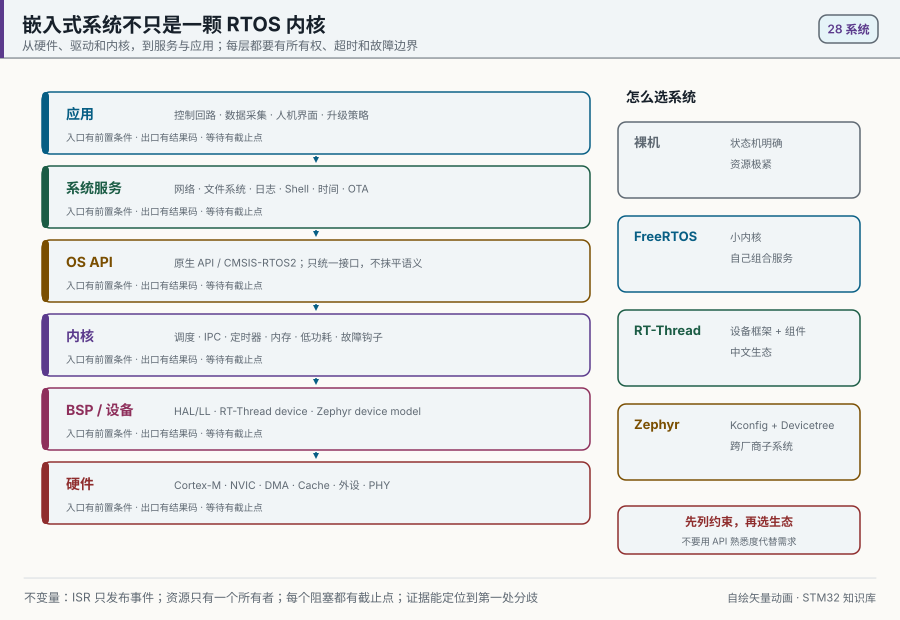

# 28 嵌入式系统与 RTOS 生态：FreeRTOS、RT-Thread、Zephyr

> English: [Embedded systems and the RTOS ecosystem](en/28-system-rtos.md)

> RTOS 内核只管调度、同步、计时和内存分配；设备归谁、等多久、资源够不够、坏了怎么恢复，要自己设计。

<p align="center">
  
  <br><sub>▲ 动画：RTOS 系统分层与生态选型。作者自绘矢量动画，不代表任何项目的实测时序。</sub>
</p>

<!-- video:ch28 -->
<p align="center">
  <video width="640" controls poster="../assets/video/ch28-rtos-system.png">
    <source src="../assets/video/ch28-rtos-system.mp4" type="video/mp4">
  </video>
  <br><sub>▲ 本章讲解视频（3.0 分钟）。<a href="../assets/video/ch28-rtos-system.mp4">MP4</a> · <a href="../assets/video/ch28-rtos-system.srt">字幕</a></sub>
</p>

<details>
<summary>旁白文字稿</summary>

1. RTOS 内核解决调度、同步、时间和基础内存问题，不会自动替你设计驱动所有权、启动顺序、升级和诊断。能创建任务，只说明底座能工作，不说明产品系统已经完成。
2. 选系统先列最坏响应、内存、驱动、网络和维护约束。功能少时裸机更容易证明；已有 Cube 工程常用 FreeRTOS；需要完整设备框架，再比较 RT-Thread 与 Zephyr。
3. 把执行上下文分成事件入口、实时控制、系统服务和管理策略。ISR 只取时间戳并发布事实；实时任务做有界计算；服务任务拥有设备；管理任务才决定重连、降级或重启。
4. 这张图展示从硬件、设备层、内核到系统服务和应用的分层。一个有状态外设只给一个所有者。其他任务发送完整事务，不要把片选、DMA 完成和超时恢复拆给多个调用者。
5. 实时性来自预算。区分响应、执行和端到端时延。一个事务只创建一个单调截止点。CPU 利用率小于一，只证明总时间没超额，不证明每个截止时间满足。
6. 队列、邮箱、事件和任务通知不能按名字互换。二值信号量表示事件，互斥量表示所有权并支持优先级继承。CMSIS RTOS2 统一接口名，不统一底层语义。
7. 启动别靠固定延时。先记录复位原因、版本和启动槽，再创建内核对象并探测关键设备，按依赖启动服务。安全前置条件全部满足后，才开放执行器和远程命令。
8. 每个任务自己喂狗会制造假健康。关键任务完成一轮有效工作后，只更新自己的健康纪元。监督者检查所有纪元、队列积压、内存水位和状态机，全部健康时才刷新硬件看门狗。
9. 把 WFI 放进 idle hook 只是入口。能否进入 Stop，还取决于截止点、DMA、Flash 和唤醒时钟。H7 的 M7 加 M4 通常按 AMP 设计，不是对称 SMP。
10. 合上书，三问。有状态外设应该有几个所有者？什么条件满足时，监督者才能刷新看门狗？系统迁移为什么先做硬件事件到任务输出的垂直切片？

</details>
<!-- /video:ch28 -->

## 学习目标

读这一章之前：读过第 15 章（FreeRTOS 入门），会创建任务，知道队列、信号量、互斥量和优先级继承是什么；读过第 04 章，知道 NVIC 的优先级数值和抢占是什么意思。第 10 章的 DMA、第 11 章的独立看门狗和第 16 章的低功耗模式，用到时会再提。C 语言的结构体和指针不熟的话，先读第 00 章的「零基础预备」。

- [ ] 说清内核、组件层、BSP 和产品系统各管什么，举出两件内核不会替你做的事
- [ ] 把一个工程的中断和任务分进四层，给每个有状态外设指定唯一的所有者任务
- [ ] 算出本章的 CPU 利用率示例账（合计 17.2%），说出利用率小于 1 还缺哪些证明
- [ ] 写出 NVIC、FreeRTOS、CMSIS-RTOS2、RT-Thread、Zephyr 各自的优先级数值方向，不把任务优先级的数字填进 NVIC
- [ ] 按设备框架、Devicetree/Kconfig 和现成驱动这几条，判断一个工程该用裸机、FreeRTOS、RT-Thread 还是 Zephyr
- [ ] 设计由健康监督者喂狗的看门狗方案，并用队列满、任务冻结、驱动超时三种故障注入验证它

## 内核只是系统的一层

**一句话结论：RTOS 内核管调度、同步、计时和内存分配；设备归谁管、一次等待最多等多久、内存够不够、出了故障怎么恢复，要你自己设计。**

第 15 章的例程跑起了几个任务，说明内核这块底座能工作。做成产品还要回答更多问题：两个任务都要用同一片 SPI Flash 时谁说了算，网络断了由谁决定重连，看门狗在什么条件下才能喂。

### 先打个比方

第 15 章把 CPU 比成厨房里唯一的厨师，任务是订单，调度器是领班，中断是门口的服务员。厨房的规矩定好了，餐馆还不一定能开门营业：

- 烤箱只归一个人管。别人要烤东西，把单子交给他，不自己去拧旋钮。这就是后面的所有者任务。
- 每张单子写明最晚几点上桌。过了点，由经理决定退单还是换菜，厨师不自己一遍遍重做。这是截止点和策略层。
- 食材和盘子按最忙的那个晚上备，不按平均客流备。这是资源预算。
- 经理隔一会儿看一眼各个灶台是不是真在出菜，都正常才在值班表上签字；签字断了，老板就来清场重开。这是由健康监督者喂看门狗。

比方到这里为止。真实系统里「最晚几点上桌」要换算成节拍和微秒，还要能用仪器量出来；餐馆忙不过来可以加人，单核 MCU 的 CPU 时间加不出来。

### 软件分几层，各管什么

章首动画画了六层：硬件、BSP 与设备、内核、OS API、系统服务和应用。下表按职责把它们归成四行，第二列是这一层负责的事，第三列是它不会自动替你做的事。读的时候重点看第三列：

| 层级 | 负责什么 | 不自动负责什么 |
| --- | --- | --- |
| 内核 | 任务调度、任务间通信（IPC）、软件定时器、临界区、内存分配 | 板级驱动、文件系统、网络、安全升级、日志策略 |
| 组件层 | 设备模型、网络、文件系统、命令行、软件包、POSIX 子集 | 产品需求、资源预算、故障恢复策略 |
| BSP 与驱动层 | 启动、时钟、引脚、外设、中断、DMA、Cache | 业务数据帧、任务所有权、端到端超时 |
| 产品系统 | 状态机、控制策略、数据模型、升级、证据与验收 | 正确性不能交给某个 RTOS 名字 |

BSP（Board Support Package，板级支持包）是让软件在某块具体板子上跑起来的那部分代码：启动文件、时钟配置、引脚分配和外设驱动。IPC（Inter-Process Communication）在 RTOS 里泛指任务之间传数据、发信号的对象，比如队列和信号量。POSIX 是 Unix 系统那套标准接口，比如 `open`、`read`、`pthread_create`；组件层提供其中一部分，方便移植现成的代码。

### 三套系统各是什么

- **FreeRTOS Kernel**：第 15 章用的就是它。它只是内核，网络、TLS（传输层加密）、OTA（空中升级）、文件系统和驱动由项目自己挑、自己拼。
- **RT-Thread**：在内核外面带了一套设备框架（统一的设备查找和读写接口）、FinSH/MSH 命令行、DFS 虚拟文件系统（Device File System）、SAL 套接字抽象层（Socket Abstraction Layer）和软件包生态。
- **Zephyr**：把 Kconfig（软件配置）、Devicetree（硬件描述）、设备模型、驱动和大量子系统放进同一套构建流程，编译时一起生成固件。

另外还有 CMSIS-RTOS2。它不是内核，是 Arm 定的一组通用 RTOS 函数接口，下面可以接 FreeRTOS 或别的内核，后面有专门一节。

三套系统都能做出好产品，也都会被不清楚的所有权和没有上限的等待拖垮。本章冻结的版本是 FreeRTOS Kernel V11.3.2、RT-Thread v5.3.0、Zephyr v4.4.2，以及 CMSIS 6.4.0 里的 CMSIS-RTOS2 2.3.0，出处在后面各自的小节里。

## 四层执行模型

一个系统里同时有中断、周期任务、驱动任务和管理任务。上一节看代码归哪一层软件；这里看代码在什么上下文里运行：在中断里，还是在哪一类任务里。按职责分成四层，每层只做自己的事，出了问题才知道该查哪一层。下表一行一层，「允许做什么」和「禁止做什么」两列是审查代码时逐条对照用的：

| 层 | 典型执行上下文 | 允许做什么 | 禁止做什么 |
| --- | --- | --- | --- |
| 事件入口 | ISR、DMA 完成回调 | 取时间戳、清硬件标志、发布定长事件 | 等锁、动态分配内存、大段格式化、访问慢设备 |
| 实时控制 | 高优先级周期任务 | 读数据快照、做控制计算、写执行器命令 | 域名解析（DNS）和加密握手（TLS）、擦 Flash、没有上限的日志、等低优先级服务 |
| 系统服务 | 驱动所有者、网络、存储、日志任务 | 串行处理设备访问、执行有上限的事务、返回结果码 | 长时间持锁、无限重试、出错不报 |
| 管理策略 | 状态机、升级、诊断任务 | 决定重连、降级、重启和持久化 | 从多个上下文同时抢同一个硬件 |

执行器指电机、阀门、继电器这类由程序驱动的输出。四层之间靠五条不变量连起来。不变量是系统运行中任何时候都必须成立的条件：

1. **ISR 只发布事实，不执行策略。**它报告「某次采样完成，时间戳是多少」，不决定要不要重连。
2. **一个有状态外设只有一个所有者。**有状态外设指一次操作要分几步完成、中间不能被别人插进来的外设，比如 SPI Flash 的一次写入要先写使能，再发命令和数据，最后等它忙完。其他任务把命令发给所有者，不直接并发调用 HAL。
3. **每次等待都有截止点。**超时就把结果交回策略层，底层不无限重试。
4. **每个队列都有满时策略。**丢最新的、丢最旧的、让发送方等着（背压），还是进入故障态，事先写明。
5. **每次跨层都带上能对得上的序号、时间戳和结果码。**

### 所有者任务：一个外设只有一个写入者

以 SPI Flash 为例。几个任务都直接调用 `HAL_SPI_TransmitReceive()`，就算每次调用都包一把互斥量，一次完整的读写也要调用好几次：拉低片选、发命令、发地址、DMA 传数据、等完成、拉高片选。两次调用之间锁是放开的，别的任务可以插进来，片选和 DMA 状态就乱了。所有者任务的做法是只让一个任务碰这片 Flash，其他任务把整个事务装进一条消息发给它：

```c
typedef enum { FLASH_READ, FLASH_WRITE, FLASH_ERASE } flash_op_t;

typedef struct {
    flash_op_t op;
    uint32_t address;
    void *buffer;
    size_t length;
    TaskHandle_t requester;
    uint32_t sequence;
} flash_request_t;

/* 只有 flash_task 能碰 SPI、CS 和 DMA 状态。 */
static void flash_task(void *argument)
{
    flash_request_t req;
    (void)argument;
    for (;;) {
        if (xQueueReceive(g_flash_requests, &req, portMAX_DELAY) != pdTRUE) {
            continue;
        }
        flash_result_t result = flash_execute_until(&req, xTaskGetTickCount() + pdMS_TO_TICKS(500));
        xTaskNotify(req.requester, pack_result(req.sequence, result), eSetValueWithOverwrite);
    }
}
```

这是一段片段，省略了队列的创建，以及 `flash_execute_until()`、`pack_result()` 的实现。逐段看：

- `flash_request_t` 把一次事务要用的东西装在一起：操作、地址、缓冲区、长度、谁发的请求、序号。请求方靠序号把结果和自己发出的那一条对上。
- `xQueueReceive(..., portMAX_DELAY)`：没有请求时任务阻塞，不占 CPU。FreeRTOSConfig.h 里 `INCLUDE_vTaskSuspend` 为 1 时，`portMAX_DELAY` 才表示无限期等待（[FreeRTOS V11.3.2](#source-freertos-1132)）；为 0 时它只是最长的一段有限等待，所以代码照样检查返回值。
- `xTaskGetTickCount() + pdMS_TO_TICKS(500)`：给整个事务定一个绝对截止点，500 ms 是示例设定。事务里每一步等待都只用剩下的时间，到点就返回超时。
- `xTaskNotify(..., eSetValueWithOverwrite)`：用任务通知把序号和结果码送回请求方。

互斥量适合保护短小的临界区，比如更新一个结构体。事务里有片选、DMA、状态机和恢复动作时，用所有者任务。代价是每次多一次消息传递，还要给请求队列定容量；换来的是外设状态只有一个写入者。

## 中断与内核的边界

中断优先级和任务优先级是两套编号，方向也不一样，不能拿任务优先级的数字去填 NVIC。下表列出本章涉及的五套编号。迁移代码时先看「数值方向」一列，按「谁比谁急」重新排，不抄数字：

| 编号 | 数值方向 | 出处 |
| --- | --- | --- |
| Cortex-M 的 NVIC 中断优先级 | 越小越急；F1 每个优先级字段只实现高 4 位 | [PM0056 Rev 7](#source-pm0056) 第 2.3.5 节、第 4.3.7 节表 42 |
| FreeRTOS 任务优先级 | 越大越先运行 | [FreeRTOS V11.3.2](#source-freertos-1132) |
| CMSIS-RTOS2 的 `osPriority_t` | 越大越先运行 | [CMSIS-RTOS2 2.3.0](#source-cmsis-640) |
| RT-Thread 线程优先级 | 越小越先运行，0 最高 | [RT-Thread v5.3.0](#source-rtthread-530) |
| Zephyr 线程优先级 | 越小越先运行；负数是协作式线程 | [Zephyr v4.4.2](#source-zephyr-442) |

协作式线程一旦运行，要等它自己让出 CPU，别的线程才能运行，中断照样能打断它。

ISR 里只能调用标明可在中断里用的接口，而且不能等待。四套系统的写法如下，第三列是 ISR 里不能做的事：

| 系统 | ISR 里可用的典型入口 | 必须避免 |
| --- | --- | --- |
| FreeRTOS | `xQueueSendFromISR`、`vTaskNotifyGiveFromISR` 这类 `FromISR` 函数，最后按需调用 `portYIELD_FROM_ISR` | 普通的阻塞 API、互斥量、动态日志 |
| RT-Thread | 文档标明可在中断上下文调用的 IPC 接口和设备回调；按移植层的约定调用 `rt_interrupt_enter/leave` | 在 ISR 里等待 IPC，关着中断调用和调度有关的操作 |
| Zephyr | 文档标明可在 ISR 中调用的 API，例如 `k_sem_give`，或者提交 `k_work` | 用 `K_FOREVER` 等待，在 ISR 里走可能睡眠的驱动路径 |
| CMSIS-RTOS2 | 每个 API 的文档写明能否从 ISR 调用；在 ISR 里调用时，超时参数必须是 0 | 以为所有 `os*` API 都能在 ISR 里用 |

FreeRTOS 在 Cortex-M 上用 BASEPRI 寄存器做临界区。BASEPRI 写成非零值后，优先级数值大于等于它的异常都不会被响应（[PM0056 Rev 7](#source-pm0056) 第 2.1.3 节表 9）。这个门槛由 `configMAX_SYSCALL_INTERRUPT_PRIORITY` 决定。调用 `FromISR` 的中断，优先级数值不能比门槛小，否则内核进临界区时挡不住它，内核的数据结构会被打乱（[FreeRTOS 的 Cortex-M 说明](#source-freertos-priority)）。第 15 章的例程把门槛设成 5，写进寄存器是 0x50。

任务没有反应时，沿着事件走过的路一站一站往下查，找到第一处和预期不一样的地方，也就是第一处分歧：

1. 硬件的挂起位有没有置起，比如 EXTI 的 `EXTI_PR`。
2. NVIC 里这一路中断使能了没有。
3. ISR 进没进。可以在入口翻转一个空闲引脚，用逻辑分析仪看。
4. 事件有没有放进队列：看 `xQueueSendFromISR` 的返回值。
5. 目标任务有没有变成就绪态。
6. 调度器有没有切过去：是不是有更高优先级的任务一直占着 CPU。

不要从「任务没打印」直接跳到「RTOS 坏了」。

## 任务间通信：四套系统的对象怎么对应

第 15 章讲过 FreeRTOS 的队列、信号量、互斥量、事件组和任务通知。另外三套系统也有对应的对象。下表按用途排成一行，只回答「做这件事该去找哪个对象」；同一行的对象行为并不完全一样，差别列在表下面：

| 用途 | FreeRTOS | RT-Thread | Zephyr | CMSIS-RTOS2 |
| --- | --- | --- | --- | --- |
| 传消息（拷贝内容） | Queue | message queue | `k_msgq` | Message Queue |
| 通知一个指定的任务 | Task Notification | event、semaphore 或 mailbox，按要带的数据选 | `k_event`、`k_sem` 或 `k_poll_signal` | Thread Flags |
| 计数资源 | Counting Semaphore | semaphore | `k_sem` | Semaphore |
| 保护共享资源 | Mutex | mutex | `k_mutex` | Mutex |
| 等多个条件位 | Event Group | event | `k_event` | Event Flags |
| 把 ISR 的后续工作交给线程 | 通知任务或发队列 | 用 IPC 唤醒线程 | `k_work` 和工作队列 | 用 flags 或队列唤醒线程 |

同名不等于同义：

- FreeRTOS 的任务通知绑在接收它的那个任务上：谁都可以发，只有这一个任务能收。它比队列轻，但不能有多个接收者。
- RT-Thread 的邮箱每封信是一个机器字（32 位 MCU 上是 4 字节），通常放一个数或一个指针；消息队列拷贝消息内容，每条不超过创建时定下的长度上限。名字相近，不能互换。
- Zephyr 的工作项共用一个工作线程。一个工作项阻塞，同一个队列里的其他工作项都得等。
- CMSIS-RTOS2 统一的是函数名和参数，调度细节、内存布局和底层扩展仍随内核而变。它的互斥量要在创建属性里设 `osMutexPrioInherit`，接口才保证有优先级继承（[CMSIS-RTOS2 2.3.0](#source-cmsis-640)）。
- 二值信号量表示「事件发生了」；互斥量表示「这个资源现在归我」，并带优先级继承（[FreeRTOS V11.3.2](#source-freertos-1132)）。优先级继承是指低优先级任务拿着锁、高优先级任务来等时，内核临时提高持锁任务的优先级，让它尽快放锁。两者都只有「有」和「没有」两种状态，也不能互相替换。

## 实时性要用预算证明

实时的意思是最坏情况下也按时完成，不是平均跑得快。说一个系统实时，要拿出一笔时间账：每件事最坏要花多久，最晚什么时候必须做完。

### 三种时间要分开

下表三行是三种不同的时间，起点和终点都不一样。第三列是量错时最容易犯的错：

| 时间 | 从哪里量到哪里 | 常见错误 |
| --- | --- | --- |
| 响应时间 | 事件发生到任务开始处理 | 只量到 ISR 入口，漏了被更高优先级任务挡住的那一段 |
| 执行时间 | 任务实际占用 CPU 的时间 | 拿平均值当最坏值；测的时候关着日志，上线又打开 |
| 端到端时延 | 从传感器到执行器，或者从发出请求到收到网络应答 | 每层各设一个超时，加起来远超产品要求 |

### CPU 利用率账

单核系统可以先算一笔保守的利用率账。C 是一个任务一次最坏的执行时间，T 是它的周期，U 是利用率：

```text
U = C1/T1 + C2/T2 + … + Cn/Tn
```

下表是本章的示例账。四个任务的周期和执行时间都是示例设定，不是任何 STM32 的实测。CAN 服务由报文触发，没有固定周期，按两条报文之间最短 2 ms 折算成周期。最后一列就是 C/T：

| 任务 | 周期或触发 | 预算执行时间 | 利用率 |
| --- | ---: | ---: | ---: |
| 电流环计算 | 1 ms | 80 µs | 8% |
| 传感器融合 | 10 ms | 420 µs | 4.2% |
| CAN 服务 | 事件驱动，按 2 ms 折算 | 70 µs | 3.5% |
| 日志编码 | 100 ms | 1.5 ms | 1.5% |
| 已知任务合计 | — | — | 17.2% |

每一格都能算回去：

```text
80 µs  / 1 ms   = 0.08  = 8%
420 µs / 10 ms  = 0.042 = 4.2%
70 µs  / 2 ms   = 0.035 = 3.5%
1.5 ms / 100 ms = 0.015 = 1.5%
合计 8% + 4.2% + 3.5% + 1.5% = 17.2%
```

17.2% 只说明这四个任务加起来没有占满一个核。U 小于 1 不证明每个任务都按时完成：任务被共享资源挡住、被中断打断、等 Cache 未命中和 Flash 等待的时间，还有优先级怎么排，都要放进响应时间分析里另算。这笔账还要加上 ISR、内核本身、协议栈和突发流量的余量。

### 周期、超时与截止点

- 周期任务用绝对唤醒时刻。第 15 章的 `vTaskDelayUntil` 就是这样做的：下一次唤醒时刻等于上一次唤醒时刻加周期，任务自己的执行时间不会累积成周期漂移。
- 一个事务只算一次截止点，用单调时钟来算。单调时钟只增不减，不受校时影响，比如节拍计数。事务里每一步等待都用「截止点减现在」得到的剩余时间，不是每一步重新等满一个固定超时。
- 超时不等于「再试一次」。重试安不安全、试几次、会不会让同一个动作执行两遍，只有策略层知道。
- 毫秒换成节拍会丢精度。FreeRTOS 的 `pdMS_TO_TICKS()` 用整数除法，向下取整：节拍是 1000 Hz 时 `pdMS_TO_TICKS(5)` 是 5；节拍是 100 Hz 时是 0，等待会立刻超时（[FreeRTOS V11.3.2](#source-freertos-1132)）。需要「至少等这么久」时，自己向上取整。
- 节拍从调用那一刻开始数，而当前这个节拍已经过去了一部分，所以 `vTaskDelay(n)` 实际阻塞 n − 1 到 n 个节拍周期。比一个节拍还短的期限，内核保证不了。
- Tickless idle（无节拍空闲）是指没有任务要运行时停掉周期性的节拍中断，醒来后再把睡过的节拍补上。它减少的是空闲时被节拍叫醒的次数，外设和板上其他器件的耗电不会因此变少。

## 内存：栈、内核堆、C 库堆和 DMA 缓冲分开算

第 15 章讲过任务栈以字为单位，还有 heap_1 到 heap_5 几种堆。一个完整的系统里还有更多块内存，每块的使用者、风险和验证方法都不一样。下表每行一块区域，最后一列是证明它够用的办法：

| 区域 | 谁在用 | 主要风险 | 怎么验证 |
| --- | --- | --- | --- |
| 任务栈 | 函数调用帧、局部变量、切换任务时保存的寄存器 | 最深的调用链、`printf` 和浮点运算、嵌套中断让栈溢出 | 栈水位、溢出钩子、故意加压测试 |
| 内核对象与内核堆 | 任务控制块（TCB）、队列、定时器等 | 启动后再动态创建时失败、堆碎片 | 启动前算预算，运行时记录最小剩余量 |
| C 库堆 | `malloc`、`new` 和部分 C 库函数 | 线程安不安全、和内核堆重复计算 | 只留一个分配器，写明加锁方式 |
| DMA 缓冲区 | 外设和 CPU 共用 | DMA 能不能访问这块地址、对齐、Cache 一致性、此刻归谁用 | 看链接 map、加地址断言、定好 Cache 和 MPU 规则 |
| 持久化区 | Flash、备份 SRAM | 写到一半掉电、版本不兼容、写放大 | 双副本、CRC、版本号、故障注入 |

表里几个词：

- **栈水位**：创建任务时把栈填成固定图案，运行一段时间后看图案还剩多少，就知道栈最深用到了哪里。FreeRTOS 用 `uxTaskGetStackHighWaterMark()` 读这个余量。
- **Cache 一致性**：CPU 改了 Cache 里的数据还没写回内存，DMA 读到的就是旧数据；反过来，DMA 写了内存，CPU 读到的可能是 Cache 里的旧副本（[AN4839 Rev 2](#source-an4839)）。F1 没有数据 Cache，H7 有。
- **MPU**（Memory Protection Unit，存储器保护单元）：给一段地址设访问权限和 Cache 属性。
- **链接 map**：链接器生成的 `.map` 文件，列出每个段、每个变量放在哪里、占多少字节。
- **写放大**：只改几个字节，也要擦写整页 Flash。

长期存在的对象，量产时尽量在初始化阶段静态创建。FreeRTOSConfig.h 里打开 `configSUPPORT_STATIC_ALLOCATION` 后，`xTaskCreateStatic`、`xQueueCreateStatic` 用你提供的内存，创建不会因为堆不够而失败（[FreeRTOS V11.3.2](#source-freertos-1132)）。确实要动态创建和删除的对象，写明谁分配、谁释放、失败怎么回滚、重复释放怎么发现。`malloc` 失败后返回一份空数据，只是把资源耗尽藏了起来，不算恢复。

### 一份能复算的内存账

假设一颗芯片有 256 KiB SRAM（1 KiB 是 1024 字节）。本书主板 STM32F103C8T6 只有 20 KB SRAM（[DS5319 Rev 20](#source-ds5319) 表 2），放不下这张账，这里只演示算法。表中每一格都是示例设定，第二列写出这一格是怎么来的：

| 项目 | 数量 × 单项 | 预算 |
| --- | ---: | ---: |
| 8 个线程栈 | `8 × 2 KiB` | 16 KiB |
| 网络 RX/TX 缓冲 | `16 × 1.6 KiB` | 25.6 KiB |
| 消息队列与对象存储 | 汇总 | 12 KiB |
| 文件系统工作区 | 汇总 | 8 KiB |
| TLS 峰值工作内存 | 由固定配置/实测获得 | 64 KiB |
| DMA 非缓存区 | 对齐后汇总 | 16 KiB |
| 全局静态数据 | link map | 28 KiB |
| 故障转储保留区 | 固定 | 8 KiB |
| 已分配 | — | 177.6 KiB |
| 未分配裕量 | `256 - 177.6` | 78.4 KiB |

```text
16 + 25.6 + 12 + 8 + 64 + 16 + 28 + 8 = 177.6 KiB
256 − 177.6 = 78.4 KiB
```

DMA 非缓存区是设成不经过 Cache 的一段 SRAM，DMA 缓冲放在这里，就不用做 Cache 维护。这张账只是计算示例。真实项目要用链接 map、每个任务栈的最小余量、内核堆的最低水位和 TLS、网络的峰值来更新它。现在空着的 78.4 KiB 不能直接当成长期的安全余量：突发的队列积压、证书链和升级用的双缓冲，都可能把峰值推高。

## 驱动生命周期：七个状态

驱动的 `init` 返回成功，只说明它走到了「就绪」这一步。一个能从故障里恢复的驱动，至少要有下面七个状态。状态名保留英文，日志里就写这几个词。下表每行是一次状态转移，从左往右读：

| 当前状态 | 触发事件 | 下一个状态 |
| --- | --- | --- |
| 上电 | 系统启动 | `Absent`（未发现） |
| `Absent` | 在板子上发现了这个设备 | `Probing`（探测中） |
| `Probing` | 初始化和自检都通过 | `Ready`（就绪） |
| `Probing` | 可选功能失败，核心功能正常 | `Degraded`（降级） |
| `Ready` | 接受一个事务 | `Busy`（忙） |
| `Busy` | 事务完成 | `Ready` |
| `Busy` | 超时或出错 | `Recovering`（恢复中） |
| `Recovering` | 复位并重新探测通过 | `Ready` |
| `Recovering` | 恢复预算用完 | `Failed`（失败） |
| `Degraded` | 策略层明确要求重试 | `Probing` |
| `Failed` | 策略层批准重启 | `Probing` |

恢复预算是事先写定的恢复次数和总时长，用完就不再自己重试，交给策略层。每个转移都要写清：触发条件、最长耗时、要清理哪些资源、错误码和日志字段。`HAL_OK`、`RT_EOK` 或 `device_is_ready()` 只证明它自己那一层成功了，不证明传感器读数合理、Flash 已经写进去，也不证明网络对端已经确认。

## 启动顺序：先证明底座，再开放服务

上电以后，按下面六道门依次打开。前一道没过，后面的就不开：

1. **复位证据**：记下复位原因、固件版本、启动槽和持久化数据的版本。F1 的复位原因在 `RCC_CSR` 的标志位里，独立看门狗复位会置 `IWDGRSTF`（[RM0008 Rev 21](#source-rm0008) 第 7.3.10 节）。启动槽指正在运行的是哪一份固件：做在线升级时，Flash 里可以放两份，升级失败还能退回旧的那份。
2. **最低硬件**：时钟、电源监控、内存、看门狗。失败就停在一个能诊断的安全状态。
3. **内核对象**：静态的队列、任务、事件和内存池。任何一个创建失败，都不进入正常运行。
4. **设备探测**：关键设备必须通过；非关键设备可以进入明确的降级态。
5. **服务层**：日志、存储、网络、时间、升级，按依赖关系依次启动。
6. **应用门控**：所有安全前提都满足以后，才允许驱动执行器、接受远程命令。

不要用固定延时代替依赖关系。`delay(500)` 之后就当网络已经拿到地址，启动快一点慢一点都会出错。应该等一个带结果码的状态事件，并给整个启动过程设一个截止点。

## 可观测性：让故障落到第一处分歧

出了故障，要能从日志里找到第一处和预期不一样的地方。每条关键日志至少带这几个字段：

```text
monotonic_ms | boot_id | component | event | state | sequence | result | detail
```

- `monotonic_ms`：从这次上电起的单调毫秒数，给同一次启动里的事件排序，不受 RTC 校时跳变影响。
- `boot_id`：每次启动换一个编号，区分复位前后重复使用的序号。
- `component`、`event`、`state`：哪个组件、发生了什么、当时处在哪个状态。
- `sequence`：同一个事件从 ISR、队列、驱动事务一直到协议应答，都带着同一个序号。
- `result`：固定的枚举值，不要只写自由文本。
- `detail`：放寄存器快照或协议错误码，不能放私钥和口令。

### 看门狗由健康监督任务来喂

第 11 章的独立看门狗（IWDG）是一个独立的递减计数器：向 `IWDG_KR` 写 0xAAAA 就把计数器重装，减到 0 就复位芯片（[RM0008 Rev 21](#source-rm0008-wdg) 第 19.3 节）。谁来写这个 0xAAAA，决定了看门狗能不能发现故障。

每个任务各自喂狗，会出现「业务全卡死了，某个中断还在喂」的假健康。改成由一个健康监督任务统一喂：

1. 每个关键任务各有一个健康纪元（epoch），就是一个计数器。任务每完成一轮有效工作，就把自己的纪元加 1。有效工作指真正完成了一次职责，比如控制任务算完一次输出；只是被唤醒一次不算。
2. 监督任务定期检查：每个纪元有没有在这个任务允许的最长间隔内前进，队列有没有积压，内存水位和关键状态机是否正常。
3. 全部正常，监督任务才刷新硬件看门狗。
4. 有一项不正常，先把一份最小的故障摘要写进持久化区，再停止喂狗，让看门狗复位。写摘要本身也要有截止点。

复位以后，读复位标志和故障摘要，就能知道哪一个健康条件先失败。

## 低功耗与 RTOS

没有任务就绪时，RTOS 运行空闲任务，可以在这里让 CPU 睡下。能睡多深，要看整个系统：

- 最近的软件截止点还剩多久，够不够睡一觉；
- DMA、Flash 擦写、网络 PHY（以太网的物理层芯片）或别的外设事务是否还在进行；
- 哪个时钟在低功耗模式里还在走，能把芯片叫醒；
- 醒来以后，HAL 时基、PLL、Cache、外设和网络状态能不能恢复；
- tickless 补节拍用的那个时钟够不够准。

FreeRTOS 打开 `configUSE_TICKLESS_IDLE` 后，空闲时停掉节拍中断，醒来再把睡过的节拍补上（[FreeRTOS V11.3.2](#source-freertos-1132)）。Cortex-M 移植层自带的实现用 SysTick 计时，用 `WFI`（等中断指令，CPU 停下来等中断）睡眠。F1 进入 Stop 后，1.8 V 域的时钟全部停下，SysTick 也跟着停；醒来时系统时钟是 HSI，要重新配置时钟（[RM0008 Rev 21](#source-rm0008-pwr) 第 5.3.4 节）。想在 Stop 里用 tickless，就要换一个 Stop 时还在走的时钟来计时和补节拍，比如 RTC。

把 `WFI` 放进空闲钩子只是一个入口，算不上低功耗策略。第 16 章和第 24 章讲的模式、唤醒和恢复的证据，在 RTOS 下同样要做。

## FreeRTOS V11.3.2：小内核，自行组合系统

本章冻结的版本是 [FreeRTOS Kernel V11.3.2](#source-freertos-1132)。内核提供任务、队列、互斥量、信号量、任务通知、事件组、软件定时器和几种堆实现（heap_1 到 heap_5）。它不规定项目用哪套设备模型，也不带 STM32 驱动、命令行或文件系统；第 15 章用的 HAL 驱动来自 STM32Cube，不属于 FreeRTOS。

系统要自己拼，目录可以按前面的分层来分：

```text
app/        产品状态机与业务协议
services/   storage / network / update / log
drivers/    每个外设的唯一所有者与异步事务
rtos/       FreeRTOSConfig.h、静态对象和钩子
bsp/        时钟、引脚、中断、链接脚本、HAL/LL
```

### 配置清单：要冻结和审查的项

`FreeRTOSConfig.h` 决定内核怎么工作。下面这些项要写进评审记录，每次改动都能追溯：

- `configTICK_RATE_HZ`（节拍频率）、`configMAX_PRIORITIES`（优先级个数）、`configUSE_PREEMPTION`（是否抢占）。
- `configMAX_SYSCALL_INTERRUPT_PRIORITY`，以及芯片实现了几位优先级：F1 是 4 位（[PM0056 Rev 7](#source-pm0056) 表 42）。
- 静态和动态分配的开关，以及选了哪个 `heap_x.c`。
- 栈溢出检查、`malloc` 失败钩子、空闲钩子、节拍钩子是否打开。
- 软件定时器任务的优先级、栈大小和命令队列长度。
- tickless idle 的前提条件和唤醒用的时钟。
- 运行时间统计用的时钟是否独立于内核节拍。

V11 系列支持 SMP 调度。SMP 要求几个相同的核由一个内核调度；STM32H745 的 M7 和 M4 是两个不同的核，通常按 AMP 设计，也就是每个核跑自己的固件，见后面「双核：SMP 与 AMP」一节。

## RT-Thread v5.3.0：内核、设备框架与组件

本章冻结的版本是 [RT-Thread v5.3.0](#source-rtthread-530)。对 STM32 项目来说，它比线程 API 多出来的是一套统一框架：设备访问、组件初始化、命令行、文件系统和网络抽象，都按这套框架组织。

### 对象与启动

- 线程：静态创建用 `rt_thread_init`，动态创建用 `rt_thread_create`，创建后调用 `rt_thread_startup` 才进入调度。优先级数值越小越先运行，0 最高。
- 通信对象：semaphore、mutex、event、mailbox、message queue。
- 定时器：硬定时器的回调在节拍中断里执行，按 ISR 的规矩写，不能阻塞；软定时器的回调在定时器线程里执行，一个回调跑得慢，排在后面的软定时器都要等。能不能阻塞，按模式查文档确认。
- 初始化：`INIT_BOARD_EXPORT`、`INIT_DEVICE_EXPORT`、`INIT_COMPONENT_EXPORT`、`INIT_APP_EXPORT` 等宏把函数登记进分级的启动序列，上电后按级别依次调用。
- 配置与构建：`menuconfig` 生成配置，SCons（用 Python 写的构建工具）组织 BSP、组件和软件包。

### 设备框架：先找设备，再按统一入口操作

RT-Thread 的驱动把自己注册成一个有名字的设备。应用按名字找到它，再用 `rt_device_open`、`rt_device_read`、`rt_device_write`、`rt_device_control` 这组统一接口操作。下面这段片段在应用初始化阶段打开串口 2：

```c
#include <rtthread.h>
#include <rtdevice.h>

static rt_device_t console_uart;

static int app_uart_init(void)
{
    console_uart = rt_device_find("uart2");
    if (console_uart == RT_NULL) {
        return -RT_ENOSYS;
    }
    rt_err_t error = rt_device_open(console_uart, RT_DEVICE_FLAG_RX_NON_BLOCKING);
    if (error != RT_EOK) {
        console_uart = RT_NULL;
        return error;
    }
    return RT_EOK;
}
INIT_APP_EXPORT(app_uart_init);
```

逐段看：

- `rt_device_find("uart2")`：按名字查找已注册的设备，找不到返回 `RT_NULL`。名字由 BSP 注册设备时决定。
- `rt_device_open(..., RT_DEVICE_FLAG_RX_NON_BLOCKING)`：打开设备，接收按非阻塞方式工作。这个标志属于串口 V2 框架；BSP 用的若是旧版串口框架，标志不同，以 v5.3.0 里所用 BSP 的驱动源码为准。
- 打开失败时把 `console_uart` 清回 `RT_NULL` 再返回错误码，后面的代码一看就知道串口不可用。
- `INIT_APP_EXPORT(app_uart_init)`：把这个函数登记到应用级的启动序列里。

这段代码只演示生命周期的边界：查找、打开、检查失败。串口 DMA、接收回调和缓冲方式，要回到 v5.3.0 对应的 BSP 驱动里看；看到 `rt_device_read`，不能就以为每个驱动的阻塞和超时行为都一样。

统一的对象和组件是 RT-Thread 的长处，风险也在这里：打开 DFS、SAL、FinSH、软件包和 POSIX 层，Flash、RAM、线程数和初始化依赖都会增加。每打开一个组件，就把它的对象数量、线程栈和失败路径记进系统预算。

## Zephyr v4.4.2：配置、硬件描述与子系统共同生成固件

本章冻结的版本是 [Zephyr v4.4.2](#source-zephyr-442)。Zephyr 和前两套最大的不同在构建方式：板子、驱动、内核配置和子系统，在编译时由构建系统连在一起，生成一份固件。它由四个部分配合：

- **Devicetree**（设备树）：一种描述硬件的文本格式，写明有哪些外设实例，以及它们的地址、中断、GPIO、时钟和总线连接。
- **Kconfig**：选择编进固件的软件功能、依赖和参数，结果生成 `CONFIG_*` 宏。
- **设备模型**：把 Devicetree 里的硬件实例和驱动对象绑在一起，应用通过它拿到设备。
- **west + CMake + Ninja**：west 是 Zephyr 的命令行工具，按清单文件（west manifest）拉取并锁定多个代码仓库的版本；CMake 和 Ninja 负责生成并执行编译。

### Devicetree 描述硬件，Kconfig 选择软件能力

下面两段片段让一颗 LED 闪烁。第一段是 Devicetree 覆盖文件（overlay），写明 LED 接在 GPIOA 的第 5 脚、高电平有效，并给它起别名 `status-led`。第二段是应用代码，只通过别名找 LED，不写寄存器地址：

```dts
/ {
    aliases {
        status-led = &user_led;
    };

    leds {
        compatible = "gpio-leds";
        user_led: led_0 {
            gpios = <&gpioa 5 GPIO_ACTIVE_HIGH>;
        };
    };
};
```

```c
#include <zephyr/device.h>
#include <zephyr/drivers/gpio.h>
#include <zephyr/kernel.h>

static const struct gpio_dt_spec led = GPIO_DT_SPEC_GET(DT_ALIAS(status_led), gpios);

int main(void)
{
    if (!gpio_is_ready_dt(&led)) {
        return -ENODEV;
    }
    int error = gpio_pin_configure_dt(&led, GPIO_OUTPUT_INACTIVE);
    if (error != 0) {
        return error;
    }
    for (;;) {
        gpio_pin_toggle_dt(&led);
        k_msleep(500);
    }
}
```

逐段看：

- `status-led = &user_led`：别名。代码里的 `DT_ALIAS(status_led)` 找的就是它；Devicetree 里的连字符，在宏里写成下划线。
- `gpios = <&gpioa 5 GPIO_ACTIVE_HIGH>`：GPIOA 的第 5 脚，高电平有效。换板子只改这一行，应用代码不动。
- `gpio_is_ready_dt(&led)`：检查驱动是否已经就绪。Devicetree 里有这个节点，不等于驱动初始化成功了。
- `gpio_pin_configure_dt(&led, GPIO_OUTPUT_INACTIVE)`：配置成输出，初始是无效电平，也就是灭。
- `k_msleep(500)`：让出 CPU 500 ms，所以亮 500 ms、灭 500 ms。500 ms 是示例设定。

打开 GPIO 驱动这类软件能力，写在 Kconfig 里，不写在 Devicetree 里。不要在应用里抄寄存器地址绕过设备模型，那样一来，换板子、电源管理和驱动所有权都失去了统一的边界。

### 工作队列：几个工作项共用一个线程

`k_work` 是一个工作项：ISR 把它提交给工作队列，后续处理就在线程上下文里执行。系统工作队列由所有提交者共用，一个工作项执行慢操作，后面的工作项都要排队。网络、存储或者可能长时间阻塞的工作，放进专用的工作队列或所有者线程，给它们单独的栈和优先级预算。

## CMSIS-RTOS2 2.3.0：统一接口，不是统一实现

CMSIS（Cortex Microcontroller Software Interface Standard）是 Arm 为 Cortex-M 定的一组软件接口标准。其中的 CMSIS-RTOS2 是一套通用的 RTOS 函数接口，下面接真正的内核，比如 Arm 的 RTX5，或者经 CMSIS-FreeRTOS 接到 FreeRTOS。本章冻结的是 CMSIS 6.4.0 里的 CMSIS-RTOS2 API 2.3.0（[CMSIS 6.4.0](#source-cmsis-640)）。启动的写法如下：

```c
osKernelInitialize();
osThreadId_t worker = osThreadNew(worker_main, NULL, &worker_attributes);
if (worker == NULL) {
    system_init_fail(INIT_THREAD_CREATE);
}
osKernelStart();
```

这是一段片段，`worker_main`、`worker_attributes` 和 `system_init_fail()` 要另外定义。`osThreadNew` 返回 `NULL` 表示线程没建成，启动就停在这里，不进入调度。

它让应用少依赖某个内核的函数名。换内核之前，仍要逐项核对：

- 优先级：`osPriority_t` 数值越大越先运行，看它怎样映射到底层内核的优先级；
- 栈大小的单位：`osThreadAttr_t` 的 `stack_size` 以字节计，FreeRTOS 的 `xTaskCreate` 以字计，第 15 章的 128 字就是 512 字节；
- 哪些 API 可以在 ISR 里调用；
- 线程标志、事件标志、消息队列满了和超时的时候怎么返回；
- 静态控制块和消息存储区要多大、怎么对齐；
- 业务代码是否还依赖底层扩展，比如 FreeRTOS 的任务通知、流缓冲区（stream buffer）。

应用大量调用底层扩展时，只在头文件里包一层同名函数，换内核照样要改，算不上可移植。

## 什么时候选哪一种

选系统按这个顺序：先列硬约束，包括最坏响应时间、RAM 和 Flash、必须有的驱动、网络和维护周期；再看现有驱动和团队能维护什么；最后才看哪套 API 用着顺手。下表每行是一种约束，后四列是四种做法在这种约束下的情况：

| 约束 | 裸机前后台 | FreeRTOS | RT-Thread | Zephyr |
| --- | --- | --- | --- | --- |
| 功能很少，状态机能列举穷尽 | 合适 | 能用，可能多余 | 通常偏重 | 通常偏重 |
| Cube/HAL 工程，需要少量并发 | 状态一多就难维护 | 常见，接入直接 | 可行 | 可行 |
| 想要统一的设备访问、命令行、文件系统和软件包 | 自己写 | 自己挑、自己拼 | 自带 | 自带 |
| 中文文档、国内 MCU 的 BSP、RT-Thread Studio | — | 中文社区资料多 | 三项都有 | 看具体板卡 |
| 跨厂商板卡、Kconfig 和 Devicetree、协议子系统 | 手工维护 | 手工组合 | 有设备模型和组件 | 构建系统就按这套设计 |
| 已有量产代码和认证证据 | 维持现状通常风险最低 | 看冻结版本和证据 | 看冻结版本和证据 | 看冻结版本和证据 |
| 维护周期很长 | 全部维护自己承担 | 冻结内核和依赖 | 冻结 BSP、组件和软件包 | 冻结 west manifest 和模块 |

前后台就是第 15 章说的裸机写法：主循环轮询，中断置标志。这张表不是排行榜。一个已经有稳定 FreeRTOS 驱动和测试体系的产品，只因为「生态更丰富」改成 Zephyr，迁移的代价可能大于收益。反过来，一个要支持多家厂商的无线芯片、标准设备模型和大量协议的新产品，在 FreeRTOS 上自己一层层拼，会背上长期的维护负担。

选定之前，再核对三件事：

- 目标芯片或板卡在所选的冻结版本里，有能维护的 BSP 和关键驱动。
- 内核、BSP、组件、工具链和依赖仓库的版本全部冻结，能重新构建出同一份固件。
- 有人持续跟踪 CVE（公开的安全漏洞编号）、芯片勘误和上游修复，并且有升级流程。

## 从一个系统迁到另一个系统

不要逐个函数机械替换。按下面的顺序迁：

1. 列出所有线程、ISR、通信对象、定时器、动态对象和驱动所有者。
2. 给每个对象写下它的阻塞、超时、唤醒、公平性、优先级继承和删除时的行为。
3. 先迁一条垂直切片：从一个硬件事件开始，经过一次任务间通信进到一个任务，最后产生一个能观察到的输出。这条路代码不多，却穿过了中断边界、通信对象和调度这几层，两套系统的差别会最早暴露出来。
4. 用同一组输入复测时延、栈水位、队列峰值和故障路径。
5. 再迁网络、存储这类大组件，每次只改动一处所有权边界。
6. 删掉旧的适配层和重复的初始化，不长期同时维护两套内核 API。

最难迁的往往不是 `xQueueSend` 换成哪个函数，而是原工程里没写下来的行为：队列满了是不是阻塞，任务被删除时它拿着的锁怎么办，定时器回调在哪个上下文里执行，驱动是不是假设了线程本地状态（每个线程各有一份的变量）。

## 双核：SMP 与 AMP

前面讲的都是单核：同一时刻只有一个任务在运行。有两个核时有两种用法。下表第三列是每种用法新增的主要风险：

| 模式 | 特点 | 新增的主要风险 |
| --- | --- | --- |
| 单核抢占 | 同一时刻只有一个任务在运行 | 优先级、阻塞链、ISR |
| SMP（对称多处理） | 一个操作系统调度几个相同的核 | 自旋锁、内存访问顺序、任务绑核、并发缺陷 |
| AMP（非对称多处理） | 每个核运行自己的固件或操作系统 | 启动顺序、共享内存、Cache、核间中断、版本协议 |

自旋锁是拿不到就原地反复检查、直到拿到为止的锁；任务绑核是规定某个任务只在某个核上运行。FreeRTOS 和 RT-Thread 的新版本都有多核能力，Zephyr 也在部分平台上支持 SMP；目标芯片、移植层和冻结版本支不支持，要逐项查。STM32H745 的 M7 和 M4 不是相同的核，通常按 AMP 设计：共享内存要定义所有权和 Cache 维护，核间消息要带版本、长度和超时。

### H745 双核协作：五份契约

STM32H745 的两个核用 HSEM（硬件信号量）协调（[RM0399](#source-rm0399)，[stm32h745xx.h](#source-stm32h745-header)）。HSEM 提供原子的占用和中断通知，但它不搬运数据（payload，真正要传的内容），也不替 Cortex-M7 维护数据 Cache。评审一条核间通道时，把下面五层分开冻结。下表第二列是要写死的约定，第三列是验收时至少要做的故障注入：

| 层 | 要写死的约定 | 验收时至少做的故障注入 |
| --- | --- | --- |
| 共享存储 | 两个核都能访问的那块 SRAM：起始地址、长度、对齐和结构体布局。共享区不能放在某个核私有的栈或链接段里 | 注入越界的长度、错误的对齐和非法状态，接收端必须拒绝，不能接着解引用 |
| 所有权与可见性 | 谁写、谁读、什么时候交接。不管共享区可不可缓存，交接时双方都要按发布、获取的顺序执行内存屏障，调用一次 HSEM 释放代替不了屏障；共享区设成可缓存时，还要按所有权做 clean 和 invalidate | 连续更新序号和数据，读端只能接受同一代的数据；内存顺序和 Cache 策略写进链接脚本、MPU 配置和评审记录 |
| 同步 | HSEM 编号怎么分配、谁持有、最长持有多久、怎么通知、超时后怎么降级。HSEM 释放了，不等于业务消息已经处理 | 故意占住一个 HSEM，或者丢掉一次通知，另一个核必须在截止时间内超时并记下原因 |
| 消息协议 | `magic`、版本、长度、序号、状态和兼容规则。共享的 C 结构体也算通信协议 | 注入未知版本、截断的长度和重复的序号，接收端给出能区分的拒绝结果 |
| 启动与恢复 | 哪个核先初始化共享区、`ready` 标志和代际号、心跳、一个核单独复位后怎么重新同步、谁负责复位整机 | 分别冻结或复位 M7 和 M4，活着的那个核进入预定的降级或安全状态，不无限等待旧代际 |

表里几个词：

- **内存屏障**：一条指令，保证它前面的读写先完成，再执行它后面的读写。Cortex-M 上是 `DMB`、`DSB`。
- **发布、获取的顺序**：发布方先写完数据，执行屏障，再改「数据已就绪」的标志；获取方先读到标志，执行屏障，再读数据。
- **clean 和 invalidate**：clean 把 Cache 里改过的数据写回内存，invalidate 丢掉 Cache 里的旧副本、下次从内存重读（[AN4839 Rev 2](#source-an4839)）。
- **`magic`**：放在结构体开头的固定数值，用来认出这块内存确实是约定的格式。
- **代际号和心跳**：代际号是共享区每重新初始化一次就加 1 的编号，用来认出对方是不是刚复位过；心跳是一个定期更新的计数，对方据此判断这个核还活着。

这张表是设计和验收协议，不是本仓库已经做完的 H745 硬件实测。HSEM 或心跳超时以后，恢复策略要明确选一种：重试、单独重启一个核、复位整机，或者保持安全输出。「继续等」不能当默认方案。

## 动手实验

前三个实验各注入一种故障：队列满、驱动超时、任务冻结；第四个实验比较两套系统。每做完一个，在本节末尾的记录表里填一行。

1. **实验一：队列满了会怎样。** 在第 15 章的 freertos-task 工程里建一个深度为 2 的队列。接收任务一启动先 `vTaskDelay(pdMS_TO_TICKS(1000))`，然后才开始取；发送任务的优先级比它高，连发三条消息 1、2、3。第三次发送用三种超时各做一遍：`0`、`pdMS_TO_TICKS(100)`、`portMAX_DELAY`。
   - 预期现象：超时为 0 时，第三次发送立刻返回 `errQUEUE_FULL`；超时为 100 ms 时，约 100 ms 后返回 `errQUEUE_FULL`；超时为 `portMAX_DELAY` 时，发送任务一直等到接收任务开始取，约 1 s 后返回 `pdPASS`。接收任务按 1、2、3 的顺序收到消息，第三条只在第三种情况下进得去。
   - 怎么确认：每次发送前后各读一次 `xTaskGetTickCount()`，把返回值和耗时从串口打印出来（第 06 章）。例程设定的节拍是 1000 Hz，一个节拍就是 1 ms。
   - 没成功先查：接收任务是不是一开始就在取，队列根本没满；`INCLUDE_vTaskSuspend` 是否为 1，不为 1 时 `portMAX_DELAY` 不是无限等待；节拍频率是不是例程设定的 1000 Hz。
2. **实验二：每次调用加锁，对比所有者任务。** 用第 08 章的 W25Q64，SPI 走 DMA（第 10 章），让两个任务读写同一片 Flash。版本 A 只给每次 HAL 调用加一把互斥量；版本 B 改成本章的所有者任务。在第一个事务启动 DMA 之后、DMA 完成之前，触发第二个请求。最后在版本 B 里注入一次驱动超时：用一个调试开关丢掉一次 DMA 完成通知。
   - 预期现象：版本 A 会出现 `HAL_BUSY`，或者两个事务的字节夹在同一段片选低电平里，读回的数据出错；版本 B 每段片选低电平里只有一个事务，第二个请求排队等候。注入超时后，所有者任务在 500 ms 截止点（示例设定）返回超时，下一个请求照常完成。
   - 怎么确认：逻辑分析仪同时抓 CS、SCK、MOSI 三根线；请求方把序号和结果码打印出来。
   - 没成功先查：版本 A 看不到冲突，是第二个请求没有真的落在 DMA 完成之前，把触发点挪到启动 DMA 之后；版本 B 超时后卡住，先看每一步等待是不是重新等满了 500 ms，而不是用剩下的时间；再看 DMA 完成回调里调用的是不是 `FromISR` 版本的接口。
3. **实验三：冻结任务，看监督任务停止喂狗。** 在实验一的工程里加一个健康监督任务和第 11 章的 IWDG（约 1 s 超时，LSI 按典型值 40 kHz 算）。监督任务每 250 ms 检查一次，KEY 任务平时阻塞在队列上，把它的 `portMAX_DELAY` 换成 500 ms 的有限超时，超时返回也算完成一轮。每个任务允许的最长间隔取它周期的两倍：LED 和 KEY 任务 1 s，UART 任务 2 s（都是示例设定）。然后依次冻结 LED、KEY、UART 三个任务：用一个调试开关让它进入死循环，或者无限期阻塞。
   - 预期现象：被冻结任务的纪元不再增长；过了它允许的最长间隔，监督任务写下故障摘要，停止喂狗；再过约 1 s，IWDG 复位芯片。复位后 `RCC_CSR` 的 `IWDGRSTF` 为 1，故障摘要写着先停下的是哪个任务。
   - 怎么确认：复位后先打印 `RCC_CSR` 和故障摘要，再写 `RCC_CSR` 的 `RMVF` 位清掉复位标志。三个任务各冻结一次，三份摘要应该各不相同。
   - 没成功先查：一直不复位，是还有别的地方在喂狗，比如某个中断或空闲钩子；或者调试器停着内核，`DBG_IWDG_STOP` 把计数器冻住了（第 11 章）。复位了却没有摘要，是被冻结的任务在死循环，优先级又比监督任务高，监督任务根本轮不到运行；把监督任务设成应用任务里优先级最高的。
4. **实验四：同一条垂直切片，两套系统各做一遍。** 从 FreeRTOS、RT-Thread、Zephyr 里选两套，再选一块在这两套系统的冻结版本里都有 BSP 的板子。两边只实现同一条路：GPIO 中断发出一个定长事件，工作线程收到后从 UART 打印序号和时间戳。用第 05 章的 PWM 输出接到这只 GPIO 上，把输入频率固定下来；两边的日志格式保持一致。
   - 预期现象：两边打印的序号连续，不丢事件；你能列出两边在通信对象、配置文件、栈预算和 ISR 写法上的差别。
   - 怎么确认：对比两边日志里的序号和时间戳；用逻辑分析仪量 GPIO 边沿到 UART 第一个字节的时延，两边各量一组。
   - 没成功先查：ISR 里是不是用了不允许在中断里调用的接口（见「中断与内核的边界」）；优先级数字是不是照抄了另一套系统的；PWM 频率是不是快到工作线程来不及处理，先把频率调低。

做完前三个实验，把结果填进这张记录表。「第一处分歧」写实际结果最早从哪一步开始和预期不一样，全部一致就写「无」：

| 注入 | 预期 | 实际 | 第一处分歧 |
| --- | --- | --- | --- |
| 队列满（实验一） | 按超时设定返回 `errQUEUE_FULL`，或阻塞到有空位 |  |  |
| 驱动超时（实验二） | 500 ms 截止点返回超时，下一个请求正常完成 |  |  |
| 任务冻结（实验三） | 监督任务停止喂狗，IWDG 复位，摘要指出是哪个任务 |  |  |

## 常见坑与出处

下表每行一个坑。「出处」一列是能查证的资料，最后一列写这份资料能证明到哪一步，证明不了的部分没有写进这一行：

| 现象 | 原因 | 处理 | 出处 | 出处能证明的部分 |
| --- | --- | --- | --- | --- |
| 高优先级任务仍然迟到 | 被更高优先级的中断或任务占着，或者在等一把低优先级任务拿着的锁 | 分别记下 ISR 占用时间、任务切换和互斥量持有时长，看是谁占着 CPU | [PM0056 Rev 7](#source-pm0056) | 第 2.3.5 节：优先级数值越小越优先；锁的等待时间要自己量 |
| 运行几小时后，创建对象失败 | 内存泄漏或堆碎片，不是「内核不稳定」 | 长期对象在初始化时静态创建；用固定输入循环跑，记录最小剩余堆和对象数 | [FreeRTOS V11.3.2](#source-freertos-1132) | 内核有静态创建接口和几种堆实现；泄漏和碎片要靠运行记录来查 |
| 开网络以后控制周期抖动 | 网络任务的优先级或临界区挤占了控制任务，或者 Cache、DMA 的访问路径变了 | 先关日志，再分别关掉网络流量和网络任务，每一步用 DWT 周期计数器量控制周期的分布 | [PM0056 DWT](#source-pm0056-dwt) | 先置 DEMCR 的 bit 24，`DWT_CYCCNT`（0xE0001004）才计数；72 MHz 下 72 个计数是 1 µs |
| 拿 `pdMS_TO_TICKS(5)` 当超时，一调用就返回 | 整数除法向下取整，节拍 100 Hz 时结果是 0 | 提高节拍频率，或者自己向上取整，至少等 1 个节拍 | [FreeRTOS V11.3.2](#source-freertos-1132) | `pdMS_TO_TICKS()` 按整数除法把毫秒换成节拍 |
| 中断里调了 `FromISR`，停在 `configASSERT` 或数据偶尔错乱 | 这一路中断的优先级数值比 `configMAX_SYSCALL_INTERRUPT_PRIORITY` 小，内核的临界区挡不住它 | 调用 `FromISR` 的中断，优先级数值设成不小于门槛；第 15 章例程是 5 | [FreeRTOS 的 Cortex-M 说明](#source-freertos-priority) | Cortex-M 上优先级数值的方向、BASEPRI 和 `configMAX_SYSCALL_INTERRUPT_PRIORITY` 的关系 |
| FreeRTOS 的优先级数字照抄到 RT-Thread，先后顺序反了 | FreeRTOS 数值越大越先运行，RT-Thread 数值越小越先运行 | 按「谁比谁急」重新排，不抄数字 | [RT-Thread v5.3.0](#source-rtthread-530) | RT-Thread 线程优先级 0 最高 |
| 换成 CMSIS-RTOS2 后，任务的先后顺序变了 | 抽象层把 `osPriority_t` 映射到底层内核时，和原来手写的数字对不上 | 打印每个线程实际的底层优先级和就绪顺序 | [CMSIS-RTOS2 2.3.0](#source-cmsis-640) | 接口只定义 `osPriority_t` 的枚举，不规定底层内核的数值 |
| `rt_device_find()` 返回 `RT_NULL` | 设备没注册、对应组件没在 menuconfig 里打开，或者名字写错 | 在 FinSH/MSH 里列出已注册的设备，核对名字和初始化级别，再动业务代码 | [RT-Thread v5.3.0](#source-rtthread-530) | 设备框架按名字查找已注册的设备，组件按初始化级别启动 |
| Devicetree 里有节点，程序却用不了这个设备 | 驱动初始化失败，或者它依赖的设备没就绪 | 先用 `device_is_ready()` 检查（GPIO 用 `gpio_is_ready_dt()`），再看启动日志和依赖设备 | [Zephyr v4.4.2](#source-zephyr-442) | 设备模型把 Devicetree 实例和驱动对象绑在一起；节点存在不等于驱动就绪 |
| 业务已经卡死，看门狗却不复位 | 某个中断或别的任务还在喂狗 | 只让健康监督任务喂狗；故意卡住每个关键任务，确认会复位 | [RM0008 Rev 21](#source-rm0008-wdg) | 第 19.3 节：向 `IWDG_KR` 写 0xAAAA 就重装计数器，减到 0 才复位 |
| 打开 tickless 以后，时间慢慢漂 | 睡眠期间计时用的时钟不够准，或者醒来补节拍时算错 | 同时记录节拍计数、RTC 和一个外部基准信号的边沿，三者对比 | [FreeRTOS V11.3.2](#source-freertos-1132) | tickless 在空闲时停掉节拍中断，醒来补上睡过的节拍；补得准不准要自己测 |

## 自测

1. 把示例账里电流环的预算执行时间从 80 µs 改成 160 µs，四个任务的合计利用率是多少？这个数小于 100%，为什么还不能说明每个任务都按时完成？
2. 两个任务读写同一片 SPI Flash，每次 HAL 调用都加了互斥量，为什么还会出错？所有者任务怎么避免？
3. 一段 FreeRTOS 代码里三个任务的优先级是 3、2、1（3 最急），移植到 RT-Thread 该怎么排？按键中断的 NVIC 优先级要不要跟着改？
4. 在 Zephyr 里，「LED 接在 GPIOA 第 5 脚」写在哪里？「把 GPIO 驱动编进固件」写在哪里？
5. 健康监督任务在什么条件下才刷新独立看门狗？为什么不让每个任务各自喂狗？

参考答案：

1. 160 µs / 1 ms = 16%，合计 16% + 4.2% + 3.5% + 1.5% = 25.2%。利用率只说明 CPU 时间的总量够用。任务被共享资源挡住、被中断打断、等 Flash 和 Cache 的时间，以及优先级怎么排，都要放进响应时间分析另算，还要加上 ISR、内核和突发流量的余量。
2. 一次完整的读写要调用好几次 HAL：拉低片选、发命令、发地址、DMA 传数据、等完成、拉高片选。两次调用之间锁是放开的，另一个任务可以插进来，片选和 DMA 状态就乱了。所有者任务只让一个任务碰 SPI、片选和 DMA，其他任务把整个事务装进一条消息发给它，结果连同序号用任务通知送回。
3. RT-Thread 的数值越小越先运行，0 最高。最急的那个任务取最小的数，顺序要倒过来排，不能照抄 3、2、1。NVIC 是另一套编号，数值越小越急（PM0056 Rev 7 第 2.3.5 节），它不随任务优先级改，也不能拿任务优先级的数字填进去。
4. 引脚写在 Devicetree 里（`gpios = <&gpioa 5 GPIO_ACTIVE_HIGH>`），应用只通过别名 `status-led` 找到它。要不要编进 GPIO 驱动这类软件能力，写在 Kconfig 里，结果是 `CONFIG_*` 宏。
5. 每个关键任务完成一轮有效工作后，把自己的健康纪元加 1。监督任务看到每个纪元都在允许的间隔内前进，队列没有积压，内存水位和关键状态机都正常，才向 `IWDG_KR` 写 0xAAAA。每个任务各自喂狗时，只要还有一个任务或中断在喂，别的任务卡死了，看门狗也不会复位，这就是假健康。

## 相关资源

- **FreeRTOS Kernel V11.3.2**：官方 release；任务调度、队列、互斥量、通知、内存、tickless 与 SMP 文档以该版本和官方开发者文档为准。
- **RT-Thread v5.3.0**：官方 release 与文档中心；内核对象、设备框架、组件初始化、FinSH、DFS、SAL 和 STM32 BSP 以冻结 tag 为准。
- **Zephyr v4.4.2**：官方 bugfix release；Kernel Services、Kconfig、Devicetree、Device Driver Model 与 west manifest 以 4.4.x 文档/源码为准。
- **CMSIS 6.4.0 / CMSIS-RTOS2 2.3.0**：Arm 官方 release 与 RTOS2 API 文档。
- **PM0056**：Cortex-M3 NVIC、异常模型与优先级硬件边界；其他 Cortex-M 内核需切换到对应编程手册。
- **RM0399**：STM32H745/755 与 STM32H747/757 的双核架构、共享存储、HSEM、启动与复位边界；具体寄存器和值必须以目标器件当前修订和勘误为准。
- **冻结的 `stm32h745xx.h`**：STM32CubeH7 commit `8ec3113d4039d30ba9dc2bf0cb6eefc756b48d06` 指向 CMSIS Device H7 commit `81db1ec63cdc191fae1565b772da3ea5aa29a683`；用于核对 HSEM 中断、寄存器和外设清单。
- 相关章节：[04 中断与 NVIC](04-中断与NVIC.md)、[10 DMA](10-DMA.md)、[15 FreeRTOS 入门](15-FreeRTOS入门.md)、[16 低功耗](16-低功耗设计.md)、[17 调试](17-调试与性能优化.md)、[27 网络](27-网络与协议栈.md)。
