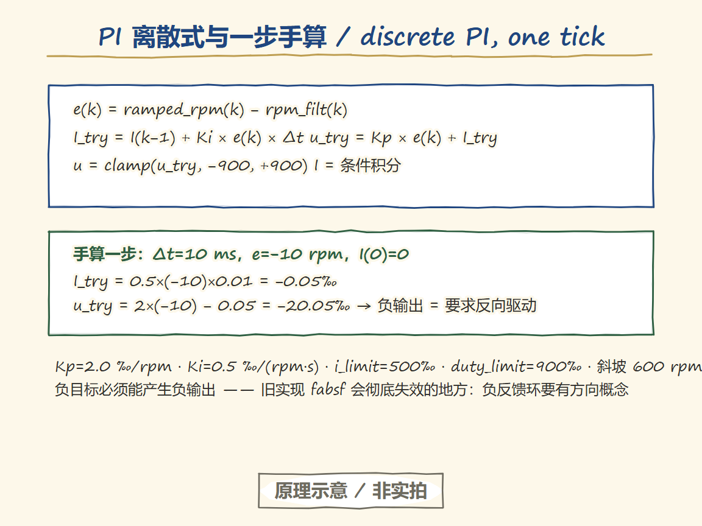
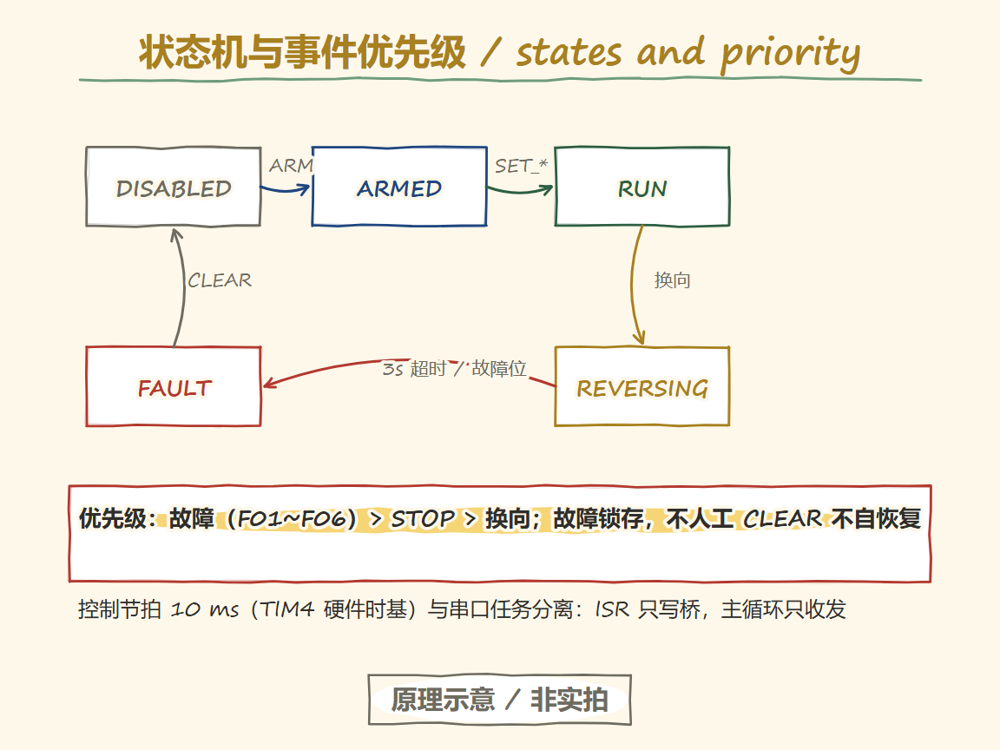
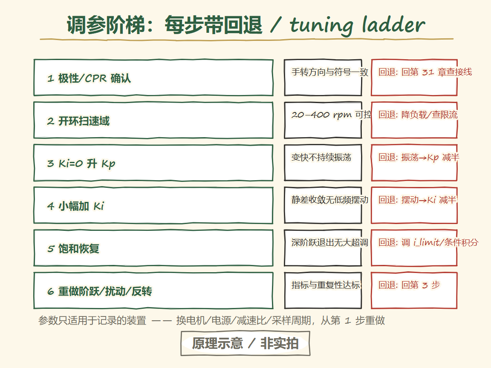
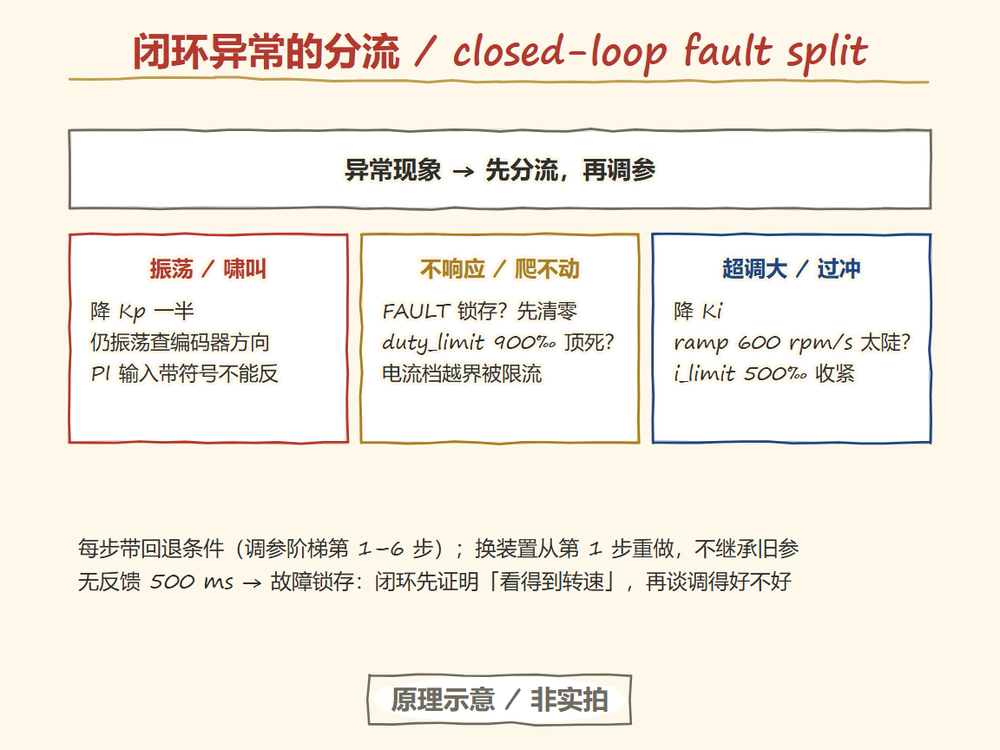

# 32 直流电机速度闭环：PI、状态机与抗饱和

> 闭环只做一件事：每次控制节拍比较目标与测量，按误差调整输出。难的是把这件事在饱和、反转、反馈丢失和故障锁存下都做对。

**本章板级前提**：接线与参数以采购冻结 v1.2 为准（候选值，P2 上板核验）。控制律与状态机实现引用 `examples/motor-dc-speed/` 的 `pi_controller.c` / `control_tick.c` / `motor_state.c`。本章全部实验结果待 P2/P3 真板数据回填，当前不展示任何实测曲线。

## 学习目标

- [ ] 写出本工程 PI 的离散更新式，手算一个 10 ms 时间步。
- [ ] 区分输出限幅与积分限幅，解释条件积分（抗饱和）为什么必要。
- [ ] 画出运行/反转/故障状态机，说明事件优先级（故障 > 停止 > 换向）。
- [ ] 按调参步骤从极性确认走到饱和恢复，每步知道回退条件。
- [ ] 列出速度阶跃的四个指标定义（超调、上升时间、稳态误差、整定时间）及其数据要求。

---

## 进入问题

加了负载转速掉下去，怎样让程序自己把它拉回目标值？

开环（第 30 章）给的是电压，负载一转矩上来转速就被拉走。闭环把**转速**当目标：每个控制节拍测一次转速，和目标比较得到误差，误差经 PI 算出新的占空比。负载加重 → 误差变大 → 占空比自动加深 → 转速被拉回。这一章把这台“误差放大器”的全部边界条件钉死。

## 最小胜利（M32-A：一次速度阶跃）

**目标**：在已标定（M31-A 通过）、已确认极性的装置上，完成一次 0→150 rpm 阶跃，保存目标、测量、输出三条同轴曲线，算出四个指标。

1. 前置：M29/M30/M31 全部通过；`CONFIG` 写入标定 CPR；`ARM` 回 OK。
2. `SET_RPM 150`，记录至少 3 秒遥测（SAMPLE 帧 43 B，100 Hz）。
3. 主机工具 `tools/motor_analyze.py`（P3 交付）从原始 CSV 计算指标；原始帧与输入文件 SHA256 一并归档。
4. 反向阶跃 150→−150 重复一次，确认走 REVERSING 合同。

**预期证据**：三条曲线同轴；指标数值附输入哈希与分析工具版本；两次重复结果全部保留，不只留好看的一次。

> 状态：M32-A~F 待实物到货与 P3 工具链（golden vectors、分析器）就绪后执行；当前为候选步骤，不展示实测数据。

## 核心机制

### PI 离散式与单位


<p align="center">
  
  <br><sub>▲ 知识轨（Handraw · 原理示意/非实拍）。e/I_try/u_try/clamp/条件积分五步；手算 e=−10 rpm→u_try=−20.05‰（负输出=反向驱动）；Kp=2.0、Ki=0.5、i_limit=500‰、duty_limit=900‰；不是实拍。</sub>
</p>
冻结默认参数（`src/main.c`，待 P2 实测修订）：

```text
e(k)        = ramped_rpm(k) − rpm_filt(k)          ‰ 目标斜坡后的误差，rpm
I_try(k)    = I(k−1) + Ki × e(k) × Δt              积分试算，输出单位(‰)
u_try(k)    = Kp × e(k) + I_try(k)                 输出试算，占空比 ‰
u(k)        = clamp(u_try, −duty_limit, +duty_limit)
I(k)        = 条件积分结果（见下）
```

| 参数 | 默认 | 含义 |
| --- | --- | --- |
| Kp | 2.0 | 比例增益 ‰/rpm |
| Ki | 0.5 | 积分增益 ‰/(rpm·s) |
| i_limit | 500‰ | 积分自身限幅 |
| duty_limit | 900‰ | 输出限幅（<1000，留满压余量） |
| 目标斜坡 | 600 rpm/s | 目标突变变斜坡，PI 只跟平滑目标 |
| 滤波 α | 1.0（不滤） | 待调参时评估 |

手算一步：Δt=10 ms，某拍 e=−10 rpm，I(0)=0 → I_try = 0.5×(−10)×0.01 = −0.05‰，u_try = 2×(−10) − 0.05 = −20.05‰。输出为负 = 要求反向驱动——这正是第 30 章带符号占空比表示的意义，也是旧实现里用 fabsf 会彻底失效的地方：**负目标必须能产生负输出，负反馈环才有方向概念**。

### 限幅与抗饱和

输出限幅只决定“最多给多少”；真正让积分项 windup 的是**误差长期存在**：电机压到 900‰ 也到不了目标，积分会一路积到天文数字，等误差反号时输出卡在饱和区回不来（饱和恢复迟缓，表现为大超调或振荡）。

本工程的条件积分规则：u_try 未饱和 → 接受积分；上界饱和且 e<0（误差要求输出下降）→ 接受；下界饱和且 e>0 → 接受；其余拒绝。积分同时有自身限幅 ±500‰。效果是饱和时积分停在不 worsen 的位置，一旦误差反号输出立即脱离饱和区。注意区分：**限幅是钳制当前输出，抗饱和是管住积分的历史积累**——两者缺一不可。

### 状态机与事件优先级


<p align="center">
  
  <br><sub>▲ 知识轨（Handraw · 原理示意/非实拍）。DISABLED→ARMED→RUN/REVERSING→FAULT；故障（F01~F06）> STOP > 换向；故障锁存不人工 CLEAR 不自恢复；控制节拍 10 ms 与串口任务分离；不是实拍。</sub>
</p>
```text
        ARM        SET_*        故障(F01~F06)
DISABLED ──→ ARMED ───→ RUN_OPEN / RUN_SPEED
   ↑            │  STOP          │
   └────────────┴────────────────┤
        CLEAR(仅DISABLED)        ↓ 符号翻转
                              REVERSING(斜坡降0→等停稳→保持100ms→换向)
                                 │ 全程3s超时→FAULT
                              FAULT(锁存, CLEAR→DISABLED→HEARTBEAT→ARMED)
```

事件优先级：故障位（租约 F01 / 反馈 F02 / 丢失 F03 / 未标定 F06 / 换向超时）永远最先；其次 STOP（撤使能）；换向最末。所有故障锁存——不人工 CLEAR 不会自恢复，防止故障态下命令抖动反复重启电机。

控制节拍 10 ms（TIM4 硬件时基）与串口任务严格分离：ISR 只写桥，主循环只收发（design §4 所有权），打印和协议解析拖慢主循环不会拉长控制周期——这条是“控制周期被打印拖慢”失效分支的结构性对策。

### 调参步骤（每步带回退条件）


<p align="center">
  
  <br><sub>▲ 知识轨（Handraw · 原理示意/非实拍）。六步阶梯：极性/CPR→开环扫速→升 Kp→加 Ki→饱和恢复→重做阶跃扰动反转，每步带通过判据与回退；换装置从第 1 步重做；不是实拍。</sub>
</p>
| 步 | 动作 | 通过判据 | 回退 |
| --- | --- | --- | --- |
| 1 | 极性与 CPR 确认（M31-A） | 手转方向与符号一致 | 回第 31 章，查接线/模式 |
| 2 | 开环扫有效转速范围（M30-A） | 20–400 rpm 内各档可控，起转门槛已知 | 降负载/查电源限流 |
| 3 | Ki=0，Kp 从小到大阶跃 | 响应变快不持续振荡 | 振荡→Kp 减半重来 |
| 4 | 小幅加 Ki 消静差 | 稳态误差收敛且无低频摆动 | 摆动→Ki 减半 |
| 5 | 饱和恢复测试（M32-C） | 深阶跃后退出饱和无大超调 | 调 i_limit/条件积分 |
| 6 | 重做阶跃/扰动/反转（M32-A/B/D） | 指标与重复性达标（验收协议） | 回第 3 步 |

参数只适用于记录的装置：换电机、电源、减速比或采样周期，从第 1 步重做。

## 失败分支与最短排查


<p align="center">
  
  <br><sub>▲ 知识轨（Handraw · 原理示意/非实拍）。闭环异常先分流：振荡降 Kp、不响应查 FAULT/限幅、超调降 Ki/ramp；换装置从调参第 1 步重做；不是实拍。</sub>
</p>
| 现象 | 区分证据 | 下一动作 |
| --- | --- | --- |
| 正反馈（一发不收） | 误差增大时输出反向加深 | 立即 STOP；极性反了，回第 1 步 |
| 大超调/振荡 | 遥测积分项是否顶到 i_limit | 抗饱和没生效或 Ki 过大；查条件积分实现与参数 |
| 低速来回跳 | rpm 读数在量化格间跳（第 31 章） | 确认是测量特性；评估加长测量窗 |
| 阶跃响应变慢发肉 | 控制周期遥测字段 >10 ms | 主循环过载；查打印/协议解析耗时 |
| 反馈异常仍持续加力 | 状态字 F02/F03 是否置位 | 固件已拒送 PI；若仍加力是实现 bug，报修 |
| 反转尖峰 | 是否经历 REVERSING 各阶段 | 同第 30 章排查表 |

## 迁移边界

- 采样周期变（10 ms → 其他）：Ki 按 Δt 等比换算，阶跃实验重做。
- 电机/电源变：全部参数从第 1 步重做；禁止照搬另一台电机的“示例增益”。
- 上 RTOS：控制任务唯一拥有输出；截止期 10 ms 进任务配置；看门狗独立监督（P2 启用 IWDG 后验证）。
- PID 的 D 项：速度环带编码器量化噪声，D 项会放大噪声——本工程 V1 不用，迁移到位置环时再评估。

## 记忆锚点

**“闭环是一杆秤：误差是秤砣差，Kp 是手快，Ki 是有耐心，限幅是秤的最大量程，抗饱和是不许秤砣滑出盘。”**

相似点：每次节拍称一次、调一次；量程（duty_limit）外多调无用；秤砣卡死（饱和）时别再积累（条件积分）。
失效点：真杆秤没有“目标斜坡”和“反转停稳”——目标直接砸下去，秤杆会晃（斜坡存在的理由）；称到一半换方向必须归零重启（REVERSING）。

## 实验登记

| 实验 | 内容 | 指标/证据 | 状态 |
| --- | --- | --- | --- |
| M32-A | 速度阶跃（±150 rpm） | 四指标 + 同轴曲线 + 输入哈希 | 待执行（实物未到） |
| M32-B | 可重复负载加/卸扰动 | 扰动恢复时间与重复性 | 待执行 |
| M32-C | 饱和退出（深阶跃） | 退出超调量 | 待执行 |
| M32-D | 受控反转 | REVERSING 全程状态记录 | 待执行 |
| M32-E | 通信/反馈故障注入 | F01–F03 锁存与恢复协议 | 待执行 |
| M32-F | 10 分钟持续运行 | 热稳定（依赖 BLK-P0-4 热预算） | 待执行 |

指标定义与数据要求以 [验收协议](../plans/2026-11-11-motor-control/acceptance.md) 为准（超调量、上升时间、稳态误差、整定时间，原始帧全保留）。

## 离开检查

1. 手算一个 10 ms 时间步（给 Kp/Ki/e/Δt），写出 u_try 与 I_try。
2. 解释输出限幅与积分限幅的区别，以及饱和时为什么必须停止积分。
3. 演示三种人工触发：断开命令流（F01）、反馈异常（F02）、CLEAR 恢复——并说出哪一步需要 HEARTBEAT。

## 出处

- 控制律与状态机实现：`examples/motor-dc-speed/src/pi_controller.c`、`src/control_tick.c`（H01–H10 主机测试覆盖，含负向起转与反转合同端到端回归）
- 冻结参数：`src/main.c` 默认值表（P2 实测后修订）
- 指标与验收口径：[验收协议](../plans/2026-11-11-motor-control/acceptance.md)
