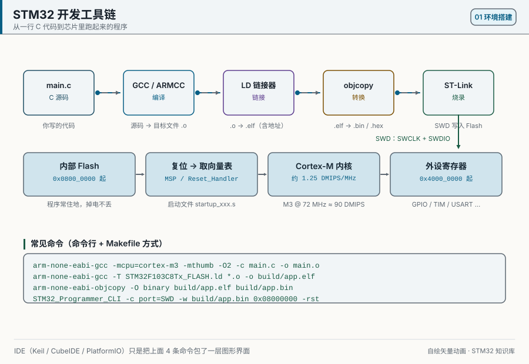
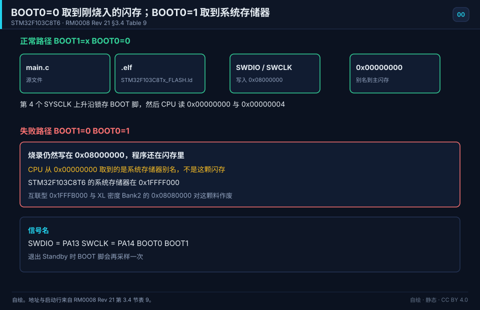

# 00 How to Learn STM32
> 中文：[如何学习 STM32](../00-如何学习STM32.md)

> For complete beginners: fill in the minimum background, gather the hardware, pick a development style, then walk the three-stage roadmap at a steady pace.

<p align="center">
  
  <br><sub>▲ Animation: the full data path of compile → link → flash → run (vector drawing by the author)</sub>
</p>

<!-- video:ch00 -->
<p align="center">
  <video width="640" controls poster="../../assets/video/ch00-learn.png">
    <source src="../../assets/video/ch00-learn.mp4" type="video/mp4">
  </video>
  <br><sub>▲ Chapter video with Chinese voice-over (2.3 min). <a href="../../assets/video/ch00-learn.mp4">MP4</a> · <a href="../../assets/video/ch00-learn.srt">subtitles</a></sub>
</p>

<details>
<summary>Narration script (Chinese, same text as the subtitles)</summary>

1. 欢迎来到第零章。先别急着买一堆模块。把路线钉死：入门四周打底，进阶六周啃外设，实战八周做出能给人看的东西。
2. 顺序别跳。先把环境和时钟踩实，再碰 GPIO，然后才轮到串口。跳步的人，最容易摔在时钟没开、寄存器像写进虚空。
3. 板子用 BluePill 就够起步。手册请备三本：数据手册查引脚和电气，参考手册查寄存器，编程手册查内核。缺一本，后面就会靠猜。
4. 画面是本仓库画的工具链，不是实拍。源码要过编译、链接、烧录，复位之后程序才听你的。中间任何一步含糊，灯都不会按你的意思闪。
5. 别一上来就抄整套例程。第一场胜利只要一颗灯，按你自己算过的频率闪。抄来的工程，时钟或引脚一变，就会整片熄火。
6. 寄存器、标准库、HAL 都能点灯。入门先用 HAL 把下载和调试跑通，再回头看它改了哪几个寄存器。别同时学三套语法。
7. 常见的劝退是一次打开十个外设，或者仿真和真板打架就怀疑人生。这一章允许你慢，不允许你跳。跳过去的坑，会在项目里排队等你。
8. 口诀送你一句：先让一颗灯按你算过的频率闪。频率对了，说明时钟、引脚和延时你都真的算过，不是看视频看会的。
9. 四周结束时，你应该能独立新建工程、下载、单步，并讲清启动后先干什么。讲不清这些，先别翻串口那一章，回去把灯做稳。
10. 合上书，三问。BOOT0 拉低进哪里？HAL 比直接写寄存器多了哪一层？你的第一场胜利到底是什么？答案都在这一章正文里。

</details>
<!-- /video:ch00 -->

## Learning goals

Before this chapter: nothing. Being able to install software on a computer is enough. If you have never touched a circuit or C, start with "Zero-background primer" in this chapter.

- [ ] Use Ohm's law to find the current through a resistor, and read units like mA, kΩ, and MHz
- [ ] Convert between decimal, binary, and hex, and change one bit with a bit operation
- [ ] Say what a register is, and read what `*(volatile uint32_t *)0x40021018` does
- [ ] Know how much C, digital electronics, and analog electronics you need before STM32
- [ ] Put together a hardware kit you can use right away, within a budget
- [ ] Read the "4 weeks beginner / 6 weeks intermediate / 8 weeks project" roadmap and check yourself with each week's self-test
- [ ] Choose among three styles: registers, the standard peripheral library (SPL), and HAL+LL+CubeMX

## Zero-background primer

This section is for readers who have never touched a circuit or C. It takes about an afternoon. If the three lines below all make sense, skip ahead to "Core ideas":

- 3.3 V across a 330 Ω resistor drives 10 mA through it.
- `0x2C` is binary `0010 1100`, which is decimal 44.
- `GPIOC->BSRR = (1U << 13);` sets only pin PC13 high and leaves the other pins of the port alone.

### 1. Voltage, current, and resistance

An analogy first: think of a circuit as water pipes. Voltage is like a difference in water level: the higher the tower stands above the ground, the stronger the pressure. Current is like how much water flows past per second. Resistance is like a narrow stretch of pipe: the narrower it is, the less water gets through.

The analogy stops here. A broken pipe spills water, but current only flows around a closed ring: out of the supply's positive side, through parts such as a resistor and an LED, and back to the supply's negative side (GND). That ring is called a loop. Break it anywhere and the current stops.

What the three quantities mean, and their units:

- **Voltage**, in volts (V). A voltage is always the difference between two points. A circuit agrees on one point as 0 V and calls it ground, written GND. "PA0 is at 3.3 V" means PA0 sits 3.3 V above GND.
- **Current**, in amperes (A). Currents in a microcontroller circuit are small, so milliamps (mA) are common: 1 mA = 0.001 A.
- **Resistance**, in ohms (Ω). Kilohms (kΩ) are common: 1 kΩ = 1000 Ω.

The relation between the three is Ohm's law:

```text
voltage = current × resistance     V = I × R
current = voltage ÷ resistance     I = V ÷ R
```

Two worked examples:

- 3.3 V across a 330 Ω resistor: I = 3.3 ÷ 330 = 0.01 A = 10 mA.
- A 10 kΩ pull-up resistor in a button circuit; when the button is pressed, all 3.3 V sits across it: I = 3.3 ÷ 10000 = 0.00033 A = 0.33 mA. The current is tiny, so a pull-up costs almost no power.

Current through a resistor turns into heat, and the power is P = V × I. The first example gives 3.3 V × 0.01 A = 0.033 W, or 33 mW. A common 1/4 W resistor takes 250 mW, so that is far inside its rating.

Two more words appear in every chapter:

- **Short circuit**: the resistance between two points is close to 0, so by Ohm's law the current gets very large. At best the supply's protection trips; at worst a part burns. Tying 3.3 V straight to GND is a short.
- **Common ground**: when two boards pass a signal, their GNDs must be connected. A voltage is a difference between two points; without a shared ground, one board's "3.3 V" means nothing to the other.

Unit prefixes come up throughout the book. The table lists them once; come back when you meet one you do not know:

| Written | Name | Equals |
| --- | --- | --- |
| mA | milliamp | 0.001 A |
| µA | microamp | 0.000001 A |
| kΩ | kilohm | 1000 Ω |
| MΩ | megohm | 1000000 Ω |
| kHz | kilohertz | 1000 times a second |
| MHz | megahertz | 1000000 times a second |
| ms | millisecond | 0.001 s |
| µs | microsecond | 0.000001 s |
| ns | nanosecond | 0.000000001 s |

### 2. High, low, and the clock

Digital circuits know only two states: a voltage near the supply is high, written 1; a voltage near 0 V is low, written 0. STM32F103 runs from 3.3 V. Exactly how high counts as 1 and how low counts as 0 is in chapter 03, with the datasheet numbers.

The moment a level goes from 0 to 1 is a **rising edge**; from 1 to 0 is a **falling edge**. When a peripheral "acts on the rising edge", it means that moment.

```text
 1        +-----+     +-----+     +-----+
          |     |     |     |     |     |
 0   -----+     +-----+     +-----+     +-----
          A     B     C
```

In the drawing, A is a rising edge and B is a falling edge. From A to C is one **period**, written T. How many periods fit in one second is the **frequency**, in hertz (Hz). Each is the reciprocal of the other:

```text
frequency f = 1 ÷ period T
1 Hz    → period 1 s
1 kHz   → period 1 ms
72 MHz  → period about 13.9 ns
```

The share of one period spent high is the **duty cycle**. In the drawing, high and low take half each, so the duty cycle is 50%. PWM in chapter 05 changes the duty cycle to set brightness and motor speed.

Inside the chip, one signal toggles between 0 and 1 all the time: the **clock**. The CPU and the peripherals take one step on each clock edge. A faster clock gets the same work done sooner and uses more power. To save power, an STM32 peripheral has no clock after power-up, which is why "enable the clock first" is the first step of nearly every chapter's code.

### 3. Binary and hex

One 0 or 1 is a **bit**. Eight bits make a **byte**, which holds 0 to 255. STM32 registers are 32 bits wide, that is, 4 bytes.

In binary, reading from the right, the bits are worth 1, 2, 4, 8, 16, 32, 64, 128, and so on. Add up the weights of the bits that are 1. In `0010 1100`, bits 2, 3, and 5 are 1 (the rightmost bit is bit 0), so the value is 4 + 8 + 32 = 44.

Binary gets long, so every 4 bits are folded into one **hexadecimal** (hex) digit. Hex uses 0–9 and then A–F, where A is 10 and F is 15. In C, a leading `0x` marks a hex number. `0010 1100` splits into `0010` and `1100`, which are 2 and C, so it is `0x2C`.

The table lists the values you will meet most. Each hex digit maps to exactly 4 binary digits:

| Decimal | Binary | Hex |
| --- | --- | --- |
| 0 | 0000 | 0x0 |
| 1 | 0001 | 0x1 |
| 5 | 0101 | 0x5 |
| 9 | 1001 | 0x9 |
| 10 | 1010 | 0xA |
| 12 | 1100 | 0xC |
| 15 | 1111 | 0xF |
| 16 | 0001 0000 | 0x10 |
| 44 | 0010 1100 | 0x2C |
| 255 | 1111 1111 | 0xFF |

To convert hex to binary, expand each hex digit into its 4 bits on its own. To convert binary to hex, group 4 bits at a time from the right. The Windows calculator's Programmer mode converts directly, which is handy for checking your answers.

Memory addresses are written in hex too. On STM32F103, `0x08000000` is the start of Flash, `0x20000000` is the start of SRAM, and peripheral registers start at `0x40000000` ([RM0008](#source-rm0008) section 3.3).

### 4. Bit operations: touch one bit only

Each bit in a register often controls one thing on its own. For example, bit 4 of the RCC_APB2ENR register is called IOPCEN; writing 1 there turns on the clock of GPIOC (RM0008 section 7.3.7). When you change that bit, the other bits of the same register must stay untouched, and that takes bit operations.

The table uses an 8-bit value `x = 0000 1111` (`0x0F`) as the example. Bits are numbered from bit 0 at the right:

| What you want | Written | Result | How it works |
| --- | --- | --- | --- |
| A value with only bit 5 set | `1U << 5` | `0010 0000` | Shift 1 left by 5 places |
| Set bit 5 | `x \| (1U << 5)` | `0010 1111` | OR: any 1 gives 1 |
| Clear bit 2 | `x & ~(1U << 2)` | `0000 1011` | `~` flips every bit, then AND |
| Toggle bit 0 | `x ^ (1U << 0)` | `0000 1110` | XOR: equal bits give 0, different bits give 1 |
| Is bit 3 set? | `x & (1U << 3)` | `0000 1000` | A nonzero result means that bit is 1 |

Real code usually uses the compound form: `x |= (1U << 5);` is short for `x = x | (1U << 5);`.

The `U` in `1U` makes the number unsigned. In `1 << 31`, the 1 is a signed `int`, and shifting it into the top bit is undefined behavior in C, so whatever the compiler does is not a bug. Write `1U` out of habit and you never meet this trap.

### 5. The parts of C that talk to hardware

The basics of C (variables, `if`, `for`, functions) are not repeated here; an introductory C book up to its chapter on pointers is enough to start. Below are only the things that show up every day in microcontroller code and get little space in those books.

**Fixed-width integers.** `uint8_t`, `uint16_t`, and `uint32_t` from `<stdint.h>` are unsigned integers of 8, 16, and 32 bits. A register is 32 bits, so it is a `uint32_t`. How wide an `int` is depends on the compiler, so it is not used for registers.

**Pointers.** A pointer is a variable that holds an address. `uint32_t *p` reads "p points to a 32-bit number", and `*p` is the number stored at that address.

**volatile.** It tells the compiler that the value at this address can be changed at any time by hardware or by an interrupt, so every read and write must really happen; none may be skipped or merged. Registers and global variables changed inside interrupts both need it. Without it, once optimization is on, the compiler may turn a loop that "keeps reading a status bit until it becomes 1" into a single read, and the program hangs there.

Put the three together and you can write a register directly:

```c
#include <stdint.h>

/* address of RCC_APB2ENR: RCC base 0x40021000 + offset 0x18 */
#define RCC_APB2ENR  (*(volatile uint32_t *)0x40021018UL)

RCC_APB2ENR |= (1U << 4);   /* bit 4 IOPCEN: turn on the GPIOC clock */
```

Read it from the inside out: `0x40021018UL` is just a number; `(volatile uint32_t *)` treats it as "the address of a 32-bit register"; the outer `*` takes the register at that address; `|=` sets only bit 4. The address and offset come from [RM0008](#source-rm0008) section 3.3 Table 3 and section 7.3.7.

**Structs and `->`.** A peripheral has a group of registers, and the vendor header writes the group as a struct. `GPIOC` is a struct pointer to address `0x40011000`, and ODR sits at offset `0x0C` in the group, so `GPIOC->ODR` is the register at address `0x4001100C`. Writing `GPIOC->ODR` and working out the address yourself do the same thing; the struct is just harder to get wrong.

**Macros, `#define`.** A macro is text substitution before compilation, often used to give a number a name, such as `#define LED_PIN GPIO_PIN_13`. The code then shows a name instead of a bare number, and anyone can read it.

### 6. What is inside a microcontroller

A microcontroller is a small computer packed into one chip. The table uses this book's STM32F103C8T6; the numbers come from the [DS5319](#source-ds5319) feature list and the [RM0008](#source-rm0008) section 3.3 memory map:

| Part | What it does | On STM32F103C8T6 |
| --- | --- | --- |
| CPU core | Runs instructions one by one | Arm Cortex-M3, up to 72 MHz |
| Flash | Holds the program; keeps it without power | 64 KB, starting at `0x08000000` |
| SRAM | Holds variables while running; loses them without power | 20 KB, starting at `0x20000000` |
| Peripherals | GPIO, timers, serial ports, ADC, and more | Registers start at `0x40000000` |
| Clock system | Gives the CPU and peripherals their beat | Chapter 02 covers it |

The part number is itself a small spec sheet. Split it as DS5319 Rev 20 section 7, "Ordering information scheme", does:

| Piece | Meaning |
| --- | --- |
| STM32 | Family of 32-bit microcontrollers with an Arm core |
| F | General purpose |
| 103 | Performance line subfamily |
| C | 48 pins |
| 8 | 64 KB of Flash |
| T | LQFP package |
| 6 | Industrial temperature range, −40 to 85 °C |

After power-up or reset, things happen in this order:

1. The CPU reads the initial stack pointer from address `0x00000000`, and from `0x00000004` it reads where the first code after reset lives. With BOOT0 tied low, these two addresses point at the program you flashed (details in "Principle and scope" of this chapter).
2. The startup code runs: it copies global variables that have initial values from Flash to SRAM, zeroes the ones without, calls `SystemInit`, and finally enters `main`.
3. `main` enables peripheral clocks, configures the peripherals, and then runs its `while (1)` loop forever.

A **register**, then, is one of the fixed-address 32-bit cells inside a peripheral. Writing a value into a cell gives the hardware a command; reading a cell shows the hardware's state.

### 7. How to read a datasheet

Every STM32 comes with several manuals, each covering its own ground. The table lists the ones STM32F103C8 uses:

| Manual | Number | What you look up there |
| --- | --- | --- |
| Datasheet | DS5319 | Which peripherals this chip has, the pin table, electrical values, package sizes |
| Reference manual | RM0008 | How each peripheral works and what every register bit means; one book for the whole F1 series |
| Programming manual | PM0056 | The Cortex-M3 core itself: the NVIC interrupt controller, SysTick, exceptions, instructions |
| Errata sheet | Download it from the same chip page on ST's website | Known problems in the chip and how to work around them |

Two kinds of datasheet tables get looked up most.

**The pin table** (DS5319 Table 5): each row is one pin, with its number in each package, its name, its type, whether it is marked FT (tolerates 5 V), its default function after reset, and its optional alternate functions. Check this table before you wire anything.

**Electrical tables**: each row has Min, Typ, Max, Unit, and test-condition columns. By DS5319 Rev 20 sections 5.1.1 and 5.1.2, Min and Max are guaranteed values, production-tested unless a footnote says they are based on characterization; Typ is the typical value at 25 °C and 3.3 V, a design guideline that is not guaranteed. So work out your margins with Min or Max, never with Typ. Also keep "absolute maximum ratings" (Tables 6 and 7) apart from "operating conditions" (Table 9): the first is the line past which the chip may be damaged, the second is the range for normal work. VDD's operating range, for example, is 2 V to 3.6 V.

In the reference manual, every register lists its address offset and its reset value, and each bit is marked with an access type. The common ones, from RM0008 Rev 21 section 2.2:

| Mark | Meaning |
| --- | --- |
| rw | Read and write |
| r | Read only |
| w | Write only; reading returns the reset value |
| rc_w1 | Readable; writing 1 clears it, writing 0 does nothing |
| rc_w0 | Readable; writing 0 clears it, writing 1 does nothing |
| rc_r | Readable; reading it clears it automatically |

A register's real address = peripheral base address + offset. Base addresses are in RM0008 section 3.3 Table 3; offsets are in each peripheral chapter's register description.

### 8. Tools and safety

- **Measuring voltage with a multimeter**: put the probes across the two points, red on the higher side and black on GND.
- **Measuring current with a multimeter**: the meter goes in series with the loop, and the red probe moves to the current jack. Move it back to the voltage jack right after. If you forget and then measure a voltage, the current range shorts the two points.
- **Continuity range**: a beep means the two points are connected. Use it to find bad solder joints and loose wires.
- **Power off before rewiring**: pulling Dupont wires on a live board easily touches a neighboring pin and shorts it.
- **Keep 3.3 V and 5 V apart**: STM32F103's VDD operating range is 2 V to 3.6 V (DS5319 Table 9). On a BluePill, the pin marked 5V is wired straight to USB 5 V, and the pin marked 3.3 is the regulated 3.3 V; do not swap them. Do not tie a 5 V module's signal to any STM32 pin; only pins marked FT tolerate it, as chapter 03 explains.
- **Heat or a burning smell**: unplug at once, then look for the short.

## Core ideas

**In one sentence: getting started with STM32 does not mean finishing an entire electronics degree. You need "enough" background plus a path that skips no steps.**

### An analogy first

Learning STM32 is like learning to drive. You do not have to repair an engine first, but you do need the rules of the road (basic circuits and C) and the dashboard (datasheets and registers). First practice pulling away in an empty lot (light one LED), then go on the road (UART, I2C, SPI), and only then take a long trip (a whole project).

The analogy stops here. You can drive by feel; you cannot program a microcontroller that way. Every number, whether a frequency, a current, or an address, has to be something you can compute and find in a manual.

### 1. The "enough" bar for background

The left column of the table is what you must be able to do, the middle is enough to know about, and the right is a sign you need to review. If a right-column item fits you, go back to the matching part of "Zero-background primer" above.

| Topic | Minimum (you must be able to do this) | Enough to know about | Sign you need to review |
| --- | --- | --- | --- |
| C | Pointers, arrays, structs, `typedef`, `enum`, bitwise ops `& \| ^ ~ << >>`, function pointers | Macros and conditional compilation, the meaning of `volatile` / `static` / `const` | `*(volatile uint32_t*)0x40021018` is a complete blank |
| Digital | High and low, AND/OR/NOT, rising and falling edges, the idea of push-pull and open-drain | Timing diagrams, setup and hold time, bus arbitration | You cannot say what "rising-edge trigger" means |
| Analog | Ohm's law, a divider, an LED series resistor, what a pull-up does | BJT/MOS switches, op-amp basics, RC filtering | You cannot compute the LED resistor R=(Vcc−Vf)/I |
| Computer organization | Binary and hex, bytes and addresses, what a register is | Interrupts, DMA, buses, cache | You do not see how a "register" relates to "memory" |
| English | You can read pin tables and parameter tables in a datasheet | You can read a whole chapter of the reference manual | You cannot even look up a Pin Name |

One-sentence bar: **if you can use a pointer on a `uint32_t`, compute an LED series resistor, and read a pin table, you can start.** Chapter 03 explains push-pull, open-drain, and the series resistor again from scratch.

### 2. Three ways to write the firmware

There are three common ways to write STM32 code. They differ in how far you stand from the registers:

| Dimension | Registers (bare registers) | Standard peripheral library (SPL) | HAL + LL + CubeMX |
| --- | --- | --- | --- |
| Abstraction | Lowest: you write `GPIOA->ODR` directly | Middle: `GPIO_SetBits()` | Highest: `HAL_GPIO_WritePin()` |
| How hard to start | High (you keep the manual open) | Medium | Low (a GUI generates the setup code) |
| Amount of code | Little, but dense | Medium | More, but clearer |
| Portability | Poor (F1 to F4 means edits) | Poor (F1 and F4 each have their own SPL) | Good (HAL is one API across families) |
| Resource use | Smallest | Small | A bit larger (you can trim it; LL is smaller) |
| Official maintenance | Needs no library, so it always works | **No longer maintained** | Still updated |
| Fits | Learning the mechanism, tight timing, tiny memory | Keeping old projects alive | New products, fast prototypes, what most jobs use |

HAL stands for Hardware Abstraction Layer and LL for Low Layer. CubeMX is ST's graphical setup tool; it turns clock and pin settings into code.

**Suggested path: start with HAL and CubeMX, then read the registers so the layer underneath makes sense, and use LL where it actually matters.**

If you inherit an old F103 project on the standard library, do not scatter its function names into a HAL project. Read [chapter 26, STM32F10x Standard Peripheral Library (SPL)](26-spl.md) first, pin V3.5.0, the density macro, the startup file, and peripheral ownership, and then decide whether to maintain or migrate.

### 3. The three-stage roadmap

The roadmap has three stages, and each week has a deliverable and a self-test question. If you cannot build the deliverable or answer the question, do not move on to the next week yet.

#### Stage 1: Beginner (4 weeks) — get the board running

| Week | Topic | You should have | Self-test |
| --- | --- | --- | --- |
| Week 1 | Environment, GPIO output, blink an LED | You can compile and flash; the LED blinks | What is the difference between push-pull and open-drain? |
| Week 2 | GPIO input, a button, debounce | A button controls the LED | Why does a button need debounce? How do you write it in software? |
| Week 3 | Interrupts, NVIC, EXTI | A button interrupt toggles the LED | What is the difference between preemption priority and subpriority? |
| Week 4 | Timer time base, PWM | A breathing LED | Where does `fCK_CNT = fCK_PSC/(PSC+1)` come from? |

#### Stage 2: Intermediate (6 weeks) — open the usual buses and peripherals

| Week | Topic | You should have | Self-test |
| --- | --- | --- | --- |
| Week 5 | UART send and receive, printf redirect | Logs on the serial port | What baud-rate error can you tolerate? |
| Week 6 | UART interrupt + DMA + IDLE | Receive a frame of unknown length | What problem does the IDLE interrupt solve? |
| Week 7 | I2C, OLED | An OLED showing characters | How are addresses 0x3C and 0x78 related? |
| Week 8 | SPI, W25Q64 | Read and write the flash | How do you tell the four CPOL/CPHA modes apart? |
| Week 9 | ADC + DMA | Sample a voltage and display it | What happens during SAR successive approximation? |
| Week 10 | Watchdogs, low power | A node that wakes on a timer | What is the difference between IWDG and WWDG? |

#### Stage 3: A real project (8 weeks) — finish something whole

| Week | Topic | You should have | Self-test |
| --- | --- | --- | --- |
| Weeks 11–12 | Split the requirements, modules, a state machine | A block diagram and a task list | How do you turn a requirement into modules? |
| Weeks 13–14 | Sensor drivers + display + storage | A complete data-capture path | How do you recover a bus that has locked up? |
| Weeks 15–16 | Bring in FreeRTOS (tasks / queues / semaphores) | Tasks working together | When is an RTOS actually worth it? |
| Weeks 17–18 | Integration, fault handling, IAP update | Firmware you can hand over, plus notes | How does a bootloader jump to the app? |

### 4. Hardware shopping list

Prices are reference ranges at the time of writing and change with the shop and the year. The "Required" items are enough for the first four weeks.

| Item | Suggested part | Price range (¥) | Required? | Notes |
| --- | --- | --- | --- | --- |
| Minimum board | BluePill STM32F103C8T6 | 15–30 | Required | Best first board; the most material exists for it |
| Next board | STM32F411 BlackPill / Nucleo-F411RE | 30–80 | Optional | Buy it when you study F4/F7, DSP, or the FPU |
| Debugger | ST-Link V2 (clone) | 15–40 | Required | SWD download and debug |
| Breadboard | 830-tie solderless breadboard | 8–20 | Required | — |
| Dupont wires | Male-to-male / male-to-female, 40 of each | 8–15 | Required | Color-coded ones are worth it |
| USB-TTL | CH340 / CP2102 module | 8–20 | Required | Serial debug; watch the 3.3 V level |
| Sensor kit | 37-in-1 sensor modules | 40–80 | Recommended | Button, LED, DHT11, and so on; you can also buy parts chapter by chapter |
| OLED | 0.96" SSD1306 I2C | 12–25 | Recommended | Practice for I2C |
| Logic analyzer | 8-channel 24 MHz (clone) | 15–40 | Recommended | Captures I2C/SPI/UART timing |
| Multimeter | Entry-level digital meter | 30–80 | Recommended | Voltage and continuity |

> Budget: **bare-minimum start ≈ 60 yuan** (BluePill + ST-Link + breadboard + Dupont wires); **full kit ≈ 200–300 yuan**.

### 5. What not to do (the list that makes people quit)

The left column lists common detours; the right column is the way around each:

| Do not | Why | Do this instead |
| --- | --- | --- |
| Start by reading a 1000-page reference manual | No context, so nothing sticks and nothing gets used | Run an example first, then look up the page you need |
| Study RTOS, bare metal, and a PC app at the same time | Attention splits, and none of them gets solid | Get the bare-metal peripherals firm, then add an RTOS |
| Copy code and never look at a register | When it breaks, you cannot look | For every HAL call, look up the matching register at least once |
| Learn the basics on an F4 or H7 | The peripherals hide the mechanism | Build the foundation on F1, then move |
| Insist on "all registers" as a flex | Slow to write, easy to get wrong | HAL for most of it; LL or registers where it matters |
| Debug a bus with no scope and no logic analyzer | If you cannot see the timing, you are guessing | At least keep a logic analyzer |
| Buy the most expensive board first | It is likely to sit unused | Run a 30-yuan BluePill first |

### 6. When you get stuck (the right order to look things up)

When you are stuck, look things up in this order. The earlier steps are faster and more reliable:

| Order | Action | Notes |
| --- | --- | --- |
| 1 | Look at the symptom and measure the waveform | Confirm the hardware with a logic analyzer or a multimeter first |
| 2 | Check pin and parameters in the datasheet | Pin definitions and electrical limits live in the DS |
| 3 | Check the peripheral chapter in the reference manual | Registers and timing live in the RM |
| 4 | Search the official examples | Examples/ inside the CubeF1 package |
| 5 | Search the error text | Keywords plus the part number |
| 6 | Ask | Attach a minimal repro, the symptom, and what you already tried |

> Three things every question needs: **what you did, what you expected, what actually happened**, plus a project small enough to reproduce.

### 7. Learning resources

| Kind | Name | What it is for |
| --- | --- | --- |
| Datasheet | DS5319 (F103C8) | Pins, package, electrical parameters |
| Reference manual | RM0008 | Registers, peripherals, clocks |
| Programming manual | PM0056 (Cortex-M3) | Core, NVIC, instructions |
| Official examples | STM32CubeF1 | A standard example for each peripheral |
| Tools | STM32CubeMX / CubeProgrammer | Generate a project / flash it |
| Debug | ST-Link + logic analyzer | Download and debug / capture timing |
| Community | ST Community, electronics forums | The odd failures |

### 8. Common questions

| Question | Short answer |
| --- | --- |
| If I use HAL, will I "never learn the bottom"? | No. After a HAL call, read the matching register. |
| Do I have to buy an oscilloscope? | A logic analyzer is enough to start; a clone costs 15–40 yuan. |
| Study F1 or F4? | F1 from zero. F4 if you want performance or a job that asks for it. |
| What if I cannot read the English manual? | Start with the figures and the register tables, and pair them with a tutorial in your language. |
| Do I need to be able to draw a PCB? | Use a ready-made board to start. You do not. |

## Hardware and wiring

At the start, all you wire is "minimum board + ST-Link + USB-TTL". Pick one power source only: when the board runs from its Micro-USB, leave both the ST-Link 3.3V wire and the USB-TTL 3.3V wire unconnected.

| Board pin | ST-Link pin | USB-TTL | Notes |
| --- | --- | --- | --- |
| 3V3 | 3.3V | — | Only when Micro-USB is not plugged in, so the ST-Link powers the board (do not put 5 V on the 3V3 pin) |
| GND | GND | GND | Common ground is required |
| SWDIO (PA13) | SWDIO | — | Debug data |
| SWCLK (PA14) | SWCLK | — | Debug clock |
| NRST | RST | — | Optional; connecting it is more reliable |
| PA9 (TX) | — | RX | Cross them: board TX → module RX |
| PA10 (RX) | — | TX | Board RX → module TX |

```text
ST-Link            BluePill            USB-TTL
 SWDIO ----------- PA13
 SWCLK ----------- PA14
 GND ------------- GND --------------- GND
 3.3V --(either)-- 3V3                  (3.3V not connected)
                   PA9  (TX) --------- RX
                   PA10 (RX) --------- TX
```

> [!WARNING]
> Never connect two supplies to 3V3 at once. With Micro-USB plugged in, disconnect the ST-Link 3.3V wire and keep only GND, SWDIO, and SWCLK. A clone ST-Link's 3.3V output is weak and sags once a few modules hang on it; switch to Micro-USB power then as well.

The physical layout is in [`assets/boards/bluepill-stm32f103c8t6.svg`](../../assets/boards/bluepill-stm32f103c8t6.svg) (a structural drawing by the author, not a photograph).

## Code

The "first program": blink the onboard LED (PC13, on when low) once a second. This is the standard check that the environment is actually set up.

```c
/* main.c —— BluePill onboard LED (PC13) blinks at 1 Hz
 * Depends on: STM32F1 HAL, system clock 72MHz
 */
#include "stm32f1xx_hal.h"

#define LED_PIN   GPIO_PIN_13
#define LED_PORT  GPIOC

static void SystemClock_Config(void);   /* generated by CubeMX, or written by hand */

int main(void)
{
    HAL_Init();                 /* init HAL, SysTick, and interrupt priority grouping */
    SystemClock_Config();       /* HSE 8MHz -> PLL x9 -> 72MHz */

    __HAL_RCC_GPIOC_CLK_ENABLE();   /* critical: enable the GPIO clock first, or register writes do not land */

    GPIO_InitTypeDef gpio = {0};
    gpio.Pin   = LED_PIN;
    gpio.Mode  = GPIO_MODE_OUTPUT_PP;   /* push-pull output */
    gpio.Pull  = GPIO_NOPULL;
    gpio.Speed = GPIO_SPEED_FREQ_LOW;
    HAL_GPIO_Init(LED_PORT, &gpio);

    while (1)
    {
        HAL_GPIO_TogglePin(LED_PORT, LED_PIN);  /* toggle the level */
        HAL_Delay(500);                         /* 500 ms, half a period */
    }
}

/* clock setup (the CubeMX-generated version is fine too) */
static void SystemClock_Config(void)
{
    RCC_OscInitTypeDef osc = {0};
    RCC_ClkInitTypeDef clk = {0};

    osc.OscillatorType = RCC_OSCILLATORTYPE_HSE;
    osc.HSEState       = RCC_HSE_ON;
    osc.HSEPredivValue = RCC_HSE_PREDIV_DIV1;
    osc.PLL.PLLState   = RCC_PLL_ON;
    osc.PLL.PLLSource  = RCC_PLLSOURCE_HSE;
    osc.PLL.PLLMUL     = RCC_PLL_MUL9;        /* 8MHz x 9 = 72MHz */
    HAL_RCC_OscConfig(&osc);

    clk.ClockType      = RCC_CLOCKTYPE_HCLK | RCC_CLOCKTYPE_SYSCLK |
                         RCC_CLOCKTYPE_PCLK1 | RCC_CLOCKTYPE_PCLK2;
    clk.SYSCLKSource   = RCC_SYSCLKSOURCE_PLLCLK;
    clk.AHBCLKDivider  = RCC_SYSCLK_DIV1;   /* AHB = 72MHz */
    clk.APB1CLKDivider = RCC_HCLK_DIV2;     /* APB1 = 36MHz (36MHz ceiling) */
    clk.APB2CLKDivider = RCC_HCLK_DIV1;     /* APB2 = 72MHz (72MHz ceiling) */
    HAL_RCC_ClockConfig(&clk, FLASH_LATENCY_2);  /* 72MHz needs 2 wait states */
}
```

Piece by piece:

- `HAL_Init()` prepares the HAL library itself, including a SysTick interrupt every 1 ms; `HAL_Delay()` counts with it.
- `SystemClock_Config()` moves the system clock from the 8 MHz internal clock used at power-up to 72 MHz: the external 8 MHz crystal (HSE) times 9 through the PLL. Chapter 02 covers the clock tree; copy this for now.
- `__HAL_RCC_GPIOC_CLK_ENABLE()` turns on the GPIOC clock. It is the same as the line `RCC_APB2ENR |= (1U << 4);` from part 5 of the primer above.
- The `GPIO_InitTypeDef` lines make PC13 a push-pull output; chapter 03 explains each field.
- Inside `while (1)` the level flips every 500 ms: on for 500 ms, off for 500 ms, so one period is 1 s, or 1 Hz.

The same thing in registers (so the layer underneath is visible):

```c
/* without HAL, four core lines blink the LED */
RCC->APB2ENR |= RCC_APB2ENR_IOPCEN;        /* enable the GPIOC clock */
GPIOC->CRH &= ~(0xF << 20);                 /* clear the PC13 configuration bits */
GPIOC->CRH |=  (0x2 << 20);                 /* PC13 general-purpose push-pull output, 2MHz */
GPIOC->ODR ^= GPIO_ODR_ODR13;               /* toggle PC13 */
```

PC13 is configured in the CRH register. CRH covers pins 8 to 15 with 4 bits per pin, so PC13 starts at (13 − 8) × 4 = 20 and takes bits 20 to 23. `0x2` is binary `0010`: the low two bits, MODE = 10, mean a 2 MHz output; the high two bits, CNF = 00, mean general-purpose push-pull ([RM0008](#source-rm0008) section 9.2.2).

The full project is in [`examples/gpio-blink/`](../../examples/gpio-blink/).

## Hands-on labs

1. **Lab 1: environment check.** Blink PC13 at 1 Hz with the code above.
   - Expected: the onboard LED turns on and off once a second. On most BluePills it is green, on some red; go by your board. The other LED, which stays lit, is the power LED.
   - How to check: time 10 blinks with a phone stopwatch; it should be about 10 s.
   - If it fails, check first: is the BOOT0 jumper on 0; are the four ST-Link wires right; is the project really driving PC13.
2. **Lab 2: change a parameter.** Change `HAL_Delay(500)` to 100.
   - Expected: the blink gets clearly faster.
   - How to check: probe PC13 with a logic analyzer. High and low each last about 100 ms, the period is about 200 ms, and the frequency is about 5 Hz.
   - If it fails, check first: did you rebuild and download again after the edit.
3. **Lab 3: registers beside HAL.** Blink the same way with the register code above and compare it with the HAL version.
   - Expected: the LED keeps the same rhythm as the HAL version.
   - How to check: single-step in the debugger and see whether bits 20 to 23 of `GPIOC->CRH` read `0010`, and whether bit 13 of `ODR` flips each time.
   - If it fails, check first: is the clock enabled; is the shift really 20.

## Self-test

1. 3.3 V sits across a 330 Ω resistor. What is the current, and how many milliwatts does the resistor turn into heat?
2. What is `0x2C` in binary and in decimal?
3. In C, how do you set only bit 5 of variable `x` and leave the other bits alone? How do you clear only bit 2?
4. Why does a pointer to a register need `volatile`?
5. With BOOT0 tied low, where does the CPU fetch its program from after reset?

Answers:

1. I = 3.3 ÷ 330 = 0.01 A = 10 mA; P = 3.3 V × 0.01 A = 0.033 W = 33 mW.
2. The two digits of `0x2C` are 2 and C, which expand to `0010` and `1100`, so it is `0010 1100`; in decimal that is 32 + 8 + 4 = 44.
3. `x |= (1U << 5);` sets it; `x &= ~(1U << 2);` clears it.
4. Hardware can change a register's value at any time. Without `volatile`, the optimizer may read it once and keep the result inside the CPU, so later hardware changes go unseen and the program hangs in its wait.
5. From main Flash. With BOOT0 = 0, address `0x00000000` maps onto the Flash that starts at `0x08000000`. The CPU reads the stack pointer from `0x00000000` and the reset vector from `0x00000004`, so it fetches the program you flashed.

## Principle and scope

> [!NOTE]
> From this section to "Pitfalls and sources" is the deep part. It pins the conclusions above to one part number, one manual section, and numbers you can recompute. On a first read you can skip it and come back after the labs.

This section covers one thing: why the CPU runs the program in Flash after a reset. Record the conclusion against orderable STM32F103C8T6; it comes from [RM0008 Rev 21 section 3.4 Table 9](#source-rm0008-boot). G0 and H7 boot tables differ, so do not fill this row from them.

**When the BOOT pins count.** The BOOT pin levels latch on the 4th rising edge of SYSCLK after reset, and they are sampled again when leaving Standby. The program has not started before that latch, so changing the BOOT pins inside `main` is already too late. After the latch, the CPU reads the stack pointer from `0x00000000` and the reset vector from `0x00000004`.

**BOOT0 = 0: boot from Flash.** For either BOOT1 value, main Flash is aliased at `0x00000000`, and the array itself stays at `0x08000000`. A program you just flashed runs through this row.

**BOOT0 = 1, BOOT1 = 0: system memory.** System memory is aliased at `0x00000000`; it holds the serial download program ST wrote at the factory. STM32F103C8T6 is not a connectivity-line part, so system memory is at `0x1FFFF000`; the connectivity-line address `0x1FFFB000` does not apply to this chip.

**BOOT0 = 1, BOOT1 = 1: boot from SRAM.** SRAM itself is at `0x20000000`, and what runs is not the image at `0x08000000`. The XL-density Bank2 address `0x08080000` does not apply to this 64 KB C8 either.

## Key figures

<p align="center">
  
  <br><sub>▲ Drawn for this book. STM32F103C8T6. The normal path writes the image through SWDIO (PA13) and SWCLK (PA14) at 0x08000000, and BOOT0=0 aliases 0x00000000 onto that Flash. The failure path is BOOT1=0 and BOOT0=1: the CPU still reads 0x00000000, but the alias is system memory at 0x1FFFF000. The flashed image is still in Flash and is simply not fetched. The BOOT pins latch on the 4th rising edge of SYSCLK. Source: [RM0008 Rev 21 section 3.4 Table 9](#source-rm0008-boot).</sub>
</p>

The top half of the figure is the normal path: the program goes into Flash over SWD, BOOT0 = 0, and what the CPU fetches from `0x00000000` is exactly that Flash. The bottom half is a common failure: the BOOT0 jumper stays at 1, the CPU still fetches from `0x00000000`, and gets system memory instead, so a program that was clearly flashed never runs. The opening `toolchain-flow.svg` is about the toolchain; this figure is about the moment of boot.

## Timing and state

The table puts the three boot states side by side. Compare the BOOT1 and BOOT0 columns with the jumpers on your board:

| State | BOOT1 | BOOT0 | What the CPU fetches from 0x00000000 | On STM32F103C8T6 |
| --- | --- | --- | --- | --- |
| Normal: the flashed program runs | x | 0 | The main-Flash alias; the array remains at 0x08000000 | Holds. The next word is at 0x00000004 |
| Failure: the chip stays in system memory | 0 | 1 | The system-memory alias | The array is at 0x1FFFF000; 0x1FFFB000 does not apply |
| Failure: boot from SRAM | 1 | 1 | Not the program in Flash | SRAM is at 0x20000000; 0x08080000 does not apply |

An x means 0 and 1 behave the same. The latch is the 4th rising edge of SYSCLK after reset. Source: [RM0008 Rev 21 Table 9](#source-rm0008-boot).

## Pitfalls and sources

| Symptom | Cause | What to do | Source | What the source supports |
| --- | --- | --- | --- | --- |
| The image is at 0x08000000, and reset runs something else | BOOT1=0 and BOOT0=1, so the boot alias is system memory | Pull BOOT0 to 0 and reset | [RM0008 Table 9](#source-rm0008-boot) | Flash itself remains at 0x08000000; this part's system memory is 0x1FFFF000 |
| BOOT pins changed inside main, and this reset already went the wrong way | The pins latched on the 4th rising edge of SYSCLK | Set BOOT0 and BOOT1 before reset | [RM0008 section 3.4](#source-rm0008-boot) | The latch is the 4th rising edge of SYSCLK; Standby exit samples them again |
| A connectivity-line or XL-density boot address was copied into the C8 project | 0x1FFFB000 and 0x08080000 are not rows for this part | Use 0x1FFFF000 for system memory and 0x08000000 for Flash | [RM0008 section 3.4](#source-rm0008-boot) | Those two rows do not apply to STM32F103C8T6 |

## Related resources

- Official manuals: STM32F103C8 datasheet **DS5319**; reference manual **RM0008** (GPIO chapter 9, RCC chapter 7)
- Next: [01 Setting Up the Development Environment](01-dev-environment.md)
- Board drawing: [`assets/boards/bluepill-stm32f103c8t6.svg`](../../assets/boards/bluepill-stm32f103c8t6.svg)
- Hardware and documents: the Nucleo product pages on ST's website (the official boards in the same class as a BluePill)
- Disclaimer: every illustration in this repo is a vector drawing or a program-generated animation by the author, not a manufacturer's photograph.
