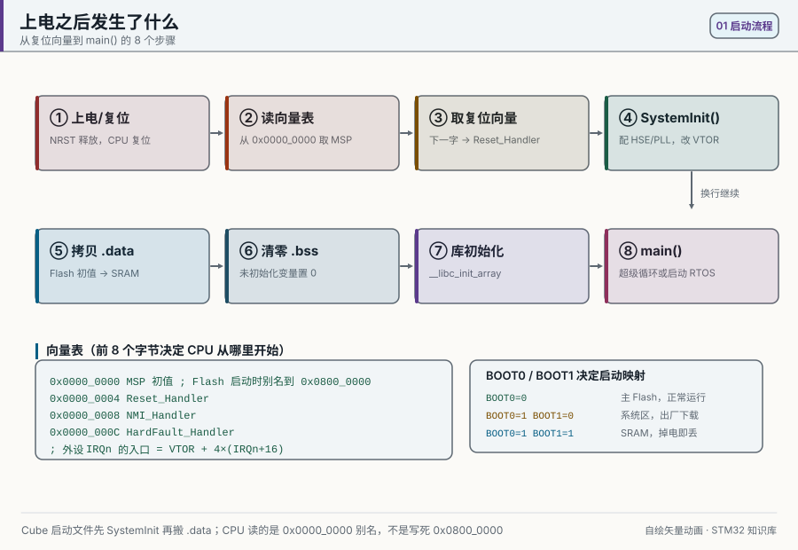
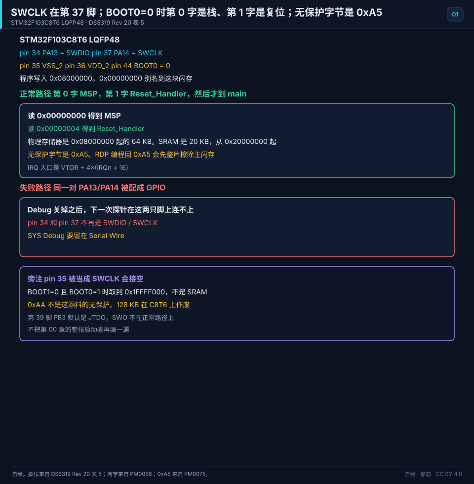
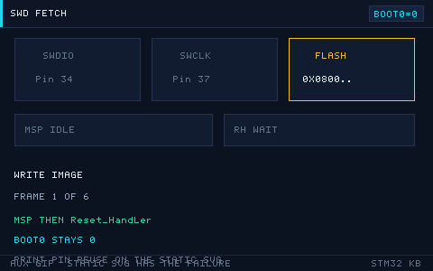

# 01 Setting Up the Development Environment
> 中文：[开发环境搭建](../01-开发环境搭建.md)

> From nothing, install a setup that can compile, flash, and single-step an STM32.

<p align="center">
  
  <br><sub>▲ Animation: after power-on reset the CPU fetches the vector table and boots (vector drawing by the author)</sub>
</p>

<!-- video:ch01 -->
<p align="center">
  <video width="640" controls poster="../../assets/video/ch01-env.png">
    <source src="../../assets/video/ch01-env.mp4" type="video/mp4">
  </video>
  <br><sub>▲ Chapter video with Chinese voice-over (2.5 min). <a href="../../assets/video/ch01-env.mp4">MP4</a> · <a href="../../assets/video/ch01-env.srt">subtitles</a></sub>
</p>

<details>
<summary>Narration script (Chinese, same text as the subtitles)</summary>

1. 环境这章只追一个问题：你写下的 C，怎样变成芯片里正在跑的程序。中间就是编译、链接、烧录、复位运行。工具可以换，这四步不会换。
2. Keil、CubeIDE、PlatformIO 都能走完这四步。差别只是谁帮你填启动文件和链接脚本。先选一个能单步的，不要三个一起装到怀疑人生。
3. 复位之后，内核先读向量表。第零个字是栈顶，第一个字才是复位入口。进 main 之前，启动文件还要配时钟、搬数据段、清 BSS。
4. 这一帧是仓库里的启动顺序动画，不是芯片照片。你只要记住：还没进 main，该做的家务启动文件已经做完一轮。单步时别以为第一行就是上电第一件事。
5. 下载靠 SWD。F103 上 PA13 是数据线，PA14 是时钟。把这两只脚让给别的功能，下次探针就连不上。救砖时先把 BOOT0 拉高，再重新接上。
6. Cube 生成的工程，用户代码写在它留的标记中间。时钟改了就重新生成，不要在启动文件里打补丁。临时文件和编译产物不要提交进版本库。
7. 第一次下载只做三件事：接上调试器，确认软件认出芯片型号，再下一个只点灯的空工程。连芯片都认不出，就先别查业务代码。
8. 口诀：先认出芯片，再谈业务。调试器连不上的时候，查线、查供电、查 BOOT，不要先重写 main。线都没通，改代码是在安慰自己。
9. 这章结束，你的文件夹里应该有一个能单步的工程。你要能说出向量表前两个字是什么，也要能指出 SWD 占用的两只脚。
10. 合上书，三问。向量表第零个字是什么？第一个字是什么？SWD 占哪两只脚？答不上来，就把启动文件再单步一遍。

</details>
<!-- /video:ch01 -->

## Learning goals

Before this chapter: you can install software and unpack files on a computer, and a hexadecimal address such as `0x08000000` means something to you (if not, read "Zero-background primer" in chapter 00 first). Have a BluePill (STM32F103C8T6) and an ST-LINK V2 debugger at hand.

- [ ] Name the four steps that turn C source into a program running on the chip (compile, link, flash, reset and run) and the tool that does each one
- [ ] Pick one of Keil MDK, STM32CubeIDE, VS Code + PlatformIO, and CLion, and say why
- [ ] Generate a blink project in STM32CubeMX that compiles as is, with SYS Debug set to Serial Wire
- [ ] Wire SWD from the table and read the chip's Device ID in STM32CubeProgrammer
- [ ] Open address `0x08000000` in the debugger, read the first two words of the vector table, and say which is the stack top and which is the reset entry
- [ ] When you hit "cannot connect to target", "download failed", or "chip is read-protected", check wiring, power, the BOOT jumpers, and software, in that order

## Core ideas

**In one sentence: whichever IDE you use, the path underneath is the same: compile, link, flash, reset and run. The IDE only decides who runs those four steps for you; if any one of them breaks, the program does not run.**

### An analogy first

Think of making a program as publishing a book.

- **Compile**: translate the manuscript (C source) chapter by chapter into pages the print shop can use (object files, `.o`). Each chapter is translated on its own and has no idea which page it will land on.
- **Link**: follow a binding plan (the linker script) to put every chapter into one book and fix which page each piece lands on (its address).
- **Flash**: print the finished book onto paper (write it into the chip's Flash).
- **Reset and run**: a reader opens the book. The chip always reads it the same way: first the bookmark position written on page 0 (the stack top), then the line on page 1 that says "the text starts on page N" (the reset entry), and then it turns there.

The analogy stops here. A printed book cannot change, but Flash can be erased and rewritten; [DS5319 Rev 20](#source-ds5319) Table 29 guarantees at least 10 000 cycles. And the CPU does not turn pages one by one; it jumps around by address.

### 1. Four steps: compile, link, flash, reset and run

Conclusion: each step has its own output. When the program does not run, find the step whose output is missing and you know where to look.

```text
source .c/.h
   │  compile (arm-none-eabi-gcc, or armclang in Keil)
   ▼
object file .o
   │  link (ld or armlink) + linker script (.ld or .sct)
   ▼
executable .elf ──► .hex / .bin
   │  flash (ST-LINK over SWD; tools such as CubeProgrammer and OpenOCD)
   ▼
Flash 0x08000000
   │  reset
   ▼
CPU reads the vector table → Reset_Handler → main()
```

The words in the diagram:

- **Compiler**: the program that translates C into machine code. Two are common for STM32. arm-none-eabi-gcc is GNU's bare-metal Arm compiler; "none" in the name means no operating system, and "eabi" is Arm's binary interface convention. Keil uses Arm's own Arm Compiler (armclang).
- **Linker**: joins the `.o` files and libraries into one program and, following the linker script, gives every piece of code and every variable an address. The GCC linker script is a `.ld` file; Keil calls its version a scatter file (`.sct`).
- **ELF**: the output of the link. Besides machine code it holds the function names, variable names, and line numbers a debugger needs. `.hex` and `.bin` keep only the bytes that go into Flash.
- **Flash (download)**: write those bytes into the chip's Flash through the debugger.
- **Reset and run**: after reset the chip starts from the vector table. Section 7 covers it.

The table puts the four steps side by side. To use it: when the program does not run, go left to right and find the first step that produced nothing.

| Step | Input | Output | Typical tool | What a broken step looks like |
| --- | --- | --- | --- | --- |
| Compile | `.c`, `.h` | `.o` | arm-none-eabi-gcc, armclang | Syntax errors, header not found |
| Link | `.o`, libraries, linker script | `.elf`, then `.hex`/`.bin` | ld, armlink | `undefined reference`, Flash too small (`region 'FLASH' overflowed`) |
| Flash | `.elf`/`.hex`/`.bin` | Bytes in Flash | ST-LINK + CubeProgrammer or OpenOCD | Cannot connect to target, download failed |
| Reset and run | The vector table in Flash | A running program | The chip itself | Never reaches `main`, stuck in HardFault |

### 2. The tools and their jobs

Conclusion: a working setup is a few pieces put together: a configuration tool that generates code, a compiler, a debugger probe, a debug server, and a flashing tool. An IDE (integrated development environment) is the shell that puts them in one window.

| Tool | What it is | Which part of the four steps it handles |
| --- | --- | --- |
| STM32CubeMX | ST's graphical configuration tool: pick the chip, click pins, set clocks, and generate init code and a project | Before compiling: generating code |
| STM32CubeIDE | ST's free IDE, built on Eclipse, with GCC and GDB included | Compile, link, flash, debug |
| arm-none-eabi-gcc | GNU's bare-metal Arm compiler, published by Arm as the Arm GNU Toolchain (formerly GNU Arm Embedded Toolchain) | Compile, link |
| ST-LINK | ST's debugger hardware, also called a debug probe: USB to the computer on one end, the chip's SWD lines on the other | The physical path for flashing and debugging |
| STM32CubeProgrammer | ST's flashing tool: erase, write Flash, edit option bytes (readout protection lives there) | Flash, unlock |
| OpenOCD | An open-source debug server: drives probes such as ST-LINK, opens a port for GDB (3333 by default), and can write Flash by itself | Flash, debug |
| GDB | The GNU debugger: breakpoints, single-stepping, variables. It never touches the chip directly; it goes through OpenOCD or ST's GDB server | Debug |

To use it: find the step you are stuck on, see which tool owns that step, and read that tool's error. Older tutorials use ST-LINK Utility; ST now recommends STM32CubeProgrammer instead.

> [!NOTE]
> STM32CubeIDE 1.x had CubeMX built in. STM32CubeIDE 2.0, released in November 2025, split it out: configure and generate the project in the standalone STM32CubeMX, then open it in CubeIDE. Many screenshots online still show the 1.x screens. If you cannot find the pinout view in 2.0, your installation is not broken.

### 3. Choosing among four environments

The table compares four common environments. Use the "Who it fits" row to pick one or two, then check that the license and platform rows work for you. License terms change; this row follows each vendor's website as of October 2026.

| Dimension | Keil MDK | STM32CubeIDE | VS Code + PlatformIO | CLion + OpenOCD |
| --- | --- | --- | --- | --- |
| License | Paid; the Community edition has no code-size limit but is for non-commercial use only; the evaluation edition is limited to 32 KB of code | Free (ST official) | Free and open source | Paid for commercial use; free for non-commercial use |
| Compiler | Arm Compiler 6 (armclang); older projects use Arm Compiler 5 (armcc) | GCC (arm-none-eabi) | GCC | GCC |
| How hard to start | Low, lots of Chinese material | Low | Medium, you write `platformio.ini` | Medium to high, you need CMake |
| Debugging | Strong, full register windows | Strong, debugger built in | Enough, through extensions | Strong |
| Platforms | µVision is Windows-only | Windows, Linux, macOS | All | All |
| Who it fits | Teaching, older company projects | Beginners, people following ST's own examples | People who like the command line and automated builds | C/C++ developers who already use CMake |

**How to choose: beginners use STM32CubeIDE, with STM32CubeMX generating the project. If you already have a Keil license, keep Keil. When you need a build that can be reviewed and run in CI (continuous integration, which compiles every commit automatically), drive CLion or VS Code from the same CMake presets. PlatformIO is a separate package-and-build route; do not mix it into a hand-written CMake project.**

### 4. The files in a project

Conclusion: most files in a project are generated. Your own code lives under `Core/`, between the markers CubeMX leaves for it.

```text
Core/          Inc/  Src/          ← your code (main.c, interrupts, peripheral init)
Drivers/       CMSIS/  STM32F1xx_HAL_Driver/
Middlewares/   (optional, such as FreeRTOS or FatFs)
Startup/       startup_stm32f103xb.s
STM32F103C8TX_FLASH.ld           ← linker script (GCC)
<project>.ioc                    ← CubeMX project file
```

The tree is drawn in [`assets/diagrams/project-structure.svg`](../../assets/diagrams/project-structure.svg) (vector drawing by the author). The table says what each key file does and whether you edit it by hand:

| File | Role | Edit by hand? |
| --- | --- | --- |
| `<project>.ioc` | CubeMX project settings; change them and regenerate the code | Edit in CubeMX |
| `startup_stm32f103xb.s` | Startup assembly: defines the vector table and the reset entry | Usually not |
| `STM32F103C8TX_FLASH.ld` | GCC linker script: Flash and RAM layout | Rarely |
| `<project>.sct` | Keil scatter file, same job | Rarely |
| `system_stm32f1xx.c` | `SystemInit()`, the first C function called after reset | Usually not |
| `stm32f1xx_hal_conf.h` | HAL module switches; turn off unused modules to save space | As needed |
| `Core/Src/main.c` and friends | Your code | Between `/* USER CODE BEGIN */` and `/* USER CODE END */` |

Two rules. To change clocks or pins, go back to CubeMX, change them there, and regenerate; do not patch the startup file. When you regenerate, code outside the markers is overwritten. The startup file name says `xb`, not `x8`, because ST's headers put the 64 KB x8 and the 128 KB xB under one device macro, `STM32F103xB`; the size difference lives in the linker script.

### 5. Generating a project in STM32CubeMX

Work down the table. The last column is the choice people most often get wrong at that step.

| Step | What you do | The option that matters |
| --- | --- | --- |
| 1 | New Project, search, and select the part | Pick `STM32F103C8Tx` |
| 2 | Configure pins in the Pinout view | Example: set PC13 to `GPIO_Output` |
| 3 | System Core → RCC | Set HSE to `Crystal/Ceramic Resonator` (the BluePill has an 8 MHz crystal) |
| 4 | System Core → SYS | Set Debug to `Serial Wire` |
| 5 | Clock Configuration | HSE 8 MHz → PLL ×9 → SYSCLK 72 MHz; set APB1 to /2 so PCLK1 stays at or below 36 MHz (chapter 02 explains why) |
| 6 | Project Manager → Project | Name and path; Toolchain/IDE `STM32CubeIDE` or `MDK-ARM`, and newer versions also offer `Makefile` and `CMake` |
| 7 | Project Manager → Code Generator | Check "Copy only necessary library files", and generate a separate .c/.h pair per peripheral |
| 8 | GENERATE CODE | You can compile as soon as it finishes |

> [!WARNING]
> SYS Debug must be **Serial Wire**. With No Debug, CubeMX puts `__HAL_AFIO_REMAP_SWJ_DISABLE()` in `HAL_MspInit()`. That writes 100 to SWJ_CFG in the AFIO_MAPR register, turns off both JTAG and SWD, and makes PA13/PA14 ordinary IO ([RM0008 Rev 21](#source-rm0008) section 9.4.2). As soon as the program runs, the debugger can no longer connect. Section 8 shows how to get it back.

### 6. Compile, flash, and debug

Where each action lives in the four environments. Read the table by row: find the action, then your environment.

| Action | Keil | CubeIDE | CLion + CMake | VS Code + CMake |
| --- | --- | --- | --- | --- |
| Compile | F7 / Build | Ctrl+B | Build after picking a CMake preset | `Ctrl+Shift+B` runs the CMake task |
| Flash | F8 / Download | Run: download, then run | OpenOCD Download & Run | Cortex-Debug launch configuration |
| Debug | Ctrl+F5 / Start Debug | F11 / Debug: download, then stop at `main` | OpenOCD + `arm-none-eabi-gdb` | Cortex-Debug + OpenOCD |
| Reset and run | Reset button | Run button | Run configuration | Run and Debug configuration |

The last two columns use CMake. CMake generates build scripts: you list the source files and compiler options in `CMakeLists.txt`, and it writes the Ninja or Makefile scripts that actually call the compiler. A CMake preset (`CMakePresets.json`) saves one configuration under a name, so the command line, CLion, and VS Code all read the same file.

#### CLion: CMake is the source of truth, and the IDE only calls it

The complete, buildable starting point is [`examples/spl-f1-blink/`](../../examples/spl-f1-blink/). It uses the SPL (Standard Peripheral Library, ST's older peripheral library; the F1 edition stopped at V3.5.0, see [STSW-STM32054](#source-stsw-stm32054)). The command line, CLion, and VS Code share one `CMakePresets.json`, one GNU Arm toolchain file, one linker script, and one OpenOCD configuration. That prevents "it builds in the IDE but not in CI".

1. Install the Arm GNU Toolchain, CMake, Ninja, and OpenOCD. On the command line, check that `arm-none-eabi-gcc --version` and `openocd --version` both print something.
2. Set the dependency root (this example uses the frozen SPL V3.5.0, in the variable `SPL_ROOT`), start CLion from that terminal, and open the example folder.
3. In CLion, pick the `BluePill SPL Debug` CMake preset. The build log must show `arm-none-eabi-gcc` as the compiler and produce an `.elf`, not a host `.exe`.
4. Create an **OpenOCD Download & Run** configuration: Target is the CMake target, Executable is the ELF, Board config is the repository's `openocd/bluepill-stlink.cfg`, and GDB is `arm-none-eabi-gdb`.
5. Run does build, write, verify, reset. Debug adds three steps: OpenOCD waits for GDB on port 3333, GDB loads the same ELF, and it stops at `main`.

#### VS Code: build with a task, debug with Cortex-Debug

1. Install three extensions: C/C++, CMake Tools, and Cortex-Debug. Cortex-Debug starts OpenOCD and GDB for you. Run `code .` from a terminal where the dependency variables are set.
2. `.vscode/tasks.json` only calls `cmake --preset debug` and `cmake --build --preset debug`. Do not copy a second set of compiler flags into the JSON.
3. `.vscode/launch.json` only names what debugging needs: the ELF path, the OpenOCD configuration, `arm-none-eabi-gdb`, and the task to run before it.
4. Check the build alone with `Ctrl+Shift+B` first, then start Cortex-Debug. Checking build and debug separately is how you tell a compiler error from a linker-script error from a probe-connection error.
5. If only IntelliSense (VS Code's completion and red underlines) complains while the CMake build succeeds, run `CMake: Configure` so the language service reads the compile database. Do not paper over the real build flags with a hand-written `includePath`.

The table lists the most common failures in these two environments. The second column is the layer that broke; check it first:

| Failure | The layer that broke | What to do |
| --- | --- | --- |
| CMake says the dependency root is empty | The IDE did not inherit the environment variable | Start the IDE from a terminal where it is set, or set it in the CMake profile |
| A host `.exe` was produced | The toolchain file did not take effect | Delete that build folder, configure again from the preset, and check the compiler line in the log |
| It compiles, but the link reports a duplicate interrupt function | One interrupt has two strong definitions | Keep one; the SPL example replaces the template with its own `stm32f10x_it.c` |
| The ELF exists, but OpenOCD cannot connect | You are past the build | Check SWD wiring, power, the target config file, and ST-LINK firmware; stop changing C code |
| The download works, but the program never reaches `main` | Startup file, linker script, or reset path | Check the vector table, `Reset_Handler`, the Flash and RAM regions, and BOOT0 |

The official documentation is [CLion's embedded development and OpenOCD pages](#source-clion-embedded) and [PlatformIO's VS Code integration](#source-platformio-vscode).

### 7. What happens after reset: vector table, startup file, linker script

**Conclusion: after reset the CPU reads two words starting at `0x00000000`. Word 0 is the stack top, loaded into the MSP. Word 1 is the reset entry, `Reset_Handler`. With BOOT0=0 that address is an alias of Flash at `0x08000000`, not a separate memory.**

A few words first:

- **Vector table**: an address table at the very start of the program. Item 0 is the stack-top address, item 1 is the reset entry, and the items after that are the entry addresses of the exceptions and interrupts.
- **Stack and MSP**: the stack is a piece of RAM where function calls keep local variables and return addresses. The MSP (Main Stack Pointer) is the CPU register that remembers where the top of the stack is.
- **Alias**: one memory readable at two addresses. With BOOT0=0, the bytes you read at `0x00000000` are exactly the bytes at `0x08000000`.
- **BOOT0, BOOT1**: two boot-selection pins. BOOT0 is pin 44; BOOT1 shares pin 20 with PB2. The BluePill sets them with two jumpers, normally both at 0.

The table shows what runs in what order after reset (a GCC project, as generated for STM32CubeIDE). Read it top to bottom as time: `main()` is step 5, not step 1.

| Order | Who does it | What happens |
| --- | --- | --- |
| 1 | Hardware | Loads word 0 at `0x00000000` into the MSP, reads word 1 at `0x00000004`, and jumps to `Reset_Handler` |
| 2 | The startup file calls `SystemInit()` | In recent Cube versions it mostly just sets the vector-table location (`SCB->VTOR`) when asked to; the SPL `SystemInit()` sets the clock straight to 72 MHz |
| 3 | Startup file | Copies the initial values of `.data` from Flash to RAM and clears `.bss` |
| 4 | `__libc_init_array` | Runs C++ global constructors and C library initialization |
| 5 | `main()` | Your code. In a Cube project, `SystemClock_Config()` sets the clock to 72 MHz here; until then the chip runs on the post-reset HSI at 8 MHz |

`.data` holds globals that have an initial value (such as `int a = 5;`); the initial values sit in Flash and must be copied into RAM at power-up. `.bss` holds globals without one, and C says they start at 0, so they are cleared. A Keil project hands steps 3 and 4 to the C library entry `__main`: the startup file jumps to `__main`, which does the copy and the clear and then calls `main()`. Trust the `startup_*.s` in your project for the exact order; older Cube startup files copy data first and call `SystemInit()` after.

A peripheral interrupt does not enter at `0x08000000 + 4×IRQn`. The first 16 items of the vector table belong to the stack top and the system exceptions, so the entry is at `VTOR + 4×(IRQn + 16)`. Example: USART1 is IRQn 37, so its entry is at `0x08000000 + 4×53 = 0x080000D4`, which matches the `0x0000_00D4` listed for USART1 in [RM0008 Rev 21](#source-rm0008) Table 63. After reset VTOR is 0, so the vector table is at `0x00000000` ([PM0056 section 2.3.4](#source-pm0056-vector)), and with BOOT0=0 that is the Flash alias.

The linker script stakes out Flash and RAM. F103C8 Flash is 64 KB, starting at `0x08000000`. SRAM is 20 KB, starting at `0x20000000`. The stack grows down from the top of RAM:

```ld
MEMORY
{
  FLASH (rx)  : ORIGIN = 0x08000000, LENGTH = 64K
  RAM (xrw)   : ORIGIN = 0x20000000, LENGTH = 20K
}
_estack = ORIGIN(RAM) + LENGTH(RAM);
```

`_estack` = `0x20000000 + 20×1024` = `0x20000000 + 0x5000` = `0x20005000`. That is word 0 of the vector table in a GCC project. Word 1 is the address of `Reset_Handler` plus 1: PM0056 requires the lowest bit of every vector to be 1, meaning Thumb code, so the memory window shows an odd number. The `.isr_vector` section that holds the vector table must be wrapped in `KEEP` in the linker script. Otherwise, when the linker drops unreferenced sections (`--gc-sections`), it throws away a vector table that no C code ever calls, and the chip runs off at power-up.

The two BOOT pins pick where the chip starts, per [RM0008 Rev 21 section 3.4, Table 9](#source-rm0008-boot):

| BOOT1 (pin 20) | BOOT0 (pin 44) | Boot space | What you read at `0x00000000` |
| --- | --- | --- | --- |
| Any | 0 | Main Flash | Flash from `0x08000000` (the normal case) |
| 0 | 1 | System memory | ST's factory bootloader from `0x1FFFF000`, which waits for a new program over USART1 |
| 1 | 1 | Embedded SRAM | No alias; SRAM is only at `0x20000000`, and the program must point VTOR at a vector table in SRAM itself |

To use it: look at BOOT0 first. If it is 0, the chip runs from Flash. Only when it is 1 does BOOT1 matter. The BOOT pin levels are latched on the 4th rising edge of SYSCLK after reset; moving a jumper later does not affect that boot.

### 8. Connecting over SWD, recovering a locked-out chip, and SWO printing

**Conclusion: SWD needs just two signal lines: PA13 is data and PA14 is clock. A program can take those pins back as ordinary IO, and then the debugger cannot connect; the way back is to keep your program from getting a chance to run.**

- **SWD (Serial Wire Debug)**: Arm's two-wire debug interface. SWDIO is the bidirectional data line and SWCLK is the clock. On F103 they are PA13 and PA14 ([RM0008 Rev 21](#source-rm0008) section 31.4.2, Table 219).
- After reset all five pins PA13, PA14, PA15, PB3, and PB4 belong to the debug port. A program can write SWJ_CFG in AFIO_MAPR to hand some or all of them back to GPIO (Table 220). For SWD only, write 010: PA15, PB3, and PB4 are released and PA13/PA14 stay with the debugger.
- The chip has an internal pull-up on SWDIO and an internal pull-down on SWCLK (section 31.4.3), so the two lines need no external resistors.

If the program has already turned the debug port off and you cannot connect, there are two ways back:

1. **Connect under reset**: wire NRST, set the connection mode in CubeProgrammer to Under reset, and click Connect. The debugger holds reset, switches to SWD during reset, sets a breakpoint on the reset vector, and then releases reset; the core halts before its first instruction ([RM0008 Rev 21](#source-rm0008) section 31.4.4). System reset also clears SWJ_CFG back to 000, so the code that disables the debug port never gets to run. Once connected, mass-erase and download the fixed program.
2. **Pull BOOT0 high**: move the BOOT0 jumper to 1, keep BOOT1 at 0, and press reset. The CPU fetches from system memory, the program in Flash does not run, and the debug port stays in its reset state. Once connected, mass-erase, then put BOOT0 back to 0.

Common debugging tools:

| Tool | What you do |
| --- | --- |
| Breakpoint | Break on a suspicious line and look at variables and registers when it stops |
| Watch | Add global and local variables to the Watch window |
| Register view | Open the peripheral register windows (GPIO, RCC, and so on) and check each bit against the manual |
| SWO printing | A `printf` that does not use the UART; see below |
| Disassembly | Look at the assembly behind the C to see what the optimizer did |

SWO (Serial Wire Output) is a one-way trace output line; on F103 it is pin 39, PB3. Its default function after reset is JTDO, and it outputs TRACESWO only after the debugger turns on asynchronous trace (Table 219). SWO is not one of the two SWD lines: to use it, the probe needs one more wire to PB3. Many cheap ST-LINK V2 clones have no SWO pin at all (rule of thumb). ITM (Instrumentation Trace Macrocell) is a block inside the core: the program writes characters to its port and they leave on SWO. Turning on the trace output on PB3 is the debugger's job (it writes TRACE_IOEN in DBGMCU_CR, section 31.16.3); you enable SWV in the IDE's debug configuration and enter the right core clock (example setting: 72 MHz).

```c
#include "main.h"   /* pulls in CMSIS core_cm3.h, which provides ITM_SendChar() */

/* GCC's printf ends in _write(). Hand each character to the ITM, which sends it out on SWO */
int _write(int fd, char *ptr, int len)
{
    (void)fd;
    for (int i = 0; i < len; i++)
    {
        ITM_SendChar((uint8_t)ptr[i]);
    }
    return len;
}
```

If the debugger has not enabled the ITM, `ITM_SendChar()` returns at once and does not block the program. Keil's C library does not go through `_write()`; retarget `fputc()` there instead.

### 9. Common errors and download algorithms

The table orders common errors by what to check first. The first time you cannot connect, work down from the top row before you touch any code.

| Error | Usual cause | Check first |
| --- | --- | --- |
| No ST-LINK found | USB cable or driver | Try another USB port; see whether ST-Link shows up in Device Manager; reinstall the driver |
| `No STM32 target found`, `No target connected` | SWD wires loose, target unpowered, or PA13/PA14 taken over by the program | Check the four wires and 3.3 V first, then try connect under reset |
| `Cannot access target` | Target lost power, or is held in reset | Check power and NRST |
| `Flash Download failed` (Keil) | Download algorithm missing or wrong; chip is read-protected | Add the right algorithm in the Flash Download settings; clear protection per section 10 |
| `Core is locked up` | The core locked up: another fault hit while handling HardFault. Common when Flash is blank or the vector table is wrong | Connect under reset, erase, download again; check pointers and the stack |

Lockup is defined in [PM0056](#source-pm0056) section 2.4.4: if a HardFault occurs while the processor is executing the NMI or HardFault handler, it stops executing instructions.

Keil needs the right download algorithm (Flash Algorithm) for the chip, chosen by Flash size class:

| Part | Keil download algorithm | Size |
| --- | --- | --- |
| F103C8 | STM32F10x Med-density Flash | 64 KB |
| F103RC | STM32F10x High-density Flash | 256 KB |
| F401 | STM32F4xx Flash (pick by size) | Depends on the part |

F1 classes chips by Flash size: 64–128 KB is medium density and 256–512 KB is high density, per the glossary in [RM0008 Rev 21](#source-rm0008) section 2.3.

### 10. Setting and clearing readout protection

**Conclusion: F103 has exactly one "unprotected" readout value: `0xA5`. Every other value counts as protected, including `0xFF` after an erase. Setting it back to `0xA5` mass-erases main Flash first.**

- **Readout protection (RDP)**: once on, a debugger cannot read the program out of Flash, so the program cannot be copied.
- **Option bytes**: a small separate configuration area in Flash; on F1 it sits at `0x1FFFF800`. RDP is one byte of it.

The rule comes from [PM0075](#source-pm0075-rdp) section 2.4.1, Table 6: RDP equal to `0xA5` (the manual prints `0x00A5`) means unprotected, and every other value means protected. `0xAA` is the "unprotected" code on F4 and other families ([RM0090](#source-rm0090) section 3.7.3). Carried over to F103 it is just a value that is not 0xA5, so writing it still protects the chip.

To clear it with STM32CubeProgrammer:

1. Choose ST-LINK and click Connect. If that fails, use connect under reset from section 8.
2. On the left, `Option bytes` → set Read Out Protection to unprotected; the byte written is `0xA5`. Some screens only show Level 0, and the byte written is still this one.
3. Click `Apply`. **Clearing readout protection mass-erases main Flash**, so you will download the program again.
4. Power the board off and on once. PM0075 requires a power-on reset before the new RDP takes effect; when you clear it through the system-memory bootloader, a system reset is enough.
5. Download the program again.

The same thing from the command line (OpenOCD):

```bash
openocd -f interface/stlink.cfg -f target/stm32f1x.cfg \
  -c "init; reset halt; stm32f1x unlock 0; reset; shutdown"
```

The `0` in the command is the number OpenOCD gives the Flash bank, not the RDP value. Afterwards, power-cycle the board once here too.

Motto: **item 0 is the stack, item 1 is reset; make the tools see the chip before you debug the code.**

## Hardware and wiring

SWD needs only four wires (3.3 V, GND, SWDIO, SWCLK). NRST is optional, and with it you can connect under reset. The table follows the 10-pin header of an ST-LINK V2 clone; the original ST-LINK/V2 has a 20-pin header, so match its pins from its own manual.

| ST-LINK pin | BluePill pin | Signal | Notes |
| --- | --- | --- | --- |
| 3.3V | 3.3 V | Power | Optional; the board can also take USB power |
| GND | GND | Ground | **Must be connected**, common ground |
| SWDIO | PA13 (pin 34) | Data | Bidirectional data |
| SWCLK | PA14 (pin 37) | Clock | Debug clock |
| RST | NRST (pin 7) | Reset | Worth connecting; connect under reset needs it |
| 5V | — | — | Usually unused |

```text
ST-LINK V2 (clone, 10-pin header)       BluePill
  3.3V   ──────────────────────────  3.3 V
  SWDIO  ──────────────────────────  SWDIO = PA13, pin 34
  SWCLK  ──────────────────────────  SWCLK = PA14, pin 37
  GND    ──────────────────────────  GND
  RST    ─ ─ ─ ─ ─ ─ ─ ─ ─ ─ ─ ─ ─  NRST, pin 7 (optional)

BluePill jumpers: BOOT0 = 0, BOOT1 = 0 → run from Flash (leave them here normally)
```

The 4-pin row on the BluePill's short edge is the debug header. Silkscreen labels differ between makers; match them by meaning: 3.3 V, SWDIO, SWCLK, GND. Power off before you wire. When you count the chip's pins, SWCLK is pin 37; do not slip to pins 35 and 36 next to it, which are supply pins.

The chip pins that matter in this chapter, with pin numbers from [DS5319 Rev 20 Table 5](#source-ds5319-swd):

| Pin | LQFP48 pin number | Use in this chapter |
| --- | --- | --- |
| PA13 | 34 | SWDIO |
| VSS_2, VDD_2 | 35, 36 | Supply pins, to ground and 3.3 V |
| PA14 | 37 | SWCLK |
| NRST | 7 | Reset |
| BOOT0 | 44 | Boot selection |
| PB2 / BOOT1 | 20 | Boot selection |
| PB3 | 39 | SWO (optional) |

Driver and firmware:

| Item | What to do |
| --- | --- |
| Install the driver | On Windows, install the ST-LINK USB driver; an ST-Link device appears in Device Manager |
| Upgrade firmware | When a tool says the firmware is too old, use ST-LINK Upgrade or the firmware upgrade in CubeProgrammer |
| Check the link | Connect in STM32CubeProgrammer; reading Device ID `0x410` means the link works |
| Linux permissions | Add a udev rule so you do not need sudo every time |

`0x410` is the device ID of medium-density F1 parts (DEV_ID in DBGMCU_IDCODE, [RM0008 Rev 21](#source-rm0008) section 31.6.1). If you read something else, the chip on the board may not be a genuine ST part (rule of thumb).

## Code

Below is a complete `main.c` for a CubeMX project: the clock is set to 72 MHz and the onboard LED on PC13 blinks at 1 Hz. The `main.h`, `stm32f1xx_hal_msp.c`, and HAL library it uses are generated by CubeMX. The same program is in [`examples/gpio-blink/`](../../examples/gpio-blink/).

```c
/* main.c: blink program in a CubeMX project (STM32F103C8T6, HSE 8 MHz) */
#include "main.h"

#define LED_PORT       GPIOC
#define LED_PIN        GPIO_PIN_13    /* onboard LED, lit when low */
#define BLINK_HALF_MS  500U           /* 500 ms on, 500 ms off, period about 1 s (example setting) */

void SystemClock_Config(void);
static void MX_GPIO_Init(void);

int main(void)
{
    HAL_Init();               /* Flash prefetch, NVIC grouping, 1 ms SysTick, then HAL_MspInit() */
    SystemClock_Config();     /* move from the post-reset HSI 8 MHz to the PLL at 72 MHz */
    MX_GPIO_Init();           /* PC13 push-pull output */

    while (1)
    {
        HAL_GPIO_TogglePin(LED_PORT, LED_PIN);
        HAL_Delay(BLINK_HALF_MS);
    }
}

void SystemClock_Config(void)
{
    RCC_OscInitTypeDef osc = {0};
    RCC_ClkInitTypeDef clk = {0};

    osc.OscillatorType = RCC_OSCILLATORTYPE_HSE;
    osc.HSEState       = RCC_HSE_ON;
    osc.HSEPredivValue = RCC_HSE_PREDIV_DIV1;
    osc.HSIState       = RCC_HSI_ON;
    osc.PLL.PLLState   = RCC_PLL_ON;
    osc.PLL.PLLSource  = RCC_PLLSOURCE_HSE;
    osc.PLL.PLLMUL     = RCC_PLL_MUL9;            /* 8 MHz × 9 = 72 MHz */
    if (HAL_RCC_OscConfig(&osc) != HAL_OK)
    {
        Error_Handler();
    }

    clk.ClockType      = RCC_CLOCKTYPE_HCLK | RCC_CLOCKTYPE_SYSCLK
                       | RCC_CLOCKTYPE_PCLK1 | RCC_CLOCKTYPE_PCLK2;
    clk.SYSCLKSource   = RCC_SYSCLKSOURCE_PLLCLK;
    clk.AHBCLKDivider  = RCC_SYSCLK_DIV1;         /* HCLK 72 MHz */
    clk.APB1CLKDivider = RCC_HCLK_DIV2;           /* PCLK1 36 MHz, must not exceed 36 MHz */
    clk.APB2CLKDivider = RCC_HCLK_DIV1;           /* PCLK2 72 MHz */
    if (HAL_RCC_ClockConfig(&clk, FLASH_LATENCY_2) != HAL_OK)   /* 72 MHz needs 2 wait states */
    {
        Error_Handler();
    }
}

static void MX_GPIO_Init(void)
{
    GPIO_InitTypeDef io = {0};

    __HAL_RCC_GPIOC_CLK_ENABLE();                 /* port clock first, or the settings do not stick */
    HAL_GPIO_WritePin(LED_PORT, LED_PIN, GPIO_PIN_SET);   /* write high first so the LED starts off */

    io.Pin   = LED_PIN;
    io.Mode  = GPIO_MODE_OUTPUT_PP;
    io.Pull  = GPIO_NOPULL;
    io.Speed = GPIO_SPEED_FREQ_LOW;
    HAL_GPIO_Init(LED_PORT, &io);
}

void Error_Handler(void)
{
    __disable_irq();          /* park here; pause the debugger and you see where it stuck */
    while (1)
    {
    }
}
```

Piece by piece:

- `HAL_Init()` does not reset the peripherals. It turns on Flash prefetch, sets the NVIC priority grouping, starts a 1 ms SysTick on the post-reset HSI clock, and finally calls `HAL_MspInit()`.
- `HAL_MspInit()` lives in the CubeMX-generated `stm32f1xx_hal_msp.c`, and that is where the SYS Debug choice ends up: Serial Wire generates `__HAL_AFIO_REMAP_SWJ_NOJTAG()`, which turns off JTAG and keeps SWD; No Debug generates `__HAL_AFIO_REMAP_SWJ_DISABLE()`, which turns off both.
- `SystemClock_Config()` is what moves the clock to 72 MHz. Before it, the program runs on HSI at 8 MHz. 72 MHz needs 2 Flash wait states; chapter 02 covers that.
- `HAL_Delay(500)` counts SysTick ticks. Each toggle waits 500 ms, so one on and one off add up to 1 s.

The same "JTAG off, SWD on" setting at register level:

```c
__HAL_RCC_AFIO_CLK_ENABLE();                          /* clock AFIO first */
AFIO->MAPR = (AFIO->MAPR & ~AFIO_MAPR_SWJ_CFG)
           | AFIO_MAPR_SWJ_CFG_JTAGDISABLE;           /* SWJ_CFG = 010: JTAG off, SWD kept */
```

The three SWJ_CFG bits are write-only, and reading them returns an undefined value ([RM0008 Rev 21](#source-rm0008) section 9.4.2). When you later change other remap bits in MAPR at register level, do not just `|=` into it; write SWJ_CFG to the value you want at the same time, or the random value read back may turn SWD off along the way.

Without an IDE you can compile and download from the command line:

```bash
# PlatformIO project: compile, then download using upload_protocol from platformio.ini
pio run
pio run -t upload

# Any project that produces an ELF (Makefile, CMake): write, verify, and reset with OpenOCD
openocd -f interface/stlink.cfg -f target/stm32f1x.cfg \
  -c "program build/firmware.elf verify reset exit"
```

A PlatformIO project describes the board and the download method in `platformio.ini`, and the output lands in `.pio/build/bluepill_f103c8/firmware.elf`. Its folder layout (`src/`, `include/`) differs from what CubeMX generates, so you move the CubeMX files in yourself:

```ini
[env:bluepill_f103c8]
platform = ststm32
board = bluepill_f103c8
framework = stm32cube
upload_protocol = stlink
debug_tool = stlink
```

## Hands-on labs

1. **Lab 1: the environment works and PC13 blinks at 1 Hz.** Generate a project in CubeMX, put in the code above, compile, and download it to the BluePill.
   - Expected: the onboard LED is on for about 0.5 s and off for about 0.5 s, over and over.
   - How to check: count 10 blinks with a phone stopwatch; it should take about 10 s. With a logic analyzer, measure the PC13 period; it should be close to 1 s.
   - If it fails, check first: whether CubeProgrammer can read the Device ID; whether SYS Debug is Serial Wire; that the onboard LED lights when low, so writing 1 turns it off.
2. **Lab 2: read the first two words of the vector table.** Download in debug mode, and once it stops at `main`, open a Memory window at `0x08000000`.
   - Expected: the first word is `0x20005000`; the second word is an odd number of the form `0x0800xxxx`.
   - How to check: `0x20005000` = `0x20000000 + 20 KB`, which is `_estack` in the linker script. The second word minus 1 should equal the address of `Reset_Handler` in the symbol table (run `arm-none-eabi-nm` on your ELF and look for `Reset_Handler`). Then change the address to `0x00000000`: the contents match `0x08000000`, which is the alias.
   - If it fails, check first: that the linker script is the C8 one (a wrong RAM size changes the stack top); in a Keil project the scatter file places the stack, so the first word is not necessarily `0x20005000`.
3. **Lab 3: reproduce "cannot connect", then recover.** In CubeMX, set SYS Debug to No Debug, generate, download once, and then try to connect again.
   - Expected: that one download succeeds; after it, a normal connection fails with "target not found".
   - How to check: connect under reset (Under reset), or move BOOT0 to 1 and press reset, and you can connect again; mass-erase, set Serial Wire again, download, and everything is back.
   - If it fails, check first: connect under reset needs NRST wired; whether you pressed reset after raising BOOT0; once recovered, put BOOT0 back to 0.

## Self-test

1. Everything compiles, and then the build stops with `region 'FLASH' overflowed`. Which of the four steps failed, and which file do you look at?
2. USART1 is IRQn 37. With the vector table at `0x08000000`, at what address is the USART1 interrupt entry?
3. The BluePill's BOOT1 jumper is at 0. You move BOOT0 to 1 and press reset. What is the CPU running? Is the program in Flash still there?
4. After erasing the whole option-byte block in CubeProgrammer, RDP reads `0xFF`. Is the chip read-protected now?
5. The linker script has RAM at `0x20000000` with `LENGTH = 20K`. What should word 0 of the vector table be in a GCC project?

Answers:

1. The link. Compiling only turns each `.c` into a `.o`; running out of Flash is discovered when the linker assigns addresses from the linker script. Look at the FLASH `LENGTH` in the `.ld` and at the map file the link produces; remove unused code or turn on optimization.
2. `4×(37 + 16) = 4×53 = 212 = 0xD4`, and `0x08000000 + 0xD4 = 0x080000D4`. RM0008 Rev 21 Table 63 lists USART1 at `0x0000_00D4`.
3. ST's factory bootloader in system memory (from `0x1FFFF000`), waiting for a new program over USART1. The program in Flash is still there; it just was not fetched this time. Put BOOT0 back to 0 and reset, and it comes back.
4. Yes. PM0075 says only RDP equal to `0xA5` is unprotected; `0xFF` is protected too, which is why erasing the option bytes does not trigger a mass erase. To clear protection, write `0xA5` and then power-cycle.
5. `0x20000000 + 20×1024 = 0x20000000 + 0x5000 = 0x20005000`, which is `_estack`.

## Principle and scope

> [!NOTE]
> From this section to "Pitfalls and sources" is the deep part. It pins the conclusions above to one part number, one manual section, and numbers you can recompute. On a first read you can skip it and come back after the labs.

The debug and boot conclusions in this chapter are pinned to order code STM32F103C8T6 in LQFP48, the chip on the BluePill.

**Debug pins.** After reset the debug port is on pin 34 PA13 = SWDIO and pin 37 PA14 = SWCLK. Between them sit pin 35 VSS_2 and pin 36 VDD_2. Those are supply pins: they go to ground and supply, must not float, and are not for the probe. Counting pin 35 as SWCLK is the failure path drawn on the key figure. Pin 7 NRST is worth connecting, but it is not a third SWD signal. Pin 44 is BOOT0. Pins: [DS5319 Rev 20 Table 5](#source-ds5319-swd).

**A program can turn the debug port off.** Leave SYS Debug on Serial Wire. Once it is turned off, pins 34 and 37 become ordinary GPIO and the next SWD connection fails.

**The two words of the vector table.** With BOOT0=0, what the CPU reads at `0x00000000` is an alias of Flash at `0x08000000`. Word 0 is the initial MSP. Word 1, at `0x00000004`, is `Reset_Handler`. A peripheral IRQ entry is not `0x08000000 + 4×IRQn`; it is `VTOR + 4×(IRQn + 16)`. See [the PM0056 vector table](#source-pm0056-vector).

**The two BOOT pins.** With BOOT1=0 and BOOT0=1 the CPU still fetches from `0x00000000` and gets system memory at `0x1FFFF000`. The program in Flash is still there; it is just not fetched. Starting from embedded SRAM (`0x20000000`) needs both BOOT1 and BOOT0 at 1. The claim that "BOOT0=1 means SRAM boot" is void. See [RM0008 Rev 21 Table 9](#source-rm0008-boot).

**The readout value.** Unprotected readout is RDP = `0xA5`, not `0xAA`. The manual prints that key as `0x00A5`; the low byte is still `0xA5`. Writing it back mass-erases main Flash first. `0xAA` is another family's code and is void on this part: writing it still protects the chip. If the option-byte screen only shows Level 0, the byte written is still `0xA5`. See [PM0075](#source-pm0075-rdp).

**Size.** This C8 has 64 KB of Flash and 20 KB of SRAM; the xB's 128 KB is void on this part. `LENGTH = 64K` and `LENGTH = 20K` in the linker script match those two numbers.

**The trace pin.** Trace output is on pin 39, PB3. Its default function is JTDO, and TRACESWO appears only in the remap column. It is not PA13 and it is not PA14. SWO printing is taught in the core ideas and stays off the normal path of the key figure; chapter 17's `debug-swo.svg` is not redrawn here.

**When the chip changes.** With another package, look up pins 7, 34, 35, 36, 37, and 44 again in Table 5. With another family, the RDP codes and the BOOT pin rules come from that chip's own manual.

## Key figures

<p align="center">
  
  <br><sub>▲ Drawn for this book. STM32F103C8T6, LQFP48. Pin 34 PA13 = SWDIO and pin 37 PA14 = SWCLK. Pin 35 is VSS_2 and pin 36 is VDD_2. With pin 44 BOOT0 = 0, 0x00000000 aliases 0x08000000. Word 0 is the MSP and word 1 is Reset_Handler. The failure is those two pins reused as GPIO, or pin 35 counted as SWCLK. BOOT1=0 and BOOT0=1 fetches 0x1FFFF000, not SRAM. The unprotected byte is 0xA5. 0xAA is void. Sources: [DS5319 Rev 20 Table 5](#source-ds5319-swd), [the PM0056 vector table](#source-pm0056-vector), and [PM0075's 0xA5](#source-pm0075-rdp).</sub>
</p>

<p align="center">
  
  <br><sub>▲ Auxiliary figure for the web and the article channel. It only plays the normal path: SWD finishes writing Flash, the CPU reads the MSP and Reset_Handler, and pins 34 and 37 are marked. Print uses the static figure. GPIO reuse and 0xAA are not on this GIF.</sub>
</p>

Read the main figure in three layers. At the top are the chip's pins: the probe belongs on pins 34 and 37, and pins 35 and 36 between them are supply. The middle layer is the normal path: the program is written at `0x08000000`, and after reset the CPU reads `0x00000000` to get the MSP and `0x00000004` to get `Reset_Handler`, and only then reaches `main`. At the bottom are the failure path and the side notes: the program turns the debug port off; raising BOOT0 while BOOT1=0 enters system memory; `0xAA` is not this part's unprotected value.

The chapter's opening `boot-sequence.svg` is the animated side figure. You do not need to play it: the pin numbers, the two words, and the failed connection are all on this static figure.

## Timing and state

The table runs top to bottom in the order of one reset. The two rows marked "Failure" are the branches you reach when a setting or jumper is wrong. The BOOT latch moment and the three boot spaces come from [RM0008 Rev 21 section 3.4, Table 9](#source-rm0008-boot); the two words come from [the PM0056 vector table](#source-pm0056-vector).

| Phase | BOOT / Debug | Address read | State |
| --- | --- | --- | --- |
| BOOT latch | 4th rising edge of SYSCLK after reset | — | Moving a jumper afterwards does not affect this boot; the pins are sampled again on exit from Standby |
| Reset, BOOT0=0 | Pin 44 BOOT0 = 0 | `0x00000000` aliases `0x08000000` | The physical memory is 64 KB of Flash |
| Word 0 | Vector item 0 | `0x00000000` | Initial MSP, `0x20005000` in a GCC project |
| Word 1 | Vector item 1 | `0x00000004` | `Reset_Handler` (lowest bit 1), then `main` |
| Failure: Debug off | Pins 34 and 37 become GPIO | PA13 / PA14 are no longer SWD | The SWD connection fails |
| Failure: system memory | BOOT1=0 and BOOT0=1 | `0x1FFFF000` | Not SRAM. The program in Flash is still there and is not fetched |
| SRAM | BOOT1=1 and BOOT0=1 | `0x20000000` | Both BOOT pins must be 1 |
| IRQ | Peripheral interrupt | `VTOR + 4×(IRQn + 16)` | Not `0x08000000 + 4×IRQn` |
| Size | C8 | 64 KB Flash, 20 KB SRAM | 128 KB is void on this part |

This table does not include toolchain menus. Pin 35 is VSS_2, pin 36 is VDD_2, and pin 7 is NRST.

## Pitfalls and sources

| Symptom | Cause | What to do | Source | What the source supports |
| --- | --- | --- | --- | --- |
| After one flash you can never connect | PA13/PA14 were set as ordinary GPIO | Leave SYS Debug on Serial Wire, with SWD on pin 34 and pin 37 | [DS5319](#source-ds5319-swd) | LQFP48 pin 34 is PA13/SWDIO, pin 37 is PA14/SWCLK, and pin 35 is VSS_2 |
| The program has turned the debug port off and you want the chip back | The program writes SWJ_CFG right after it starts | Wire NRST and connect under reset, or raise BOOT0 and reset; once connected, mass-erase | [RM0008 section 31.4.4](#source-rm0008) | During system reset all five SWJ pins belong to the debug port, and the debugger can halt the core on the reset vector |
| The probe is on the pin next to PA13 and there is no clock | Pin 35 was counted as SWCLK | Keep the probe off pins 35 and 36 (VSS_2/VDD_2 stay on ground and supply); move SWCLK to pin 37 | [DS5319](#source-ds5319-swd) | Pin 35 is VSS_2, pin 36 is VDD_2, and pin 37 is SWCLK. Those two supply pins must not float |
| With BOOT0 high, the chip runs neither the Flash program nor SRAM | BOOT1 is still 0 | With BOOT1=0 this is system memory. For SRAM, raise both BOOT pins | [RM0008](#source-rm0008-boot) | BOOT1=0 and BOOT0=1 aliases `0x1FFFF000`. SRAM boot also needs BOOT1=1 |
| Clearing protection with `AA` leaves the chip protected, or the erase does not match | The unprotected key is not `0xAA` | Write the unprotected key as `0xA5`. Clearing it mass-erases main Flash | [PM0075](#source-pm0075-rdp) | RDP `0xA5` is what allows readout. Programming it back mass-erases first. `0xAA` is void on this part |
| You erased the option bytes and expected the chip to be unlocked, but it still reads as protected | After an erase RDP is `0xFF`, which also counts as protected | After the erase, write `0xA5`, then power-cycle | [PM0075](#source-pm0075-rdp) | The erased value `0xFF` is a protected value and does not trigger a mass erase; after clearing, a power-on reset makes it take effect |
| Word 0 of the vector table was treated as the reset entry | Word 0 is the stack | Word 0 is the MSP. Word 1 is `Reset_Handler` | [PM0056](#source-pm0056-vector) | Item 0 is the initial stack. Item 1 is reset. An IRQ entry adds the 16 system exceptions first |

## Related resources

- Official manuals: **RM0008** chapter 2 (memory and buses), chapter 8 (RCC), chapter 9 (GPIO); **DS5319** (F103C8 datasheet)
- Previous: [00 How to Learn STM32](00-how-to-learn-stm32.md) | Next: [02 Choosing a Part, Memory, and Clocks](02-part-and-clock.md)
- Figures: [`assets/diagrams/project-structure.svg`](../../assets/diagrams/project-structure.svg), [`assets/animations/boot-sequence.svg`](../../assets/animations/boot-sequence.svg)
- Hardware and documents: the ST-Link, STM32CubeIDE, and STM32CubeProgrammer download pages on ST's website
- Disclaimer: every illustration in this repo is a vector drawing or a program-generated animation by the author, not a manufacturer's photograph.
